# SkyGest — documentação unificada

Este é o único arquivo de documentação técnica do projeto. Use o sumário para navegar; novas informações devem ser mantidas aqui, na seção correspondente.

**Organização revisada em 15/10/2026.** A consolidação preserva o conteúdo local, inclusive a auditoria ainda não commitada, e incorpora os complementos de `develop`. Datas, versões, hashes e resultados de testes dentro das seções pertencem às revisões originais: não comprovam o estado implantado hoje. O código e as migrations prevalecem em caso de divergência. Os complementos publicados em `develop`, incluindo fuso do dispositivo, segurança e desempenho Windows, devem ser considerados ao ler a auditoria local anterior.

O README apenas aponta para este manual. AGENTS.md e RTK.md mantêm as instruções dos agentes; CHANGELOG.md mantém o histórico de versões. Eles não são manuais técnicos paralelos.

## Regra de entrega

Toda alteração passa por `develop`, deploy e teste manual em homologação. Produção (`main`) e nova versão exigem autorização explícita do usuário **depois** desse teste. Comandos antigos de promoção preservados no histórico não substituem essa regra.

## Como consultar

- Comece pela auditoria e pelo guia de manutenção para entender as ressalvas e localizar o código.
- Consulte o manual geral para uma visão integrada e os catálogos para o detalhe de contratos e entidades.
- Os guias preservam sua data e contexto original. A seção histórica registra decisões anteriores, sem representar aprovação de trabalho futuro.
- O caminho de origem em cada seção serve apenas à rastreabilidade; o conteúdo foi transferido para este arquivo.

## Sumário

- [Evidências estruturadas](#evidências-estruturadas-preservadas)

### Auditoria técnica de 14/10/2026

- [Auditoria técnica e funcional — SkyGest](#doc-docs-14-auditoria-readme-md)
- [Arquitetura observada](#doc-docs-14-auditoria-arquitetura-md)
- [Checklist da auditoria — 14/10/2026](#doc-docs-14-auditoria-checklist-md)
- [Guia de manutenção para desenvolvedores e agentes](#doc-docs-14-auditoria-guia-manutencao-md)
- [Inventário de implementação](#doc-docs-14-auditoria-inventario-arquivos-md)
- [Integrações, ambientes e operação](#doc-docs-14-auditoria-operacao-md)
- [Relatório final da execução local](#doc-docs-14-auditoria-relatorio-final-md)
- [Achados, segurança e dívida técnica](#doc-docs-14-auditoria-riscos-md)
- [Variáveis de configuração Python](#doc-docs-14-auditoria-variaveis-md)
- [Verificações e evidências — 14/10/2026](#doc-docs-14-auditoria-verificacoes-md)

### Manual geral de referência — revisão de 10/09/2026

- [SkyGest — documentação técnica completa](#doc-documentacao-completa-md)

### Catálogos detalhados: dados, API, módulos e regras

- [Relacionamentos](#doc-docs-05-banco-de-dados-diagrama-er-md)
- [Dicionário de dados completo](#doc-docs-05-banco-de-dados-dicionario-dados-md)
- [Catálogo de índices](#doc-docs-05-banco-de-dados-indices-md)
- [Catálogo de migrações](#doc-docs-05-banco-de-dados-migrations-md)
- [Persistência, integridade e ciclo dos dados](#doc-docs-05-banco-de-dados-persistencia-md)
- [Referência HTTP](#doc-docs-06-api-readme-md)
- [Contratos HTTP, parsers e erros](#doc-docs-06-api-contratos-md)
- [Catálogo detalhado da API v1](#doc-docs-06-api-endpoints-md)
- [Catálogo detalhado de rotas Web](#doc-docs-06-api-rotas-web-md)
- [Matriz funcional e rastreabilidade](#doc-docs-07-modulos-readme-md)
- [Abertura, conferência e fechamento de caixa](#doc-docs-07-modulos-caixa-md)
- [Configurações, licenciamento e painel master](#doc-docs-07-modulos-configuracoes-md)
- [Contas a pagar; distinção de clientes e fiado](#doc-docs-07-modulos-contas-a-pagar-md)
- [Estoque e movimentações](#doc-docs-07-modulos-estoque-md)
- [Importações de catálogo e histórico](#doc-docs-07-modulos-importacoes-md)
- [Notificações, e-mail e auditoria](#doc-docs-07-modulos-notificacoes-md)
- [Pagamentos e cálculos financeiros](#doc-docs-07-modulos-pagamentos-md)
- [PDV, vendas e cancelamento](#doc-docs-07-modulos-pdv-md)
- [Produtos, categorias e kits](#doc-docs-07-modulos-produtos-md)
- [Dashboard, relatórios e indicadores](#doc-docs-07-modulos-relatorios-md)
- [Autenticação, usuários e equipe](#doc-docs-07-modulos-usuarios-md)
- [Catálogo de regras de negócio](#doc-docs-11-regras-negocio-catalogo-md)
- [Fluxos comprovados no código](#doc-docs-11-regras-negocio-fluxos-md)

### Guias técnicos e operacionais

- [SkyGest](#doc-readme-md)
- [SkyGest para Windows - WPF](#doc-desktop-wpf-readme-md)
- [Índice da documentação SkyGest](#doc-docs-00-index-md)
- [01 - Visão Geral](#doc-docs-01-visao-geral-md)
- [02 - Requisitos](#doc-docs-02-requisitos-md)
- [03 - Arquitetura](#doc-docs-03-arquitetura-md)
- [04 - Modelagem do Banco](#doc-docs-04-modelagem-banco-md)
- [05 - Regras de Negócio](#doc-docs-05-regras-negocio-md)
- [06 - Fluxo do Sistema](#doc-docs-06-fluxo-sistema-md)
- [07 - Front-end WEB e APP WINDOWS](#doc-docs-07-front-end-md)
- [08 - Back-end](#doc-docs-08-back-end-md)
- [09 - Rotas HTTP](#doc-docs-09-api-md)
- [10 - Autenticação](#doc-docs-10-autenticacao-md)
- [11 - Permissões](#doc-docs-11-permissoes-md)
- [12 - Deploy](#doc-docs-12-deploy-md)
- [13 - Monitoramento](#doc-docs-13-monitoramento-md)
- [14 - Segurança](#doc-docs-14-seguranca-md)
- [15 - Testes](#doc-docs-15-testes-md)
- [16 - Manutenção](#doc-docs-16-manutencao-md)
- [18 - Casos de Uso](#doc-docs-18-casos-de-uso-md)
- [19 - Diagrama de Classe](#doc-docs-19-diagrama-classe-md)
- [20 - Diagramas de Sequência](#doc-docs-20-diagrama-sequencia-md)
- [21 - Glossário](#doc-docs-21-glossario-md)
- [22 - OCI Free Tier](#doc-docs-22-oci-free-tier-md)
- [23 - Pipeline de Deploy](#doc-docs-23-pipeline-deploy-md)
- [Estado das Versões Web e Windows](#doc-docs-24-estado-versoes-web-windows-md)
- [25 - Caixa atual e caixas anteriores no Windows](#doc-docs-25-caixas-windows-md)
- [Notificações — Web, Windows e e-mail](#doc-docs-25-notificacoes-web-windows-email-md)
- [26 - Desempenho e estabilidade do SkyGest Windows](#doc-docs-26-desempenho-estabilidade-windows-md)
- [Cancelamento e estorno de vendas — Web, API e Windows](#doc-docs-27-cancelamento-estorno-vendas-md)
- [Rate limit persistente e distribuído](#doc-docs-28-rate-limit-redis-md)
- [Migrações versionadas — banco central e tenants](#doc-docs-29-migracoes-versionadas-md)
- [Acessibilidade nativa no SkyGest Windows](#doc-docs-32-acessibilidade-windows-md)
- [33 - Rebranding SkyGest](#doc-docs-33-rebranding-skygest-md)
- [34 - Ambientes de produção e homologação](#doc-docs-34-separacao-producao-homologacao-md)
- [Auditoria financeira Float → Decimal/Numeric — gate 1.0](#doc-docs-35-auditoria-financeira-decimal-1-0-md)
- [Importação de relatórios históricos](#doc-docs-36-importacao-relatorios-historicos-md)
- [Correção de lentidão no aplicativo Windows — 12/10/2026](#doc-docs-37-correcao-lentidao-windows-md)
- [Revisão de segurança — 2026-09-10](#doc-docs-37-revisao-seguranca-2026-09-10-md)
- [Retorno ao GiroFy App após cadastro](#doc-docs-cadastro-app-callback-md)
- [Runbook - Deploy dos ambientes SkyGest](#doc-docs-deploy-ambientes-md)
- [Arquitetura do SkyGest para Windows](#doc-docs-desktop-architecture-md)
- [Paridade funcional Web, Windows e Backend](#doc-docs-feature-parity-md)
- [Matriz resumida Web, App e Backend](#doc-docs-matrix-md)
- [Workflows, deploy e artefatos](#doc-docs-workflows-md)
- [SkyGest App Windows](#doc-docs-app-readme-md)
- [Security Hardening - Girofy](#doc-docs-security-hardening-md)
- [Segurança: entrega em homologação](#doc-docs-seguranca-entrega-hml-md)
- [Backend e regras compartilhadas](#doc-docs-shared-readme-md)
- [Sistema de temas do SkyGest](#doc-docs-shared-theming-md)
- [SkyGest Web](#doc-docs-web-readme-md)

### Histórico e planejamento

- [17 - Roadmap](#doc-docs-17-roadmap-md)
- [Versão atual — 13/08/2026](#doc-docs-30-versao-atual-13-08-2026-md)
- [Estado atual completo — 17/08/2026](#doc-docs-31-estado-atual-17-08-2026-md)
- [Auditoria técnica e documental — 10/09/2026](#doc-docs-auditoria-documentacao-md)
- [Análise da Migração Windows Nativa](#doc-docs-desktop-migration-analysis-md)
- [Instalador do GiroFy Windows 0.8.0](#doc-docs-windows-installer-md)
- [DOCUMENTACAO_COMPLETA](#doc-documentacao-documentacao-completa-txt)
- [ROADMAP_CONTINUIDADE](#doc-documentacao-roadmap-continuidade-txt)

## Auditoria técnica de 14/10/2026

<a id="doc-docs-14-auditoria-readme-md"></a>

### Auditoria técnica e funcional — SkyGest

Origem preservada: `docs/14-auditoria/README.md`. [Voltar ao sumário](#sumário).

<a id="doc-docs-14-auditoria-readme-md--auditoria-técnica-e-funcional--skygest"></a>

#### Auditoria técnica e funcional — SkyGest

Revisão local de **14/10/2026**, sobre `d645260eb92832a504134697f2975ddc32acc489` e arquivos locais. [Voltar ao índice geral](#doc-docs-00-index-md).

Este conjunto complementa os manuais existentes com evidências atualizadas, catálogo de rotas, dicionário completo e achados reproduzíveis. Não substitui históricos nem atribui a esta sessão mudanças já existentes no workspace. Em divergências, consultar primeiro código/migrations e esta revisão; os resultados de testes anteriores não são evidências de execução desta sessão.

<a id="doc-docs-14-auditoria-readme-md--roteiro-de-leitura"></a>

##### Roteiro de leitura

1. [Arquitetura, stack, estrutura e interfaces](#doc-docs-14-auditoria-arquitetura-md).
2. [Módulos, status e rastreabilidade](#doc-docs-07-modulos-readme-md).
3. [Catálogo de regras de negócio](#doc-docs-11-regras-negocio-catalogo-md) e [fluxos Mermaid](#doc-docs-11-regras-negocio-fluxos-md).
4. [Dicionário de 24 modelos/tabelas e 286 colunas](#doc-docs-05-banco-de-dados-dicionario-dados-md), [ER](#doc-docs-05-banco-de-dados-diagrama-er-md), [índices](#doc-docs-05-banco-de-dados-indices-md), [migrations](#doc-docs-05-banco-de-dados-migrations-md) e [persistência](#doc-docs-05-banco-de-dados-persistencia-md).
5. [Inventário HTTP](#doc-docs-06-api-readme-md), [contratos](#doc-docs-06-api-contratos-md), [59 declarações da API](#doc-docs-06-api-endpoints-md) e [73 declarações Web/factory](#doc-docs-06-api-rotas-web-md).
6. [Integrações, execução, infraestrutura e recuperação](#doc-docs-14-auditoria-operacao-md).
7. [Segurança, dívida técnica e recomendações](#doc-docs-14-auditoria-riscos-md).
8. [Testes e evidências desta execução](#doc-docs-14-auditoria-verificacoes-md), [checklist e limitações](#doc-docs-14-auditoria-checklist-md), [relatório final](#doc-docs-14-auditoria-relatorio-final-md).
9. [Inventário de implementação](#doc-docs-14-auditoria-inventario-arquivos-md) e [guia de manutenção](#doc-docs-14-auditoria-guia-manutencao-md).

<a id="doc-docs-14-auditoria-readme-md--escopo-e-vocabulário"></a>

##### Escopo e vocabulário

**IMPLEMENTADA** significa que o fluxo foi identificado no código, não que foi validado em servidor. **PARCIAL** indica ausência de parte do fluxo ou da garantia anunciada. **COM FALHA IDENTIFICADA** exige análise específica/reprodução. **NÃO CONFIRMADA** não deve ser convertido em inexistência absoluta. **LEGADA**, **INATIVA** e **PLANEJADA** não equivalem a funcionalidades prontas.

Tenant é o estabelecimento e seu contexto de dados; central concentra identidade/licenciamento, enquanto bancos tenant atendem operações. PDV é o ponto de venda; DTO é o objeto de contrato; ORM é o mapeamento objeto-relacional; HML é homologação. Estoque de kit é derivado de um produto-base; pagamento é registro interno, sem autorização bancária. `Payable` é conta a pagar, não fiado. “Lucro” possui divergências conhecidas entre superfícies, descritas nos achados FIN-001/002.

Não houve deploy, migração remota, consulta de dados reais ou alteração de lógica. Homologação manual, produção e versão permanecem pendentes conforme o pedido e o AGENTS.md.

---

<a id="doc-docs-14-auditoria-arquitetura-md"></a>

### Arquitetura observada

Origem preservada: `docs/14-auditoria/arquitetura.md`. [Voltar ao sumário](#sumário).

<a id="doc-docs-14-auditoria-arquitetura-md--arquitetura-observada"></a>

#### Arquitetura observada

[Índice](#doc-docs-14-auditoria-readme-md)

<a id="doc-docs-14-auditoria-arquitetura-md--contexto-e-responsabilidades"></a>

##### Contexto e responsabilidades

SkyGest é um monólito Python/Flask com Web renderizada no servidor e API HTTP consumida por um cliente Windows. O nome Girofy persiste em namespaces, identificadores de protocolo, diretórios e contratos; isso não caracteriza outro backend ativo. Não foram encontrados projetos ASP.NET, Blazor, React ou backend Node. C# é cliente, não servidor.

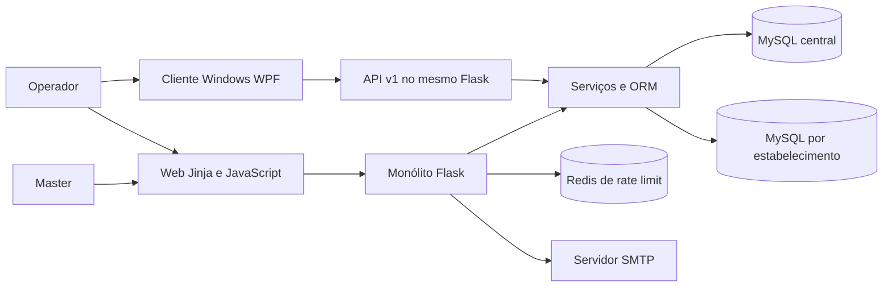

<a id="doc-docs-14-auditoria-arquitetura-md--inventário-tecnológico"></a>

##### Inventário tecnológico

Versões abaixo são declaradas, não versões instaladas em produção. Faixas Python não são lockfiles.

| Tecnologia | Versão declarada | Uso/módulo | Evidência | Situação |
|---|---|---|---|---|
| Python | 3.13 na imagem/CI | servidor e scripts | [Dockerfile](Dockerfile) | Ativa |
| Flask / Werkzeug | >=3,<4 | rotas, servidor, hash de senha | [requirements](requirements.txt), [factory](app/__init__.py) | Ativa |
| Flask-Login | >=0.6,<0.7 | sessão Web | [extensions](app/extensions.py) | Ativa |
| Jinja2 | >=3.1,<4 | HTML server-side | [templates](app/templates) | Ativa |
| SQLAlchemy / Flask-SQLAlchemy | >=2,<3 / >=3.1,<4 | ORM e sessão | [extensions](app/extensions.py) | Ativa |
| PyMySQL / MySQL | >=1.1,<2 / 8.4 | driver e bancos | [config](config.py), [Compose HML](docker-compose.hml.yml) | Ativa |
| SQLite | versão runtime não fixada | testes, legado e migração de dados | [testes](tests/test_routes.py), [script](scripts/migrate_sqlite_to_mysql.py) | Ativa em testes; legada como armazenamento operacional |
| Flask-Migrate / Alembic | >=4.1,<5 / indireta | duas árvores de schema | [migration_service](app/services/migration_service.py) | Ativa / dependência indireta |
| Flask-Limiter / Redis | >=4.1,<5 / 7.4.2-alpine | limites distribuídos | [rate_limit](app/security/rate_limit.py), Compose | Ativa |
| itsdangerous | indireta de Flask | token assinado temporizado; não JWT | [api_auth_service](app/services/api_auth_service.py) | Dependência indireta usada diretamente |
| simplejson | >=3.19,<4 | números Decimal em JSON | [API](app/routes/api/v1.py) | Ativa |
| Gunicorn | >=22,<24 | 1 worker, 4 threads, timeout 120s | Dockerfile | Ativa |
| Bootstrap | 5.3.3 via CDN | componentes Web | [base](app/templates/base.html) | Ativa |
| JavaScript / CSS / HTML | sem toolchain npm | comportamento, estilos e formulários | [static](app/static), templates | Ativa |
| .NET / WPF / C# | net8.0 e net8.0-windows | cliente MVVM | [solução](desktop_wpf/Girofy.Desktop.sln) | Ativa; execução local não validada |
| Microsoft.Extensions.* / DPAPI | 8.0.x | DI, HTTP, logs, sessão protegida | [Infrastructure](desktop_wpf/src/Girofy.Infrastructure/Girofy.Infrastructure.csproj) | Ativa |
| xUnit / Test SDK | 2.9.2 / 17.11.1 | testes Windows | [csproj](desktop_wpf/tests/Girofy.UnitTests/Girofy.UnitTests.csproj) | Ativa |
| unittest | stdlib Python | integração/unitários | [tests](tests) | Ativa |
| Docker Compose / Caddy / Nginx | Compose não fixado / caddy:2 / externo | implantação e gateways | [deploy](deploy), Compose | Configuração ativa; implantação externa não confirmada |
| Inno Setup | 6 no CI | instaladores Windows | [workflow](.github/workflows/build-windows-wpf.yml) | Ativa no pipeline |
| OCI / Ubuntu / GitHub Actions | configuração versionada | VM, runners, CI/CD | [scripts OCI](scripts/oci), [workflows](.github/workflows) | Execução atual não confirmada |

<a id="doc-docs-14-auditoria-arquitetura-md--mapa-de-diretórios"></a>

##### Mapa de diretórios

| Caminho | Responsabilidade |
|---|---|
| `app.py`, `config.py`, `app/__init__.py` | entrada, ambiente e factory; inicializar a factory pode criar/verificar schema e usuários |
| `app/routes` | blueprints HTML: auth, catálogo, operações e importação histórica |
| `app/routes/api/v1.py` | parsers, autorização, handlers e serializadores da API; não é apenas registro de rotas |
| `app/services` | domínio de estoque/vendas/caixa/catálogo; tokens, e-mail, relatórios, auditoria e migrations |
| `app/models` | 24 entidades SQLAlchemy; não há camada Repository separada |
| `app/security`, `permissions.py` | CSRF, senha, rate limit e elevação Web |
| `app/templates`, `app/static` | Jinja, CSS, JS, marca e modelos de importação XLSX |
| `migrations/central`, `migrations/tenant` | árvores Alembic independentes |
| `desktop_wpf/src/Girofy.Application` | Models/DTOs, abstrações, comandos, ViewModels e serviços independentes da interface |
| `desktop_wpf/src/Girofy.Infrastructure` | HTTP, refresh, DPAPI, arquivos, configuração e logs |
| `desktop_wpf/src/Girofy.Desktop` | Views XAML, code-behind, recursos, behaviors, temas, composição por DI |
| `desktop_wpf/tests`, `desktop_wpf/installer` | xUnit e empacotamento Inno Setup/PowerShell |
| `scripts`, `deploy`, `.github/workflows` | operação, backup, migração, provisionamento e CI/CD |
| `docs`, `documentacao` | manuais atuais e marcos históricos; preservar contexto de versão |
| `database`, `backups`, `reports` | dados/artefatos locais; não usar como documentação ou fixture |

<a id="doc-docs-14-auditoria-arquitetura-md--componentes-e-acoplamento"></a>

##### Componentes e acoplamento

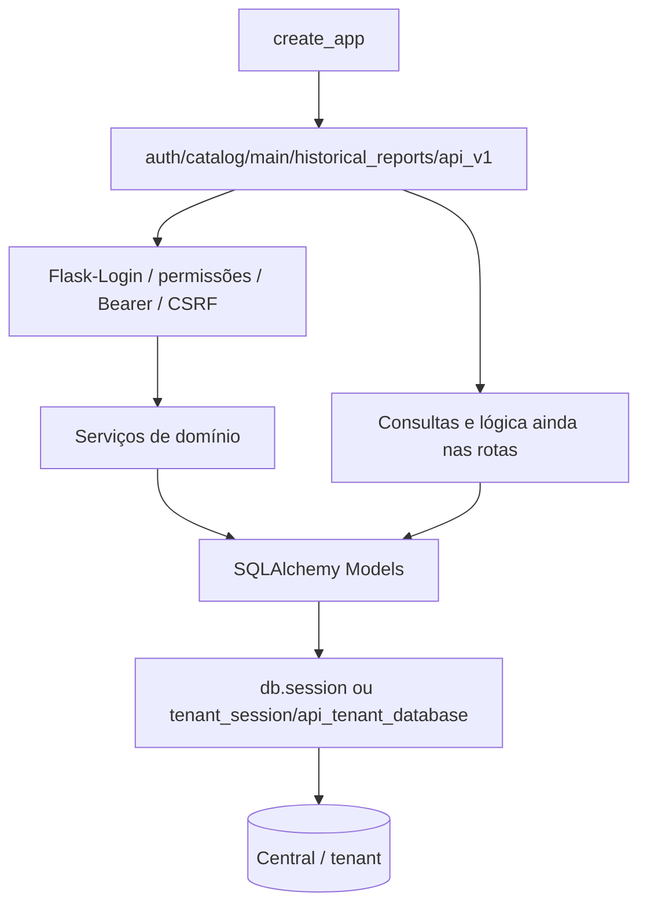

Há serviços compartilhados de vendas, cancelamento, estoque e caixa, mas cadastro/importação Web e API ainda possuem caminhos próprios. Não atribuir paridade a dois fluxos só porque acessam a mesma entidade. Relatórios também duplicam cálculos; há divergências financeiras reproduzidas.

A autenticação usa dados centrais. O contexto tenant Web pode ser selecionado pelo master; a API rejeita empresa de sistema para operações comerciais. `tenant_engine` mantém engines em cache e sincroniza empresa/usuários a cada 300 segundos (ou usuário Web ausente), usando lock em memória por processo. Não há transação distribuída entre central e tenant.

<a id="doc-docs-14-auditoria-arquitetura-md--frontend-web"></a>

##### Frontend Web

Roteamento é Flask; não há SPA nem estado global React. `base.html` define shell/navegação/tema e carrega Bootstrap CDN. `main.js` controla atalhos (F3), carrinho, campos monetários, modais, filtros, abas e consultas de sugestões com `fetch`. Formulários submetem às rotas HTML; flash e redirecionamento informam sucesso/erro. Pesquisa de produtos usa endpoints Web e não necessariamente `/api/v1`.

Preferências visuais são persistidas no `localStorage` (`girofy-theme`, escalas/contraste e sidebar), enquanto autenticação usa cookie Flask-Login. Campos hidden CSRF vêm do helper; não usar token Bearer no browser sem necessidade. CSS responsivo, navegação por teclado e opções de contraste estão presentes; conformidade WCAG completa não foi medida. Textos e moeda são pt-BR; não foi localizado mecanismo completo de tradução por catálogo.

<a id="doc-docs-14-auditoria-arquitetura-md--cliente-windows"></a>

##### Cliente Windows

`App.xaml.cs` registra serviços e ViewModels por DI. `ObservableObject`, `RelayCommand` e `AsyncRelayCommand` formam MVVM próprio. `GirofyApiClient` serializa contratos em `Application/Models`; Views apresentam erros e estado ocupado via ViewModels. Não há banco operacional offline nem fila de vendas offline identificada.

`ApiOptions` usa HTTPS, normaliza domínio legado e limita timeout configurável a 3–60 segundos (padrão 10). `AutomaticSessionRefreshHandler` copia a requisição e repete uma vez após 401, coordenado por `SessionRefreshCoordinator`. `SalesViewModel` preserva chave idempotente na tentativa e a renova ao limpar a venda. A sessão usa DPAPI CurrentUser e troca de arquivo temporário; preferências são JSON. Os nomes Girofy de entropia/protocolo/pastas devem ser preservados até haver migração compatível.

A versão de `Directory.Build.props` é `0.9.18-preview`; não prova artefato instalado, release estável ou versão do backend. C#/.NET não foi executado neste macOS sem SDK.

<a id="doc-docs-14-auditoria-arquitetura-md--histórico-e-decisões"></a>

##### Histórico e decisões

Os documentos datados em agosto/setembro são fotografias históricas. `git log` pode comprovar ordem de commits, mas não datas reais de implantação. O estado desta auditoria está vinculado ao hash local. Uso de monólito, banco por tenant e WPF é observável; motivações comerciais/técnicas que não estão explicitadas em documentos são **inferências**, não ADRs oficiais.

---

<a id="doc-docs-14-auditoria-checklist-md"></a>

### Checklist da auditoria — 14/10/2026

Origem preservada: `docs/14-auditoria/checklist.md`. [Voltar ao sumário](#sumário).

<a id="doc-docs-14-auditoria-checklist-md--checklist-da-auditoria--14102026"></a>

#### Checklist da auditoria — 14/10/2026

Base: `d645260eb92832a504134697f2975ddc32acc489`, branch local `codex/style-stock-view`, com alterações preexistentes preservadas. A data descreve a revisão local, não o deploy.

- [x] Inventariar estrutura, manifestos, modelos, rotas, serviços, templates, WPF, testes e pipelines.
- [x] Ler regras transacionais de venda, estoque e caixa; autenticação e isolamento.
- [x] Confrontar documentação anterior com implementação e identificar divergências de métricas.
- [x] Completar catálogo de rotas e dicionário de dados derivados do código.
- [x] Consolidar módulos, regras, diagramas, infraestrutura e riscos.
- [x] Atualizar navegação e orientações do AGENTS.md sem remover regras existentes.
- [x] Executar testes isolados e reprodução dos achados financeiros.
- [x] Validar links, referências, sintaxe e escopo das alterações documentais.
- [x] Validar sintaxe de 12 blocos com Mermaid 11.17.2 (layout visual não renderizado).
- [ ] Publicar e testar manualmente homologação — fora da autorização desta auditoria (pedido proíbe deploy/alterações remotas).
- [ ] Promover produção/nova versão — depende de autorização explícita posterior ao teste manual em homologação.

Dados reais, dumps, bancos locais, arquivos `.env` e logs preexistentes não são fonte de exemplos e não serão abertos para extração de dados. Inspeção de modelos não comprova schema implantado. Inventário estático não equivale a execução funcional de todas as interfaces.

<a id="doc-docs-14-auditoria-checklist-md--cobertura-que-permanece-parcial"></a>

##### Cobertura que permanece parcial

- [ ] OpenAPI tipada para os 59 handlers API (health formalizado; inventário Markdown completo).
- [ ] Revisão linha a linha de todos os componentes WPF/templates e renderização visual dos diagramas.
- [ ] Ensaios concorrentes MySQL, restore e auditoria de dependências/CVEs.
- [ ] Consolidar todos os documentos históricos sem duplicações; as páginas principais já apontam à revisão atual.

Ver [relatório final](#doc-docs-14-auditoria-relatorio-final-md) para o alcance real, achados e pendências. Não transformar itens pendentes em concluídos com base apenas no inventário automatizado.

---

<a id="doc-docs-14-auditoria-guia-manutencao-md"></a>

### Guia de manutenção para desenvolvedores e agentes

Origem preservada: `docs/14-auditoria/guia-manutencao.md`. [Voltar ao sumário](#sumário).

<a id="doc-docs-14-auditoria-guia-manutencao-md--guia-de-manutenção-para-desenvolvedores-e-agentes"></a>

#### Guia de manutenção para desenvolvedores e agentes

[Índice](#doc-docs-14-auditoria-readme-md)

<a id="doc-docs-14-auditoria-guia-manutencao-md--antes-de-alterar"></a>

##### Antes de alterar

Ler AGENTS.md/RTK.md e conferir `rtk git status`. Este workspace pode conter trabalho de outra sessão; não restaurar nem sobrescrever indiscriminadamente. Identificar branch e diff de partida. Ler módulo, contrato e serviço, não apenas template. A auditoria atual preserva alterações preexistentes; documentação antiga pode conter hash/data de outra revisão.

<a id="doc-docs-14-auditoria-guia-manutencao-md--onde-localizar"></a>

##### Onde localizar

- Regra de venda/cancelamento: `app/services/sale_service.py`; estoque: `stock_service.py`; caixa: `cash_register_service.py`.
- Cadastro Web: `app/routes/catalog.py`; API: `app/routes/api/v1.py` + product/category_service. Não presumir parser compartilhado.
- Relatórios: main.py, API e dashboard_service; consultar FIN-001/002 antes de alterar fórmula.
- Tenant/identidade: tenant.py, auth.py, api_auth_service.py, permissions.py.
- Contrato Windows: Application/Models e Abstractions/IGirofyApiClient, Infrastructure/Api/GirofyApiClient, ViewModel e View XAML correspondentes.
- Schema: models, central/tenant versions, migration_service e testes de migrations.

<a id="doc-docs-14-auditoria-guia-manutencao-md--adicionar-funcionalidade-ou-endpoint"></a>

##### Adicionar funcionalidade ou endpoint

Definir interface/permissão e contrato antes da implementação. Obter empresa do contexto autenticado. API: registrar no blueprint v1, aplicar decorator e guardas específicas, usar parsers existentes, abrir sessão tenant, chamar serviço e tratar commit/rollback. Reutilizar envelope sem converter Decimal para float. Não adicionar campo sensível ao serializador geral. Web: login_required + permission_required quando cabível, CSRF e feedback por flash; redirecionamentos devem ser locais.

No Windows, atualizar DTO, interface, cliente, ViewModel e View; manter estados ocupado/erro/cancelamento e os testes. Operação não idempotente não deve ganhar retries genéricos. Venda usa chave estável para a mesma intenção. Tratar resposta inesperada e não apenas HTTP 200.

<a id="doc-docs-14-auditoria-guia-manutencao-md--alterar-entidade-ou-schema"></a>

##### Alterar entidade ou schema

Modificar o modelo não altera banco implantado. Criar revisão na árvore correta, considerar se metadata ampla exige ambas; conferir unicidade de head. Não reescrever migration já aplicada. Ensaiar criação do zero, upgrade de estado anterior, idempotência e preservação de valores em banco temporário. Fixtures SQLite não substituem ensaio MySQL quando houver DDL/tipos/locks específicos. Produção/HML inicializam em verify, mas há exceções de criação documentadas; execução de factory não é inspeção inócua.

<a id="doc-docs-14-auditoria-guia-manutencao-md--convenções-que-importam"></a>

##### Convenções que importam

Dinheiro Decimal/Numeric e arredondamento central em money.py; timestamps e data do negócio em time_utils; erro de domínio com code/status/field; escopo company_id; auditoria na mesma unidade de trabalho quando possível; preserve nomes/protocolo Girofy para compatibilidade até migração explícita. C# usa nullable, warnings como erros e MVVM próprio. Recursos de tema XAML usam DynamicResource; Run.Text binding deve explicitar OneWay conforme pipeline.

<a id="doc-docs-14-auditoria-guia-manutencao-md--validação-e-entrega"></a>

##### Validação e entrega

Executar testes direcionados e suíte apropriada no ambiente isolado. Nunca usar `TESTING=1` para tentar tornar seguro um comando que ainda aponta a banco real: configure base e URI locais antes de importar. Atualizar módulo, catálogo de regra, endpoints, DTOs, dicionário/migration e riscos quando mudarem. Validar links e diagramas; indicar claramente testes que não foram executados.

Não iniciar scripts de deploy/provisionamento/cleanup em auditoria. Para implementação autorizada, publicar primeiro develop/HML, testar manualmente, registrar resultado e só então pedir autorização de produção. Não gerar release por iniciativa antes desse gate.

---

<a id="doc-docs-14-auditoria-inventario-arquivos-md"></a>

### Inventário de implementação

Origem preservada: `docs/14-auditoria/inventario-arquivos.md`. [Voltar ao sumário](#sumário).

<a id="doc-docs-14-auditoria-inventario-arquivos-md--inventário-de-implementação"></a>

#### Inventário de implementação

[Índice](#doc-docs-14-auditoria-readme-md)

Levantamento recursivo respeitando arquivos ignorados. Hash SHA-256 abreviado identifica o conteúdo lido, sem copiar dados pessoais. Assets binários são inventariados por diretório na arquitetura; bancos, dumps e relatórios locais foram deliberadamente excluídos. Enumeração não significa revisão linha a linha de cada arquivo.

| Arquivo | Linhas | Símbolos de nível superior/tipo | SHA-256 (16 caracteres) |
| --- | --- | --- | --- |
| [.github/workflows/build-windows-wpf.yml](.github/workflows/build-windows-wpf.yml) | 268 | .yml | 86545ca2242aa741 |
| [.github/workflows/deploy-hml-oci.yml](.github/workflows/deploy-hml-oci.yml) | 179 | .yml | 7b2efe058dd47744 |
| [.github/workflows/deploy-oci-self-hosted.yml](.github/workflows/deploy-oci-self-hosted.yml) | 175 | .yml | 94c974bca72f0f1e |
| [.github/workflows/deploy-oci.yml](.github/workflows/deploy-oci.yml) | 96 | .yml | 9dc7cbefe3fcd3e5 |
| [.github/workflows/reset-production-password.yml](.github/workflows/reset-production-password.yml) | 68 | .yml | 0fdc5d205ef619ed |
| [Dockerfile](Dockerfile) | 22 |  | 9a613016e67d5e6a |
| [app.py](app.py) | 11 | .py | 4af8c4e93822e893 |
| [app/__init__.py](app/__init__.py) | 805 | ensure_mysql_database_exists, ensure_product_kit_columns, ensure_product_stock_columns, ensure_sale_discount_columns, ensure_sale_cancellation_columns, ensure_sale_item_profit_columns, ensure_user_profile_columns, ensure_user_permission_columns, ensure_user_email_security_columns, ensure_company_columns, ensure_company_subscription_columns, ensure_company_card_fee_columns, ensure_company_operation_columns, ensure_company_backup_columns, create_app | 9ca0e7258aac4acb |
| [app/backup.py](app/backup.py) | 132 | backup_frequency_label, backup_due, sql_value, create_statement, build_database_dump, create_company_backup | 1da681964d26dfb8 |
| [app/error_logging.py](app/error_logging.py) | 200 | SecurityEventFilter, EnvironmentFilter, _safe_value, _redact_mapping, error_context, _json_context, log_http_error, _log_unhandled_exception, setup_error_logging | 618798601d460073 |
| [app/extensions.py](app/extensions.py) | 15 | .py | b6f35cd5fa4d1570 |
| [app/models/__init__.py](app/models/__init__.py) | 22 | .py | ae0372d080c646af |
| [app/models/activation_key.py](app/models/activation_key.py) | 25 | ActivationKey | 07669283ef75a725 |
| [app/models/api_refresh_token.py](app/models/api_refresh_token.py) | 39 | utc_now_naive, ApiRefreshToken | b9c831ead3505686 |
| [app/models/api_sale_request.py](app/models/api_sale_request.py) | 21 | ApiSaleRequest | 47c1424f8a6af837 |
| [app/models/app_registration_code.py](app/models/app_registration_code.py) | 27 | utc_now_naive, AppRegistrationCode | c89efc325f116913 |
| [app/models/audit_log.py](app/models/audit_log.py) | 37 | AuditLog | 09a6148b7ecf2d79 |
| [app/models/cash_register.py](app/models/cash_register.py) | 18 | CashRegister | 2ab77021bb4311d0 |
| [app/models/category.py](app/models/category.py) | 13 | Category | 04bfc1607ba6cb66 |
| [app/models/company.py](app/models/company.py) | 48 | Company | 789a9783c9e3572d |
| [app/models/email_alert_delivery.py](app/models/email_alert_delivery.py) | 17 | EmailAlertDelivery | 88a857bec697db47 |
| [app/models/email_alert_setting.py](app/models/email_alert_setting.py) | 23 | EmailAlertSetting | e7fca851409557af |
| [app/models/email_change_request.py](app/models/email_change_request.py) | 20 | EmailChangeRequest | 019b2ae2781280a5 |
| [app/models/email_verification_code.py](app/models/email_verification_code.py) | 18 | EmailVerificationCode | 9261c5da8dcd45b0 |
| [app/models/historical_report.py](app/models/historical_report.py) | 63 | HistoricalReportImportBatch, HistoricalDailyReport | 020e382f4acd07e1 |
| [app/models/notification.py](app/models/notification.py) | 67 | Notification, NotificationPreference | f34b2b2682712721 |
| [app/models/password_reset_token.py](app/models/password_reset_token.py) | 17 | PasswordResetToken | 91c8e5d262c25b9e |
| [app/models/payable.py](app/models/payable.py) | 20 | Payable | 16a1f768899f4667 |
| [app/models/payment.py](app/models/payment.py) | 13 | Payment | 8d44f8868e1414ac |
| [app/models/product.py](app/models/product.py) | 55 | Product | 0113de41807e9113 |
| [app/models/sale.py](app/models/sale.py) | 33 | Sale | 6759e4d809f70c38 |
| [app/models/sale_item.py](app/models/sale_item.py) | 18 | SaleItem | fa6e203cab6b0f48 |
| [app/models/stock_movement.py](app/models/stock_movement.py) | 27 | StockMovement | f47bfff3487ae50e |
| [app/models/user.py](app/models/user.py) | 95 | User | 4eda0a6610f78ccb |
| [app/money.py](app/money.py) | 78 | decimal_value, money_decimal, percent_decimal, _normalized_money_decimal, parse_money_decimal, money_json, format_brl | 8ae7321da0fc2dd4 |
| [app/permissions.py](app/permissions.py) | 122 | user_can_override_permission, authorize_permission_override, authorize_role_override, needs_permission_override, permission_view_overrides, has_permission_view_override, grant_permission_view_override, permission_required | ed278b2c1a7ca4a5 |
| [app/routes/__init__.py](app/routes/__init__.py) | 4 | .py | a8891672227cbcf4 |
| [app/routes/api/__init__.py](app/routes/api/__init__.py) | 2 | .py | b099c45cdfda6536 |
| [app/routes/api/v1.py](app/routes/api/v1.py) | 5030 | api_success, api_failure, api_auth_error_response, available_activation_key, apply_activation_key_to_company, json_object_body, bearer_access_token, api_auth_required, api_permission_required, api_tenant_database, positive_integer_argument, json_positive_integer, json_money, json_optional_money, optional_money_argument, json_text, json_optional_positive_integer, json_non_negative_integer, json_integer, parse_report_date_argument, parse_optional_query_date_argument, json_required_date, api_report_period_range, api_sale_item_profit, api_serialize_sale_receipt, api_build_sales_report, api_merge_historical_sales_report, api_product_report_sort_options, api_build_product_report, api_build_sales_chart, json_bool, product_input_from_payload, category_input_from_payload, sale_idempotency_key, sale_line_inputs, sale_payment_inputs, catalog_category_data, catalog_product_data, stock_movement_data, stock_filter_options, payable_status_value, payable_data, payable_filter_options, payable_snapshot, health_check, api_dependency_health_check, api_version_health_check, api_login, api_exchange_registration_callback, api_request_password_recovery, api_activate_subscription, api_refresh, api_logout, api_me, api_settings_payload, normalize_digits, api_can_manage_team, api_require_team_permission, api_require_settings_permission, api_can_export_data, api_can_import_products, api_require_export_permission, api_require_product_import_permission, format_export_datetime, format_export_date, format_export_money, api_sale_profit_amount, api_cash_register_total_sold, api_cash_register_profit_amount, api_export_products_rows, api_export_sales_rows, api_export_cash_register_rows, api_export_payables_rows, api_csv_export_response, api_import_parse_money, api_import_parse_int, api_import_normalize_header, api_import_column, api_read_csv_import_rows, api_xlsx_column_index, api_read_xlsx_import_rows, api_read_product_import_rows, api_find_or_create_import_category, api_product_import_audit_values, api_find_import_product, api_import_products_from_rows, api_role_options, api_permission_options, api_employee_data, company_cpf_exists_api, apply_role_permissions_api, json_employee_role, validate_employee_email, api_settings_account, api_json_fee_percent, api_update_company_settings, api_update_profile, api_update_password, api_update_backup_settings, api_run_manual_backup, api_export_settings_data, api_import_settings_products, api_settings_team, api_create_employee, api_update_employee, api_dashboard_summary, api_reports_summary, api_reports_products, audit_log_data, audit_filter_options, audit_user_options, api_audit_logs, api_tenant_payable_or_error, api_payables, api_payable_categories, api_create_payable, api_pay_payable, api_reopen_payable, api_cash_register_summary, api_cash_register_detail_data, api_cash_register_detail, api_open_cash_register, api_close_cash_register, api_create_sale, api_sale_detail, api_cancel_sale, api_today_sales, api_catalog_categories, api_create_catalog_category, api_update_catalog_category, api_delete_catalog_category, api_catalog_products, api_create_catalog_product, api_update_catalog_product, api_delete_catalog_product, api_stock_movements, api_create_stock_entry, api_create_stock_adjustment, notification_preference_data, email_alert_setting_data, api_email_alert_settings, api_update_email_alert_settings, api_test_email_alert_settings, api_notifications, api_notifications_unread_count, api_notification_read, api_notifications_read_all, api_notification_dismiss, api_notification_preferences, api_update_notification_preferences | 1ea47c1fa24398b6 |
| [app/routes/auth.py](app/routes/auth.py) | 2492 | _normalized_deletion_confirmation, parse_date_field, parse_percent, password_min_length, password_too_short, password_validation_messages, password_first_error, valid_email, utc_now, generate_verification_code, verification_user_from_session, remember_verification_user, clear_verification_user, create_email_verification_code, active_verification_code_for_user, public_url_for, request_email_change, normalize_digits, generate_activation_key, generate_unique_activation_key, available_activation_key, apply_activation_key_to_company, renewal_date_from_request, apply_subscription_to_company, activation_key_status, read_recent_error_logs, clear_error_log_file, can_manage_company_users, can_view_admin_settings, can_view_finance_settings, can_import_products_settings, can_export_data_settings, apply_employee_permissions, company_cpf_exists, subscription_status, company_requires_activation, company_uses_key_license, current_basic_pro_plan, login_form_values, register_form_values, pending_registration_matches, resume_pending_registration, render_auth_form, rotate_browser_session_before_login, register, login, verify_email, resend_verification_code, forgot_password, reset_password, confirm_email_change, logout, permission_unlock, subscription_activation, subscriptions, master_required, master_companies, master_dashboard, master_users, delete_master_user, master_subscriptions, master_logs, clear_master_logs, generate_master_activation_key, renew_master_subscription, cancel_master_activation_key, clear_master_activation_key_history, renew_master_activation_key, edit_master_activation_key, edit_company, access_company, leave_company_access, toggle_company_status, delete_company, settings, import_template_download | 164912683fcf9d76 |
| [app/routes/catalog.py](app/routes/catalog.py) | 979 | tenant_query, tenant_get_or_404, product_barcode_exists, kit_component_is_valid, category_name_exists, is_duplicate_error, current_company_categories_query, can_import_products, import_redirect_target, parse_money, parse_optional_money, parse_int, normalize_header, import_column, read_csv_rows, xlsx_column_index, read_xlsx_rows, read_import_rows, find_or_create_category, product_audit_values, import_products_from_rows, populate_product, products, import_products, kit_product_suggestions, new_product, edit_product, quick_update_product, dismiss_low_stock_notification, toggle_product, delete_product, categories, update_category, delete_category | 6210a36b352bf23a |
| [app/routes/historical_reports.py](app/routes/historical_reports.py) | 174 | _ensure_available, _preview_directory, _batches, index, download_template, preview, confirm, error_report | 385c9f03e770e773 |
| [app/routes/main.py](app/routes/main.py) | 2099 | health_check, dependency_health_check, version_health_check, parse_money, format_brl, safe_local_redirect, payable_status, payable_status_label, can_export_data, can_view_cash_financials, csv_response, export_products_rows, export_sales_rows, export_cash_register_rows, export_payables_rows, parse_quantity, parse_signed_quantity, parse_date, sale_form_state, sale_form_products, open_cash_register, tenant_query, tenant_get_or_404, product_name_map, user_name_map, audit_json_lines, audit_field_label, audit_value_items, apply_date_filters, tenant_actor_user_id, tenant_actor, sale_item_profit, sale_profit, cash_register_profit, cash_register_total_sold, cash_register_expected_amount, payment_summary_text, build_sale_timeline, build_cash_register_snapshot, subtract_calendar_months, report_period_range, build_sales_report, merge_historical_report_totals, _chart_bucket_start, _next_chart_bucket, _chart_bucket_end, _chart_bucket_label, _chart_bucket_title, build_sales_chart, build_daily_sales_activity, cash_register_peak_hours, build_product_report, home, dashboard, sales, stock_movements, stock_entry, stock_adjustment, audit_logs, master_audit_logs, export_data, payables, pay_payable, reopen_payable, reports, product_search_api, new_sale, sale_detail, cancel_sale_route, cash_register, cash_register_detail, open_cash_register_route, close_cash_register_route | c655230de2b61fe4 |
| [app/schema.py](app/schema.py) | 74 | quote_identifier, existing_index_names, ensure_performance_indexes | e535045481c5293a |
| [app/security/__init__.py](app/security/__init__.py) | 1 | .py | d441507b021f015b |
| [app/security/csrf.py](app/security/csrf.py) | 76 | CSRFError, csrf_enabled, csrf_token, request_csrf_token, validate_csrf_request, init_csrf | 38e1bccdd7c9e2a1 |
| [app/security/passwords.py](app/security/passwords.py) | 36 | validate_password_strength | e7f981c046d94419 |
| [app/security/rate_limit.py](app/security/rate_limit.py) | 213 | trusted_request_ip, _digest, request_identifier, anonymous_identity_key, login_identity_key, token_identity_key, api_identity_key, authenticated_identity_key, default_rate_limit_key, configured_limit, _is_api_request, _retry_after, _retry_after_label, log_rate_limit_event, rate_limit_error_response, rate_limit_storage_error_response, redis_health_status, init_rate_limit_errors | 5a87a91a0c717f20 |
| [app/services/__init__.py](app/services/__init__.py) | 1 | .py | 01ba4719c80b6fe9 |
| [app/services/alert_service.py](app/services/alert_service.py) | 174 | claim_email_alert_check, parse_recipients, default_alert_recipients, ensure_email_alert_settings, alert_settings_for_company, send_configured_email_alert, enqueue_configured_email_alert | 715a363db670622c |
| [app/services/api_auth_service.py](app/services/api_auth_service.py) | 400 | utc_now_naive, ApiAuthError, AuthenticatedApiUser, access_token_lifetime_seconds, refresh_token_lifetime_days, request_uses_secure_transport, require_secure_auth_transport, _request_ip_address, clear_api_login_attempts, _find_user, _validate_user_access, authenticate_credentials, authenticate_credentials_for_activation, _credential_hash, _refresh_token_hash, _access_serializer, _access_payload, _new_refresh_token, issue_token_pair, _parse_refresh_token, _active_refresh_session, rotate_refresh_token, authenticate_access_token, revoke_session, user_permissions, user_identity_data | 8b3ae16bfdd78912 |
| [app/services/app_registration_service.py](app/services/app_registration_service.py) | 59 | _now, valid_callback_request, create_registration_code, exchange_registration_code | f35698d1e902f55d |
| [app/services/audit_service.py](app/services/audit_service.py) | 219 | mask_sensitive_value, json_default, sanitize_payload, serialize_payload, changed_values, request_ip_address, record_audit_event, audit_action_label, entity_label | 7a7d866ef3754ea4 |
| [app/services/cash_register_service.py](app/services/cash_register_service.py) | 343 | CashRegisterOperationError, money_value, money_text, timestamp_value, lock_company_scope, find_open_cash_register, cash_register_expected_amount, open_cash_register, close_cash_register, build_cash_register_snapshot | d951a93850929b03 |
| [app/services/category_service.py](app/services/category_service.py) | 175 | CategoryOperationError, CategoryInput, category_audit_values, create_category, update_category, delete_category, category_product_count, validate_category_input | 0ffcbf30147adcc8 |
| [app/services/dashboard_service.py](app/services/dashboard_service.py) | 549 | _shift_month, resolve_dashboard_period, _change_percent, _money, _item_profit_expression, _period_filters, _sales_totals, _sales_profit, _payment_totals, _top_products, _category_sales, _revenue_series, _low_stock, _recent_sales, _current_cash, _upcoming_payables, build_dashboard_snapshot | 446f4fdd99c0dfda |
| [app/services/email_service.py](app/services/email_service.py) | 125 | EmailAuthenticationError, configured_sender, render_email_template, send_email, send_bulk_email, send_verification_code_email, send_password_reset_email, send_email_change_confirmation, send_alert_email | 5e4c0e4407c03128 |
| [app/services/historical_report_import_service.py](app/services/historical_report_import_service.py) | 429 | HistoricalImportError, _column_index, _cell_text, _xlsx_rows, _csv_rows, _parse_date, _parse_decimal, _parse_count, _serialize_row, deserialize_row, preview_historical_import, import_preview_rows, save_preview, load_preview | 0ef7dc3916f6dd7b |
| [app/services/migration_service.py](app/services/migration_service.py) | 162 | MigrationError, MigrationResult, migration_config, migration_head, current_revision, database_label, existing_business_tables, validate_baseline_schema, validate_current_schema, database_revision, upgrade_database, assert_database_at_head | 63fb9c4f3ff4f718 |
| [app/services/notification_service.py](app/services/notification_service.py) | 376 | utcnow, safe_text, safe_metadata, notification_data, preference_for, preference_allows, create_notification, visible_query, get_user_notifications, get_unread_count, find_visible_notification, mark_as_read, mark_all_as_read, dismiss_notification, resolve_notification, _resolve_other_entity_notifications, sync_operational_notifications | 4154bc7983d8fcef |
| [app/services/password_recovery_service.py](app/services/password_recovery_service.py) | 52 | _public_reset_url, request_password_recovery | a9546ea118aa5b3d |
| [app/services/product_service.py](app/services/product_service.py) | 316 | ProductOperationError, ProductInput, normalize_product_barcode, product_audit_values, create_product, update_product, delete_product, validate_product_input | 4444a655795dcc06 |
| [app/services/sale_service.py](app/services/sale_service.py) | 605 | SaleOperationError, SaleLineInput, SalePaymentInput, SaleCreationResult, SaleCancellationResult, money_value, timestamp_value, stock_source_for_product, card_fee_total, find_sale_request, find_completed_sale_request, create_sale, cancel_sale, serialize_sale_result | 9c0512fbd9faa4e7 |
| [app/services/stock_service.py](app/services/stock_service.py) | 337 | StockMovementError, decimal_money, stock_movement_label, stock_source_label, audit_action_for_movement, lock_product, register_stock_movement, increase_stock, decrease_stock, adjust_stock | d29d9b963ef6a8ba |
| [app/static/css/home.css](app/static/css/home.css) | 20 | .css | 1908cfc94dc3688a |
| [app/static/css/style.css](app/static/css/style.css) | 10435 | .css | 8b9dcfff858a3782 |
| [app/static/js/home.js](app/static/js/home.js) | 92 | .js | 21a4f4f820d5f14e |
| [app/static/js/main.js](app/static/js/main.js) | 3152 | .js | ccd719a0871fb836 |
| [app/tenant.py](app/tenant.py) | 379 | slugify, mysql_database_name, tenant_database_identifier, mysql_tenant_url, create_mysql_database_if_needed, is_concurrent_ddl_error, run_with_concurrent_ddl_retry, drop_mysql_database, sync_tenant_reference_data, tenant_reference_sync_lock, current_user_missing_from_tenant, ensure_tenant_reference_data, tenant_engine, current_tenant_company, tenant_session, close_tenant_session | 6086f0c115c63669 |
| [app/time_utils.py](app/time_utils.py) | 50 | business_timezone, as_utc, utc_isoformat, to_business_datetime, business_today, business_date_range_utc | b2ee31a4266da995 |
| [config.py](config.py) | 157 | runtime_base_dir, load_env_file, env_bool, mysql_database_url, Config | b1c06d95be664d3c |
| [deploy/Caddyfile](deploy/Caddyfile) | 4 |  | aace745bf7e4b6d8 |
| [deploy/Caddyfile.hml](deploy/Caddyfile.hml) | 4 | .hml | a0133e8019852e2b |
| [deploy/mysql/init/01-grants.sh](deploy/mysql/init/01-grants.sh) | 15 | .sh | 0af24f932af24d49 |
| [desktop_wpf/Directory.Build.props](desktop_wpf/Directory.Build.props) | 14 | .props | 41e9926546f34185 |
| [desktop_wpf/installer/GiroFy.iss](desktop_wpf/installer/GiroFy.iss) | 87 | .iss | 39df8087357beb5e |
| [desktop_wpf/installer/build-installer.ps1](desktop_wpf/installer/build-installer.ps1) | 106 | .ps1 | 08414f6756e67362 |
| [desktop_wpf/installer/test-installer.ps1](desktop_wpf/installer/test-installer.ps1) | 157 | .ps1 | 84b4d478499e8e00 |
| [desktop_wpf/src/Girofy.Application/Abstractions/IAccessibilityService.cs](desktop_wpf/src/Girofy.Application/Abstractions/IAccessibilityService.cs) | 18 | .cs | 6d50ca26de39c17b |
| [desktop_wpf/src/Girofy.Application/Abstractions/IAppSessionContext.cs](desktop_wpf/src/Girofy.Application/Abstractions/IAppSessionContext.cs) | 14 | .cs | 0e00c90d55fed2ea |
| [desktop_wpf/src/Girofy.Application/Abstractions/IExternalBrowserService.cs](desktop_wpf/src/Girofy.Application/Abstractions/IExternalBrowserService.cs) | 20 | .cs | 7da4660aab007ada |
| [desktop_wpf/src/Girofy.Application/Abstractions/IFilePickerService.cs](desktop_wpf/src/Girofy.Application/Abstractions/IFilePickerService.cs) | 24 | .cs | 6cf49aa4d8910549 |
| [desktop_wpf/src/Girofy.Application/Abstractions/IFileSaveService.cs](desktop_wpf/src/Girofy.Application/Abstractions/IFileSaveService.cs) | 10 | .cs | 7a1e2ae475fc1ac2 |
| [desktop_wpf/src/Girofy.Application/Abstractions/IGirofyApiClient.cs](desktop_wpf/src/Girofy.Application/Abstractions/IGirofyApiClient.cs) | 334 | .cs | dace18386123121e |
| [desktop_wpf/src/Girofy.Application/Abstractions/IPasswordRecoveryService.cs](desktop_wpf/src/Girofy.Application/Abstractions/IPasswordRecoveryService.cs) | 6 | .cs | 1d0330b5082ee18b |
| [desktop_wpf/src/Girofy.Application/Abstractions/IRegistrationHandoffStore.cs](desktop_wpf/src/Girofy.Application/Abstractions/IRegistrationHandoffStore.cs) | 10 | .cs | 8c0a26a6ca973d46 |
| [desktop_wpf/src/Girofy.Application/Abstractions/ISecureSessionStore.cs](desktop_wpf/src/Girofy.Application/Abstractions/ISecureSessionStore.cs) | 12 | .cs | 99558181b732cc71 |
| [desktop_wpf/src/Girofy.Application/Abstractions/IThemeService.cs](desktop_wpf/src/Girofy.Application/Abstractions/IThemeService.cs) | 16 | .cs | f0b6fbe6cb016737 |
| [desktop_wpf/src/Girofy.Application/Abstractions/IUserPreferencesStore.cs](desktop_wpf/src/Girofy.Application/Abstractions/IUserPreferencesStore.cs) | 10 | .cs | 32ebfc0628ac6786 |
| [desktop_wpf/src/Girofy.Application/Exceptions/GirofyApiException.cs](desktop_wpf/src/Girofy.Application/Exceptions/GirofyApiException.cs) | 11 | .cs | 0bf6a3201c7af908 |
| [desktop_wpf/src/Girofy.Application/Formatting/BrazilianMoneyFormatter.cs](desktop_wpf/src/Girofy.Application/Formatting/BrazilianMoneyFormatter.cs) | 80 | .cs | 07703e29690a0dc3 |
| [desktop_wpf/src/Girofy.Application/Girofy.Application.csproj](desktop_wpf/src/Girofy.Application/Girofy.Application.csproj) | 5 | .csproj | e44c6aa5d69d0526 |
| [desktop_wpf/src/Girofy.Application/Models/ApiEnvelope.cs](desktop_wpf/src/Girofy.Application/Models/ApiEnvelope.cs) | 30 | .cs | 76bd1cfc7993b27a |
| [desktop_wpf/src/Girofy.Application/Models/AuditModels.cs](desktop_wpf/src/Girofy.Application/Models/AuditModels.cs) | 153 | .cs | f22656a85ead9b9a |
| [desktop_wpf/src/Girofy.Application/Models/AuthSession.cs](desktop_wpf/src/Girofy.Application/Models/AuthSession.cs) | 111 | .cs | 151c0200e2da1240 |
| [desktop_wpf/src/Girofy.Application/Models/BrazilianDateFormatting.cs](desktop_wpf/src/Girofy.Application/Models/BrazilianDateFormatting.cs) | 94 | .cs | d62ba4dd4d43239a |
| [desktop_wpf/src/Girofy.Application/Models/CashRegisterModels.cs](desktop_wpf/src/Girofy.Application/Models/CashRegisterModels.cs) | 250 | .cs | f8ee72dab7226b00 |
| [desktop_wpf/src/Girofy.Application/Models/CatalogModels.cs](desktop_wpf/src/Girofy.Application/Models/CatalogModels.cs) | 162 | .cs | 0a209d2a80443514 |
| [desktop_wpf/src/Girofy.Application/Models/DashboardModels.cs](desktop_wpf/src/Girofy.Application/Models/DashboardModels.cs) | 333 | .cs | 694ac0f73c3ff766 |
| [desktop_wpf/src/Girofy.Application/Models/HealthStatus.cs](desktop_wpf/src/Girofy.Application/Models/HealthStatus.cs) | 15 | .cs | 157dda54ddf25a10 |
| [desktop_wpf/src/Girofy.Application/Models/NotificationModels.cs](desktop_wpf/src/Girofy.Application/Models/NotificationModels.cs) | 105 | .cs | 5548ceee439a1098 |
| [desktop_wpf/src/Girofy.Application/Models/PayableModels.cs](desktop_wpf/src/Girofy.Application/Models/PayableModels.cs) | 129 | .cs | 470de8fc55c17d35 |
| [desktop_wpf/src/Girofy.Application/Models/RegistrationCallbackModels.cs](desktop_wpf/src/Girofy.Application/Models/RegistrationCallbackModels.cs) | 14 | .cs | 93e06a9014c85f93 |
| [desktop_wpf/src/Girofy.Application/Models/ReportModels.cs](desktop_wpf/src/Girofy.Application/Models/ReportModels.cs) | 393 | .cs | 40d905d19cbbedb9 |
| [desktop_wpf/src/Girofy.Application/Models/SaleModels.cs](desktop_wpf/src/Girofy.Application/Models/SaleModels.cs) | 147 | .cs | 072fe64552edcdd5 |
| [desktop_wpf/src/Girofy.Application/Models/SettingsModels.cs](desktop_wpf/src/Girofy.Application/Models/SettingsModels.cs) | 292 | .cs | 250f7f0955e77702 |
| [desktop_wpf/src/Girofy.Application/Models/StockModels.cs](desktop_wpf/src/Girofy.Application/Models/StockModels.cs) | 220 | .cs | 3a85390e8aa31e51 |
| [desktop_wpf/src/Girofy.Application/Models/UserPreferences.cs](desktop_wpf/src/Girofy.Application/Models/UserPreferences.cs) | 25 | .cs | d80ed4484dde5e82 |
| [desktop_wpf/src/Girofy.Application/Mvvm/AsyncRelayCommand.cs](desktop_wpf/src/Girofy.Application/Mvvm/AsyncRelayCommand.cs) | 45 | .cs | dd8ae56916ca15eb |
| [desktop_wpf/src/Girofy.Application/Mvvm/ObservableObject.cs](desktop_wpf/src/Girofy.Application/Mvvm/ObservableObject.cs) | 24 | .cs | f4937c74d544478c |
| [desktop_wpf/src/Girofy.Application/Mvvm/RelayCommand.cs](desktop_wpf/src/Girofy.Application/Mvvm/RelayCommand.cs) | 32 | .cs | 62ab18ea29ff0960 |
| [desktop_wpf/src/Girofy.Application/Services/AccessibilityService.cs](desktop_wpf/src/Girofy.Application/Services/AccessibilityService.cs) | 60 | .cs | 4a8a4f5ce4015386 |
| [desktop_wpf/src/Girofy.Application/Services/AppSessionContext.cs](desktop_wpf/src/Girofy.Application/Services/AppSessionContext.cs) | 23 | .cs | c71524792af8155e |
| [desktop_wpf/src/Girofy.Application/Services/BarcodeScannerInputService.cs](desktop_wpf/src/Girofy.Application/Services/BarcodeScannerInputService.cs) | 64 | .cs | 25c6ece57829965b |
| [desktop_wpf/src/Girofy.Application/ViewModels/AuditViewModel.cs](desktop_wpf/src/Girofy.Application/ViewModels/AuditViewModel.cs) | 408 | .cs | a3ec8bbd54585452 |
| [desktop_wpf/src/Girofy.Application/ViewModels/CashRegisterTimelineSaleViewModel.cs](desktop_wpf/src/Girofy.Application/ViewModels/CashRegisterTimelineSaleViewModel.cs) | 205 | .cs | e5820e6c7698c8c9 |
| [desktop_wpf/src/Girofy.Application/ViewModels/CashRegisterViewModel.cs](desktop_wpf/src/Girofy.Application/ViewModels/CashRegisterViewModel.cs) | 606 | .cs | c2bfcb7fce586185 |
| [desktop_wpf/src/Girofy.Application/ViewModels/CatalogViewModel.cs](desktop_wpf/src/Girofy.Application/ViewModels/CatalogViewModel.cs) | 1699 | .cs | be539c6206660a33 |
| [desktop_wpf/src/Girofy.Application/ViewModels/ConnectionViewModel.cs](desktop_wpf/src/Girofy.Application/ViewModels/ConnectionViewModel.cs) | 390 | .cs | e5ab19bb3147702a |
| [desktop_wpf/src/Girofy.Application/ViewModels/DashboardViewModel.cs](desktop_wpf/src/Girofy.Application/ViewModels/DashboardViewModel.cs) | 182 | .cs | f3905a7e8db2c3f2 |
| [desktop_wpf/src/Girofy.Application/ViewModels/EmailAlertSettingViewModel.cs](desktop_wpf/src/Girofy.Application/ViewModels/EmailAlertSettingViewModel.cs) | 74 | .cs | c431f73db3465c76 |
| [desktop_wpf/src/Girofy.Application/ViewModels/ForgotPasswordViewModel.cs](desktop_wpf/src/Girofy.Application/ViewModels/ForgotPasswordViewModel.cs) | 135 | .cs | d3f5ab8c63d2fbac |
| [desktop_wpf/src/Girofy.Application/ViewModels/LoginViewModel.cs](desktop_wpf/src/Girofy.Application/ViewModels/LoginViewModel.cs) | 527 | .cs | 800a85cf7feeea48 |
| [desktop_wpf/src/Girofy.Application/ViewModels/NotificationsViewModel.cs](desktop_wpf/src/Girofy.Application/ViewModels/NotificationsViewModel.cs) | 178 | .cs | d797ebf991b6d25d |
| [desktop_wpf/src/Girofy.Application/ViewModels/PayablesViewModel.cs](desktop_wpf/src/Girofy.Application/ViewModels/PayablesViewModel.cs) | 718 | .cs | 276413e62563b01d |
| [desktop_wpf/src/Girofy.Application/ViewModels/ReportsViewModel.cs](desktop_wpf/src/Girofy.Application/ViewModels/ReportsViewModel.cs) | 548 | .cs | 18354b1524d480e9 |
| [desktop_wpf/src/Girofy.Application/ViewModels/SalesViewModel.cs](desktop_wpf/src/Girofy.Application/ViewModels/SalesViewModel.cs) | 1933 | .cs | b27368c80b35a21f |
| [desktop_wpf/src/Girofy.Application/ViewModels/SettingsViewModel.cs](desktop_wpf/src/Girofy.Application/ViewModels/SettingsViewModel.cs) | 1769 | .cs | f73b1bffe7969600 |
| [desktop_wpf/src/Girofy.Application/ViewModels/StockViewModel.cs](desktop_wpf/src/Girofy.Application/ViewModels/StockViewModel.cs) | 874 | .cs | dfdc86da6b3bc370 |
| [desktop_wpf/src/Girofy.Desktop/App.xaml](desktop_wpf/src/Girofy.Desktop/App.xaml) | 11 | .xaml | e1651c23ac3a8b6f |
| [desktop_wpf/src/Girofy.Desktop/App.xaml.cs](desktop_wpf/src/Girofy.Desktop/App.xaml.cs) | 368 | .cs | 0c8fdb6430bb0b58 |
| [desktop_wpf/src/Girofy.Desktop/Behaviors/BrazilianDateInputBehavior.cs](desktop_wpf/src/Girofy.Desktop/Behaviors/BrazilianDateInputBehavior.cs) | 116 | .cs | 6411706f3f03a015 |
| [desktop_wpf/src/Girofy.Desktop/Behaviors/EnterCommandBehavior.cs](desktop_wpf/src/Girofy.Desktop/Behaviors/EnterCommandBehavior.cs) | 112 | .cs | 99794691a82301f1 |
| [desktop_wpf/src/Girofy.Desktop/Behaviors/IntegerInputBehavior.cs](desktop_wpf/src/Girofy.Desktop/Behaviors/IntegerInputBehavior.cs) | 53 | .cs | 8438890df2ec492c |
| [desktop_wpf/src/Girofy.Desktop/Behaviors/MoneyInputBehavior.cs](desktop_wpf/src/Girofy.Desktop/Behaviors/MoneyInputBehavior.cs) | 123 | .cs | 32f492ec7c95992e |
| [desktop_wpf/src/Girofy.Desktop/Controls/DashboardCharts.cs](desktop_wpf/src/Girofy.Desktop/Controls/DashboardCharts.cs) | 392 | .cs | 69ee15d622a873fb |
| [desktop_wpf/src/Girofy.Desktop/Girofy.Desktop.csproj](desktop_wpf/src/Girofy.Desktop/Girofy.Desktop.csproj) | 37 | .csproj | fe9cf07ffb2f8bcf |
| [desktop_wpf/src/Girofy.Desktop/MainWindow.xaml](desktop_wpf/src/Girofy.Desktop/MainWindow.xaml) | 2227 | .xaml | 46950e571d53edbf |
| [desktop_wpf/src/Girofy.Desktop/MainWindow.xaml.cs](desktop_wpf/src/Girofy.Desktop/MainWindow.xaml.cs) | 642 | .cs | 95166c6e4d06daf6 |
| [desktop_wpf/src/Girofy.Desktop/Platform/WindowsAccessibilityResourceAdapter.cs](desktop_wpf/src/Girofy.Desktop/Platform/WindowsAccessibilityResourceAdapter.cs) | 116 | .cs | eb3c58d1bc590f12 |
| [desktop_wpf/src/Girofy.Desktop/Platform/WindowsThemeService.cs](desktop_wpf/src/Girofy.Desktop/Platform/WindowsThemeService.cs) | 214 | .cs | 852908d052d1046b |
| [desktop_wpf/src/Girofy.Desktop/Properties/AssemblyInfo.cs](desktop_wpf/src/Girofy.Desktop/Properties/AssemblyInfo.cs) | 3 | .cs | af5b98fee6aa7050 |
| [desktop_wpf/src/Girofy.Desktop/System/SmoothScrollController.cs](desktop_wpf/src/Girofy.Desktop/System/SmoothScrollController.cs) | 163 | .cs | a82f0f093021d942 |
| [desktop_wpf/src/Girofy.Desktop/System/WindowsFilePickerService.cs](desktop_wpf/src/Girofy.Desktop/System/WindowsFilePickerService.cs) | 34 | .cs | 74c017aba9ce06d7 |
| [desktop_wpf/src/Girofy.Desktop/System/WindowsFileSaveService.cs](desktop_wpf/src/Girofy.Desktop/System/WindowsFileSaveService.cs) | 33 | .cs | 8e4c68831ebddfbc |
| [desktop_wpf/src/Girofy.Desktop/Themes/Colors.xaml](desktop_wpf/src/Girofy.Desktop/Themes/Colors.xaml) | 740 | .xaml | 6e89c323a0cc00e2 |
| [desktop_wpf/src/Girofy.Desktop/Views/AuditView.xaml](desktop_wpf/src/Girofy.Desktop/Views/AuditView.xaml) | 240 | .xaml | 4c065074304f473b |
| [desktop_wpf/src/Girofy.Desktop/Views/AuditView.xaml.cs](desktop_wpf/src/Girofy.Desktop/Views/AuditView.xaml.cs) | 11 | .cs | a35002bea4f9df62 |
| [desktop_wpf/src/Girofy.Desktop/Views/CashRegisterView.xaml](desktop_wpf/src/Girofy.Desktop/Views/CashRegisterView.xaml) | 1200 | .xaml | 46dc79481e5af0ed |
| [desktop_wpf/src/Girofy.Desktop/Views/CashRegisterView.xaml.cs](desktop_wpf/src/Girofy.Desktop/Views/CashRegisterView.xaml.cs) | 66 | .cs | 0f150ac950bcd7e2 |
| [desktop_wpf/src/Girofy.Desktop/Views/DashboardView.xaml](desktop_wpf/src/Girofy.Desktop/Views/DashboardView.xaml) | 95 | .xaml | 6b44877a102c68b7 |
| [desktop_wpf/src/Girofy.Desktop/Views/DashboardView.xaml.cs](desktop_wpf/src/Girofy.Desktop/Views/DashboardView.xaml.cs) | 11 | .cs | a33f0e20ee60207d |
| [desktop_wpf/src/Girofy.Desktop/Views/NotificationsPopoverView.xaml](desktop_wpf/src/Girofy.Desktop/Views/NotificationsPopoverView.xaml) | 87 | .xaml | 5da1d7010445ebce |
| [desktop_wpf/src/Girofy.Desktop/Views/NotificationsPopoverView.xaml.cs](desktop_wpf/src/Girofy.Desktop/Views/NotificationsPopoverView.xaml.cs) | 11 | .cs | ab0ccbd1bf521832 |
| [desktop_wpf/src/Girofy.Desktop/Views/PayablesView.xaml](desktop_wpf/src/Girofy.Desktop/Views/PayablesView.xaml) | 242 | .xaml | 10e4c1958a756413 |
| [desktop_wpf/src/Girofy.Desktop/Views/PayablesView.xaml.cs](desktop_wpf/src/Girofy.Desktop/Views/PayablesView.xaml.cs) | 112 | .cs | b4871328255f650b |
| [desktop_wpf/src/Girofy.Desktop/Views/ReportsView.xaml](desktop_wpf/src/Girofy.Desktop/Views/ReportsView.xaml) | 845 | .xaml | c8df91156eab4384 |
| [desktop_wpf/src/Girofy.Desktop/Views/ReportsView.xaml.cs](desktop_wpf/src/Girofy.Desktop/Views/ReportsView.xaml.cs) | 11 | .cs | acf32ba3ec4efd2b |
| [desktop_wpf/src/Girofy.Desktop/Views/SalesView.xaml](desktop_wpf/src/Girofy.Desktop/Views/SalesView.xaml) | 1724 | .xaml | c4f663181e8fb969 |
| [desktop_wpf/src/Girofy.Desktop/Views/SalesView.xaml.cs](desktop_wpf/src/Girofy.Desktop/Views/SalesView.xaml.cs) | 912 | .cs | 89e11e89915fde1d |
| [desktop_wpf/src/Girofy.Desktop/Views/SettingsView.xaml](desktop_wpf/src/Girofy.Desktop/Views/SettingsView.xaml) | 1284 | .xaml | aac0c37f07888ac3 |
| [desktop_wpf/src/Girofy.Desktop/Views/SettingsView.xaml.cs](desktop_wpf/src/Girofy.Desktop/Views/SettingsView.xaml.cs) | 47 | .cs | 776f8f8e5e5b45d2 |
| [desktop_wpf/src/Girofy.Desktop/Views/StockView.xaml](desktop_wpf/src/Girofy.Desktop/Views/StockView.xaml) | 702 | .xaml | 8d6a78fbe3e2f065 |
| [desktop_wpf/src/Girofy.Desktop/Views/StockView.xaml.cs](desktop_wpf/src/Girofy.Desktop/Views/StockView.xaml.cs) | 44 | .cs | 8eb22593a6f81d6a |
| [desktop_wpf/src/Girofy.Desktop/appsettings.Homologation.json](desktop_wpf/src/Girofy.Desktop/appsettings.Homologation.json) | 7 | .json | 584cc0509b8c9472 |
| [desktop_wpf/src/Girofy.Desktop/appsettings.json](desktop_wpf/src/Girofy.Desktop/appsettings.json) | 7 | .json | 240ddf1a75531269 |
| [desktop_wpf/src/Girofy.Infrastructure/Api/ApiOptions.cs](desktop_wpf/src/Girofy.Infrastructure/Api/ApiOptions.cs) | 59 | .cs | 47ae34a518eb96bb |
| [desktop_wpf/src/Girofy.Infrastructure/Api/AutomaticSessionRefreshHandler.cs](desktop_wpf/src/Girofy.Infrastructure/Api/AutomaticSessionRefreshHandler.cs) | 139 | .cs | 10479f6ee0222714 |
| [desktop_wpf/src/Girofy.Infrastructure/Api/GirofyApiClient.cs](desktop_wpf/src/Girofy.Infrastructure/Api/GirofyApiClient.cs) | 1091 | .cs | 9d7e0e428441195e |
| [desktop_wpf/src/Girofy.Infrastructure/Api/PasswordRecoveryService.cs](desktop_wpf/src/Girofy.Infrastructure/Api/PasswordRecoveryService.cs) | 35 | .cs | 22e0d8a742f6de2c |
| [desktop_wpf/src/Girofy.Infrastructure/Api/SessionRefreshCoordinator.cs](desktop_wpf/src/Girofy.Infrastructure/Api/SessionRefreshCoordinator.cs) | 145 | .cs | cdcaec93846f2d87 |
| [desktop_wpf/src/Girofy.Infrastructure/Girofy.Infrastructure.csproj](desktop_wpf/src/Girofy.Infrastructure/Girofy.Infrastructure.csproj) | 16 | .csproj | 14f6aa2449bbd6e3 |
| [desktop_wpf/src/Girofy.Infrastructure/Logging/LocalFileLoggerProvider.cs](desktop_wpf/src/Girofy.Infrastructure/Logging/LocalFileLoggerProvider.cs) | 89 | .cs | 04f8244b514a5379 |
| [desktop_wpf/src/Girofy.Infrastructure/Runtime/SkyGestRuntimeEnvironment.cs](desktop_wpf/src/Girofy.Infrastructure/Runtime/SkyGestRuntimeEnvironment.cs) | 15 | .cs | 04f78f0ec102faa5 |
| [desktop_wpf/src/Girofy.Infrastructure/Storage/AppDataPaths.cs](desktop_wpf/src/Girofy.Infrastructure/Storage/AppDataPaths.cs) | 16 | .cs | 012565b316b8fe6b |
| [desktop_wpf/src/Girofy.Infrastructure/Storage/DpapiRegistrationHandoffStore.cs](desktop_wpf/src/Girofy.Infrastructure/Storage/DpapiRegistrationHandoffStore.cs) | 42 | .cs | f35796fd28e04359 |
| [desktop_wpf/src/Girofy.Infrastructure/Storage/DpapiSessionStore.cs](desktop_wpf/src/Girofy.Infrastructure/Storage/DpapiSessionStore.cs) | 95 | .cs | 41bbbe03b5a52f74 |
| [desktop_wpf/src/Girofy.Infrastructure/Storage/JsonUserPreferencesStore.cs](desktop_wpf/src/Girofy.Infrastructure/Storage/JsonUserPreferencesStore.cs) | 73 | .cs | e2c9f4d95af7fea0 |
| [desktop_wpf/src/Girofy.Infrastructure/System/SystemBrowserService.cs](desktop_wpf/src/Girofy.Infrastructure/System/SystemBrowserService.cs) | 39 | .cs | 3680d4c1a18f1851 |
| [desktop_wpf/tests/Girofy.UnitTests/AccessibilityServiceTests.cs](desktop_wpf/tests/Girofy.UnitTests/AccessibilityServiceTests.cs) | 112 | .cs | 9ed604d564ec92b9 |
| [desktop_wpf/tests/Girofy.UnitTests/ApiOptionsTests.cs](desktop_wpf/tests/Girofy.UnitTests/ApiOptionsTests.cs) | 45 | .cs | 245d822cc7de1a77 |
| [desktop_wpf/tests/Girofy.UnitTests/ApplicationIconTests.cs](desktop_wpf/tests/Girofy.UnitTests/ApplicationIconTests.cs) | 44 | .cs | f8a5992ef3e2dc7f |
| [desktop_wpf/tests/Girofy.UnitTests/AutomaticSessionRefreshHandlerTests.cs](desktop_wpf/tests/Girofy.UnitTests/AutomaticSessionRefreshHandlerTests.cs) | 298 | .cs | 8b22d4ce7ac8b609 |
| [desktop_wpf/tests/Girofy.UnitTests/BarcodeScannerInputServiceTests.cs](desktop_wpf/tests/Girofy.UnitTests/BarcodeScannerInputServiceTests.cs) | 34 | .cs | 96875c13e5181c4d |
| [desktop_wpf/tests/Girofy.UnitTests/BrazilianDateFormattingTests.cs](desktop_wpf/tests/Girofy.UnitTests/BrazilianDateFormattingTests.cs) | 106 | .cs | 8136a410b49ae367 |
| [desktop_wpf/tests/Girofy.UnitTests/CashRegisterViewModelTests.cs](desktop_wpf/tests/Girofy.UnitTests/CashRegisterViewModelTests.cs) | 687 | .cs | 0d7986e153682d2c |
| [desktop_wpf/tests/Girofy.UnitTests/CatalogViewModelTests.cs](desktop_wpf/tests/Girofy.UnitTests/CatalogViewModelTests.cs) | 1167 | .cs | b3efe44c272079e9 |
| [desktop_wpf/tests/Girofy.UnitTests/ConnectionViewModelTests.cs](desktop_wpf/tests/Girofy.UnitTests/ConnectionViewModelTests.cs) | 495 | .cs | ed6f38f745e0218f |
| [desktop_wpf/tests/Girofy.UnitTests/DashboardFormattingTests.cs](desktop_wpf/tests/Girofy.UnitTests/DashboardFormattingTests.cs) | 74 | .cs | c0a71406811e11b3 |
| [desktop_wpf/tests/Girofy.UnitTests/DashboardViewModelTests.cs](desktop_wpf/tests/Girofy.UnitTests/DashboardViewModelTests.cs) | 156 | .cs | 4b2b59d74b443795 |
| [desktop_wpf/tests/Girofy.UnitTests/EnterCommandBehaviorTests.cs](desktop_wpf/tests/Girofy.UnitTests/EnterCommandBehaviorTests.cs) | 73 | .cs | c315b9b923560fa8 |
| [desktop_wpf/tests/Girofy.UnitTests/ForgotPasswordViewModelTests.cs](desktop_wpf/tests/Girofy.UnitTests/ForgotPasswordViewModelTests.cs) | 126 | .cs | 1fd6ac494a3a162a |
| [desktop_wpf/tests/Girofy.UnitTests/Girofy.UnitTests.csproj](desktop_wpf/tests/Girofy.UnitTests/Girofy.UnitTests.csproj) | 23 | .csproj | 0ee35e404957c4ca |
| [desktop_wpf/tests/Girofy.UnitTests/IntegerInputBehaviorTests.cs](desktop_wpf/tests/Girofy.UnitTests/IntegerInputBehaviorTests.cs) | 32 | .cs | 51379f41b76320b9 |
| [desktop_wpf/tests/Girofy.UnitTests/LoginViewModelTests.cs](desktop_wpf/tests/Girofy.UnitTests/LoginViewModelTests.cs) | 451 | .cs | 8d350d9b5b494bce |
| [desktop_wpf/tests/Girofy.UnitTests/NotificationsViewModelTests.cs](desktop_wpf/tests/Girofy.UnitTests/NotificationsViewModelTests.cs) | 113 | .cs | a358fa09252f7844 |
| [desktop_wpf/tests/Girofy.UnitTests/PayablesViewModelTests.cs](desktop_wpf/tests/Girofy.UnitTests/PayablesViewModelTests.cs) | 593 | .cs | 5360b5f7de2b2bc2 |
| [desktop_wpf/tests/Girofy.UnitTests/PaymentMethodsLayoutTests.cs](desktop_wpf/tests/Girofy.UnitTests/PaymentMethodsLayoutTests.cs) | 134 | .cs | 99a14084db2990db |
| [desktop_wpf/tests/Girofy.UnitTests/ReportChartBucketTests.cs](desktop_wpf/tests/Girofy.UnitTests/ReportChartBucketTests.cs) | 32 | .cs | dbaa1d521e4af9d7 |
| [desktop_wpf/tests/Girofy.UnitTests/SalesViewModelTests.cs](desktop_wpf/tests/Girofy.UnitTests/SalesViewModelTests.cs) | 1061 | .cs | 6727dba78af59e91 |
| [desktop_wpf/tests/Girofy.UnitTests/ScrollbarVisibilityTests.cs](desktop_wpf/tests/Girofy.UnitTests/ScrollbarVisibilityTests.cs) | 59 | .cs | cb1a64471338ea6d |
| [desktop_wpf/tests/Girofy.UnitTests/SettingsViewModelTests.cs](desktop_wpf/tests/Girofy.UnitTests/SettingsViewModelTests.cs) | 656 | .cs | 0beec43e3fde66c9 |
| [desktop_wpf/tests/Girofy.UnitTests/StockModelsTests.cs](desktop_wpf/tests/Girofy.UnitTests/StockModelsTests.cs) | 86 | .cs | 652155a7d42ded29 |
| [desktop_wpf/tests/Girofy.UnitTests/Usings.cs](desktop_wpf/tests/Girofy.UnitTests/Usings.cs) | 1 | .cs | 50436eb3a60162e0 |
| [docker-compose.hml.yml](docker-compose.hml.yml) | 177 | .yml | 736696a4e0a1db44 |
| [docker-compose.oci.yml](docker-compose.oci.yml) | 132 | .yml | eacfa6ddad29d086 |
| [migrations/central/alembic.ini](migrations/central/alembic.ini) | 31 | .ini | c9d80af6a024429a |
| [migrations/central/env.py](migrations/central/env.py) | 53 | database_url, run_migrations_offline, run_migrations_online | ac5adcbcb7b6ba61 |
| [migrations/central/script.py.mako](migrations/central/script.py.mako) | 23 | .mako | 6b662eb6505713e4 |
| [migrations/central/versions/central_0001_baseline_current_schema.py](migrations/central/versions/central_0001_baseline_current_schema.py) | 470 | upgrade, downgrade | 7f5b95595e7b282c |
| [migrations/central/versions/central_0002_reconcile_legacy_schema.py](migrations/central/versions/central_0002_reconcile_legacy_schema.py) | 118 | upgrade, downgrade | bac39e743927c7d3 |
| [migrations/central/versions/central_0003_audit_foreign_keys_set_null.py](migrations/central/versions/central_0003_audit_foreign_keys_set_null.py) | 48 | _replace_foreign_key, upgrade, downgrade | 619c61baafc07c58 |
| [migrations/central/versions/central_0004_app_registration_codes.py](migrations/central/versions/central_0004_app_registration_codes.py) | 35 | upgrade, downgrade | 80afc41809026eef |
| [migrations/central/versions/central_0005_activation_key_management.py](migrations/central/versions/central_0005_activation_key_management.py) | 51 | upgrade, downgrade | 20339ae22c1c2c05 |
| [migrations/central/versions/central_0006_system_company.py](migrations/central/versions/central_0006_system_company.py) | 32 | upgrade, downgrade | c54ec79dd97de1ff |
| [migrations/central/versions/central_0007_standardize_subscription_plans.py](migrations/central/versions/central_0007_standardize_subscription_plans.py) | 38 | upgrade, downgrade | d26d550d7061b721 |
| [migrations/central/versions/central_0008_detach_system_tenant.py](migrations/central/versions/central_0008_detach_system_tenant.py) | 31 | upgrade, downgrade | 15fa091e37ce68cf |
| [migrations/central/versions/central_0009_financial_decimal.py](migrations/central/versions/central_0009_financial_decimal.py) | 76 | _normalize_and_convert, upgrade, downgrade | 63ac558090ceaced |
| [migrations/central/versions/central_0010_historical_reports.py](migrations/central/versions/central_0010_historical_reports.py) | 70 | upgrade, downgrade | ad9f7b0f10ba605c |
| [migrations/tenant/alembic.ini](migrations/tenant/alembic.ini) | 31 | .ini | c9d80af6a024429a |
| [migrations/tenant/env.py](migrations/tenant/env.py) | 53 | database_url, run_migrations_offline, run_migrations_online | ac5adcbcb7b6ba61 |
| [migrations/tenant/script.py.mako](migrations/tenant/script.py.mako) | 23 | .mako | 6b662eb6505713e4 |
| [migrations/tenant/versions/tenant_0001_baseline_current_schema.py](migrations/tenant/versions/tenant_0001_baseline_current_schema.py) | 470 | upgrade, downgrade | 6621a93764bc7558 |
| [migrations/tenant/versions/tenant_0002_reconcile_legacy_schema.py](migrations/tenant/versions/tenant_0002_reconcile_legacy_schema.py) | 26 | upgrade, downgrade | 4df0d5ca31645c8b |
| [migrations/tenant/versions/tenant_0003_unique_product_barcode.py](migrations/tenant/versions/tenant_0003_unique_product_barcode.py) | 43 | upgrade, downgrade | b7499d3c81b4d3fa |
| [migrations/tenant/versions/tenant_0004_payables_decimal.py](migrations/tenant/versions/tenant_0004_payables_decimal.py) | 52 | upgrade, downgrade | d5b35251a4d35f63 |
| [migrations/tenant/versions/tenant_0005_audit_foreign_keys_set_null.py](migrations/tenant/versions/tenant_0005_audit_foreign_keys_set_null.py) | 21 | upgrade, downgrade | ac31ab89bdd58161 |
| [migrations/tenant/versions/tenant_0006_activation_key_management.py](migrations/tenant/versions/tenant_0006_activation_key_management.py) | 51 | upgrade, downgrade | 3f2c33f3fe8f462d |
| [migrations/tenant/versions/tenant_0007_system_company.py](migrations/tenant/versions/tenant_0007_system_company.py) | 32 | upgrade, downgrade | 9bcbe3f8079dd03b |
| [migrations/tenant/versions/tenant_0008_standardize_subscription_plans.py](migrations/tenant/versions/tenant_0008_standardize_subscription_plans.py) | 38 | upgrade, downgrade | dba969417f11cfc6 |
| [migrations/tenant/versions/tenant_0009_financial_decimal.py](migrations/tenant/versions/tenant_0009_financial_decimal.py) | 76 | _normalize_and_convert, upgrade, downgrade | 7c5ce394b4cc8251 |
| [migrations/tenant/versions/tenant_0010_historical_reports.py](migrations/tenant/versions/tenant_0010_historical_reports.py) | 75 | upgrade, downgrade | 3359eebb8df5ebe3 |
| [migrations/tenant/versions/tenant_0011_repair_notification_tables.py](migrations/tenant/versions/tenant_0011_repair_notification_tables.py) | 106 | upgrade, downgrade | c0c8de8e3332690e |
| [requirements.txt](requirements.txt) | 12 | .txt | a67939506fa12612 |
| [scripts/audit_oci_readonly.sh](scripts/audit_oci_readonly.sh) | 90 | .sh | 9d7ec5f80be59616 |
| [scripts/backup_mysql.sh](scripts/backup_mysql.sh) | 216 | .sh | e82e4f1119bc7fbe |
| [scripts/cleanup_system_tenant.py](scripts/cleanup_system_tenant.py) | 135 | safe_identifier, slugify, expected_database_name, validate_legacy_database, cleanup, main | 0de58f0c295c6a6f |
| [scripts/configure_hml_gateway.sh](scripts/configure_hml_gateway.sh) | 94 | .sh | 397ca9ec2fb5162b |
| [scripts/deploy_hml.sh](scripts/deploy_hml.sh) | 112 | .sh | a0b6579528b7b205 |
| [scripts/deploy_oci_app.sh](scripts/deploy_oci_app.sh) | 84 | .sh | 67e224b576d01fb5 |
| [scripts/deploy_self_hosted_app.sh](scripts/deploy_self_hosted_app.sh) | 92 | .sh | 8c99a51dca4fc80c |
| [scripts/migrate_sqlite_to_mysql.py](scripts/migrate_sqlite_to_mysql.py) | 176 | sqlite_rows, target_columns, clean_row, reset_tables, insert_rows, migrate_central, migrate_tenant, main | 49af4144e3607105 |
| [scripts/oci/cloud-init-girofy.yaml](scripts/oci/cloud-init-girofy.yaml) | 37 | .yaml | 758e1d9611973d8f |
| [scripts/oci/install_github_runner.sh](scripts/oci/install_github_runner.sh) | 62 | .sh | 7e338f7736f7c0fe |
| [scripts/oci/load_oci_env.sh](scripts/oci/load_oci_env.sh) | 117 | .sh | 799167ff20beb6b1 |
| [scripts/oci/oci_check.sh](scripts/oci/oci_check.sh) | 25 | .sh | cab91acd9cc8f858 |
| [scripts/oci/oci_create_free_tier_vm.sh](scripts/oci/oci_create_free_tier_vm.sh) | 175 | .sh | 7fab9d81e69dcc9d |
| [scripts/oci/oci_harden_network.sh](scripts/oci/oci_harden_network.sh) | 87 | .sh | 7679adf956e57140 |
| [scripts/oci/oci_session_login.sh](scripts/oci/oci_session_login.sh) | 43 | .sh | 6e4356638ff8288f |
| [scripts/provision_hml_env.sh](scripts/provision_hml_env.sh) | 88 | .sh | 8a3e6783d933c450 |
| [scripts/provision_hml_user.py](scripts/provision_hml_user.py) | 171 | normalized, required_secret, provision | 8cd8a1ef610c0da7 |
| [scripts/schema_migrate.py](scripts/schema_migrate.py) | 134 | safe_database_name, ensure_database, central_engine, tenant_url, tenant_names, status, upgrade_all, main | c0adb3386a52ceef |
| [scripts/validate_environment_isolation.py](scripts/validate_environment_isolation.py) | 124 | parse_env, validate_secret_strength, validate_homologation, validate_production, main | e4066d23d9ed44ce |
| [tests/__init__.py](tests/__init__.py) | 1 | .py | 01ba4719c80b6fe9 |
| [tests/test_environment_isolation.py](tests/test_environment_isolation.py) | 87 | EnvironmentIsolationTestCase | 93d04c36df68491b |
| [tests/test_migrations.py](tests/test_migrations.py) | 301 | VersionedMigrationTestCase | 45ab983137f8f1ea |
| [tests/test_money.py](tests/test_money.py) | 78 | MoneyTestCase | 1d1d06daa6e98b49 |
| [tests/test_payment_methods_layout.py](tests/test_payment_methods_layout.py) | 41 | PaymentMethodsLayoutTestCase | b712437004895745 |
| [tests/test_routes.py](tests/test_routes.py) | 8548 | TestConfig, close_test_log_handlers, RouteTestCase | 40ac37ca302cf410 |
| [tests/test_time_utils.py](tests/test_time_utils.py) | 30 | TimeUtilsTests | 0d31a6be9bd8d5cd |
| [tests/test_z_app_registration.py](tests/test_z_app_registration.py) | 79 | TestConfig, AppRegistrationTests | 2a07e63623b580a2 |
| [tests/test_z_historical_reports.py](tests/test_z_historical_reports.py) | 331 | TestConfig, csv_bytes, xlsx_bytes, HistoricalReportTestCase | e5feb69e2ae4e31c |


---

<a id="doc-docs-14-auditoria-operacao-md"></a>

### Integrações, ambientes e operação

Origem preservada: `docs/14-auditoria/operacao.md`. [Voltar ao sumário](#sumário).

<a id="doc-docs-14-auditoria-operacao-md--integrações-ambientes-e-operação"></a>

#### Integrações, ambientes e operação

[Índice](#doc-docs-14-auditoria-readme-md)

<a id="doc-docs-14-auditoria-operacao-md--integrações-confirmadas"></a>

##### Integrações confirmadas

| Origem → destino | Protocolo / autenticação / formato | Timeout, retry e falha | Evidência e situação |
|---|---|---|---|
| Web → Flask | HTTP(S), cookie + CSRF, form/HTML; fetch JSON pontual | flash/redirect; timeout de proxy/servidor, sem retry global JS comprovado | templates e `main.js`; IMPLEMENTADA |
| WPF → Flask v1 | HTTPS, Bearer, JSON; multipart/CSV onde indicado | 10s padrão, 3–60 configurável; uma repetição após refresh; exceção API exibida pelo ViewModel | ApiOptions, GirofyApiClient, AutomaticSessionRefreshHandler; IMPLEMENTADA |
| Flask → central/tenant | SQL via PyMySQL, credenciais de ambiente, ORM/binds | rollback por operação; DDL concorrente específico tem 4 tentativas e espera crescente | config.py, tenant.py; IMPLEMENTADA |
| Flask → Redis | protocolo Redis; URI em configuração | produção/HML sem fallback em memória; falha fecha requisições com indisponibilidade | security/rate_limit.py e Compose; IMPLEMENTADA |
| Flask → SMTP | SMTP STARTTLS com login, MIME HTML/texto | timeout 20s; sem fila durável/retry garantido; supressão em testes/HML | email_service.py; IMPLEMENTADA, entrega externa NÃO CONFIRMADA |
| Navegador → aplicativo | protocolo de callback com código, state e challenge | código temporário de uso único; troca via API | app_registration_service.py e armazenamento de handoff WPF; IMPLEMENTADA |
| Arquivo → catálogo | CSV/XLSX local, permissão de importação | validação por parser; erro e contadores conforme rota | catalog.py e API; IMPLEMENTADA |
| Arquivo → histórico diário | CSV/XLSX, admin/master, prévia vinculada | revalida colisões; ignore/update; transação de lote | historical_report_import_service.py; IMPLEMENTADA |
| Backup → volume local | SQL dump; credenciais MySQL | espera por MySQL; arquivo temporário e status; retenção | backup_mysql.sh / app/backup.py; IMPLEMENTADA |
| Navegador → CDN | HTTPS público, Bootstrap 5.3.3 | depende da disponibilidade do terceiro; sem SRI encontrado em base.html | base.html; IMPLEMENTADA |
| Links comerciais → WhatsApp | link de navegação | não é API de mensagens nem cobrança | configurações/subscription templates; IMPLEMENTADA como link |

Nex PDV: não foi identificado cliente/API/conector dedicado; aceitar CSV/XLSX não prova integração nativa com Nex. Gateway bancário, webhook fiscal e processador de assinatura não foram encontrados. Não há mensagem enviada a terceiros nesta auditoria.

<a id="doc-docs-14-auditoria-operacao-md--implantação-declarada"></a>

##### Implantação declarada

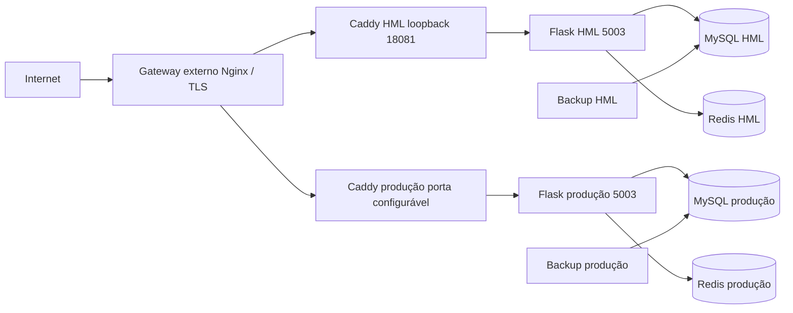

O diagrama combina Compose e scripts de gateway. Os certificados/DNS/regras OCI e serviços ativos não foram consultados. `deploy/nginx/skygest-hml.conf` contém listeners HTTP; `configure_hml_gateway.sh` trata configuração adicional. Não afirmar TLS válido apenas pelo arquivo do proxy. Endereços `skygest.com.br`, `app.skygest.com.br`, `hml.skygest.com.br` e `app.hml.skygest.com.br` aparecem na configuração, mas disponibilidade atual é NÃO CONFIRMADA.

HML usa projeto/rede/volumes dedicados `skygest-hml`, limites de memória e porta loopback. Dados/secrets devem ser distintos de produção. MySQL/Redis não são publicados para Internet pelo Compose HML. A possibilidade de compartilhar a VM significa que isolamento de processos/volumes não elimina disputa de CPU/RAM.

<a id="doc-docs-14-auditoria-operacao-md--configuração-e-segredos"></a>

##### Configuração e segredos

[Configuração Python](config.py), arquivos `.env.*.example` e appsettings WPF são as fontes. Não copiar `.env` real para documentos.

| Grupo | Variáveis principais | Efeito |
|---|---|---|
| Processo | APP_BASE_DIR, APP_ENV, FLASK_DEBUG, PORT, APP_VERSION, BUILD_SHA | diretórios, modo, bind e versão exposta |
| Banco | DATABASE_URL, MYSQL_HOST/PORT/USER/PASSWORD/DATABASE, MYSQL_SERVER_DATABASE_URL, MYSQL_TENANT_DATABASE_PREFIX, MYSQL_TENANT_DATABASE_URL_TEMPLATE | central, conta administrativa e tenants |
| Schema | SCHEMA_MANAGEMENT_MODE | upgrade local; verify em HML/produção; test_create_all nos testes |
| Sessão | SECRET_KEY, API_TOKEN_SECRET, API_ACCESS_TOKEN_MINUTES, API_REFRESH_TOKEN_DAYS, SESSION_LIFETIME_HOURS | assinatura, validade e cookies |
| Transporte | SESSION_COOKIE_SECURE/SAMESITE, API_ALLOW_INSECURE_AUTH, TRUST_PROXY_HEADERS, TRUSTED_PROXY_COUNT | cookies/HTTPS e confiança em proxies |
| Limites | RATELIMIT_ENABLED/STORAGE_URI/KEY_PREFIX e limites por ação, MAX_CONTENT_LENGTH | Redis e upload (8MiB padrão) |
| E-mail | MAIL_SMTP_SERVER/PORT/LOGIN/PASSWORD, MAIL_FROM_EMAIL/NAME, MAIL_SUPPRESS_SEND | SMTP; aliases legados Gmail/Brevo existem |
| Comercial | PUBLIC_BASE_URL, MARKETING_BASE_URL, SUBSCRIPTION_COMMERCIAL_ENABLED | links e callbacks |
| Backup | AUTO_BACKUP_ENABLED/INTERVAL_SECONDS/RETENTION_DAYS/RETENTION_COUNT, AUTO_AUDIT_* | frequência, retenção e limpeza periódica |
| Windows | GIROFY_API_BASE_URL, GIROFY_ALLOW_INSECURE_HTTP, GIROFY_API_TIMEOUT_SECONDS | sobrepõem appsettings |

Defaults sensíveis de desenvolvimento existem, mas não são instrução de configuração segura. A classe Config bloqueia defaults conhecidos e rate limiter em memória nos ambientes protegidos. A leitura de `.env` usa setdefault: variável já presente no processo prevalece. Catálogo completo de nomes em [variáveis](#doc-docs-14-auditoria-variaveis-md).

<a id="doc-docs-14-auditoria-operacao-md--execução-local"></a>

##### Execução local

Pré-requisitos: RTK conforme RTK.md, Python 3.13/pip/venv, MySQL compatível (Compose usa 8.4); Redis se habilitar limites distribuídos; Windows + SDK .NET 8 para UI nativa. Este host executou Python, não possui Docker/dotnet no PATH.

```bash
rtk proxy python3 -m venv .venv
rtk proxy .venv/bin/python -m pip install -r requirements.txt
rtk proxy cp .env.example .env
```

Editar `.env` para **banco local vazio e exclusivo**, configurar segredos, conta MySQL capaz de provisionar tenant e MAIL_SUPPRESS_SEND=1 para não enviar mensagens. Não reutilizar credenciais remotas. A aplicação não é iniciada de forma segura apenas trocando a porta: a factory pode executar DDL/bootstrap.

```bash
rtk proxy .venv/bin/python scripts/schema_migrate.py --help
rtk proxy .venv/bin/python scripts/schema_migrate.py upgrade-all
rtk proxy .venv/bin/python app.py
```

Os dois últimos comandos modificam somente o ambiente local configurado e são instruções, **não foram executados nesta auditoria**. Porta padrão 5003; dependências/versão têm health checks separados. Para testes, usar diretório temporário como APP_BASE_DIR e TESTING=1, evitando carregar `.env` local. O comando exato executado está em [verificações](#doc-docs-14-auditoria-verificacoes-md).

Windows: `rtk dotnet restore desktop_wpf/Girofy.Desktop.sln`, `rtk dotnet test desktop_wpf/tests/Girofy.UnitTests/Girofy.UnitTests.csproj --configuration Release` e `rtk dotnet run --project desktop_wpf/src/Girofy.Desktop/Girofy.Desktop.csproj`. Conferir destino HML no appsettings antes de login. Executável/instalador dependem de Windows, publicação win-x64 e Inno Setup; detalhes em [README Windows](#doc-desktop-wpf-readme-md).

<a id="doc-docs-14-auditoria-operacao-md--deploy-e-gates"></a>

##### Deploy e gates

Não foi executado. O fluxo HML dispara em develop, mas ignora `docs/**` e `*.md`: uma alteração só documental não dispara automaticamente esse deploy. O script faz rsync, valida isolamento, build, backup obrigatório, migrations, limpeza de tenant legado de sistema e up dos serviços; testa health/version. Portanto não é comando somente leitura.

Produção tem workflow self-hosted em main e alternativa manual OCI. Proteção efetiva do environment, reviewers e secrets no GitHub é NÃO CONFIRMADA. Os YAML não substituem a autorização humana exigida em AGENTS.md: implementar → homologar → testar manualmente → obter autorização explícita posterior → promover a mesma mudança e versionar.

Nesta tarefa, o pedido específico proíbe deploy/alteração remota. Não houve push, merge, tag, release ou publicação HML. Procedimentos detalhados existentes: [ambientes](#doc-docs-deploy-ambientes-md), [migrations](#doc-docs-29-migracoes-versionadas-md), [pipeline](#doc-docs-23-pipeline-deploy-md).

<a id="doc-docs-14-auditoria-operacao-md--backup-recuperação-e-rollback"></a>

##### Backup, recuperação e rollback

Há dois mecanismos: dump por empresa em `app/backup.py` e dump global `mysqldump` no sidecar/script. O script usa arquivo temporário, valida não vazio, rename, modo 600 e retenção. Também pode apagar auditoria antiga por configuração; iniciar backup uma vez não deve ser tratado como operação sem efeitos de dados sem examinar flags.

Restauração automática e ensaio recente não estão comprovados. Procedimento recomendado, ainda NÃO VALIDADO: escolher cópia, restaurar em MySQL isolado, conferir central/tenants e revisões Alembic, exercitar login/venda/estoque/cancelamento/caixa, medir tempo e perda aceitável. Não executar restore sobre ambiente real como teste. Rollback de imagem não garante compatibilidade após alteração de schema; precisa de planejamento específico por migration. RPO/RTO e off-site são pendências.

<a id="doc-docs-14-auditoria-operacao-md--logs-e-diagnóstico"></a>

##### Logs e diagnóstico

Backend usa RotatingFileHandler de 5MiB (cinco backups de erro, três de segurança), contexto HTTP e X-Request-ID. Campos sensíveis de query/form são mascarados; não assumir que todo texto livre é anonimizado. WPF usa LocalFileLoggerProvider e arquivos locais; nenhum APM/Sentry/Prometheus foi localizado.

| Sintoma | Investigar primeiro | Limite da conclusão |
|---|---|---|
| login 401/403 | credencial, e-mail, empresa, assinatura e sessão revogada | não divulgar token/hash em log |
| 426 | HTTPS e número de proxies confiáveis | não habilitar HTTP inseguro em HML/produção |
| 429/503 | limites/Redis e health/dependencies | health simples não verifica dependências |
| schema desatualizado | head central/tenant e log de migration | `tenants-status` chama ensure_database; não usar como leitura remota inocente |
| venda falhou | código/field, caixa, estoque, chave idempotente e rollback | após falha de resposta, repetir mesma chave antes de nova intenção |
| relatório diverge | período, fuso, histórico e FIN-001/002 | não ajustar banco para “bater” valores |
| e-mail não chega | MAIL_SUPPRESS_SEND e configuração SMTP; fila em memória | não há garantia durável |
| WPF sem conexão | BaseUrl, TLS, timeout, sessão e logs locais | ambiente correto antes de inserir dados |

---

<a id="doc-docs-14-auditoria-relatorio-final-md"></a>

### Relatório final da execução local

Origem preservada: `docs/14-auditoria/relatorio-final.md`. [Voltar ao sumário](#sumário).

<a id="doc-docs-14-auditoria-relatorio-final-md--relatório-final-da-execução-local"></a>

#### Relatório final da execução local

[Índice](#doc-docs-14-auditoria-readme-md)

<a id="doc-docs-14-auditoria-relatorio-final-md--resultado"></a>

##### Resultado

Auditoria documental produzida em português sobre o HEAD `d645260eb92832a504134697f2975ddc32acc489`, branch local `codex/style-stock-view`, em 14/10/2026. O workspace já possuía mudanças em documentação, imagens e bytecode; elas foram preservadas. Nenhuma alteração de regra de negócio, schema remoto, dado de produção, branch main, versão ou release foi feita.

A arquitetura encontrada é Flask/Jinja + API v1 no mesmo servidor, SQLAlchemy/MySQL central e por tenant, Redis para limites, cliente WPF/.NET 8 e SMTP. SQLite está em testes/legado. Não há evidência de backend ASP.NET, SPA React, gateway financeiro ou módulo de fiado operacional.

<a id="doc-docs-14-auditoria-relatorio-final-md--inventário-e-cobertura"></a>

##### Inventário e cobertura

| Item | Resultado |
|---|---|
| Áreas funcionais agrupadas | 11 documentos, incluindo categorias com produtos e equipe com identidade |
| Rotas | 132 declarações: 59 API e 73 Web/factory; 147 pares método/caminho sem static/HEAD/OPTIONS |
| Persistência | 24 modelos/tabelas, 286 colunas; ER, índices, constraints, defaults e migrations catalogados |
| Migrações | central_0010 e tenant_0011 como heads dos arquivos, não leitura remota |
| Implementação | 262 arquivos de código/configuração no inventário inicial, sem dados/binários/documentação |
| Regras centralizadas | 21 regras com implementação e teste relacionado |
| Diagramas | 12 blocos Mermaid validados pelo parser |
| Python | 292 testes passaram em 81,551s |
| Windows | 247 casos diretamente enumeráveis por inspeção; não executados |
| Comportamento financeiro | duas divergências Web/API reproduzidas sem banco |

Cada grupo funcional contém responsabilidades, interface/handler/serviço/entidade/tabela, validações, erros, permissões, testes e limitações. Os catálogos de rota registram expressões reais de entrada/saída e guardas, sem inventar schemas estáticos para valores dinâmicos. Isso é cobertura de inventário e rastreabilidade, não certificação operacional de cada ramo.

<a id="doc-docs-14-auditoria-relatorio-final-md--achados-prioritários"></a>

##### Achados prioritários

**FIN-001:** desconto deduzido do lucro na Web, omitido na soma de lucro API/dashboard. **FIN-002:** zero legítimo é recalculado na Web/dashboard, preservado na API. Ambas têm evidências fictícias reproduzíveis.

Privilégio administrativo MySQL no processo, ausência de ensaio de recuperação, limitações da suíte SQLite para concorrência, commits separados na importação histórica e duplicação de cálculo são prioridades. Há controles defensivos implementados, mas a auditoria não certifica ausência de vulnerabilidades. [Registro completo](#doc-docs-14-auditoria-riscos-md).

<a id="doc-docs-14-auditoria-relatorio-final-md--arquivos-desta-sessão"></a>

##### Arquivos desta sessão

- Criados: documentação em `docs/14-auditoria/`, `docs/05-banco-de-dados/`, `docs/06-api/`, `docs/07-modulos/`, `docs/11-regras-negocio/` e `CHANGELOG.md` (não publicado).
- Atualizados de forma aditiva: `README.md`, `AGENTS.md`, `DOCUMENTACAO_COMPLETA.md`, `docs/00-INDEX.md`, `docs/04-modelagem-banco.md`, `docs/09-api.md`, `docs/15-testes.md` e o registro anterior `docs/AUDITORIA_DOCUMENTACAO.md`.
- O diff total contra HEAD também contém mudanças anteriores; não atribuí-las a esta auditoria. O [manifesto desta sessão](#evidencia-arquivos-da-sessao) separa arquivos adicionados/modificados a partir do snapshot inicial.

<a id="doc-docs-14-auditoria-relatorio-final-md--limitações-e-pendências-explícitas"></a>

##### Limitações e pendências explícitas

1. O código/configuração foram inventariados amplamente e os fluxos principais analisados; não houve revisão semântica linha a linha de cada ViewModel, template, script e teste. O inventário não deve ser interpretado como essa garantia.
2. OpenAPI formal cobre somente health; os demais endpoints têm catálogo Markdown/contratos de referência. Completar schemas tipados e validar todos os exemplos dinâmicos permanece pendente.
3. MySQL, concorrência, schema implantado, SMTP real, OCI/DNS/TLS, restore, UI Windows e testes manuais em HML não foram validados.
4. O parser confirmou sintaxe Mermaid; layout visual não foi renderizado. Cobertura percentual e auditoria de CVEs não foram medidas.
5. Documentos históricos foram preservados e receberam referências de precedência nos pontos principais; não houve consolidação/desduplicação integral de todos os marcos anteriores.
6. Não houve deploy, conforme o pedido. Homologação publicada/testada, promoção para produção e nova versão permanecem pendentes; a autorização de produção só pode ocorrer após teste manual em HML.

Assim, a entrega é uma base documental ampla e rastreável com limitações explícitas; não declara concluídas as validações externas nem uma especificação OpenAPI integral.

<a id="doc-docs-14-auditoria-relatorio-final-md--validação-final"></a>

##### Validação final

Resultados detalhados em [verificações](#doc-docs-14-auditoria-verificacoes-md) e [evidência estrutural](#evidencia-validacao-final). Links relativos dos documentos novos, caminhos de código e referências de testes foram verificados; nenhum link local ausente permaneceu no conjunto novo. Scripts não foram executados, apenas submetidos a análise de sintaxe. Nenhum arquivo preexistente foi removido e nenhum arquivo operacional foi alterado nesta sessão.

---

<a id="doc-docs-14-auditoria-riscos-md"></a>

### Achados, segurança e dívida técnica

Origem preservada: `docs/14-auditoria/riscos.md`. [Voltar ao sumário](#sumário).

<a id="doc-docs-14-auditoria-riscos-md--achados-segurança-e-dívida-técnica"></a>

#### Achados, segurança e dívida técnica

[Índice](#doc-docs-14-auditoria-readme-md)

Nenhuma correção aplicada. Severidade considera impacto e evidência, não uma pontuação de exploração em produção. Não houve pentest remoto, consulta de dados reais nem auditoria de CVEs online. Versões declaradas não comprovam instalação vulnerável.

<a id="doc-docs-14-auditoria-riscos-md--achados-confirmados"></a>

##### Achados confirmados

| ID | Área / prioridade | Evidência | Impacto e recomendação | Confirmação |
|---|---|---|---|---|
| FIN-001 | Financeiro / alta | `main.sale_profit` deduz desconto; `api_build_sales_report` e `dashboard_service._sales_profit` não | lucro de venda com desconto diverge entre interfaces; centralizar fórmula após decisão explícita e testes comparativos | reprodução: lucro 30 Web versus 40 API; dashboard confirmado por código |
| FIN-002 | Financeiro / alta | `main.sale_item_profit` e `_item_profit_expression` usam fallback quando lucro é zero; `api_sale_item_profit` preserva zero | item com custo e taxa que resultam lucro zero pode reaparecer lucrativo; distinguir dado ausente de zero legítimo | reprodução: 40 Web versus 0 API |
| DATA-001 | Auditoria / média | `import_preview_rows` confirma dados; `historical_reports.confirm` audita em outro commit | falha após primeiro commit pode deixar importação sem auditoria correspondente; unificar unidade transacional | análise de chamadas/commits |
| DATA-002 | Integridade / média | Category sem UNIQUE(company_id, name); validação faz consulta prévia | possibilidade de duplicidade em disputa; definir normalização e constraint em migration | lacuna estática; corrida NÃO reproduzida |
| SEC-001 | Privilégios / alta | Compose passa URL administrativa MySQL root ao app | comprometimento do processo amplia alcance aos bancos; separar provisionamento e restringir privilégio | configuração versionada; concessões efetivas não consultadas |
| SEC-002 | Container / média | Dockerfile sem USER | imagem app inicia como root por padrão; definir usuário e testar volumes em HML | arquivo confirmado |
| SEC-003 | XSS/CDN / média | CSP com unsafe-inline; Bootstrap CDN sem integrity em base.html | reduz defesa em profundidade e amplia dependência externa; nonces/hashes ou assets locais/SRI | código confirmado; exploração não tentada |
| OPS-001 | Recuperação / alta | scripts geram backup, mas sem evidência de restore externo | sucesso de dump não assegura recuperação; ensaio isolado e RPO/RTO | lacuna de evidência |
| OPS-002 | Auditoria operacional / média | factory garante existência de banco; tenants-status chama ensure_database | comandos aparentemente de inspeção podem criar banco; separar leitura pura de preparação | análise estática |
| QUAL-001 | Testes / alta | TESTING faz tenant_session/api_tenant_database usar db.session SQLite | locks, collations e bancos físicos não testados; cenário MySQL concorrente e cross-tenant por conexão | fixtures confirmadas |
| QUAL-002 | Acoplamento / média | api/v1.py >5000 linhas, main.py/auth.py/catalog.py extensos; parsers e relatórios duplicados | divergências de regra e manutenção; extrair funções após caracterizar contrato | inventário e FIN-001/002 |
| OPS-003 | Entrega / média | workflows ignoram docs e markdown | alteração documental não publica automaticamente HML; planejar validação/documentação sem presumir deploy | YAML confirmado |

Exemplos financeiros são fictícios e usam as funções reais sem persistência: [resultado](#evidencia-reproducao-financeira), [procedimento](#doc-docs-14-auditoria-verificacoes-md).

<a id="doc-docs-14-auditoria-riscos-md--riscos-a-validar-sem-declaração-de-falha-reproduzida"></a>

##### Riscos a validar, sem declaração de falha reproduzida

- **CONC-001, alta:** cenários concorrentes venda/ajuste/cancelamento e refresh simultâneo. Há locks no código, mas não ensaio com múltiplas conexões MySQL; identity map, ordem de locks e isolamento precisam ser exercitados.
- **KIT-001, média:** API aceita base ativa e impede autorreferência direta, mas não rejeita explicitamente base que já é kit. O consumo resolve um nível; testar cadeia/ciclo antes de prometer kits compostos.
- **TIME-001, média:** importador histórico usa `created_at.date()` e limites datetime civis em trechos, enquanto relatórios convertem dia do negócio a UTC. Testar vendas perto da meia-noite para colisão histórica.
- **MIG-001, média:** validação final de schema verifica tabelas/colunas, não todos os tipos/FKs/índices. Comparar reflection MySQL contra metadata/migration em fixture isolada.
- **SCALE-001, média:** engines cacheados por empresa/processo, consultas extensas e loops de importação. Medir conexões e latência antes de aumentar workers/tenants.
- **MAIL-001, média:** fila em memória sem persistência e marcação de entrega separada do SMTP; reinício e concorrência podem afetar entrega/deduplicação.
- **WIN-001, média:** assinatura de código e atualização autenticada do instalador não localizadas. Validar distribuição e upgrade em Windows antes de release estável.

<a id="doc-docs-14-auditoria-riscos-md--controles-observados-e-limites"></a>

##### Controles observados e limites

Scrypt; validação de comprimento de senha; sessões Web e refresh revogável; cookies HttpOnly/SameSite e Secure em ambientes protegidos; CSRF em mutações Web; API Bearer dispensada de CSRF; guarda de origem; ORM/binds; identificadores SQL de tenant saneados; autoescape Jinja; framing DENY, HSTS e CSP; upload limitado; rate limit Redis sem fallback em ambiente protegido; mascaramento de auditoria/logs; escopo por tenant e flags de usuário.

Nenhum desses controles, isoladamente, prova ausência de SQL injection/XSS/CSRF ou conformidade com legislação. Não há CORS permissivo explícito identificado. Dados de conexão, credenciais, tokens e dumps não foram incluídos nos documentos. Retenção e acesso a backups precisam de política externa; não existe comprovação de criptografia off-site ou trilha imutável.

<a id="doc-docs-14-auditoria-riscos-md--ordem-sugerida-para-próximas-mudanças"></a>

##### Ordem sugerida para próximas mudanças

1. Reproduzir e alinhar cálculo de lucro com decisão de produto; incluir desconto, zero legítimo, custo histórico e taxa total.
2. Executar cenários concorrentes MySQL e restauração isolada; registrar evidências antes de alegar garantias operacionais.
3. Reduzir privilégio administrativo e revisar fronteiras de transação/auditoria.
4. Consolidar parsers/serializadores por contrato, medir consultas e revisar preferências sem execução completa.
5. Completar OpenAPI tipada e validação Windows/E2E. Toda implementação futura segue HML primeiro e autorização posterior para produção.

---

<a id="doc-docs-14-auditoria-variaveis-md"></a>

### Variáveis de configuração Python

Origem preservada: `docs/14-auditoria/variaveis.md`. [Voltar ao sumário](#sumário).

<a id="doc-docs-14-auditoria-variaveis-md--variáveis-de-configuração-python"></a>

#### Variáveis de configuração Python

[Operação](#doc-docs-14-auditoria-operacao-md)

Nomes extraídos de leituras explícitas em config.py; valores não são publicados. Compose, scripts e WPF possuem variáveis adicionais descritas no manual de operação. A presença de variável não prova uso de todo seu efeito por cada módulo.

| Nome | Evidência |
|---|---|
| `API_ACCESS_TOKEN_MINUTES` | [config.py](config.py), linha 78 |
| `API_ALLOW_INSECURE_AUTH` | [config.py](config.py), linha 82 |
| `API_LOGIN_ATTEMPT_LIMIT` | [config.py](config.py), linha 80 |
| `API_LOGIN_BLOCK_SECONDS` | [config.py](config.py), linha 81 |
| `API_REFRESH_TOKEN_DAYS` | [config.py](config.py), linha 79 |
| `API_TOKEN_SECRET` | [config.py](config.py), linha 77 |
| `APP_BASE_DIR` | [config.py](config.py), linha 9 |
| `APP_ENV` | [config.py](config.py), linha 70 |
| `APP_VERSION` | [config.py](config.py), linha 72 |
| `BREVO_FROM_EMAIL` | [config.py](config.py), linha 126 |
| `BREVO_FROM_NAME` | [config.py](config.py), linha 127 |
| `BREVO_SMTP_LOGIN` | [config.py](config.py), linha 124 |
| `BREVO_SMTP_PASSWORD` | [config.py](config.py), linha 125 |
| `BREVO_SMTP_PORT` | [config.py](config.py), linha 123 |
| `BREVO_SMTP_SERVER` | [config.py](config.py), linha 122 |
| `BUILD_SHA` | [config.py](config.py), linha 72 |
| `BUSINESS_TIMEZONE` | [config.py](config.py), linha 73 |
| `CSRF_ENABLED` | [config.py](config.py), linha 117 |
| `DATABASE_URL` | [config.py](config.py), linha 137 |
| `FLASK_DEBUG` | [config.py](config.py), linha 75 |
| `FLASK_ENV` | [config.py](config.py), linha 70 |
| `GMAIL_APP_PASSWORD` | [config.py](config.py), linha 125 |
| `GMAIL_SMTP_LOGIN` | [config.py](config.py), linha 124 |
| `GMAIL_SMTP_PORT` | [config.py](config.py), linha 123 |
| `GMAIL_SMTP_SERVER` | [config.py](config.py), linha 122 |
| `MAIL_FROM_EMAIL` | [config.py](config.py), linha 126 |
| `MAIL_FROM_NAME` | [config.py](config.py), linha 127 |
| `MAIL_SMTP_LOGIN` | [config.py](config.py), linha 124 |
| `MAIL_SMTP_PASSWORD` | [config.py](config.py), linha 125 |
| `MAIL_SMTP_PORT` | [config.py](config.py), linha 123 |
| `MAIL_SMTP_SERVER` | [config.py](config.py), linha 122 |
| `MAIL_SUPPRESS_SEND` | [config.py](config.py), linha 128 |
| `MARKETING_BASE_URL` | [config.py](config.py), linha 121 |
| `MASTER_DEFAULT_PASSWORD` | [config.py](config.py), linha 109 |
| `MASTER_DEFAULT_USERNAME` | [config.py](config.py), linha 108 |
| `MAX_CONTENT_LENGTH` | [config.py](config.py), linha 119 |
| `MYSQL_DATABASE` | [config.py](config.py), linha 56 |
| `MYSQL_HOST` | [config.py](config.py), linha 54 |
| `MYSQL_PASSWORD` | [config.py](config.py), linha 53 |
| `MYSQL_PORT` | [config.py](config.py), linha 55 |
| `MYSQL_SERVER_DATABASE_URL` | [config.py](config.py), linha 143 |
| `MYSQL_TENANT_DATABASE_PREFIX` | [config.py](config.py), linha 141 |
| `MYSQL_TENANT_DATABASE_URL_TEMPLATE` | [config.py](config.py), linha 142 |
| `MYSQL_USER` | [config.py](config.py), linha 52 |
| `PASSWORD_MAX_LENGTH` | [config.py](config.py), linha 111 |
| `PASSWORD_MIN_LENGTH` | [config.py](config.py), linha 110 |
| `PUBLIC_BASE_URL` | [config.py](config.py), linha 120 |
| `RATELIMIT_ACTIVATION` | [config.py](config.py), linha 101 |
| `RATELIMIT_ADMIN` | [config.py](config.py), linha 107 |
| `RATELIMIT_API_GENERAL` | [config.py](config.py), linha 103 |
| `RATELIMIT_BACKUP` | [config.py](config.py), linha 105 |
| `RATELIMIT_EMAIL_RESEND` | [config.py](config.py), linha 99 |
| `RATELIMIT_ENABLED` | [config.py](config.py), linha 88 |
| `RATELIMIT_EXPORT` | [config.py](config.py), linha 106 |
| `RATELIMIT_IMPORT` | [config.py](config.py), linha 104 |
| `RATELIMIT_IN_MEMORY_FALLBACK_ENABLED` | [config.py](config.py), linha 92 |
| `RATELIMIT_KEY_PREFIX` | [config.py](config.py), linha 96 |
| `RATELIMIT_LOGIN` | [config.py](config.py), linha 97 |
| `RATELIMIT_PASSWORD_RESET` | [config.py](config.py), linha 98 |
| `RATELIMIT_REFRESH` | [config.py](config.py), linha 102 |
| `RATELIMIT_REGISTRATION` | [config.py](config.py), linha 100 |
| `RATELIMIT_STORAGE_URI` | [config.py](config.py), linha 89 |
| `SCHEMA_MANAGEMENT_MODE` | [config.py](config.py), linha 145 |
| `SECRET_KEY` | [config.py](config.py), linha 76 |
| `SESSION_COOKIE_SAMESITE` | [config.py](config.py), linha 131 |
| `SESSION_COOKIE_SECURE` | [config.py](config.py), linha 132 |
| `SESSION_LIFETIME_HOURS` | [config.py](config.py), linha 129 |
| `SUBSCRIPTION_COMMERCIAL_ENABLED` | [config.py](config.py), linha 113 |
| `SUBSCRIPTION_WHATSAPP_NUMBER` | [config.py](config.py), linha 112 |
| `TESTING` | [config.py](config.py), linha 74 |
| `TRUSTED_PROXY_COUNT` | [config.py](config.py), linha 87 |
| `TRUST_PROXY_HEADERS` | [config.py](config.py), linha 86 |

---

<a id="doc-docs-14-auditoria-verificacoes-md"></a>

### Verificações e evidências — 14/10/2026

Origem preservada: `docs/14-auditoria/verificacoes.md`. [Voltar ao sumário](#sumário).

<a id="doc-docs-14-auditoria-verificacoes-md--verificações-e-evidências--14102026"></a>

#### Verificações e evidências — 14/10/2026

[Índice](#doc-docs-14-auditoria-readme-md)

<a id="doc-docs-14-auditoria-verificacoes-md--suíte-python-executada"></a>

##### Suíte Python executada

**292 testes, OK, 81,551 segundos; processo retornou 0.** Python 3.13 no macOS. A execução completa usou `python3 -m unittest discover -v`, invocada sob RTK, com `APP_BASE_DIR` apontando para diretório temporário vazio e estas variáveis antes de importar a aplicação:

```text
APP_ENV=development
TESTING=1
MAIL_SUPPRESS_SEND=1
PYTHONDONTWRITEBYTECODE=1
```

As fixtures usam SQLite em memória/arquivos temporários, logs/backups temporários e mocks. A execução não conectou aos bancos MySQL configurados em `.env` do repositório. O log bruto fica no diretório temporário da sessão, não foi copiado para documentação. Resultado resumido:

```text
Ran 292 tests in 81.551s
OK
exit_code 0
```

Houve uma tentativa inicial em subprocesso desacoplado sem resultado final; ela **não foi contada** como sucesso. A execução acima foi repetida em processo acompanhado até o término.

Cobertura por percentual/branches não foi medida. A suíte abrange rotas, dinheiro, tempo, layout de meios de pagamento, isolamento de configuração, migrations, cadastro app e importação histórica. Passar testes existentes não elimina os achados abaixo nem valida MySQL concorrente.

<a id="doc-docs-14-auditoria-verificacoes-md--reprodução-financeira-sem-banco"></a>

##### Reprodução financeira sem banco

Foram chamadas as funções reais `build_sales_report`, `api_build_sales_report`, `sale_item_profit` e `api_sale_item_profit` com objetos fictícios em memória, sem chamada HTTP/remota e sem escrita em base. O resultado está em [JSON](#evidencia-reproducao-financeira).

| Cenário | Web | API | Resultado |
|---|---|---|---|
| 1 item, preço 100, custo 60, quantidade 1, profit_amount 40, desconto da venda 10, total final 90 | lucro 30,00 | lucro 40,00 | divergência confirmada |
| Mesmo item com profit_amount gravado como zero | lucro do item 40,00 | lucro do item 0,00 | divergência confirmada |

Procedimento reproduzível após isolar APP_BASE_DIR/ambiente antes do import:

```python
from decimal import Decimal as D
from types import SimpleNamespace as NS
from app.routes.main import build_sales_report, sale_item_profit
from app.routes.api.v1 import api_build_sales_report, api_sale_item_profit

item = NS(profit_amount=D('40'), unit_cost_price=D('60'),
          unit_price=D('100'), quantity=1, total_price=D('100'),
          product_id=1, product=NS(name='Produto fictício', cost_price=D('60')))
sale = NS(is_cancelled=False, items=[item], payments=[],
          total_amount=D('100'), discount_amount=D('10'), final_amount=D('90'))
assert build_sales_report([sale])[0]['profit'] == D('30')
assert api_build_sales_report([sale])['summary']['profit'] == D('40')
item.profit_amount = D('0')
assert sale_item_profit(item) == D('40')
assert api_sale_item_profit(item) == D('0')
```

Os asserts caracterizam o comportamento encontrado, não o comportamento desejado. No dashboard, a divergência foi confirmada pela expressão/consulta do código, sem reprodução de endpoint nesta verificação específica.

<a id="doc-docs-14-auditoria-verificacoes-md--verificações-estruturais"></a>

##### Verificações estruturais

- Modelos: extração de metadata sem `create_app` e sem conexão de banco; 24 tabelas e 286 colunas, defaults Python/SQL separados, FKs/constraints/relacionamentos e índices catalogados.
- Rotas: AST e comparação com `app.url_map` em fixture de teste; 132 declarações (59 API, 73 Web/factory), 147 pares método/caminho sem static e HEAD/OPTIONS automáticos. A comparação detectou `/favicon.ico` na factory; o catálogo foi corrigido.
- Mermaid: 12 blocos passaram pelo parser **Mermaid 11.17.2** com jsdom 26.1.0 em diretório temporário. Duas mensagens de sequência com ponto e vírgula foram corrigidas e todos os blocos revalidados. [Resultado](#evidencia-validacao-mermaid). Não houve avaliação visual de layout/renderização SVG.
- Shell: `bash -n` em 13 scripts `.sh`, sem erro; não executa deploy/provisionamento/backup.
- JSON: inventário, OpenAPI parcial e evidências parseados com `json.loads`. Não houve certificação por validador OpenAPI externo.
- Links locais, fences Markdown e nomes de testes mencionados: checados nos novos documentos; resultado final em [relatório](#doc-docs-14-auditoria-relatorio-final-md).
- `git diff --check`: sem erros. Hashes comparados com snapshot de início confirmam que arquivos preexistentes alterados nesta sessão são apenas documentação/AGENTS; os `.pyc` já modificados foram preservados.
- Varredura dos documentos novos: nenhum endereço de e-mail literal ou marcador óbvio de segredo encontrado. Esta checagem é limitada e não equivale a varredura do histórico Git por segredos.

<a id="doc-docs-14-auditoria-verificacoes-md--windows-e-limitações"></a>

##### Windows e limitações

Inventário estático: **165 `[Fact]`, 16 `[Theory]`, 82 `[InlineData]`**, ou 247 casos diretamente enumeráveis (Facts + linhas de dados; não somar Theories novamente). **Não executados**, pois dotnet/Windows não estão disponíveis no host. Não declarar esse número como testes aprovados. A versão do cliente é 0.9.18-preview no props.

Docker/Compose não foram executados; Docker não estava no PATH. MySQL real, OCI, SMTP, gateway, TLS, restore, release, UI manual Windows e homologação não foram validados. As variáveis/pipelines/scripts foram inspecionados estaticamente. Dependências do parser Mermaid foram instaladas fora do repositório; requirements/manifestos/lockfiles do projeto não mudaram.

<a id="doc-docs-14-auditoria-verificacoes-md--matriz-de-testes-recomendados"></a>

##### Matriz de testes recomendados

| Prioridade | Cenário | Resultado a decidir/verificar | Ambiente |
|---|---|---|---|
| Alta | Desconto e lucro zero em todas as superfícies | fórmula coerente e preservação de zero válido | unitário/integração |
| Alta | Duas vendas disputando último estoque | nenhuma perda de atualização; rollback completo | MySQL com conexões independentes |
| Alta | Abrir/fechar simultaneamente; venda versus cancelamento | único caixa, estoque e total consistentes | MySQL |
| Alta | Tenant A tentando IDs de B por todas as mutações | 403/404 sem efeito em B | bancos tenant separados |
| Alta | Restore central + tenants de dump | login, caixa, venda e histórico recuperados; RPO/RTO medidos | MySQL isolado |
| Média | Falha da auditoria após importação histórica | comportamento parcial explicitado ou transação única após correção | integração com falha injetada |
| Média | Vendas em limite UTC/data do negócio | sem sobreposição indevida com histórico | integração |
| Média | Barcode com zeros e colisão de categoria concorrente | unicidade/normalização coerentes | Web/API/MySQL |
| Média | Refresh simultâneo e retry de venda | uma intenção, sem duplicação de venda | API + WPF |
| Média | Callback, DPAPI, upgrades e instalador | sessão preservada/invalidada corretamente | Windows |
| Média | Preferências de digest/quiet hours | execução real ou status PARCIAL preservado | integração/job futuro |
| Baixa | Teclado, contraste, responsividade | navegação e leitura verificadas manualmente | browser/Windows |

---

## Manual geral de referência — revisão de 10/09/2026

<a id="doc-documentacao-completa-md"></a>

### SkyGest — documentação técnica completa

Origem preservada: `DOCUMENTACAO_COMPLETA.md`. [Voltar ao sumário](#sumário).

<a id="doc-documentacao-completa-md--skygest--documentação-técnica-completa"></a>

#### SkyGest — documentação técnica completa

> **Complemento de 14/10/2026:** a [auditoria atual](#doc-docs-14-auditoria-readme-md) refere-se ao HEAD local `d645260eb92832a504134697f2975ddc32acc489`. Datas, hashes e resultados anteriores abaixo pertencem à revisão anterior. Para schema, inventário HTTP e divergências financeiras, prevalece a revisão atual baseada no código.

> Fonte oficial de referência técnica do SaaS. Revisão baseada no código do commit `938e18ceedb6b6b49780a63027e82f6eaac97940`, em 10/09/2026. A branch local auditada foi `mdcodex/style-stock-view`; o commit coincide com `origin/develop`, não com `origin/main`. Nenhum estado de produção foi consultado. Em caso de divergência, prevalecem o código e as migrations versionadas.

<a id="doc-documentacao-completa-md--índice"></a>

##### Índice

1. [Introdução e escopo](#doc-documentacao-completa-md--1-introdução-e-escopo)
2. [Visão geral](#doc-documentacao-completa-md--2-visão-geral)
3. [Arquitetura](#doc-documentacao-completa-md--3-arquitetura)
4. [Tecnologias](#doc-documentacao-completa-md--4-tecnologias)
5. [Estrutura do projeto](#doc-documentacao-completa-md--5-estrutura-do-projeto)
6. [Funcionalidades](#doc-documentacao-completa-md--6-funcionalidades)
7. [Regras de negócio](#doc-documentacao-completa-md--7-regras-de-negócio)
8. [Banco de dados](#doc-documentacao-completa-md--8-banco-de-dados)
9. [API REST v1](#doc-documentacao-completa-md--9-api-rest-v1)
10. [Autenticação](#doc-documentacao-completa-md--10-autenticação)
11. [Autorização e permissões](#doc-documentacao-completa-md--11-autorização-e-permissões)
12. [Multi-tenancy](#doc-documentacao-completa-md--12-multi-tenancy)
13. [Segurança](#doc-documentacao-completa-md--13-segurança)
14. [Painel Master](#doc-documentacao-completa-md--14-painel-master)
15. [Assinaturas e licenças](#doc-documentacao-completa-md--15-assinaturas-e-licenças)
16. [Web, App e Master](#doc-documentacao-completa-md--16-web-app-e-master)
17. [Responsividade e acessibilidade](#doc-documentacao-completa-md--17-responsividade-e-acessibilidade)
18. [Configuração e variáveis de ambiente](#doc-documentacao-completa-md--18-configuração-e-variáveis-de-ambiente)
19. [Instalação local](#doc-documentacao-completa-md--19-instalação-local)
20. [Docker e infraestrutura](#doc-documentacao-completa-md--20-docker-e-infraestrutura)
21. [Produção e deploy](#doc-documentacao-completa-md--21-produção-e-deploy)
22. [CI/CD, releases e instalador](#doc-documentacao-completa-md--22-cicd-releases-e-instalador)
23. [Logs, auditoria e observabilidade](#doc-documentacao-completa-md--23-logs-auditoria-e-observabilidade)
24. [Tratamento de erros](#doc-documentacao-completa-md--24-tratamento-de-erros)
25. [Backup e recuperação](#doc-documentacao-completa-md--25-backup-e-recuperação)
26. [Testes](#doc-documentacao-completa-md--26-testes)
27. [Performance e concorrência](#doc-documentacao-completa-md--27-performance-e-concorrência)
28. [Fluxos importantes](#doc-documentacao-completa-md--28-fluxos-importantes)
29. [Dependências](#doc-documentacao-completa-md--29-dependências)
30. [Troubleshooting](#doc-documentacao-completa-md--30-troubleshooting)
31. [Dívida técnica](#doc-documentacao-completa-md--31-dívida-técnica)
32. [Roadmap técnico sugerido](#doc-documentacao-completa-md--32-roadmap-técnico-sugerido)
33. [Onboarding de desenvolvedor](#doc-documentacao-completa-md--33-onboarding-de-desenvolvedor)
34. [Estados de implementação](#doc-documentacao-completa-md--34-estados-de-implementação)
35. [Divergências corrigidas](#doc-documentacao-completa-md--35-divergências-corrigidas)
36. [Changelog da documentação](#doc-documentacao-completa-md--36-changelog-da-documentação)

<a id="doc-documentacao-completa-md--1-introdução-e-escopo"></a>

##### 1. Introdução e escopo

SkyGest é um sistema SaaS de ponto de venda e gestão operacional direcionado principalmente a adegas e pequenos comércios. Centraliza catálogo, estoque, vendas, pagamentos, caixa, contas a pagar, relatórios, equipe, permissões, auditoria, notificações e licenciamento.

Esta revisão inventariou 426 arquivos versionados. Foram examinados backend, templates, JavaScript, CSS, 22 tabelas/modelos funcionais, serviços, 59 endpoints da API v1, migrations, testes, aplicativo WPF, instalador, Docker, scripts OCI, workflows e a separação operacional entre produção e homologação. Caches, builds, artefatos, bancos e relatórios gerados não foram tratados como código-fonte. Os documentos antigos foram usados apenas como contexto; nenhuma afirmação foi considerada verdadeira sem confirmação no código atual.

Convenções:

- **Implementado**: existe caminho executável no código atual.
- **Parcial**: existe infraestrutura, mas faltam etapas para uso completo.
- **Planejado/recomendado**: não existe como recurso disponível.
- **Legado**: mantido apenas para compatibilidade ou histórico.
- “App” significa o cliente nativo Windows WPF; não há aplicativo Android/iOS no repositório.

<a id="doc-documentacao-completa-md--2-visão-geral"></a>

##### 2. Visão geral

O produto possui três interfaces técnicas sobre o mesmo domínio:

- **Web**: Flask/Jinja entrega HTML server-side, CSS e JavaScript vanilla.
- **App Windows**: cliente WPF/.NET 8 online, que consome `/api/v1`.
- **Painel Master**: interface Web exclusiva para administrar o SaaS; não é uma adega operacional. O contexto técnico marcado com `Company.is_system=True` existe somente para identidade do Master, mantém `database_path=''`, não recebe schema tenant e é excluído das métricas de clientes.

O backend é a fonte de verdade para autenticação, autorização, cálculo financeiro, estoque, assinatura e isolamento de tenant. O App não conecta ao MySQL e não mantém uma cópia operacional do banco.

Público-alvo atual: adegas e pequenos comércios que precisam operar vendas e estoque com usuários e permissões. Não foram encontrados módulos de clientes, fornecedores, emissão fiscal ou integração com adquirentes.

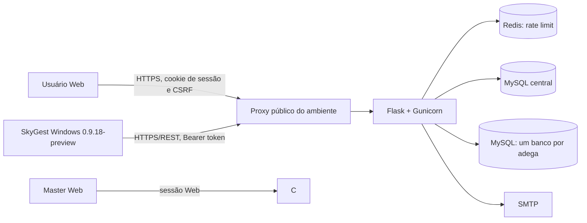

<a id="doc-documentacao-completa-md--3-arquitetura"></a>

##### 3. Arquitetura

<a id="doc-documentacao-completa-md--31-backend-e-web"></a>

###### 3.1 Backend e Web

`app:create_app()` em `app/__init__.py` usa o padrão application factory. Registra os blueprints `auth`, `catalog`, `api_v1` e `main`, inicializa SQLAlchemy, Flask-Login, Flask-Limiter, CSRF, logging e encerramento da sessão tenant. Templates ficam em `app/templates`; estilos e comportamento do navegador em `app/static/css/style.css` e `app/static/js/main.js`.

O HTML é renderizado no servidor. Formulários mutáveis recebem `_csrf_token`; chamadas `fetch` recebem `X-CSRFToken`. O backend também rejeita `Origin` diferente do host para POST/PUT/PATCH/DELETE.

<a id="doc-documentacao-completa-md--32-api"></a>

###### 3.2 API

A API é um blueprint versionado com prefixo `/api/v1` (`app/routes/api/v1.py`). O envelope é `{"success": true, "data": ..., "message": null, "errors": []}` no sucesso; falhas usam `success=false`, `data=null`, mensagem e uma lista com código estável e campo opcional. Autenticação usa access token assinado e refresh token opaco persistido somente como hash.

<a id="doc-documentacao-completa-md--33-serviços-de-domínio"></a>

###### 3.3 Serviços de domínio

- `sale_service.py`: venda/cancelamento, pagamentos, desconto, taxas, lucro, locks, idempotência e estoque.
- `cash_register_service.py`: um caixa aberto, abertura/fechamento e snapshots.
- `stock_service.py`: movimentos, locks, saldo anterior/posterior e notificações.
- `product_service.py` e `category_service.py`: validação e mutações do catálogo.
- `api_auth_service.py`: login, tokens, rotação, revogação e bloqueio de tentativas.
- `notification_service.py` e `alert_service.py`: alertas in-app/e-mail e deduplicação.
- `audit_service.py`: diffs, metadados da requisição e mascaramento.
- `migration_service.py`: heads e upgrade Alembic central/tenant.

<a id="doc-documentacao-completa-md--34-aplicativo-windows"></a>

###### 3.4 Aplicativo Windows

A solução `desktop_wpf/Girofy.Desktop.sln` tem quatro projetos:

- `Girofy.Desktop`: WPF, XAML, views e integração Windows.
- `Girofy.Application`: ViewModels, comandos, modelos e abstrações.
- `Girofy.Infrastructure`: HTTP, logs, preferências, DPAPI e browser externo.
- `Girofy.UnitTests`: testes xUnit.

O nome interno “Girofy” é legado de namespaces, protocolo e diretórios; produto, executável e assets exibidos são SkyGest. O App é `net8.0-windows`, `win-x64`, self-contained e single-file.

A URL comercial padrão é `https://www.skygest.com.br`. `ApiOptions` converte o host legado `skygest.com.br` para o host canônico antes de criar os clientes HTTP, evitando que redirects de domínio transformem o login `POST` em navegação incompatível. O ambiente de homologação continua selecionável por `SKYGEST_ENVIRONMENT=Homologation`.

<a id="doc-documentacao-completa-md--35-persistência"></a>

###### 3.5 Persistência

O banco central contém identidade, empresas, chaves, tokens e administração SaaS. Cada adega possui um banco MySQL próprio, cujo nome é gerado como `<prefixo>_<company_id>_<slug>`. `tenant_session()` resolve a empresa autenticada e abre uma sessão para o engine correto. Empresa e usuários de referência são sincronizados por DML no tenant.

<a id="doc-documentacao-completa-md--36-containers-e-rede"></a>

###### 3.6 Containers e rede

O Compose oficial possui `mysql`, `redis`, `app`, `backup` e `caddy`. Flask escuta `5003` dentro da rede e é publicado somente em `127.0.0.1:5003`. Caddy publica `18080` por padrão. Redis não publica porta. MySQL persiste em volume; backups persistem em diretório do host.

Não foi encontrada fila dedicada. O “enqueue” de alertas utiliza execução/thread do processo e persistência de estado, não RabbitMQ/Kafka/Celery.

<a id="doc-documentacao-completa-md--4-tecnologias"></a>

##### 4. Tecnologias

| Tecnologia | Versão identificável | Uso |
|---|---:|---|
| Python | 3.13 na imagem/workflows | Backend, scripts, migrations e testes |
| Flask | `>=3,<4` | Web e API |
| Flask-Login | `>=0.6,<0.7` | Sessão Web |
| Flask-SQLAlchemy / SQLAlchemy | `>=3.1,<4` / `>=2,<3` | ORM, sessões, transações e locks |
| Flask-Migrate/Alembic | `>=4.1,<5` | Migrations independentes central/tenant |
| Flask-Limiter | `>=4.1,<5` | Rate limit Web/API com Redis |
| Jinja2 | `>=3.1,<4` | Templates server-side |
| PyMySQL | `>=1.1,<2` | Driver MySQL |
| simplejson | `>=3.19,<4` | Serialização JSON de `Decimal` sem conversão intermediária para `float` |
| Gunicorn | `>=22,<24` | Servidor WSGI, 1 worker/4 threads |
| MySQL | 8.4 | Banco central e bancos tenant |
| Redis | 7.4.2 Alpine | Rate limit distribuído, sem persistência |
| Caddy | 2 | Proxy reverso, compressão e terminação conforme endereço configurado |
| HTML/CSS/JavaScript | nativo | Interface Web e responsividade |
| Bootstrap | 5.3.3 via jsDelivr | componentes Web (modal, collapse e alert) e base CSS |
| .NET/WPF | .NET 8 | App Windows |
| Microsoft.Extensions.Hosting/Http | 8.0.1 | Host e clientes HTTP do App |
| Configuration/Logging Abstractions | 8.0.0/8.0.2 | configuração e logging do App |
| DPAPI/ProtectedData | 8.0.0 | Proteção da sessão local do App |
| xUnit / Test SDK / runner | 2.9.2 / 17.11.1 / 2.8.2 | Testes do cliente |
| Inno Setup | 6 | Instalador por usuário |
| Docker Compose | Compose v2 esperado | Produção OCI |
| Oracle Cloud Infrastructure | VM provisionada por scripts OCI | hospedagem de PROD/HML no mesmo host com isolamento lógico |
| Ubuntu | 22.04 nos defaults de provisionamento | host Linux da OCI |
| Nginx | configuração do host em scripts/runbooks | borda HTTPS e roteamento dos dois domínios |
| GitHub Actions | workflows YAML | CI, deploy e release preview |

<a id="doc-documentacao-completa-md--5-estrutura-do-projeto"></a>

##### 5. Estrutura do projeto

```text
/
├── app/                    # Flask, domínio, Web e API
│   ├── models/             # modelos SQLAlchemy
│   ├── routes/             # rotas Web e API v1
│   ├── security/           # CSRF, senhas e rate limit
│   ├── services/           # regras compartilhadas
│   ├── static/             # CSS, JS, marca e modelo XLSX
│   └── templates/          # Jinja Web/Master/e-mails/erros
├── desktop_wpf/            # solução, instalador e testes Windows
├── migrations/central/     # Alembic central, head central_0010
├── migrations/tenant/      # Alembic tenant, head tenant_0011
├── scripts/                # deploy, backup, migrations e OCI
├── deploy/                 # Caddy e inicialização MySQL
├── tests/                  # integração/contrato do backend
├── docs/                   # manuais temáticos e marcos históricos
├── documentacao/           # consolidação histórica em TXT
├── Dockerfile
├── docker-compose.oci.yml
├── config.py
└── requirements.txt
```

Arquivos gerados como `__pycache__`, `.venv*`, `build`, `dist`, `reports`, `logs` e backups não fazem parte do código-fonte e não devem ser versionados.

<a id="doc-documentacao-completa-md--6-funcionalidades"></a>

##### 6. Funcionalidades

<a id="doc-documentacao-completa-md--61-login-cadastro-e-conta"></a>

###### 6.1 Login, cadastro e conta

- Login Web por usuário ou e-mail, senha e “lembrar-me”.
- Cadastro Web na própria tela de login usando **somente usuário, e-mail e senha**. O primeiro `Company.name` recebe o usuário; o primeiro usuário é `admin`. O banco tenant é provisionado antes do commit.
- Cliques/reenvios concorrentes não devem duplicar empresa: há desabilitação do submit no navegador, unicidade do usuário e tratamento de `IntegrityError`; cadastro pendente com mesmo usuário/e-mail retoma a verificação.
- Confirmação de e-mail por código com validade, limite de tentativas e reenvio limitado.
- Recuperação de senha por token temporário e troca de e-mail por confirmação.
- Logout Web por POST e logout API com revogação.
- Bloqueio de usuário inativo, empresa inativa e assinatura expirada.

Tabelas principais: `users`, `companies`, `email_verification_codes`, `password_reset_tokens`, `email_change_requests`, `api_refresh_tokens`, `app_registration_codes`. Rotas Web em `app/routes/auth.py`; API em `app/routes/api/v1.py`.

<a id="doc-documentacao-completa-md--62-dashboard"></a>

###### 6.2 Dashboard

Apresenta vendas, faturamento, ticket, lucro condicionado à permissão, estoque baixo, contas próximas, caixa atual, produtos mais vendidos e movimentação recente. Aceita hoje, 7/30 dias, mês atual, mês anterior, 3/6 meses, ano e período personalizado, comparando os indicadores com o período imediatamente anterior de mesma duração. Os gráficos agrupam faturamento por hora/dia/mês e distribuição por categoria; Web oferece tooltip por mouse/toque com rótulo, valor e percentual, e estados vazios consistentes.

O App deixou de representar o gráfico horário com barras genéricas e passou a usar controles WPF próprios em `desktop_wpf/src/Girofy.Desktop/Controls/DashboardCharts.cs`: linha/área de faturamento e donut de categorias, com paleta, rótulos, foco e tooltips. Os modelos de dashboard transportam valor e percentual numéricos, evitando o estado `NaN` que ocorria após trocar o período. O cartão de clientes é apenas um marcador de funcionalidade futura: não existe módulo de clientes no domínio atual. A implementação usa agregações de `dashboard_service.py`; o App consome `/api/v1/dashboard/summary`.

<a id="doc-documentacao-completa-md--63-produtos-e-categorias"></a>

###### 6.3 Produtos e categorias

- Listagem paginada, busca por nome/código, status, categoria e ordenação.
- Cadastro/edição responsivos, atualização rápida, ativação/inativação e exclusão protegida.
- Código de barras opcional e único por empresa (`uq_products_company_barcode`).
- Preço de custo/venda, margem, estoque inicial/mínimo e motivo do ajuste.
- Campos de estoque com zero selecionado ao foco, para substituição direta pela primeira digitação.
- Categoria com sugestões ao foco e filtro durante a digitação.
- Kit: pesquisa remota por nome/código, produto-base da mesma empresa e multiplicador positivo.
- Importação CSV/XLSX (limite de upload global 8 MiB por padrão), modelo XLSX e exportação CSV.
- Exclusão é bloqueada quando o produto participa de venda ou é base de kit; nesses casos usa-se inativação.

<a id="doc-documentacao-completa-md--64-estoque"></a>

###### 6.4 Estoque

Entradas e ajustes registram tipo, origem, quantidade absoluta, saldo anterior/posterior, custo unitário/total, motivo, observação, usuário e referência. Venda gera saída; cancelamento gera devolução; kit baixa o produto-base multiplicado. Estoque negativo depende de `Company.allow_negative_stock`. Locks `FOR UPDATE` são usados no MySQL para produtos mutados.

Notificações são criadas para estoque negativo, zero, baixo e ajustes manuais grandes. O histórico oferece filtros por texto, produto, categoria, tipo, origem, responsável e datas.

<a id="doc-documentacao-completa-md--65-vendaspdv"></a>

###### 6.5 Vendas/PDV

- Caixa aberto obrigatório.
- Pesquisa/autocomplete por nome ou código de barras, mouse/teclado e scanner HID.
- Múltiplos itens com quantidades inteiras positivas.
- Desconto não negativo e não superior ao subtotal.
- Dinheiro, débito, crédito e Pix, inclusive pagamentos mistos. Na Web os campos se adaptam ao espaço disponível; no App `0.9.18-preview` os quatro permanecem em uma coluna vertical, com ícones próprios e navegação por setas na mesma ordem, para evitar ocultação ou saltos ao redimensionar e operar por teclado.
- Foco automático na pesquisa ao abrir venda; na finalização, foco inicial no dinheiro.
- Atalhos F2/F3 conforme tela e fluxo; navegação por setas mantém o item selecionado visível.
- Cálculo autoritativo com `Decimal`; snapshots de preço/custo/lucro em `sale_items`. Entradas aceitam formato pt-BR, rejeitam booleanos, não finitos, negativos e valores novos acima de `9.999.999.999,99`; arredondamento é `ROUND_HALF_UP` em centavos.
- Taxas configuráveis de Pix/débito/crédito descontadas do lucro.
- Idempotência por `(company_id, idempotency_key)` evita venda/baixa duplicada.
- Cancelamento lógico integral exige motivo/permissão, preserva itens/pagamentos, devolve estoque uma vez e exclui a venda dos indicadores válidos.

Não há cliente associado à venda, orçamento, comanda, pré-venda, cancelamento parcial nem estorno em adquirente.

<a id="doc-documentacao-completa-md--66-caixa"></a>

###### 6.6 Caixa

- Um caixa aberto por empresa, protegido por lock no escopo da empresa.
- Abertura com valor inicial e fechamento com conferência exata.
- Total vendido, lucro condicionado à permissão, saldo esperado e formas de pagamento.
- Caixas atuais/anteriores e vendas expansíveis; cancelamentos permanecem visíveis.
- Fechamento divergente informa falta/excesso somente a usuário com permissão financeira.

<a id="doc-documentacao-completa-md--67-contas-a-pagar"></a>

###### 6.7 Contas a pagar

Criação, listagem/pesquisa, categorias, filtros de abertas/pagas/todas, marcar como paga e reabrir. Valores usam `Numeric(18,2)` no modelo. Vencimento alimenta alertas in-app/e-mail.

<a id="doc-documentacao-completa-md--68-relatórios-e-exportações"></a>

###### 6.8 Relatórios e exportações

Períodos diário, semanal, mensal, anual e personalizado; vendas, faturamento, lucro, desconto, ticket, itens, pagamentos, produtos e horários. Exportações suportadas pelo código: produtos, vendas, caixas e contas a pagar, condicionadas a `can_export_data` ou autorização superior.

<a id="doc-documentacao-completa-md--69-notificações-e-e-mail"></a>

###### 6.9 Notificações e e-mail

Notificações persistentes possuem categoria, severidade, leitura, descarte, resolução, expiração e deduplicação por empresa. Preferências suportam canais in-app/e-mail/desktop, severidade mínima, horários silenciosos e digest (campos persistidos; digest agendado completo não foi identificado). Alertas SMTP abrangem estoque e vencimentos configurados. `EmailAlertDelivery` evita reenvio contínuo da mesma condição.

<a id="doc-documentacao-completa-md--610-configurações-e-equipe"></a>

###### 6.10 Configurações e equipe

Perfil, senha, empresa, operação, taxas financeiras, alertas, backup, importação, exportação, suporte, acessibilidade e equipe. Equipe permite criar/editar usuário, papel, status e permissões dentro da empresa. Hashes e senhas nunca são devolvidos pela API.

<a id="doc-documentacao-completa-md--611-auditoria"></a>

###### 6.11 Auditoria

Registra ação, entidade, ID, descrição, diffs, ator, papel, empresa, IP, user-agent, request ID, rota, método e data. Exclusões relevantes usam `SET NULL` para preservar o histórico. Há visualização tenant e Master.

<a id="doc-documentacao-completa-md--7-regras-de-negócio"></a>

##### 7. Regras de negócio

| Domínio | Regra implementada |
|---|---|
| Empresa | Usuário não Master opera apenas a própria `company_id`; empresa inativa bloqueia login/operação. |
| Cadastro | Usuário é único; cadastro pendente idêntico retoma verificação; cria empresa e banco tenant atomicamente sempre que possível. |
| Produto | Nome obrigatório; barcode único por empresa; preços/estoques validados; componente do kit pertence ao tenant e não pode ser o próprio kit. |
| Estoque | Toda mutação operacional gera `StockMovement`; negativo só quando permitido; quantidade manual válida e motivo registrado. |
| Venda | Exige caixa aberto, item ativo/do tenant, quantidade positiva, estoque suficiente quando negativo é proibido e pagamento suficiente. |
| Kit | Venda do kit consome `kit_component_quantity × quantidade` do produto-base. |
| Dinheiro | Servidor recalcula subtotal, desconto, total, taxas, pagamento e troco; cliente não define totais finais. |
| Caixa | No máximo um aberto; fechamento só com o caixa que segue aberto e valor igual ao esperado. |
| Cancelamento | Apenas venda concluída, motivo obrigatório, permissão `can_cancel_sales`; restaura estoque e não apaga histórico. |
| Assinatura | Empresa não Master sem validade é redirecionada para assinatura/ativação; Master é isento. |
| Keys | Únicas, ativas, com plano/ciclo/vencimento e vínculo opcional/uso por empresa; cancelamento e renovação são Master. |
| Planos | Basic, Pro e Ultimate são rótulos comerciais/licença; não foram encontrados limites técnicos de recursos por plano. Ultimate é apresentado como mais completo e recebe novas funcionalidades/atualizações. |
| Permissão | Admin/Master têm todas; demais usam flags; ação pode exigir credencial elevada de usuário autorizado da mesma empresa. |

<a id="doc-documentacao-completa-md--8-banco-de-dados"></a>

##### 8. Banco de dados

<a id="doc-documentacao-completa-md--81-migrations"></a>

###### 8.1 Migrations

Existem árvores Alembic independentes:

- Central: `migrations/central`, head `central_0010`.
- Tenant: `migrations/tenant`, head `tenant_0011`.

Desenvolvimento usa `upgrade`; produção usa `verify` no processo Web e o deploy executa `scripts/schema_migrate.py upgrade-all` antes de trocar os serviços. Bancos legados são reconciliados por migrations; downgrades destrutivos de reconciliação são bloqueados.

<a id="doc-documentacao-completa-md--82-tabelas-e-responsabilidades"></a>

###### 8.2 Tabelas e responsabilidades

| Tabela | Campos/constraints relevantes | Responsabilidade |
|---|---|---|
| `companies` | PK `id`; nome, `database_path`, `active`, `is_system`, plano, renovação, key, taxas `Numeric(8,4)`, backup | Tenant e configuração empresarial |
| `users` | PK; `username` unique; `company_id`; scrypt; papel/flags | Identidade e autorização |
| `activation_keys` | `key` unique; plano/ciclo/vencimento; empresa atribuída/usada | Licenciamento |
| `api_refresh_tokens` | `session_id` unique/index; hashes; validade/revogação | Sessões do App |
| `app_registration_codes` | hashes, PKCE, validade/uso | Handoff de cadastro Web→App |
| `email_verification_codes` | hash, validade, tentativas/uso | Confirmação de e-mail |
| `password_reset_tokens` | hash, validade/uso | Recuperação de senha |
| `email_change_requests` | e-mails, token hash, validade/uso | Troca de e-mail |
| `categories` | `company_id`, nome | Classificação por tenant |
| `products` | barcode único por empresa; categoria; preços `Numeric(18,2)`; estoque; autorrelação kit | Catálogo |
| `cash_registers` | abertura/fechamento `Numeric(18,2)`, status, usuário/empresa | Sessões de caixa |
| `sales` | totais/desconto `Numeric(18,2)`, status/cancelamento, usuário, empresa e caixa | Cabeçalho da venda |
| `sale_items` | produto, quantidade, snapshots de preço/custo/lucro `Numeric(18,2)` | Itens históricos |
| `payments` | venda, método, valor `Numeric(18,2)` | Pagamentos da venda |
| `api_sale_requests` | unique empresa+idempotency key | Antiduplicação de venda API |
| `stock_movements` | empresa/produto/usuário, tipo/origem, antes/depois, custos `Numeric(18,2)` | Livro de estoque |
| `payables` | `Numeric(18,2)`, vencimento, pago/data | Contas a pagar |
| `audit_logs` | ator, ação, entidade, diffs, contexto HTTP | Auditoria |
| `notifications` | unique empresa+dedup key; ciclo de vida/canais | Alertas persistentes |
| `notification_preferences` | unique empresa+usuário+tipo | Preferências de alertas |
| `email_alert_settings` | empresa+tipo, habilitado/destinatários | Regras SMTP |
| `email_alert_deliveries` | empresa, tipo/chave, destinatários/data | Deduplicação de entrega |
| `historical_report_import_batches` | empresa/usuário, arquivo/hash, estratégia, contadores, idempotência | Lotes de importação histórica |
| `historical_daily_reports` | empresa/data unique, quantidade, faturamento/lucro/ticket `Numeric(18,2)` | Resumos históricos sem efeitos em venda, caixa ou estoque |

<a id="doc-documentacao-completa-md--83-relacionamentos-principais"></a>

###### 8.3 Relacionamentos principais

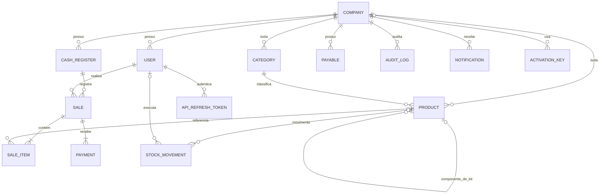

Não existe exclusão lógica uniforme. Vendas usam status/cancelamento lógico; produtos podem ser inativados; outras exclusões são físicas e protegidas por regras/FKs.

<a id="doc-documentacao-completa-md--9-api-rest-v1"></a>

##### 9. API REST v1

<a id="doc-documentacao-completa-md--91-convenções"></a>

###### 9.1 Convenções

- Base: `/api/v1`.
- `Content-Type: application/json` nas mutações JSON; multipart na importação.
- Autenticação: `Authorization: Bearer <access_token>`, salvo health/login/refresh/recuperação/exchange/ativação conforme fluxo.
- Paginação usa `page`/`per_page` nos recursos listáveis.
- Datas civis: `YYYY-MM-DD`; timestamps: ISO 8601.
- Erros comuns: `400` JSON/argumento inválido, `401` token/credencial, `403` permissão, `404` recurso, `409` conflito, `422` regra/validação, `429` rate limit, `503` dependência.

<a id="doc-documentacao-completa-md--92-endpoints"></a>

###### 9.2 Endpoints

| Método e rota | Objetivo e entrada principal | Autenticação/permissão |
|---|---|---|
| `GET /health` | disponibilidade básica | pública |
| `GET /health/dependencies` | estado seguro de DB/Redis | pública |
| `GET /health/version` | versão/commit do artefato implantado | pública, sem segredos |
| `POST /auth/login` | `identifier`, `password`; retorna identidade/tokens | pública, limitada, HTTPS exigido em produção |
| `POST /auth/registration-callback/exchange` | code/state/verifier PKCE | pública, limitada |
| `POST /auth/password-recovery/request` | identificador | pública, resposta não enumerável |
| `POST /subscription/activate` | credencial/key de ativação | limitada; fluxo de licença |
| `POST /auth/refresh` | refresh token; rotação | pública autenticada pelo token, limitada |
| `POST /auth/logout` | revoga sessão | Bearer |
| `GET /auth/me` | identidade, empresa e permissões | Bearer |
| `GET /settings/account` | snapshot da conta/configurações | Bearer |
| `PUT /settings/company` | nome/operação/taxas permitidas | `can_manage_settings` |
| `PUT /settings/profile` | dados pessoais | Bearer |
| `PUT /settings/password` | senha atual/nova | Bearer |
| `PUT /settings/backup` | frequência | admin/configurações |
| `POST /settings/backup/run` | backup manual | admin, rate limit |
| `GET /settings/export/<export_type>` | CSV de products/sales/cash/payables | `can_export_data` |
| `POST /settings/import/products` | CSV/XLSX multipart | `can_manage_products`, rate limit |
| `GET /settings/team` | integrantes | administração da equipe |
| `POST /settings/team` | cria funcionário e permissões | admin/configurações |
| `PUT /settings/team/<int:user_id>` | atualiza funcionário | admin/configurações, mesmo tenant |
| `GET /dashboard/summary` | métricas operacionais | Bearer/permissões refletidas |
| `GET /reports/summary` | período e agregados | `can_view_reports` |
| `GET /reports/products` | relatório paginado por produto | `can_view_reports` |
| `GET /audit/logs` | filtros/paginação | `can_view_audit_logs` |
| `GET /payables` | q/status/category/datas/página | `can_manage_payables` |
| `GET /payables/categories` | categorias conhecidas | `can_manage_payables` |
| `POST /payables` | descrição, categoria, valor, vencimento, notas | `can_manage_payables` |
| `POST /payables/<int:payable_id>/pay` | marca paga | `can_manage_payables` |
| `POST /payables/<int:payable_id>/reopen` | reabre | `can_manage_payables` |
| `GET /cash-registers/summary` | caixa atual/recentes | `can_manage_cash_register` |
| `GET /cash-registers/<int:cash_register_id>` | detalhe e timeline | `can_manage_cash_register` |
| `POST /cash-registers/open` | opening_amount | `can_manage_cash_register` |
| `POST /cash-registers/close` | id e closing_amount | `can_manage_cash_register` |
| `POST /sales` | items, payments, discount, idempotency key | `can_manage_sales` |
| `GET /sales/<int:sale_id>` | recibo do tenant | `can_manage_sales` |
| `POST /sales/<int:sale_id>/cancel` | motivo | `can_cancel_sales` |
| `GET /sales/today` | histórico/filtros/paginação | `can_manage_sales` |
| `GET /catalog/categories` | categorias/pesquisa | catálogo |
| `POST /catalog/categories` | nome | `can_manage_categories` |
| `PUT /catalog/categories/<int:category_id>` | nome | `can_manage_categories` |
| `DELETE /catalog/categories/<int:category_id>` | exclusão protegida | `can_manage_categories` |
| `GET /catalog/products` | q/barcode/categoria/status/preço/ordem/página | `can_view_products` |
| `POST /catalog/products` | produto completo | `can_manage_products` |
| `PUT /catalog/products/<int:product_id>` | produto completo | `can_manage_products` |
| `DELETE /catalog/products/<int:product_id>` | exclusão protegida | `can_manage_products` |
| `GET /stock/movements` | filtros/paginação | `can_view_stock_movements` |
| `POST /stock/entries` | produto, quantidade, custo/motivo | `can_manage_stock` |
| `POST /stock/adjustments` | produto, saldo/ajuste, motivo | `can_manage_stock` |
| `GET /notifications/email-alert-settings` | regras SMTP | configurações |
| `PUT /notifications/email-alert-settings` | regras/destinatários | configurações |
| `POST /notifications/email-alert-settings/test` | envio de teste | configurações |
| `GET /notifications` | filtros/paginação | Bearer |
| `GET /notifications/unread-count` | contador | Bearer |
| `PUT /notifications/<int:notification_id>/read` | marca lida | dono/tenant |
| `PUT /notifications/read-all` | marca todas | Bearer |
| `PUT /notifications/<int:notification_id>/dismiss` | descarta | dono/tenant |
| `GET /notifications/preferences` | preferências | Bearer |
| `PUT /notifications/preferences` | canais/severidade/horários | Bearer |

São 59 endpoints REST registrados no blueprint atual. O contrato exato de campos e serializadores está em `app/routes/api/v1.py` e nos modelos C# em `desktop_wpf/src/Girofy.Application/Models`. Novos clientes devem tolerar campos adicionais e usar os códigos de erro, não textos localizados.

<a id="doc-documentacao-completa-md--93-contratos-respostas-e-falhas-por-grupo"></a>

###### 9.3 Contratos, respostas e falhas por grupo

| Grupo | Entrada/validação autoritativa | Sucesso | Falhas típicas |
|---|---|---|---|
| Health | sem payload | status, dependências ou `version`/commit, sem credenciais | `503` quando DB/Redis obrigatório não responde |
| Autenticação | identificador/senha, refresh ou code PKCE; limites e validade no servidor | identidade, permissões e par access/refresh quando aplicável | `400`, `401`, `403`, `409`, `429` |
| Configurações/equipe | JSON por operação; IDs sempre revalidados no tenant | snapshot ou recurso atualizado em `data` | `400`, `403`, `404`, `409`, `422` |
| Catálogo/estoque | produto/categoria/quantidade/motivo; preço e saldo recalculados | entidade ou movimento persistido | `400`, `403`, `404`, `409`, `422` |
| Venda/caixa | itens, pagamentos, desconto, caixa e idempotency key; totais não são confiados ao cliente | venda/recibo ou caixa com totais do servidor | `403`, `404`, `409`, `422`, `429` |
| Contas/relatórios/auditoria | filtros, datas e paginação limitados | coleções paginadas e agregados | `400`, `403`, `404` |
| Notificações | filtros ou preferências; notificação precisa pertencer ao usuário/tenant | estado/contagem/preferências | `400`, `403`, `404`, `422` |

Sucesso usa `success=true`, `data`, `message=null` e `errors=[]`. Erros retornam `success=false`, `data=null`, `message` e item em `errors` com `code` estável e `field` opcional; a aplicação cliente não deve tomar decisões com base na mensagem traduzida. Todas as respostas recebem `Cache-Control: no-store`; `Retry-After` deve ser respeitado em `429`. IDs recebidos nunca substituem a resolução server-side da empresa autenticada.

<a id="doc-documentacao-completa-md--94-rotas-web-relevantes"></a>

###### 9.4 Rotas Web relevantes

Web usa `/login`, `/verify-email`, `/forgot-password`, `/reset-password/<token>`, `/assinaturas`, `/dashboard`, `/catalogo/produtos`, `/catalogo/categorias`, `/vendas`, `/vendas/nova`, `/caixa`, `/estoque/*`, `/contas-a-pagar`, `/relatorios`, `/auditoria`, `/configuracoes` e `/exportacoes/<type>`. O Master usa `/master`, `/master/adegas`, `/master/usuarios`, `/master/assinaturas`, `/master/logs` e `/master/auditoria`, com POSTs específicos para keys, renovação, acesso, status e exclusão.

<a id="doc-documentacao-completa-md--10-autenticação"></a>

##### 10. Autenticação

<a id="doc-documentacao-completa-md--101-web"></a>

###### 10.1 Web

Flask-Login mantém cookie de sessão HTTPOnly, SameSite configurável e Secure em produção. Sessão permanente dura 8 horas por padrão. Senhas usam `werkzeug.security.generate_password_hash(..., method="scrypt")`. Login bem-sucedido é auditado; mensagens tratam usuário/empresa inativos e e-mail pendente.

<a id="doc-documentacao-completa-md--102-appapi"></a>

###### 10.2 App/API

Access token assinado tem 15 minutos por padrão. Refresh token tem 30 dias, é aleatório, armazenado no servidor apenas por SHA-256 e rotacionado a cada uso. Registro guarda session ID, hash vinculado às credenciais, IP, user-agent, validade, revogação e substituição. Mudança de senha invalida o vínculo. O App protege a sessão em `%LocalAppData%` com DPAPI `CurrentUser` e faz escrita atômica.

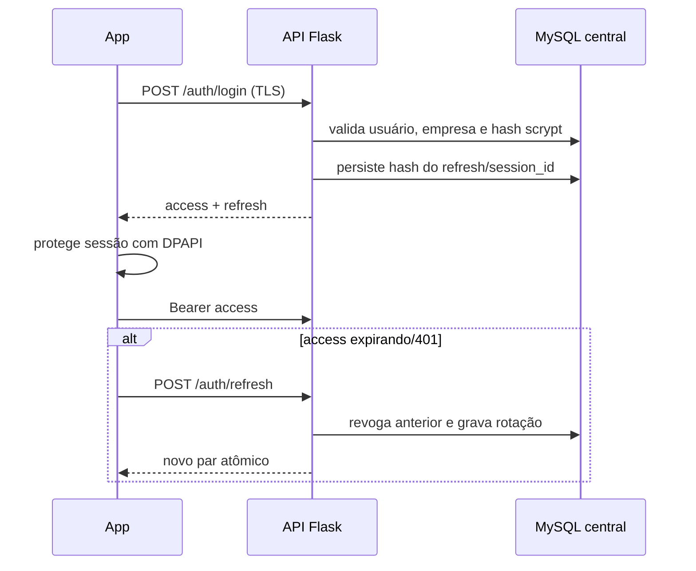

<a id="doc-documentacao-completa-md--103-recuperaçãocadastro-no-app"></a>

###### 10.3 Recuperação/cadastro no App

Recuperação solicita e-mail pelo backend. O cadastro principal ocorre na Web; o callback `girofy://` e o exchange PKCE permitem devolver a sessão ao App sem colocar senha na URI.

<a id="doc-documentacao-completa-md--11-autorização-e-permissões"></a>

##### 11. Autorização e permissões

Papéis: `master`, `admin`, `manager` e `operator`. Master/Admin passam em todas as permissões; demais usam flags. `can_view_products` é sempre permitido a usuário ativo e gestão implica visualização.

Permissões persistidas: visualizar/gerenciar produtos, categorias, vendas, cancelar vendas, caixa, relatórios, contas, configurações, estoque/movimentos e auditoria. `can_view_finance` e `can_export_data` são regras administrativas derivadas. A Web oferece override pontual com credencial de usuário autorizado da mesma empresa; a API rejeita sem permissão do token.

<a id="doc-documentacao-completa-md--12-multi-tenancy"></a>

##### 12. Multi-tenancy

1. O login resolve `User.company_id` no banco central.
2. `current_tenant_company()` usa a empresa do usuário; Master só acessa tenant após selecionar `session['master_company_id']`.
3. `tenant_engine()` valida nome do banco, cria/migra quando permitido e guarda engine em cache.
4. `tenant_session()` fornece sessão operacional específica.
5. Consultas e IDs ainda são filtrados por `company_id`.
6. Serviços revalidam produto, categoria, venda, caixa e usuário dentro do tenant.

Proteções existentes: banco físico por adega, filtros `company_id`, FKs, validação de IDs, permissões server-side e idempotência escopada por empresa. Risco residual: os bancos tenant replicam referências de empresa/usuário e usam a mesma metadata ampla; qualquer rota nova que use `db.session` no lugar de `tenant_session()` sem filtro pode quebrar o isolamento. Revisão de tenant deve ser obrigatória em code review.

<a id="doc-documentacao-completa-md--13-segurança"></a>

##### 13. Segurança

<a id="doc-documentacao-completa-md--131-controles-implementados"></a>

###### 13.1 Controles implementados

- scrypt para senhas; tokens/keys sensíveis mascarados em auditoria/logs.
- CSRF por token em Web e verificação de origem em métodos mutáveis.
- Não foi encontrada configuração CORS permissiva; Web e App usam os domínios HTTPS oficiais, e a Web permanece same-origin.
- Jinja mantém autoescape para HTML; CSP e validações complementam a mitigação de XSS, embora `'unsafe-inline'` reduza a força da política.
- ORM/queries parametrizadas; identificadores de banco passam por allowlist alfanumérica/underscore.
- Cookies HTTPOnly/SameSite/Secure em produção e HSTS quando Secure.
- CSP, `nosniff`, `X-Frame-Options: DENY`, `frame-ancestors 'none'`, Referrer/Permissions/COOP/CORP headers.
- Access token curto, refresh com hash/rotação/revogação e transporte seguro obrigatório.
- Rate limit Redis distribuído; produção recusa `memory://` e fallback.
- Respostas 429/503 não armazenáveis e logs de segurança com request ID.
- Upload limitado; CSV/XLSX parseado pelo backend sem executar macros.
- MySQL/Flask não expostos diretamente na interface pública do Compose.
- Backup pré-migration obrigatório e health checks pós-deploy.

<a id="doc-documentacao-completa-md--132-pontos-de-atenção"></a>

###### 13.2 Pontos de atenção

Não foram identificados segredos reais versionados nos arquivos examinados; exemplos usam placeholders. Não copie `.env`, `.env.save`, chaves OCI/SSH ou arquivos de backup para commits.

| Severidade | Quantidade | Achado |
|---|---:|---|
| Crítico | 0 | Nenhum problema crítico confirmado apenas pelo código. |
| Alto | 1 | A aplicação usa conta administrativa/root em `MYSQL_SERVER_DATABASE_URL` para criar e excluir bancos tenant; reduzir privilégios exige mudança coordenada de infraestrutura e rotação. |
| Médio | 6 | Container da aplicação sem `USER`; CSP permite `'unsafe-inline'`; Bootstrap é carregado de CDN sem SRI; não há restauração testada/off-site comprovada; isolamento depende de disciplina nas rotas novas apesar do banco por tenant; instalador não possui assinatura de código nem atualização automática verificada. |
| Baixo | 3 | Namespaces/protocolo/diretórios “Girofy” permanecem; actions exibem aviso de runtime Node antigo; ausência de cobertura E2E/browser visual automatizada. |

Recomendações: manter o bloqueio de transporte inseguro nas builds comerciais; adotar nonce/hash CSP e SRI ou servir o Bootstrap localmente; testar restauração e cópia off-site; criar testes automatizados de isolamento para toda rota nova; assinar instalador/atualizações; atualizar actions quando versões compatíveis forem disponíveis.

<a id="doc-documentacao-completa-md--14-painel-master"></a>

##### 14. Painel Master

O Master é administração global, não tenant comercial. Recursos:

- dashboard com métricas globais excluindo `is_system`;
- lista de adegas simplificada/expansível, estatísticas e edição;
- ativar/inativar, acessar para suporte e sair do acesso;
- exclusão protegida de empresa e banco tenant;
- usuários globais e exclusão protegida;
- assinaturas, geração/edição/renovação/cancelamento de keys e limpeza de histórico;
- logs técnicos e limpeza;
- auditoria Master.

As rotas verificam `current_user.role == 'master'`; usuário comum não deve conseguir selecionar outro tenant. Operações destrutivas exigem confirmação e são auditadas quando implementado no fluxo correspondente.

<a id="doc-documentacao-completa-md--15-assinaturas-e-licenças"></a>

##### 15. Assinaturas e licenças

Planos comerciais atuais:

| Plano | Preço mensal exibido | Estado |
|---|---:|---|
| Basic | R$ 50,00 | Implementado como rótulo/licença; sem limites técnicos específicos encontrados |
| Pro | R$ 120,00 | Implementado como rótulo/licença; inclui comercialmente o Basic |
| Ultimate | R$ 180,00 | “Mais completo”; inclui Pro e todas as novas funcionalidades/atualizações |

O botão **Assinar** abre WhatsApp com mensagem específica por plano e número configurável por `SUBSCRIPTION_WHATSAPP_NUMBER`. Não há gateway de cobrança, webhook, fatura ou renovação automática financeira.

Keys guardam plano, nome, ciclo (`monthly`, `quarterly`, `semiannual`, `annual`, `custom`), vencimento, status, empresa atribuída/usada, criador e datas. O Master gera e administra; a empresa ativa uma key válida. `Company.subscription_valid`/helpers determinam acesso. Nomes legados Essencial/Profissional/Premium são normalizados pelas migrations para Basic/Ultimate, mas não são opções novas.

**Limitação importante:** o código não aplica cotas de usuários/produtos/vendas nem feature flags por Basic/Pro/Ultimate. A diferenciação atual é comercial e de licenciamento, não de capacidades técnicas.

<a id="doc-documentacao-completa-md--16-web-app-e-master"></a>

##### 16. Web, App e Master

| Funcionalidade | Web | App Windows | Master |
|---|:---:|:---:|:---:|
| Login/logout/recuperação | ✅ | ✅ | ✅ Web |
| Cadastro inicial | ✅ | ↗️ abre/retoma Web | ❌ |
| Dashboard operacional | ✅ | ✅ | ❌ |
| Produtos/categorias/kits | ✅ | ✅ | via acesso assistido |
| Vendas/pagamentos/cancelamento | ✅ | ✅ | via acesso assistido |
| Caixa | ✅ | ✅ | via acesso assistido |
| Estoque | ✅ | ✅ | via acesso assistido |
| Contas a pagar | ✅ | ✅ | via acesso assistido |
| Relatórios | ✅ | ✅ | via acesso assistido |
| Auditoria tenant | ✅ | ✅ | ✅ global |
| Notificações/preferências | ✅ | ✅ | parcial/global |
| Equipe/configurações | ✅ | ✅ | usuários globais |
| Importação/exportação/backup | ✅ | ✅ via API | administração indireta |
| Gestão de adegas | ❌ | ❌ | ✅ |
| Gestão de keys/assinaturas | consulta/ativação | ativação | ✅ |
| Cobrança automática | ❌ | ❌ | ❌ |
| Clientes/fornecedores/fiscal | ❌ | ❌ | ❌ |

Diferenças: Web usa cookie/CSRF e renderização server-side; App usa Bearer/refresh/DPAPI e UX XAML. Master é exclusivamente Web. Regras críticas convergem nos serviços, mas algumas rotas Web ainda possuem adaptação própria de formulário/flash.

<a id="doc-documentacao-completa-md--17-responsividade-e-acessibilidade"></a>

##### 17. Responsividade e acessibilidade

Web usa grid/flex, tabelas com wrappers, painéis expansíveis e menu colapsável. `style.css` contém breakpoints reais em 1500, 1480, 1320, 1280, 1200, 1180, 1100, 1080, 1024, 980, 960, 900, 860, 820, 800, 780, 768, 760, 640, 575.98, 560, 520 e 480 px, além de ajustes por altura em 820 e 760 px e preferência por movimento reduzido. Em telas pequenas, grids viram coluna, botões podem ocupar largura total, sidebar torna-se móvel e tabelas usam scroll/representação compacta. No fechamento da venda Web, os meios de pagamento usam grid adaptativo (`auto-fit`/`minmax`) e passam a uma coluna até 640 px.

Produtos e painel Master possuem regras específicas de proporção. Modais e formulários de venda/cadastro foram ajustados para desktop e celular. Tema Light/Dark, tamanho de texto, contraste, negrito e `prefers-reduced-motion` são persistidos no `localStorage`.

O WPF usa recursos dinâmicos, layouts responsivos à janela, virtualização, scroll e acessibilidade Windows. As barras de rolagem visuais são ocultadas globalmente, sem remover navegação por roda, teclado ou toque. No fechamento da venda, meios de pagamento e resumo ficam lado a lado a partir de 640 px e empilhados abaixo disso; os quatro meios permanecem internamente em coluna vertical para evitar desaparecimento ou quebra ao redimensionar. Homologação visual em Windows real, DPI 100/125/150% e resoluções mínimas continua necessária; CI valida estrutura/build, não aparência.

<a id="doc-documentacao-completa-md--18-configuração-e-variáveis-de-ambiente"></a>

##### 18. Configuração e variáveis de ambiente

Nunca documente valores reais. Exemplos seguros:

| Variável | Obrigatória em produção | Finalidade/exemplo seguro |
|---|:---:|---|
| `APP_BASE_DIR` | não | diretório-base de runtime; útil em executável/instalação |
| `APP_ENV` | ✅ | `production`/`development` |
| `FLASK_ENV` | legado | fallback de ambiente quando `APP_ENV` não existe |
| `APP_VERSION`/`BUILD_SHA` | recomendada | versão/commit exposto com segurança por `/api/v1/health/version` |
| `SECRET_KEY` | ✅ | assinatura de sessão; `<segredo-longo>` |
| `API_TOKEN_SECRET` | recomendada | segredo distinto para access token |
| `BUSINESS_TIMEZONE` | não | `America/Sao_Paulo` |
| `SCHEMA_MANAGEMENT_MODE` | ✅ | produção `verify`; dev `upgrade` |
| `FLASK_DEBUG` | ✅ | produção `0` |
| `TESTING` | testes | habilita comportamento de teste; nunca em produção |
| `MASTER_DEFAULT_USERNAME` | ✅ | login bootstrap Master |
| `MASTER_DEFAULT_PASSWORD` | ✅ | `<senha-forte>`; default recusado em produção |
| `PASSWORD_MIN_LENGTH`/`MAX_LENGTH` | não | `8`/`128` |
| `CSRF_ENABLED` | ✅ | `1` |
| `SESSION_LIFETIME_HOURS` | não | `8` |
| `SESSION_COOKIE_SECURE` | ✅ com HTTPS | `1` |
| `SESSION_COOKIE_SAMESITE` | não | `Lax` |
| `MAX_CONTENT_LENGTH` | não | `8388608` |
| `API_ACCESS_TOKEN_MINUTES` | não | `15` |
| `API_REFRESH_TOKEN_DAYS` | não | `30` |
| `API_LOGIN_ATTEMPT_LIMIT` | não | `5` |
| `API_LOGIN_BLOCK_SECONDS` | não | `900` |
| `API_ALLOW_INSECURE_AUTH` | ✅ | produção `0` |
| `TRUST_PROXY_HEADERS` | ✅ atrás do Caddy | `1` |
| `TRUSTED_PROXY_COUNT` | ✅ | `1` para Compose atual |
| `RATELIMIT_ENABLED` | ✅ | `1` |
| `RATELIMIT_STORAGE_URI` | ✅ | `redis://redis:6379/0` |
| `RATELIMIT_IN_MEMORY_FALLBACK_ENABLED` | ✅ | produção `0` |
| `RATELIMIT_KEY_PREFIX` | não | `girofy` (legado interno) |
| `RATELIMIT_LOGIN` | não | `10 per 5 minutes` |
| `RATELIMIT_PASSWORD_RESET` | não | `3 per 15 minutes` |
| `RATELIMIT_EMAIL_RESEND` | não | `3 per 15 minutes` |
| `RATELIMIT_REGISTRATION` | não | `3 per hour` |
| `RATELIMIT_ACTIVATION` | não | `5 per 15 minutes` |
| `RATELIMIT_REFRESH` | não | `120 per hour` |
| `RATELIMIT_API_GENERAL` | não | `600 per minute` |
| `RATELIMIT_IMPORT/BACKUP/EXPORT/ADMIN` | não | limites por operação |
| `SUBSCRIPTION_WHATSAPP_NUMBER` | não | número E.164 sem símbolos |
| `SUBSCRIPTION_COMMERCIAL_ENABLED` | não | habilita o fluxo comercial; homologação usa `0` |
| `MYSQL_USER/PASSWORD/HOST/PORT/DATABASE` | ✅ | conexão central, senha mascarada |
| `DATABASE_URL` | opcional | substitui campos MySQL; nunca versionar credenciais |
| `MYSQL_TENANT_DATABASE_PREFIX` | não | `adega` |
| `MYSQL_TENANT_DATABASE_URL_TEMPLATE` | opcional | template `{database}` |
| `MYSQL_SERVER_DATABASE_URL` | ✅ para provisionar | conexão administrativa mascarada |
| `MYSQL_ROOT_PASSWORD` | ✅ Compose | `<senha-root-forte>` |
| `PUBLIC_BASE_URL` | produção | `https://www.skygest.com.br` (host canônico) |
| `MAIL_SMTP_SERVER/PORT/LOGIN/PASSWORD` | se e-mail ativo | SMTP; password secreto |
| `MAIL_FROM_EMAIL/NAME` | se e-mail ativo | remetente SkyGest |
| `MAIL_SUPPRESS_SEND` | testes | `1` em testes |
| `GMAIL_*`/`BREVO_*` | legado | aliases de compatibilidade SMTP; prefira `MAIL_*` |
| `PORT` | não | Flask local `5001`; container sobrescreve `5003` |
| `GIROFY_SITE_ADDRESS` | Compose | domínio/endereço do Caddy |
| `GIROFY_PUBLIC_HTTP_PORT` | não | `18080` |
| `AUTO_BACKUP_ENABLED/INTERVAL_SECONDS` | não | `1`/`86400` |
| `AUTO_BACKUP_RETENTION_DAYS/COUNT` | não | `30`/`30` |
| `GIROFY_BACKUP_HOST_DIR/UID/GID` | Compose | volume/permissões de backup |
| `HML_SITE_ADDRESS/HML_LOOPBACK_PORT` | HML | endereço Caddy e porta loopback, padrão `:18081`/`18081` |
| `HML_BACKUP_HOST_DIR` | HML | diretório de backup exclusivo de homologação |
| `AUTO_AUDIT_CLEANUP_ENABLED` | não | `1` |
| `AUTO_AUDIT_CLEANUP_INTERVAL_SECONDS` | não | `259200` |
| `AUTO_AUDIT_RETENTION_DAYS` | não | `90` |
| `OCI_*` | somente provisionamento | região, shape, rede e caminhos; OCIDs/chaves são secretos |

Homologação usa `.env.hml` separado, `APP_ENV=homologation`, `PUBLIC_BASE_URL=https://hml.skygest.com.br`, banco central `skygest_hml_central`, prefixo tenant `skygest_hml_tenant`, prefixo Redis próprio, porta local `18081`, credenciais/secrets exclusivos e retenção de backup de 14 dias. Produção usa `.env`, `adega_central`, prefixo `adega`, porta interna pública legada `18080` e retenção padrão de 30 dias/30 cópias. Arquivos reais não são versionados.

No App, `SKYGEST_ENVIRONMENT` seleciona o ambiente; `GIROFY_API_BASE_URL`, `GIROFY_ALLOW_INSECURE_HTTP` e `GIROFY_API_TIMEOUT_SECONDS` podem sobrescrever a configuração. `appsettings.json` aponta para `https://www.skygest.com.br`; `appsettings.Homologation.json`, para `https://hml.skygest.com.br`; ambos mantêm transporte inseguro desabilitado. O cliente normaliza o host legado sem `www` antes de enviar requisições autenticadas.

Para evitar ambiguidade nos grupos da tabela: a conexão central lê individualmente `MYSQL_USER`, `MYSQL_PASSWORD`, `MYSQL_HOST`, `MYSQL_PORT` e `MYSQL_DATABASE`; a política de senha lê `PASSWORD_MIN_LENGTH` e `PASSWORD_MAX_LENGTH`; os limites especiais são `RATELIMIT_IMPORT`, `RATELIMIT_BACKUP`, `RATELIMIT_EXPORT` e `RATELIMIT_ADMIN`; SMTP usa `MAIL_SMTP_SERVER`, `MAIL_SMTP_PORT`, `MAIL_SMTP_LOGIN`, `MAIL_SMTP_PASSWORD`, `MAIL_FROM_EMAIL` e `MAIL_FROM_NAME`. `config.py` também aceita os aliases legados `GMAIL_SMTP_SERVER`, `GMAIL_SMTP_PORT`, `GMAIL_SMTP_LOGIN`, `GMAIL_APP_PASSWORD`, `BREVO_SMTP_SERVER`, `BREVO_SMTP_PORT`, `BREVO_SMTP_LOGIN`, `BREVO_SMTP_PASSWORD`, `BREVO_FROM_EMAIL` e `BREVO_FROM_NAME`. Eles são compatibilidade, não integrações separadas comprovadas.

<a id="doc-documentacao-completa-md--19-instalação-local"></a>

##### 19. Instalação local

<a id="doc-documentacao-completa-md--191-webbackend"></a>

###### 19.1 Web/backend

Pré-requisitos: Python 3.13, MySQL 8 compatível e, para simular produção, Redis/Docker.

```bash
git clone <repositorio>
cd pdv-adega-jf
python3.13 -m venv .venv
source .venv/bin/activate
python -m pip install -r requirements.txt
cp .env.example .env
# edite .env sem versionar segredos
python scripts/schema_migrate.py upgrade-all
python app.py
```

Acesse `http://127.0.0.1:5001/login` conforme o `PORT`. O bootstrap cria a conta Master a partir das variáveis somente quando necessário. Em produção, defaults inseguros impedem inicialização.

<a id="doc-documentacao-completa-md--192-testes-backend"></a>

###### 19.2 Testes backend

```bash
TESTING=1 MAIL_SUPPRESS_SEND=1 python -m unittest discover
python scripts/schema_migrate.py --help
```

<a id="doc-documentacao-completa-md--193-app-windows"></a>

###### 19.3 App Windows

Em Windows com SDK .NET 8:

```powershell
dotnet restore desktop_wpf/Girofy.Desktop.sln
dotnet test desktop_wpf/tests/Girofy.UnitTests/Girofy.UnitTests.csproj -c Release
dotnet run --project desktop_wpf/src/Girofy.Desktop/Girofy.Desktop.csproj
```

Configure `desktop_wpf/src/Girofy.Desktop/appsettings.json` para uma URL HTTPS antes de distribuição.

<a id="doc-documentacao-completa-md--20-docker-e-infraestrutura"></a>

##### 20. Docker e infraestrutura

```bash
docker compose -f docker-compose.oci.yml up -d
docker compose -f docker-compose.oci.yml ps
docker compose -f docker-compose.oci.yml logs --tail=200 app caddy mysql redis backup
docker compose -f docker-compose.oci.yml down
```

| Serviço | Produção | Homologação | Observação |
|---|---|---|---|
| MySQL 8.4 | volume `girofy_mysql_data` | volume/rede exclusivos HML | somente rede, utf8mb4 e health check |
| Redis 7.4.2 | rede PROD | rede/prefixo HML | somente rede, tmpfs, allkeys-lru, read-only e sem persistência |
| App | `127.0.0.1:5003` | serviço/volume HML isolado | Gunicorn 1 worker/4 threads; HML possui limites de memória próprios |
| Backup | `/opt/girofy/backups` | diretório/volume HML exclusivo | mysqldump completo e limpeza de auditoria |
| Caddy 2 | loopback `18080` legado | loopback `18081` | reverse proxy interno para o app do ambiente, gzip |

Produção e homologação usam projetos Compose, redes, volumes, bancos, Redis, secrets e backups independentes. O proxy Nginx do host é a borda HTTPS pública: `www.skygest.com.br` é o host canônico de produção, o domínio sem `www` redireciona para ele e `hml.skygest.com.br` encaminha para o Caddy HML em `127.0.0.1:18081`. O Compose aplica `restart: unless-stopped`. Backup/Redis removem capabilities e usam `no-new-privileges`; Redis e backup são read-only (com tmpfs para Redis).

<a id="doc-documentacao-completa-md--21-produção-e-deploy"></a>

##### 21. Produção e deploy

Fluxo real:

```mermaid
flowchart LR
    D[Commit] --> G[Push main]
    G --> T[GitHub Actions: testes backend e WPF]
    T --> R[Runner self-hosted OCI]
    R --> B[rsync preservando .env/dados]
    B --> I[Build app/backup]
    I --> DB[Subir MySQL/Redis]
    DB --> BK[Backup obrigatório]
    BK --> MG[upgrade-all central/tenants]
    MG --> UP[Atualizar app/backup/Caddy]
    UP --> H[Health: login, DB e Redis]
```

Workflow de produção: `.github/workflows/deploy-oci-self-hosted.yml`, disparado por push em `main`, exceto alterações somente `docs/**`/`*.md`, ou manualmente. Runner: `self-hosted`, `linux`, `girofy-oci`; caminho padrão `/opt/girofy/app`. O deploy faz backup, executa `upgrade-all`, remove com segurança eventual banco tenant legado do Painel Master e valida login/dependências/versão. O contexto central do Master permanece com `is_system=1` e `database_path=''`, sem banco de adega.

Workflow de homologação: `.github/workflows/deploy-hml-oci.yml`, disparado por push em `develop` ou manualmente. Ele executa a mesma validação de backend/WPF, implanta o Compose HML isolado e verifica HTTPS e health em `https://hml.skygest.com.br`. Alterações devem ser promovidas de `develop` para `main` somente após homologação; os dois ambientes não compartilham dados nem credenciais.

`scripts/deploy_self_hosted_app.sh` usa `rsync --delete`, exclui `.env`, Git, venvs, caches, logs, backups, reports, database, build e dist; builda; faz dump completo obrigatório; migra; sobe serviços; valida `/login`, `/health/dependencies` e `/api/v1/health/dependencies`.

Fallback manual/SSH: `.github/workflows/deploy-oci.yml` e `scripts/deploy_oci_app.sh`. Rollback seguro requer parar escritas, restaurar o dump pré-deploy e publicar commit anterior; não existe botão de rollback nem downgrade destrutivo automático.

Os domínios operacionais são `https://www.skygest.com.br` (produção; host canônico) e `https://hml.skygest.com.br` (homologação). `https://skygest.com.br` permanece como entrada legada com redirecionamento. A configuração versionada documenta o encaminhamento interno, mas não contém credenciais nem permite afirmar o provedor/gestão externa do DNS ou certificado.

<a id="doc-documentacao-completa-md--22-cicd-releases-e-instalador"></a>

##### 22. CI/CD, releases e instalador

<a id="doc-documentacao-completa-md--221-web"></a>

###### 22.1 Web

O workflow de deploy instala Python 3.13, dependências, executa `python -m unittest discover`, valida heads (`central_0010`, `tenant_0011`) e sintaxe dos scripts. Só depois libera a OCI.

<a id="doc-documentacao-completa-md--222-windows-preview"></a>

###### 22.2 Windows preview

`.github/workflows/build-windows-wpf.yml` roda em `windows-latest` quando `desktop_wpf` ou contratos relacionados mudam, além de execução manual/PR. Etapas:

1. validar versão e regras XAML;
2. instalar .NET 8/Python 3.13;
3. executar contratos backend (uma repetição em falha isolada);
4. restore e testes xUnit;
5. publish `win-x64`, self-contained, single-file;
6. smoke test de inicialização;
7. instalar Inno Setup 6, criar/testar instalador;
8. publicar artefatos por 7 dias;
9. substituir assets da release prerelease `windows-preview`.

Versão atual: `0.9.18`, assembly/file `0.9.18.0`, informational `0.9.18-preview`. Artefatos esperados: `SkyGest.exe`, `SkyGest-Setup-0.9.18.exe` e o instalador separado de homologação. Instalação por usuário em `%LocalAppData%\Programs\SkyGest`, sem elevação. O CI executa smoke test do ciclo de instalar/iniciar/desinstalar para os dois canais. Code Signing e atualização automática não foram encontrados.

O protocolo `girofy://` é legado intencional para callback. Upgrade remove executável/atalhos Girofy antigos e preserva dados locais.

<a id="doc-documentacao-completa-md--23-logs-auditoria-e-observabilidade"></a>

##### 23. Logs, auditoria e observabilidade

Backend configura logs em `logs/`, incluindo erros e eventos de segurança, com request ID e mascaramento. Containers persistem `girofy_logs`; diagnóstico usa `docker compose logs`. Erros 500 exibem request ID ao usuário sem stack trace.

O App usa `LocalFileLoggerProvider` e mantém logs sob o caminho legado `%LocalAppData%\Girofy\logs`. Tokens e cabeçalhos Authorization não devem ser registrados. Exceções de UI/tarefa possuem handlers globais.

`audit_logs` é trilha funcional, não substitui log técnico. Limpeza automática remove auditoria anterior a 90 dias por padrão em central/tenants. Health checks expõem somente estados de database/Redis, sem credenciais.

Não foram encontrados APM, OpenTelemetry, Prometheus, tracing distribuído ou agregador externo.

<a id="doc-documentacao-completa-md--24-tratamento-de-erros"></a>

##### 24. Tratamento de erros

- Web usa flash, validações de campo e páginas 400/404/429/500/503.
- API usa envelope estável e `SaleOperationError`, `CashRegisterOperationError`, `ProductOperationError` e validações auxiliares.
- Transações fazem rollback em exceção; fechamento de sessão tenant ocorre no teardown.
- Rate limit indisponível falha fechado em produção com 503.
- App converte HTTP/timeout/contrato em `GirofyApiException`, mensagens de ViewModel e ações de retry; refresh concorrente é coordenado.
- Banco/migration com schema atrasado impede startup/deploy em `verify`.

Inconsistência: rotas Web históricas ainda possuem validações próprias além dos serviços compartilhados. Mudanças de regra devem priorizar serviços e testes de paridade.

<a id="doc-documentacao-completa-md--25-backup-e-recuperação"></a>

##### 25. Backup e recuperação

Implementado:

- container `backup` executa `mysqldump --all-databases`, single transaction, routines/events/triggers/hex-blob;
- arquivo temporário é validado, renomeado atomicamente e recebe modo `600`;
- periodicidade padrão diária; retenção 30 dias/30 cópias;
- volume host padrão `/opt/girofy/backups`;
- backup obrigatório antes de migrations;
- backup manual por configurações/API e metadados em `Company`.

Parcial/não comprovado:

- não há restauração guiada na interface;
- não há teste automatizado periódico de restore;
- não há replicação off-site, criptografia própria dos dumps ou política formal de desastre no código.

Procedimento de emergência deve ser ensaiado: parar escrita, copiar dump para ambiente seguro, restaurar com cliente MySQL, verificar heads, executar health/tests e documentar RPO/RTO.

<a id="doc-documentacao-completa-md--26-testes"></a>

##### 26. Testes

Backend: 291 testes descobertos por `unittest`. Cobrem Web/API, autenticação, tenant, permissões, vendas, caixa, estoque, catálogo, relatórios, importação histórica, Master, assinatura, segurança, rate limit, precisão Decimal/Numeric e contratos visuais críticos. A suíte foi aprovada localmente no commit auditado em 10/09/2026 e é executada integralmente nos workflows de deploy.

App: o código contém 162 `[Fact]`, 16 `[Theory]` e 82 `[InlineData]`, equivalentes a 244 casos estaticamente enumeráveis. Eles cobrem ViewModels, sessão/refresh, catálogo, vendas, caixa, estoque, contas, relatórios, auditoria, notificações, acessibilidade, formatação monetária/data, scanner, dashboards e behaviors. A execução local não foi possível nesta auditoria porque o SDK `dotnet` não está instalado; os workflows estão configurados para testar, compilar, iniciar o executável e testar os instaladores.

Lacunas: ausência de percentual de cobertura publicado; E2E browser completo; testes visuais/snapshots; carga/soak; concorrência distribuída com múltiplas instâncias; restore real; homologação manual de DPI/periféricos.

<a id="doc-documentacao-completa-md--27-performance-e-concorrência"></a>

##### 27. Performance e concorrência

Controles existentes: paginação de produtos/API/estoque/auditoria, eager loading seletivo, agregações SQL, virtualização WPF, debounce/cancelamento de busca, cache de detalhes, idempotência de venda, `FOR UPDATE` e lock por empresa/caixa. Engines tenant e sincronização de referência têm cache/lock; sync é limitado a 300 s.

Pontos de atenção: um worker Gunicorn com quatro threads limita escala; criação de engine por tenant cresce com número de empresas e não possui política explícita de expiração; contexto Web pode calcular notificações/alertas em requisições; relatórios/agregações crescerão com volume; índices devem acompanhar filtros.

Recomenda-se medir antes de otimizar: slow query log, EXPLAIN, latência p95/p99, cardinalidade por tenant e tamanho de auditoria/notificações.

<a id="doc-documentacao-completa-md--28-fluxos-importantes"></a>

##### 28. Fluxos importantes

<a id="doc-documentacao-completa-md--281-venda"></a>

###### 28.1 Venda

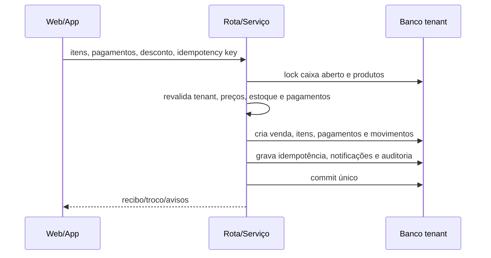

<a id="doc-documentacao-completa-md--282-cancelamento"></a>

###### 28.2 Cancelamento

Usuário autorizado informa motivo → backend bloqueia/revalida venda → marca `cancelled` → devolve exatamente o estoque registrado (incluindo kit) → mantém itens/pagamentos → audita → indicadores usam `Sale.valid_filter()`.

<a id="doc-documentacao-completa-md--283-assinatura"></a>

###### 28.3 Assinatura

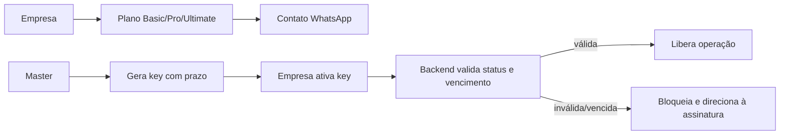

<a id="doc-documentacao-completa-md--29-dependências"></a>

##### 29. Dependências

Dependências Python diretas estão em `requirements.txt`, com faixas amplas e sem lock/hashes. Dependências .NET usam versões fixas nos `.csproj`. Imagens Docker fixam MySQL 8.4 e Redis 7.4.2, mas Caddy usa tag major `2` e Python base `3.13-slim` mutável.

Pontos recomendados: gerar lock/SBOM e rotina de atualização; fixar digest de imagens críticas; executar scanner de dependências/imagem. Nenhuma dependência foi removida nesta auditoria. Não foi possível afirmar vulnerabilidades concretas sem consulta a banco CVE no instante da build.

<a id="doc-documentacao-completa-md--30-troubleshooting"></a>

##### 30. Troubleshooting

<a id="doc-documentacao-completa-md--aplicação-não-inicia"></a>

###### Aplicação não inicia

```bash
docker compose -f docker-compose.oci.yml ps
docker compose -f docker-compose.oci.yml logs --tail=200 app
curl -i http://127.0.0.1:18080/health/dependencies
```

Verifique `.env`, defaults recusados, Redis obrigatório e schema em head.

<a id="doc-documentacao-completa-md--bancomigration"></a>

###### Banco/migration

```bash
python scripts/schema_migrate.py central-current
python scripts/schema_migrate.py tenants-status
python scripts/schema_migrate.py upgrade-all
```

Não rode downgrade destrutivo. Confirme backup antes de upgrade.

<a id="doc-documentacao-completa-md--containerredismysql"></a>

###### Container/Redis/MySQL

```bash
docker compose -f docker-compose.oci.yml logs --tail=200 mysql redis
docker compose -f docker-compose.oci.yml exec mysql mysqladmin ping -uroot -p
docker compose -f docker-compose.oci.yml exec redis redis-cli ping
```

<a id="doc-documentacao-completa-md--http-429503"></a>

###### HTTP 429/503

Leia `Retry-After`; 429 indica limite. 503 de rate limit pode indicar Redis indisponível. Não desative proteção em produção.

<a id="doc-documentacao-completa-md--app-não-conecta"></a>

###### App não conecta

Confirme URL HTTPS, relógio do Windows, `/api/v1/health/dependencies`, proxy/certificado e logs `%LocalAppData%\Girofy\logs`. `AllowInsecureHttp` deve ser falso em release comercial.

<a id="doc-documentacao-completa-md--logincadastro"></a>

###### Login/cadastro

Confirme e-mail verificado, usuário/empresa ativos e assinatura. Cadastro repetido pendente deve continuar em `/verify-email`, não criar nova empresa.

<a id="doc-documentacao-completa-md--deploy-falhou"></a>

###### Deploy falhou

Abra o job, identifique teste/backup/migration/health. A versão anterior permanece quando backup/migration falha antes da atualização. Não apague `.env`/backups para “corrigir”.

<a id="doc-documentacao-completa-md--31-dívida-técnica"></a>

##### 31. Dívida técnica

<a id="doc-documentacao-completa-md--prioridade-alta"></a>

###### Prioridade alta

1. Criar teste e procedimento formal de restauração/off-site, com RPO/RTO.
2. Ampliar testes de isolamento tenant e concorrência com MySQL real.
3. Definir assinatura de código e cadeia confiável de atualização do instalador Windows.

<a id="doc-documentacao-completa-md--prioridade-média"></a>

###### Prioridade média

1. Validar `central_0010`/`tenant_0011` em uma cópia recente e anonimizada antes de futura promoção.
2. Reduzir `'unsafe-inline'` da CSP.
3. Consolidar validações Web/API nos serviços compartilhados.
4. Definir ciclo de vida/limite do cache de engines tenant.
5. Introduzir lock de dependências, SBOM e scanning.
6. Aplicar SRI ou hospedar localmente os assets Bootstrap atualmente carregados do CDN.
7. Instrumentar métricas/latência e slow queries.

<a id="doc-documentacao-completa-md--prioridade-baixa"></a>

###### Prioridade baixa

1. Concluir renomeação interna Girofy sem quebrar upgrade/protocolo.
2. Atualizar actions que geram aviso de Node runtime.
3. Automatizar testes visuais e documentação de screenshots.
4. Reduzir documentos históricos duplicados após aprovação deste documento.

<a id="doc-documentacao-completa-md--32-roadmap-técnico-sugerido"></a>

##### 32. Roadmap técnico sugerido

<a id="doc-documentacao-completa-md--curto-prazo"></a>

###### Curto prazo

- **IMPLEMENTADO:** planos/preços e contato WhatsApp, idempotência, Redis, migrations e backups.
- **IMPLEMENTADO:** transporte HTTPS obrigatório no App; produção e homologação independentes na OCI.
- **IMPLEMENTADO:** campos financeiros migrados para `Numeric`, cálculos normalizados em `Decimal` e serialização JSON compatível por `simplejson`.
- **RECOMENDADO:** teste de restore; homologação 0.9.18 em Windows 10/11 e DPI variados; corrigir alertas do workflow.

<a id="doc-documentacao-completa-md--médio-prazo"></a>

###### Médio prazo

- **RECOMENDADO:** cobrança real/webhooks idempotentes, cotas/feature flags por plano, E2E, observabilidade e API compatibility policy.
- **PARCIAL:** preferências de digest existem no banco, mas agendamento completo não foi confirmado.

<a id="doc-documentacao-completa-md--longo-prazo"></a>

###### Longo prazo

- **FUTURO:** clientes/fornecedores, comprovante/impressão/fiscal conforme definição legal, cancelamento parcial, integrações de pagamento, atualização automática assinada e escala horizontal medida.

Nada nesta seção deve ser tratado como funcionalidade disponível.

<a id="doc-documentacao-completa-md--33-onboarding-de-desenvolvedor"></a>

##### 33. Onboarding de desenvolvedor

1. Leia este documento e `app/__init__.py`, `config.py`, `app/tenant.py`.
2. Entenda modelos em `app/models` e heads das duas árvores.
3. Para regras, comece por `app/services`; rotas devem adaptar HTTP, não duplicar domínio.
4. Web: blueprint → template → `main.js`/`style.css`.
5. App: modelo/abstração → `GirofyApiClient` → ViewModel → XAML → teste.
6. Ao criar endpoint: autentique, aplique permissão, resolva tenant, valide entrada/IDs, use serviço/transação, serialize envelope e teste 401/403/404/tenant.
7. Ao mudar schema: crie revisão central ou tenant, teste banco vazio/legado e atualize heads do workflow.
8. Ao mudar contrato usado pelo App: teste backend e xUnit; mantenha compatibilidade.
9. Rode testes proporcionais e nunca versione `.env`, dumps, logs, tokens ou artefatos.
10. Deploy ocorre somente após commit/push autorizado; documentação Markdown isolada não dispara produção.

Padrões relevantes: `Decimal` para dinheiro, data civil sem fuso, timestamp ISO/UTC, texto pt-BR na UI, permissions server-side, diffs de auditoria e `apply_patch`/commits focados.

<a id="doc-documentacao-completa-md--34-estados-de-implementação"></a>

##### 34. Estados de implementação

<a id="doc-documentacao-completa-md--implementado-no-código-auditado"></a>

###### Implementado no código auditado

Web/API, App WPF preview, multi-tenancy físico, autenticação Web/token, produtos/kits/categorias, estoque, vendas, caixa, contas, relatórios, importação histórica, auditoria, notificações, equipe, Master, keys, import/export, backup, Redis, migrations, CI/CD, instalador preview e configurações isoladas de produção/homologação. Esta auditoria não verificou o estado implantado dos ambientes.

<a id="doc-documentacao-completa-md--parcialmente-implementado"></a>

###### Parcialmente implementado

Planos sem cobrança/cotas; digest de notificação sem scheduler confirmado; backup sem restore/off-site formal; rebranding interno incompleto; acessibilidade/responsividade dependem de homologação visual; App é preview sem assinatura/auto-update.

<a id="doc-documentacao-completa-md--planejadorecomendado"></a>

###### Planejado/recomendado

Gateway de pagamento, limites por plano, clientes, fornecedores, emissão fiscal, cancelamento parcial, integração adquirente, observabilidade e testes E2E/visuais.

<a id="doc-documentacao-completa-md--legadodepreciado"></a>

###### Legado/depreciado

Nomes Girofy internos, protocolo `girofy://`, caminhos locais e aliases SMTP; planos Essencial/Profissional/Premium apenas para migração; workflow OCI via SSH é fallback ao self-hosted.

<a id="doc-documentacao-completa-md--35-divergências-corrigidas"></a>

##### 35. Divergências corrigidas

- “Girofy” substituído por SkyGest como nome do produto; nomes internos foram classificados como legado.
- Versão corrente atualizada para `0.9.18-preview`; marcos históricos permanecem no changelog.
- Cadastro antigo com dados de adega/pessoa corrigido para usuário, e-mail e senha.
- Planos antigos/dois planos corrigidos para Basic/Pro/Ultimate e preços 50/120/180.
- Pro deixou de ser “Mais completo”; Ultimate recebe o destaque e novas funcionalidades.
- Cobrança descrita como WhatsApp/manual, não gateway.
- Heads antigos evoluídos para `central_0010`/`tenant_0011`.
- Painel Master explicitamente não é adega: `is_system` fica no banco central apenas como contexto de identidade, sem `database_path` e sem banco tenant.
- IP HTTP histórico não foi tratado como endpoint público atual; App e domínios atuais usam HTTPS com transporte inseguro desabilitado.
- Backup formal existe, portanto a frase “estratégia não identificada” seria incorreta; restauração/off-site continuam pendentes.
- Clientes/fornecedores foram removidos da lista de recursos implementados porque não existem modelos/rotas.

<a id="doc-documentacao-completa-md--36-changelog-da-documentação"></a>

##### 36. Changelog da documentação

<a id="doc-documentacao-completa-md--10092026--auditoria-integral-no-estado-de-homologação"></a>

###### 10/09/2026 — auditoria integral no estado de homologação

- Commit de referência: `938e18ceedb6b6b49780a63027e82f6eaac97940`, branch local `mdcodex/style-stock-view`, coincidente com `origin/develop`.
- Recalculados 426 arquivos versionados, 22 tabelas/modelos, 59 endpoints da API v1, 291 testes backend e 244 casos WPF estaticamente enumeráveis.
- Versão Windows reconciliada como `0.9.18-preview`; heads reconciliados como `central_0010` e `tenant_0011`.
- Importação de relatórios históricos documentada como disponível conforme configuração atual, inclusive em produção para usuário autorizado; não cria vendas, caixa, estoque ou pagamentos.
- Segurança reconciliada com framing `DENY`, proteção de origem/proxy e pendências atuais de privilégios MySQL, usuário do container, CSP, restore/off-site e assinatura do instalador.
- Nenhum deploy, banco real, commit, push ou mudança de aplicação foi realizado.

<a id="doc-documentacao-completa-md--01092026--app-windows-0913"></a>

###### 01/09/2026 — App Windows 0.9.13

- Perfil do cabeçalho convertido em menu expansível com tema claro/escuro e encerramento de sessão.
- Ícones vetoriais próprios de Dinheiro, Débito, Crédito e Pix aplicados no Caixa e na finalização da venda.
- Navegação por setas corrigida para avançar um campo por vez na ordem Dinheiro, Débito, Crédito e Pix.
- Versão do executável e instalador avançada para `0.9.13-preview`.

<a id="doc-documentacao-completa-md--01092026--app-windows-0912"></a>

###### 01/09/2026 — App Windows 0.9.12

- Cabeçalho autenticado refinado com marca, tema, notificações, perfil e saída em componentes visuais consistentes.
- Meios de pagamento do Caixa receberam ícones vetoriais próprios para Dinheiro, Pix, Débito e Crédito no resumo atual e nos detalhes históricos.
- Versão do executável e instalador avançada para `0.9.12-preview`.

<a id="doc-documentacao-completa-md--01092026--auditoria-incremental-integral-até-0911"></a>

###### 01/09/2026 — auditoria incremental integral até 0.9.11

- Commit de referência: `e5552cb`, no branch local `codex/style-stock-view` e idêntico ao `main` de produção no momento da auditoria.
- 397 arquivos versionados e 321 arquivos das áreas operacionais principais inventariados; 22 tabelas/modelos funcionais e 59 endpoints REST reconferidos.
- Versão Windows atualizada para `0.9.11-preview`, com executável e instalador `SkyGest-Setup-0.9.11.exe`.
- Migrações `central_0009`/`tenant_0009`, tipos `Numeric`, cálculos `Decimal`, limites monetários, arredondamento e serialização `simplejson` documentados.
- Dashboards Web/App, gráfico de rosca sem `NaN`, gráficos nativos WPF, URL canônica `www`, ícones, barras de rolagem ocultas e meios de pagamento verticais/responsivos reconciliados com o código.
- Suítes reconferidas: 260 testes backend aprovados localmente e 239 testes WPF aprovados no CI; smoke tests do executável e instalador permanecem no pipeline.
- Segurança mantida em 0 achados críticos, 0 altos, 5 médios e 3 baixos; a varredura dos arquivos versionados não encontrou padrões conhecidos de chaves privadas ou tokens reais.
- Segunda passagem cruzou código, migrations, dependências, contratos, Compose, scripts, workflows, assets, testes e documentos ativos; materiais de marco foram preservados como históricos.

<a id="doc-documentacao-completa-md--30082026--auditoria-integral-e-ambientes-separados"></a>

###### 30/08/2026 — auditoria integral e ambientes separados

- Commit analisado e implantado: `87e4917`, presente em `main` e `develop`.
- 355 arquivos relevantes inventariados; 22 tabelas/modelos funcionais e 59 endpoints REST conferidos com o código.
- Versão Windows conferida como `0.9.2-preview`; configuração de produção e homologação validada com HTTPS.
- Suítes conferidas: 251 testes backend e 153 casos xUnit WPF; deploys do commit passaram em HML e PROD.
- Infraestrutura documentada com bancos, volumes, Redis, backups, secrets, redes e workflows separados por ambiente.
- Painel Master confirmado apenas no banco central, com `is_system=1`, `database_path=''` e sem banco tenant; o banco legado `adega_1_painel_master` foi removido de produção após backup.
- Revisão de segurança atualizada para 0 críticos, 0 altos, 5 médios e 3 baixos; o antigo achado de HTTP no App foi encerrado.
- README e documentos temáticos ativos reconciliados; materiais de marco permanecem históricos.
- Segunda passagem cruzou rotas, modelos, migrations, variáveis, Compose, scripts, workflows, WPF, testes e referências documentais.

<a id="doc-documentacao-completa-md--29082026--revisão-completa"></a>

###### 29/08/2026 — revisão completa

- Commit analisado: `56397e7`.
- Branch analisada: `codex/style-stock-view` (mesmo commit enviado à `main` no deploy correspondente).
- Aproximadamente 344 arquivos relevantes inventariados.
- Áreas: Flask/Web/API, 22 tabelas/modelos funcionais, 58 endpoints API, serviços, segurança, WPF, Docker, OCI, workflows, testes e documentação histórica.
- Documento criado: `DOCUMENTACAO_COMPLETA.md`.
- Índice documental atualizado para apontar esta fonte oficial.
- Segunda passagem: rotas API comparadas com a tabela; modelos comparados com banco/ER; `.env.example`/`config.py` comparados com variáveis; Compose/scripts comparados com deploy/backup; versão WPF comparada com workflow/instalador.
- Pendências não confirmáveis apenas pelo código: configuração externa de DNS/certificado, restore real, homologação visual Windows e controles operacionais fora do repositório.

Esta documentação descreve o estado encontrado; não altera regras, banco, API, frontend, App ou infraestrutura.

---

## Catálogos detalhados: dados, API, módulos e regras

<a id="doc-docs-05-banco-de-dados-diagrama-er-md"></a>

### Relacionamentos

Origem preservada: `docs/05-banco-de-dados/diagrama-er.md`. [Voltar ao sumário](#sumário).

<a id="doc-docs-05-banco-de-dados-diagrama-er-md--relacionamentos"></a>

#### Relacionamentos

[Índice](#doc-docs-14-auditoria-readme-md)

Diagrama derivado das chaves estrangeiras declaradas. `o|` permite referência nula, `||` exige referência; o lado filho é `o{` porque não impõe que o pai tenha filhos. Unicidades específicas estão no dicionário. Cascatas ORM e SQL são distintas.

```mermaid
erDiagram
    companies o|--o{ activation_keys : "assigned_company_id"
    companies o|--o{ activation_keys : "used_by_company_id"
    users o|--o{ activation_keys : "created_by_user_id"
    users ||--o{ api_refresh_tokens : "user_id"
    companies ||--o{ api_sale_requests : "company_id"
    sales o|--o{ api_sale_requests : "sale_id"
    users ||--o{ app_registration_codes : "user_id"
    companies o|--o{ audit_logs : "company_id"
    users o|--o{ audit_logs : "user_id"
    users o|--o{ cash_registers : "user_id"
    companies o|--o{ cash_registers : "company_id"
    companies o|--o{ categories : "company_id"
    companies ||--o{ email_alert_deliveries : "company_id"
    companies ||--o{ email_alert_settings : "company_id"
    users ||--o{ email_change_requests : "user_id"
    users ||--o{ email_verification_codes : "user_id"
    companies ||--o{ historical_daily_reports : "company_id"
    historical_report_import_batches ||--o{ historical_daily_reports : "batch_id"
    users ||--o{ historical_daily_reports : "user_id"
    companies ||--o{ historical_report_import_batches : "company_id"
    users ||--o{ historical_report_import_batches : "user_id"
    companies ||--o{ notification_preferences : "company_id"
    users ||--o{ notification_preferences : "user_id"
    companies ||--o{ notifications : "company_id"
    users o|--o{ notifications : "user_id"
    users ||--o{ password_reset_tokens : "user_id"
    companies o|--o{ payables : "company_id"
    sales o|--o{ payments : "sale_id"
    categories o|--o{ products : "category_id"
    companies o|--o{ products : "company_id"
    products o|--o{ products : "kit_component_product_id"
    sales o|--o{ sale_items : "sale_id"
    products o|--o{ sale_items : "product_id"
    users o|--o{ sales : "cancelled_by_user_id"
    users o|--o{ sales : "user_id"
    companies o|--o{ sales : "company_id"
    cash_registers o|--o{ sales : "cash_register_id"
    companies ||--o{ stock_movements : "company_id"
    products o|--o{ stock_movements : "product_id"
    users o|--o{ stock_movements : "user_id"
    companies o|--o{ users : "company_id"
```

---

<a id="doc-docs-05-banco-de-dados-dicionario-dados-md"></a>

### Dicionário de dados completo

Origem preservada: `docs/05-banco-de-dados/dicionario-dados.md`. [Voltar ao sumário](#sumário).

<a id="doc-docs-05-banco-de-dados-dicionario-dados-md--dicionário-de-dados-completo"></a>

#### Dicionário de dados completo

[Índice da auditoria](#doc-docs-14-auditoria-readme-md)

Extraído dos modelos SQLAlchemy em 14/10/2026, sem conectar a bancos. Defaults Python não são defaults do servidor. Nullable representa o modelo, não uma garantia de preenchimento pela interface. Tabelas físicas em produção: **NÃO CONFIRMADAS**. As baselines e reconciliações criam schema amplo nos dois bancos; `app_registration_codes` é central e dispensada na validação tenant. Ver [migrations](#doc-docs-05-banco-de-dados-migrations-md) para evolução e [persistência](#doc-docs-05-banco-de-dados-persistencia-md) para fronteiras transacionais.

<a id="doc-docs-05-banco-de-dados-dicionario-dados-md--activation_keys--activationkey"></a>

##### `activation_keys` — `ActivationKey`

Modelo: [app/models/activation_key.py](app/models/activation_key.py). Uso localizado: [app/routes/api/v1.py](app/routes/api/v1.py), [app/routes/auth.py](app/routes/auth.py).

| Coluna | Tipo/tamanho/precisão | Nulo | PK | Default Python | Default SQL | On update Python | FK/exclusão |
| --- | --- | --- | --- | --- | --- | --- | --- |
| id | INTEGER | não | sim | — | — | — | — |
| key | VARCHAR(80) | não | não | — | — | — | — |
| plan | VARCHAR(40) | sim | não | 'Basic' | — | — | — |
| display_name | VARCHAR(160) | sim | não | '' | — | — | — |
| payment_cycle | VARCHAR(20) | sim | não | 'monthly' | — | — | — |
| renews_at | DATE | não | não | — | — | — | — |
| active | BOOLEAN | sim | não | True | — | — | — |
| assigned_company_id | INTEGER | sim | não | — | — | — | companies.id; ON DELETE não declarado |
| used_by_company_id | INTEGER | sim | não | — | — | — | companies.id; ON DELETE não declarado |
| used_at | DATETIME | sim | não | — | — | — | — |
| revoked_at | DATETIME | sim | não | — | — | — | — |
| created_by_user_id | INTEGER | sim | não | — | — | — | users.id; ON DELETE não declarado |
| created_at | DATETIME | sim | não | lambda: datetime.now(timezone.utc) | — | — | — |


| Constraint | Tipo | Definição |
| --- | --- | --- |
| (automático) | UNIQUE | key |


| Relacionamento ORM | Destino | Forma | Cascade ORM | Passive deletes |
| --- | --- | --- | --- | --- |
| company | companies | referência | CascadeOptions('merge,save-update') | False |
| assigned_company | companies | referência | CascadeOptions('merge,save-update') | False |
| created_by | users | referência | CascadeOptions('merge,save-update') | False |


Auditoria temporal: ver colunas de data acima; ausência de `updated_at` significa que o modelo não fornece atualização temporal automática genérica. Histórico operacional complementar reside em `audit_logs`/`stock_movements`, conforme o serviço. Retenção e exclusão dependem dos fluxos descritos em [persistência](#doc-docs-05-banco-de-dados-persistencia-md).


<a id="doc-docs-05-banco-de-dados-dicionario-dados-md--api_refresh_tokens--apirefreshtoken"></a>

##### `api_refresh_tokens` — `ApiRefreshToken`

Modelo: [app/models/api_refresh_token.py](app/models/api_refresh_token.py). Uso localizado: [app/routes/api/v1.py](app/routes/api/v1.py), [app/routes/auth.py](app/routes/auth.py), [app/services/api_auth_service.py](app/services/api_auth_service.py).

| Coluna | Tipo/tamanho/precisão | Nulo | PK | Default Python | Default SQL | On update Python | FK/exclusão |
| --- | --- | --- | --- | --- | --- | --- | --- |
| id | INTEGER | não | sim | — | — | — | — |
| user_id | INTEGER | não | não | — | — | — | users.id; ON DELETE CASCADE |
| session_id | VARCHAR(96) | não | não | — | — | — | — |
| token_hash | VARCHAR(64) | não | não | — | — | — | — |
| credential_hash | VARCHAR(64) | não | não | — | — | — | — |
| expires_at | DATETIME | não | não | — | — | — | — |
| created_at | DATETIME | não | não | utc_now_naive | — | — | — |
| last_used_at | DATETIME | sim | não | — | — | — | — |
| revoked_at | DATETIME | sim | não | — | — | — | — |
| replaced_by_session_id | VARCHAR(96) | sim | não | — | — | — | — |
| ip_address | VARCHAR(80) | sim | não | '' | — | — | — |
| user_agent | VARCHAR(255) | sim | não | '' | — | — | — |


Sem UNIQUE/CHECK adicional declarado no modelo. PK e FKs constam acima.


| Relacionamento ORM | Destino | Forma | Cascade ORM | Passive deletes |
| --- | --- | --- | --- | --- |
| user | users | referência | CascadeOptions('merge,save-update') | False |


Auditoria temporal: ver colunas de data acima; ausência de `updated_at` significa que o modelo não fornece atualização temporal automática genérica. Histórico operacional complementar reside em `audit_logs`/`stock_movements`, conforme o serviço. Retenção e exclusão dependem dos fluxos descritos em [persistência](#doc-docs-05-banco-de-dados-persistencia-md).


<a id="doc-docs-05-banco-de-dados-dicionario-dados-md--api_sale_requests--apisalerequest"></a>

##### `api_sale_requests` — `ApiSaleRequest`

Modelo: [app/models/api_sale_request.py](app/models/api_sale_request.py). Uso localizado: [app/routes/auth.py](app/routes/auth.py), [app/services/sale_service.py](app/services/sale_service.py).

| Coluna | Tipo/tamanho/precisão | Nulo | PK | Default Python | Default SQL | On update Python | FK/exclusão |
| --- | --- | --- | --- | --- | --- | --- | --- |
| id | INTEGER | não | sim | — | — | — | — |
| company_id | INTEGER | não | não | — | — | — | companies.id; ON DELETE não declarado |
| idempotency_key | VARCHAR(128) | não | não | — | — | — | — |
| sale_id | INTEGER | sim | não | — | — | — | sales.id; ON DELETE não declarado |
| created_at | DATETIME | não | não | lambda: datetime.now(timezone.utc) | — | — | — |


| Constraint | Tipo | Definição |
| --- | --- | --- |
| uq_api_sale_request_company_key | UNIQUE | company_id, idempotency_key |


| Relacionamento ORM | Destino | Forma | Cascade ORM | Passive deletes |
| --- | --- | --- | --- | --- |
| sale | sales | referência | CascadeOptions('merge,save-update') | False |


Auditoria temporal: ver colunas de data acima; ausência de `updated_at` significa que o modelo não fornece atualização temporal automática genérica. Histórico operacional complementar reside em `audit_logs`/`stock_movements`, conforme o serviço. Retenção e exclusão dependem dos fluxos descritos em [persistência](#doc-docs-05-banco-de-dados-persistencia-md).


<a id="doc-docs-05-banco-de-dados-dicionario-dados-md--app_registration_codes--appregistrationcode"></a>

##### `app_registration_codes` — `AppRegistrationCode`

Modelo: [app/models/app_registration_code.py](app/models/app_registration_code.py). Uso localizado: [app/services/app_registration_service.py](app/services/app_registration_service.py).

| Coluna | Tipo/tamanho/precisão | Nulo | PK | Default Python | Default SQL | On update Python | FK/exclusão |
| --- | --- | --- | --- | --- | --- | --- | --- |
| id | INTEGER | não | sim | — | — | — | — |
| user_id | INTEGER | não | não | — | — | — | users.id; ON DELETE CASCADE |
| code_hash | VARCHAR(64) | não | não | — | — | — | — |
| state_hash | VARCHAR(64) | não | não | — | — | — | — |
| code_challenge | VARCHAR(64) | não | não | — | — | — | — |
| expires_at | DATETIME | não | não | — | — | — | — |
| created_at | DATETIME | não | não | utc_now_naive | — | — | — |
| used_at | DATETIME | sim | não | — | — | — | — |


Sem UNIQUE/CHECK adicional declarado no modelo. PK e FKs constam acima.


| Relacionamento ORM | Destino | Forma | Cascade ORM | Passive deletes |
| --- | --- | --- | --- | --- |
| user | users | referência | CascadeOptions('merge,save-update') | False |


Auditoria temporal: ver colunas de data acima; ausência de `updated_at` significa que o modelo não fornece atualização temporal automática genérica. Histórico operacional complementar reside em `audit_logs`/`stock_movements`, conforme o serviço. Retenção e exclusão dependem dos fluxos descritos em [persistência](#doc-docs-05-banco-de-dados-persistencia-md).


<a id="doc-docs-05-banco-de-dados-dicionario-dados-md--audit_logs--auditlog"></a>

##### `audit_logs` — `AuditLog`

Modelo: [app/models/audit_log.py](app/models/audit_log.py). Uso localizado: [app/routes/api/v1.py](app/routes/api/v1.py), [app/routes/auth.py](app/routes/auth.py), [app/routes/main.py](app/routes/main.py), [app/services/audit_service.py](app/services/audit_service.py).

| Coluna | Tipo/tamanho/precisão | Nulo | PK | Default Python | Default SQL | On update Python | FK/exclusão |
| --- | --- | --- | --- | --- | --- | --- | --- |
| id | INTEGER | não | sim | — | — | — | — |
| company_id | INTEGER | sim | não | — | — | — | companies.id; ON DELETE SET NULL |
| user_id | INTEGER | sim | não | — | — | — | users.id; ON DELETE SET NULL |
| user_name | VARCHAR(160) | sim | não | '' | — | — | — |
| user_role | VARCHAR(60) | sim | não | '' | — | — | — |
| action | VARCHAR(80) | não | não | — | — | — | — |
| entity_type | VARCHAR(80) | não | não | — | — | — | — |
| entity_id | INTEGER | sim | não | — | — | — | — |
| description | TEXT | sim | não | '' | — | — | — |
| old_values | TEXT | sim | não | '' | — | — | — |
| new_values | TEXT | sim | não | '' | — | — | — |
| ip_address | VARCHAR(80) | sim | não | '' | — | — | — |
| user_agent | TEXT | sim | não | '' | — | — | — |
| request_id | VARCHAR(80) | sim | não | '' | — | — | — |
| route | VARCHAR(180) | sim | não | '' | — | — | — |
| http_method | VARCHAR(10) | sim | não | '' | — | — | — |
| created_at | DATETIME | sim | não | lambda: datetime.now(timezone.utc) | — | — | — |


Sem UNIQUE/CHECK adicional declarado no modelo. PK e FKs constam acima.


| Relacionamento ORM | Destino | Forma | Cascade ORM | Passive deletes |
| --- | --- | --- | --- | --- |
| user | users | referência | CascadeOptions('merge,save-update') | False |


Auditoria temporal: ver colunas de data acima; ausência de `updated_at` significa que o modelo não fornece atualização temporal automática genérica. Histórico operacional complementar reside em `audit_logs`/`stock_movements`, conforme o serviço. Retenção e exclusão dependem dos fluxos descritos em [persistência](#doc-docs-05-banco-de-dados-persistencia-md).


<a id="doc-docs-05-banco-de-dados-dicionario-dados-md--cash_registers--cashregister"></a>

##### `cash_registers` — `CashRegister`

Modelo: [app/models/cash_register.py](app/models/cash_register.py). Uso localizado: [app/routes/api/v1.py](app/routes/api/v1.py), [app/routes/auth.py](app/routes/auth.py), [app/routes/main.py](app/routes/main.py), [app/services/cash_register_service.py](app/services/cash_register_service.py), [app/services/dashboard_service.py](app/services/dashboard_service.py), [app/services/sale_service.py](app/services/sale_service.py).

| Coluna | Tipo/tamanho/precisão | Nulo | PK | Default Python | Default SQL | On update Python | FK/exclusão |
| --- | --- | --- | --- | --- | --- | --- | --- |
| id | INTEGER | não | sim | — | — | — | — |
| opened_at | DATETIME | sim | não | lambda: datetime.now(timezone.utc) | — | — | — |
| closed_at | DATETIME | sim | não | — | — | — | — |
| opening_amount | NUMERIC(18, 2) | não | não | Decimal('0.00') | '0' | — | — |
| closing_amount | NUMERIC(18, 2) | não | não | Decimal('0.00') | '0' | — | — |
| status | VARCHAR(20) | sim | não | 'open' | — | — | — |
| user_id | INTEGER | sim | não | — | — | — | users.id; ON DELETE não declarado |
| company_id | INTEGER | sim | não | — | — | — | companies.id; ON DELETE não declarado |


Sem UNIQUE/CHECK adicional declarado no modelo. PK e FKs constam acima.


| Relacionamento ORM | Destino | Forma | Cascade ORM | Passive deletes |
| --- | --- | --- | --- | --- |
| sales | sales | coleção | CascadeOptions('merge,save-update') | False |


Auditoria temporal: ver colunas de data acima; ausência de `updated_at` significa que o modelo não fornece atualização temporal automática genérica. Histórico operacional complementar reside em `audit_logs`/`stock_movements`, conforme o serviço. Retenção e exclusão dependem dos fluxos descritos em [persistência](#doc-docs-05-banco-de-dados-persistencia-md).


<a id="doc-docs-05-banco-de-dados-dicionario-dados-md--categories--category"></a>

##### `categories` — `Category`

Modelo: [app/models/category.py](app/models/category.py). Uso localizado: [app/routes/api/v1.py](app/routes/api/v1.py), [app/routes/auth.py](app/routes/auth.py), [app/routes/catalog.py](app/routes/catalog.py), [app/routes/main.py](app/routes/main.py), [app/services/category_service.py](app/services/category_service.py), [app/services/dashboard_service.py](app/services/dashboard_service.py), [app/services/product_service.py](app/services/product_service.py).

| Coluna | Tipo/tamanho/precisão | Nulo | PK | Default Python | Default SQL | On update Python | FK/exclusão |
| --- | --- | --- | --- | --- | --- | --- | --- |
| id | INTEGER | não | sim | — | — | — | — |
| name | VARCHAR(120) | não | não | — | — | — | — |
| company_id | INTEGER | sim | não | — | — | — | companies.id; ON DELETE não declarado |
| created_at | DATETIME | sim | não | lambda: datetime.now(timezone.utc) | — | — | — |


Sem UNIQUE/CHECK adicional declarado no modelo. PK e FKs constam acima.


| Relacionamento ORM | Destino | Forma | Cascade ORM | Passive deletes |
| --- | --- | --- | --- | --- |
| products | products | coleção | CascadeOptions('merge,save-update') | False |


Auditoria temporal: ver colunas de data acima; ausência de `updated_at` significa que o modelo não fornece atualização temporal automática genérica. Histórico operacional complementar reside em `audit_logs`/`stock_movements`, conforme o serviço. Retenção e exclusão dependem dos fluxos descritos em [persistência](#doc-docs-05-banco-de-dados-persistencia-md).


<a id="doc-docs-05-banco-de-dados-dicionario-dados-md--companies--company"></a>

##### `companies` — `Company`

Modelo: [app/models/company.py](app/models/company.py). Uso localizado: [app/routes/api/v1.py](app/routes/api/v1.py), [app/routes/auth.py](app/routes/auth.py), [app/routes/main.py](app/routes/main.py), [app/services/alert_service.py](app/services/alert_service.py), [app/services/cash_register_service.py](app/services/cash_register_service.py), [app/tenant.py](app/tenant.py).

| Coluna | Tipo/tamanho/precisão | Nulo | PK | Default Python | Default SQL | On update Python | FK/exclusão |
| --- | --- | --- | --- | --- | --- | --- | --- |
| id | INTEGER | não | sim | — | — | — | — |
| name | VARCHAR(160) | não | não | — | — | — | — |
| database_path | VARCHAR(255) | sim | não | '' | — | — | — |
| active | BOOLEAN | sim | não | True | — | — | — |
| is_system | BOOLEAN | não | não | False | db.false() | — | — |
| allow_negative_stock | BOOLEAN | sim | não | False | — | — | — |
| subscription_plan | VARCHAR(80) | sim | não | 'Basic' | 'Basic' | — | — |
| billing_cycle | VARCHAR(20) | sim | não | 'monthly' | — | — | — |
| subscription_started_at | DATE | sim | não | date.today | — | — | — |
| subscription_renews_at | DATE | sim | não | lambda: date.today() + timedelta(days=30) | — | — | — |
| activation_key | VARCHAR(80) | sim | não | '' | — | — | — |
| activation_key_updated_at | DATETIME | sim | não | — | — | — | — |
| card_fee_enabled | BOOLEAN | sim | não | False | — | — | — |
| pix_fee_enabled | BOOLEAN | sim | não | False | — | — | — |
| debit_fee_enabled | BOOLEAN | sim | não | False | — | — | — |
| credit_fee_enabled | BOOLEAN | sim | não | False | — | — | — |
| pix_fee_percent | NUMERIC(8, 4) | não | não | Decimal('0.0000') | '0' | — | — |
| debit_fee_percent | NUMERIC(8, 4) | não | não | Decimal('0.0000') | '0' | — | — |
| credit_fee_percent | NUMERIC(8, 4) | não | não | Decimal('0.0000') | '0' | — | — |
| backup_frequency | VARCHAR(20) | sim | não | 'manual' | — | — | — |
| backup_last_at | DATETIME | sim | não | — | — | — | — |
| backup_last_path | VARCHAR(255) | sim | não | '' | — | — | — |
| backup_last_status | VARCHAR(40) | sim | não | '' | — | — | — |
| created_at | DATETIME | sim | não | lambda: datetime.now(timezone.utc) | — | — | — |


Sem UNIQUE/CHECK adicional declarado no modelo. PK e FKs constam acima.


| Relacionamento ORM | Destino | Forma | Cascade ORM | Passive deletes |
| --- | --- | --- | --- | --- |
| users | users | coleção | CascadeOptions('merge,save-update') | False |
| email_alert_settings | email_alert_settings | coleção | CascadeOptions('delete,delete-orphan,expunge,merge,refresh-expire,save-update') | False |
| email_alert_deliveries | email_alert_deliveries | coleção | CascadeOptions('delete,delete-orphan,expunge,merge,refresh-expire,save-update') | False |


Auditoria temporal: ver colunas de data acima; ausência de `updated_at` significa que o modelo não fornece atualização temporal automática genérica. Histórico operacional complementar reside em `audit_logs`/`stock_movements`, conforme o serviço. Retenção e exclusão dependem dos fluxos descritos em [persistência](#doc-docs-05-banco-de-dados-persistencia-md).


<a id="doc-docs-05-banco-de-dados-dicionario-dados-md--email_alert_deliveries--emailalertdelivery"></a>

##### `email_alert_deliveries` — `EmailAlertDelivery`

Modelo: [app/models/email_alert_delivery.py](app/models/email_alert_delivery.py). Uso localizado: [app/routes/auth.py](app/routes/auth.py), [app/services/alert_service.py](app/services/alert_service.py).

| Coluna | Tipo/tamanho/precisão | Nulo | PK | Default Python | Default SQL | On update Python | FK/exclusão |
| --- | --- | --- | --- | --- | --- | --- | --- |
| id | INTEGER | não | sim | — | — | — | — |
| company_id | INTEGER | não | não | — | — | — | companies.id; ON DELETE não declarado |
| alert_type | VARCHAR(80) | não | não | — | — | — | — |
| alert_key | VARCHAR(255) | não | não | — | — | — | — |
| recipients | TEXT | sim | não | '' | — | — | — |
| sent_at | DATETIME | sim | não | lambda: datetime.now(timezone.utc) | — | — | — |


Sem UNIQUE/CHECK adicional declarado no modelo. PK e FKs constam acima.


| Relacionamento ORM | Destino | Forma | Cascade ORM | Passive deletes |
| --- | --- | --- | --- | --- |
| company | companies | referência | CascadeOptions('merge,save-update') | False |


Auditoria temporal: ver colunas de data acima; ausência de `updated_at` significa que o modelo não fornece atualização temporal automática genérica. Histórico operacional complementar reside em `audit_logs`/`stock_movements`, conforme o serviço. Retenção e exclusão dependem dos fluxos descritos em [persistência](#doc-docs-05-banco-de-dados-persistencia-md).


<a id="doc-docs-05-banco-de-dados-dicionario-dados-md--email_alert_settings--emailalertsetting"></a>

##### `email_alert_settings` — `EmailAlertSetting`

Modelo: [app/models/email_alert_setting.py](app/models/email_alert_setting.py). Uso localizado: [app/routes/api/v1.py](app/routes/api/v1.py), [app/routes/auth.py](app/routes/auth.py), [app/services/alert_service.py](app/services/alert_service.py).

| Coluna | Tipo/tamanho/precisão | Nulo | PK | Default Python | Default SQL | On update Python | FK/exclusão |
| --- | --- | --- | --- | --- | --- | --- | --- |
| id | INTEGER | não | sim | — | — | — | — |
| company_id | INTEGER | não | não | — | — | — | companies.id; ON DELETE não declarado |
| alert_type | VARCHAR(80) | não | não | — | — | — | — |
| enabled | BOOLEAN | sim | não | False | — | — | — |
| recipients | TEXT | sim | não | '' | — | — | — |
| created_at | DATETIME | sim | não | lambda: datetime.now(timezone.utc) | — | — | — |
| updated_at | DATETIME | sim | não | lambda: datetime.now(timezone.utc) | — | lambda: datetime.now(timezone.utc) | — |


Sem UNIQUE/CHECK adicional declarado no modelo. PK e FKs constam acima.


| Relacionamento ORM | Destino | Forma | Cascade ORM | Passive deletes |
| --- | --- | --- | --- | --- |
| company | companies | referência | CascadeOptions('merge,save-update') | False |


Auditoria temporal: ver colunas de data acima; ausência de `updated_at` significa que o modelo não fornece atualização temporal automática genérica. Histórico operacional complementar reside em `audit_logs`/`stock_movements`, conforme o serviço. Retenção e exclusão dependem dos fluxos descritos em [persistência](#doc-docs-05-banco-de-dados-persistencia-md).


<a id="doc-docs-05-banco-de-dados-dicionario-dados-md--email_change_requests--emailchangerequest"></a>

##### `email_change_requests` — `EmailChangeRequest`

Modelo: [app/models/email_change_request.py](app/models/email_change_request.py). Uso localizado: [app/routes/auth.py](app/routes/auth.py).

| Coluna | Tipo/tamanho/precisão | Nulo | PK | Default Python | Default SQL | On update Python | FK/exclusão |
| --- | --- | --- | --- | --- | --- | --- | --- |
| id | INTEGER | não | sim | — | — | — | — |
| user_id | INTEGER | não | não | — | — | — | users.id; ON DELETE não declarado |
| old_email | VARCHAR(255) | não | não | — | — | — | — |
| new_email | VARCHAR(255) | não | não | — | — | — | — |
| token_hash | VARCHAR(255) | não | não | — | — | — | — |
| expires_at | DATETIME | não | não | — | — | — | — |
| used | BOOLEAN | sim | não | False | — | — | — |
| created_at | DATETIME | sim | não | lambda: datetime.now(timezone.utc) | — | — | — |
| confirmed_at | DATETIME | sim | não | — | — | — | — |


Sem UNIQUE/CHECK adicional declarado no modelo. PK e FKs constam acima.


| Relacionamento ORM | Destino | Forma | Cascade ORM | Passive deletes |
| --- | --- | --- | --- | --- |
| user | users | referência | CascadeOptions('merge,save-update') | False |


Auditoria temporal: ver colunas de data acima; ausência de `updated_at` significa que o modelo não fornece atualização temporal automática genérica. Histórico operacional complementar reside em `audit_logs`/`stock_movements`, conforme o serviço. Retenção e exclusão dependem dos fluxos descritos em [persistência](#doc-docs-05-banco-de-dados-persistencia-md).


<a id="doc-docs-05-banco-de-dados-dicionario-dados-md--email_verification_codes--emailverificationcode"></a>

##### `email_verification_codes` — `EmailVerificationCode`

Modelo: [app/models/email_verification_code.py](app/models/email_verification_code.py). Uso localizado: [app/routes/auth.py](app/routes/auth.py).

| Coluna | Tipo/tamanho/precisão | Nulo | PK | Default Python | Default SQL | On update Python | FK/exclusão |
| --- | --- | --- | --- | --- | --- | --- | --- |
| id | INTEGER | não | sim | — | — | — | — |
| user_id | INTEGER | não | não | — | — | — | users.id; ON DELETE não declarado |
| code_hash | VARCHAR(255) | não | não | — | — | — | — |
| expires_at | DATETIME | não | não | — | — | — | — |
| used | BOOLEAN | sim | não | False | — | — | — |
| attempts | INTEGER | sim | não | 0 | — | — | — |
| created_at | DATETIME | sim | não | lambda: datetime.now(timezone.utc) | — | — | — |


Sem UNIQUE/CHECK adicional declarado no modelo. PK e FKs constam acima.


| Relacionamento ORM | Destino | Forma | Cascade ORM | Passive deletes |
| --- | --- | --- | --- | --- |
| user | users | referência | CascadeOptions('merge,save-update') | False |


Auditoria temporal: ver colunas de data acima; ausência de `updated_at` significa que o modelo não fornece atualização temporal automática genérica. Histórico operacional complementar reside em `audit_logs`/`stock_movements`, conforme o serviço. Retenção e exclusão dependem dos fluxos descritos em [persistência](#doc-docs-05-banco-de-dados-persistencia-md).


<a id="doc-docs-05-banco-de-dados-dicionario-dados-md--historical_daily_reports--historicaldailyreport"></a>

##### `historical_daily_reports` — `HistoricalDailyReport`

Modelo: [app/models/historical_report.py](app/models/historical_report.py). Uso localizado: [app/routes/api/v1.py](app/routes/api/v1.py), [app/routes/main.py](app/routes/main.py), [app/services/dashboard_service.py](app/services/dashboard_service.py), [app/services/historical_report_import_service.py](app/services/historical_report_import_service.py).

| Coluna | Tipo/tamanho/precisão | Nulo | PK | Default Python | Default SQL | On update Python | FK/exclusão |
| --- | --- | --- | --- | --- | --- | --- | --- |
| id | INTEGER | não | sim | — | — | — | — |
| company_id | INTEGER | não | não | — | — | — | companies.id; ON DELETE não declarado |
| report_date | DATE | não | não | — | — | — | — |
| sales_count | INTEGER | não | não | — | — | — | — |
| revenue | NUMERIC(18, 2) | não | não | Decimal('0.00') | — | — | — |
| gross_profit | NUMERIC(18, 2) | sim | não | — | — | — | — |
| average_ticket | NUMERIC(18, 2) | não | não | Decimal('0.00') | — | — | — |
| source | VARCHAR(120) | não | não | 'Importação histórica' | — | — | — |
| batch_id | INTEGER | não | não | — | — | — | historical_report_import_batches.id; ON DELETE não declarado |
| user_id | INTEGER | não | não | — | — | — | users.id; ON DELETE não declarado |
| created_at | DATETIME | não | não | lambda: datetime.now(timezone.utc) | — | — | — |
| updated_at | DATETIME | não | não | lambda: datetime.now(timezone.utc) | — | lambda: datetime.now(timezone.utc) | — |


| Constraint | Tipo | Definição |
| --- | --- | --- |
| uq_historical_report_company_date | UNIQUE | company_id, report_date |
| ck_historical_report_sales_count_nonnegative | CHECK | sales_count >= 0 |
| ck_historical_report_revenue_nonnegative | CHECK | revenue >= 0 |


| Relacionamento ORM | Destino | Forma | Cascade ORM | Passive deletes |
| --- | --- | --- | --- | --- |
| batch | historical_report_import_batches | referência | CascadeOptions('merge,save-update') | False |


Auditoria temporal: ver colunas de data acima; ausência de `updated_at` significa que o modelo não fornece atualização temporal automática genérica. Histórico operacional complementar reside em `audit_logs`/`stock_movements`, conforme o serviço. Retenção e exclusão dependem dos fluxos descritos em [persistência](#doc-docs-05-banco-de-dados-persistencia-md).


<a id="doc-docs-05-banco-de-dados-dicionario-dados-md--historical_report_import_batches--historicalreportimportbatch"></a>

##### `historical_report_import_batches` — `HistoricalReportImportBatch`

Modelo: [app/models/historical_report.py](app/models/historical_report.py). Uso localizado: [app/routes/historical_reports.py](app/routes/historical_reports.py), [app/services/historical_report_import_service.py](app/services/historical_report_import_service.py).

| Coluna | Tipo/tamanho/precisão | Nulo | PK | Default Python | Default SQL | On update Python | FK/exclusão |
| --- | --- | --- | --- | --- | --- | --- | --- |
| id | INTEGER | não | sim | — | — | — | — |
| company_id | INTEGER | não | não | — | — | — | companies.id; ON DELETE não declarado |
| user_id | INTEGER | não | não | — | — | — | users.id; ON DELETE não declarado |
| filename | VARCHAR(255) | não | não | — | — | — | — |
| file_hash | VARCHAR(64) | não | não | — | — | — | — |
| source | VARCHAR(120) | não | não | 'Importação histórica' | — | — | — |
| strategy | VARCHAR(20) | não | não | — | — | — | — |
| status | VARCHAR(20) | não | não | 'completed' | — | — | — |
| valid_rows | INTEGER | não | não | 0 | — | — | — |
| invalid_rows | INTEGER | não | não | 0 | — | — | — |
| inserted_rows | INTEGER | não | não | 0 | — | — | — |
| updated_rows | INTEGER | não | não | 0 | — | — | — |
| ignored_rows | INTEGER | não | não | 0 | — | — | — |
| period_start | DATE | sim | não | — | — | — | — |
| period_end | DATE | sim | não | — | — | — | — |
| error_message | TEXT | sim | não | — | — | — | — |
| idempotency_key | VARCHAR(64) | não | não | — | — | — | — |
| created_at | DATETIME | não | não | lambda: datetime.now(timezone.utc) | — | — | — |


| Constraint | Tipo | Definição |
| --- | --- | --- |
| uq_historical_batch_company_request | UNIQUE | company_id, idempotency_key |


| Relacionamento ORM | Destino | Forma | Cascade ORM | Passive deletes |
| --- | --- | --- | --- | --- |
| reports | historical_daily_reports | coleção | CascadeOptions('merge,save-update') | False |


Auditoria temporal: ver colunas de data acima; ausência de `updated_at` significa que o modelo não fornece atualização temporal automática genérica. Histórico operacional complementar reside em `audit_logs`/`stock_movements`, conforme o serviço. Retenção e exclusão dependem dos fluxos descritos em [persistência](#doc-docs-05-banco-de-dados-persistencia-md).


<a id="doc-docs-05-banco-de-dados-dicionario-dados-md--notification_preferences--notificationpreference"></a>

##### `notification_preferences` — `NotificationPreference`

Modelo: [app/models/notification.py](app/models/notification.py). Uso localizado: [app/routes/api/v1.py](app/routes/api/v1.py), [app/routes/auth.py](app/routes/auth.py), [app/services/notification_service.py](app/services/notification_service.py).

| Coluna | Tipo/tamanho/precisão | Nulo | PK | Default Python | Default SQL | On update Python | FK/exclusão |
| --- | --- | --- | --- | --- | --- | --- | --- |
| id | INTEGER | não | sim | — | — | — | — |
| company_id | INTEGER | não | não | — | — | — | companies.id; ON DELETE não declarado |
| user_id | INTEGER | não | não | — | — | — | users.id; ON DELETE não declarado |
| notification_type | VARCHAR(80) | não | não | '*' | — | — | — |
| in_app_enabled | BOOLEAN | não | não | True | — | — | — |
| email_enabled | BOOLEAN | não | não | False | — | — | — |
| desktop_enabled | BOOLEAN | não | não | True | — | — | — |
| minimum_severity | VARCHAR(20) | não | não | 'info' | — | — | — |
| email_recipients | VARCHAR(1000) | sim | não | '' | — | — | — |
| quiet_hours_start | VARCHAR(5) | sim | não | '' | — | — | — |
| quiet_hours_end | VARCHAR(5) | sim | não | '' | — | — | — |
| daily_digest_enabled | BOOLEAN | não | não | False | — | — | — |
| daily_digest_time | VARCHAR(5) | sim | não | '08:00' | — | — | — |
| created_at | DATETIME | sim | não | lambda: datetime.now(timezone.utc) | — | — | — |
| updated_at | DATETIME | sim | não | lambda: datetime.now(timezone.utc) | — | lambda: datetime.now(timezone.utc) | — |


| Constraint | Tipo | Definição |
| --- | --- | --- |
| uq_notification_preference | UNIQUE | company_id, user_id, notification_type |


Auditoria temporal: ver colunas de data acima; ausência de `updated_at` significa que o modelo não fornece atualização temporal automática genérica. Histórico operacional complementar reside em `audit_logs`/`stock_movements`, conforme o serviço. Retenção e exclusão dependem dos fluxos descritos em [persistência](#doc-docs-05-banco-de-dados-persistencia-md).


<a id="doc-docs-05-banco-de-dados-dicionario-dados-md--notifications--notification"></a>

##### `notifications` — `Notification`

Modelo: [app/models/notification.py](app/models/notification.py). Uso localizado: [app/routes/api/v1.py](app/routes/api/v1.py), [app/routes/auth.py](app/routes/auth.py), [app/services/notification_service.py](app/services/notification_service.py).

| Coluna | Tipo/tamanho/precisão | Nulo | PK | Default Python | Default SQL | On update Python | FK/exclusão |
| --- | --- | --- | --- | --- | --- | --- | --- |
| id | INTEGER | não | sim | — | — | — | — |
| company_id | INTEGER | não | não | — | — | — | companies.id; ON DELETE não declarado |
| user_id | INTEGER | sim | não | — | — | — | users.id; ON DELETE não declarado |
| notification_type | VARCHAR(80) | não | não | — | — | — | — |
| category | VARCHAR(40) | não | não | — | — | — | — |
| severity | VARCHAR(20) | não | não | 'info' | — | — | — |
| title | VARCHAR(180) | não | não | — | — | — | — |
| message | VARCHAR(1000) | não | não | — | — | — | — |
| entity_type | VARCHAR(80) | sim | não | '' | — | — | — |
| entity_id | INTEGER | sim | não | — | — | — | — |
| action_url | VARCHAR(500) | sim | não | '' | — | — | — |
| deduplication_key | VARCHAR(255) | não | não | — | — | — | — |
| is_read | BOOLEAN | não | não | False | — | — | — |
| read_at | DATETIME | sim | não | — | — | — | — |
| is_dismissed | BOOLEAN | não | não | False | — | — | — |
| dismissed_at | DATETIME | sim | não | — | — | — | — |
| is_resolved | BOOLEAN | não | não | False | — | — | — |
| resolved_at | DATETIME | sim | não | — | — | — | — |
| email_status | VARCHAR(20) | sim | não | 'not_requested' | — | — | — |
| email_sent_at | DATETIME | sim | não | — | — | — | — |
| email_error | VARCHAR(500) | sim | não | '' | — | — | — |
| metadata_json | TEXT | sim | não | '{}' | — | — | — |
| created_at | DATETIME | sim | não | lambda: datetime.now(timezone.utc) | — | — | — |
| updated_at | DATETIME | sim | não | lambda: datetime.now(timezone.utc) | — | lambda: datetime.now(timezone.utc) | — |
| expires_at | DATETIME | sim | não | — | — | — | — |


| Constraint | Tipo | Definição |
| --- | --- | --- |
| uq_notification_company_dedup | UNIQUE | company_id, deduplication_key |


Auditoria temporal: ver colunas de data acima; ausência de `updated_at` significa que o modelo não fornece atualização temporal automática genérica. Histórico operacional complementar reside em `audit_logs`/`stock_movements`, conforme o serviço. Retenção e exclusão dependem dos fluxos descritos em [persistência](#doc-docs-05-banco-de-dados-persistencia-md).


<a id="doc-docs-05-banco-de-dados-dicionario-dados-md--password_reset_tokens--passwordresettoken"></a>

##### `password_reset_tokens` — `PasswordResetToken`

Modelo: [app/models/password_reset_token.py](app/models/password_reset_token.py). Uso localizado: [app/routes/auth.py](app/routes/auth.py), [app/services/password_recovery_service.py](app/services/password_recovery_service.py).

| Coluna | Tipo/tamanho/precisão | Nulo | PK | Default Python | Default SQL | On update Python | FK/exclusão |
| --- | --- | --- | --- | --- | --- | --- | --- |
| id | INTEGER | não | sim | — | — | — | — |
| user_id | INTEGER | não | não | — | — | — | users.id; ON DELETE não declarado |
| token_hash | VARCHAR(255) | não | não | — | — | — | — |
| expires_at | DATETIME | não | não | — | — | — | — |
| used | BOOLEAN | sim | não | False | — | — | — |
| created_at | DATETIME | sim | não | lambda: datetime.now(timezone.utc) | — | — | — |


Sem UNIQUE/CHECK adicional declarado no modelo. PK e FKs constam acima.


| Relacionamento ORM | Destino | Forma | Cascade ORM | Passive deletes |
| --- | --- | --- | --- | --- |
| user | users | referência | CascadeOptions('merge,save-update') | False |


Auditoria temporal: ver colunas de data acima; ausência de `updated_at` significa que o modelo não fornece atualização temporal automática genérica. Histórico operacional complementar reside em `audit_logs`/`stock_movements`, conforme o serviço. Retenção e exclusão dependem dos fluxos descritos em [persistência](#doc-docs-05-banco-de-dados-persistencia-md).


<a id="doc-docs-05-banco-de-dados-dicionario-dados-md--payables--payable"></a>

##### `payables` — `Payable`

Modelo: [app/models/payable.py](app/models/payable.py). Uso localizado: [app/routes/api/v1.py](app/routes/api/v1.py), [app/routes/auth.py](app/routes/auth.py), [app/routes/main.py](app/routes/main.py), [app/services/dashboard_service.py](app/services/dashboard_service.py), [app/services/notification_service.py](app/services/notification_service.py).

| Coluna | Tipo/tamanho/precisão | Nulo | PK | Default Python | Default SQL | On update Python | FK/exclusão |
| --- | --- | --- | --- | --- | --- | --- | --- |
| id | INTEGER | não | sim | — | — | — | — |
| company_id | INTEGER | sim | não | — | — | — | companies.id; ON DELETE não declarado |
| description | VARCHAR(180) | não | não | — | — | — | — |
| category | VARCHAR(80) | sim | não | 'Geral' | — | — | — |
| amount | NUMERIC(18, 2) | não | não | Decimal('0.00') | '0' | — | — |
| due_date | DATE | não | não | business_today | — | — | — |
| paid | BOOLEAN | não | não | False | — | — | — |
| paid_at | DATETIME | sim | não | — | — | — | — |
| notes | TEXT | sim | não | '' | — | — | — |
| created_at | DATETIME | sim | não | lambda: datetime.now(timezone.utc) | — | — | — |


Sem UNIQUE/CHECK adicional declarado no modelo. PK e FKs constam acima.


Auditoria temporal: ver colunas de data acima; ausência de `updated_at` significa que o modelo não fornece atualização temporal automática genérica. Histórico operacional complementar reside em `audit_logs`/`stock_movements`, conforme o serviço. Retenção e exclusão dependem dos fluxos descritos em [persistência](#doc-docs-05-banco-de-dados-persistencia-md).


<a id="doc-docs-05-banco-de-dados-dicionario-dados-md--payments--payment"></a>

##### `payments` — `Payment`

Modelo: [app/models/payment.py](app/models/payment.py). Uso localizado: [app/routes/api/v1.py](app/routes/api/v1.py), [app/routes/auth.py](app/routes/auth.py), [app/routes/main.py](app/routes/main.py), [app/services/cash_register_service.py](app/services/cash_register_service.py), [app/services/dashboard_service.py](app/services/dashboard_service.py), [app/services/sale_service.py](app/services/sale_service.py).

| Coluna | Tipo/tamanho/precisão | Nulo | PK | Default Python | Default SQL | On update Python | FK/exclusão |
| --- | --- | --- | --- | --- | --- | --- | --- |
| id | INTEGER | não | sim | — | — | — | — |
| sale_id | INTEGER | sim | não | — | — | — | sales.id; ON DELETE não declarado |
| method | VARCHAR(50) | sim | não | 'money' | — | — | — |
| amount | NUMERIC(18, 2) | não | não | Decimal('0.00') | '0' | — | — |


Sem UNIQUE/CHECK adicional declarado no modelo. PK e FKs constam acima.


| Relacionamento ORM | Destino | Forma | Cascade ORM | Passive deletes |
| --- | --- | --- | --- | --- |
| sale | sales | referência | CascadeOptions('merge,save-update') | False |


Auditoria temporal: ver colunas de data acima; ausência de `updated_at` significa que o modelo não fornece atualização temporal automática genérica. Histórico operacional complementar reside em `audit_logs`/`stock_movements`, conforme o serviço. Retenção e exclusão dependem dos fluxos descritos em [persistência](#doc-docs-05-banco-de-dados-persistencia-md).


<a id="doc-docs-05-banco-de-dados-dicionario-dados-md--products--product"></a>

##### `products` — `Product`

Modelo: [app/models/product.py](app/models/product.py). Uso localizado: [app/routes/api/v1.py](app/routes/api/v1.py), [app/routes/auth.py](app/routes/auth.py), [app/routes/catalog.py](app/routes/catalog.py), [app/routes/main.py](app/routes/main.py), [app/services/category_service.py](app/services/category_service.py), [app/services/dashboard_service.py](app/services/dashboard_service.py), [app/services/notification_service.py](app/services/notification_service.py), [app/services/product_service.py](app/services/product_service.py), [app/services/sale_service.py](app/services/sale_service.py), [app/services/stock_service.py](app/services/stock_service.py).

| Coluna | Tipo/tamanho/precisão | Nulo | PK | Default Python | Default SQL | On update Python | FK/exclusão |
| --- | --- | --- | --- | --- | --- | --- | --- |
| id | INTEGER | não | sim | — | — | — | — |
| name | VARCHAR(200) | não | não | — | — | — | — |
| barcode | VARCHAR(100) | sim | não | — | — | — | — |
| category_id | INTEGER | sim | não | — | — | — | categories.id; ON DELETE não declarado |
| company_id | INTEGER | sim | não | — | — | — | companies.id; ON DELETE não declarado |
| cost_price | NUMERIC(18, 2) | não | não | Decimal('0.00') | '0' | — | — |
| sale_price | NUMERIC(18, 2) | não | não | Decimal('0.00') | '0' | — | — |
| stock_quantity | INTEGER | sim | não | 0 | — | — | — |
| min_stock_quantity | INTEGER | sim | não | 0 | — | — | — |
| active | BOOLEAN | sim | não | True | — | — | — |
| is_kit | BOOLEAN | sim | não | False | — | — | — |
| kit_component_product_id | INTEGER | sim | não | — | — | — | products.id; ON DELETE não declarado |
| kit_component_quantity | INTEGER | sim | não | 0 | — | — | — |
| created_at | DATETIME | sim | não | lambda: datetime.now(timezone.utc) | — | — | — |


| Constraint | Tipo | Definição |
| --- | --- | --- |
| uq_products_company_barcode | UNIQUE | company_id, barcode |


| Relacionamento ORM | Destino | Forma | Cascade ORM | Passive deletes |
| --- | --- | --- | --- | --- |
| category | categories | referência | CascadeOptions('merge,save-update') | False |
| stock_movements | stock_movements | coleção | CascadeOptions('merge,save-update') | True |
| kit_component | products | referência | CascadeOptions('merge,save-update') | False |


Auditoria temporal: ver colunas de data acima; ausência de `updated_at` significa que o modelo não fornece atualização temporal automática genérica. Histórico operacional complementar reside em `audit_logs`/`stock_movements`, conforme o serviço. Retenção e exclusão dependem dos fluxos descritos em [persistência](#doc-docs-05-banco-de-dados-persistencia-md).


<a id="doc-docs-05-banco-de-dados-dicionario-dados-md--sale_items--saleitem"></a>

##### `sale_items` — `SaleItem`

Modelo: [app/models/sale_item.py](app/models/sale_item.py). Uso localizado: [app/routes/api/v1.py](app/routes/api/v1.py), [app/routes/auth.py](app/routes/auth.py), [app/routes/main.py](app/routes/main.py), [app/services/dashboard_service.py](app/services/dashboard_service.py), [app/services/product_service.py](app/services/product_service.py), [app/services/sale_service.py](app/services/sale_service.py).

| Coluna | Tipo/tamanho/precisão | Nulo | PK | Default Python | Default SQL | On update Python | FK/exclusão |
| --- | --- | --- | --- | --- | --- | --- | --- |
| id | INTEGER | não | sim | — | — | — | — |
| sale_id | INTEGER | sim | não | — | — | — | sales.id; ON DELETE não declarado |
| product_id | INTEGER | sim | não | — | — | — | products.id; ON DELETE não declarado |
| quantity | INTEGER | sim | não | 1 | — | — | — |
| unit_price | NUMERIC(18, 2) | não | não | Decimal('0.00') | '0' | — | — |
| unit_cost_price | NUMERIC(18, 2) | não | não | Decimal('0.00') | '0' | — | — |
| total_price | NUMERIC(18, 2) | não | não | Decimal('0.00') | '0' | — | — |
| profit_amount | NUMERIC(18, 2) | não | não | Decimal('0.00') | '0' | — | — |


Sem UNIQUE/CHECK adicional declarado no modelo. PK e FKs constam acima.


| Relacionamento ORM | Destino | Forma | Cascade ORM | Passive deletes |
| --- | --- | --- | --- | --- |
| sale | sales | referência | CascadeOptions('merge,save-update') | False |
| product | products | referência | CascadeOptions('merge,save-update') | False |


Auditoria temporal: ver colunas de data acima; ausência de `updated_at` significa que o modelo não fornece atualização temporal automática genérica. Histórico operacional complementar reside em `audit_logs`/`stock_movements`, conforme o serviço. Retenção e exclusão dependem dos fluxos descritos em [persistência](#doc-docs-05-banco-de-dados-persistencia-md).


<a id="doc-docs-05-banco-de-dados-dicionario-dados-md--sales--sale"></a>

##### `sales` — `Sale`

Modelo: [app/models/sale.py](app/models/sale.py). Uso localizado: [app/routes/api/v1.py](app/routes/api/v1.py), [app/routes/auth.py](app/routes/auth.py), [app/routes/main.py](app/routes/main.py), [app/services/cash_register_service.py](app/services/cash_register_service.py), [app/services/dashboard_service.py](app/services/dashboard_service.py), [app/services/historical_report_import_service.py](app/services/historical_report_import_service.py), [app/services/product_service.py](app/services/product_service.py), [app/services/sale_service.py](app/services/sale_service.py).

| Coluna | Tipo/tamanho/precisão | Nulo | PK | Default Python | Default SQL | On update Python | FK/exclusão |
| --- | --- | --- | --- | --- | --- | --- | --- |
| id | INTEGER | não | sim | — | — | — | — |
| created_at | DATETIME | sim | não | lambda: datetime.now(timezone.utc) | — | — | — |
| total_amount | NUMERIC(18, 2) | não | não | Decimal('0.00') | '0' | — | — |
| discount_amount | NUMERIC(18, 2) | não | não | Decimal('0.00') | '0' | — | — |
| final_amount | NUMERIC(18, 2) | não | não | Decimal('0.00') | '0' | — | — |
| payment_status | VARCHAR(20) | sim | não | 'pending' | — | — | — |
| status | VARCHAR(20) | não | não | 'completed' | — | — | — |
| cancelled_at | DATETIME | sim | não | — | — | — | — |
| cancelled_by_user_id | INTEGER | sim | não | — | — | — | users.id; ON DELETE não declarado |
| cancellation_reason | VARCHAR(500) | sim | não | '' | — | — | — |
| user_id | INTEGER | sim | não | — | — | — | users.id; ON DELETE não declarado |
| company_id | INTEGER | sim | não | — | — | — | companies.id; ON DELETE não declarado |
| cash_register_id | INTEGER | sim | não | — | — | — | cash_registers.id; ON DELETE não declarado |


Sem UNIQUE/CHECK adicional declarado no modelo. PK e FKs constam acima.


| Relacionamento ORM | Destino | Forma | Cascade ORM | Passive deletes |
| --- | --- | --- | --- | --- |
| items | sale_items | coleção | CascadeOptions('delete,delete-orphan,expunge,merge,refresh-expire,save-update') | False |
| payments | payments | coleção | CascadeOptions('delete,delete-orphan,expunge,merge,refresh-expire,save-update') | False |
| cancelled_by_user | users | referência | CascadeOptions('merge,save-update') | False |
| cash_register | cash_registers | referência | CascadeOptions('merge,save-update') | False |


Auditoria temporal: ver colunas de data acima; ausência de `updated_at` significa que o modelo não fornece atualização temporal automática genérica. Histórico operacional complementar reside em `audit_logs`/`stock_movements`, conforme o serviço. Retenção e exclusão dependem dos fluxos descritos em [persistência](#doc-docs-05-banco-de-dados-persistencia-md).


<a id="doc-docs-05-banco-de-dados-dicionario-dados-md--stock_movements--stockmovement"></a>

##### `stock_movements` — `StockMovement`

Modelo: [app/models/stock_movement.py](app/models/stock_movement.py). Uso localizado: [app/routes/api/v1.py](app/routes/api/v1.py), [app/routes/auth.py](app/routes/auth.py), [app/routes/catalog.py](app/routes/catalog.py), [app/routes/main.py](app/routes/main.py), [app/services/product_service.py](app/services/product_service.py), [app/services/sale_service.py](app/services/sale_service.py), [app/services/stock_service.py](app/services/stock_service.py).

| Coluna | Tipo/tamanho/precisão | Nulo | PK | Default Python | Default SQL | On update Python | FK/exclusão |
| --- | --- | --- | --- | --- | --- | --- | --- |
| id | INTEGER | não | sim | — | — | — | — |
| company_id | INTEGER | não | não | — | — | — | companies.id; ON DELETE não declarado |
| product_id | INTEGER | sim | não | — | — | — | products.id; ON DELETE SET NULL |
| user_id | INTEGER | sim | não | — | — | — | users.id; ON DELETE não declarado |
| movement_type | VARCHAR(40) | não | não | — | — | — | — |
| source_type | VARCHAR(60) | não | não | — | — | — | — |
| source_id | INTEGER | sim | não | — | — | — | — |
| quantity | INTEGER | não | não | 0 | — | — | — |
| previous_stock | INTEGER | não | não | 0 | — | — | — |
| new_stock | INTEGER | não | não | 0 | — | — | — |
| unit_cost | NUMERIC(18, 2) | não | não | Decimal('0.00') | '0' | — | — |
| total_cost | NUMERIC(18, 2) | não | não | Decimal('0.00') | '0' | — | — |
| reason | VARCHAR(180) | sim | não | '' | — | — | — |
| notes | TEXT | sim | não | '' | — | — | — |
| created_at | DATETIME | sim | não | lambda: datetime.now(timezone.utc) | — | — | — |


Sem UNIQUE/CHECK adicional declarado no modelo. PK e FKs constam acima.


| Relacionamento ORM | Destino | Forma | Cascade ORM | Passive deletes |
| --- | --- | --- | --- | --- |
| product | products | referência | CascadeOptions('merge,save-update') | False |
| user | users | referência | CascadeOptions('merge,save-update') | False |


Auditoria temporal: ver colunas de data acima; ausência de `updated_at` significa que o modelo não fornece atualização temporal automática genérica. Histórico operacional complementar reside em `audit_logs`/`stock_movements`, conforme o serviço. Retenção e exclusão dependem dos fluxos descritos em [persistência](#doc-docs-05-banco-de-dados-persistencia-md).


<a id="doc-docs-05-banco-de-dados-dicionario-dados-md--users--user"></a>

##### `users` — `User`

Modelo: [app/models/user.py](app/models/user.py). Uso localizado: [app/routes/api/v1.py](app/routes/api/v1.py), [app/routes/auth.py](app/routes/auth.py), [app/routes/main.py](app/routes/main.py), [app/services/api_auth_service.py](app/services/api_auth_service.py), [app/services/audit_service.py](app/services/audit_service.py), [app/services/cash_register_service.py](app/services/cash_register_service.py), [app/services/dashboard_service.py](app/services/dashboard_service.py), [app/services/password_recovery_service.py](app/services/password_recovery_service.py), [app/tenant.py](app/tenant.py).

| Coluna | Tipo/tamanho/precisão | Nulo | PK | Default Python | Default SQL | On update Python | FK/exclusão |
| --- | --- | --- | --- | --- | --- | --- | --- |
| id | INTEGER | não | sim | — | — | — | — |
| username | VARCHAR(80) | não | não | — | — | — | — |
| first_name | VARCHAR(120) | sim | não | '' | — | — | — |
| last_name | VARCHAR(120) | sim | não | '' | — | — | — |
| cpf | VARCHAR(20) | sim | não | '' | — | — | — |
| email | VARCHAR(255) | sim | não | '' | — | — | — |
| email_verified | BOOLEAN | sim | não | True | — | — | — |
| email_verified_at | DATETIME | sim | não | — | — | — | — |
| phone | VARCHAR(40) | sim | não | '' | — | — | — |
| password_hash | VARCHAR(255) | não | não | — | — | — | — |
| role | VARCHAR(50) | sim | não | 'admin' | — | — | — |
| company_id | INTEGER | sim | não | — | — | — | companies.id; ON DELETE não declarado |
| is_active | BOOLEAN | sim | não | True | — | — | — |
| can_view_products | BOOLEAN | sim | não | True | — | — | — |
| can_manage_products | BOOLEAN | sim | não | True | — | — | — |
| can_manage_categories | BOOLEAN | sim | não | True | — | — | — |
| can_manage_sales | BOOLEAN | sim | não | True | — | — | — |
| can_cancel_sales | BOOLEAN | sim | não | False | — | — | — |
| can_manage_cash_register | BOOLEAN | sim | não | True | — | — | — |
| can_view_reports | BOOLEAN | sim | não | True | — | — | — |
| can_manage_payables | BOOLEAN | sim | não | True | — | — | — |
| can_manage_settings | BOOLEAN | sim | não | True | — | — | — |
| can_view_stock_movements | BOOLEAN | sim | não | True | — | — | — |
| can_manage_stock | BOOLEAN | sim | não | True | — | — | — |
| can_view_audit_logs | BOOLEAN | sim | não | True | — | — | — |
| created_at | DATETIME | sim | não | lambda: datetime.now(timezone.utc) | — | — | — |


| Constraint | Tipo | Definição |
| --- | --- | --- |
| (automático) | UNIQUE | username |


| Relacionamento ORM | Destino | Forma | Cascade ORM | Passive deletes |
| --- | --- | --- | --- | --- |
| company | companies | referência | CascadeOptions('merge,save-update') | False |
| email_verification_codes | email_verification_codes | coleção | CascadeOptions('delete,delete-orphan,expunge,merge,refresh-expire,save-update') | False |
| password_reset_tokens | password_reset_tokens | coleção | CascadeOptions('delete,delete-orphan,expunge,merge,refresh-expire,save-update') | False |
| email_change_requests | email_change_requests | coleção | CascadeOptions('delete,delete-orphan,expunge,merge,refresh-expire,save-update') | False |
| api_refresh_tokens | api_refresh_tokens | coleção | CascadeOptions('delete,delete-orphan,expunge,merge,refresh-expire,save-update') | True |


Auditoria temporal: ver colunas de data acima; ausência de `updated_at` significa que o modelo não fornece atualização temporal automática genérica. Histórico operacional complementar reside em `audit_logs`/`stock_movements`, conforme o serviço. Retenção e exclusão dependem dos fluxos descritos em [persistência](#doc-docs-05-banco-de-dados-persistencia-md).


---

<a id="doc-docs-05-banco-de-dados-indices-md"></a>

### Catálogo de índices

Origem preservada: `docs/05-banco-de-dados/indices.md`. [Voltar ao sumário](#sumário).

<a id="doc-docs-05-banco-de-dados-indices-md--catálogo-de-índices"></a>

#### Catálogo de índices

[Índice](#doc-docs-14-auditoria-readme-md)

PK e UNIQUE também criam estruturas de acesso conforme o SGBD; veja [dicionário](#doc-docs-05-banco-de-dados-dicionario-dados-md). Esta lista separa índices dos modelos daqueles solicitados pelo reconciliador. A existência física e o plano de execução MySQL não foram consultados.

| Tabela | Nome | Colunas | Único | Origem |
| --- | --- | --- | --- | --- |
| api_refresh_tokens | ix_api_refresh_tokens_expires_at | expires_at | False | modelo |
| api_refresh_tokens | ix_api_refresh_tokens_revoked_at | revoked_at | False | modelo |
| api_refresh_tokens | ix_api_refresh_tokens_session_id | session_id | True | modelo |
| api_refresh_tokens | ix_api_refresh_tokens_user_id | user_id | False | modelo |
| app_registration_codes | ix_app_registration_codes_code_hash | code_hash | True | modelo |
| app_registration_codes | ix_app_registration_codes_expires_at | expires_at | False | modelo |
| app_registration_codes | ix_app_registration_codes_used_at | used_at | False | modelo |
| app_registration_codes | ix_app_registration_codes_user_id | user_id | False | modelo |
| audit_logs | ix_audit_logs_action | action | False | modelo |
| audit_logs | ix_audit_logs_company_id | company_id | False | modelo |
| audit_logs | ix_audit_logs_created_at | created_at | False | modelo |
| audit_logs | ix_audit_logs_entity_id | entity_id | False | modelo |
| audit_logs | ix_audit_logs_entity_type | entity_type | False | modelo |
| audit_logs | ix_audit_logs_user_id | user_id | False | modelo |
| audit_logs | idx_audit_company_created | company_id, created_at | False | app/schema.py; criação condicional nas migrações |
| audit_logs | idx_audit_company_action_created | company_id, action, created_at | False | app/schema.py; criação condicional nas migrações |
| audit_logs | idx_audit_company_entity_created | company_id, entity_type, created_at | False | app/schema.py; criação condicional nas migrações |
| cash_registers | idx_cash_company_status_opened | company_id, status, opened_at | False | app/schema.py; criação condicional nas migrações |
| categories | idx_categories_company_name | company_id, name | False | app/schema.py; criação condicional nas migrações |
| email_alert_deliveries | ix_email_alert_deliveries_alert_key | alert_key | False | modelo |
| email_alert_deliveries | ix_email_alert_deliveries_company_id | company_id | False | modelo |
| email_alert_settings | ix_email_alert_settings_company_id | company_id | False | modelo |
| email_change_requests | ix_email_change_requests_token_hash | token_hash | False | modelo |
| email_change_requests | ix_email_change_requests_user_id | user_id | False | modelo |
| email_verification_codes | ix_email_verification_codes_user_id | user_id | False | modelo |
| historical_daily_reports | ix_historical_daily_reports_company_id | company_id | False | modelo |
| historical_daily_reports | ix_historical_daily_reports_report_date | report_date | False | modelo |
| historical_report_import_batches | ix_historical_report_import_batches_company_id | company_id | False | modelo |
| notification_preferences | ix_notification_preferences_company_id | company_id | False | modelo |
| notification_preferences | ix_notification_preferences_user_id | user_id | False | modelo |
| notifications | ix_notifications_category | category | False | modelo |
| notifications | ix_notifications_company_id | company_id | False | modelo |
| notifications | ix_notifications_created_at | created_at | False | modelo |
| notifications | ix_notifications_entity_id | entity_id | False | modelo |
| notifications | ix_notifications_entity_type | entity_type | False | modelo |
| notifications | ix_notifications_expires_at | expires_at | False | modelo |
| notifications | ix_notifications_is_dismissed | is_dismissed | False | modelo |
| notifications | ix_notifications_is_read | is_read | False | modelo |
| notifications | ix_notifications_is_resolved | is_resolved | False | modelo |
| notifications | ix_notifications_notification_type | notification_type | False | modelo |
| notifications | ix_notifications_severity | severity | False | modelo |
| notifications | ix_notifications_user_id | user_id | False | modelo |
| password_reset_tokens | ix_password_reset_tokens_token_hash | token_hash | False | modelo |
| password_reset_tokens | ix_password_reset_tokens_user_id | user_id | False | modelo |
| payables | idx_payables_company_paid_due | company_id, paid, due_date | False | app/schema.py; criação condicional nas migrações |
| payments | idx_payments_sale_method | sale_id, method | False | app/schema.py; criação condicional nas migrações |
| products | idx_products_company_active_name | company_id, active, name | False | app/schema.py; criação condicional nas migrações |
| products | idx_products_company_barcode | company_id, barcode | False | app/schema.py; criação condicional nas migrações |
| products | idx_products_company_category | company_id, category_id | False | app/schema.py; criação condicional nas migrações |
| sale_items | idx_sale_items_sale_product | sale_id, product_id | False | app/schema.py; criação condicional nas migrações |
| sale_items | idx_sale_items_product | product_id | False | app/schema.py; criação condicional nas migrações |
| sales | ix_sales_status | status | False | modelo |
| sales | idx_sales_company_created | company_id, created_at | False | app/schema.py; criação condicional nas migrações |
| sales | idx_sales_company_cash_created | company_id, cash_register_id, created_at | False | app/schema.py; criação condicional nas migrações |
| sales | idx_sales_company_status_created | company_id, payment_status, created_at | False | app/schema.py; criação condicional nas migrações |
| stock_movements | ix_stock_movements_company_id | company_id | False | modelo |
| stock_movements | ix_stock_movements_created_at | created_at | False | modelo |
| stock_movements | ix_stock_movements_movement_type | movement_type | False | modelo |
| stock_movements | ix_stock_movements_product_id | product_id | False | modelo |
| stock_movements | ix_stock_movements_source_id | source_id | False | modelo |
| stock_movements | ix_stock_movements_source_type | source_type | False | modelo |
| stock_movements | ix_stock_movements_user_id | user_id | False | modelo |
| stock_movements | idx_stock_company_created | company_id, created_at | False | app/schema.py; criação condicional nas migrações |
| stock_movements | idx_stock_company_product_created | company_id, product_id, created_at | False | app/schema.py; criação condicional nas migrações |
| stock_movements | idx_stock_company_type_created | company_id, movement_type, created_at | False | app/schema.py; criação condicional nas migrações |


---

<a id="doc-docs-05-banco-de-dados-migrations-md"></a>

### Catálogo de migrações

Origem preservada: `docs/05-banco-de-dados/migrations.md`. [Voltar ao sumário](#sumário).

<a id="doc-docs-05-banco-de-dados-migrations-md--catálogo-de-migrações"></a>

#### Catálogo de migrações

[Índice](#doc-docs-14-auditoria-readme-md)

Heads lidos dos arquivos: `central` → `central_0010`, `tenant` → `tenant_0011`. Não são revisões consultadas em servidor.

| Árvore | Revisão | Anterior | Arquivo | Objetivo declarado |
| --- | --- | --- | --- | --- |
| central | central_0001 | None | [migrations/central/versions/central_0001_baseline_current_schema.py](migrations/central/versions/central_0001_baseline_current_schema.py) | baseline_current_schema |
| central | central_0002 | central_0001 | [migrations/central/versions/central_0002_reconcile_legacy_schema.py](migrations/central/versions/central_0002_reconcile_legacy_schema.py) | Reconcile databases created before Alembic was introduced. |
| central | central_0003 | central_0002 | [migrations/central/versions/central_0003_audit_foreign_keys_set_null.py](migrations/central/versions/central_0003_audit_foreign_keys_set_null.py) | Preserve audit history when companies or users are deleted. |
| central | central_0004 | central_0003 | [migrations/central/versions/central_0004_app_registration_codes.py](migrations/central/versions/central_0004_app_registration_codes.py) | Add one-time PKCE codes for desktop registration handoff. |
| central | central_0005 | central_0004 | [migrations/central/versions/central_0005_activation_key_management.py](migrations/central/versions/central_0005_activation_key_management.py) | activation key management fields |
| central | central_0006 | central_0005 | [migrations/central/versions/central_0006_system_company.py](migrations/central/versions/central_0006_system_company.py) | separate the master system context from customer companies |
| central | central_0007 | central_0006 | [migrations/central/versions/central_0007_standardize_subscription_plans.py](migrations/central/versions/central_0007_standardize_subscription_plans.py) | standardize subscription plans |
| central | central_0008 | central_0007 | [migrations/central/versions/central_0008_detach_system_tenant.py](migrations/central/versions/central_0008_detach_system_tenant.py) | detach the SaaS master context from tenant databases |
| central | central_0009 | central_0008 | [migrations/central/versions/central_0009_financial_decimal.py](migrations/central/versions/central_0009_financial_decimal.py) | Store monetary values and fee percentages as exact decimals. |
| central | central_0010 | central_0009 | [migrations/central/versions/central_0010_historical_reports.py](migrations/central/versions/central_0010_historical_reports.py) | Add historical reports to the shared model-compatible schema. |
| tenant | tenant_0001 | None | [migrations/tenant/versions/tenant_0001_baseline_current_schema.py](migrations/tenant/versions/tenant_0001_baseline_current_schema.py) | baseline_current_schema |
| tenant | tenant_0002 | tenant_0001 | [migrations/tenant/versions/tenant_0002_reconcile_legacy_schema.py](migrations/tenant/versions/tenant_0002_reconcile_legacy_schema.py) | Reconcile tenant databases created before Alembic was introduced. |
| tenant | tenant_0003 | tenant_0002 | [migrations/tenant/versions/tenant_0003_unique_product_barcode.py](migrations/tenant/versions/tenant_0003_unique_product_barcode.py) | Guarantee one product barcode per tenant/company. |
| tenant | tenant_0004 | tenant_0003 | [migrations/tenant/versions/tenant_0004_payables_decimal.py](migrations/tenant/versions/tenant_0004_payables_decimal.py) | Store payable amounts as exact decimal values. |
| tenant | tenant_0005 | tenant_0004 | [migrations/tenant/versions/tenant_0005_audit_foreign_keys_set_null.py](migrations/tenant/versions/tenant_0005_audit_foreign_keys_set_null.py) | Preserve audit history when companies or users are deleted. |
| tenant | tenant_0006 | tenant_0005 | [migrations/tenant/versions/tenant_0006_activation_key_management.py](migrations/tenant/versions/tenant_0006_activation_key_management.py) | activation key management fields |
| tenant | tenant_0007 | tenant_0006 | [migrations/tenant/versions/tenant_0007_system_company.py](migrations/tenant/versions/tenant_0007_system_company.py) | separate the master system context from customer companies |
| tenant | tenant_0008 | tenant_0007 | [migrations/tenant/versions/tenant_0008_standardize_subscription_plans.py](migrations/tenant/versions/tenant_0008_standardize_subscription_plans.py) | standardize subscription plans |
| tenant | tenant_0009 | tenant_0008 | [migrations/tenant/versions/tenant_0009_financial_decimal.py](migrations/tenant/versions/tenant_0009_financial_decimal.py) | Store monetary values and fee percentages as exact decimals. |
| tenant | tenant_0010 | tenant_0009 | [migrations/tenant/versions/tenant_0010_historical_reports.py](migrations/tenant/versions/tenant_0010_historical_reports.py) | Add isolated historical daily reports and import batches. |
| tenant | tenant_0011 | tenant_0010 | [migrations/tenant/versions/tenant_0011_repair_notification_tables.py](migrations/tenant/versions/tenant_0011_repair_notification_tables.py) | Repair notification tables missing from legacy tenant databases. |


As árvores possuem baselines explícitas e reconciliação de legado. `upgrade_database` verifica tabelas mínimas antes de stamp e colunas depois do upgrade; essa verificação não compara todos os tipos, constraints ou índices. As migrations 0009 normalizam dinheiro, sem reescrever regras comerciais. `tenant_0011` recompõe notificações legadas. Não executar upgrade/downgrade em banco real durante auditoria.

---

<a id="doc-docs-05-banco-de-dados-persistencia-md"></a>

### Persistência, integridade e ciclo dos dados

Origem preservada: `docs/05-banco-de-dados/persistencia.md`. [Voltar ao sumário](#sumário).

<a id="doc-docs-05-banco-de-dados-persistencia-md--persistência-integridade-e-ciclo-dos-dados"></a>

#### Persistência, integridade e ciclo dos dados

[Índice](#doc-docs-14-auditoria-readme-md)

<a id="doc-docs-05-banco-de-dados-persistencia-md--bancos-e-conexões"></a>

##### Bancos e conexões

`config.py` monta URL `mysql+pymysql` com utf8mb4. O Compose fixa MySQL 8.4 e collation utf8mb4_unicode_ci. `db.session` é central; `tenant_session` e `api_tenant_database` selecionam engine por empresa. Nos testes `TESTING=True`, ambos compartilham SQLite. Isso testa filtros `company_id`, mas não isolamento físico, collations e locks reais de MySQL.

Não há parâmetros explícitos gerais de pool/pre-ping/recycle no `create_engine` de tenant: aplicam-se defaults do SQLAlchemy/driver. Engines ficam em dicionário global sem política geral de limite por número de empresas; exclusão de banco remove o engine correspondente. Dimensionar conexões por processo e tenant antes de escalar workers; HML limita MySQL a 40 conexões.

A factory chama `ensure_mysql_database_exists` antes do modo de schema. Mesmo `verify` não significa ausência absoluta de DDL: criação do banco central é tentada e tenant vazio pode receber upgrade. Não inicializar a aplicação apontando a banco real como simples inspeção somente leitura.

<a id="doc-docs-05-banco-de-dados-persistencia-md--transações"></a>

##### Transações

| Operação | Unidade de escrita e commit | Falha/limite |
|---|---|---|
| Venda | chave idempotente, venda, itens, pagamentos, movimentos e auditoria na sessão tenant; rota confirma | rollback no handler; falha de confirmação após commit requer repetir a mesma chave |
| Cancelamento | estado, movimentos reversos e auditoria; commit da rota | usa movimentos originais; bloqueia repetição; não estorna banco/adquirente |
| Abertura/fechamento | lock da empresa e caixa, estado e auditoria; commit da rota | sem constraint UNIQUE para apenas um aberto; depende de todos os escritores usarem serviço |
| Produto/estoque | alteração de produto e movimento com flush; commit do chamador | cadastro/importação Web e API não são todos a mesma implementação |
| Categoria | checagem de duplicidade e vínculo; commit da rota | modelo não possui UNIQUE empresa/nome: checagem pode disputar em concorrência |
| Histórico importado | serviço confirma lote/linhas; rota grava auditoria em segundo commit | dados podem persistir mesmo se auditoria posterior falhar |
| Identidade/configuração | central e posterior sincronização tenant | não há atomicidade entre dois bancos |
| E-mail | SMTP fora da transação SQL | envio não pode ser desfeito por rollback; executor não é fila durável |

Evidências: [sale_service](app/services/sale_service.py), [cash_register_service](app/services/cash_register_service.py), [stock_service](app/services/stock_service.py), [historical_reports](app/routes/historical_reports.py), [tenant](app/tenant.py).

`with_for_update` serializa caixa/estoque em MySQL. SQLite não exerce a mesma semântica. A consulta de estoque pode reencontrar objetos já carregados na identity map; testes concorrentes com conexões reais devem verificar atualização fresca e cancelamento versus venda. É risco a validar, não falha concorrente reproduzida nesta auditoria.

<a id="doc-docs-05-banco-de-dados-persistencia-md--integridade"></a>

##### Integridade

O [dicionário](#doc-docs-05-banco-de-dados-dicionario-dados-md) registra PK, FK, nullable, defaults, UNIQUE, CHECK e cascatas ORM. `products(company_id, barcode)` e `api_sale_requests(company_id,idempotency_key)` têm unicidade; categorias têm apenas checagem de serviço. Muitas FKs/company_id são nullable por compatibilidade. A aplicação impõe escopo que não é automaticamente garantido por uma FK simples: categoria e produto podem apontar a empresas diferentes se escritos fora dos serviços.

`Sale.items/payments` possuem cascade ORM delete-orphan; isso não implica `ON DELETE CASCADE` SQL. `StockMovement.product_id` e auditoria possuem SET NULL explícito onde indicado. `source_id`/`entity_id` são referências polimórficas sem FK: não inferir integridade relacional para elas. Datas são Date/DateTime; moeda Numeric(18,2), taxa Numeric(8,4). Não foram localizadas procedures, views ou triggers versionadas.

<a id="doc-docs-05-banco-de-dados-persistencia-md--ciclo-de-vida-e-privacidade"></a>

##### Ciclo de vida e privacidade

Entrada vem de formulários, JSON ou CSV/XLSX; parsers validam limites e serviços validam escopo/regras; ORM persiste; consultas paginam ou agregam; exclusões de produtos com venda e categorias com produto são bloqueadas. Cancelamento preserva venda e comprovante; estoque registra antes/depois. Não há exclusão lógica universal nem histórico completo de toda coluna.

Usuários, contatos, logs, backups e metadados podem conter dados pessoais. Auditoria mascara campos sensíveis, mas isso não constitui anonimização de toda base. Exportações CSV são autorizadas; restrição de permissão não criptografa arquivo após download. Retenção de arquivo exportado pelo usuário é externa e não confirmada.

O script de backup possui limpeza periódica de auditoria configurável (90 dias padrão produção, 30 HML no Compose) e retenção de dumps. Backup por empresa em `app/backup.py` é outro caminho: lê tabelas e monta SQL com conexão, sem garantia explícita de snapshot global consistente. Não confundir ambos. Restore testado, criptografia off-site e RPO/RTO são **NÃO CONFIRMADOS**.

<a id="doc-docs-05-banco-de-dados-persistencia-md--desempenho"></a>

##### Desempenho

Índices compostos estão em [catálogo](#doc-docs-05-banco-de-dados-indices-md). `selectinload` é usado em vendas/kits para evitar alguns N+1. Relatórios Web carregam listas e percorrem itens; produto e estoque baixo podem carregar todos os candidatos e ordenar em Python. Importação histórica consulta relatório por linha. Esses caminhos merecem medição em massa; não atribuir latências sem benchmark. A inspeção de migrations verifica presença de colunas, não um diff completo de schema físico.

---

<a id="doc-docs-06-api-readme-md"></a>

### Referência HTTP

Origem preservada: `docs/06-api/README.md`. [Voltar ao sumário](#sumário).

<a id="doc-docs-06-api-readme-md--referência-http"></a>

#### Referência HTTP

[Índice](#doc-docs-14-auditoria-readme-md)

| Métodos | Caminho | Handler | Implementação |
| --- | --- | --- | --- |
| GET | /api/v1/health | health_check | [app/routes/api/v1.py](app/routes/api/v1.py) |
| GET | /api/v1/health/dependencies | api_dependency_health_check | [app/routes/api/v1.py](app/routes/api/v1.py) |
| GET | /api/v1/health/version | api_version_health_check | [app/routes/api/v1.py](app/routes/api/v1.py) |
| POST | /api/v1/auth/login | api_login | [app/routes/api/v1.py](app/routes/api/v1.py) |
| POST | /api/v1/auth/registration-callback/exchange | api_exchange_registration_callback | [app/routes/api/v1.py](app/routes/api/v1.py) |
| POST | /api/v1/auth/password-recovery/request | api_request_password_recovery | [app/routes/api/v1.py](app/routes/api/v1.py) |
| POST | /api/v1/subscription/activate | api_activate_subscription | [app/routes/api/v1.py](app/routes/api/v1.py) |
| POST | /api/v1/auth/refresh | api_refresh | [app/routes/api/v1.py](app/routes/api/v1.py) |
| POST | /api/v1/auth/logout | api_logout | [app/routes/api/v1.py](app/routes/api/v1.py) |
| GET | /api/v1/auth/me | api_me | [app/routes/api/v1.py](app/routes/api/v1.py) |
| GET | /api/v1/settings/account | api_settings_account | [app/routes/api/v1.py](app/routes/api/v1.py) |
| PUT | /api/v1/settings/company | api_update_company_settings | [app/routes/api/v1.py](app/routes/api/v1.py) |
| PUT | /api/v1/settings/profile | api_update_profile | [app/routes/api/v1.py](app/routes/api/v1.py) |
| PUT | /api/v1/settings/password | api_update_password | [app/routes/api/v1.py](app/routes/api/v1.py) |
| PUT | /api/v1/settings/backup | api_update_backup_settings | [app/routes/api/v1.py](app/routes/api/v1.py) |
| POST | /api/v1/settings/backup/run | api_run_manual_backup | [app/routes/api/v1.py](app/routes/api/v1.py) |
| GET | /api/v1/settings/export/<export_type> | api_export_settings_data | [app/routes/api/v1.py](app/routes/api/v1.py) |
| POST | /api/v1/settings/import/products | api_import_settings_products | [app/routes/api/v1.py](app/routes/api/v1.py) |
| GET | /api/v1/settings/team | api_settings_team | [app/routes/api/v1.py](app/routes/api/v1.py) |
| POST | /api/v1/settings/team | api_create_employee | [app/routes/api/v1.py](app/routes/api/v1.py) |
| PUT | /api/v1/settings/team/<int:user_id> | api_update_employee | [app/routes/api/v1.py](app/routes/api/v1.py) |
| GET | /api/v1/dashboard/summary | api_dashboard_summary | [app/routes/api/v1.py](app/routes/api/v1.py) |
| GET | /api/v1/reports/summary | api_reports_summary | [app/routes/api/v1.py](app/routes/api/v1.py) |
| GET | /api/v1/reports/products | api_reports_products | [app/routes/api/v1.py](app/routes/api/v1.py) |
| GET | /api/v1/audit/logs | api_audit_logs | [app/routes/api/v1.py](app/routes/api/v1.py) |
| GET | /api/v1/payables | api_payables | [app/routes/api/v1.py](app/routes/api/v1.py) |
| GET | /api/v1/payables/categories | api_payable_categories | [app/routes/api/v1.py](app/routes/api/v1.py) |
| POST | /api/v1/payables | api_create_payable | [app/routes/api/v1.py](app/routes/api/v1.py) |
| POST | /api/v1/payables/<int:payable_id>/pay | api_pay_payable | [app/routes/api/v1.py](app/routes/api/v1.py) |
| POST | /api/v1/payables/<int:payable_id>/reopen | api_reopen_payable | [app/routes/api/v1.py](app/routes/api/v1.py) |
| GET | /api/v1/cash-registers/summary | api_cash_register_summary | [app/routes/api/v1.py](app/routes/api/v1.py) |
| GET | /api/v1/cash-registers/<int:cash_register_id> | api_cash_register_detail | [app/routes/api/v1.py](app/routes/api/v1.py) |
| POST | /api/v1/cash-registers/open | api_open_cash_register | [app/routes/api/v1.py](app/routes/api/v1.py) |
| POST | /api/v1/cash-registers/close | api_close_cash_register | [app/routes/api/v1.py](app/routes/api/v1.py) |
| POST | /api/v1/sales | api_create_sale | [app/routes/api/v1.py](app/routes/api/v1.py) |
| GET | /api/v1/sales/<int:sale_id> | api_sale_detail | [app/routes/api/v1.py](app/routes/api/v1.py) |
| POST | /api/v1/sales/<int:sale_id>/cancel | api_cancel_sale | [app/routes/api/v1.py](app/routes/api/v1.py) |
| GET | /api/v1/sales/today | api_today_sales | [app/routes/api/v1.py](app/routes/api/v1.py) |
| GET | /api/v1/catalog/categories | api_catalog_categories | [app/routes/api/v1.py](app/routes/api/v1.py) |
| POST | /api/v1/catalog/categories | api_create_catalog_category | [app/routes/api/v1.py](app/routes/api/v1.py) |
| PUT | /api/v1/catalog/categories/<int:category_id> | api_update_catalog_category | [app/routes/api/v1.py](app/routes/api/v1.py) |
| DELETE | /api/v1/catalog/categories/<int:category_id> | api_delete_catalog_category | [app/routes/api/v1.py](app/routes/api/v1.py) |
| GET | /api/v1/catalog/products | api_catalog_products | [app/routes/api/v1.py](app/routes/api/v1.py) |
| POST | /api/v1/catalog/products | api_create_catalog_product | [app/routes/api/v1.py](app/routes/api/v1.py) |
| PUT | /api/v1/catalog/products/<int:product_id> | api_update_catalog_product | [app/routes/api/v1.py](app/routes/api/v1.py) |
| DELETE | /api/v1/catalog/products/<int:product_id> | api_delete_catalog_product | [app/routes/api/v1.py](app/routes/api/v1.py) |
| GET | /api/v1/stock/movements | api_stock_movements | [app/routes/api/v1.py](app/routes/api/v1.py) |
| POST | /api/v1/stock/entries | api_create_stock_entry | [app/routes/api/v1.py](app/routes/api/v1.py) |
| POST | /api/v1/stock/adjustments | api_create_stock_adjustment | [app/routes/api/v1.py](app/routes/api/v1.py) |
| GET | /api/v1/notifications/email-alert-settings | api_email_alert_settings | [app/routes/api/v1.py](app/routes/api/v1.py) |
| PUT | /api/v1/notifications/email-alert-settings | api_update_email_alert_settings | [app/routes/api/v1.py](app/routes/api/v1.py) |
| POST | /api/v1/notifications/email-alert-settings/test | api_test_email_alert_settings | [app/routes/api/v1.py](app/routes/api/v1.py) |
| GET | /api/v1/notifications | api_notifications | [app/routes/api/v1.py](app/routes/api/v1.py) |
| GET | /api/v1/notifications/unread-count | api_notifications_unread_count | [app/routes/api/v1.py](app/routes/api/v1.py) |
| PUT | /api/v1/notifications/<int:notification_id>/read | api_notification_read | [app/routes/api/v1.py](app/routes/api/v1.py) |
| PUT | /api/v1/notifications/read-all | api_notifications_read_all | [app/routes/api/v1.py](app/routes/api/v1.py) |
| PUT | /api/v1/notifications/<int:notification_id>/dismiss | api_notification_dismiss | [app/routes/api/v1.py](app/routes/api/v1.py) |
| GET | /api/v1/notifications/preferences | api_notification_preferences | [app/routes/api/v1.py](app/routes/api/v1.py) |
| PUT | /api/v1/notifications/preferences | api_update_notification_preferences | [app/routes/api/v1.py](app/routes/api/v1.py) |
| GET | /register | register | [app/routes/auth.py](app/routes/auth.py) |
| GET, POST | /login | login | [app/routes/auth.py](app/routes/auth.py) |
| GET, POST | /verify-email | verify_email | [app/routes/auth.py](app/routes/auth.py) |
| POST | /verify-email/resend | resend_verification_code | [app/routes/auth.py](app/routes/auth.py) |
| GET, POST | /forgot-password | forgot_password | [app/routes/auth.py](app/routes/auth.py) |
| GET, POST | /reset-password/<token> | reset_password | [app/routes/auth.py](app/routes/auth.py) |
| GET | /confirmar-troca-email/<token> | confirm_email_change | [app/routes/auth.py](app/routes/auth.py) |
| POST | /logout | logout | [app/routes/auth.py](app/routes/auth.py) |
| GET, POST | /autorizar-acesso | permission_unlock | [app/routes/auth.py](app/routes/auth.py) |
| GET, POST | /assinatura | subscription_activation | [app/routes/auth.py](app/routes/auth.py) |
| GET | /assinaturas | subscriptions | [app/routes/auth.py](app/routes/auth.py) |
| GET | /master/adegas | master_companies | [app/routes/auth.py](app/routes/auth.py) |
| GET | /master | master_dashboard | [app/routes/auth.py](app/routes/auth.py) |
| GET | /master/usuarios | master_users | [app/routes/auth.py](app/routes/auth.py) |
| POST | /master/usuarios/<int:user_id>/excluir | delete_master_user | [app/routes/auth.py](app/routes/auth.py) |
| GET | /master/assinaturas | master_subscriptions | [app/routes/auth.py](app/routes/auth.py) |
| GET | /master/logs | master_logs | [app/routes/auth.py](app/routes/auth.py) |
| POST | /master/logs/limpar | clear_master_logs | [app/routes/auth.py](app/routes/auth.py) |
| POST | /master/assinaturas/keys/gerar | generate_master_activation_key | [app/routes/auth.py](app/routes/auth.py) |
| POST | /master/assinaturas/renovar | renew_master_subscription | [app/routes/auth.py](app/routes/auth.py) |
| POST | /master/assinaturas/keys/<int:key_id>/cancelar | cancel_master_activation_key | [app/routes/auth.py](app/routes/auth.py) |
| POST | /master/assinaturas/keys/historico/limpar | clear_master_activation_key_history | [app/routes/auth.py](app/routes/auth.py) |
| POST | /master/assinaturas/keys/<int:key_id>/renovar | renew_master_activation_key | [app/routes/auth.py](app/routes/auth.py) |
| POST | /master/assinaturas/keys/<int:key_id>/editar | edit_master_activation_key | [app/routes/auth.py](app/routes/auth.py) |
| POST | /master/adegas/<int:company_id>/editar | edit_company | [app/routes/auth.py](app/routes/auth.py) |
| POST | /master/adegas/<int:company_id>/acessar | access_company | [app/routes/auth.py](app/routes/auth.py) |
| POST | /master/adegas/sair-acesso | leave_company_access | [app/routes/auth.py](app/routes/auth.py) |
| POST | /master/adegas/<int:company_id>/alternar-status | toggle_company_status | [app/routes/auth.py](app/routes/auth.py) |
| POST | /master/adegas/<int:company_id>/excluir | delete_company | [app/routes/auth.py](app/routes/auth.py) |
| GET, POST | /configuracoes | settings | [app/routes/auth.py](app/routes/auth.py) |
| GET | /configuracoes/importacao/modelo | import_template_download | [app/routes/auth.py](app/routes/auth.py) |
| GET | /catalogo/produtos | products | [app/routes/catalog.py](app/routes/catalog.py) |
| POST | /catalogo/produtos/importar | import_products | [app/routes/catalog.py](app/routes/catalog.py) |
| GET | /catalogo/produtos/sugestoes-kit | kit_product_suggestions | [app/routes/catalog.py](app/routes/catalog.py) |
| GET, POST | /catalogo/produtos/novo | new_product | [app/routes/catalog.py](app/routes/catalog.py) |
| GET, POST | /catalogo/produtos/<int:product_id>/editar | edit_product | [app/routes/catalog.py](app/routes/catalog.py) |
| POST | /catalogo/produtos/<int:product_id>/atualizar | quick_update_product | [app/routes/catalog.py](app/routes/catalog.py) |
| POST | /catalogo/produtos/<int:product_id>/notificacao-estoque | dismiss_low_stock_notification | [app/routes/catalog.py](app/routes/catalog.py) |
| POST | /catalogo/produtos/<int:product_id>/alternar-status | toggle_product | [app/routes/catalog.py](app/routes/catalog.py) |
| POST | /catalogo/produtos/<int:product_id>/excluir | delete_product | [app/routes/catalog.py](app/routes/catalog.py) |
| GET, POST | /catalogo/categorias | categories | [app/routes/catalog.py](app/routes/catalog.py) |
| POST | /catalogo/categorias/<int:category_id>/atualizar | update_category | [app/routes/catalog.py](app/routes/catalog.py) |
| POST | /catalogo/categorias/<int:category_id>/excluir | delete_category | [app/routes/catalog.py](app/routes/catalog.py) |
| GET | /relatorios/importacao/ | index | [app/routes/historical_reports.py](app/routes/historical_reports.py) |
| GET | /relatorios/importacao/modelo | download_template | [app/routes/historical_reports.py](app/routes/historical_reports.py) |
| POST | /relatorios/importacao/previsualizar | preview | [app/routes/historical_reports.py](app/routes/historical_reports.py) |
| POST | /relatorios/importacao/confirmar | confirm | [app/routes/historical_reports.py](app/routes/historical_reports.py) |
| GET | /relatorios/importacao/erros/<token>.csv | error_report | [app/routes/historical_reports.py](app/routes/historical_reports.py) |
| GET | /health | health_check | [app/routes/main.py](app/routes/main.py) |
| GET | /health/dependencies | dependency_health_check | [app/routes/main.py](app/routes/main.py) |
| GET | /health/version | version_health_check | [app/routes/main.py](app/routes/main.py) |
| GET | / | home | [app/routes/main.py](app/routes/main.py) |
| GET | /dashboard | dashboard | [app/routes/main.py](app/routes/main.py) |
| GET | /vendas | sales | [app/routes/main.py](app/routes/main.py) |
| GET | /estoque/movimentacoes | stock_movements | [app/routes/main.py](app/routes/main.py) |
| GET, POST | /estoque/entrada | stock_entry | [app/routes/main.py](app/routes/main.py) |
| GET, POST | /estoque/ajuste | stock_adjustment | [app/routes/main.py](app/routes/main.py) |
| GET | /auditoria | audit_logs | [app/routes/main.py](app/routes/main.py) |
| GET | /master/auditoria | master_audit_logs | [app/routes/main.py](app/routes/main.py) |
| GET, POST | /exportacoes/<export_type> | export_data | [app/routes/main.py](app/routes/main.py) |
| GET, POST | /contas-a-pagar | payables | [app/routes/main.py](app/routes/main.py) |
| POST | /contas-a-pagar/<int:payable_id>/pagar | pay_payable | [app/routes/main.py](app/routes/main.py) |
| POST | /contas-a-pagar/<int:payable_id>/reabrir | reopen_payable | [app/routes/main.py](app/routes/main.py) |
| GET | /relatorios | reports | [app/routes/main.py](app/routes/main.py) |
| GET | /api/produtos/busca | product_search_api | [app/routes/main.py](app/routes/main.py) |
| GET, POST | /vendas/nova | new_sale | [app/routes/main.py](app/routes/main.py) |
| GET | /vendas/<int:sale_id> | sale_detail | [app/routes/main.py](app/routes/main.py) |
| POST | /vendas/<int:sale_id>/cancelar | cancel_sale_route | [app/routes/main.py](app/routes/main.py) |
| GET | /caixa | cash_register | [app/routes/main.py](app/routes/main.py) |
| GET | /caixa/<int:cash_register_id> | cash_register_detail | [app/routes/main.py](app/routes/main.py) |
| POST | /caixa/abrir | open_cash_register_route | [app/routes/main.py](app/routes/main.py) |
| POST | /caixa/fechar | close_cash_register_route | [app/routes/main.py](app/routes/main.py) |


- [Contratos e segurança](#doc-docs-06-api-contratos-md)
- [Detalhes de cada operação da API](#doc-docs-06-api-endpoints-md)
- [Detalhes de cada rota Web](#doc-docs-06-api-rotas-web-md)
- [Manual narrativo existente](#doc-docs-09-api-md)
- [Inventário estruturado](#evidencia-inventario)

<a id="doc-docs-06-api-readme-md--rotas-da-factory-e-framework"></a>

##### Rotas da factory e framework

| Método | Caminho | Handler | Contrato |
|---|---|---|---|
| GET | `/favicon.ico` | `create_app.favicon`, [factory](app/__init__.py) | público, arquivo brand/favicon.ico, cache no-cache |
| GET | `/static/<path:filename>` | estático automático Flask | arquivos estáticos, 404 se ausentes; não é operação comercial |

Inventário conferido contra `app.url_map` em aplicação de teste isolada: **132 declarações e 147 pares método/caminho**, excluindo static e HEAD/OPTIONS automáticos. São 59 declarações API e 73 Web/factory.

---

<a id="doc-docs-06-api-contratos-md"></a>

### Contratos HTTP, parsers e erros

Origem preservada: `docs/06-api/contratos.md`. [Voltar ao sumário](#sumário).

<a id="doc-docs-06-api-contratos-md--contratos-http-parsers-e-erros"></a>

#### Contratos HTTP, parsers e erros

[Índice HTTP](#doc-docs-06-api-readme-md)

<a id="doc-docs-06-api-contratos-md--fronteira-das-interfaces"></a>

##### Fronteira das interfaces

Web usa sessão Flask-Login, formulários com `_csrf_token`, flash e redirects. API usa `Authorization: Bearer <token>` e `Content-Type: application/json` nas operações JSON. Uploads usam multipart e exportações devolvem CSV; não aplicar JSON a todas as rotas. O [catálogo](#doc-docs-06-api-endpoints-md) registra retornos e campos por handler, incluindo validators/helpers locais. Parâmetros entre `<...>` pertencem à rota Flask.

Não há controllers/repositories separados: o controller é o handler em `app/routes/api/v1.py`; serviços são funções e DTOs Python dataclasses quando utilizados. O consumidor tipado fica em `desktop_wpf/src/Girofy.Application/Models` e `GirofyApiClient`. Tipos C# não substituem validação no servidor.

<a id="doc-docs-06-api-contratos-md--envelope-comum"></a>

##### Envelope comum

`api_success` usa simplejson com `use_decimal=True` e `Cache-Control: no-store`. Dinheiro sai como número JSON, não necessariamente string. Token assinado por itsdangerous não é JWT.

Resposta verificável de `GET /api/v1/health`:

```json
{"success":true,"data":{"status":"ok","service":"girofy","api_version":"v1"},"message":null,"errors":[]}
```

Falha de credencial, com mensagem de código e dados fictícios:

```json
{"success":false,"data":null,"message":"Usuário, e-mail ou senha inválidos.","errors":[{"field":"password","code":"invalid_credentials","message":"Usuário, e-mail ou senha inválidos."}]}
```

As rotas tratam erros de domínio e auth pelo envelope; erros globais podem renderizar HTML conforme handler. Consumidores devem tratar corpo inesperado e indisponibilidade. 401: credenciais/token; 403: permissão/estado; 404: entidade ausente no escopo; 409: conflito operacional; 422: validação; 426: HTTPS exigido; 429: limite; 503: dependência/rate limiter. Nem todo endpoint retorna todos esses códigos.

<a id="doc-docs-06-api-contratos-md--exemplos-de-entrada"></a>

##### Exemplos de entrada

Login:

```http
POST /api/v1/auth/login
Content-Type: application/json

{"identifier":"operador.exemplo","password":"SenhaFicticia123!"}
```

Aceita também alias `username`; identificador limitado a 255 caracteres e senha ao máximo configurado (padrão 128). Retorna `access_token`, `refresh_token`, `token_type`, `expires_in`, `refresh_expires_at`, `user` e `company`, definidos em `issue_token_pair`/`user_identity_data`. O conteúdo real dos tokens nunca deve ser copiado para documentação.

Venda fictícia (IDs devem existir no tenant e o caixa deve estar aberto):

```http
POST /api/v1/sales
Content-Type: application/json
Authorization: Bearer <token>
Idempotency-Key: auditoria-exemplo-0001

{"items":[{"product_id":1,"quantity":2}],"payments":[{"method":"money","amount":20.00}],"discount_amount":0.00}
```

O backend busca o preço: não aceita o preço do carrinho como autoridade. Lista de itens: 1–200 entradas; quantidade inteira positiva e até 100000 por linha. Produtos repetidos são agregados. Pagamentos: lista com até 12 entradas; métodos money/pix/debit/credit; valores positivos são agregados por método. Lista vazia só consegue pagar venda cujo total seja zero. Chave: 8–128 caracteres no padrão seguro do parser; header e corpo não podem discordar. Repetição de chave concluída retorna a venda anterior com `already_processed=true` e HTTP 200; nova venda retorna 201. Não existe comparação de hash do payload da primeira venda: nunca reutilizar chave em intenção comercial diferente.

`serialize_sale_result` define dados de comprovante, estoque negativo permitido, total pago e troco. O nome do produto é lido do relacionamento atual; preço/custo de venda são snapshots. O [catálogo de regras](#doc-docs-11-regras-negocio-catalogo-md) documenta efeitos e exceções.

Produto API: `name` obrigatório até 180; barcode opcional até 80; `category_id` opcional positivo; preço de venda requerido; custo opcional; estoque inteiro; mínimo e multiplicador não negativos; flags booleanas. O modelo tem capacidades maiores em alguns campos; limite HTTP prevalece na entrada. Categoria API usa seu parser próprio; não inferir constraints de tamanho só pelo banco.

<a id="doc-docs-06-api-contratos-md--openapi"></a>

##### OpenAPI

A especificação [openapi.json](#evidencia-openapi) descreve **somente o contrato de health confirmado integralmente** e identifica explicitamente esse escopo. As demais 58 declarações da API estão no inventário detalhado. Não foi encontrada especificação OpenAPI anterior para comparação. Formalizar todos os DTOs e variantes de erro ainda é trabalho pendente; não se oferece arquivo superficial que simule cobertura integral.

---

<a id="doc-docs-06-api-endpoints-md"></a>

### Catálogo detalhado da API v1

Origem preservada: `docs/06-api/endpoints.md`. [Voltar ao sumário](#sumário).

<a id="doc-docs-06-api-endpoints-md--catálogo-detalhado-da-api-v1"></a>

#### Catálogo detalhado da API v1

[Índice](#doc-docs-14-auditoria-readme-md)

Extração estrutural de todas as declarações de rota em 14/10/2026. Os campos são expressões verificáveis; leitura de um campo não o torna obrigatório. Helpers locais alcançáveis são incluídos, podendo atender múltiplos ramos. Evidências de execução e regras estão nos módulos e relatório final. HEAD/OPTIONS automáticos do Flask e `/static/<path:filename>` não são operações comerciais adicionais.

<a id="doc-docs-06-api-endpoints-md--get-apiv1health"></a>

##### `GET /api/v1/health`

Handler: `health_check` em [app/routes/api/v1.py](app/routes/api/v1.py), linha 1412.

Proteções declaradas: sem decorator de autenticação nesta função; verificar guardas globais e validação interna.

Entidades referenciadas pelo handler/helpers locais: nenhuma referência direta; consultar serviços chamados. Tabelas: resolvidas nos serviços.

Serviços/guardas/serializadores: lógica no handler e helpers locais. Não há camada Repository dedicada.

<a id="doc-docs-06-api-endpoints-md--entradas-e-validações-localizáveis"></a>

###### Entradas e validações localizáveis

Sem leitura direta de formulário/query/payload localizada. Parâmetros de rota estão no caminho; parsers delegados devem ser consultados nos helpers.

<a id="doc-docs-06-api-endpoints-md--saídas-e-erros"></a>

###### Saídas e erros

| Retorno declarado no handler |
| --- |
| `api_success({'status': 'ok', 'service': 'girofy', 'api_version': 'v1'})` |

Transação: não há commit/rollback explícito nos helpers locais analisados; verificar serviço e teardown.

Exceções propagadas pelos serviços e falhas globais seguem o [contrato comum](#doc-docs-06-api-contratos-md). O inventário não afirma sucesso remoto nem enumera códigos dinâmicos como se fossem constantes. Para comportamento funcional e testes, ver [módulos](#doc-docs-07-modulos-readme-md).


<a id="doc-docs-06-api-endpoints-md--get-apiv1healthdependencies"></a>

##### `GET /api/v1/health/dependencies`

Handler: `api_dependency_health_check` em [app/routes/api/v1.py](app/routes/api/v1.py), linha 1421.

Proteções declaradas: sem decorator de autenticação nesta função; verificar guardas globais e validação interna.

Entidades referenciadas pelo handler/helpers locais: nenhuma referência direta; consultar serviços chamados. Tabelas: resolvidas nos serviços.

Serviços/guardas/serializadores: lógica no handler e helpers locais. Não há camada Repository dedicada.

<a id="doc-docs-06-api-endpoints-md--entradas-e-validações-localizáveis-1"></a>

###### Entradas e validações localizáveis

Sem leitura direta de formulário/query/payload localizada. Parâmetros de rota estão no caminho; parsers delegados devem ser consultados nos helpers.

<a id="doc-docs-06-api-endpoints-md--saídas-e-erros-1"></a>

###### Saídas e erros

| Retorno declarado no handler |
| --- |
| `(response, status_code)` |

Transação: não há commit/rollback explícito nos helpers locais analisados; verificar serviço e teardown.

Exceções propagadas pelos serviços e falhas globais seguem o [contrato comum](#doc-docs-06-api-contratos-md). O inventário não afirma sucesso remoto nem enumera códigos dinâmicos como se fossem constantes. Para comportamento funcional e testes, ver [módulos](#doc-docs-07-modulos-readme-md).


<a id="doc-docs-06-api-endpoints-md--get-apiv1healthversion"></a>

##### `GET /api/v1/health/version`

Handler: `api_version_health_check` em [app/routes/api/v1.py](app/routes/api/v1.py), linha 1437.

Proteções declaradas: sem decorator de autenticação nesta função; verificar guardas globais e validação interna.

Entidades referenciadas pelo handler/helpers locais: nenhuma referência direta; consultar serviços chamados. Tabelas: resolvidas nos serviços.

Serviços/guardas/serializadores: lógica no handler e helpers locais. Não há camada Repository dedicada.

<a id="doc-docs-06-api-endpoints-md--entradas-e-validações-localizáveis-2"></a>

###### Entradas e validações localizáveis

Sem leitura direta de formulário/query/payload localizada. Parâmetros de rota estão no caminho; parsers delegados devem ser consultados nos helpers.

<a id="doc-docs-06-api-endpoints-md--saídas-e-erros-2"></a>

###### Saídas e erros

| Retorno declarado no handler |
| --- |
| `api_success({'status': 'ok', 'service': 'skygest', 'api_version': 'v1', 'environment': current_app.config.get('ENVIRONMENT', 'development'), 'version': current_app.config.get('APP_VERSION', 'unknown')})` |

Transação: não há commit/rollback explícito nos helpers locais analisados; verificar serviço e teardown.

Exceções propagadas pelos serviços e falhas globais seguem o [contrato comum](#doc-docs-06-api-contratos-md). O inventário não afirma sucesso remoto nem enumera códigos dinâmicos como se fossem constantes. Para comportamento funcional e testes, ver [módulos](#doc-docs-07-modulos-readme-md).


<a id="doc-docs-06-api-endpoints-md--post-apiv1authlogin"></a>

##### `POST /api/v1/auth/login`

Handler: `api_login` em [app/routes/api/v1.py](app/routes/api/v1.py), linha 1453.

Proteções declaradas: `limiter.limit(configured_limit('RATELIMIT_LOGIN', '10 per 5 minutes'), key_func=login_identity_key, override_defaults=False)`.

Entidades referenciadas pelo handler/helpers locais: nenhuma referência direta; consultar serviços chamados. Tabelas: resolvidas nos serviços.

Serviços/guardas/serializadores: `authenticate_credentials`, `issue_token_pair`, `record_audit_event`. Não há camada Repository dedicada.

<a id="doc-docs-06-api-endpoints-md--entradas-e-validações-localizáveis-3"></a>

###### Entradas e validações localizáveis

| Função | Expressão real (não é exemplo de payload) |
| --- | --- |
| api_login | `payload.get('password')` |
| api_login | `payload.get('identifier')` |
| api_login | `payload.get('username')` |

<a id="doc-docs-06-api-endpoints-md--saídas-e-erros-3"></a>

###### Saídas e erros

| Retorno declarado no handler |
| --- |
| `api_success({**token_pair, **user_identity_data(user)})` |
| `api_auth_error_response(error)` |

| Função | Falha/validação explícita |
| --- | --- |
| api_login | `ApiAuthError('Informe seu usuário ou e-mail.', 'identifier_required', 422, 'identifier')` |
| api_login | `ApiAuthError('Informe sua senha.', 'password_required', 422, 'password')` |
| api_login | `ApiAuthError('Os dados de acesso excedem o tamanho permitido.', 'credentials_too_long', 422)` |
| json_object_body | `ApiAuthError('Envie um objeto JSON válido.', 'invalid_json', 400)` |
| api_auth_error_response | `api_failure(error.message, error.code, error.status_code, error.field)` |

Transação: `api_login: db.session.commit()`; `api_login: db.session.rollback()`.

Exceções propagadas pelos serviços e falhas globais seguem o [contrato comum](#doc-docs-06-api-contratos-md). O inventário não afirma sucesso remoto nem enumera códigos dinâmicos como se fossem constantes. Para comportamento funcional e testes, ver [módulos](#doc-docs-07-modulos-readme-md).


<a id="doc-docs-06-api-endpoints-md--post-apiv1authregistration-callbackexchange"></a>

##### `POST /api/v1/auth/registration-callback/exchange`

Handler: `api_exchange_registration_callback` em [app/routes/api/v1.py](app/routes/api/v1.py), linha 1519.

Proteções declaradas: `limiter.limit(configured_limit('RATELIMIT_REGISTRATION_CALLBACK', '10 per minute'), key_func=login_identity_key, override_defaults=False)`.

Entidades referenciadas pelo handler/helpers locais: nenhuma referência direta; consultar serviços chamados. Tabelas: resolvidas nos serviços.

Serviços/guardas/serializadores: lógica no handler e helpers locais. Não há camada Repository dedicada.

<a id="doc-docs-06-api-endpoints-md--entradas-e-validações-localizáveis-4"></a>

###### Entradas e validações localizáveis

| Função | Expressão real (não é exemplo de payload) |
| --- | --- |
| api_exchange_registration_callback | `payload.get('code')` |
| api_exchange_registration_callback | `payload.get('state')` |
| api_exchange_registration_callback | `payload.get('code_verifier')` |

<a id="doc-docs-06-api-endpoints-md--saídas-e-erros-4"></a>

###### Saídas e erros

| Retorno declarado no handler |
| --- |
| `api_success({'identifier': user.email or user.username, 'subscription_activation_required': not bool(user.company and user.company.subscription_valid)})` |
| `api_auth_error_response(error)` |

| Função | Falha/validação explícita |
| --- | --- |
| json_object_body | `ApiAuthError('Envie um objeto JSON válido.', 'invalid_json', 400)` |
| api_auth_error_response | `api_failure(error.message, error.code, error.status_code, error.field)` |

Transação: `api_exchange_registration_callback: db.session.rollback()`.

Exceções propagadas pelos serviços e falhas globais seguem o [contrato comum](#doc-docs-06-api-contratos-md). O inventário não afirma sucesso remoto nem enumera códigos dinâmicos como se fossem constantes. Para comportamento funcional e testes, ver [módulos](#doc-docs-07-modulos-readme-md).


<a id="doc-docs-06-api-endpoints-md--post-apiv1authpassword-recoveryrequest"></a>

##### `POST /api/v1/auth/password-recovery/request`

Handler: `api_request_password_recovery` em [app/routes/api/v1.py](app/routes/api/v1.py), linha 1543.

Proteções declaradas: `limiter.limit(configured_limit('RATELIMIT_PASSWORD_RESET', '3 per 15 minutes'), key_func=login_identity_key, override_defaults=False)`.

Entidades referenciadas pelo handler/helpers locais: nenhuma referência direta; consultar serviços chamados. Tabelas: resolvidas nos serviços.

Serviços/guardas/serializadores: lógica no handler e helpers locais. Não há camada Repository dedicada.

<a id="doc-docs-06-api-endpoints-md--entradas-e-validações-localizáveis-5"></a>

###### Entradas e validações localizáveis

| Função | Expressão real (não é exemplo de payload) |
| --- | --- |
| api_request_password_recovery | `payload.get('identifier')` |

<a id="doc-docs-06-api-endpoints-md--saídas-e-erros-5"></a>

###### Saídas e erros

| Retorno declarado no handler |
| --- |
| `api_success({'requested': True})` |
| `api_failure('Envie um objeto JSON válido.', 'invalid_json', 400)` |
| `api_failure('Informe seu usuário ou e-mail.', 'identifier_required', 422, 'identifier')` |
| `api_failure('Os dados informados excedem o tamanho permitido.', 'identifier_too_long', 422, 'identifier')` |

| Função | Falha/validação explícita |
| --- | --- |
| api_request_password_recovery | `api_failure('Envie um objeto JSON válido.', 'invalid_json', 400)` |
| api_request_password_recovery | `api_failure('Informe seu usuário ou e-mail.', 'identifier_required', 422, 'identifier')` |
| api_request_password_recovery | `api_failure('Os dados informados excedem o tamanho permitido.', 'identifier_too_long', 422, 'identifier')` |

Transação: `api_request_password_recovery: db.session.rollback()`.

Exceções propagadas pelos serviços e falhas globais seguem o [contrato comum](#doc-docs-06-api-contratos-md). O inventário não afirma sucesso remoto nem enumera códigos dinâmicos como se fossem constantes. Para comportamento funcional e testes, ver [módulos](#doc-docs-07-modulos-readme-md).


<a id="doc-docs-06-api-endpoints-md--post-apiv1subscriptionactivate"></a>

##### `POST /api/v1/subscription/activate`

Handler: `api_activate_subscription` em [app/routes/api/v1.py](app/routes/api/v1.py), linha 1587.

Proteções declaradas: `limiter.limit(configured_limit('RATELIMIT_ACTIVATION', '5 per 15 minutes'), key_func=login_identity_key, override_defaults=False)`.

Entidades referenciadas pelo handler/helpers locais: `ActivationKey`. Tabelas: `activation_keys`.

Serviços/guardas/serializadores: `authenticate_credentials_for_activation`, `issue_token_pair`, `record_audit_event`. Não há camada Repository dedicada.

<a id="doc-docs-06-api-endpoints-md--entradas-e-validações-localizáveis-6"></a>

###### Entradas e validações localizáveis

| Função | Expressão real (não é exemplo de payload) |
| --- | --- |
| api_activate_subscription | `payload.get('password')` |
| api_activate_subscription | `payload.get('identifier')` |
| api_activate_subscription | `payload.get('username')` |
| api_activate_subscription | `payload.get('activation_key')` |
| api_activate_subscription | `payload.get('key')` |

<a id="doc-docs-06-api-endpoints-md--saídas-e-erros-6"></a>

###### Saídas e erros

| Retorno declarado no handler |
| --- |
| `api_success({**token_pair, **user_identity_data(user)})` |
| `api_auth_error_response(error)` |

| Função | Falha/validação explícita |
| --- | --- |
| api_activate_subscription | `ApiAuthError('Informe seu usuário ou e-mail.', 'identifier_required', 422, 'identifier')` |
| api_activate_subscription | `ApiAuthError('Informe sua senha.', 'password_required', 422, 'password')` |
| api_activate_subscription | `ApiAuthError('Informe a key de ativação.', 'activation_key_required', 422, 'activation_key')` |
| api_activate_subscription | `ApiAuthError('Os dados de acesso excedem o tamanho permitido.', 'credentials_too_long', 422)` |
| api_activate_subscription | `ApiAuthError('Este usuário não possui uma adega vinculada.', 'company_context_required', 403)` |
| api_activate_subscription | `ApiAuthError('Key inválida, expirada ou já utilizada.', 'invalid_activation_key', 422, 'activation_key')` |
| json_object_body | `ApiAuthError('Envie um objeto JSON válido.', 'invalid_json', 400)` |
| api_auth_error_response | `api_failure(error.message, error.code, error.status_code, error.field)` |

Transação: `api_activate_subscription: db.session.commit()`; `api_activate_subscription: db.session.rollback()`.

Exceções propagadas pelos serviços e falhas globais seguem o [contrato comum](#doc-docs-06-api-contratos-md). O inventário não afirma sucesso remoto nem enumera códigos dinâmicos como se fossem constantes. Para comportamento funcional e testes, ver [módulos](#doc-docs-07-modulos-readme-md).


<a id="doc-docs-06-api-endpoints-md--post-apiv1authrefresh"></a>

##### `POST /api/v1/auth/refresh`

Handler: `api_refresh` em [app/routes/api/v1.py](app/routes/api/v1.py), linha 1684.

Proteções declaradas: `limiter.limit(configured_limit('RATELIMIT_REFRESH', '120 per hour'), key_func=token_identity_key, override_defaults=False)`.

Entidades referenciadas pelo handler/helpers locais: nenhuma referência direta; consultar serviços chamados. Tabelas: resolvidas nos serviços.

Serviços/guardas/serializadores: `rotate_refresh_token`. Não há camada Repository dedicada.

<a id="doc-docs-06-api-endpoints-md--entradas-e-validações-localizáveis-7"></a>

###### Entradas e validações localizáveis

| Função | Expressão real (não é exemplo de payload) |
| --- | --- |
| api_refresh | `payload.get('refresh_token')` |

<a id="doc-docs-06-api-endpoints-md--saídas-e-erros-7"></a>

###### Saídas e erros

| Retorno declarado no handler |
| --- |
| `api_success({**token_pair, **user_identity_data(user)})` |
| `api_auth_error_response(error)` |

| Função | Falha/validação explícita |
| --- | --- |
| api_refresh | `ApiAuthError('Informe o token de atualização.', 'refresh_token_required', 422, 'refresh_token')` |
| json_object_body | `ApiAuthError('Envie um objeto JSON válido.', 'invalid_json', 400)` |
| api_auth_error_response | `api_failure(error.message, error.code, error.status_code, error.field)` |

Transação: `api_refresh: db.session.commit()`; `api_refresh: db.session.rollback()`.

Exceções propagadas pelos serviços e falhas globais seguem o [contrato comum](#doc-docs-06-api-contratos-md). O inventário não afirma sucesso remoto nem enumera códigos dinâmicos como se fossem constantes. Para comportamento funcional e testes, ver [módulos](#doc-docs-07-modulos-readme-md).


<a id="doc-docs-06-api-endpoints-md--post-apiv1authlogout"></a>

##### `POST /api/v1/auth/logout`

Handler: `api_logout` em [app/routes/api/v1.py](app/routes/api/v1.py), linha 1709.

Proteções declaradas: `api_auth_required`.

Entidades referenciadas pelo handler/helpers locais: nenhuma referência direta; consultar serviços chamados. Tabelas: resolvidas nos serviços.

Serviços/guardas/serializadores: `record_audit_event`, `revoke_session`. Não há camada Repository dedicada.

<a id="doc-docs-06-api-endpoints-md--entradas-e-validações-localizáveis-8"></a>

###### Entradas e validações localizáveis

Sem leitura direta de formulário/query/payload localizada. Parâmetros de rota estão no caminho; parsers delegados devem ser consultados nos helpers.

<a id="doc-docs-06-api-endpoints-md--saídas-e-erros-8"></a>

###### Saídas e erros

| Retorno declarado no handler |
| --- |
| `api_success({'logged_out': True})` |

Transação: `api_logout: db.session.commit()`.

Exceções propagadas pelos serviços e falhas globais seguem o [contrato comum](#doc-docs-06-api-contratos-md). O inventário não afirma sucesso remoto nem enumera códigos dinâmicos como se fossem constantes. Para comportamento funcional e testes, ver [módulos](#doc-docs-07-modulos-readme-md).


<a id="doc-docs-06-api-endpoints-md--get-apiv1authme"></a>

##### `GET /api/v1/auth/me`

Handler: `api_me` em [app/routes/api/v1.py](app/routes/api/v1.py), linha 1727.

Proteções declaradas: `api_auth_required`.

Entidades referenciadas pelo handler/helpers locais: nenhuma referência direta; consultar serviços chamados. Tabelas: resolvidas nos serviços.

Serviços/guardas/serializadores: lógica no handler e helpers locais. Não há camada Repository dedicada.

<a id="doc-docs-06-api-endpoints-md--entradas-e-validações-localizáveis-9"></a>

###### Entradas e validações localizáveis

Sem leitura direta de formulário/query/payload localizada. Parâmetros de rota estão no caminho; parsers delegados devem ser consultados nos helpers.

<a id="doc-docs-06-api-endpoints-md--saídas-e-erros-9"></a>

###### Saídas e erros

| Retorno declarado no handler |
| --- |
| `api_success(user_identity_data(g.api_user))` |

Transação: não há commit/rollback explícito nos helpers locais analisados; verificar serviço e teardown.

Exceções propagadas pelos serviços e falhas globais seguem o [contrato comum](#doc-docs-06-api-contratos-md). O inventário não afirma sucesso remoto nem enumera códigos dinâmicos como se fossem constantes. Para comportamento funcional e testes, ver [módulos](#doc-docs-07-modulos-readme-md).


<a id="doc-docs-06-api-endpoints-md--get-apiv1settingsaccount"></a>

##### `GET /api/v1/settings/account`

Handler: `api_settings_account` em [app/routes/api/v1.py](app/routes/api/v1.py), linha 2431.

Proteções declaradas: `api_auth_required`.

Entidades referenciadas pelo handler/helpers locais: nenhuma referência direta; consultar serviços chamados. Tabelas: resolvidas nos serviços.

Serviços/guardas/serializadores: lógica no handler e helpers locais. Não há camada Repository dedicada.

<a id="doc-docs-06-api-endpoints-md--entradas-e-validações-localizáveis-10"></a>

###### Entradas e validações localizáveis

Sem leitura direta de formulário/query/payload localizada. Parâmetros de rota estão no caminho; parsers delegados devem ser consultados nos helpers.

<a id="doc-docs-06-api-endpoints-md--saídas-e-erros-10"></a>

###### Saídas e erros

| Retorno declarado no handler |
| --- |
| `api_success(api_settings_payload(g.api_user))` |

Transação: não há commit/rollback explícito nos helpers locais analisados; verificar serviço e teardown.

Exceções propagadas pelos serviços e falhas globais seguem o [contrato comum](#doc-docs-06-api-contratos-md). O inventário não afirma sucesso remoto nem enumera códigos dinâmicos como se fossem constantes. Para comportamento funcional e testes, ver [módulos](#doc-docs-07-modulos-readme-md).


<a id="doc-docs-06-api-endpoints-md--put-apiv1settingscompany"></a>

##### `PUT /api/v1/settings/company`

Handler: `api_update_company_settings` em [app/routes/api/v1.py](app/routes/api/v1.py), linha 2459.

Proteções declaradas: `api_auth_required`.

Entidades referenciadas pelo handler/helpers locais: nenhuma referência direta; consultar serviços chamados. Tabelas: resolvidas nos serviços.

Serviços/guardas/serializadores: `api_require_settings_permission`, `record_audit_event`. Não há camada Repository dedicada.

<a id="doc-docs-06-api-endpoints-md--entradas-e-validações-localizáveis-11"></a>

###### Entradas e validações localizáveis

| Função | Expressão real (não é exemplo de payload) |
| --- | --- |
| api_update_company_settings | `json_bool(payload, 'allow_negative_stock', default=company.allow_negative_stock)` |
| api_update_company_settings | `json_bool(payload, 'pix_fee_enabled', default=company.pix_fee_enabled)` |
| api_update_company_settings | `json_bool(payload, 'debit_fee_enabled', default=company.debit_fee_enabled)` |
| api_update_company_settings | `json_bool(payload, 'credit_fee_enabled', default=company.credit_fee_enabled)` |
| json_bool | `payload.get(name, default)` |
| api_json_fee_percent | `payload.get(name, '0')` |

<a id="doc-docs-06-api-endpoints-md--saídas-e-erros-11"></a>

###### Saídas e erros

| Retorno declarado no handler |
| --- |
| `api_success(api_settings_payload(g.api_user))` |
| `api_auth_error_response(error)` |

| Função | Falha/validação explícita |
| --- | --- |
| api_require_settings_permission | `ApiAuthError('Nenhuma adega está vinculada ao usuário autenticado.', 'company_required', 403)` |
| api_require_settings_permission | `ApiAuthError('Você não tem permissão para gerenciar as configurações da adega.', 'permission_denied', 403)` |
| json_object_body | `ApiAuthError('Envie um objeto JSON válido.', 'invalid_json', 400)` |
| json_bool | `ApiAuthError(f'O campo {name} precisa ser verdadeiro ou falso.', 'invalid_boolean', 422, name)` |
| api_json_fee_percent | `ApiAuthError(f'O campo {name} deve ser menor ou igual a 100%.', 'invalid_percent', 422, name)` |
| api_json_fee_percent | `ApiAuthError(f'O campo {name} precisa ser um percentual válido.', 'invalid_percent', 422, name)` |
| api_auth_error_response | `api_failure(error.message, error.code, error.status_code, error.field)` |

Transação: `api_update_company_settings: db.session.commit()`; `api_update_company_settings: db.session.rollback()`.

Exceções propagadas pelos serviços e falhas globais seguem o [contrato comum](#doc-docs-06-api-contratos-md). O inventário não afirma sucesso remoto nem enumera códigos dinâmicos como se fossem constantes. Para comportamento funcional e testes, ver [módulos](#doc-docs-07-modulos-readme-md).


<a id="doc-docs-06-api-endpoints-md--put-apiv1settingsprofile"></a>

##### `PUT /api/v1/settings/profile`

Handler: `api_update_profile` em [app/routes/api/v1.py](app/routes/api/v1.py), linha 2518.

Proteções declaradas: `api_auth_required`.

Entidades referenciadas pelo handler/helpers locais: nenhuma referência direta; consultar serviços chamados. Tabelas: resolvidas nos serviços.

Serviços/guardas/serializadores: `record_audit_event`. Não há camada Repository dedicada.

<a id="doc-docs-06-api-endpoints-md--entradas-e-validações-localizáveis-12"></a>

###### Entradas e validações localizáveis

| Função | Expressão real (não é exemplo de payload) |
| --- | --- |
| api_update_profile | `payload.get('first_name')` |
| api_update_profile | `payload.get('last_name')` |
| api_update_profile | `payload.get('phone')` |

<a id="doc-docs-06-api-endpoints-md--saídas-e-erros-12"></a>

###### Saídas e erros

| Retorno declarado no handler |
| --- |
| `api_success(api_settings_payload(g.api_user))` |
| `api_auth_error_response(error)` |

| Função | Falha/validação explícita |
| --- | --- |
| api_update_profile | `ApiAuthError('O nome deve ter no máximo 120 caracteres.', 'first_name_too_long', 422, 'first_name')` |
| api_update_profile | `ApiAuthError('O sobrenome deve ter no máximo 120 caracteres.', 'last_name_too_long', 422, 'last_name')` |
| api_update_profile | `ApiAuthError('O telefone deve ter no máximo 40 caracteres.', 'phone_too_long', 422, 'phone')` |
| json_object_body | `ApiAuthError('Envie um objeto JSON válido.', 'invalid_json', 400)` |
| api_auth_error_response | `api_failure(error.message, error.code, error.status_code, error.field)` |

Transação: `api_update_profile: db.session.commit()`; `api_update_profile: db.session.rollback()`.

Exceções propagadas pelos serviços e falhas globais seguem o [contrato comum](#doc-docs-06-api-contratos-md). O inventário não afirma sucesso remoto nem enumera códigos dinâmicos como se fossem constantes. Para comportamento funcional e testes, ver [módulos](#doc-docs-07-modulos-readme-md).


<a id="doc-docs-06-api-endpoints-md--put-apiv1settingspassword"></a>

##### `PUT /api/v1/settings/password`

Handler: `api_update_password` em [app/routes/api/v1.py](app/routes/api/v1.py), linha 2565.

Proteções declaradas: `api_auth_required`.

Entidades referenciadas pelo handler/helpers locais: `ApiRefreshToken`. Tabelas: `api_refresh_tokens`.

Serviços/guardas/serializadores: `record_audit_event`. Não há camada Repository dedicada.

<a id="doc-docs-06-api-endpoints-md--entradas-e-validações-localizáveis-13"></a>

###### Entradas e validações localizáveis

| Função | Expressão real (não é exemplo de payload) |
| --- | --- |
| api_update_password | `payload.get('current_password')` |
| api_update_password | `payload.get('new_password')` |
| api_update_password | `payload.get('confirm_password')` |

<a id="doc-docs-06-api-endpoints-md--saídas-e-erros-13"></a>

###### Saídas e erros

| Retorno declarado no handler |
| --- |
| `api_success({'password_changed': True, 'requires_login': True})` |
| `api_auth_error_response(error)` |

| Função | Falha/validação explícita |
| --- | --- |
| api_update_password | `ApiAuthError('Informe a senha atual.', 'current_password_required', 422, 'current_password')` |
| api_update_password | `ApiAuthError('A senha atual está incorreta.', 'current_password_invalid', 422, 'current_password')` |
| api_update_password | `ApiAuthError('A nova senha deve ter pelo menos 6 caracteres.', 'new_password_too_short', 422, 'new_password')` |
| api_update_password | `ApiAuthError('A nova senha excede o tamanho permitido.', 'new_password_too_long', 422, 'new_password')` |
| api_update_password | `ApiAuthError('A confirmação da senha não confere.', 'password_confirmation_mismatch', 422, 'confirm_password')` |
| json_object_body | `ApiAuthError('Envie um objeto JSON válido.', 'invalid_json', 400)` |
| api_auth_error_response | `api_failure(error.message, error.code, error.status_code, error.field)` |

Transação: `api_update_password: db.session.commit()`; `api_update_password: db.session.rollback()`.

Exceções propagadas pelos serviços e falhas globais seguem o [contrato comum](#doc-docs-06-api-contratos-md). O inventário não afirma sucesso remoto nem enumera códigos dinâmicos como se fossem constantes. Para comportamento funcional e testes, ver [módulos](#doc-docs-07-modulos-readme-md).


<a id="doc-docs-06-api-endpoints-md--put-apiv1settingsbackup"></a>

##### `PUT /api/v1/settings/backup`

Handler: `api_update_backup_settings` em [app/routes/api/v1.py](app/routes/api/v1.py), linha 2607.

Proteções declaradas: `api_auth_required`.

Entidades referenciadas pelo handler/helpers locais: nenhuma referência direta; consultar serviços chamados. Tabelas: resolvidas nos serviços.

Serviços/guardas/serializadores: `api_require_settings_permission`, `record_audit_event`. Não há camada Repository dedicada.

<a id="doc-docs-06-api-endpoints-md--entradas-e-validações-localizáveis-14"></a>

###### Entradas e validações localizáveis

| Função | Expressão real (não é exemplo de payload) |
| --- | --- |
| api_update_backup_settings | `json_text(payload, 'backup_frequency', max_length=20)` |
| json_text | `payload.get(name)` |

<a id="doc-docs-06-api-endpoints-md--saídas-e-erros-14"></a>

###### Saídas e erros

| Retorno declarado no handler |
| --- |
| `api_success(api_settings_payload(g.api_user))` |
| `api_auth_error_response(error)` |

| Função | Falha/validação explícita |
| --- | --- |
| api_update_backup_settings | `ApiAuthError('Frequência de backup inválida.', 'invalid_backup_frequency', 422, 'backup_frequency')` |
| api_require_settings_permission | `ApiAuthError('Nenhuma adega está vinculada ao usuário autenticado.', 'company_required', 403)` |
| api_require_settings_permission | `ApiAuthError('Você não tem permissão para gerenciar as configurações da adega.', 'permission_denied', 403)` |
| json_object_body | `ApiAuthError('Envie um objeto JSON válido.', 'invalid_json', 400)` |
| json_text | `ApiAuthError(f'Informe o campo {name}.', 'text_required', 422, name)` |
| json_text | `ApiAuthError(f'O campo {name} excede o tamanho permitido.', 'text_too_long', 422, name)` |
| api_auth_error_response | `api_failure(error.message, error.code, error.status_code, error.field)` |

Transação: `api_update_backup_settings: db.session.commit()`; `api_update_backup_settings: db.session.rollback()`.

Exceções propagadas pelos serviços e falhas globais seguem o [contrato comum](#doc-docs-06-api-contratos-md). O inventário não afirma sucesso remoto nem enumera códigos dinâmicos como se fossem constantes. Para comportamento funcional e testes, ver [módulos](#doc-docs-07-modulos-readme-md).


<a id="doc-docs-06-api-endpoints-md--post-apiv1settingsbackuprun"></a>

##### `POST /api/v1/settings/backup/run`

Handler: `api_run_manual_backup` em [app/routes/api/v1.py](app/routes/api/v1.py), linha 2650.

Proteções declaradas: `api_auth_required`; `limiter.limit(configured_limit('RATELIMIT_BACKUP', '3 per hour'), key_func=authenticated_identity_key, override_defaults=False)`.

Entidades referenciadas pelo handler/helpers locais: nenhuma referência direta; consultar serviços chamados. Tabelas: resolvidas nos serviços.

Serviços/guardas/serializadores: `api_require_settings_permission`, `record_audit_event`. Não há camada Repository dedicada.

<a id="doc-docs-06-api-endpoints-md--entradas-e-validações-localizáveis-15"></a>

###### Entradas e validações localizáveis

Sem leitura direta de formulário/query/payload localizada. Parâmetros de rota estão no caminho; parsers delegados devem ser consultados nos helpers.

<a id="doc-docs-06-api-endpoints-md--saídas-e-erros-15"></a>

###### Saídas e erros

| Retorno declarado no handler |
| --- |
| `api_success({**api_settings_payload(g.api_user), 'backup': {'file_name': backup_path.name, 'status': company.backup_last_status or 'success', 'generated_at': utc_isoformat(company.backup_last_at)}})` |
| `api_auth_error_response(error)` |
| `api_failure('Não foi possível gerar o backup agora. Verifique os logs do servidor.', 'backup_failed', 500)` |

| Função | Falha/validação explícita |
| --- | --- |
| api_run_manual_backup | `api_failure('Não foi possível gerar o backup agora. Verifique os logs do servidor.', 'backup_failed', 500)` |
| api_require_settings_permission | `ApiAuthError('Nenhuma adega está vinculada ao usuário autenticado.', 'company_required', 403)` |
| api_require_settings_permission | `ApiAuthError('Você não tem permissão para gerenciar as configurações da adega.', 'permission_denied', 403)` |
| api_auth_error_response | `api_failure(error.message, error.code, error.status_code, error.field)` |

Transação: `api_run_manual_backup: db.session.commit()`; `api_run_manual_backup: db.session.rollback()`.

Exceções propagadas pelos serviços e falhas globais seguem o [contrato comum](#doc-docs-06-api-contratos-md). O inventário não afirma sucesso remoto nem enumera códigos dinâmicos como se fossem constantes. Para comportamento funcional e testes, ver [módulos](#doc-docs-07-modulos-readme-md).


<a id="doc-docs-06-api-endpoints-md--get-apiv1settingsexport"></a>

##### `GET /api/v1/settings/export/<export_type>`

Handler: `api_export_settings_data` em [app/routes/api/v1.py](app/routes/api/v1.py), linha 2696.

Proteções declaradas: `api_auth_required`; `limiter.limit(configured_limit('RATELIMIT_EXPORT', '20 per hour'), key_func=authenticated_identity_key, override_defaults=False)`.

Entidades referenciadas pelo handler/helpers locais: nenhuma referência direta; consultar serviços chamados. Tabelas: resolvidas nos serviços.

Serviços/guardas/serializadores: `api_require_export_permission`, `api_tenant_database`, `record_audit_event`. Não há camada Repository dedicada.

<a id="doc-docs-06-api-endpoints-md--entradas-e-validações-localizáveis-16"></a>

###### Entradas e validações localizáveis

Sem leitura direta de formulário/query/payload localizada. Parâmetros de rota estão no caminho; parsers delegados devem ser consultados nos helpers.

<a id="doc-docs-06-api-endpoints-md--saídas-e-erros-16"></a>

###### Saídas e erros

| Retorno declarado no handler |
| --- |
| `api_csv_export_response(normalized_export_type, export_definition['headers'], rows)` |
| `api_auth_error_response(error)` |

| Função | Falha/validação explícita |
| --- | --- |
| api_export_settings_data | `ApiAuthError('Tipo de exportação inválido.', 'invalid_export_type', 422, 'export_type')` |
| api_require_export_permission | `ApiAuthError('Nenhuma adega está vinculada ao usuário autenticado.', 'company_required', 403)` |
| api_require_export_permission | `ApiAuthError('Apenas administradores podem exportar dados da adega.', 'permission_denied', 403)` |
| api_tenant_database | `ApiAuthError('Selecione uma adega antes de acessar o catálogo.', 'company_context_required', 409)` |
| api_auth_error_response | `api_failure(error.message, error.code, error.status_code, error.field)` |

Transação: `api_export_settings_data: db.session.commit()`; `api_export_settings_data: db.session.rollback()`.

Exceções propagadas pelos serviços e falhas globais seguem o [contrato comum](#doc-docs-06-api-contratos-md). O inventário não afirma sucesso remoto nem enumera códigos dinâmicos como se fossem constantes. Para comportamento funcional e testes, ver [módulos](#doc-docs-07-modulos-readme-md).


<a id="doc-docs-06-api-endpoints-md--post-apiv1settingsimportproducts"></a>

##### `POST /api/v1/settings/import/products`

Handler: `api_import_settings_products` em [app/routes/api/v1.py](app/routes/api/v1.py), linha 2740.

Proteções declaradas: `api_auth_required`; `limiter.limit(configured_limit('RATELIMIT_IMPORT', '5 per hour'), key_func=authenticated_identity_key, override_defaults=False)`.

Entidades referenciadas pelo handler/helpers locais: `Category`, `Product`. Tabelas: `categories`, `products`.

Serviços/guardas/serializadores: `adjust_stock`, `api_require_product_import_permission`, `api_tenant_database`, `record_audit_event`. Não há camada Repository dedicada.

<a id="doc-docs-06-api-endpoints-md--entradas-e-validações-localizáveis-17"></a>

###### Entradas e validações localizáveis

| Função | Expressão real (não é exemplo de payload) |
| --- | --- |
| api_import_settings_products | `request.files.get('spreadsheet')` |
| api_import_settings_products | `request.files.get('file')` |

<a id="doc-docs-06-api-endpoints-md--saídas-e-erros-17"></a>

###### Saídas e erros

| Retorno declarado no handler |
| --- |
| `api_success(summary)` |
| `api_auth_error_response(error)` |
| `api_failure(str(error) or 'Não foi possível ler a planilha.', 'invalid_import_file', 422, 'spreadsheet')` |
| `api_failure('A planilha possui dados duplicados ou inválidos.', 'invalid_import_data', 422, 'spreadsheet')` |
| `api_failure('Não foi possível importar a planilha agora. Verifique os logs do servidor.', 'import_failed', 500, 'spreadsheet')` |

| Função | Falha/validação explícita |
| --- | --- |
| api_import_settings_products | `ApiAuthError('Envie uma planilha CSV ou XLSX para importar.', 'file_required', 422, 'spreadsheet')` |
| api_import_settings_products | `api_failure(str(error) or 'Não foi possível ler a planilha.', 'invalid_import_file', 422, 'spreadsheet')` |
| api_import_settings_products | `api_failure('A planilha possui dados duplicados ou inválidos.', 'invalid_import_data', 422, 'spreadsheet')` |
| api_import_settings_products | `api_failure('Não foi possível importar a planilha agora. Verifique os logs do servidor.', 'import_failed', 500, 'spreadsheet')` |
| api_require_product_import_permission | `ApiAuthError('Nenhuma adega está vinculada ao usuário autenticado.', 'company_required', 403)` |
| api_require_product_import_permission | `ApiAuthError('Apenas administradores e gerentes podem importar produtos.', 'permission_denied', 403)` |
| api_tenant_database | `ApiAuthError('Selecione uma adega antes de acessar o catálogo.', 'company_context_required', 409)` |
| api_auth_error_response | `api_failure(error.message, error.code, error.status_code, error.field)` |

Transação: `api_import_settings_products: db.session.commit()`; `api_import_settings_products: db.session.rollback()`; `api_import_products_from_rows: tenant_db.commit()`.

Exceções propagadas pelos serviços e falhas globais seguem o [contrato comum](#doc-docs-06-api-contratos-md). O inventário não afirma sucesso remoto nem enumera códigos dinâmicos como se fossem constantes. Para comportamento funcional e testes, ver [módulos](#doc-docs-07-modulos-readme-md).


<a id="doc-docs-06-api-endpoints-md--get-apiv1settingsteam"></a>

##### `GET /api/v1/settings/team`

Handler: `api_settings_team` em [app/routes/api/v1.py](app/routes/api/v1.py), linha 2809.

Proteções declaradas: `api_auth_required`.

Entidades referenciadas pelo handler/helpers locais: `User`. Tabelas: `users`.

Serviços/guardas/serializadores: `api_require_team_permission`. Não há camada Repository dedicada.

<a id="doc-docs-06-api-endpoints-md--entradas-e-validações-localizáveis-18"></a>

###### Entradas e validações localizáveis

| Função | Expressão real (não é exemplo de payload) |
| --- | --- |
| api_settings_team | `request.args.get('search')` |

<a id="doc-docs-06-api-endpoints-md--saídas-e-erros-18"></a>

###### Saídas e erros

| Retorno declarado no handler |
| --- |
| `api_success({'employees': [api_employee_data(user) for user in users], 'roles': api_role_options(), 'permissions': api_permission_options()})` |
| `api_auth_error_response(error)` |

| Função | Falha/validação explícita |
| --- | --- |
| api_require_team_permission | `ApiAuthError('Nenhuma adega está vinculada ao usuário autenticado.', 'company_required', 403)` |
| api_require_team_permission | `ApiAuthError('Você não tem permissão para gerenciar a equipe.', 'permission_denied', 403)` |
| api_auth_error_response | `api_failure(error.message, error.code, error.status_code, error.field)` |

Transação: não há commit/rollback explícito nos helpers locais analisados; verificar serviço e teardown.

Exceções propagadas pelos serviços e falhas globais seguem o [contrato comum](#doc-docs-06-api-contratos-md). O inventário não afirma sucesso remoto nem enumera códigos dinâmicos como se fossem constantes. Para comportamento funcional e testes, ver [módulos](#doc-docs-07-modulos-readme-md).


<a id="doc-docs-06-api-endpoints-md--post-apiv1settingsteam"></a>

##### `POST /api/v1/settings/team`

Handler: `api_create_employee` em [app/routes/api/v1.py](app/routes/api/v1.py), linha 2835.

Proteções declaradas: `api_auth_required`.

Entidades referenciadas pelo handler/helpers locais: `User`. Tabelas: `users`.

Serviços/guardas/serializadores: `api_require_team_permission`, `record_audit_event`. Não há camada Repository dedicada.

<a id="doc-docs-06-api-endpoints-md--entradas-e-validações-localizáveis-19"></a>

###### Entradas e validações localizáveis

| Função | Expressão real (não é exemplo de payload) |
| --- | --- |
| api_create_employee | `json_text(payload, 'username', required=True, max_length=80)` |
| api_create_employee | `payload.get('password')` |
| api_create_employee | `json_text(payload, 'first_name', max_length=120)` |
| api_create_employee | `json_text(payload, 'last_name', max_length=120)` |
| api_create_employee | `json_text(payload, 'cpf', max_length=20)` |
| api_create_employee | `json_text(payload, 'email', max_length=255)` |
| api_create_employee | `json_text(payload, 'phone', max_length=40)` |
| api_create_employee | `json_employee_role(payload)` |
| json_text | `payload.get(name)` |
| json_employee_role | `json_text(payload, name, required=False, max_length=30)` |

<a id="doc-docs-06-api-endpoints-md--saídas-e-erros-19"></a>

###### Saídas e erros

| Retorno declarado no handler |
| --- |
| `api_success(api_employee_data(employee), 201)` |
| `api_auth_error_response(error)` |

| Função | Falha/validação explícita |
| --- | --- |
| api_create_employee | `ApiAuthError('A senha do funcionário deve ter pelo menos 6 caracteres.', 'password_too_short', 422, 'password')` |
| api_create_employee | `ApiAuthError('Já existe um usuário com este login.', 'username_exists', 409, 'username')` |
| api_create_employee | `ApiAuthError('Já existe um funcionário com este CPF nesta adega.', 'cpf_exists', 409, 'cpf')` |
| api_require_team_permission | `ApiAuthError('Nenhuma adega está vinculada ao usuário autenticado.', 'company_required', 403)` |
| api_require_team_permission | `ApiAuthError('Você não tem permissão para gerenciar a equipe.', 'permission_denied', 403)` |
| json_object_body | `ApiAuthError('Envie um objeto JSON válido.', 'invalid_json', 400)` |
| json_text | `ApiAuthError(f'Informe o campo {name}.', 'text_required', 422, name)` |
| json_text | `ApiAuthError(f'O campo {name} excede o tamanho permitido.', 'text_too_long', 422, name)` |
| json_employee_role | `ApiAuthError('Perfil de funcionário inválido.', 'invalid_employee_role', 422, name)` |
| validate_employee_email | `ApiAuthError('Informe um e-mail válido para o funcionário.', 'invalid_email', 422, 'email')` |
| api_auth_error_response | `api_failure(error.message, error.code, error.status_code, error.field)` |

Transação: `api_create_employee: db.session.commit()`; `api_create_employee: db.session.rollback()`.

Exceções propagadas pelos serviços e falhas globais seguem o [contrato comum](#doc-docs-06-api-contratos-md). O inventário não afirma sucesso remoto nem enumera códigos dinâmicos como se fossem constantes. Para comportamento funcional e testes, ver [módulos](#doc-docs-07-modulos-readme-md).


<a id="doc-docs-06-api-endpoints-md--put-apiv1settingsteam"></a>

##### `PUT /api/v1/settings/team/<int:user_id>`

Handler: `api_update_employee` em [app/routes/api/v1.py](app/routes/api/v1.py), linha 2907.

Proteções declaradas: `api_auth_required`.

Entidades referenciadas pelo handler/helpers locais: `User`. Tabelas: `users`.

Serviços/guardas/serializadores: `api_require_team_permission`, `record_audit_event`. Não há camada Repository dedicada.

<a id="doc-docs-06-api-endpoints-md--entradas-e-validações-localizáveis-20"></a>

###### Entradas e validações localizáveis

| Função | Expressão real (não é exemplo de payload) |
| --- | --- |
| api_update_employee | `json_text(payload, 'first_name', max_length=120)` |
| api_update_employee | `json_text(payload, 'last_name', max_length=120)` |
| api_update_employee | `json_text(payload, 'cpf', max_length=20)` |
| api_update_employee | `json_text(payload, 'email', max_length=255)` |
| api_update_employee | `json_text(payload, 'phone', max_length=40)` |
| api_update_employee | `json_employee_role(payload)` |
| api_update_employee | `payload.get('is_active', True)` |
| json_text | `payload.get(name)` |
| json_employee_role | `json_text(payload, name, required=False, max_length=30)` |

<a id="doc-docs-06-api-endpoints-md--saídas-e-erros-20"></a>

###### Saídas e erros

| Retorno declarado no handler |
| --- |
| `api_success(api_employee_data(employee))` |
| `api_auth_error_response(error)` |

| Função | Falha/validação explícita |
| --- | --- |
| api_update_employee | `ApiAuthError('Funcionário não encontrado.', 'employee_not_found', 404)` |
| api_update_employee | `ApiAuthError('Já existe um funcionário com este CPF nesta adega.', 'cpf_exists', 409, 'cpf')` |
| api_require_team_permission | `ApiAuthError('Nenhuma adega está vinculada ao usuário autenticado.', 'company_required', 403)` |
| api_require_team_permission | `ApiAuthError('Você não tem permissão para gerenciar a equipe.', 'permission_denied', 403)` |
| json_object_body | `ApiAuthError('Envie um objeto JSON válido.', 'invalid_json', 400)` |
| json_text | `ApiAuthError(f'Informe o campo {name}.', 'text_required', 422, name)` |
| json_text | `ApiAuthError(f'O campo {name} excede o tamanho permitido.', 'text_too_long', 422, name)` |
| json_employee_role | `ApiAuthError('Perfil de funcionário inválido.', 'invalid_employee_role', 422, name)` |
| validate_employee_email | `ApiAuthError('Informe um e-mail válido para o funcionário.', 'invalid_email', 422, 'email')` |
| api_auth_error_response | `api_failure(error.message, error.code, error.status_code, error.field)` |

Transação: `api_update_employee: db.session.commit()`; `api_update_employee: db.session.rollback()`.

Exceções propagadas pelos serviços e falhas globais seguem o [contrato comum](#doc-docs-06-api-contratos-md). O inventário não afirma sucesso remoto nem enumera códigos dinâmicos como se fossem constantes. Para comportamento funcional e testes, ver [módulos](#doc-docs-07-modulos-readme-md).


<a id="doc-docs-06-api-endpoints-md--get-apiv1dashboardsummary"></a>

##### `GET /api/v1/dashboard/summary`

Handler: `api_dashboard_summary` em [app/routes/api/v1.py](app/routes/api/v1.py), linha 2968.

Proteções declaradas: `api_auth_required`.

Entidades referenciadas pelo handler/helpers locais: nenhuma referência direta; consultar serviços chamados. Tabelas: resolvidas nos serviços.

Serviços/guardas/serializadores: `api_tenant_database`, `build_dashboard_snapshot`. Não há camada Repository dedicada.

<a id="doc-docs-06-api-endpoints-md--entradas-e-validações-localizáveis-21"></a>

###### Entradas e validações localizáveis

| Função | Expressão real (não é exemplo de payload) |
| --- | --- |
| api_dashboard_summary | `request.args.get('period')` |
| parse_report_date_argument | `request.args.get(name)` |

<a id="doc-docs-06-api-endpoints-md--saídas-e-erros-21"></a>

###### Saídas e erros

| Retorno declarado no handler |
| --- |
| `api_success(snapshot)` |
| `api_failure(str(error), 'invalid_dashboard_period', 422)` |
| `api_auth_error_response(error)` |

| Função | Falha/validação explícita |
| --- | --- |
| api_dashboard_summary | `api_failure(str(error), 'invalid_dashboard_period', 422)` |
| parse_report_date_argument | `ApiAuthError(f'O parâmetro {name} precisa estar no formato AAAA-MM-DD.', 'invalid_query_parameter', 422, name)` |
| api_tenant_database | `ApiAuthError('Selecione uma adega antes de acessar o catálogo.', 'company_context_required', 409)` |
| api_auth_error_response | `api_failure(error.message, error.code, error.status_code, error.field)` |

Transação: não há commit/rollback explícito nos helpers locais analisados; verificar serviço e teardown.

Exceções propagadas pelos serviços e falhas globais seguem o [contrato comum](#doc-docs-06-api-contratos-md). O inventário não afirma sucesso remoto nem enumera códigos dinâmicos como se fossem constantes. Para comportamento funcional e testes, ver [módulos](#doc-docs-07-modulos-readme-md).


<a id="doc-docs-06-api-endpoints-md--get-apiv1reportssummary"></a>

##### `GET /api/v1/reports/summary`

Handler: `api_reports_summary` em [app/routes/api/v1.py](app/routes/api/v1.py), linha 2992.

Proteções declaradas: `api_permission_required('can_view_reports')`.

Entidades referenciadas pelo handler/helpers locais: `HistoricalDailyReport`, `Sale`, `SaleItem`. Tabelas: `historical_daily_reports`, `sale_items`, `sales`.

Serviços/guardas/serializadores: `api_tenant_database`. Não há camada Repository dedicada.

<a id="doc-docs-06-api-endpoints-md--entradas-e-validações-localizáveis-22"></a>

###### Entradas e validações localizáveis

| Função | Expressão real (não é exemplo de payload) |
| --- | --- |
| api_reports_summary | `request.args.get('period')` |
| api_reports_summary | `request.args.get('chart_metric')` |
| parse_report_date_argument | `request.args.get(name)` |

<a id="doc-docs-06-api-endpoints-md--saídas-e-erros-22"></a>

###### Saídas e erros

| Retorno declarado no handler |
| --- |
| `api_success({'period': period, 'period_label': label, 'start_date': start.isoformat(), 'end_date': end.isoformat(), 'chart_metric': chart['metric'], **report, 'chart': chart})` |
| `api_auth_error_response(error)` |

| Função | Falha/validação explícita |
| --- | --- |
| api_permission_required | `api_failure('Você não tem permissão para acessar esta informação.', 'permission_denied', 403)` |
| parse_report_date_argument | `ApiAuthError(f'O parâmetro {name} precisa estar no formato AAAA-MM-DD.', 'invalid_query_parameter', 422, name)` |
| api_tenant_database | `ApiAuthError('Selecione uma adega antes de acessar o catálogo.', 'company_context_required', 409)` |
| api_auth_error_response | `api_failure(error.message, error.code, error.status_code, error.field)` |

Transação: não há commit/rollback explícito nos helpers locais analisados; verificar serviço e teardown.

Exceções propagadas pelos serviços e falhas globais seguem o [contrato comum](#doc-docs-06-api-contratos-md). O inventário não afirma sucesso remoto nem enumera códigos dinâmicos como se fossem constantes. Para comportamento funcional e testes, ver [módulos](#doc-docs-07-modulos-readme-md).


<a id="doc-docs-06-api-endpoints-md--get-apiv1reportsproducts"></a>

##### `GET /api/v1/reports/products`

Handler: `api_reports_products` em [app/routes/api/v1.py](app/routes/api/v1.py), linha 3046.

Proteções declaradas: `api_permission_required('can_view_reports')`.

Entidades referenciadas pelo handler/helpers locais: `Product`, `Sale`, `SaleItem`. Tabelas: `sale_items`, `products`, `sales`.

Serviços/guardas/serializadores: `api_tenant_database`. Não há camada Repository dedicada.

<a id="doc-docs-06-api-endpoints-md--entradas-e-validações-localizáveis-23"></a>

###### Entradas e validações localizáveis

| Função | Expressão real (não é exemplo de payload) |
| --- | --- |
| api_reports_products | `request.args.get('category_id')` |
| api_reports_products | `request.args.get('product_id')` |
| api_reports_products | `request.args.get('q')` |
| api_reports_products | `request.args.get('sort')` |
| api_reports_products | `request.args.get('period')` |
| parse_report_date_argument | `request.args.get(name)` |
| positive_integer_argument | `request.args.get(name)` |

<a id="doc-docs-06-api-endpoints-md--saídas-e-erros-23"></a>

###### Saídas e erros

| Retorno declarado no handler |
| --- |
| `api_success({'period': period, 'period_label': label, 'start_date': start.isoformat(), 'end_date': end.isoformat(), 'search': search, 'category_id': category_id, 'product_id': product_id, **report})` |
| `api_auth_error_response(error)` |

| Função | Falha/validação explícita |
| --- | --- |
| api_permission_required | `api_failure('Você não tem permissão para acessar esta informação.', 'permission_denied', 403)` |
| parse_report_date_argument | `ApiAuthError(f'O parâmetro {name} precisa estar no formato AAAA-MM-DD.', 'invalid_query_parameter', 422, name)` |
| positive_integer_argument | `ApiAuthError(f'O parâmetro {name} precisa ser maior que zero.', 'invalid_query_parameter', 422, name)` |
| positive_integer_argument | `ApiAuthError(f'O parâmetro {name} precisa ser um número inteiro.', 'invalid_query_parameter', 422, name)` |
| api_tenant_database | `ApiAuthError('Selecione uma adega antes de acessar o catálogo.', 'company_context_required', 409)` |
| api_auth_error_response | `api_failure(error.message, error.code, error.status_code, error.field)` |

Transação: não há commit/rollback explícito nos helpers locais analisados; verificar serviço e teardown.

Exceções propagadas pelos serviços e falhas globais seguem o [contrato comum](#doc-docs-06-api-contratos-md). O inventário não afirma sucesso remoto nem enumera códigos dinâmicos como se fossem constantes. Para comportamento funcional e testes, ver [módulos](#doc-docs-07-modulos-readme-md).


<a id="doc-docs-06-api-endpoints-md--get-apiv1auditlogs"></a>

##### `GET /api/v1/audit/logs`

Handler: `api_audit_logs` em [app/routes/api/v1.py](app/routes/api/v1.py), linha 3143.

Proteções declaradas: `api_permission_required('can_view_audit_logs')`.

Entidades referenciadas pelo handler/helpers locais: `AuditLog`, `User`. Tabelas: `users`, `audit_logs`.

Serviços/guardas/serializadores: `api_tenant_database`. Não há camada Repository dedicada.

<a id="doc-docs-06-api-endpoints-md--entradas-e-validações-localizáveis-24"></a>

###### Entradas e validações localizáveis

| Função | Expressão real (não é exemplo de payload) |
| --- | --- |
| api_audit_logs | `request.args.get('user_id')` |
| api_audit_logs | `request.args.get('q')` |
| api_audit_logs | `request.args.get('action')` |
| api_audit_logs | `request.args.get('entity_type')` |
| api_audit_logs | `request.args.get('http_method')` |
| positive_integer_argument | `request.args.get(name)` |
| parse_optional_query_date_argument | `request.args.get(name)` |

<a id="doc-docs-06-api-endpoints-md--saídas-e-erros-24"></a>

###### Saídas e erros

| Retorno declarado no handler |
| --- |
| `api_success({'items': [audit_log_data(log) for log in logs], 'pagination': {'page': page if total else 0, 'per_page': per_page, 'total': total, 'total_pages': total_pages}, 'summary': {'count': total, 'users': users_count, 'actions': actions_count}, 'users': audit_user_options(users), 'action_options': audit_filter_options(actions, audit_action_label), 'entity_options': audit_filter_options(entities, entity_label), 'method_options': audit_filter_options(methods)})` |
| `api_auth_error_response(error)` |

| Função | Falha/validação explícita |
| --- | --- |
| api_permission_required | `api_failure('Você não tem permissão para acessar esta informação.', 'permission_denied', 403)` |
| positive_integer_argument | `ApiAuthError(f'O parâmetro {name} precisa ser maior que zero.', 'invalid_query_parameter', 422, name)` |
| positive_integer_argument | `ApiAuthError(f'O parâmetro {name} precisa ser um número inteiro.', 'invalid_query_parameter', 422, name)` |
| parse_optional_query_date_argument | `ApiAuthError(f'O parâmetro {name} precisa estar no formato AAAA-MM-DD.', 'invalid_query_parameter', 422, name)` |
| api_tenant_database | `ApiAuthError('Selecione uma adega antes de acessar o catálogo.', 'company_context_required', 409)` |
| api_auth_error_response | `api_failure(error.message, error.code, error.status_code, error.field)` |

Transação: não há commit/rollback explícito nos helpers locais analisados; verificar serviço e teardown.

Exceções propagadas pelos serviços e falhas globais seguem o [contrato comum](#doc-docs-06-api-contratos-md). O inventário não afirma sucesso remoto nem enumera códigos dinâmicos como se fossem constantes. Para comportamento funcional e testes, ver [módulos](#doc-docs-07-modulos-readme-md).


<a id="doc-docs-06-api-endpoints-md--get-apiv1payables"></a>

##### `GET /api/v1/payables`

Handler: `api_payables` em [app/routes/api/v1.py](app/routes/api/v1.py), linha 3286.

Proteções declaradas: `api_permission_required('can_manage_payables')`.

Entidades referenciadas pelo handler/helpers locais: `Payable`. Tabelas: `payables`.

Serviços/guardas/serializadores: `api_tenant_database`. Não há camada Repository dedicada.

<a id="doc-docs-06-api-endpoints-md--entradas-e-validações-localizáveis-25"></a>

###### Entradas e validações localizáveis

| Função | Expressão real (não é exemplo de payload) |
| --- | --- |
| api_payables | `request.args.get('category')` |
| api_payables | `request.args.get('q')` |
| api_payables | `request.args.get('status')` |
| parse_optional_query_date_argument | `request.args.get(name)` |

<a id="doc-docs-06-api-endpoints-md--saídas-e-erros-25"></a>

###### Saídas e erros

| Retorno declarado no handler |
| --- |
| `api_success(snapshot)` |
| `api_auth_error_response(error)` |
| `api_failure('Não foi possível carregar as contas a pagar agora. Tente novamente.', 'payables_load_failed', 500)` |

| Função | Falha/validação explícita |
| --- | --- |
| api_payables | `ApiAuthError('Status de conta a pagar inválido.', 'invalid_query_parameter', 422, 'status')` |
| api_payables | `ApiAuthError('A data final não pode ser anterior à data inicial.', 'invalid_date_range', 422, 'end_date')` |
| api_payables | `api_failure('Não foi possível carregar as contas a pagar agora. Tente novamente.', 'payables_load_failed', 500)` |
| api_permission_required | `api_failure('Você não tem permissão para acessar esta informação.', 'permission_denied', 403)` |
| parse_optional_query_date_argument | `ApiAuthError(f'O parâmetro {name} precisa estar no formato AAAA-MM-DD.', 'invalid_query_parameter', 422, name)` |
| api_tenant_database | `ApiAuthError('Selecione uma adega antes de acessar o catálogo.', 'company_context_required', 409)` |
| api_auth_error_response | `api_failure(error.message, error.code, error.status_code, error.field)` |

Transação: não há commit/rollback explícito nos helpers locais analisados; verificar serviço e teardown.

Exceções propagadas pelos serviços e falhas globais seguem o [contrato comum](#doc-docs-06-api-contratos-md). O inventário não afirma sucesso remoto nem enumera códigos dinâmicos como se fossem constantes. Para comportamento funcional e testes, ver [módulos](#doc-docs-07-modulos-readme-md).


<a id="doc-docs-06-api-endpoints-md--get-apiv1payablescategories"></a>

##### `GET /api/v1/payables/categories`

Handler: `api_payable_categories` em [app/routes/api/v1.py](app/routes/api/v1.py), linha 3335.

Proteções declaradas: `api_permission_required('can_manage_payables')`.

Entidades referenciadas pelo handler/helpers locais: nenhuma referência direta; consultar serviços chamados. Tabelas: resolvidas nos serviços.

Serviços/guardas/serializadores: lógica no handler e helpers locais. Não há camada Repository dedicada.

<a id="doc-docs-06-api-endpoints-md--entradas-e-validações-localizáveis-26"></a>

###### Entradas e validações localizáveis

Sem leitura direta de formulário/query/payload localizada. Parâmetros de rota estão no caminho; parsers delegados devem ser consultados nos helpers.

<a id="doc-docs-06-api-endpoints-md--saídas-e-erros-26"></a>

###### Saídas e erros

| Retorno declarado no handler |
| --- |
| `api_success(list(PAYABLE_CATEGORIES))` |

| Função | Falha/validação explícita |
| --- | --- |
| api_permission_required | `api_failure('Você não tem permissão para acessar esta informação.', 'permission_denied', 403)` |

Transação: não há commit/rollback explícito nos helpers locais analisados; verificar serviço e teardown.

Exceções propagadas pelos serviços e falhas globais seguem o [contrato comum](#doc-docs-06-api-contratos-md). O inventário não afirma sucesso remoto nem enumera códigos dinâmicos como se fossem constantes. Para comportamento funcional e testes, ver [módulos](#doc-docs-07-modulos-readme-md).


<a id="doc-docs-06-api-endpoints-md--post-apiv1payables"></a>

##### `POST /api/v1/payables`

Handler: `api_create_payable` em [app/routes/api/v1.py](app/routes/api/v1.py), linha 3342.

Proteções declaradas: `api_permission_required('can_manage_payables')`.

Entidades referenciadas pelo handler/helpers locais: `Payable`. Tabelas: `payables`.

Serviços/guardas/serializadores: `api_tenant_database`, `record_audit_event`. Não há camada Repository dedicada.

<a id="doc-docs-06-api-endpoints-md--entradas-e-validações-localizáveis-27"></a>

###### Entradas e validações localizáveis

| Função | Expressão real (não é exemplo de payload) |
| --- | --- |
| api_create_payable | `json_text(payload, 'description', required=True, max_length=180)` |
| api_create_payable | `json_required_date(payload, 'due_date')` |
| api_create_payable | `json_text(payload, 'notes', required=False, max_length=2000)` |
| api_create_payable | `json_text(payload, 'category', required=False, max_length=80)` |
| api_create_payable | `payload.get('amount')` |
| json_text | `payload.get(name)` |
| json_required_date | `json_text(payload, name, required=True, max_length=20)` |

<a id="doc-docs-06-api-endpoints-md--saídas-e-erros-27"></a>

###### Saídas e erros

| Retorno declarado no handler |
| --- |
| `api_success(response_data, 201)` |
| `api_auth_error_response(error)` |
| `api_failure('Não foi possível cadastrar a conta. Atualize os dados e tente novamente.', 'payable_integrity_error', 409)` |
| `api_failure('Não foi possível cadastrar a conta agora. Os dados informados foram preservados.', 'payable_create_failed', 500)` |

| Função | Falha/validação explícita |
| --- | --- |
| api_create_payable | `api_failure('Não foi possível cadastrar a conta. Atualize os dados e tente novamente.', 'payable_integrity_error', 409)` |
| api_create_payable | `api_failure('Não foi possível cadastrar a conta agora. Os dados informados foram preservados.', 'payable_create_failed', 500)` |
| api_create_payable | `ApiAuthError('O valor da conta precisa ser monetário, maior que zero e estar no intervalo permitido.', 'invalid_money', 422, 'amount')` |
| api_permission_required | `api_failure('Você não tem permissão para acessar esta informação.', 'permission_denied', 403)` |
| json_object_body | `ApiAuthError('Envie um objeto JSON válido.', 'invalid_json', 400)` |
| json_text | `ApiAuthError(f'Informe o campo {name}.', 'text_required', 422, name)` |
| json_text | `ApiAuthError(f'O campo {name} excede o tamanho permitido.', 'text_too_long', 422, name)` |
| json_required_date | `ApiAuthError(f'O campo {name} precisa estar no formato AAAA-MM-DD.', 'invalid_date', 422, name)` |
| api_tenant_database | `ApiAuthError('Selecione uma adega antes de acessar o catálogo.', 'company_context_required', 409)` |
| api_auth_error_response | `api_failure(error.message, error.code, error.status_code, error.field)` |

Transação: `api_create_payable: tenant_db.commit()`; `api_create_payable: tenant_db.rollback()`.

Exceções propagadas pelos serviços e falhas globais seguem o [contrato comum](#doc-docs-06-api-contratos-md). O inventário não afirma sucesso remoto nem enumera códigos dinâmicos como se fossem constantes. Para comportamento funcional e testes, ver [módulos](#doc-docs-07-modulos-readme-md).


<a id="doc-docs-06-api-endpoints-md--post-apiv1payablespay"></a>

##### `POST /api/v1/payables/<int:payable_id>/pay`

Handler: `api_pay_payable` em [app/routes/api/v1.py](app/routes/api/v1.py), linha 3417.

Proteções declaradas: `api_permission_required('can_manage_payables')`.

Entidades referenciadas pelo handler/helpers locais: `Payable`. Tabelas: `payables`.

Serviços/guardas/serializadores: `api_tenant_database`, `record_audit_event`. Não há camada Repository dedicada.

<a id="doc-docs-06-api-endpoints-md--entradas-e-validações-localizáveis-28"></a>

###### Entradas e validações localizáveis

Sem leitura direta de formulário/query/payload localizada. Parâmetros de rota estão no caminho; parsers delegados devem ser consultados nos helpers.

<a id="doc-docs-06-api-endpoints-md--saídas-e-erros-28"></a>

###### Saídas e erros

| Retorno declarado no handler |
| --- |
| `api_success(response_data)` |
| `api_auth_error_response(error)` |

| Função | Falha/validação explícita |
| --- | --- |
| api_permission_required | `api_failure('Você não tem permissão para acessar esta informação.', 'permission_denied', 403)` |
| api_tenant_database | `ApiAuthError('Selecione uma adega antes de acessar o catálogo.', 'company_context_required', 409)` |
| api_auth_error_response | `api_failure(error.message, error.code, error.status_code, error.field)` |
| api_tenant_payable_or_error | `ApiAuthError('Conta a pagar não encontrada.', 'payable_not_found', 404, 'payable_id')` |

Transação: `api_pay_payable: tenant_db.commit()`; `api_pay_payable: tenant_db.rollback()`.

Exceções propagadas pelos serviços e falhas globais seguem o [contrato comum](#doc-docs-06-api-contratos-md). O inventário não afirma sucesso remoto nem enumera códigos dinâmicos como se fossem constantes. Para comportamento funcional e testes, ver [módulos](#doc-docs-07-modulos-readme-md).


<a id="doc-docs-06-api-endpoints-md--post-apiv1payablesreopen"></a>

##### `POST /api/v1/payables/<int:payable_id>/reopen`

Handler: `api_reopen_payable` em [app/routes/api/v1.py](app/routes/api/v1.py), linha 3451.

Proteções declaradas: `api_permission_required('can_manage_payables')`.

Entidades referenciadas pelo handler/helpers locais: `Payable`. Tabelas: `payables`.

Serviços/guardas/serializadores: `api_tenant_database`, `record_audit_event`. Não há camada Repository dedicada.

<a id="doc-docs-06-api-endpoints-md--entradas-e-validações-localizáveis-29"></a>

###### Entradas e validações localizáveis

Sem leitura direta de formulário/query/payload localizada. Parâmetros de rota estão no caminho; parsers delegados devem ser consultados nos helpers.

<a id="doc-docs-06-api-endpoints-md--saídas-e-erros-29"></a>

###### Saídas e erros

| Retorno declarado no handler |
| --- |
| `api_success(response_data)` |
| `api_auth_error_response(error)` |

| Função | Falha/validação explícita |
| --- | --- |
| api_permission_required | `api_failure('Você não tem permissão para acessar esta informação.', 'permission_denied', 403)` |
| api_tenant_database | `ApiAuthError('Selecione uma adega antes de acessar o catálogo.', 'company_context_required', 409)` |
| api_auth_error_response | `api_failure(error.message, error.code, error.status_code, error.field)` |
| api_tenant_payable_or_error | `ApiAuthError('Conta a pagar não encontrada.', 'payable_not_found', 404, 'payable_id')` |

Transação: `api_reopen_payable: tenant_db.commit()`; `api_reopen_payable: tenant_db.rollback()`.

Exceções propagadas pelos serviços e falhas globais seguem o [contrato comum](#doc-docs-06-api-contratos-md). O inventário não afirma sucesso remoto nem enumera códigos dinâmicos como se fossem constantes. Para comportamento funcional e testes, ver [módulos](#doc-docs-07-modulos-readme-md).


<a id="doc-docs-06-api-endpoints-md--get-apiv1cash-registerssummary"></a>

##### `GET /api/v1/cash-registers/summary`

Handler: `api_cash_register_summary` em [app/routes/api/v1.py](app/routes/api/v1.py), linha 3484.

Proteções declaradas: `api_permission_required('can_manage_cash_register')`.

Entidades referenciadas pelo handler/helpers locais: nenhuma referência direta; consultar serviços chamados. Tabelas: resolvidas nos serviços.

Serviços/guardas/serializadores: `api_tenant_database`. Não há camada Repository dedicada.

<a id="doc-docs-06-api-endpoints-md--entradas-e-validações-localizáveis-30"></a>

###### Entradas e validações localizáveis

Sem leitura direta de formulário/query/payload localizada. Parâmetros de rota estão no caminho; parsers delegados devem ser consultados nos helpers.

<a id="doc-docs-06-api-endpoints-md--saídas-e-erros-30"></a>

###### Saídas e erros

| Retorno declarado no handler |
| --- |
| `api_success(snapshot)` |
| `api_auth_error_response(error)` |

| Função | Falha/validação explícita |
| --- | --- |
| api_permission_required | `api_failure('Você não tem permissão para acessar esta informação.', 'permission_denied', 403)` |
| api_tenant_database | `ApiAuthError('Selecione uma adega antes de acessar o catálogo.', 'company_context_required', 409)` |
| api_auth_error_response | `api_failure(error.message, error.code, error.status_code, error.field)` |

Transação: não há commit/rollback explícito nos helpers locais analisados; verificar serviço e teardown.

Exceções propagadas pelos serviços e falhas globais seguem o [contrato comum](#doc-docs-06-api-contratos-md). O inventário não afirma sucesso remoto nem enumera códigos dinâmicos como se fossem constantes. Para comportamento funcional e testes, ver [módulos](#doc-docs-07-modulos-readme-md).


<a id="doc-docs-06-api-endpoints-md--get-apiv1cash-registers"></a>

##### `GET /api/v1/cash-registers/<int:cash_register_id>`

Handler: `api_cash_register_detail` em [app/routes/api/v1.py](app/routes/api/v1.py), linha 3634.

Proteções declaradas: `api_permission_required('can_manage_cash_register')`.

Entidades referenciadas pelo handler/helpers locais: `CashRegister`, `Sale`, `SaleItem`, `User`. Tabelas: `sale_items`, `users`, `cash_registers`, `sales`.

Serviços/guardas/serializadores: `api_tenant_database`. Não há camada Repository dedicada.

<a id="doc-docs-06-api-endpoints-md--entradas-e-validações-localizáveis-31"></a>

###### Entradas e validações localizáveis

Sem leitura direta de formulário/query/payload localizada. Parâmetros de rota estão no caminho; parsers delegados devem ser consultados nos helpers.

<a id="doc-docs-06-api-endpoints-md--saídas-e-erros-31"></a>

###### Saídas e erros

| Retorno declarado no handler |
| --- |
| `api_success(data)` |
| `api_auth_error_response(error)` |

| Função | Falha/validação explícita |
| --- | --- |
| api_cash_register_detail | `ApiAuthError('Caixa não encontrado.', 'cash_register_not_found', 404, 'cash_register_id')` |
| api_permission_required | `api_failure('Você não tem permissão para acessar esta informação.', 'permission_denied', 403)` |
| api_tenant_database | `ApiAuthError('Selecione uma adega antes de acessar o catálogo.', 'company_context_required', 409)` |
| api_auth_error_response | `api_failure(error.message, error.code, error.status_code, error.field)` |

Transação: não há commit/rollback explícito nos helpers locais analisados; verificar serviço e teardown.

Exceções propagadas pelos serviços e falhas globais seguem o [contrato comum](#doc-docs-06-api-contratos-md). O inventário não afirma sucesso remoto nem enumera códigos dinâmicos como se fossem constantes. Para comportamento funcional e testes, ver [módulos](#doc-docs-07-modulos-readme-md).


<a id="doc-docs-06-api-endpoints-md--post-apiv1cash-registersopen"></a>

##### `POST /api/v1/cash-registers/open`

Handler: `api_open_cash_register` em [app/routes/api/v1.py](app/routes/api/v1.py), linha 3669.

Proteções declaradas: `api_permission_required('can_manage_cash_register')`.

Entidades referenciadas pelo handler/helpers locais: nenhuma referência direta; consultar serviços chamados. Tabelas: resolvidas nos serviços.

Serviços/guardas/serializadores: `api_tenant_database`, `open_cash_register`. Não há camada Repository dedicada.

<a id="doc-docs-06-api-endpoints-md--entradas-e-validações-localizáveis-32"></a>

###### Entradas e validações localizáveis

| Função | Expressão real (não é exemplo de payload) |
| --- | --- |
| api_open_cash_register | `json_money(payload, 'opening_amount')` |
| json_money | `payload.get(name)` |

<a id="doc-docs-06-api-endpoints-md--saídas-e-erros-32"></a>

###### Saídas e erros

| Retorno declarado no handler |
| --- |
| `api_success(snapshot, 201)` |
| `api_auth_error_response(error)` |
| `api_failure(error.message, error.code, error.status_code, error.field)` |

| Função | Falha/validação explícita |
| --- | --- |
| api_open_cash_register | `api_failure(error.message, error.code, error.status_code, error.field)` |
| api_permission_required | `api_failure('Você não tem permissão para acessar esta informação.', 'permission_denied', 403)` |
| json_object_body | `ApiAuthError('Envie um objeto JSON válido.', 'invalid_json', 400)` |
| json_money | `ApiAuthError(f'Informe o campo {name}.', 'money_required', 422, name)` |
| json_money | `ApiAuthError(f'O campo {name} está fora do intervalo permitido.', 'invalid_money', 422, name)` |
| json_money | `ApiAuthError(f'O campo {name} precisa ser um valor monetário válido.', 'invalid_money', 422, name)` |
| api_tenant_database | `ApiAuthError('Selecione uma adega antes de acessar o catálogo.', 'company_context_required', 409)` |
| api_auth_error_response | `api_failure(error.message, error.code, error.status_code, error.field)` |

Transação: `api_open_cash_register: tenant_db.commit()`; `api_open_cash_register: tenant_db.rollback()`.

Exceções propagadas pelos serviços e falhas globais seguem o [contrato comum](#doc-docs-06-api-contratos-md). O inventário não afirma sucesso remoto nem enumera códigos dinâmicos como se fossem constantes. Para comportamento funcional e testes, ver [módulos](#doc-docs-07-modulos-readme-md).


<a id="doc-docs-06-api-endpoints-md--post-apiv1cash-registersclose"></a>

##### `POST /api/v1/cash-registers/close`

Handler: `api_close_cash_register` em [app/routes/api/v1.py](app/routes/api/v1.py), linha 3704.

Proteções declaradas: `api_permission_required('can_manage_cash_register')`.

Entidades referenciadas pelo handler/helpers locais: nenhuma referência direta; consultar serviços chamados. Tabelas: resolvidas nos serviços.

Serviços/guardas/serializadores: `api_tenant_database`, `close_cash_register`. Não há camada Repository dedicada.

<a id="doc-docs-06-api-endpoints-md--entradas-e-validações-localizáveis-33"></a>

###### Entradas e validações localizáveis

| Função | Expressão real (não é exemplo de payload) |
| --- | --- |
| api_close_cash_register | `json_positive_integer(payload, 'cash_register_id')` |
| api_close_cash_register | `json_money(payload, 'closing_amount')` |
| json_positive_integer | `payload.get(name)` |
| json_money | `payload.get(name)` |

<a id="doc-docs-06-api-endpoints-md--saídas-e-erros-33"></a>

###### Saídas e erros

| Retorno declarado no handler |
| --- |
| `api_success(snapshot)` |
| `api_auth_error_response(error)` |
| `api_failure(error.message, error.code, error.status_code, error.field)` |

| Função | Falha/validação explícita |
| --- | --- |
| api_close_cash_register | `api_failure(error.message, error.code, error.status_code, error.field)` |
| api_permission_required | `api_failure('Você não tem permissão para acessar esta informação.', 'permission_denied', 403)` |
| json_object_body | `ApiAuthError('Envie um objeto JSON válido.', 'invalid_json', 400)` |
| json_positive_integer | `ApiAuthError(f'O campo {name} precisa ser maior que zero.', 'invalid_integer', 422, name)` |
| json_positive_integer | `ApiAuthError(f'O campo {name} precisa ser um número inteiro maior que zero.', 'invalid_integer', 422, name)` |
| json_money | `ApiAuthError(f'Informe o campo {name}.', 'money_required', 422, name)` |
| json_money | `ApiAuthError(f'O campo {name} está fora do intervalo permitido.', 'invalid_money', 422, name)` |
| json_money | `ApiAuthError(f'O campo {name} precisa ser um valor monetário válido.', 'invalid_money', 422, name)` |
| api_tenant_database | `ApiAuthError('Selecione uma adega antes de acessar o catálogo.', 'company_context_required', 409)` |
| api_auth_error_response | `api_failure(error.message, error.code, error.status_code, error.field)` |

Transação: `api_close_cash_register: tenant_db.commit()`; `api_close_cash_register: tenant_db.rollback()`.

Exceções propagadas pelos serviços e falhas globais seguem o [contrato comum](#doc-docs-06-api-contratos-md). O inventário não afirma sucesso remoto nem enumera códigos dinâmicos como se fossem constantes. Para comportamento funcional e testes, ver [módulos](#doc-docs-07-modulos-readme-md).


<a id="doc-docs-06-api-endpoints-md--post-apiv1sales"></a>

##### `POST /api/v1/sales`

Handler: `api_create_sale` em [app/routes/api/v1.py](app/routes/api/v1.py), linha 3744.

Proteções declaradas: `api_permission_required('can_manage_sales')`.

Entidades referenciadas pelo handler/helpers locais: nenhuma referência direta; consultar serviços chamados. Tabelas: resolvidas nos serviços.

Serviços/guardas/serializadores: `api_tenant_database`, `create_sale`, `serialize_sale_result`. Não há camada Repository dedicada.

<a id="doc-docs-06-api-endpoints-md--entradas-e-validações-localizáveis-34"></a>

###### Entradas e validações localizáveis

| Função | Expressão real (não é exemplo de payload) |
| --- | --- |
| api_create_sale | `json_optional_money(payload, 'discount_amount')` |
| sale_idempotency_key | `request.headers.get('Idempotency-Key')` |
| sale_idempotency_key | `payload.get('idempotency_key')` |
| sale_line_inputs | `payload.get('items')` |
| sale_line_inputs | `json_positive_integer(raw_item, 'product_id')` |
| sale_line_inputs | `json_positive_integer(raw_item, 'quantity')` |
| json_positive_integer | `payload.get(name)` |
| sale_payment_inputs | `payload.get('payments')` |
| sale_payment_inputs | `json_money(raw_payment, 'amount')` |
| json_money | `payload.get(name)` |
| json_optional_money | `payload.get(name)` |
| json_optional_money | `json_money(payload, name)` |

<a id="doc-docs-06-api-endpoints-md--saídas-e-erros-34"></a>

###### Saídas e erros

| Retorno declarado no handler |
| --- |
| `api_success(response_data, 200 if was_already_processed else 201)` |
| `api_auth_error_response(error)` |
| `api_failure(error.message, error.code, error.status_code, error.field)` |

| Função | Falha/validação explícita |
| --- | --- |
| api_create_sale | `api_failure(error.message, error.code, error.status_code, error.field)` |
| api_permission_required | `api_failure('Você não tem permissão para acessar esta informação.', 'permission_denied', 403)` |
| json_object_body | `ApiAuthError('Envie um objeto JSON válido.', 'invalid_json', 400)` |
| sale_idempotency_key | `ApiAuthError('A chave de idempotência do cabeçalho difere da chave enviada no corpo.', 'idempotency_key_mismatch', 422, 'idempotency_key')` |
| sale_idempotency_key | `ApiAuthError('Informe uma chave de idempotência para registrar a venda.', 'idempotency_key_required', 422, 'idempotency_key')` |
| sale_idempotency_key | `ApiAuthError('A chave de idempotência precisa ter de 8 a 128 caracteres seguros.', 'invalid_idempotency_key', 422, 'idempotency_key')` |
| sale_line_inputs | `ApiAuthError('Adicione pelo menos um produto à venda.', 'sale_items_required', 422, 'items')` |
| sale_line_inputs | `ApiAuthError('Uma venda pode conter no máximo 200 linhas de produtos.', 'too_many_sale_items', 422, 'items')` |
| sale_line_inputs | `ApiAuthError(f'O item {index + 1} precisa ser um objeto JSON.', 'invalid_sale_item', 422, 'items')` |
| sale_line_inputs | `ApiAuthError('A quantidade de um produto excede o limite permitido.', 'invalid_quantity', 422, 'items')` |
| json_positive_integer | `ApiAuthError(f'O campo {name} precisa ser maior que zero.', 'invalid_integer', 422, name)` |
| json_positive_integer | `ApiAuthError(f'O campo {name} precisa ser um número inteiro maior que zero.', 'invalid_integer', 422, name)` |
| sale_payment_inputs | `ApiAuthError('Informe as formas de pagamento da venda.', 'payments_required', 422, 'payments')` |
| sale_payment_inputs | `ApiAuthError('A quantidade de formas de pagamento excede o limite permitido.', 'too_many_payments', 422, 'payments')` |
| sale_payment_inputs | `ApiAuthError(f'O pagamento {index + 1} precisa ser um objeto JSON.', 'invalid_payment', 422, 'payments')` |
| json_money | `ApiAuthError(f'Informe o campo {name}.', 'money_required', 422, name)` |
| json_money | `ApiAuthError(f'O campo {name} está fora do intervalo permitido.', 'invalid_money', 422, name)` |
| json_money | `ApiAuthError(f'O campo {name} precisa ser um valor monetário válido.', 'invalid_money', 422, name)` |
| api_tenant_database | `ApiAuthError('Selecione uma adega antes de acessar o catálogo.', 'company_context_required', 409)` |
| api_auth_error_response | `api_failure(error.message, error.code, error.status_code, error.field)` |

Transação: `api_create_sale: tenant_db.commit()`; `api_create_sale: tenant_db.rollback()`.

Exceções propagadas pelos serviços e falhas globais seguem o [contrato comum](#doc-docs-06-api-contratos-md). O inventário não afirma sucesso remoto nem enumera códigos dinâmicos como se fossem constantes. Para comportamento funcional e testes, ver [módulos](#doc-docs-07-modulos-readme-md).


<a id="doc-docs-06-api-endpoints-md--get-apiv1sales"></a>

##### `GET /api/v1/sales/<int:sale_id>`

Handler: `api_sale_detail` em [app/routes/api/v1.py](app/routes/api/v1.py), linha 3814.

Proteções declaradas: `api_permission_required('can_manage_sales')`.

Entidades referenciadas pelo handler/helpers locais: `Sale`, `SaleItem`. Tabelas: `sale_items`, `sales`.

Serviços/guardas/serializadores: `api_serialize_sale_receipt`, `api_tenant_database`. Não há camada Repository dedicada.

<a id="doc-docs-06-api-endpoints-md--entradas-e-validações-localizáveis-35"></a>

###### Entradas e validações localizáveis

Sem leitura direta de formulário/query/payload localizada. Parâmetros de rota estão no caminho; parsers delegados devem ser consultados nos helpers.

<a id="doc-docs-06-api-endpoints-md--saídas-e-erros-35"></a>

###### Saídas e erros

| Retorno declarado no handler |
| --- |
| `api_success(response_data)` |
| `api_auth_error_response(error)` |
| `api_failure('Venda não encontrada.', 'sale_not_found', 404)` |

| Função | Falha/validação explícita |
| --- | --- |
| api_sale_detail | `api_failure('Venda não encontrada.', 'sale_not_found', 404)` |
| api_permission_required | `api_failure('Você não tem permissão para acessar esta informação.', 'permission_denied', 403)` |
| api_tenant_database | `ApiAuthError('Selecione uma adega antes de acessar o catálogo.', 'company_context_required', 409)` |
| api_auth_error_response | `api_failure(error.message, error.code, error.status_code, error.field)` |

Transação: não há commit/rollback explícito nos helpers locais analisados; verificar serviço e teardown.

Exceções propagadas pelos serviços e falhas globais seguem o [contrato comum](#doc-docs-06-api-contratos-md). O inventário não afirma sucesso remoto nem enumera códigos dinâmicos como se fossem constantes. Para comportamento funcional e testes, ver [módulos](#doc-docs-07-modulos-readme-md).


<a id="doc-docs-06-api-endpoints-md--post-apiv1salescancel"></a>

##### `POST /api/v1/sales/<int:sale_id>/cancel`

Handler: `api_cancel_sale` em [app/routes/api/v1.py](app/routes/api/v1.py), linha 3845.

Proteções declaradas: `api_permission_required('can_cancel_sales')`.

Entidades referenciadas pelo handler/helpers locais: nenhuma referência direta; consultar serviços chamados. Tabelas: resolvidas nos serviços.

Serviços/guardas/serializadores: `api_serialize_sale_receipt`, `api_tenant_database`, `cancel_sale`. Não há camada Repository dedicada.

<a id="doc-docs-06-api-endpoints-md--entradas-e-validações-localizáveis-36"></a>

###### Entradas e validações localizáveis

| Função | Expressão real (não é exemplo de payload) |
| --- | --- |
| api_cancel_sale | `json_text(payload, 'reason', required=True, max_length=500)` |
| json_text | `payload.get(name)` |

<a id="doc-docs-06-api-endpoints-md--saídas-e-erros-36"></a>

###### Saídas e erros

| Retorno declarado no handler |
| --- |
| `api_success(response_data)` |
| `api_auth_error_response(error)` |
| `api_failure(error.message, error.code, error.status_code, error.field)` |

| Função | Falha/validação explícita |
| --- | --- |
| api_cancel_sale | `api_failure(error.message, error.code, error.status_code, error.field)` |
| api_permission_required | `api_failure('Você não tem permissão para acessar esta informação.', 'permission_denied', 403)` |
| json_object_body | `ApiAuthError('Envie um objeto JSON válido.', 'invalid_json', 400)` |
| json_text | `ApiAuthError(f'Informe o campo {name}.', 'text_required', 422, name)` |
| json_text | `ApiAuthError(f'O campo {name} excede o tamanho permitido.', 'text_too_long', 422, name)` |
| api_tenant_database | `ApiAuthError('Selecione uma adega antes de acessar o catálogo.', 'company_context_required', 409)` |
| api_auth_error_response | `api_failure(error.message, error.code, error.status_code, error.field)` |

Transação: `api_cancel_sale: tenant_db.commit()`; `api_cancel_sale: tenant_db.rollback()`.

Exceções propagadas pelos serviços e falhas globais seguem o [contrato comum](#doc-docs-06-api-contratos-md). O inventário não afirma sucesso remoto nem enumera códigos dinâmicos como se fossem constantes. Para comportamento funcional e testes, ver [módulos](#doc-docs-07-modulos-readme-md).


<a id="doc-docs-06-api-endpoints-md--get-apiv1salestoday"></a>

##### `GET /api/v1/sales/today`

Handler: `api_today_sales` em [app/routes/api/v1.py](app/routes/api/v1.py), linha 3883.

Proteções declaradas: `api_permission_required('can_manage_sales')`.

Entidades referenciadas pelo handler/helpers locais: `CashRegister`, `Sale`, `User`. Tabelas: `users`, `cash_registers`, `sales`.

Serviços/guardas/serializadores: `api_tenant_database`. Não há camada Repository dedicada.

<a id="doc-docs-06-api-endpoints-md--entradas-e-validações-localizáveis-37"></a>

###### Entradas e validações localizáveis

| Função | Expressão real (não é exemplo de payload) |
| --- | --- |
| positive_integer_argument | `request.args.get(name)` |

<a id="doc-docs-06-api-endpoints-md--saídas-e-erros-37"></a>

###### Saídas e erros

| Retorno declarado no handler |
| --- |
| `api_success({'cash_register_id': cash_register_id, 'sales': sales_data, 'page': page, 'per_page': per_page, 'total': total, 'has_more': page * per_page < total})` |
| `api_auth_error_response(error)` |

| Função | Falha/validação explícita |
| --- | --- |
| api_permission_required | `api_failure('Você não tem permissão para acessar esta informação.', 'permission_denied', 403)` |
| positive_integer_argument | `ApiAuthError(f'O parâmetro {name} precisa ser maior que zero.', 'invalid_query_parameter', 422, name)` |
| positive_integer_argument | `ApiAuthError(f'O parâmetro {name} precisa ser um número inteiro.', 'invalid_query_parameter', 422, name)` |
| api_tenant_database | `ApiAuthError('Selecione uma adega antes de acessar o catálogo.', 'company_context_required', 409)` |
| api_auth_error_response | `api_failure(error.message, error.code, error.status_code, error.field)` |

Transação: não há commit/rollback explícito nos helpers locais analisados; verificar serviço e teardown.

Exceções propagadas pelos serviços e falhas globais seguem o [contrato comum](#doc-docs-06-api-contratos-md). O inventário não afirma sucesso remoto nem enumera códigos dinâmicos como se fossem constantes. Para comportamento funcional e testes, ver [módulos](#doc-docs-07-modulos-readme-md).


<a id="doc-docs-06-api-endpoints-md--get-apiv1catalogcategories"></a>

##### `GET /api/v1/catalog/categories`

Handler: `api_catalog_categories` em [app/routes/api/v1.py](app/routes/api/v1.py), linha 3970.

Proteções declaradas: `api_permission_required('can_view_products')`.

Entidades referenciadas pelo handler/helpers locais: `Category`, `Product`. Tabelas: `categories`, `products`.

Serviços/guardas/serializadores: `api_tenant_database`. Não há camada Repository dedicada.

<a id="doc-docs-06-api-endpoints-md--entradas-e-validações-localizáveis-38"></a>

###### Entradas e validações localizáveis

| Função | Expressão real (não é exemplo de payload) |
| --- | --- |
| api_catalog_categories | `request.args.get('q')` |

<a id="doc-docs-06-api-endpoints-md--saídas-e-erros-38"></a>

###### Saídas e erros

| Retorno declarado no handler |
| --- |
| `api_success({'items': [catalog_category_data(category, product_count) for category, product_count in categories], 'total': len(categories)})` |
| `api_auth_error_response(error)` |

| Função | Falha/validação explícita |
| --- | --- |
| api_catalog_categories | `ApiAuthError('A busca de categoria excede o tamanho permitido.', 'query_too_long', 422, 'q')` |
| api_permission_required | `api_failure('Você não tem permissão para acessar esta informação.', 'permission_denied', 403)` |
| api_tenant_database | `ApiAuthError('Selecione uma adega antes de acessar o catálogo.', 'company_context_required', 409)` |
| api_auth_error_response | `api_failure(error.message, error.code, error.status_code, error.field)` |

Transação: não há commit/rollback explícito nos helpers locais analisados; verificar serviço e teardown.

Exceções propagadas pelos serviços e falhas globais seguem o [contrato comum](#doc-docs-06-api-contratos-md). O inventário não afirma sucesso remoto nem enumera códigos dinâmicos como se fossem constantes. Para comportamento funcional e testes, ver [módulos](#doc-docs-07-modulos-readme-md).


<a id="doc-docs-06-api-endpoints-md--post-apiv1catalogcategories"></a>

##### `POST /api/v1/catalog/categories`

Handler: `api_create_catalog_category` em [app/routes/api/v1.py](app/routes/api/v1.py), linha 4016.

Proteções declaradas: `api_permission_required('can_manage_categories')`.

Entidades referenciadas pelo handler/helpers locais: nenhuma referência direta; consultar serviços chamados. Tabelas: resolvidas nos serviços.

Serviços/guardas/serializadores: `api_tenant_database`. Não há camada Repository dedicada.

<a id="doc-docs-06-api-endpoints-md--entradas-e-validações-localizáveis-39"></a>

###### Entradas e validações localizáveis

| Função | Expressão real (não é exemplo de payload) |
| --- | --- |
| category_input_from_payload | `json_text(payload, 'name', required=True, max_length=120)` |
| json_text | `payload.get(name)` |

<a id="doc-docs-06-api-endpoints-md--saídas-e-erros-39"></a>

###### Saídas e erros

| Retorno declarado no handler |
| --- |
| `api_success(response_data, 201)` |
| `api_auth_error_response(error)` |
| `api_failure(error.message, error.code, error.status_code, error.field)` |
| `api_failure('Já existe uma categoria com este nome nesta adega.', 'category_already_exists', 409, 'name')` |

| Função | Falha/validação explícita |
| --- | --- |
| api_create_catalog_category | `api_failure(error.message, error.code, error.status_code, error.field)` |
| api_create_catalog_category | `api_failure('Já existe uma categoria com este nome nesta adega.', 'category_already_exists', 409, 'name')` |
| api_permission_required | `api_failure('Você não tem permissão para acessar esta informação.', 'permission_denied', 403)` |
| json_object_body | `ApiAuthError('Envie um objeto JSON válido.', 'invalid_json', 400)` |
| json_text | `ApiAuthError(f'Informe o campo {name}.', 'text_required', 422, name)` |
| json_text | `ApiAuthError(f'O campo {name} excede o tamanho permitido.', 'text_too_long', 422, name)` |
| api_tenant_database | `ApiAuthError('Selecione uma adega antes de acessar o catálogo.', 'company_context_required', 409)` |
| api_auth_error_response | `api_failure(error.message, error.code, error.status_code, error.field)` |

Transação: `api_create_catalog_category: tenant_db.commit()`; `api_create_catalog_category: tenant_db.rollback()`.

Exceções propagadas pelos serviços e falhas globais seguem o [contrato comum](#doc-docs-06-api-contratos-md). O inventário não afirma sucesso remoto nem enumera códigos dinâmicos como se fossem constantes. Para comportamento funcional e testes, ver [módulos](#doc-docs-07-modulos-readme-md).


<a id="doc-docs-06-api-endpoints-md--put-apiv1catalogcategories"></a>

##### `PUT /api/v1/catalog/categories/<int:category_id>`

Handler: `api_update_catalog_category` em [app/routes/api/v1.py](app/routes/api/v1.py), linha 4055.

Proteções declaradas: `api_permission_required('can_manage_categories')`.

Entidades referenciadas pelo handler/helpers locais: nenhuma referência direta; consultar serviços chamados. Tabelas: resolvidas nos serviços.

Serviços/guardas/serializadores: `api_tenant_database`. Não há camada Repository dedicada.

<a id="doc-docs-06-api-endpoints-md--entradas-e-validações-localizáveis-40"></a>

###### Entradas e validações localizáveis

| Função | Expressão real (não é exemplo de payload) |
| --- | --- |
| category_input_from_payload | `json_text(payload, 'name', required=True, max_length=120)` |
| json_text | `payload.get(name)` |

<a id="doc-docs-06-api-endpoints-md--saídas-e-erros-40"></a>

###### Saídas e erros

| Retorno declarado no handler |
| --- |
| `api_success(response_data)` |
| `api_auth_error_response(error)` |
| `api_failure(error.message, error.code, error.status_code, error.field)` |
| `api_failure('Já existe uma categoria com este nome nesta adega.', 'category_already_exists', 409, 'name')` |

| Função | Falha/validação explícita |
| --- | --- |
| api_update_catalog_category | `api_failure(error.message, error.code, error.status_code, error.field)` |
| api_update_catalog_category | `api_failure('Já existe uma categoria com este nome nesta adega.', 'category_already_exists', 409, 'name')` |
| api_permission_required | `api_failure('Você não tem permissão para acessar esta informação.', 'permission_denied', 403)` |
| json_object_body | `ApiAuthError('Envie um objeto JSON válido.', 'invalid_json', 400)` |
| json_text | `ApiAuthError(f'Informe o campo {name}.', 'text_required', 422, name)` |
| json_text | `ApiAuthError(f'O campo {name} excede o tamanho permitido.', 'text_too_long', 422, name)` |
| api_tenant_database | `ApiAuthError('Selecione uma adega antes de acessar o catálogo.', 'company_context_required', 409)` |
| api_auth_error_response | `api_failure(error.message, error.code, error.status_code, error.field)` |

Transação: `api_update_catalog_category: tenant_db.commit()`; `api_update_catalog_category: tenant_db.rollback()`.

Exceções propagadas pelos serviços e falhas globais seguem o [contrato comum](#doc-docs-06-api-contratos-md). O inventário não afirma sucesso remoto nem enumera códigos dinâmicos como se fossem constantes. Para comportamento funcional e testes, ver [módulos](#doc-docs-07-modulos-readme-md).


<a id="doc-docs-06-api-endpoints-md--delete-apiv1catalogcategories"></a>

##### `DELETE /api/v1/catalog/categories/<int:category_id>`

Handler: `api_delete_catalog_category` em [app/routes/api/v1.py](app/routes/api/v1.py), linha 4100.

Proteções declaradas: `api_permission_required('can_manage_categories')`.

Entidades referenciadas pelo handler/helpers locais: nenhuma referência direta; consultar serviços chamados. Tabelas: resolvidas nos serviços.

Serviços/guardas/serializadores: `api_tenant_database`. Não há camada Repository dedicada.

<a id="doc-docs-06-api-endpoints-md--entradas-e-validações-localizáveis-41"></a>

###### Entradas e validações localizáveis

Sem leitura direta de formulário/query/payload localizada. Parâmetros de rota estão no caminho; parsers delegados devem ser consultados nos helpers.

<a id="doc-docs-06-api-endpoints-md--saídas-e-erros-41"></a>

###### Saídas e erros

| Retorno declarado no handler |
| --- |
| `api_success({'id': deleted_category_id, 'deleted': True})` |
| `api_auth_error_response(error)` |
| `api_failure(error.message, error.code, error.status_code, error.field)` |

| Função | Falha/validação explícita |
| --- | --- |
| api_delete_catalog_category | `api_failure(error.message, error.code, error.status_code, error.field)` |
| api_permission_required | `api_failure('Você não tem permissão para acessar esta informação.', 'permission_denied', 403)` |
| api_tenant_database | `ApiAuthError('Selecione uma adega antes de acessar o catálogo.', 'company_context_required', 409)` |
| api_auth_error_response | `api_failure(error.message, error.code, error.status_code, error.field)` |

Transação: `api_delete_catalog_category: tenant_db.commit()`; `api_delete_catalog_category: tenant_db.rollback()`.

Exceções propagadas pelos serviços e falhas globais seguem o [contrato comum](#doc-docs-06-api-contratos-md). O inventário não afirma sucesso remoto nem enumera códigos dinâmicos como se fossem constantes. Para comportamento funcional e testes, ver [módulos](#doc-docs-07-modulos-readme-md).


<a id="doc-docs-06-api-endpoints-md--get-apiv1catalogproducts"></a>

##### `GET /api/v1/catalog/products`

Handler: `api_catalog_products` em [app/routes/api/v1.py](app/routes/api/v1.py), linha 4132.

Proteções declaradas: `api_permission_required('can_view_products')`.

Entidades referenciadas pelo handler/helpers locais: `Product`. Tabelas: `products`.

Serviços/guardas/serializadores: `api_tenant_database`. Não há camada Repository dedicada.

<a id="doc-docs-06-api-endpoints-md--entradas-e-validações-localizáveis-42"></a>

###### Entradas e validações localizáveis

| Função | Expressão real (não é exemplo de payload) |
| --- | --- |
| api_catalog_products | `request.args.get('barcode')` |
| api_catalog_products | `request.args.get('q')` |
| api_catalog_products | `request.args.get('category_id')` |
| api_catalog_products | `request.args.get('active')` |
| api_catalog_products | `request.args.get('stock')` |
| api_catalog_products | `request.args.get('sort')` |
| positive_integer_argument | `request.args.get(name)` |
| optional_money_argument | `request.args.get(name)` |

<a id="doc-docs-06-api-endpoints-md--saídas-e-erros-42"></a>

###### Saídas e erros

| Retorno declarado no handler |
| --- |
| `api_success({'items': [catalog_product_data(product, include_cost) for product in products], 'pagination': {'page': page, 'per_page': per_page, 'total': total, 'total_pages': (total + per_page - 1) // per_page}})` |
| `api_auth_error_response(error)` |

| Função | Falha/validação explícita |
| --- | --- |
| api_catalog_products | `ApiAuthError('A busca de produto excede o tamanho permitido.', 'query_too_long', 422, 'q')` |
| api_catalog_products | `ApiAuthError('Informe o código de barras para a busca exata.', 'invalid_query_parameter', 422, 'barcode')` |
| api_catalog_products | `ApiAuthError('O código de barras excede o tamanho permitido.', 'query_too_long', 422, 'barcode')` |
| api_catalog_products | `ApiAuthError('O filtro de status informado é inválido.', 'invalid_query_parameter', 422, 'active')` |
| api_catalog_products | `ApiAuthError('O filtro de estoque informado é inválido.', 'invalid_query_parameter', 422, 'stock')` |
| api_catalog_products | `ApiAuthError('O preço mínimo não pode ser maior que o preço máximo.', 'invalid_query_parameter', 422, 'min_price')` |
| api_catalog_products | `ApiAuthError('A ordenação informada é inválida.', 'invalid_query_parameter', 422, 'sort')` |
| api_permission_required | `api_failure('Você não tem permissão para acessar esta informação.', 'permission_denied', 403)` |
| positive_integer_argument | `ApiAuthError(f'O parâmetro {name} precisa ser maior que zero.', 'invalid_query_parameter', 422, name)` |
| positive_integer_argument | `ApiAuthError(f'O parâmetro {name} precisa ser um número inteiro.', 'invalid_query_parameter', 422, name)` |
| optional_money_argument | `ApiAuthError(f'O parâmetro {name} está fora do intervalo permitido.', 'invalid_query_parameter', 422, name)` |
| optional_money_argument | `ApiAuthError(f'O parâmetro {name} precisa ser um valor monetário válido.', 'invalid_query_parameter', 422, name)` |
| api_tenant_database | `ApiAuthError('Selecione uma adega antes de acessar o catálogo.', 'company_context_required', 409)` |
| api_auth_error_response | `api_failure(error.message, error.code, error.status_code, error.field)` |

Transação: não há commit/rollback explícito nos helpers locais analisados; verificar serviço e teardown.

Exceções propagadas pelos serviços e falhas globais seguem o [contrato comum](#doc-docs-06-api-contratos-md). O inventário não afirma sucesso remoto nem enumera códigos dinâmicos como se fossem constantes. Para comportamento funcional e testes, ver [módulos](#doc-docs-07-modulos-readme-md).


<a id="doc-docs-06-api-endpoints-md--post-apiv1catalogproducts"></a>

##### `POST /api/v1/catalog/products`

Handler: `api_create_catalog_product` em [app/routes/api/v1.py](app/routes/api/v1.py), linha 4276.

Proteções declaradas: `api_permission_required('can_manage_products')`.

Entidades referenciadas pelo handler/helpers locais: nenhuma referência direta; consultar serviços chamados. Tabelas: resolvidas nos serviços.

Serviços/guardas/serializadores: `api_tenant_database`. Não há camada Repository dedicada.

<a id="doc-docs-06-api-endpoints-md--entradas-e-validações-localizáveis-43"></a>

###### Entradas e validações localizáveis

| Função | Expressão real (não é exemplo de payload) |
| --- | --- |
| product_input_from_payload | `json_text(payload, 'name', required=True, max_length=180)` |
| product_input_from_payload | `json_text(payload, 'barcode', required=False, max_length=80)` |
| product_input_from_payload | `json_optional_positive_integer(payload, 'category_id')` |
| product_input_from_payload | `json_optional_money(payload, 'cost_price')` |
| product_input_from_payload | `json_money(payload, 'sale_price')` |
| product_input_from_payload | `json_integer(payload, 'stock_quantity')` |
| product_input_from_payload | `json_non_negative_integer(payload, 'min_stock_quantity')` |
| product_input_from_payload | `json_bool(payload, 'active', default=True)` |
| product_input_from_payload | `json_text(payload, 'stock_reason', required=False, max_length=240)` |
| product_input_from_payload | `json_bool(payload, 'is_kit', default=False)` |
| product_input_from_payload | `json_optional_positive_integer(payload, 'kit_component_product_id')` |
| product_input_from_payload | `json_non_negative_integer(payload, 'kit_component_quantity')` |
| json_text | `payload.get(name)` |
| json_optional_positive_integer | `payload.get(name)` |
| json_optional_positive_integer | `json_positive_integer(payload, name)` |
| json_positive_integer | `payload.get(name)` |
| json_optional_money | `payload.get(name)` |
| json_optional_money | `json_money(payload, name)` |
| json_money | `payload.get(name)` |
| json_integer | `payload.get(name, default)` |
| json_non_negative_integer | `payload.get(name, default)` |
| json_bool | `payload.get(name, default)` |

<a id="doc-docs-06-api-endpoints-md--saídas-e-erros-43"></a>

###### Saídas e erros

| Retorno declarado no handler |
| --- |
| `api_success(response_data, 201)` |
| `api_auth_error_response(error)` |
| `api_failure(error.message, error.code, error.status_code, error.field)` |

| Função | Falha/validação explícita |
| --- | --- |
| api_create_catalog_product | `api_failure(error.message, error.code, error.status_code, error.field)` |
| api_permission_required | `api_failure('Você não tem permissão para acessar esta informação.', 'permission_denied', 403)` |
| json_object_body | `ApiAuthError('Envie um objeto JSON válido.', 'invalid_json', 400)` |
| json_text | `ApiAuthError(f'Informe o campo {name}.', 'text_required', 422, name)` |
| json_text | `ApiAuthError(f'O campo {name} excede o tamanho permitido.', 'text_too_long', 422, name)` |
| json_positive_integer | `ApiAuthError(f'O campo {name} precisa ser maior que zero.', 'invalid_integer', 422, name)` |
| json_positive_integer | `ApiAuthError(f'O campo {name} precisa ser um número inteiro maior que zero.', 'invalid_integer', 422, name)` |
| json_money | `ApiAuthError(f'Informe o campo {name}.', 'money_required', 422, name)` |
| json_money | `ApiAuthError(f'O campo {name} está fora do intervalo permitido.', 'invalid_money', 422, name)` |
| json_money | `ApiAuthError(f'O campo {name} precisa ser um valor monetário válido.', 'invalid_money', 422, name)` |
| json_integer | `ApiAuthError(f'O campo {name} está fora do intervalo permitido.', 'invalid_integer', 422, name)` |
| json_integer | `ApiAuthError(f'O campo {name} precisa ser um número inteiro.', 'invalid_integer', 422, name)` |
| json_non_negative_integer | `ApiAuthError(f'O campo {name} está fora do intervalo permitido.', 'invalid_integer', 422, name)` |
| json_non_negative_integer | `ApiAuthError(f'O campo {name} precisa ser um número inteiro.', 'invalid_integer', 422, name)` |
| json_bool | `ApiAuthError(f'O campo {name} precisa ser verdadeiro ou falso.', 'invalid_boolean', 422, name)` |
| api_tenant_database | `ApiAuthError('Selecione uma adega antes de acessar o catálogo.', 'company_context_required', 409)` |
| api_auth_error_response | `api_failure(error.message, error.code, error.status_code, error.field)` |

Transação: `api_create_catalog_product: tenant_db.commit()`; `api_create_catalog_product: tenant_db.rollback()`.

Exceções propagadas pelos serviços e falhas globais seguem o [contrato comum](#doc-docs-06-api-contratos-md). O inventário não afirma sucesso remoto nem enumera códigos dinâmicos como se fossem constantes. Para comportamento funcional e testes, ver [módulos](#doc-docs-07-modulos-readme-md).


<a id="doc-docs-06-api-endpoints-md--put-apiv1catalogproducts"></a>

##### `PUT /api/v1/catalog/products/<int:product_id>`

Handler: `api_update_catalog_product` em [app/routes/api/v1.py](app/routes/api/v1.py), linha 4314.

Proteções declaradas: `api_permission_required('can_manage_products')`.

Entidades referenciadas pelo handler/helpers locais: nenhuma referência direta; consultar serviços chamados. Tabelas: resolvidas nos serviços.

Serviços/guardas/serializadores: `api_tenant_database`. Não há camada Repository dedicada.

<a id="doc-docs-06-api-endpoints-md--entradas-e-validações-localizáveis-44"></a>

###### Entradas e validações localizáveis

| Função | Expressão real (não é exemplo de payload) |
| --- | --- |
| product_input_from_payload | `json_text(payload, 'name', required=True, max_length=180)` |
| product_input_from_payload | `json_text(payload, 'barcode', required=False, max_length=80)` |
| product_input_from_payload | `json_optional_positive_integer(payload, 'category_id')` |
| product_input_from_payload | `json_optional_money(payload, 'cost_price')` |
| product_input_from_payload | `json_money(payload, 'sale_price')` |
| product_input_from_payload | `json_integer(payload, 'stock_quantity')` |
| product_input_from_payload | `json_non_negative_integer(payload, 'min_stock_quantity')` |
| product_input_from_payload | `json_bool(payload, 'active', default=True)` |
| product_input_from_payload | `json_text(payload, 'stock_reason', required=False, max_length=240)` |
| product_input_from_payload | `json_bool(payload, 'is_kit', default=False)` |
| product_input_from_payload | `json_optional_positive_integer(payload, 'kit_component_product_id')` |
| product_input_from_payload | `json_non_negative_integer(payload, 'kit_component_quantity')` |
| json_text | `payload.get(name)` |
| json_optional_positive_integer | `payload.get(name)` |
| json_optional_positive_integer | `json_positive_integer(payload, name)` |
| json_positive_integer | `payload.get(name)` |
| json_optional_money | `payload.get(name)` |
| json_optional_money | `json_money(payload, name)` |
| json_money | `payload.get(name)` |
| json_integer | `payload.get(name, default)` |
| json_non_negative_integer | `payload.get(name, default)` |
| json_bool | `payload.get(name, default)` |

<a id="doc-docs-06-api-endpoints-md--saídas-e-erros-44"></a>

###### Saídas e erros

| Retorno declarado no handler |
| --- |
| `api_success(response_data)` |
| `api_auth_error_response(error)` |
| `api_failure(error.message, error.code, error.status_code, error.field)` |

| Função | Falha/validação explícita |
| --- | --- |
| api_update_catalog_product | `api_failure(error.message, error.code, error.status_code, error.field)` |
| api_permission_required | `api_failure('Você não tem permissão para acessar esta informação.', 'permission_denied', 403)` |
| json_object_body | `ApiAuthError('Envie um objeto JSON válido.', 'invalid_json', 400)` |
| json_text | `ApiAuthError(f'Informe o campo {name}.', 'text_required', 422, name)` |
| json_text | `ApiAuthError(f'O campo {name} excede o tamanho permitido.', 'text_too_long', 422, name)` |
| json_positive_integer | `ApiAuthError(f'O campo {name} precisa ser maior que zero.', 'invalid_integer', 422, name)` |
| json_positive_integer | `ApiAuthError(f'O campo {name} precisa ser um número inteiro maior que zero.', 'invalid_integer', 422, name)` |
| json_money | `ApiAuthError(f'Informe o campo {name}.', 'money_required', 422, name)` |
| json_money | `ApiAuthError(f'O campo {name} está fora do intervalo permitido.', 'invalid_money', 422, name)` |
| json_money | `ApiAuthError(f'O campo {name} precisa ser um valor monetário válido.', 'invalid_money', 422, name)` |
| json_integer | `ApiAuthError(f'O campo {name} está fora do intervalo permitido.', 'invalid_integer', 422, name)` |
| json_integer | `ApiAuthError(f'O campo {name} precisa ser um número inteiro.', 'invalid_integer', 422, name)` |
| json_non_negative_integer | `ApiAuthError(f'O campo {name} está fora do intervalo permitido.', 'invalid_integer', 422, name)` |
| json_non_negative_integer | `ApiAuthError(f'O campo {name} precisa ser um número inteiro.', 'invalid_integer', 422, name)` |
| json_bool | `ApiAuthError(f'O campo {name} precisa ser verdadeiro ou falso.', 'invalid_boolean', 422, name)` |
| api_tenant_database | `ApiAuthError('Selecione uma adega antes de acessar o catálogo.', 'company_context_required', 409)` |
| api_auth_error_response | `api_failure(error.message, error.code, error.status_code, error.field)` |

Transação: `api_update_catalog_product: tenant_db.commit()`; `api_update_catalog_product: tenant_db.rollback()`.

Exceções propagadas pelos serviços e falhas globais seguem o [contrato comum](#doc-docs-06-api-contratos-md). O inventário não afirma sucesso remoto nem enumera códigos dinâmicos como se fossem constantes. Para comportamento funcional e testes, ver [módulos](#doc-docs-07-modulos-readme-md).


<a id="doc-docs-06-api-endpoints-md--delete-apiv1catalogproducts"></a>

##### `DELETE /api/v1/catalog/products/<int:product_id>`

Handler: `api_delete_catalog_product` em [app/routes/api/v1.py](app/routes/api/v1.py), linha 4353.

Proteções declaradas: `api_permission_required('can_manage_products')`.

Entidades referenciadas pelo handler/helpers locais: nenhuma referência direta; consultar serviços chamados. Tabelas: resolvidas nos serviços.

Serviços/guardas/serializadores: `api_tenant_database`. Não há camada Repository dedicada.

<a id="doc-docs-06-api-endpoints-md--entradas-e-validações-localizáveis-45"></a>

###### Entradas e validações localizáveis

Sem leitura direta de formulário/query/payload localizada. Parâmetros de rota estão no caminho; parsers delegados devem ser consultados nos helpers.

<a id="doc-docs-06-api-endpoints-md--saídas-e-erros-45"></a>

###### Saídas e erros

| Retorno declarado no handler |
| --- |
| `api_success({'id': deleted_product_id, 'deleted': True})` |
| `api_auth_error_response(error)` |
| `api_failure(error.message, error.code, error.status_code, error.field)` |

| Função | Falha/validação explícita |
| --- | --- |
| api_delete_catalog_product | `api_failure(error.message, error.code, error.status_code, error.field)` |
| api_permission_required | `api_failure('Você não tem permissão para acessar esta informação.', 'permission_denied', 403)` |
| api_tenant_database | `ApiAuthError('Selecione uma adega antes de acessar o catálogo.', 'company_context_required', 409)` |
| api_auth_error_response | `api_failure(error.message, error.code, error.status_code, error.field)` |

Transação: `api_delete_catalog_product: tenant_db.commit()`; `api_delete_catalog_product: tenant_db.rollback()`.

Exceções propagadas pelos serviços e falhas globais seguem o [contrato comum](#doc-docs-06-api-contratos-md). O inventário não afirma sucesso remoto nem enumera códigos dinâmicos como se fossem constantes. Para comportamento funcional e testes, ver [módulos](#doc-docs-07-modulos-readme-md).


<a id="doc-docs-06-api-endpoints-md--get-apiv1stockmovements"></a>

##### `GET /api/v1/stock/movements`

Handler: `api_stock_movements` em [app/routes/api/v1.py](app/routes/api/v1.py), linha 4385.

Proteções declaradas: `api_permission_required('can_view_stock_movements')`.

Entidades referenciadas pelo handler/helpers locais: `Product`, `StockMovement`, `User`. Tabelas: `products`, `users`, `stock_movements`.

Serviços/guardas/serializadores: `api_tenant_database`. Não há camada Repository dedicada.

<a id="doc-docs-06-api-endpoints-md--entradas-e-validações-localizáveis-46"></a>

###### Entradas e validações localizáveis

| Função | Expressão real (não é exemplo de payload) |
| --- | --- |
| api_stock_movements | `request.args.get('category_id', '').strip()` |
| api_stock_movements | `request.args.get('user_id', '').strip()` |
| api_stock_movements | `request.args.get('category_id', '')` |
| api_stock_movements | `request.args.get('user_id', '')` |
| api_stock_movements | `request.args.get('movement_type')` |
| api_stock_movements | `request.args.get('source_type')` |
| api_stock_movements | `request.args.get('q')` |
| positive_integer_argument | `request.args.get(name)` |
| parse_optional_query_date_argument | `request.args.get(name)` |

<a id="doc-docs-06-api-endpoints-md--saídas-e-erros-46"></a>

###### Saídas e erros

| Retorno declarado no handler |
| --- |
| `api_success({'items': [stock_movement_data(movement, include_cost=include_cost) for movement in movements], 'pagination': {'page': page, 'per_page': per_page, 'total': total, 'total_pages': total_pages}, 'summary': summary, 'movement_types': stock_filter_options(MOVEMENT_TYPE_LABELS), 'source_types': stock_filter_options(SOURCE_TYPE_LABELS), 'responsible_users': [{'value': str(user_id), 'label': username} for user_id, username in responsible_users], 'costs_visible': include_cost})` |
| `api_auth_error_response(error)` |

| Função | Falha/validação explícita |
| --- | --- |
| api_stock_movements | `ApiAuthError('A data inicial não pode ser posterior à data final.', 'invalid_date_range', 422, 'start_date')` |
| api_stock_movements | `ApiAuthError('Tipo de movimentação inválido.', 'invalid_query_parameter', 422, 'movement_type')` |
| api_stock_movements | `ApiAuthError('Origem de movimentação inválida.', 'invalid_query_parameter', 422, 'source_type')` |
| api_stock_movements | `ApiAuthError('A categoria precisa ser maior que zero.', 'invalid_query_parameter', 422, 'category_id')` |
| api_stock_movements | `ApiAuthError('O responsável precisa ser maior que zero.', 'invalid_query_parameter', 422, 'user_id')` |
| api_stock_movements | `ApiAuthError('A categoria precisa ser um número inteiro.', 'invalid_query_parameter', 422, 'category_id')` |
| api_stock_movements | `ApiAuthError('O responsável precisa ser um número inteiro.', 'invalid_query_parameter', 422, 'user_id')` |
| api_permission_required | `api_failure('Você não tem permissão para acessar esta informação.', 'permission_denied', 403)` |
| positive_integer_argument | `ApiAuthError(f'O parâmetro {name} precisa ser maior que zero.', 'invalid_query_parameter', 422, name)` |
| positive_integer_argument | `ApiAuthError(f'O parâmetro {name} precisa ser um número inteiro.', 'invalid_query_parameter', 422, name)` |
| parse_optional_query_date_argument | `ApiAuthError(f'O parâmetro {name} precisa estar no formato AAAA-MM-DD.', 'invalid_query_parameter', 422, name)` |
| api_tenant_database | `ApiAuthError('Selecione uma adega antes de acessar o catálogo.', 'company_context_required', 409)` |
| api_auth_error_response | `api_failure(error.message, error.code, error.status_code, error.field)` |

Transação: não há commit/rollback explícito nos helpers locais analisados; verificar serviço e teardown.

Exceções propagadas pelos serviços e falhas globais seguem o [contrato comum](#doc-docs-06-api-contratos-md). O inventário não afirma sucesso remoto nem enumera códigos dinâmicos como se fossem constantes. Para comportamento funcional e testes, ver [módulos](#doc-docs-07-modulos-readme-md).


<a id="doc-docs-06-api-endpoints-md--post-apiv1stockentries"></a>

##### `POST /api/v1/stock/entries`

Handler: `api_create_stock_entry` em [app/routes/api/v1.py](app/routes/api/v1.py), linha 4557.

Proteções declaradas: `api_permission_required('can_manage_stock')`.

Entidades referenciadas pelo handler/helpers locais: `Product`. Tabelas: `products`.

Serviços/guardas/serializadores: `api_tenant_database`, `increase_stock`. Não há camada Repository dedicada.

<a id="doc-docs-06-api-endpoints-md--entradas-e-validações-localizáveis-47"></a>

###### Entradas e validações localizáveis

| Função | Expressão real (não é exemplo de payload) |
| --- | --- |
| api_create_stock_entry | `json_positive_integer(payload, 'product_id')` |
| api_create_stock_entry | `json_positive_integer(payload, 'quantity')` |
| api_create_stock_entry | `json_optional_money(payload, 'unit_cost')` |
| api_create_stock_entry | `json_text(payload, 'reason', required=False, max_length=180)` |
| api_create_stock_entry | `json_text(payload, 'notes', required=False, max_length=1000)` |
| api_create_stock_entry | `json_bool(payload, 'update_cost', default=False)` |
| json_positive_integer | `payload.get(name)` |
| json_optional_money | `payload.get(name)` |
| json_optional_money | `json_money(payload, name)` |
| json_money | `payload.get(name)` |
| json_text | `payload.get(name)` |
| json_bool | `payload.get(name, default)` |

<a id="doc-docs-06-api-endpoints-md--saídas-e-erros-47"></a>

###### Saídas e erros

| Retorno declarado no handler |
| --- |
| `api_success(response_data, 201)` |
| `api_auth_error_response(error)` |
| `api_failure(str(error), 'stock_movement_error', 422)` |

| Função | Falha/validação explícita |
| --- | --- |
| api_create_stock_entry | `api_failure(str(error), 'stock_movement_error', 422)` |
| api_create_stock_entry | `ApiAuthError('Produto não encontrado nesta adega.', 'product_not_found', 404, 'product_id')` |
| api_permission_required | `api_failure('Você não tem permissão para acessar esta informação.', 'permission_denied', 403)` |
| json_object_body | `ApiAuthError('Envie um objeto JSON válido.', 'invalid_json', 400)` |
| json_positive_integer | `ApiAuthError(f'O campo {name} precisa ser maior que zero.', 'invalid_integer', 422, name)` |
| json_positive_integer | `ApiAuthError(f'O campo {name} precisa ser um número inteiro maior que zero.', 'invalid_integer', 422, name)` |
| json_money | `ApiAuthError(f'Informe o campo {name}.', 'money_required', 422, name)` |
| json_money | `ApiAuthError(f'O campo {name} está fora do intervalo permitido.', 'invalid_money', 422, name)` |
| json_money | `ApiAuthError(f'O campo {name} precisa ser um valor monetário válido.', 'invalid_money', 422, name)` |
| json_text | `ApiAuthError(f'Informe o campo {name}.', 'text_required', 422, name)` |
| json_text | `ApiAuthError(f'O campo {name} excede o tamanho permitido.', 'text_too_long', 422, name)` |
| json_bool | `ApiAuthError(f'O campo {name} precisa ser verdadeiro ou falso.', 'invalid_boolean', 422, name)` |
| api_tenant_database | `ApiAuthError('Selecione uma adega antes de acessar o catálogo.', 'company_context_required', 409)` |
| api_auth_error_response | `api_failure(error.message, error.code, error.status_code, error.field)` |

Transação: `api_create_stock_entry: tenant_db.commit()`; `api_create_stock_entry: tenant_db.rollback()`.

Exceções propagadas pelos serviços e falhas globais seguem o [contrato comum](#doc-docs-06-api-contratos-md). O inventário não afirma sucesso remoto nem enumera códigos dinâmicos como se fossem constantes. Para comportamento funcional e testes, ver [módulos](#doc-docs-07-modulos-readme-md).


<a id="doc-docs-06-api-endpoints-md--post-apiv1stockadjustments"></a>

##### `POST /api/v1/stock/adjustments`

Handler: `api_create_stock_adjustment` em [app/routes/api/v1.py](app/routes/api/v1.py), linha 4613.

Proteções declaradas: `api_permission_required('can_manage_stock')`.

Entidades referenciadas pelo handler/helpers locais: `Product`. Tabelas: `products`.

Serviços/guardas/serializadores: `adjust_stock`, `api_tenant_database`. Não há camada Repository dedicada.

<a id="doc-docs-06-api-endpoints-md--entradas-e-validações-localizáveis-48"></a>

###### Entradas e validações localizáveis

| Função | Expressão real (não é exemplo de payload) |
| --- | --- |
| api_create_stock_adjustment | `json_positive_integer(payload, 'product_id')` |
| api_create_stock_adjustment | `json_text(payload, 'reason', required=True, max_length=180)` |
| api_create_stock_adjustment | `json_text(payload, 'notes', required=False, max_length=1000)` |
| api_create_stock_adjustment | `json_text(payload, 'adjustment_mode', required=False, max_length=20)` |
| api_create_stock_adjustment | `json_integer(payload, 'target_stock')` |
| api_create_stock_adjustment | `json_text(payload, 'direction', required=True, max_length=10)` |
| api_create_stock_adjustment | `json_positive_integer(payload, 'quantity')` |
| json_positive_integer | `payload.get(name)` |
| json_text | `payload.get(name)` |
| json_integer | `payload.get(name, default)` |

<a id="doc-docs-06-api-endpoints-md--saídas-e-erros-48"></a>

###### Saídas e erros

| Retorno declarado no handler |
| --- |
| `api_success(response_data, 201)` |
| `api_auth_error_response(error)` |
| `api_failure(str(error), 'stock_movement_error', 422)` |
| `api_success({'changed': False, 'message': 'O estoque já estava neste valor.'})` |

| Função | Falha/validação explícita |
| --- | --- |
| api_create_stock_adjustment | `api_failure(str(error), 'stock_movement_error', 422)` |
| api_create_stock_adjustment | `ApiAuthError('Produto não encontrado nesta adega.', 'product_not_found', 404, 'product_id')` |
| api_create_stock_adjustment | `ApiAuthError('Modo de ajuste inválido.', 'invalid_adjustment_mode', 422, 'adjustment_mode')` |
| api_create_stock_adjustment | `ApiAuthError('A direção do ajuste precisa ser in ou out.', 'invalid_adjustment_direction', 422, 'direction')` |
| api_permission_required | `api_failure('Você não tem permissão para acessar esta informação.', 'permission_denied', 403)` |
| json_object_body | `ApiAuthError('Envie um objeto JSON válido.', 'invalid_json', 400)` |
| json_positive_integer | `ApiAuthError(f'O campo {name} precisa ser maior que zero.', 'invalid_integer', 422, name)` |
| json_positive_integer | `ApiAuthError(f'O campo {name} precisa ser um número inteiro maior que zero.', 'invalid_integer', 422, name)` |
| json_text | `ApiAuthError(f'Informe o campo {name}.', 'text_required', 422, name)` |
| json_text | `ApiAuthError(f'O campo {name} excede o tamanho permitido.', 'text_too_long', 422, name)` |
| api_tenant_database | `ApiAuthError('Selecione uma adega antes de acessar o catálogo.', 'company_context_required', 409)` |
| api_auth_error_response | `api_failure(error.message, error.code, error.status_code, error.field)` |
| json_integer | `ApiAuthError(f'O campo {name} está fora do intervalo permitido.', 'invalid_integer', 422, name)` |
| json_integer | `ApiAuthError(f'O campo {name} precisa ser um número inteiro.', 'invalid_integer', 422, name)` |

Transação: `api_create_stock_adjustment: tenant_db.commit()`; `api_create_stock_adjustment: tenant_db.rollback()`.

Exceções propagadas pelos serviços e falhas globais seguem o [contrato comum](#doc-docs-06-api-contratos-md). O inventário não afirma sucesso remoto nem enumera códigos dinâmicos como se fossem constantes. Para comportamento funcional e testes, ver [módulos](#doc-docs-07-modulos-readme-md).


<a id="doc-docs-06-api-endpoints-md--get-apiv1notificationsemail-alert-settings"></a>

##### `GET /api/v1/notifications/email-alert-settings`

Handler: `api_email_alert_settings` em [app/routes/api/v1.py](app/routes/api/v1.py), linha 4721.

Proteções declaradas: `api_auth_required`.

Entidades referenciadas pelo handler/helpers locais: `Company`, `EmailAlertSetting`, `User`. Tabelas: `companies`, `users`, `email_alert_settings`.

Serviços/guardas/serializadores: lógica no handler e helpers locais. Não há camada Repository dedicada.

<a id="doc-docs-06-api-endpoints-md--entradas-e-validações-localizáveis-49"></a>

###### Entradas e validações localizáveis

Sem leitura direta de formulário/query/payload localizada. Parâmetros de rota estão no caminho; parsers delegados devem ser consultados nos helpers.

<a id="doc-docs-06-api-endpoints-md--saídas-e-erros-49"></a>

###### Saídas e erros

| Retorno declarado no handler |
| --- |
| `api_success({'company_name': company.name if company else '', 'smtp_configured': bool(current_app.config.get('MAIL_SMTP_SERVER')), 'items': items})` |
| `api_failure('Você não tem permissão para configurar alertas por e-mail.', 'permission_denied', 403)` |

| Função | Falha/validação explícita |
| --- | --- |
| api_email_alert_settings | `api_failure('Você não tem permissão para configurar alertas por e-mail.', 'permission_denied', 403)` |

Transação: `api_email_alert_settings: db.session.commit()`.

Exceções propagadas pelos serviços e falhas globais seguem o [contrato comum](#doc-docs-06-api-contratos-md). O inventário não afirma sucesso remoto nem enumera códigos dinâmicos como se fossem constantes. Para comportamento funcional e testes, ver [módulos](#doc-docs-07-modulos-readme-md).


<a id="doc-docs-06-api-endpoints-md--put-apiv1notificationsemail-alert-settings"></a>

##### `PUT /api/v1/notifications/email-alert-settings`

Handler: `api_update_email_alert_settings` em [app/routes/api/v1.py](app/routes/api/v1.py), linha 4754.

Proteções declaradas: `api_auth_required`.

Entidades referenciadas pelo handler/helpers locais: `Company`, `EmailAlertSetting`. Tabelas: `companies`, `email_alert_settings`.

Serviços/guardas/serializadores: `record_audit_event`. Não há camada Repository dedicada.

<a id="doc-docs-06-api-endpoints-md--entradas-e-validações-localizáveis-50"></a>

###### Entradas e validações localizáveis

| Função | Expressão real (não é exemplo de payload) |
| --- | --- |
| api_update_email_alert_settings | `payload.get('items')` |

<a id="doc-docs-06-api-endpoints-md--saídas-e-erros-50"></a>

###### Saídas e erros

| Retorno declarado no handler |
| --- |
| `api_failure('Você não tem permissão para configurar alertas por e-mail.', 'permission_denied', 403)` |
| `api_success({'company_name': company.name if company else '', 'smtp_configured': bool(current_app.config.get('MAIL_SMTP_SERVER')), 'items': items})` |
| `api_auth_error_response(error)` |

| Função | Falha/validação explícita |
| --- | --- |
| api_update_email_alert_settings | `api_failure('Você não tem permissão para configurar alertas por e-mail.', 'permission_denied', 403)` |
| api_update_email_alert_settings | `ApiAuthError('Informe a lista de alertas.', 'invalid_payload', 422, 'items')` |
| api_update_email_alert_settings | `ApiAuthError('Envie todos os tipos de alerta.', 'incomplete_alert_settings', 422, 'items')` |
| api_update_email_alert_settings | `ApiAuthError('Alerta inválido.', 'invalid_payload', 422, f'items[{index}]')` |
| api_update_email_alert_settings | `ApiAuthError('Tipo de alerta inválido ou duplicado.', 'invalid_alert_type', 422, f'items[{index}].alert_type')` |
| api_update_email_alert_settings | `ApiAuthError('Informe apenas e-mails válidos.', 'invalid_email', 422, f'items[{index}].recipients')` |
| json_object_body | `ApiAuthError('Envie um objeto JSON válido.', 'invalid_json', 400)` |
| api_auth_error_response | `api_failure(error.message, error.code, error.status_code, error.field)` |

Transação: `api_update_email_alert_settings: db.session.commit()`.

Exceções propagadas pelos serviços e falhas globais seguem o [contrato comum](#doc-docs-06-api-contratos-md). O inventário não afirma sucesso remoto nem enumera códigos dinâmicos como se fossem constantes. Para comportamento funcional e testes, ver [módulos](#doc-docs-07-modulos-readme-md).


<a id="doc-docs-06-api-endpoints-md--post-apiv1notificationsemail-alert-settingstest"></a>

##### `POST /api/v1/notifications/email-alert-settings/test`

Handler: `api_test_email_alert_settings` em [app/routes/api/v1.py](app/routes/api/v1.py), linha 4813.

Proteções declaradas: `api_auth_required`.

Entidades referenciadas pelo handler/helpers locais: `Company`. Tabelas: `companies`.

Serviços/guardas/serializadores: `record_audit_event`. Não há camada Repository dedicada.

<a id="doc-docs-06-api-endpoints-md--entradas-e-validações-localizáveis-51"></a>

###### Entradas e validações localizáveis

| Função | Expressão real (não é exemplo de payload) |
| --- | --- |
| api_test_email_alert_settings | `payload.get('recipients')` |

<a id="doc-docs-06-api-endpoints-md--saídas-e-erros-51"></a>

###### Saídas e erros

| Retorno declarado no handler |
| --- |
| `api_failure('Você não tem permissão para testar alertas por e-mail.', 'permission_denied', 403)` |
| `api_success({'sent_count': sent_count, 'recipients': recipients})` |
| `api_failure('Adega não encontrada.', 'company_not_found', 404)` |
| `api_auth_error_response(error)` |
| `api_failure('O servidor de e-mail recusou a autenticação. Revise a configuração SMTP.', 'email_authentication_failed', 502)` |
| `api_failure('Não foi possível enviar o teste. Verifique a configuração SMTP.', 'email_delivery_failed', 502)` |

| Função | Falha/validação explícita |
| --- | --- |
| api_test_email_alert_settings | `api_failure('Você não tem permissão para testar alertas por e-mail.', 'permission_denied', 403)` |
| api_test_email_alert_settings | `ApiAuthError('Informe a lista de destinatários.', 'invalid_payload', 422, 'recipients')` |
| api_test_email_alert_settings | `ApiAuthError('Adicione pelo menos um destinatário.', 'recipients_required', 422, 'recipients')` |
| api_test_email_alert_settings | `ApiAuthError('O teste aceita no máximo 20 destinatários.', 'too_many_recipients', 422, 'recipients')` |
| api_test_email_alert_settings | `ApiAuthError('Informe apenas e-mails válidos.', 'invalid_email', 422, 'recipients')` |
| api_test_email_alert_settings | `api_failure('Adega não encontrada.', 'company_not_found', 404)` |
| api_test_email_alert_settings | `api_failure('O servidor de e-mail recusou a autenticação. Revise a configuração SMTP.', 'email_authentication_failed', 502)` |
| api_test_email_alert_settings | `api_failure('Não foi possível enviar o teste. Verifique a configuração SMTP.', 'email_delivery_failed', 502)` |
| json_object_body | `ApiAuthError('Envie um objeto JSON válido.', 'invalid_json', 400)` |
| api_auth_error_response | `api_failure(error.message, error.code, error.status_code, error.field)` |

Transação: `api_test_email_alert_settings: db.session.commit()`.

Exceções propagadas pelos serviços e falhas globais seguem o [contrato comum](#doc-docs-06-api-contratos-md). O inventário não afirma sucesso remoto nem enumera códigos dinâmicos como se fossem constantes. Para comportamento funcional e testes, ver [módulos](#doc-docs-07-modulos-readme-md).


<a id="doc-docs-06-api-endpoints-md--get-apiv1notifications"></a>

##### `GET /api/v1/notifications`

Handler: `api_notifications` em [app/routes/api/v1.py](app/routes/api/v1.py), linha 4859.

Proteções declaradas: `api_auth_required`.

Entidades referenciadas pelo handler/helpers locais: nenhuma referência direta; consultar serviços chamados. Tabelas: resolvidas nos serviços.

Serviços/guardas/serializadores: `api_tenant_database`. Não há camada Repository dedicada.

<a id="doc-docs-06-api-endpoints-md--entradas-e-validações-localizáveis-52"></a>

###### Entradas e validações localizáveis

| Função | Expressão real (não é exemplo de payload) |
| --- | --- |
| api_notifications | `request.args.get('category')` |
| api_notifications | `request.args.get('severity')` |
| api_notifications | `request.args.get('is_read')` |
| api_notifications | `request.args.get('search')` |
| positive_integer_argument | `request.args.get(name)` |
| parse_optional_query_date_argument | `request.args.get(name)` |

<a id="doc-docs-06-api-endpoints-md--saídas-e-erros-52"></a>

###### Saídas e erros

| Retorno declarado no handler |
| --- |
| `api_success(data)` |
| `api_auth_error_response(error)` |

| Função | Falha/validação explícita |
| --- | --- |
| api_notifications | `ApiAuthError('Categoria de notificação inválida.', 'invalid_query_parameter', 422, 'category')` |
| api_notifications | `ApiAuthError('Severidade de notificação inválida.', 'invalid_query_parameter', 422, 'severity')` |
| api_notifications | `ApiAuthError('O parâmetro is_read precisa ser true ou false.', 'invalid_query_parameter', 422, 'is_read')` |
| positive_integer_argument | `ApiAuthError(f'O parâmetro {name} precisa ser maior que zero.', 'invalid_query_parameter', 422, name)` |
| positive_integer_argument | `ApiAuthError(f'O parâmetro {name} precisa ser um número inteiro.', 'invalid_query_parameter', 422, name)` |
| parse_optional_query_date_argument | `ApiAuthError(f'O parâmetro {name} precisa estar no formato AAAA-MM-DD.', 'invalid_query_parameter', 422, name)` |
| api_tenant_database | `ApiAuthError('Selecione uma adega antes de acessar o catálogo.', 'company_context_required', 409)` |
| api_auth_error_response | `api_failure(error.message, error.code, error.status_code, error.field)` |

Transação: `api_notifications: tenant_db.commit()`.

Exceções propagadas pelos serviços e falhas globais seguem o [contrato comum](#doc-docs-06-api-contratos-md). O inventário não afirma sucesso remoto nem enumera códigos dinâmicos como se fossem constantes. Para comportamento funcional e testes, ver [módulos](#doc-docs-07-modulos-readme-md).


<a id="doc-docs-06-api-endpoints-md--get-apiv1notificationsunread-count"></a>

##### `GET /api/v1/notifications/unread-count`

Handler: `api_notifications_unread_count` em [app/routes/api/v1.py](app/routes/api/v1.py), linha 4901.

Proteções declaradas: `api_auth_required`.

Entidades referenciadas pelo handler/helpers locais: nenhuma referência direta; consultar serviços chamados. Tabelas: resolvidas nos serviços.

Serviços/guardas/serializadores: `api_tenant_database`. Não há camada Repository dedicada.

<a id="doc-docs-06-api-endpoints-md--entradas-e-validações-localizáveis-53"></a>

###### Entradas e validações localizáveis

Sem leitura direta de formulário/query/payload localizada. Parâmetros de rota estão no caminho; parsers delegados devem ser consultados nos helpers.

<a id="doc-docs-06-api-endpoints-md--saídas-e-erros-53"></a>

###### Saídas e erros

| Retorno declarado no handler |
| --- |
| `api_success({'unread_count': count})` |

| Função | Falha/validação explícita |
| --- | --- |
| api_tenant_database | `ApiAuthError('Selecione uma adega antes de acessar o catálogo.', 'company_context_required', 409)` |

Transação: `api_notifications_unread_count: tenant_db.commit()`.

Exceções propagadas pelos serviços e falhas globais seguem o [contrato comum](#doc-docs-06-api-contratos-md). O inventário não afirma sucesso remoto nem enumera códigos dinâmicos como se fossem constantes. Para comportamento funcional e testes, ver [módulos](#doc-docs-07-modulos-readme-md).


<a id="doc-docs-06-api-endpoints-md--put-apiv1notificationsread"></a>

##### `PUT /api/v1/notifications/<int:notification_id>/read`

Handler: `api_notification_read` em [app/routes/api/v1.py](app/routes/api/v1.py), linha 4911.

Proteções declaradas: `api_auth_required`.

Entidades referenciadas pelo handler/helpers locais: nenhuma referência direta; consultar serviços chamados. Tabelas: resolvidas nos serviços.

Serviços/guardas/serializadores: `api_tenant_database`. Não há camada Repository dedicada.

<a id="doc-docs-06-api-endpoints-md--entradas-e-validações-localizáveis-54"></a>

###### Entradas e validações localizáveis

Sem leitura direta de formulário/query/payload localizada. Parâmetros de rota estão no caminho; parsers delegados devem ser consultados nos helpers.

<a id="doc-docs-06-api-endpoints-md--saídas-e-erros-54"></a>

###### Saídas e erros

| Retorno declarado no handler |
| --- |
| `api_success(data)` |
| `api_failure('Notificação não encontrada.', 'notification_not_found', 404)` |

| Função | Falha/validação explícita |
| --- | --- |
| api_notification_read | `api_failure('Notificação não encontrada.', 'notification_not_found', 404)` |
| api_tenant_database | `ApiAuthError('Selecione uma adega antes de acessar o catálogo.', 'company_context_required', 409)` |

Transação: `api_notification_read: tenant_db.commit()`.

Exceções propagadas pelos serviços e falhas globais seguem o [contrato comum](#doc-docs-06-api-contratos-md). O inventário não afirma sucesso remoto nem enumera códigos dinâmicos como se fossem constantes. Para comportamento funcional e testes, ver [módulos](#doc-docs-07-modulos-readme-md).


<a id="doc-docs-06-api-endpoints-md--put-apiv1notificationsread-all"></a>

##### `PUT /api/v1/notifications/read-all`

Handler: `api_notifications_read_all` em [app/routes/api/v1.py](app/routes/api/v1.py), linha 4927.

Proteções declaradas: `api_auth_required`.

Entidades referenciadas pelo handler/helpers locais: nenhuma referência direta; consultar serviços chamados. Tabelas: resolvidas nos serviços.

Serviços/guardas/serializadores: `api_tenant_database`, `record_audit_event`. Não há camada Repository dedicada.

<a id="doc-docs-06-api-endpoints-md--entradas-e-validações-localizáveis-55"></a>

###### Entradas e validações localizáveis

Sem leitura direta de formulário/query/payload localizada. Parâmetros de rota estão no caminho; parsers delegados devem ser consultados nos helpers.

<a id="doc-docs-06-api-endpoints-md--saídas-e-erros-55"></a>

###### Saídas e erros

| Retorno declarado no handler |
| --- |
| `api_success({'changed': changed, 'unread_count': 0})` |

| Função | Falha/validação explícita |
| --- | --- |
| api_tenant_database | `ApiAuthError('Selecione uma adega antes de acessar o catálogo.', 'company_context_required', 409)` |

Transação: `api_notifications_read_all: tenant_db.commit()`.

Exceções propagadas pelos serviços e falhas globais seguem o [contrato comum](#doc-docs-06-api-contratos-md). O inventário não afirma sucesso remoto nem enumera códigos dinâmicos como se fossem constantes. Para comportamento funcional e testes, ver [módulos](#doc-docs-07-modulos-readme-md).


<a id="doc-docs-06-api-endpoints-md--put-apiv1notificationsdismiss"></a>

##### `PUT /api/v1/notifications/<int:notification_id>/dismiss`

Handler: `api_notification_dismiss` em [app/routes/api/v1.py](app/routes/api/v1.py), linha 4941.

Proteções declaradas: `api_auth_required`.

Entidades referenciadas pelo handler/helpers locais: nenhuma referência direta; consultar serviços chamados. Tabelas: resolvidas nos serviços.

Serviços/guardas/serializadores: `api_tenant_database`. Não há camada Repository dedicada.

<a id="doc-docs-06-api-endpoints-md--entradas-e-validações-localizáveis-56"></a>

###### Entradas e validações localizáveis

Sem leitura direta de formulário/query/payload localizada. Parâmetros de rota estão no caminho; parsers delegados devem ser consultados nos helpers.

<a id="doc-docs-06-api-endpoints-md--saídas-e-erros-56"></a>

###### Saídas e erros

| Retorno declarado no handler |
| --- |
| `api_success({'id': notification_id, 'dismissed': True})` |
| `api_failure('Notificação não encontrada.', 'notification_not_found', 404)` |

| Função | Falha/validação explícita |
| --- | --- |
| api_notification_dismiss | `api_failure('Notificação não encontrada.', 'notification_not_found', 404)` |
| api_tenant_database | `ApiAuthError('Selecione uma adega antes de acessar o catálogo.', 'company_context_required', 409)` |

Transação: `api_notification_dismiss: tenant_db.commit()`.

Exceções propagadas pelos serviços e falhas globais seguem o [contrato comum](#doc-docs-06-api-contratos-md). O inventário não afirma sucesso remoto nem enumera códigos dinâmicos como se fossem constantes. Para comportamento funcional e testes, ver [módulos](#doc-docs-07-modulos-readme-md).


<a id="doc-docs-06-api-endpoints-md--get-apiv1notificationspreferences"></a>

##### `GET /api/v1/notifications/preferences`

Handler: `api_notification_preferences` em [app/routes/api/v1.py](app/routes/api/v1.py), linha 4955.

Proteções declaradas: `api_auth_required`.

Entidades referenciadas pelo handler/helpers locais: nenhuma referência direta; consultar serviços chamados. Tabelas: resolvidas nos serviços.

Serviços/guardas/serializadores: `api_tenant_database`. Não há camada Repository dedicada.

<a id="doc-docs-06-api-endpoints-md--entradas-e-validações-localizáveis-57"></a>

###### Entradas e validações localizáveis

Sem leitura direta de formulário/query/payload localizada. Parâmetros de rota estão no caminho; parsers delegados devem ser consultados nos helpers.

<a id="doc-docs-06-api-endpoints-md--saídas-e-erros-57"></a>

###### Saídas e erros

| Retorno declarado no handler |
| --- |
| `api_success(data)` |

| Função | Falha/validação explícita |
| --- | --- |
| api_tenant_database | `ApiAuthError('Selecione uma adega antes de acessar o catálogo.', 'company_context_required', 409)` |

Transação: `api_notification_preferences: tenant_db.commit()`.

Exceções propagadas pelos serviços e falhas globais seguem o [contrato comum](#doc-docs-06-api-contratos-md). O inventário não afirma sucesso remoto nem enumera códigos dinâmicos como se fossem constantes. Para comportamento funcional e testes, ver [módulos](#doc-docs-07-modulos-readme-md).


<a id="doc-docs-06-api-endpoints-md--put-apiv1notificationspreferences"></a>

##### `PUT /api/v1/notifications/preferences`

Handler: `api_update_notification_preferences` em [app/routes/api/v1.py](app/routes/api/v1.py), linha 4968.

Proteções declaradas: `api_auth_required`.

Entidades referenciadas pelo handler/helpers locais: nenhuma referência direta; consultar serviços chamados. Tabelas: resolvidas nos serviços.

Serviços/guardas/serializadores: `api_tenant_database`, `record_audit_event`. Não há camada Repository dedicada.

<a id="doc-docs-06-api-endpoints-md--entradas-e-validações-localizáveis-58"></a>

###### Entradas e validações localizáveis

| Função | Expressão real (não é exemplo de payload) |
| --- | --- |
| api_update_notification_preferences | `json_text(payload, 'email_recipients', max_length=1000)` |
| api_update_notification_preferences | `json_text(payload, 'quiet_hours_start', max_length=5)` |
| api_update_notification_preferences | `json_text(payload, 'quiet_hours_end', max_length=5)` |
| api_update_notification_preferences | `json_text(payload, 'minimum_severity', max_length=20)` |
| api_update_notification_preferences | `json_text(payload, 'daily_digest_time', max_length=5)` |
| api_update_notification_preferences | `json_bool(payload, 'in_app_enabled', True)` |
| api_update_notification_preferences | `json_bool(payload, 'email_enabled', False)` |
| api_update_notification_preferences | `json_bool(payload, 'desktop_enabled', True)` |
| api_update_notification_preferences | `json_bool(payload, 'daily_digest_enabled', False)` |
| json_text | `payload.get(name)` |
| json_bool | `payload.get(name, default)` |

<a id="doc-docs-06-api-endpoints-md--saídas-e-erros-58"></a>

###### Saídas e erros

| Retorno declarado no handler |
| --- |
| `api_success(data)` |
| `api_auth_error_response(error)` |

| Função | Falha/validação explícita |
| --- | --- |
| api_update_notification_preferences | `ApiAuthError('Severidade mínima inválida.', 'invalid_severity', 422, 'minimum_severity')` |
| api_update_notification_preferences | `ApiAuthError('Você não tem permissão para alterar destinatários.', 'permission_denied', 403, 'email_recipients')` |
| api_update_notification_preferences | `ApiAuthError('Informe apenas e-mails válidos.', 'invalid_email', 422, 'email_recipients')` |
| api_update_notification_preferences | `ApiAuthError('Informe os dois horários do período de silêncio ou deixe ambos vazios.', 'invalid_quiet_hours', 422, 'quiet_hours_start')` |
| api_update_notification_preferences | `ApiAuthError('Informe o horário no formato HH:mm.', 'invalid_time', 422, field)` |
| json_object_body | `ApiAuthError('Envie um objeto JSON válido.', 'invalid_json', 400)` |
| json_text | `ApiAuthError(f'Informe o campo {name}.', 'text_required', 422, name)` |
| json_text | `ApiAuthError(f'O campo {name} excede o tamanho permitido.', 'text_too_long', 422, name)` |
| api_tenant_database | `ApiAuthError('Selecione uma adega antes de acessar o catálogo.', 'company_context_required', 409)` |
| json_bool | `ApiAuthError(f'O campo {name} precisa ser verdadeiro ou falso.', 'invalid_boolean', 422, name)` |
| api_auth_error_response | `api_failure(error.message, error.code, error.status_code, error.field)` |

Transação: `api_update_notification_preferences: tenant_db.commit()`.

Exceções propagadas pelos serviços e falhas globais seguem o [contrato comum](#doc-docs-06-api-contratos-md). O inventário não afirma sucesso remoto nem enumera códigos dinâmicos como se fossem constantes. Para comportamento funcional e testes, ver [módulos](#doc-docs-07-modulos-readme-md).


---

<a id="doc-docs-06-api-rotas-web-md"></a>

### Catálogo detalhado de rotas Web

Origem preservada: `docs/06-api/rotas-web.md`. [Voltar ao sumário](#sumário).

<a id="doc-docs-06-api-rotas-web-md--catálogo-detalhado-de-rotas-web"></a>

#### Catálogo detalhado de rotas Web

[Índice](#doc-docs-14-auditoria-readme-md)

Extração estrutural de todas as declarações de rota em 14/10/2026. Os campos são expressões verificáveis; leitura de um campo não o torna obrigatório. Helpers locais alcançáveis são incluídos, podendo atender múltiplos ramos. Evidências de execução e regras estão nos módulos e relatório final. HEAD/OPTIONS automáticos do Flask e `/static/<path:filename>` não são operações comerciais adicionais.

<a id="doc-docs-06-api-rotas-web-md--get-register"></a>

##### `GET /register`

Handler: `register` em [app/routes/auth.py](app/routes/auth.py), linha 690.

Proteções declaradas: sem decorator de autenticação nesta função; verificar guardas globais e validação interna.

Entidades referenciadas pelo handler/helpers locais: nenhuma referência direta; consultar serviços chamados. Tabelas: resolvidas nos serviços.

Serviços/guardas/serializadores: lógica no handler e helpers locais. Não há camada Repository dedicada.

<a id="doc-docs-06-api-rotas-web-md--entradas-e-validações-localizáveis"></a>

###### Entradas e validações localizáveis

Sem leitura direta de formulário/query/payload localizada. Parâmetros de rota estão no caminho; parsers delegados devem ser consultados nos helpers.

<a id="doc-docs-06-api-rotas-web-md--saídas-e-erros"></a>

###### Saídas e erros

| Retorno declarado no handler |
| --- |
| `redirect(url_for('auth.login', auth_tab='register'))` |
| `redirect(url_for('main.dashboard'))` |

Transação: não há commit/rollback explícito nos helpers locais analisados; verificar serviço e teardown.

Exceções propagadas pelos serviços e falhas globais seguem o [contrato comum](#doc-docs-06-api-contratos-md). O inventário não afirma sucesso remoto nem enumera códigos dinâmicos como se fossem constantes. Para comportamento funcional e testes, ver [módulos](#doc-docs-07-modulos-readme-md).


<a id="doc-docs-06-api-rotas-web-md--get-post-login"></a>

##### `GET, POST /login`

Handler: `login` em [app/routes/auth.py](app/routes/auth.py), linha 709.

Proteções declaradas: `limiter.limit(configured_limit('RATELIMIT_LOGIN', '10 per 5 minutes'), key_func=login_identity_key, methods=['POST'], exempt_when=lambda: request.form.get('form_type', 'login') == 'register')`; `limiter.limit(configured_limit('RATELIMIT_REGISTRATION', '3 per hour'), key_func=anonymous_identity_key, methods=['POST'], exempt_when=lambda: request.form.get('form_type', 'login') != 'register')`.

Entidades referenciadas pelo handler/helpers locais: `Company`, `EmailVerificationCode`, `User`. Tabelas: `companies`, `email_verification_codes`, `users`.

Serviços/guardas/serializadores: `record_audit_event`. Não há camada Repository dedicada.

<a id="doc-docs-06-api-rotas-web-md--entradas-e-validações-localizáveis-1"></a>

###### Entradas e validações localizáveis

| Função | Expressão real (não é exemplo de payload) |
| --- | --- |
| login | `request.form.get('form_type', 'login')` |
| login | `request.form.get('username', '').strip()` |
| login | `request.form.get('password', '')` |
| login | `request.args.get('source')` |
| login | `request.args.get('state', '')` |
| login | `request.args.get('code_challenge', '')` |
| login | `request.form.get('email', '').strip()` |
| login | `request.form.get('username', '')` |
| login | `request.form.get('remember_me')` |
| login | `request.args.get('auth_tab')` |
| login | `request.form.get('email', '')` |
| register_form_values | `request.form.get('username', '').strip()` |
| register_form_values | `request.form.get('email', '').strip()` |
| register_form_values | `request.form.get('username', '')` |
| register_form_values | `request.form.get('email', '')` |
| login_form_values | `request.form.get('username', '').strip()` |
| login_form_values | `request.form.get('remember_me')` |
| login_form_values | `request.form.get('username', '')` |

<a id="doc-docs-06-api-rotas-web-md--saídas-e-erros-1"></a>

###### Saídas e erros

| Retorno declarado no handler |
| --- |
| `render_auth_form('register' if request.args.get('auth_tab') == 'register' else 'login')` |
| `redirect(url_for('main.dashboard'))` |
| `render_auth_form('login', login_form_values(), {'password': LOGIN_FAILED_MESSAGE})` |
| `redirect(url_for('auth.master_dashboard'))` |
| `redirect(url_for('auth.verify_email'))` |
| `render_auth_form('login', login_form_values(), {'username': 'Informe usuário ou e-mail.'})` |
| `render_auth_form('login', login_form_values(), {'password': 'Informe a senha.'})` |
| `render_auth_form('register', form_values, {'username': 'Informe um usuário.'})` |
| `render_auth_form('register', form_values, {'email': 'Informe um e-mail.'})` |
| `render_auth_form('register', form_values, {'email': 'Este e-mail não parece válido.'})` |
| `render_auth_form('register', form_values, {'password': password_error})` |
| `resume_pending_registration(existing_user)` |
| `render_auth_form('register', form_values, {'username': 'Este usuário já está em uso.'})` |
| `render_auth_form('login', login_form_values(), {'username': 'Este usuário está inativo.'})` |
| `render_auth_form('login', login_form_values(), {'username': 'A adega deste usuário está inativa.'})` |
| `redirect(url_for('auth.subscriptions'))` |
| `redirect(url_for('auth.subscription_activation'))` |

Transação: `login: db.session.commit()`; `login: db.session.rollback()`; `create_email_verification_code: db.session.commit()`.

Exceções propagadas pelos serviços e falhas globais seguem o [contrato comum](#doc-docs-06-api-contratos-md). O inventário não afirma sucesso remoto nem enumera códigos dinâmicos como se fossem constantes. Para comportamento funcional e testes, ver [módulos](#doc-docs-07-modulos-readme-md).


<a id="doc-docs-06-api-rotas-web-md--get-post-verify-email"></a>

##### `GET, POST /verify-email`

Handler: `verify_email` em [app/routes/auth.py](app/routes/auth.py), linha 881.

Proteções declaradas: sem decorator de autenticação nesta função; verificar guardas globais e validação interna.

Entidades referenciadas pelo handler/helpers locais: `EmailVerificationCode`, `User`. Tabelas: `email_verification_codes`, `users`.

Serviços/guardas/serializadores: `record_audit_event`. Não há camada Repository dedicada.

<a id="doc-docs-06-api-rotas-web-md--entradas-e-validações-localizáveis-2"></a>

###### Entradas e validações localizáveis

| Função | Expressão real (não é exemplo de payload) |
| --- | --- |
| verify_email | `request.form.get('code', '')` |

<a id="doc-docs-06-api-rotas-web-md--saídas-e-erros-2"></a>

###### Saídas e erros

| Retorno declarado no handler |
| --- |
| `render_template('verify_email.html', user=user)` |
| `redirect(url_for('auth.login'))` |
| `redirect(url_for('main.dashboard'))` |
| `render_template('app_registration_complete.html', callback_uri=callback_uri, web_continue_url=url_for('auth.subscriptions') if company_requires_activation(user.company) else url_for('main.dashboard'))` |
| `redirect(url_for('auth.master_dashboard'))` |
| `redirect(url_for('auth.subscriptions'))` |

Transação: `verify_email: db.session.commit()`.

Exceções propagadas pelos serviços e falhas globais seguem o [contrato comum](#doc-docs-06-api-contratos-md). O inventário não afirma sucesso remoto nem enumera códigos dinâmicos como se fossem constantes. Para comportamento funcional e testes, ver [módulos](#doc-docs-07-modulos-readme-md).


<a id="doc-docs-06-api-rotas-web-md--post-verify-emailresend"></a>

##### `POST /verify-email/resend`

Handler: `resend_verification_code` em [app/routes/auth.py](app/routes/auth.py), linha 971.

Proteções declaradas: `limiter.limit(configured_limit('RATELIMIT_EMAIL_RESEND', '3 per 15 minutes'), key_func=anonymous_identity_key)`.

Entidades referenciadas pelo handler/helpers locais: `EmailVerificationCode`, `User`. Tabelas: `email_verification_codes`, `users`.

Serviços/guardas/serializadores: lógica no handler e helpers locais. Não há camada Repository dedicada.

<a id="doc-docs-06-api-rotas-web-md--entradas-e-validações-localizáveis-3"></a>

###### Entradas e validações localizáveis

Sem leitura direta de formulário/query/payload localizada. Parâmetros de rota estão no caminho; parsers delegados devem ser consultados nos helpers.

<a id="doc-docs-06-api-rotas-web-md--saídas-e-erros-3"></a>

###### Saídas e erros

| Retorno declarado no handler |
| --- |
| `redirect(url_for('auth.verify_email'))` |
| `redirect(url_for('auth.login'))` |

Transação: `create_email_verification_code: db.session.commit()`.

Exceções propagadas pelos serviços e falhas globais seguem o [contrato comum](#doc-docs-06-api-contratos-md). O inventário não afirma sucesso remoto nem enumera códigos dinâmicos como se fossem constantes. Para comportamento funcional e testes, ver [módulos](#doc-docs-07-modulos-readme-md).


<a id="doc-docs-06-api-rotas-web-md--get-post-forgot-password"></a>

##### `GET, POST /forgot-password`

Handler: `forgot_password` em [app/routes/auth.py](app/routes/auth.py), linha 992.

Proteções declaradas: `limiter.limit(configured_limit('RATELIMIT_PASSWORD_RESET', '3 per 15 minutes'), key_func=login_identity_key, methods=['POST'])`.

Entidades referenciadas pelo handler/helpers locais: nenhuma referência direta; consultar serviços chamados. Tabelas: resolvidas nos serviços.

Serviços/guardas/serializadores: lógica no handler e helpers locais. Não há camada Repository dedicada.

<a id="doc-docs-06-api-rotas-web-md--entradas-e-validações-localizáveis-4"></a>

###### Entradas e validações localizáveis

| Função | Expressão real (não é exemplo de payload) |
| --- | --- |
| forgot_password | `request.form.get('email', '').strip()` |
| forgot_password | `request.form.get('email', '')` |

<a id="doc-docs-06-api-rotas-web-md--saídas-e-erros-4"></a>

###### Saídas e erros

| Retorno declarado no handler |
| --- |
| `render_template('forgot_password.html')` |
| `redirect(url_for('main.dashboard'))` |
| `render_template('forgot_password.html', sent=True, email_value=email)` |
| `render_template('forgot_password.html', email_value=email, email_error='Informe um e-mail válido.')` |
| `render_template('forgot_password.html', email_value=email)` |

Transação: não há commit/rollback explícito nos helpers locais analisados; verificar serviço e teardown.

Exceções propagadas pelos serviços e falhas globais seguem o [contrato comum](#doc-docs-06-api-contratos-md). O inventário não afirma sucesso remoto nem enumera códigos dinâmicos como se fossem constantes. Para comportamento funcional e testes, ver [módulos](#doc-docs-07-modulos-readme-md).


<a id="doc-docs-06-api-rotas-web-md--get-post-reset-password"></a>

##### `GET, POST /reset-password/<token>`

Handler: `reset_password` em [app/routes/auth.py](app/routes/auth.py), linha 1018.

Proteções declaradas: sem decorator de autenticação nesta função; verificar guardas globais e validação interna.

Entidades referenciadas pelo handler/helpers locais: `PasswordResetToken`. Tabelas: `password_reset_tokens`.

Serviços/guardas/serializadores: lógica no handler e helpers locais. Não há camada Repository dedicada.

<a id="doc-docs-06-api-rotas-web-md--entradas-e-validações-localizáveis-5"></a>

###### Entradas e validações localizáveis

| Função | Expressão real (não é exemplo de payload) |
| --- | --- |
| reset_password | `request.form.get('password', '')` |
| reset_password | `request.form.get('confirm_password', '')` |

<a id="doc-docs-06-api-rotas-web-md--saídas-e-erros-5"></a>

###### Saídas e erros

| Retorno declarado no handler |
| --- |
| `render_template('reset_password.html', token=token)` |
| `redirect(url_for('auth.forgot_password'))` |
| `redirect(url_for('auth.login'))` |

Transação: `reset_password: db.session.commit()`.

Exceções propagadas pelos serviços e falhas globais seguem o [contrato comum](#doc-docs-06-api-contratos-md). O inventário não afirma sucesso remoto nem enumera códigos dinâmicos como se fossem constantes. Para comportamento funcional e testes, ver [módulos](#doc-docs-07-modulos-readme-md).


<a id="doc-docs-06-api-rotas-web-md--get-confirmar-troca-email"></a>

##### `GET /confirmar-troca-email/<token>`

Handler: `confirm_email_change` em [app/routes/auth.py](app/routes/auth.py), linha 1057.

Proteções declaradas: sem decorator de autenticação nesta função; verificar guardas globais e validação interna.

Entidades referenciadas pelo handler/helpers locais: `EmailChangeRequest`. Tabelas: `email_change_requests`.

Serviços/guardas/serializadores: lógica no handler e helpers locais. Não há camada Repository dedicada.

<a id="doc-docs-06-api-rotas-web-md--entradas-e-validações-localizáveis-6"></a>

###### Entradas e validações localizáveis

Sem leitura direta de formulário/query/payload localizada. Parâmetros de rota estão no caminho; parsers delegados devem ser consultados nos helpers.

<a id="doc-docs-06-api-rotas-web-md--saídas-e-erros-6"></a>

###### Saídas e erros

| Retorno declarado no handler |
| --- |
| `redirect(url_for('auth.login'))` |
| `redirect(url_for('auth.settings'))` |

Transação: `confirm_email_change: db.session.commit()`.

Exceções propagadas pelos serviços e falhas globais seguem o [contrato comum](#doc-docs-06-api-contratos-md). O inventário não afirma sucesso remoto nem enumera códigos dinâmicos como se fossem constantes. Para comportamento funcional e testes, ver [módulos](#doc-docs-07-modulos-readme-md).


<a id="doc-docs-06-api-rotas-web-md--post-logout"></a>

##### `POST /logout`

Handler: `logout` em [app/routes/auth.py](app/routes/auth.py), linha 1090.

Proteções declaradas: `login_required`.

Entidades referenciadas pelo handler/helpers locais: nenhuma referência direta; consultar serviços chamados. Tabelas: resolvidas nos serviços.

Serviços/guardas/serializadores: `record_audit_event`. Não há camada Repository dedicada.

<a id="doc-docs-06-api-rotas-web-md--entradas-e-validações-localizáveis-7"></a>

###### Entradas e validações localizáveis

Sem leitura direta de formulário/query/payload localizada. Parâmetros de rota estão no caminho; parsers delegados devem ser consultados nos helpers.

<a id="doc-docs-06-api-rotas-web-md--saídas-e-erros-7"></a>

###### Saídas e erros

| Retorno declarado no handler |
| --- |
| `redirect(url_for('auth.login'))` |

Transação: `logout: db.session.commit()`.

Exceções propagadas pelos serviços e falhas globais seguem o [contrato comum](#doc-docs-06-api-contratos-md). O inventário não afirma sucesso remoto nem enumera códigos dinâmicos como se fossem constantes. Para comportamento funcional e testes, ver [módulos](#doc-docs-07-modulos-readme-md).


<a id="doc-docs-06-api-rotas-web-md--get-post-autorizar-acesso"></a>

##### `GET, POST /autorizar-acesso`

Handler: `permission_unlock` em [app/routes/auth.py](app/routes/auth.py), linha 1108.

Proteções declaradas: `login_required`.

Entidades referenciadas pelo handler/helpers locais: `User`. Tabelas: `users`.

Serviços/guardas/serializadores: lógica no handler e helpers locais. Não há camada Repository dedicada.

<a id="doc-docs-06-api-rotas-web-md--entradas-e-validações-localizáveis-8"></a>

###### Entradas e validações localizáveis

Sem leitura direta de formulário/query/payload localizada. Parâmetros de rota estão no caminho; parsers delegados devem ser consultados nos helpers.

<a id="doc-docs-06-api-rotas-web-md--saídas-e-erros-8"></a>

###### Saídas e erros

| Retorno declarado no handler |
| --- |
| `render_template('permission_unlock.html', permission=permission, permission_label=PERMISSION_LABELS.get(permission, 'esta área'), next_url=next_url, authorizers=authorizers)` |
| `redirect(url_for('main.dashboard'))` |
| `redirect(next_url)` |

Transação: não há commit/rollback explícito nos helpers locais analisados; verificar serviço e teardown.

Exceções propagadas pelos serviços e falhas globais seguem o [contrato comum](#doc-docs-06-api-contratos-md). O inventário não afirma sucesso remoto nem enumera códigos dinâmicos como se fossem constantes. Para comportamento funcional e testes, ver [módulos](#doc-docs-07-modulos-readme-md).


<a id="doc-docs-06-api-rotas-web-md--get-post-assinatura"></a>

##### `GET, POST /assinatura`

Handler: `subscription_activation` em [app/routes/auth.py](app/routes/auth.py), linha 1148.

Proteções declaradas: `login_required`; `limiter.limit(configured_limit('RATELIMIT_ACTIVATION', '5 per 15 minutes'), key_func=authenticated_identity_key, methods=['POST'])`.

Entidades referenciadas pelo handler/helpers locais: `ActivationKey`. Tabelas: `activation_keys`.

Serviços/guardas/serializadores: `record_audit_event`. Não há camada Repository dedicada.

<a id="doc-docs-06-api-rotas-web-md--entradas-e-validações-localizáveis-9"></a>

###### Entradas e validações localizáveis

| Função | Expressão real (não é exemplo de payload) |
| --- | --- |
| subscription_activation | `request.form.get('activation_key', '').strip().upper()` |
| subscription_activation | `request.form.get('activation_key', '').strip()` |
| subscription_activation | `request.form.get('activation_key', '')` |

<a id="doc-docs-06-api-rotas-web-md--saídas-e-erros-9"></a>

###### Saídas e erros

| Retorno declarado no handler |
| --- |
| `render_template('subscription/activation.html', company=company, subscription=status)` |
| `redirect(url_for('auth.master_dashboard'))` |
| `redirect(url_for('main.dashboard'))` |
| `redirect(url_for('auth.subscription_activation'))` |

Transação: `subscription_activation: db.session.commit()`.

Exceções propagadas pelos serviços e falhas globais seguem o [contrato comum](#doc-docs-06-api-contratos-md). O inventário não afirma sucesso remoto nem enumera códigos dinâmicos como se fossem constantes. Para comportamento funcional e testes, ver [módulos](#doc-docs-07-modulos-readme-md).


<a id="doc-docs-06-api-rotas-web-md--get-assinaturas"></a>

##### `GET /assinaturas`

Handler: `subscriptions` em [app/routes/auth.py](app/routes/auth.py), linha 1207.

Proteções declaradas: `login_required`.

Entidades referenciadas pelo handler/helpers locais: nenhuma referência direta; consultar serviços chamados. Tabelas: resolvidas nos serviços.

Serviços/guardas/serializadores: lógica no handler e helpers locais. Não há camada Repository dedicada.

<a id="doc-docs-06-api-rotas-web-md--entradas-e-validações-localizáveis-10"></a>

###### Entradas e validações localizáveis

| Função | Expressão real (não é exemplo de payload) |
| --- | --- |
| subscriptions | `request.args.get('planos')` |

<a id="doc-docs-06-api-rotas-web-md--saídas-e-erros-10"></a>

###### Saídas e erros

| Retorno declarado no handler |
| --- |
| `render_template('subscription/plans.html', company=company, subscription=subscription, plans=plans, current_plan=current_basic_pro_plan(company), active_subscription=active_subscription, show_plans=show_plans, license_mode=license_mode, subscription_commercial_enabled=commercial_enabled)` |
| `redirect(url_for('auth.master_dashboard'))` |
| `redirect(url_for('auth.permission_unlock', permission='can_view_finance', next=request.full_path if request.query_string else request.path))` |

Transação: não há commit/rollback explícito nos helpers locais analisados; verificar serviço e teardown.

Exceções propagadas pelos serviços e falhas globais seguem o [contrato comum](#doc-docs-06-api-contratos-md). O inventário não afirma sucesso remoto nem enumera códigos dinâmicos como se fossem constantes. Para comportamento funcional e testes, ver [módulos](#doc-docs-07-modulos-readme-md).


<a id="doc-docs-06-api-rotas-web-md--get-masteradegas"></a>

##### `GET /master/adegas`

Handler: `master_companies` em [app/routes/auth.py](app/routes/auth.py), linha 1266.

Proteções declaradas: `login_required`.

Entidades referenciadas pelo handler/helpers locais: `CashRegister`, `Company`, `Product`, `Sale`, `User`. Tabelas: `companies`, `products`, `users`, `cash_registers`, `sales`.

Serviços/guardas/serializadores: lógica no handler e helpers locais. Não há camada Repository dedicada.

<a id="doc-docs-06-api-rotas-web-md--entradas-e-validações-localizáveis-11"></a>

###### Entradas e validações localizáveis

| Função | Expressão real (não é exemplo de payload) |
| --- | --- |
| master_companies | `request.args.get('view', 'table')` |

<a id="doc-docs-06-api-rotas-web-md--saídas-e-erros-11"></a>

###### Saídas e erros

| Retorno declarado no handler |
| --- |
| `render_template('master/companies.html', master_section='companies', master_title='Adegas', master_description='Gerencie, acesse e acompanhe as adegas cadastradas.', companies=companies, user_counts=user_counts, company_stats=company_stats, subscription_statuses=subscription_statuses, subscription_plans=SUBSCRIPTION_PLANS, billing_cycles=BILLING_CYCLES, view_mode=view_mode, active_master_company_id=session.get('master_company_id'))` |
| `redirect(url_for('main.dashboard'))` |

Transação: não há commit/rollback explícito nos helpers locais analisados; verificar serviço e teardown.

Exceções propagadas pelos serviços e falhas globais seguem o [contrato comum](#doc-docs-06-api-contratos-md). O inventário não afirma sucesso remoto nem enumera códigos dinâmicos como se fossem constantes. Para comportamento funcional e testes, ver [módulos](#doc-docs-07-modulos-readme-md).


<a id="doc-docs-06-api-rotas-web-md--get-master"></a>

##### `GET /master`

Handler: `master_dashboard` em [app/routes/auth.py](app/routes/auth.py), linha 1325.

Proteções declaradas: `login_required`.

Entidades referenciadas pelo handler/helpers locais: `ActivationKey`, `Company`, `User`. Tabelas: `activation_keys`, `companies`, `users`.

Serviços/guardas/serializadores: lógica no handler e helpers locais. Não há camada Repository dedicada.

<a id="doc-docs-06-api-rotas-web-md--entradas-e-validações-localizáveis-12"></a>

###### Entradas e validações localizáveis

Sem leitura direta de formulário/query/payload localizada. Parâmetros de rota estão no caminho; parsers delegados devem ser consultados nos helpers.

<a id="doc-docs-06-api-rotas-web-md--saídas-e-erros-12"></a>

###### Saídas e erros

| Retorno declarado no handler |
| --- |
| `render_template('master/companies.html', master_section='overview', master_title='Visão geral', master_description='Acompanhe a operação da plataforma em um só lugar.', companies=companies, recent_companies=companies[:5], total_users=len(users), active_companies=sum((1 for company in companies if company.active)), active_subscriptions=sum((1 for company in companies if company.subscription_valid)), available_keys=available_keys, recent_error_logs=recent_error_logs)` |
| `redirect(url_for('main.dashboard'))` |

Transação: não há commit/rollback explícito nos helpers locais analisados; verificar serviço e teardown.

Exceções propagadas pelos serviços e falhas globais seguem o [contrato comum](#doc-docs-06-api-contratos-md). O inventário não afirma sucesso remoto nem enumera códigos dinâmicos como se fossem constantes. Para comportamento funcional e testes, ver [módulos](#doc-docs-07-modulos-readme-md).


<a id="doc-docs-06-api-rotas-web-md--get-masterusuarios"></a>

##### `GET /master/usuarios`

Handler: `master_users` em [app/routes/auth.py](app/routes/auth.py), linha 1354.

Proteções declaradas: `login_required`.

Entidades referenciadas pelo handler/helpers locais: `User`. Tabelas: `users`.

Serviços/guardas/serializadores: lógica no handler e helpers locais. Não há camada Repository dedicada.

<a id="doc-docs-06-api-rotas-web-md--entradas-e-validações-localizáveis-13"></a>

###### Entradas e validações localizáveis

| Função | Expressão real (não é exemplo de payload) |
| --- | --- |
| master_users | `request.args.get('q', '').strip().casefold()` |
| master_users | `request.args.get('q', '').strip()` |
| master_users | `request.args.get('q', '')` |

<a id="doc-docs-06-api-rotas-web-md--saídas-e-erros-13"></a>

###### Saídas e erros

| Retorno declarado no handler |
| --- |
| `render_template('master/companies.html', master_section='users', master_title='Usuários', master_description='Consulte os usuários e identifique a adega e o perfil de cada acesso.', users=users, search=search)` |
| `redirect(url_for('main.dashboard'))` |

Transação: não há commit/rollback explícito nos helpers locais analisados; verificar serviço e teardown.

Exceções propagadas pelos serviços e falhas globais seguem o [contrato comum](#doc-docs-06-api-contratos-md). O inventário não afirma sucesso remoto nem enumera códigos dinâmicos como se fossem constantes. Para comportamento funcional e testes, ver [módulos](#doc-docs-07-modulos-readme-md).


<a id="doc-docs-06-api-rotas-web-md--post-masterusuariosexcluir"></a>

##### `POST /master/usuarios/<int:user_id>/excluir`

Handler: `delete_master_user` em [app/routes/auth.py](app/routes/auth.py), linha 1384.

Proteções declaradas: `login_required`.

Entidades referenciadas pelo handler/helpers locais: `ApiRefreshToken`, `AuditLog`, `CashRegister`, `EmailChangeRequest`, `EmailVerificationCode`, `Notification`, `NotificationPreference`, `PasswordResetToken`, `Sale`, `StockMovement`, `User`. Tabelas: `notification_preferences`, `email_change_requests`, `email_verification_codes`, `users`, `audit_logs`, `notifications`, `password_reset_tokens`, `cash_registers`, `stock_movements`, `sales`, `api_refresh_tokens`.

Serviços/guardas/serializadores: `record_audit_event`. Não há camada Repository dedicada.

<a id="doc-docs-06-api-rotas-web-md--entradas-e-validações-localizáveis-14"></a>

###### Entradas e validações localizáveis

| Função | Expressão real (não é exemplo de payload) |
| --- | --- |
| delete_master_user | `request.form.get('confirmation', '')` |

<a id="doc-docs-06-api-rotas-web-md--saídas-e-erros-14"></a>

###### Saídas e erros

| Retorno declarado no handler |
| --- |
| `redirect(url_for('auth.master_users'))` |
| `redirect(url_for('main.dashboard'))` |

Transação: `delete_master_user: db.session.commit()`; `delete_master_user: db.session.rollback()`.

Exceções propagadas pelos serviços e falhas globais seguem o [contrato comum](#doc-docs-06-api-contratos-md). O inventário não afirma sucesso remoto nem enumera códigos dinâmicos como se fossem constantes. Para comportamento funcional e testes, ver [módulos](#doc-docs-07-modulos-readme-md).


<a id="doc-docs-06-api-rotas-web-md--get-masterassinaturas"></a>

##### `GET /master/assinaturas`

Handler: `master_subscriptions` em [app/routes/auth.py](app/routes/auth.py), linha 1449.

Proteções declaradas: `login_required`.

Entidades referenciadas pelo handler/helpers locais: `ActivationKey`, `Company`. Tabelas: `activation_keys`, `companies`.

Serviços/guardas/serializadores: lógica no handler e helpers locais. Não há camada Repository dedicada.

<a id="doc-docs-06-api-rotas-web-md--entradas-e-validações-localizáveis-15"></a>

###### Entradas e validações localizáveis

| Função | Expressão real (não é exemplo de payload) |
| --- | --- |
| master_subscriptions | `request.args.get('q', '').strip()` |
| master_subscriptions | `request.args.get('status', '').strip()` |
| master_subscriptions | `request.args.get('plan', '').strip()` |
| master_subscriptions | `request.args.get('company_id', '').strip()` |
| master_subscriptions | `request.args.get('expiry', '').strip()` |
| master_subscriptions | `request.args.get('sort', 'created_desc').strip()` |
| master_subscriptions | `request.args.get('q', '')` |
| master_subscriptions | `request.args.get('status', '')` |
| master_subscriptions | `request.args.get('plan', '')` |
| master_subscriptions | `request.args.get('company_id', '')` |
| master_subscriptions | `request.args.get('expiry', '')` |
| master_subscriptions | `request.args.get('sort', 'created_desc')` |
| master_subscriptions | `request.args.get('page', '1')` |

<a id="doc-docs-06-api-rotas-web-md--saídas-e-erros-15"></a>

###### Saídas e erros

| Retorno declarado no handler |
| --- |
| `render_template('master/companies.html', master_section='subscriptions', master_title='Assinaturas', master_description='Gerencie assinaturas, licenças e keys de acesso do sistema.', companies=companies, activation_keys=activation_keys, activation_key_statuses={activation_key.id: activation_key_status(activation_key) for activation_key in activation_keys}, subscription_plans=SUBSCRIPTION_PLANS, master_key_plans=MASTER_KEY_PLANS, billing_cycles=BILLING_CYCLES, key_payment_cycles=KEY_PAYMENT_CYCLES, key_presets=KEY_PRESETS, subscription_summary={'active': len(active_keys), 'total': len(all_keys), 'main_plan': main_plan, 'next_expiry': next_expiry, 'next_expiry_days': (next_expiry - today).days if next_expiry else None, 'linked_companies': len(linked_company_ids)}, filters={'q': search, 'status': status_filter, 'plan': plan_filter, 'company_id': company_filter, 'expiry': expiry_filter, 'sort': sort}, page=page, total_pages=total_pages, total_keys=total_keys)` |
| `redirect(url_for('main.dashboard'))` |

Transação: não há commit/rollback explícito nos helpers locais analisados; verificar serviço e teardown.

Exceções propagadas pelos serviços e falhas globais seguem o [contrato comum](#doc-docs-06-api-contratos-md). O inventário não afirma sucesso remoto nem enumera códigos dinâmicos como se fossem constantes. Para comportamento funcional e testes, ver [módulos](#doc-docs-07-modulos-readme-md).


<a id="doc-docs-06-api-rotas-web-md--get-masterlogs"></a>

##### `GET /master/logs`

Handler: `master_logs` em [app/routes/auth.py](app/routes/auth.py), linha 1564.

Proteções declaradas: `login_required`.

Entidades referenciadas pelo handler/helpers locais: nenhuma referência direta; consultar serviços chamados. Tabelas: resolvidas nos serviços.

Serviços/guardas/serializadores: lógica no handler e helpers locais. Não há camada Repository dedicada.

<a id="doc-docs-06-api-rotas-web-md--entradas-e-validações-localizáveis-16"></a>

###### Entradas e validações localizáveis

Sem leitura direta de formulário/query/payload localizada. Parâmetros de rota estão no caminho; parsers delegados devem ser consultados nos helpers.

<a id="doc-docs-06-api-rotas-web-md--saídas-e-erros-16"></a>

###### Saídas e erros

| Retorno declarado no handler |
| --- |
| `render_template('master/companies.html', master_section='logs', master_title='Logs', master_description='Investigue falhas e avisos registrados pela aplicação.', recent_error_logs=read_recent_error_logs())` |
| `redirect(url_for('main.dashboard'))` |

Transação: não há commit/rollback explícito nos helpers locais analisados; verificar serviço e teardown.

Exceções propagadas pelos serviços e falhas globais seguem o [contrato comum](#doc-docs-06-api-contratos-md). O inventário não afirma sucesso remoto nem enumera códigos dinâmicos como se fossem constantes. Para comportamento funcional e testes, ver [módulos](#doc-docs-07-modulos-readme-md).


<a id="doc-docs-06-api-rotas-web-md--post-masterlogslimpar"></a>

##### `POST /master/logs/limpar`

Handler: `clear_master_logs` em [app/routes/auth.py](app/routes/auth.py), linha 1579.

Proteções declaradas: `login_required`.

Entidades referenciadas pelo handler/helpers locais: nenhuma referência direta; consultar serviços chamados. Tabelas: resolvidas nos serviços.

Serviços/guardas/serializadores: `record_audit_event`. Não há camada Repository dedicada.

<a id="doc-docs-06-api-rotas-web-md--entradas-e-validações-localizáveis-17"></a>

###### Entradas e validações localizáveis

Sem leitura direta de formulário/query/payload localizada. Parâmetros de rota estão no caminho; parsers delegados devem ser consultados nos helpers.

<a id="doc-docs-06-api-rotas-web-md--saídas-e-erros-17"></a>

###### Saídas e erros

| Retorno declarado no handler |
| --- |
| `redirect(url_for('auth.master_logs'))` |
| `redirect(url_for('main.dashboard'))` |

Transação: `clear_master_logs: db.session.commit()`.

Exceções propagadas pelos serviços e falhas globais seguem o [contrato comum](#doc-docs-06-api-contratos-md). O inventário não afirma sucesso remoto nem enumera códigos dinâmicos como se fossem constantes. Para comportamento funcional e testes, ver [módulos](#doc-docs-07-modulos-readme-md).


<a id="doc-docs-06-api-rotas-web-md--post-masterassinaturaskeysgerar"></a>

##### `POST /master/assinaturas/keys/gerar`

Handler: `generate_master_activation_key` em [app/routes/auth.py](app/routes/auth.py), linha 1603.

Proteções declaradas: `login_required`; `limiter.limit(configured_limit('RATELIMIT_ADMIN', '30 per hour'), key_func=authenticated_identity_key)`.

Entidades referenciadas pelo handler/helpers locais: `ActivationKey`, `Company`. Tabelas: `activation_keys`, `companies`.

Serviços/guardas/serializadores: `record_audit_event`. Não há camada Repository dedicada.

<a id="doc-docs-06-api-rotas-web-md--entradas-e-validações-localizáveis-18"></a>

###### Entradas e validações localizáveis

| Função | Expressão real (não é exemplo de payload) |
| --- | --- |
| generate_master_activation_key | `request.form.get('plan', 'Basic').strip()` |
| generate_master_activation_key | `request.form.get('company_id', '').strip()` |
| generate_master_activation_key | `request.form.get('display_name', '').strip()` |
| generate_master_activation_key | `request.form.get('plan', 'Basic')` |
| generate_master_activation_key | `request.form.get('company_id', '')` |
| generate_master_activation_key | `request.form.get('display_name', '')` |
| generate_master_activation_key | `request.form.get('quantity', '1')` |
| renewal_date_from_request | `request.form.get('billing_cycle', default_cycle).strip()` |
| renewal_date_from_request | `request.form.get('preset_days', '').strip()` |
| renewal_date_from_request | `request.form.get('renews_at')` |
| renewal_date_from_request | `request.form.get('billing_cycle', default_cycle)` |
| renewal_date_from_request | `request.form.get('preset_days', '')` |

<a id="doc-docs-06-api-rotas-web-md--saídas-e-erros-18"></a>

###### Saídas e erros

| Retorno declarado no handler |
| --- |
| `redirect(url_for('auth.master_subscriptions'))` |
| `redirect(url_for('main.dashboard'))` |

Transação: `generate_master_activation_key: db.session.commit()`.

Exceções propagadas pelos serviços e falhas globais seguem o [contrato comum](#doc-docs-06-api-contratos-md). O inventário não afirma sucesso remoto nem enumera códigos dinâmicos como se fossem constantes. Para comportamento funcional e testes, ver [módulos](#doc-docs-07-modulos-readme-md).


<a id="doc-docs-06-api-rotas-web-md--post-masterassinaturasrenovar"></a>

##### `POST /master/assinaturas/renovar`

Handler: `renew_master_subscription` em [app/routes/auth.py](app/routes/auth.py), linha 1667.

Proteções declaradas: `login_required`.

Entidades referenciadas pelo handler/helpers locais: `Company`. Tabelas: `companies`.

Serviços/guardas/serializadores: `record_audit_event`. Não há camada Repository dedicada.

<a id="doc-docs-06-api-rotas-web-md--entradas-e-validações-localizáveis-19"></a>

###### Entradas e validações localizáveis

| Função | Expressão real (não é exemplo de payload) |
| --- | --- |
| renew_master_subscription | `request.form.get('company_id', '').strip()` |
| renew_master_subscription | `request.form.get('plan', 'Basic').strip()` |
| renew_master_subscription | `request.form.get('preset_days', '').strip()` |
| renew_master_subscription | `request.form.get('company_id', '')` |
| renew_master_subscription | `request.form.get('plan', 'Basic')` |
| renew_master_subscription | `request.form.get('preset_days', '')` |
| renew_master_subscription | `request.form.get('renews_at', '').strip()` |
| renew_master_subscription | `request.form.get('renews_at', '')` |
| renewal_date_from_request | `request.form.get('billing_cycle', default_cycle).strip()` |
| renewal_date_from_request | `request.form.get('preset_days', '').strip()` |
| renewal_date_from_request | `request.form.get('renews_at')` |
| renewal_date_from_request | `request.form.get('billing_cycle', default_cycle)` |
| renewal_date_from_request | `request.form.get('preset_days', '')` |

<a id="doc-docs-06-api-rotas-web-md--saídas-e-erros-19"></a>

###### Saídas e erros

| Retorno declarado no handler |
| --- |
| `redirect(url_for('auth.master_subscriptions'))` |
| `redirect(url_for('main.dashboard'))` |

Transação: `renew_master_subscription: db.session.commit()`.

Exceções propagadas pelos serviços e falhas globais seguem o [contrato comum](#doc-docs-06-api-contratos-md). O inventário não afirma sucesso remoto nem enumera códigos dinâmicos como se fossem constantes. Para comportamento funcional e testes, ver [módulos](#doc-docs-07-modulos-readme-md).


<a id="doc-docs-06-api-rotas-web-md--post-masterassinaturaskeyscancelar"></a>

##### `POST /master/assinaturas/keys/<int:key_id>/cancelar`

Handler: `cancel_master_activation_key` em [app/routes/auth.py](app/routes/auth.py), linha 1718.

Proteções declaradas: `login_required`.

Entidades referenciadas pelo handler/helpers locais: `ActivationKey`. Tabelas: `activation_keys`.

Serviços/guardas/serializadores: `record_audit_event`. Não há camada Repository dedicada.

<a id="doc-docs-06-api-rotas-web-md--entradas-e-validações-localizáveis-20"></a>

###### Entradas e validações localizáveis

Sem leitura direta de formulário/query/payload localizada. Parâmetros de rota estão no caminho; parsers delegados devem ser consultados nos helpers.

<a id="doc-docs-06-api-rotas-web-md--saídas-e-erros-20"></a>

###### Saídas e erros

| Retorno declarado no handler |
| --- |
| `redirect(url_for('auth.master_subscriptions'))` |
| `redirect(url_for('main.dashboard'))` |

Transação: `cancel_master_activation_key: db.session.commit()`.

Exceções propagadas pelos serviços e falhas globais seguem o [contrato comum](#doc-docs-06-api-contratos-md). O inventário não afirma sucesso remoto nem enumera códigos dinâmicos como se fossem constantes. Para comportamento funcional e testes, ver [módulos](#doc-docs-07-modulos-readme-md).


<a id="doc-docs-06-api-rotas-web-md--post-masterassinaturaskeyshistoricolimpar"></a>

##### `POST /master/assinaturas/keys/historico/limpar`

Handler: `clear_master_activation_key_history` em [app/routes/auth.py](app/routes/auth.py), linha 1743.

Proteções declaradas: `login_required`.

Entidades referenciadas pelo handler/helpers locais: `ActivationKey`. Tabelas: `activation_keys`.

Serviços/guardas/serializadores: `record_audit_event`. Não há camada Repository dedicada.

<a id="doc-docs-06-api-rotas-web-md--entradas-e-validações-localizáveis-21"></a>

###### Entradas e validações localizáveis

| Função | Expressão real (não é exemplo de payload) |
| --- | --- |
| clear_master_activation_key_history | `request.form.get('confirmation', '')` |

<a id="doc-docs-06-api-rotas-web-md--saídas-e-erros-21"></a>

###### Saídas e erros

| Retorno declarado no handler |
| --- |
| `redirect(url_for('auth.master_subscriptions'))` |
| `redirect(url_for('main.dashboard'))` |

Transação: `clear_master_activation_key_history: db.session.commit()`.

Exceções propagadas pelos serviços e falhas globais seguem o [contrato comum](#doc-docs-06-api-contratos-md). O inventário não afirma sucesso remoto nem enumera códigos dinâmicos como se fossem constantes. Para comportamento funcional e testes, ver [módulos](#doc-docs-07-modulos-readme-md).


<a id="doc-docs-06-api-rotas-web-md--post-masterassinaturaskeysrenovar"></a>

##### `POST /master/assinaturas/keys/<int:key_id>/renovar`

Handler: `renew_master_activation_key` em [app/routes/auth.py](app/routes/auth.py), linha 1776.

Proteções declaradas: `login_required`.

Entidades referenciadas pelo handler/helpers locais: `ActivationKey`. Tabelas: `activation_keys`.

Serviços/guardas/serializadores: `record_audit_event`. Não há camada Repository dedicada.

<a id="doc-docs-06-api-rotas-web-md--entradas-e-validações-localizáveis-22"></a>

###### Entradas e validações localizáveis

| Função | Expressão real (não é exemplo de payload) |
| --- | --- |
| renew_master_activation_key | `request.form.get('preset_days', '30')` |

<a id="doc-docs-06-api-rotas-web-md--saídas-e-erros-22"></a>

###### Saídas e erros

| Retorno declarado no handler |
| --- |
| `redirect(url_for('auth.master_subscriptions'))` |
| `redirect(url_for('main.dashboard'))` |

Transação: `renew_master_activation_key: db.session.commit()`.

Exceções propagadas pelos serviços e falhas globais seguem o [contrato comum](#doc-docs-06-api-contratos-md). O inventário não afirma sucesso remoto nem enumera códigos dinâmicos como se fossem constantes. Para comportamento funcional e testes, ver [módulos](#doc-docs-07-modulos-readme-md).


<a id="doc-docs-06-api-rotas-web-md--post-masterassinaturaskeyseditar"></a>

##### `POST /master/assinaturas/keys/<int:key_id>/editar`

Handler: `edit_master_activation_key` em [app/routes/auth.py](app/routes/auth.py), linha 1813.

Proteções declaradas: `login_required`.

Entidades referenciadas pelo handler/helpers locais: `ActivationKey`, `Company`. Tabelas: `activation_keys`, `companies`.

Serviços/guardas/serializadores: `record_audit_event`. Não há camada Repository dedicada.

<a id="doc-docs-06-api-rotas-web-md--entradas-e-validações-localizáveis-23"></a>

###### Entradas e validações localizáveis

| Função | Expressão real (não é exemplo de payload) |
| --- | --- |
| edit_master_activation_key | `request.form.get('plan', '').strip()` |
| edit_master_activation_key | `request.form.get('payment_cycle', '').strip()` |
| edit_master_activation_key | `request.form.get('company_id', '').strip()` |
| edit_master_activation_key | `request.form.get('display_name', '').strip()` |
| edit_master_activation_key | `request.form.get('plan', '')` |
| edit_master_activation_key | `request.form.get('payment_cycle', '')` |
| edit_master_activation_key | `request.form.get('company_id', '')` |
| edit_master_activation_key | `request.form.get('display_name', '')` |

<a id="doc-docs-06-api-rotas-web-md--saídas-e-erros-23"></a>

###### Saídas e erros

| Retorno declarado no handler |
| --- |
| `redirect(url_for('auth.master_subscriptions'))` |
| `redirect(url_for('main.dashboard'))` |

Transação: `edit_master_activation_key: db.session.commit()`.

Exceções propagadas pelos serviços e falhas globais seguem o [contrato comum](#doc-docs-06-api-contratos-md). O inventário não afirma sucesso remoto nem enumera códigos dinâmicos como se fossem constantes. Para comportamento funcional e testes, ver [módulos](#doc-docs-07-modulos-readme-md).


<a id="doc-docs-06-api-rotas-web-md--post-masteradegaseditar"></a>

##### `POST /master/adegas/<int:company_id>/editar`

Handler: `edit_company` em [app/routes/auth.py](app/routes/auth.py), linha 1845.

Proteções declaradas: `login_required`.

Entidades referenciadas pelo handler/helpers locais: `ActivationKey`, `Company`. Tabelas: `activation_keys`, `companies`.

Serviços/guardas/serializadores: `record_audit_event`. Não há camada Repository dedicada.

<a id="doc-docs-06-api-rotas-web-md--entradas-e-validações-localizáveis-24"></a>

###### Entradas e validações localizáveis

| Função | Expressão real (não é exemplo de payload) |
| --- | --- |
| edit_company | `request.form.get('name', '').strip()` |
| edit_company | `request.form.get('subscription_plan', '').strip()` |
| edit_company | `request.form.get('billing_cycle', '').strip()` |
| edit_company | `request.form.get('activation_key', '').strip().upper()` |
| edit_company | `request.form.get('active')` |
| edit_company | `request.form.get('subscription_started_at')` |
| edit_company | `request.form.get('subscription_renews_at')` |
| edit_company | `request.form.get('generate_activation_key')` |
| edit_company | `request.form.get('name', '')` |
| edit_company | `request.form.get('subscription_plan', '')` |
| edit_company | `request.form.get('billing_cycle', '')` |
| edit_company | `request.form.get('activation_key', '').strip()` |
| edit_company | `request.form.get('view_mode', 'table')` |
| edit_company | `request.form.get('activation_key', '')` |

<a id="doc-docs-06-api-rotas-web-md--saídas-e-erros-24"></a>

###### Saídas e erros

| Retorno declarado no handler |
| --- |
| `redirect(url_for('auth.master_companies', view=request.form.get('view_mode', 'table')))` |
| `redirect(url_for('main.dashboard'))` |
| `redirect(url_for('auth.master_companies'))` |

Transação: `edit_company: db.session.commit()`.

Exceções propagadas pelos serviços e falhas globais seguem o [contrato comum](#doc-docs-06-api-contratos-md). O inventário não afirma sucesso remoto nem enumera códigos dinâmicos como se fossem constantes. Para comportamento funcional e testes, ver [módulos](#doc-docs-07-modulos-readme-md).


<a id="doc-docs-06-api-rotas-web-md--post-masteradegasacessar"></a>

##### `POST /master/adegas/<int:company_id>/acessar`

Handler: `access_company` em [app/routes/auth.py](app/routes/auth.py), linha 1951.

Proteções declaradas: `login_required`.

Entidades referenciadas pelo handler/helpers locais: `Company`. Tabelas: `companies`.

Serviços/guardas/serializadores: `record_audit_event`. Não há camada Repository dedicada.

<a id="doc-docs-06-api-rotas-web-md--entradas-e-validações-localizáveis-25"></a>

###### Entradas e validações localizáveis

Sem leitura direta de formulário/query/payload localizada. Parâmetros de rota estão no caminho; parsers delegados devem ser consultados nos helpers.

<a id="doc-docs-06-api-rotas-web-md--saídas-e-erros-25"></a>

###### Saídas e erros

| Retorno declarado no handler |
| --- |
| `redirect(url_for('main.dashboard'))` |
| `redirect(url_for('auth.master_companies'))` |

Transação: `access_company: db.session.commit()`.

Exceções propagadas pelos serviços e falhas globais seguem o [contrato comum](#doc-docs-06-api-contratos-md). O inventário não afirma sucesso remoto nem enumera códigos dinâmicos como se fossem constantes. Para comportamento funcional e testes, ver [módulos](#doc-docs-07-modulos-readme-md).


<a id="doc-docs-06-api-rotas-web-md--post-masteradegassair-acesso"></a>

##### `POST /master/adegas/sair-acesso`

Handler: `leave_company_access` em [app/routes/auth.py](app/routes/auth.py), linha 1976.

Proteções declaradas: `login_required`.

Entidades referenciadas pelo handler/helpers locais: nenhuma referência direta; consultar serviços chamados. Tabelas: resolvidas nos serviços.

Serviços/guardas/serializadores: `record_audit_event`. Não há camada Repository dedicada.

<a id="doc-docs-06-api-rotas-web-md--entradas-e-validações-localizáveis-26"></a>

###### Entradas e validações localizáveis

Sem leitura direta de formulário/query/payload localizada. Parâmetros de rota estão no caminho; parsers delegados devem ser consultados nos helpers.

<a id="doc-docs-06-api-rotas-web-md--saídas-e-erros-26"></a>

###### Saídas e erros

| Retorno declarado no handler |
| --- |
| `redirect(url_for('auth.master_companies'))` |
| `redirect(url_for('main.dashboard'))` |

Transação: `leave_company_access: db.session.commit()`.

Exceções propagadas pelos serviços e falhas globais seguem o [contrato comum](#doc-docs-06-api-contratos-md). O inventário não afirma sucesso remoto nem enumera códigos dinâmicos como se fossem constantes. Para comportamento funcional e testes, ver [módulos](#doc-docs-07-modulos-readme-md).


<a id="doc-docs-06-api-rotas-web-md--post-masteradegasalternar-status"></a>

##### `POST /master/adegas/<int:company_id>/alternar-status`

Handler: `toggle_company_status` em [app/routes/auth.py](app/routes/auth.py), linha 1996.

Proteções declaradas: `login_required`.

Entidades referenciadas pelo handler/helpers locais: `Company`. Tabelas: `companies`.

Serviços/guardas/serializadores: `record_audit_event`. Não há camada Repository dedicada.

<a id="doc-docs-06-api-rotas-web-md--entradas-e-validações-localizáveis-27"></a>

###### Entradas e validações localizáveis

Sem leitura direta de formulário/query/payload localizada. Parâmetros de rota estão no caminho; parsers delegados devem ser consultados nos helpers.

<a id="doc-docs-06-api-rotas-web-md--saídas-e-erros-27"></a>

###### Saídas e erros

| Retorno declarado no handler |
| --- |
| `redirect(url_for('auth.master_companies'))` |
| `redirect(url_for('main.dashboard'))` |

Transação: `toggle_company_status: db.session.commit()`.

Exceções propagadas pelos serviços e falhas globais seguem o [contrato comum](#doc-docs-06-api-contratos-md). O inventário não afirma sucesso remoto nem enumera códigos dinâmicos como se fossem constantes. Para comportamento funcional e testes, ver [módulos](#doc-docs-07-modulos-readme-md).


<a id="doc-docs-06-api-rotas-web-md--post-masteradegasexcluir"></a>

##### `POST /master/adegas/<int:company_id>/excluir`

Handler: `delete_company` em [app/routes/auth.py](app/routes/auth.py), linha 2027.

Proteções declaradas: `login_required`.

Entidades referenciadas pelo handler/helpers locais: `ActivationKey`, `ApiRefreshToken`, `ApiSaleRequest`, `AuditLog`, `CashRegister`, `Category`, `Company`, `EmailAlertDelivery`, `EmailAlertSetting`, `EmailChangeRequest`, `EmailVerificationCode`, `Notification`, `NotificationPreference`, `PasswordResetToken`, `Payable`, `Payment`, `Product`, `Sale`, `SaleItem`, `StockMovement`, `User`. Tabelas: `categories`, `activation_keys`, `payables`, `notification_preferences`, `email_change_requests`, `sale_items`, `companies`, `api_sale_requests`, `email_verification_codes`, `products`, `users`, `audit_logs`, `email_alert_deliveries`, `notifications`, `payments`, `password_reset_tokens`, `cash_registers`, `stock_movements`, `email_alert_settings`, `sales`, `api_refresh_tokens`.

Serviços/guardas/serializadores: `record_audit_event`. Não há camada Repository dedicada.

<a id="doc-docs-06-api-rotas-web-md--entradas-e-validações-localizáveis-28"></a>

###### Entradas e validações localizáveis

| Função | Expressão real (não é exemplo de payload) |
| --- | --- |
| delete_company | `request.form.get('confirmation', '')` |

<a id="doc-docs-06-api-rotas-web-md--saídas-e-erros-28"></a>

###### Saídas e erros

| Retorno declarado no handler |
| --- |
| `redirect(url_for('auth.master_companies'))` |
| `redirect(url_for('main.dashboard'))` |

Transação: `delete_company: db.session.commit()`; `delete_company: db.session.rollback()`.

Exceções propagadas pelos serviços e falhas globais seguem o [contrato comum](#doc-docs-06-api-contratos-md). O inventário não afirma sucesso remoto nem enumera códigos dinâmicos como se fossem constantes. Para comportamento funcional e testes, ver [módulos](#doc-docs-07-modulos-readme-md).


<a id="doc-docs-06-api-rotas-web-md--get-post-configuracoes"></a>

##### `GET, POST /configuracoes`

Handler: `settings` em [app/routes/auth.py](app/routes/auth.py), linha 2138.

Proteções declaradas: `login_required`; `limiter.limit(configured_limit('RATELIMIT_BACKUP', '3 per hour'), key_func=authenticated_identity_key, methods=['POST'], exempt_when=lambda: request.form.get('form_type') != 'manual_backup')`.

Entidades referenciadas pelo handler/helpers locais: `ActivationKey`, `EmailAlertSetting`, `EmailChangeRequest`, `EmailVerificationCode`, `User`. Tabelas: `activation_keys`, `email_change_requests`, `email_verification_codes`, `users`, `email_alert_settings`.

Serviços/guardas/serializadores: lógica no handler e helpers locais. Não há camada Repository dedicada.

<a id="doc-docs-06-api-rotas-web-md--entradas-e-validações-localizáveis-29"></a>

###### Entradas e validações localizáveis

| Função | Expressão real (não é exemplo de payload) |
| --- | --- |
| settings | `request.form.get('form_type')` |
| settings | `request.form.get('first_name', '').strip()` |
| settings | `request.form.get('last_name', '').strip()` |
| settings | `request.form.get('phone', '').strip()` |
| settings | `request.form.get('email', '').strip()` |
| settings | `request.form.get('current_password', '')` |
| settings | `request.form.get('new_password', '')` |
| settings | `request.form.get('confirm_password', '')` |
| settings | `request.form.get('backup_frequency', 'manual')` |
| settings | `request.form.get('key_plan', 'Basic')` |
| settings | `request.form.get('hire_username', '').strip()` |
| settings | `request.form.get('hire_first_name', '').strip()` |
| settings | `request.form.get('hire_last_name', '').strip()` |
| settings | `request.form.get('hire_cpf', '').strip()` |
| settings | `request.form.get('hire_email', '').strip()` |
| settings | `request.form.get('hire_password', '')` |
| settings | `request.form.get('hire_role', 'operator')` |
| settings | `request.form.get('employee_id')` |
| settings | `request.form.get('employee_first_name', '').strip()` |
| settings | `request.form.get('employee_last_name', '').strip()` |
| settings | `request.form.get('employee_email', '').strip()` |
| settings | `request.form.get('employee_cpf', '').strip()` |
| settings | `request.form.get('employee_role', employee.role)` |
| settings | `request.form.get('email_alert_action')` |
| settings | `request.form.get('key_renews_at')` |
| settings | `request.form.get('is_active')` |
| settings | `request.form.get('first_name', '')` |
| settings | `request.form.get('last_name', '')` |
| settings | `request.form.get('phone', '')` |
| settings | `request.form.get('email', '')` |
| settings | `request.form.get(f'alert_recipients_{alert_type}', '')` |
| settings | `request.form.get(f'alert_enabled_{alert_type}')` |
| settings | `request.form.get('pix_fee_enabled')` |
| settings | `request.form.get('debit_fee_enabled')` |
| settings | `request.form.get('credit_fee_enabled')` |
| settings | `request.form.get('pix_fee_percent')` |
| settings | `request.form.get('debit_fee_percent')` |
| settings | `request.form.get('credit_fee_percent')` |
| settings | `request.form.get('allow_negative_stock')` |
| settings | `request.form.get('hire_username', '')` |
| settings | `request.form.get('hire_first_name', '')` |
| settings | `request.form.get('hire_last_name', '')` |
| settings | `request.form.get('hire_cpf', '')` |
| settings | `request.form.get('hire_email', '')` |
| settings | `request.form.get('employee_first_name', '')` |
| settings | `request.form.get('employee_last_name', '')` |
| settings | `request.form.get('employee_email', '')` |
| settings | `request.form.get('employee_cpf', '')` |
| settings | `request.form.get('key_quantity', '1')` |

<a id="doc-docs-06-api-rotas-web-md--saídas-e-erros-29"></a>

###### Saídas e erros

| Retorno declarado no handler |
| --- |
| `render_template('settings/index.html', company_users=company_users, settings_company=settings_company, employee_permissions=EMPLOYEE_PERMISSIONS, permission_labels=PERMISSION_LABELS, employee_roles=EMPLOYEE_ROLES, can_manage_employees=can_manage_company_users(), can_view_admin_tabs=can_view_admin_tabs, can_view_finance_tab=can_view_finance_tab, backup_frequencies=BACKUP_FREQUENCIES, backup_frequency_label=backup_frequency_label, can_import_products=can_import_products_settings(), can_import_historical_reports=current_user.role in ('admin', 'master'), can_export_data=can_export_data_settings(), key_records=key_records, key_plans=MASTER_KEY_PLANS, key_presets=KEY_PRESETS, default_key_renews_at=date.today() + timedelta(days=30), email_alert_types=EMAIL_ALERT_TYPES, email_alert_settings=email_alert_settings)` |
| `redirect(url_for('auth.settings'))` |
| `redirect(url_for('auth.verify_email'))` |

Transação: `settings: db.session.commit()`; `create_email_verification_code: db.session.commit()`; `request_email_change: db.session.commit()`.

Exceções propagadas pelos serviços e falhas globais seguem o [contrato comum](#doc-docs-06-api-contratos-md). O inventário não afirma sucesso remoto nem enumera códigos dinâmicos como se fossem constantes. Para comportamento funcional e testes, ver [módulos](#doc-docs-07-modulos-readme-md).


<a id="doc-docs-06-api-rotas-web-md--get-configuracoesimportacaomodelo"></a>

##### `GET /configuracoes/importacao/modelo`

Handler: `import_template_download` em [app/routes/auth.py](app/routes/auth.py), linha 2477.

Proteções declaradas: `login_required`.

Entidades referenciadas pelo handler/helpers locais: nenhuma referência direta; consultar serviços chamados. Tabelas: resolvidas nos serviços.

Serviços/guardas/serializadores: lógica no handler e helpers locais. Não há camada Repository dedicada.

<a id="doc-docs-06-api-rotas-web-md--entradas-e-validações-localizáveis-30"></a>

###### Entradas e validações localizáveis

Sem leitura direta de formulário/query/payload localizada. Parâmetros de rota estão no caminho; parsers delegados devem ser consultados nos helpers.

<a id="doc-docs-06-api-rotas-web-md--saídas-e-erros-30"></a>

###### Saídas e erros

| Retorno declarado no handler |
| --- |
| `send_file(io.BytesIO(template_path.read_bytes()), mimetype='application/vnd.openxmlformats-officedocument.spreadsheetml.sheet', as_attachment=True, download_name='modelo_importacao_produtos.xlsx')` |
| `redirect(url_for('auth.settings'))` |

Transação: não há commit/rollback explícito nos helpers locais analisados; verificar serviço e teardown.

Exceções propagadas pelos serviços e falhas globais seguem o [contrato comum](#doc-docs-06-api-contratos-md). O inventário não afirma sucesso remoto nem enumera códigos dinâmicos como se fossem constantes. Para comportamento funcional e testes, ver [módulos](#doc-docs-07-modulos-readme-md).


<a id="doc-docs-06-api-rotas-web-md--get-catalogoprodutos"></a>

##### `GET /catalogo/produtos`

Handler: `products` em [app/routes/catalog.py](app/routes/catalog.py), linha 388.

Proteções declaradas: `login_required`; `permission_required('can_view_products')`.

Entidades referenciadas pelo handler/helpers locais: `Category`, `Product`. Tabelas: `categories`, `products`.

Serviços/guardas/serializadores: `tenant_session`. Não há camada Repository dedicada.

<a id="doc-docs-06-api-rotas-web-md--entradas-e-validações-localizáveis-31"></a>

###### Entradas e validações localizáveis

| Função | Expressão real (não é exemplo de payload) |
| --- | --- |
| products | `request.args.get('q', '').strip()` |
| products | `request.args.get('status', 'active')` |
| products | `request.args.get('category_id', '').strip()` |
| products | `request.args.get('stock', 'all')` |
| products | `request.args.get('sort', 'name_asc')` |
| products | `request.args.get('min_price')` |
| products | `request.args.get('max_price')` |
| products | `request.args.get('page', 1, type=int)` |
| products | `request.args.get('min_price', '').strip()` |
| products | `request.args.get('max_price', '').strip()` |
| products | `request.args.get('q', '')` |
| products | `request.args.get('category_id', '')` |
| products | `request.args.items()` |
| products | `request.args.get('min_price', '')` |
| products | `request.args.get('max_price', '')` |

<a id="doc-docs-06-api-rotas-web-md--saídas-e-erros-31"></a>

###### Saídas e erros

| Retorno declarado no handler |
| --- |
| `render_template('catalog/products.html', products=products, product_suggestions=product_suggestions, categories=categories, category_counts=category_counts, kit_products=kit_products, filters=filters, page=page, per_page=per_page, total_products=total_products, total_pages=total_pages, pagination_query=pagination_query, can_import_products=can_import_products(), import_company=current_tenant_company())` |

Transação: não há commit/rollback explícito nos helpers locais analisados; verificar serviço e teardown.

Exceções propagadas pelos serviços e falhas globais seguem o [contrato comum](#doc-docs-06-api-contratos-md). O inventário não afirma sucesso remoto nem enumera códigos dinâmicos como se fossem constantes. Para comportamento funcional e testes, ver [módulos](#doc-docs-07-modulos-readme-md).


<a id="doc-docs-06-api-rotas-web-md--post-catalogoprodutosimportar"></a>

##### `POST /catalogo/produtos/importar`

Handler: `import_products` em [app/routes/catalog.py](app/routes/catalog.py), linha 486.

Proteções declaradas: `login_required`; `permission_required('can_manage_products')`; `limiter.limit(configured_limit('RATELIMIT_IMPORT', '5 per hour'), key_func=authenticated_identity_key)`.

Entidades referenciadas pelo handler/helpers locais: `Category`, `Product`. Tabelas: `categories`, `products`.

Serviços/guardas/serializadores: `adjust_stock`, `record_audit_event`, `tenant_session`. Não há camada Repository dedicada.

<a id="doc-docs-06-api-rotas-web-md--entradas-e-validações-localizáveis-32"></a>

###### Entradas e validações localizáveis

| Função | Expressão real (não é exemplo de payload) |
| --- | --- |
| import_products | `request.files.get('spreadsheet')` |
| import_redirect_target | `request.form.get('return_to')` |

<a id="doc-docs-06-api-rotas-web-md--saídas-e-erros-32"></a>

###### Saídas e erros

| Retorno declarado no handler |
| --- |
| `import_redirect_target()` |

Transação: `import_products: tenant_session().rollback()`; `import_products_from_rows: tenant_db.commit()`; `import_products_from_rows: db.session.commit()`.

Exceções propagadas pelos serviços e falhas globais seguem o [contrato comum](#doc-docs-06-api-contratos-md). O inventário não afirma sucesso remoto nem enumera códigos dinâmicos como se fossem constantes. Para comportamento funcional e testes, ver [módulos](#doc-docs-07-modulos-readme-md).


<a id="doc-docs-06-api-rotas-web-md--get-catalogoprodutossugestoes-kit"></a>

##### `GET /catalogo/produtos/sugestoes-kit`

Handler: `kit_product_suggestions` em [app/routes/catalog.py](app/routes/catalog.py), linha 517.

Proteções declaradas: `login_required`; `permission_required('can_manage_products')`.

Entidades referenciadas pelo handler/helpers locais: `Product`. Tabelas: `products`.

Serviços/guardas/serializadores: `tenant_session`. Não há camada Repository dedicada.

<a id="doc-docs-06-api-rotas-web-md--entradas-e-validações-localizáveis-33"></a>

###### Entradas e validações localizáveis

| Função | Expressão real (não é exemplo de payload) |
| --- | --- |
| kit_product_suggestions | `request.args.get('exclude_id', type=int)` |
| kit_product_suggestions | `request.args.get('q', '').strip()` |
| kit_product_suggestions | `request.args.get('q', '')` |

<a id="doc-docs-06-api-rotas-web-md--saídas-e-erros-33"></a>

###### Saídas e erros

| Retorno declarado no handler |
| --- |
| `jsonify({'items': [{'id': product.id, 'value': product.name, 'title': product.name, 'barcode': product.barcode or '', 'stock': int(product.effective_stock_quantity or 0), 'sale_price': money_json(product.sale_price), 'meta': f"Código: {product.barcode or 'sem código'} · Estoque: {int(product.effective_stock_quantity or 0)} un. · R$ {format(product.sale_price or 0, '.2f').replace('.', ',')}"} for product in products]})` |
| `jsonify({'items': []})` |

Transação: não há commit/rollback explícito nos helpers locais analisados; verificar serviço e teardown.

Exceções propagadas pelos serviços e falhas globais seguem o [contrato comum](#doc-docs-06-api-contratos-md). O inventário não afirma sucesso remoto nem enumera códigos dinâmicos como se fossem constantes. Para comportamento funcional e testes, ver [módulos](#doc-docs-07-modulos-readme-md).


<a id="doc-docs-06-api-rotas-web-md--get-post-catalogoprodutosnovo"></a>

##### `GET, POST /catalogo/produtos/novo`

Handler: `new_product` em [app/routes/catalog.py](app/routes/catalog.py), linha 555.

Proteções declaradas: `login_required`; `permission_required('can_manage_products')`.

Entidades referenciadas pelo handler/helpers locais: `Category`, `Product`. Tabelas: `categories`, `products`.

Serviços/guardas/serializadores: `record_audit_event`, `tenant_session`. Não há camada Repository dedicada.

<a id="doc-docs-06-api-rotas-web-md--entradas-e-validações-localizáveis-34"></a>

###### Entradas e validações localizáveis

| Função | Expressão real (não é exemplo de payload) |
| --- | --- |
| new_product | `request.form.get('stock_quantity')` |
| new_product | `request.form.get('stock_reason', '').strip()` |
| new_product | `request.form.get('stock_reason', '')` |
| populate_product | `request.form.get('barcode', '').strip()` |
| populate_product | `request.form.get('name', '').strip()` |
| populate_product | `request.form.get('category_id')` |
| populate_product | `request.form.get('kit_component_product_id')` |
| populate_product | `request.form.get('cost_price')` |
| populate_product | `request.form.get('sale_price')` |
| populate_product | `request.form.get('min_stock_quantity')` |
| populate_product | `request.form.get('active')` |
| populate_product | `request.form.get('is_kit')` |
| populate_product | `request.form.get('kit_component_quantity')` |
| populate_product | `request.form.get('barcode', '')` |
| populate_product | `request.form.get('name', '')` |
| populate_product | `request.form.get('stock_quantity')` |

<a id="doc-docs-06-api-rotas-web-md--saídas-e-erros-34"></a>

###### Saídas e erros

| Retorno declarado no handler |
| --- |
| `render_template('catalog/product_form.html', product=product, categories=categories, kit_products=kit_products)` |
| `redirect(url_for('catalog.products'))` |

Transação: `new_product: tenant_db.commit()`; `new_product: tenant_db.rollback()`.

Exceções propagadas pelos serviços e falhas globais seguem o [contrato comum](#doc-docs-06-api-contratos-md). O inventário não afirma sucesso remoto nem enumera códigos dinâmicos como se fossem constantes. Para comportamento funcional e testes, ver [módulos](#doc-docs-07-modulos-readme-md).


<a id="doc-docs-06-api-rotas-web-md--get-post-catalogoprodutoseditar"></a>

##### `GET, POST /catalogo/produtos/<int:product_id>/editar`

Handler: `edit_product` em [app/routes/catalog.py](app/routes/catalog.py), linha 624.

Proteções declaradas: `login_required`; `permission_required('can_manage_products')`.

Entidades referenciadas pelo handler/helpers locais: `Category`, `Product`. Tabelas: `categories`, `products`.

Serviços/guardas/serializadores: `adjust_stock`, `record_audit_event`, `tenant_session`. Não há camada Repository dedicada.

<a id="doc-docs-06-api-rotas-web-md--entradas-e-validações-localizáveis-35"></a>

###### Entradas e validações localizáveis

| Função | Expressão real (não é exemplo de payload) |
| --- | --- |
| edit_product | `request.form.get('stock_quantity')` |
| edit_product | `request.form.get('stock_reason', '').strip()` |
| edit_product | `request.form.get('stock_reason', '')` |
| populate_product | `request.form.get('barcode', '').strip()` |
| populate_product | `request.form.get('name', '').strip()` |
| populate_product | `request.form.get('category_id')` |
| populate_product | `request.form.get('kit_component_product_id')` |
| populate_product | `request.form.get('cost_price')` |
| populate_product | `request.form.get('sale_price')` |
| populate_product | `request.form.get('min_stock_quantity')` |
| populate_product | `request.form.get('active')` |
| populate_product | `request.form.get('is_kit')` |
| populate_product | `request.form.get('kit_component_quantity')` |
| populate_product | `request.form.get('barcode', '')` |
| populate_product | `request.form.get('name', '')` |
| populate_product | `request.form.get('stock_quantity')` |

<a id="doc-docs-06-api-rotas-web-md--saídas-e-erros-35"></a>

###### Saídas e erros

| Retorno declarado no handler |
| --- |
| `render_template('catalog/product_form.html', product=product, categories=categories, kit_products=kit_products)` |
| `redirect(url_for('catalog.products'))` |

| Função | Falha/validação explícita |
| --- | --- |
| tenant_get_or_404 | `abort(404)` |

Transação: `edit_product: tenant_db.commit()`; `edit_product: tenant_db.rollback()`.

Exceções propagadas pelos serviços e falhas globais seguem o [contrato comum](#doc-docs-06-api-contratos-md). O inventário não afirma sucesso remoto nem enumera códigos dinâmicos como se fossem constantes. Para comportamento funcional e testes, ver [módulos](#doc-docs-07-modulos-readme-md).


<a id="doc-docs-06-api-rotas-web-md--post-catalogoprodutosatualizar"></a>

##### `POST /catalogo/produtos/<int:product_id>/atualizar`

Handler: `quick_update_product` em [app/routes/catalog.py](app/routes/catalog.py), linha 696.

Proteções declaradas: `login_required`; `permission_required('can_manage_products')`.

Entidades referenciadas pelo handler/helpers locais: `Product`. Tabelas: `products`.

Serviços/guardas/serializadores: `adjust_stock`, `record_audit_event`, `tenant_session`. Não há camada Repository dedicada.

<a id="doc-docs-06-api-rotas-web-md--entradas-e-validações-localizáveis-36"></a>

###### Entradas e validações localizáveis

| Função | Expressão real (não é exemplo de payload) |
| --- | --- |
| quick_update_product | `request.form.get('name', '').strip()` |
| quick_update_product | `request.form.get('stock_quantity')` |
| quick_update_product | `request.form.get('barcode', '').strip()` |
| quick_update_product | `request.form.get('category_id')` |
| quick_update_product | `request.form.get('cost_price')` |
| quick_update_product | `request.form.get('sale_price')` |
| quick_update_product | `request.form.get('min_stock_quantity')` |
| quick_update_product | `request.form.get('is_kit')` |
| quick_update_product | `request.form.get('kit_component_product_id')` |
| quick_update_product | `request.form.get('kit_component_quantity')` |
| quick_update_product | `request.form.get('name', '')` |
| quick_update_product | `request.form.get('barcode', '')` |
| quick_update_product | `request.form.get('stock_reason', '').strip()` |
| quick_update_product | `request.form.get('stock_reason', '')` |

<a id="doc-docs-06-api-rotas-web-md--saídas-e-erros-36"></a>

###### Saídas e erros

| Retorno declarado no handler |
| --- |
| `redirect(url_for('catalog.products', status='all'))` |

| Função | Falha/validação explícita |
| --- | --- |
| tenant_get_or_404 | `abort(404)` |

Transação: `quick_update_product: tenant_db.commit()`; `quick_update_product: tenant_db.rollback()`.

Exceções propagadas pelos serviços e falhas globais seguem o [contrato comum](#doc-docs-06-api-contratos-md). O inventário não afirma sucesso remoto nem enumera códigos dinâmicos como se fossem constantes. Para comportamento funcional e testes, ver [módulos](#doc-docs-07-modulos-readme-md).


<a id="doc-docs-06-api-rotas-web-md--post-catalogoprodutosnotificacao-estoque"></a>

##### `POST /catalogo/produtos/<int:product_id>/notificacao-estoque`

Handler: `dismiss_low_stock_notification` em [app/routes/catalog.py](app/routes/catalog.py), linha 775.

Proteções declaradas: `login_required`; `permission_required('can_view_products')`.

Entidades referenciadas pelo handler/helpers locais: `Product`. Tabelas: `products`.

Serviços/guardas/serializadores: `tenant_session`. Não há camada Repository dedicada.

<a id="doc-docs-06-api-rotas-web-md--entradas-e-validações-localizáveis-37"></a>

###### Entradas e validações localizáveis

Sem leitura direta de formulário/query/payload localizada. Parâmetros de rota estão no caminho; parsers delegados devem ser consultados nos helpers.

<a id="doc-docs-06-api-rotas-web-md--saídas-e-erros-37"></a>

###### Saídas e erros

| Retorno declarado no handler |
| --- |
| `redirect(url_for('catalog.products', status='active', q=product.name))` |

| Função | Falha/validação explícita |
| --- | --- |
| tenant_get_or_404 | `abort(404)` |

Transação: não há commit/rollback explícito nos helpers locais analisados; verificar serviço e teardown.

Exceções propagadas pelos serviços e falhas globais seguem o [contrato comum](#doc-docs-06-api-contratos-md). O inventário não afirma sucesso remoto nem enumera códigos dinâmicos como se fossem constantes. Para comportamento funcional e testes, ver [módulos](#doc-docs-07-modulos-readme-md).


<a id="doc-docs-06-api-rotas-web-md--post-catalogoprodutosalternar-status"></a>

##### `POST /catalogo/produtos/<int:product_id>/alternar-status`

Handler: `toggle_product` em [app/routes/catalog.py](app/routes/catalog.py), linha 792.

Proteções declaradas: `login_required`; `permission_required('can_manage_products')`.

Entidades referenciadas pelo handler/helpers locais: `Product`. Tabelas: `products`.

Serviços/guardas/serializadores: `record_audit_event`, `tenant_session`. Não há camada Repository dedicada.

<a id="doc-docs-06-api-rotas-web-md--entradas-e-validações-localizáveis-38"></a>

###### Entradas e validações localizáveis

Sem leitura direta de formulário/query/payload localizada. Parâmetros de rota estão no caminho; parsers delegados devem ser consultados nos helpers.

<a id="doc-docs-06-api-rotas-web-md--saídas-e-erros-38"></a>

###### Saídas e erros

| Retorno declarado no handler |
| --- |
| `redirect(url_for('catalog.products', status='all'))` |

| Função | Falha/validação explícita |
| --- | --- |
| tenant_get_or_404 | `abort(404)` |

Transação: `toggle_product: tenant_session().commit()`.

Exceções propagadas pelos serviços e falhas globais seguem o [contrato comum](#doc-docs-06-api-contratos-md). O inventário não afirma sucesso remoto nem enumera códigos dinâmicos como se fossem constantes. Para comportamento funcional e testes, ver [módulos](#doc-docs-07-modulos-readme-md).


<a id="doc-docs-06-api-rotas-web-md--post-catalogoprodutosexcluir"></a>

##### `POST /catalogo/produtos/<int:product_id>/excluir`

Handler: `delete_product` em [app/routes/catalog.py](app/routes/catalog.py), linha 816.

Proteções declaradas: `login_required`; `permission_required('can_manage_products')`.

Entidades referenciadas pelo handler/helpers locais: nenhuma referência direta; consultar serviços chamados. Tabelas: resolvidas nos serviços.

Serviços/guardas/serializadores: `delete_product_service`, `tenant_session`. Não há camada Repository dedicada.

<a id="doc-docs-06-api-rotas-web-md--entradas-e-validações-localizáveis-39"></a>

###### Entradas e validações localizáveis

Sem leitura direta de formulário/query/payload localizada. Parâmetros de rota estão no caminho; parsers delegados devem ser consultados nos helpers.

<a id="doc-docs-06-api-rotas-web-md--saídas-e-erros-39"></a>

###### Saídas e erros

| Retorno declarado no handler |
| --- |
| `redirect(url_for('catalog.products', status='all'))` |

Transação: `delete_product: tenant_db.commit()`; `delete_product: tenant_db.rollback()`.

Exceções propagadas pelos serviços e falhas globais seguem o [contrato comum](#doc-docs-06-api-contratos-md). O inventário não afirma sucesso remoto nem enumera códigos dinâmicos como se fossem constantes. Para comportamento funcional e testes, ver [módulos](#doc-docs-07-modulos-readme-md).


<a id="doc-docs-06-api-rotas-web-md--get-post-catalogocategorias"></a>

##### `GET, POST /catalogo/categorias`

Handler: `categories` em [app/routes/catalog.py](app/routes/catalog.py), linha 838.

Proteções declaradas: `login_required`; `permission_required('can_manage_categories')`.

Entidades referenciadas pelo handler/helpers locais: `Category`, `Product`. Tabelas: `categories`, `products`.

Serviços/guardas/serializadores: `record_audit_event`, `tenant_session`. Não há camada Repository dedicada.

<a id="doc-docs-06-api-rotas-web-md--entradas-e-validações-localizáveis-40"></a>

###### Entradas e validações localizáveis

| Função | Expressão real (não é exemplo de payload) |
| --- | --- |
| categories | `request.args.get('q', '').strip()` |
| categories | `request.args.get('usage', 'all')` |
| categories | `request.args.get('sort', 'name_asc')` |
| categories | `request.form.get('name', '').strip()` |
| categories | `request.args.get('q', '')` |
| categories | `request.form.get('name', '')` |

<a id="doc-docs-06-api-rotas-web-md--saídas-e-erros-40"></a>

###### Saídas e erros

| Retorno declarado no handler |
| --- |
| `render_template('catalog/categories.html', categories=categories, category_suggestions=category_suggestions, category_counts=category_counts, filters=filters)` |
| `redirect(url_for('catalog.categories'))` |

Transação: `categories: tenant_db.commit()`; `categories: tenant_db.rollback()`.

Exceções propagadas pelos serviços e falhas globais seguem o [contrato comum](#doc-docs-06-api-contratos-md). O inventário não afirma sucesso remoto nem enumera códigos dinâmicos como se fossem constantes. Para comportamento funcional e testes, ver [módulos](#doc-docs-07-modulos-readme-md).


<a id="doc-docs-06-api-rotas-web-md--post-catalogocategoriasatualizar"></a>

##### `POST /catalogo/categorias/<int:category_id>/atualizar`

Handler: `update_category` em [app/routes/catalog.py](app/routes/catalog.py), linha 920.

Proteções declaradas: `login_required`; `permission_required('can_manage_categories')`.

Entidades referenciadas pelo handler/helpers locais: `Category`. Tabelas: `categories`.

Serviços/guardas/serializadores: `record_audit_event`, `tenant_session`. Não há camada Repository dedicada.

<a id="doc-docs-06-api-rotas-web-md--entradas-e-validações-localizáveis-41"></a>

###### Entradas e validações localizáveis

| Função | Expressão real (não é exemplo de payload) |
| --- | --- |
| update_category | `request.form.get('name', '').strip()` |
| update_category | `request.form.get('name', '')` |

<a id="doc-docs-06-api-rotas-web-md--saídas-e-erros-41"></a>

###### Saídas e erros

| Retorno declarado no handler |
| --- |
| `redirect(url_for('catalog.categories'))` |

| Função | Falha/validação explícita |
| --- | --- |
| tenant_get_or_404 | `abort(404)` |

Transação: `update_category: tenant_session().commit()`; `update_category: tenant_session().rollback()`.

Exceções propagadas pelos serviços e falhas globais seguem o [contrato comum](#doc-docs-06-api-contratos-md). O inventário não afirma sucesso remoto nem enumera códigos dinâmicos como se fossem constantes. Para comportamento funcional e testes, ver [módulos](#doc-docs-07-modulos-readme-md).


<a id="doc-docs-06-api-rotas-web-md--post-catalogocategoriasexcluir"></a>

##### `POST /catalogo/categorias/<int:category_id>/excluir`

Handler: `delete_category` em [app/routes/catalog.py](app/routes/catalog.py), linha 960.

Proteções declaradas: `login_required`; `permission_required('can_manage_categories')`.

Entidades referenciadas pelo handler/helpers locais: `Category`, `Product`. Tabelas: `categories`, `products`.

Serviços/guardas/serializadores: `record_audit_event`, `tenant_session`. Não há camada Repository dedicada.

<a id="doc-docs-06-api-rotas-web-md--entradas-e-validações-localizáveis-42"></a>

###### Entradas e validações localizáveis

Sem leitura direta de formulário/query/payload localizada. Parâmetros de rota estão no caminho; parsers delegados devem ser consultados nos helpers.

<a id="doc-docs-06-api-rotas-web-md--saídas-e-erros-42"></a>

###### Saídas e erros

| Retorno declarado no handler |
| --- |
| `redirect(url_for('catalog.categories'))` |

| Função | Falha/validação explícita |
| --- | --- |
| tenant_get_or_404 | `abort(404)` |

Transação: `delete_category: tenant_db.commit()`.

Exceções propagadas pelos serviços e falhas globais seguem o [contrato comum](#doc-docs-06-api-contratos-md). O inventário não afirma sucesso remoto nem enumera códigos dinâmicos como se fossem constantes. Para comportamento funcional e testes, ver [módulos](#doc-docs-07-modulos-readme-md).


<a id="doc-docs-06-api-rotas-web-md--get-relatoriosimportacao"></a>

##### `GET /relatorios/importacao/`

Handler: `index` em [app/routes/historical_reports.py](app/routes/historical_reports.py), linha 49.

Proteções declaradas: `login_required`.

Entidades referenciadas pelo handler/helpers locais: `HistoricalReportImportBatch`. Tabelas: `historical_report_import_batches`.

Serviços/guardas/serializadores: `tenant_session`. Não há camada Repository dedicada.

<a id="doc-docs-06-api-rotas-web-md--entradas-e-validações-localizáveis-43"></a>

###### Entradas e validações localizáveis

Sem leitura direta de formulário/query/payload localizada. Parâmetros de rota estão no caminho; parsers delegados devem ser consultados nos helpers.

<a id="doc-docs-06-api-rotas-web-md--saídas-e-erros-43"></a>

###### Saídas e erros

| Retorno declarado no handler |
| --- |
| `render_template('historical_reports/import.html', preview=None, preview_token=None, idempotency_key=None, batches=_batches(company.id))` |

| Função | Falha/validação explícita |
| --- | --- |
| _ensure_available | `abort(403)` |

Transação: não há commit/rollback explícito nos helpers locais analisados; verificar serviço e teardown.

Exceções propagadas pelos serviços e falhas globais seguem o [contrato comum](#doc-docs-06-api-contratos-md). O inventário não afirma sucesso remoto nem enumera códigos dinâmicos como se fossem constantes. Para comportamento funcional e testes, ver [módulos](#doc-docs-07-modulos-readme-md).


<a id="doc-docs-06-api-rotas-web-md--get-relatoriosimportacaomodelo"></a>

##### `GET /relatorios/importacao/modelo`

Handler: `download_template` em [app/routes/historical_reports.py](app/routes/historical_reports.py), linha 62.

Proteções declaradas: `login_required`.

Entidades referenciadas pelo handler/helpers locais: nenhuma referência direta; consultar serviços chamados. Tabelas: resolvidas nos serviços.

Serviços/guardas/serializadores: lógica no handler e helpers locais. Não há camada Repository dedicada.

<a id="doc-docs-06-api-rotas-web-md--entradas-e-validações-localizáveis-44"></a>

###### Entradas e validações localizáveis

Sem leitura direta de formulário/query/payload localizada. Parâmetros de rota estão no caminho; parsers delegados devem ser consultados nos helpers.

<a id="doc-docs-06-api-rotas-web-md--saídas-e-erros-44"></a>

###### Saídas e erros

| Retorno declarado no handler |
| --- |
| `send_file(template_path, mimetype='application/vnd.openxmlformats-officedocument.spreadsheetml.sheet', as_attachment=True, download_name='modelo_importacao_relatorios_skygest.xlsx')` |

| Função | Falha/validação explícita |
| --- | --- |
| download_template | `abort(404)` |
| _ensure_available | `abort(403)` |

Transação: não há commit/rollback explícito nos helpers locais analisados; verificar serviço e teardown.

Exceções propagadas pelos serviços e falhas globais seguem o [contrato comum](#doc-docs-06-api-contratos-md). O inventário não afirma sucesso remoto nem enumera códigos dinâmicos como se fossem constantes. Para comportamento funcional e testes, ver [módulos](#doc-docs-07-modulos-readme-md).


<a id="doc-docs-06-api-rotas-web-md--post-relatoriosimportacaoprevisualizar"></a>

##### `POST /relatorios/importacao/previsualizar`

Handler: `preview` em [app/routes/historical_reports.py](app/routes/historical_reports.py), linha 78.

Proteções declaradas: `login_required`; `limiter.limit(configured_limit('RATELIMIT_IMPORT', '5 per hour'), key_func=authenticated_identity_key)`.

Entidades referenciadas pelo handler/helpers locais: `HistoricalReportImportBatch`. Tabelas: `historical_report_import_batches`.

Serviços/guardas/serializadores: `preview_historical_import`, `tenant_session`. Não há camada Repository dedicada.

<a id="doc-docs-06-api-rotas-web-md--entradas-e-validações-localizáveis-45"></a>

###### Entradas e validações localizáveis

| Função | Expressão real (não é exemplo de payload) |
| --- | --- |
| preview | `request.files.get('spreadsheet')` |

<a id="doc-docs-06-api-rotas-web-md--saídas-e-erros-45"></a>

###### Saídas e erros

| Retorno declarado no handler |
| --- |
| `render_template('historical_reports/import.html', preview=preview_data, preview_token=token, idempotency_key=uuid.uuid4().hex, batches=_batches(company.id), Decimal=Decimal)` |
| `redirect(url_for('historical_reports.index'))` |

| Função | Falha/validação explícita |
| --- | --- |
| _ensure_available | `abort(403)` |

Transação: não há commit/rollback explícito nos helpers locais analisados; verificar serviço e teardown.

Exceções propagadas pelos serviços e falhas globais seguem o [contrato comum](#doc-docs-06-api-contratos-md). O inventário não afirma sucesso remoto nem enumera códigos dinâmicos como se fossem constantes. Para comportamento funcional e testes, ver [módulos](#doc-docs-07-modulos-readme-md).


<a id="doc-docs-06-api-rotas-web-md--post-relatoriosimportacaoconfirmar"></a>

##### `POST /relatorios/importacao/confirmar`

Handler: `confirm` em [app/routes/historical_reports.py](app/routes/historical_reports.py), linha 108.

Proteções declaradas: `login_required`; `limiter.limit(configured_limit('RATELIMIT_IMPORT', '5 per hour'), key_func=authenticated_identity_key)`.

Entidades referenciadas pelo handler/helpers locais: nenhuma referência direta; consultar serviços chamados. Tabelas: resolvidas nos serviços.

Serviços/guardas/serializadores: `import_preview_rows`, `record_audit_event`, `tenant_session`. Não há camada Repository dedicada.

<a id="doc-docs-06-api-rotas-web-md--entradas-e-validações-localizáveis-46"></a>

###### Entradas e validações localizáveis

| Função | Expressão real (não é exemplo de payload) |
| --- | --- |
| confirm | `request.form.get('preview_token', '')` |
| confirm | `request.form.get('idempotency_key', '')` |
| confirm | `request.form.get('strategy', 'ignore')` |

<a id="doc-docs-06-api-rotas-web-md--saídas-e-erros-46"></a>

###### Saídas e erros

| Retorno declarado no handler |
| --- |
| `redirect(url_for('historical_reports.index'))` |

| Função | Falha/validação explícita |
| --- | --- |
| _ensure_available | `abort(403)` |

Transação: `confirm: tenant_session().commit()`; `confirm: tenant_session().rollback()`.

Exceções propagadas pelos serviços e falhas globais seguem o [contrato comum](#doc-docs-06-api-contratos-md). O inventário não afirma sucesso remoto nem enumera códigos dinâmicos como se fossem constantes. Para comportamento funcional e testes, ver [módulos](#doc-docs-07-modulos-readme-md).


<a id="doc-docs-06-api-rotas-web-md--get-relatoriosimportacaoerroscsv"></a>

##### `GET /relatorios/importacao/erros/<token>.csv`

Handler: `error_report` em [app/routes/historical_reports.py](app/routes/historical_reports.py), linha 157.

Proteções declaradas: `login_required`.

Entidades referenciadas pelo handler/helpers locais: nenhuma referência direta; consultar serviços chamados. Tabelas: resolvidas nos serviços.

Serviços/guardas/serializadores: lógica no handler e helpers locais. Não há camada Repository dedicada.

<a id="doc-docs-06-api-rotas-web-md--entradas-e-validações-localizáveis-47"></a>

###### Entradas e validações localizáveis

Sem leitura direta de formulário/query/payload localizada. Parâmetros de rota estão no caminho; parsers delegados devem ser consultados nos helpers.

<a id="doc-docs-06-api-rotas-web-md--saídas-e-erros-47"></a>

###### Saídas e erros

| Retorno declarado no handler |
| --- |
| `Response('\ufeff' + output.getvalue(), mimetype='text/csv; charset=utf-8', headers={'Content-Disposition': 'attachment; filename="erros_importacao_relatorios.csv"'})` |
| `redirect(url_for('historical_reports.index'))` |

| Função | Falha/validação explícita |
| --- | --- |
| _ensure_available | `abort(403)` |

Transação: não há commit/rollback explícito nos helpers locais analisados; verificar serviço e teardown.

Exceções propagadas pelos serviços e falhas globais seguem o [contrato comum](#doc-docs-06-api-contratos-md). O inventário não afirma sucesso remoto nem enumera códigos dinâmicos como se fossem constantes. Para comportamento funcional e testes, ver [módulos](#doc-docs-07-modulos-readme-md).


<a id="doc-docs-06-api-rotas-web-md--get-health"></a>

##### `GET /health`

Handler: `health_check` em [app/routes/main.py](app/routes/main.py), linha 98.

Proteções declaradas: sem decorator de autenticação nesta função; verificar guardas globais e validação interna.

Entidades referenciadas pelo handler/helpers locais: nenhuma referência direta; consultar serviços chamados. Tabelas: resolvidas nos serviços.

Serviços/guardas/serializadores: lógica no handler e helpers locais. Não há camada Repository dedicada.

<a id="doc-docs-06-api-rotas-web-md--entradas-e-validações-localizáveis-48"></a>

###### Entradas e validações localizáveis

Sem leitura direta de formulário/query/payload localizada. Parâmetros de rota estão no caminho; parsers delegados devem ser consultados nos helpers.

<a id="doc-docs-06-api-rotas-web-md--saídas-e-erros-48"></a>

###### Saídas e erros

| Retorno declarado no handler |
| --- |
| `response` |

Transação: não há commit/rollback explícito nos helpers locais analisados; verificar serviço e teardown.

Exceções propagadas pelos serviços e falhas globais seguem o [contrato comum](#doc-docs-06-api-contratos-md). O inventário não afirma sucesso remoto nem enumera códigos dinâmicos como se fossem constantes. Para comportamento funcional e testes, ver [módulos](#doc-docs-07-modulos-readme-md).


<a id="doc-docs-06-api-rotas-web-md--get-healthdependencies"></a>

##### `GET /health/dependencies`

Handler: `dependency_health_check` em [app/routes/main.py](app/routes/main.py), linha 105.

Proteções declaradas: sem decorator de autenticação nesta função; verificar guardas globais e validação interna.

Entidades referenciadas pelo handler/helpers locais: nenhuma referência direta; consultar serviços chamados. Tabelas: resolvidas nos serviços.

Serviços/guardas/serializadores: lógica no handler e helpers locais. Não há camada Repository dedicada.

<a id="doc-docs-06-api-rotas-web-md--entradas-e-validações-localizáveis-49"></a>

###### Entradas e validações localizáveis

Sem leitura direta de formulário/query/payload localizada. Parâmetros de rota estão no caminho; parsers delegados devem ser consultados nos helpers.

<a id="doc-docs-06-api-rotas-web-md--saídas-e-erros-49"></a>

###### Saídas e erros

| Retorno declarado no handler |
| --- |
| `response` |

Transação: não há commit/rollback explícito nos helpers locais analisados; verificar serviço e teardown.

Exceções propagadas pelos serviços e falhas globais seguem o [contrato comum](#doc-docs-06-api-contratos-md). O inventário não afirma sucesso remoto nem enumera códigos dinâmicos como se fossem constantes. Para comportamento funcional e testes, ver [módulos](#doc-docs-07-modulos-readme-md).


<a id="doc-docs-06-api-rotas-web-md--get-healthversion"></a>

##### `GET /health/version`

Handler: `version_health_check` em [app/routes/main.py](app/routes/main.py), linha 124.

Proteções declaradas: sem decorator de autenticação nesta função; verificar guardas globais e validação interna.

Entidades referenciadas pelo handler/helpers locais: nenhuma referência direta; consultar serviços chamados. Tabelas: resolvidas nos serviços.

Serviços/guardas/serializadores: lógica no handler e helpers locais. Não há camada Repository dedicada.

<a id="doc-docs-06-api-rotas-web-md--entradas-e-validações-localizáveis-50"></a>

###### Entradas e validações localizáveis

Sem leitura direta de formulário/query/payload localizada. Parâmetros de rota estão no caminho; parsers delegados devem ser consultados nos helpers.

<a id="doc-docs-06-api-rotas-web-md--saídas-e-erros-50"></a>

###### Saídas e erros

| Retorno declarado no handler |
| --- |
| `response` |

Transação: não há commit/rollback explícito nos helpers locais analisados; verificar serviço e teardown.

Exceções propagadas pelos serviços e falhas globais seguem o [contrato comum](#doc-docs-06-api-contratos-md). O inventário não afirma sucesso remoto nem enumera códigos dinâmicos como se fossem constantes. Para comportamento funcional e testes, ver [módulos](#doc-docs-07-modulos-readme-md).


<a id="doc-docs-06-api-rotas-web-md--get-"></a>

##### `GET /`

Handler: `home` em [app/routes/main.py](app/routes/main.py), linha 1037.

Proteções declaradas: sem decorator de autenticação nesta função; verificar guardas globais e validação interna.

Entidades referenciadas pelo handler/helpers locais: nenhuma referência direta; consultar serviços chamados. Tabelas: resolvidas nos serviços.

Serviços/guardas/serializadores: lógica no handler e helpers locais. Não há camada Repository dedicada.

<a id="doc-docs-06-api-rotas-web-md--entradas-e-validações-localizáveis-51"></a>

###### Entradas e validações localizáveis

Sem leitura direta de formulário/query/payload localizada. Parâmetros de rota estão no caminho; parsers delegados devem ser consultados nos helpers.

<a id="doc-docs-06-api-rotas-web-md--saídas-e-erros-51"></a>

###### Saídas e erros

| Retorno declarado no handler |
| --- |
| `render_template('home.html', plans=PUBLIC_PLANS, is_non_production=environment != 'production', marketing_base_url=marketing_base_url, app_base_url=app_base_url)` |

Transação: não há commit/rollback explícito nos helpers locais analisados; verificar serviço e teardown.

Exceções propagadas pelos serviços e falhas globais seguem o [contrato comum](#doc-docs-06-api-contratos-md). O inventário não afirma sucesso remoto nem enumera códigos dinâmicos como se fossem constantes. Para comportamento funcional e testes, ver [módulos](#doc-docs-07-modulos-readme-md).


<a id="doc-docs-06-api-rotas-web-md--get-dashboard"></a>

##### `GET /dashboard`

Handler: `dashboard` em [app/routes/main.py](app/routes/main.py), linha 1052.

Proteções declaradas: `login_required`.

Entidades referenciadas pelo handler/helpers locais: nenhuma referência direta; consultar serviços chamados. Tabelas: resolvidas nos serviços.

Serviços/guardas/serializadores: `build_dashboard_snapshot`, `tenant_session`. Não há camada Repository dedicada.

<a id="doc-docs-06-api-rotas-web-md--entradas-e-validações-localizáveis-52"></a>

###### Entradas e validações localizáveis

| Função | Expressão real (não é exemplo de payload) |
| --- | --- |
| dashboard | `request.args.get('start_date')` |
| dashboard | `request.args.get('end_date')` |
| dashboard | `request.args.get('period')` |

<a id="doc-docs-06-api-rotas-web-md--saídas-e-erros-52"></a>

###### Saídas e erros

| Retorno declarado no handler |
| --- |
| `render_template('dashboard.html', dashboard=snapshot, format_brl_value=format_brl_decimal)` |

Transação: não há commit/rollback explícito nos helpers locais analisados; verificar serviço e teardown.

Exceções propagadas pelos serviços e falhas globais seguem o [contrato comum](#doc-docs-06-api-contratos-md). O inventário não afirma sucesso remoto nem enumera códigos dinâmicos como se fossem constantes. Para comportamento funcional e testes, ver [módulos](#doc-docs-07-modulos-readme-md).


<a id="doc-docs-06-api-rotas-web-md--get-vendas"></a>

##### `GET /vendas`

Handler: `sales` em [app/routes/main.py](app/routes/main.py), linha 1087.

Proteções declaradas: `login_required`; `permission_required('can_manage_sales')`.

Entidades referenciadas pelo handler/helpers locais: `CashRegister`, `Sale`, `User`. Tabelas: `users`, `cash_registers`, `sales`.

Serviços/guardas/serializadores: `open_cash_register`, `tenant_session`. Não há camada Repository dedicada.

<a id="doc-docs-06-api-rotas-web-md--entradas-e-validações-localizáveis-53"></a>

###### Entradas e validações localizáveis

Sem leitura direta de formulário/query/payload localizada. Parâmetros de rota estão no caminho; parsers delegados devem ser consultados nos helpers.

<a id="doc-docs-06-api-rotas-web-md--saídas-e-erros-53"></a>

###### Saídas e erros

| Retorno declarado no handler |
| --- |
| `render_template('sales/index.html', sales=sales, sale_users=sale_users, sales_filter_options=sales_filter_options, payment_methods=PAYMENT_METHODS, open_cash_register=open_cash_register())` |
| `options` |

Transação: não há commit/rollback explícito nos helpers locais analisados; verificar serviço e teardown.

Exceções propagadas pelos serviços e falhas globais seguem o [contrato comum](#doc-docs-06-api-contratos-md). O inventário não afirma sucesso remoto nem enumera códigos dinâmicos como se fossem constantes. Para comportamento funcional e testes, ver [módulos](#doc-docs-07-modulos-readme-md).


<a id="doc-docs-06-api-rotas-web-md--get-estoquemovimentacoes"></a>

##### `GET /estoque/movimentacoes`

Handler: `stock_movements` em [app/routes/main.py](app/routes/main.py), linha 1132.

Proteções declaradas: `login_required`; `permission_required('can_view_stock_movements')`.

Entidades referenciadas pelo handler/helpers locais: `Category`, `Product`, `StockMovement`, `User`. Tabelas: `categories`, `products`, `users`, `stock_movements`.

Serviços/guardas/serializadores: `tenant_session`. Não há camada Repository dedicada.

<a id="doc-docs-06-api-rotas-web-md--entradas-e-validações-localizáveis-54"></a>

###### Entradas e validações localizáveis

| Função | Expressão real (não é exemplo de payload) |
| --- | --- |
| stock_movements | `request.args.get('produto', '').strip()` |
| stock_movements | `request.args.get('categoria', '').strip()` |
| stock_movements | `request.args.get('tipo', '').strip()` |
| stock_movements | `request.args.get('origem', '').strip()` |
| stock_movements | `request.args.get('usuario', '').strip()` |
| stock_movements | `request.args.get('data_inicio')` |
| stock_movements | `request.args.get('data_fim')` |
| stock_movements | `request.args.get('data_inicio', '').strip()` |
| stock_movements | `request.args.get('data_fim', '').strip()` |
| stock_movements | `request.args.get('page', 1, type=int)` |
| stock_movements | `request.args.get('produto', '')` |
| stock_movements | `request.args.get('categoria', '')` |
| stock_movements | `request.args.get('tipo', '')` |
| stock_movements | `request.args.get('origem', '')` |
| stock_movements | `request.args.get('usuario', '')` |
| stock_movements | `request.args.items()` |
| stock_movements | `request.args.get('data_inicio', '')` |
| stock_movements | `request.args.get('data_fim', '')` |

<a id="doc-docs-06-api-rotas-web-md--saídas-e-erros-54"></a>

###### Saídas e erros

| Retorno declarado no handler |
| --- |
| `render_template('stock/movements.html', movements=movements, products_by_id=products_by_id, users_by_id=users_by_id, categories=all_categories, users=all_users, movement_type_labels=MOVEMENT_TYPE_LABELS, source_type_labels=SOURCE_TYPE_LABELS, stock_movement_label=stock_movement_label, stock_source_label=stock_source_label, summary=summary, filters=filters, page=page, total_pages=total_pages, pagination_query=pagination_query)` |

Transação: não há commit/rollback explícito nos helpers locais analisados; verificar serviço e teardown.

Exceções propagadas pelos serviços e falhas globais seguem o [contrato comum](#doc-docs-06-api-contratos-md). O inventário não afirma sucesso remoto nem enumera códigos dinâmicos como se fossem constantes. Para comportamento funcional e testes, ver [módulos](#doc-docs-07-modulos-readme-md).


<a id="doc-docs-06-api-rotas-web-md--get-post-estoqueentrada"></a>

##### `GET, POST /estoque/entrada`

Handler: `stock_entry` em [app/routes/main.py](app/routes/main.py), linha 1210.

Proteções declaradas: `login_required`; `permission_required('can_manage_stock')`.

Entidades referenciadas pelo handler/helpers locais: `Product`. Tabelas: `products`.

Serviços/guardas/serializadores: `increase_stock`, `record_audit_event`, `tenant_session`. Não há camada Repository dedicada.

<a id="doc-docs-06-api-rotas-web-md--entradas-e-validações-localizáveis-55"></a>

###### Entradas e validações localizáveis

| Função | Expressão real (não é exemplo de payload) |
| --- | --- |
| stock_entry | `request.form.get('product_id', '').strip()` |
| stock_entry | `request.form.get('notes', '').strip()` |
| stock_entry | `request.form.get('quantity')` |
| stock_entry | `request.form.get('unit_cost')` |
| stock_entry | `request.form.get('reason', '').strip()` |
| stock_entry | `request.form.get('update_cost')` |
| stock_entry | `request.form.get('product_id', '')` |
| stock_entry | `request.form.get('notes', '')` |
| stock_entry | `request.form.get('reason', '')` |

<a id="doc-docs-06-api-rotas-web-md--saídas-e-erros-55"></a>

###### Saídas e erros

| Retorno declarado no handler |
| --- |
| `render_template('stock/form.html', mode='entry', products=products)` |
| `redirect(url_for('main.stock_movements'))` |

Transação: `stock_entry: tenant_db.commit()`; `stock_entry: tenant_db.rollback()`.

Exceções propagadas pelos serviços e falhas globais seguem o [contrato comum](#doc-docs-06-api-contratos-md). O inventário não afirma sucesso remoto nem enumera códigos dinâmicos como se fossem constantes. Para comportamento funcional e testes, ver [módulos](#doc-docs-07-modulos-readme-md).


<a id="doc-docs-06-api-rotas-web-md--get-post-estoqueajuste"></a>

##### `GET, POST /estoque/ajuste`

Handler: `stock_adjustment` em [app/routes/main.py](app/routes/main.py), linha 1265.

Proteções declaradas: `login_required`; `permission_required('can_manage_stock')`.

Entidades referenciadas pelo handler/helpers locais: `Product`. Tabelas: `products`.

Serviços/guardas/serializadores: `adjust_stock`, `tenant_session`. Não há camada Repository dedicada.

<a id="doc-docs-06-api-rotas-web-md--entradas-e-validações-localizáveis-56"></a>

###### Entradas e validações localizáveis

| Função | Expressão real (não é exemplo de payload) |
| --- | --- |
| stock_adjustment | `request.form.get('product_id', '').strip()` |
| stock_adjustment | `request.form.get('adjustment_mode', 'target')` |
| stock_adjustment | `request.form.get('direction', 'in')` |
| stock_adjustment | `request.form.get('reason', '').strip()` |
| stock_adjustment | `request.form.get('notes', '').strip()` |
| stock_adjustment | `request.form.get('quantity')` |
| stock_adjustment | `request.form.get('target_stock')` |
| stock_adjustment | `request.form.get('product_id', '')` |
| stock_adjustment | `request.form.get('reason', '')` |
| stock_adjustment | `request.form.get('notes', '')` |

<a id="doc-docs-06-api-rotas-web-md--saídas-e-erros-56"></a>

###### Saídas e erros

| Retorno declarado no handler |
| --- |
| `render_template('stock/form.html', mode='adjustment', products=products)` |
| `redirect(url_for('main.stock_movements'))` |
| `redirect(url_for('main.stock_adjustment'))` |

Transação: `stock_adjustment: tenant_db.commit()`; `stock_adjustment: tenant_db.rollback()`.

Exceções propagadas pelos serviços e falhas globais seguem o [contrato comum](#doc-docs-06-api-contratos-md). O inventário não afirma sucesso remoto nem enumera códigos dinâmicos como se fossem constantes. Para comportamento funcional e testes, ver [módulos](#doc-docs-07-modulos-readme-md).


<a id="doc-docs-06-api-rotas-web-md--get-auditoria"></a>

##### `GET /auditoria`

Handler: `audit_logs` em [app/routes/main.py](app/routes/main.py), linha 1317.

Proteções declaradas: `login_required`; `permission_required('can_view_audit_logs')`.

Entidades referenciadas pelo handler/helpers locais: `AuditLog`, `User`. Tabelas: `users`, `audit_logs`.

Serviços/guardas/serializadores: `tenant_session`. Não há camada Repository dedicada.

<a id="doc-docs-06-api-rotas-web-md--entradas-e-validações-localizáveis-57"></a>

###### Entradas e validações localizáveis

| Função | Expressão real (não é exemplo de payload) |
| --- | --- |
| audit_logs | `request.args.get('q', '').strip()` |
| audit_logs | `request.args.get('usuario', '').strip().isdigit()` |
| audit_logs | `request.args.get('acao', '').strip()` |
| audit_logs | `request.args.get('entidade', '').strip()` |
| audit_logs | `request.args.get('metodo', '').strip()` |
| audit_logs | `request.args.get('data_inicio')` |
| audit_logs | `request.args.get('data_fim')` |
| audit_logs | `request.args.get('usuario', '').strip()` |
| audit_logs | `request.args.get('data_inicio', '').strip()` |
| audit_logs | `request.args.get('data_fim', '').strip()` |
| audit_logs | `request.args.get('page', 1, type=int)` |
| audit_logs | `request.args.get('q', '')` |
| audit_logs | `request.args.get('acao', '')` |
| audit_logs | `request.args.get('entidade', '')` |
| audit_logs | `request.args.get('metodo', '')` |
| audit_logs | `request.args.items()` |
| audit_logs | `request.args.get('acao').strip()` |
| audit_logs | `request.args.get('entidade').strip()` |
| audit_logs | `request.args.get('metodo').strip()` |
| audit_logs | `request.args.get('usuario', '')` |
| audit_logs | `request.args.get('data_inicio', '')` |
| audit_logs | `request.args.get('data_fim', '')` |
| audit_logs | `request.args.get('usuario')` |
| audit_logs | `request.args.get('acao')` |
| audit_logs | `request.args.get('entidade')` |
| audit_logs | `request.args.get('metodo')` |

<a id="doc-docs-06-api-rotas-web-md--saídas-e-erros-57"></a>

###### Saídas e erros

| Retorno declarado no handler |
| --- |
| `render_template('audit/index.html', logs=logs, users=users, available_actions=available_actions, available_entities=available_entities, audit_action_label=audit_action_label, entity_label=entity_label, audit_json_lines=audit_json_lines, audit_value_items=audit_value_items, summary=summary, filters=filters, page=page, total_pages=total_pages, pagination_query=pagination_query, master_view=False)` |

Transação: não há commit/rollback explícito nos helpers locais analisados; verificar serviço e teardown.

Exceções propagadas pelos serviços e falhas globais seguem o [contrato comum](#doc-docs-06-api-contratos-md). O inventário não afirma sucesso remoto nem enumera códigos dinâmicos como se fossem constantes. Para comportamento funcional e testes, ver [módulos](#doc-docs-07-modulos-readme-md).


<a id="doc-docs-06-api-rotas-web-md--get-masterauditoria"></a>

##### `GET /master/auditoria`

Handler: `master_audit_logs` em [app/routes/main.py](app/routes/main.py), linha 1387.

Proteções declaradas: `login_required`.

Entidades referenciadas pelo handler/helpers locais: `AuditLog`, `Company`, `User`. Tabelas: `companies`, `users`, `audit_logs`.

Serviços/guardas/serializadores: lógica no handler e helpers locais. Não há camada Repository dedicada.

<a id="doc-docs-06-api-rotas-web-md--entradas-e-validações-localizáveis-58"></a>

###### Entradas e validações localizáveis

| Função | Expressão real (não é exemplo de payload) |
| --- | --- |
| master_audit_logs | `request.args.get('adega', '').strip().isdigit()` |
| master_audit_logs | `request.args.get('usuario', '').strip().isdigit()` |
| master_audit_logs | `request.args.get('acao', '').strip()` |
| master_audit_logs | `request.args.get('data_inicio')` |
| master_audit_logs | `request.args.get('data_fim')` |
| master_audit_logs | `request.args.get('adega', '').strip()` |
| master_audit_logs | `request.args.get('usuario', '').strip()` |
| master_audit_logs | `request.args.get('data_inicio', '').strip()` |
| master_audit_logs | `request.args.get('data_fim', '').strip()` |
| master_audit_logs | `request.args.get('page', 1, type=int)` |
| master_audit_logs | `request.args.get('acao', '')` |
| master_audit_logs | `request.args.get('acao').strip()` |
| master_audit_logs | `request.args.get('adega', '')` |
| master_audit_logs | `request.args.get('usuario', '')` |
| master_audit_logs | `request.args.get('data_inicio', '')` |
| master_audit_logs | `request.args.get('data_fim', '')` |
| master_audit_logs | `request.args.get('adega')` |
| master_audit_logs | `request.args.get('usuario')` |
| master_audit_logs | `request.args.items()` |
| master_audit_logs | `request.args.get('acao')` |

<a id="doc-docs-06-api-rotas-web-md--saídas-e-erros-58"></a>

###### Saídas e erros

| Retorno declarado no handler |
| --- |
| `render_template('audit/master.html', logs=logs, companies=companies, users=users, available_actions=available_actions, audit_action_label=audit_action_label, entity_label=entity_label, audit_json_lines=audit_json_lines, audit_value_items=audit_value_items, filters=filters, page=page, total_pages=total_pages, pagination_query={key: value for key, value in request.args.items() if key != 'page'})` |

| Função | Falha/validação explícita |
| --- | --- |
| master_audit_logs | `abort(403)` |

Transação: não há commit/rollback explícito nos helpers locais analisados; verificar serviço e teardown.

Exceções propagadas pelos serviços e falhas globais seguem o [contrato comum](#doc-docs-06-api-contratos-md). O inventário não afirma sucesso remoto nem enumera códigos dinâmicos como se fossem constantes. Para comportamento funcional e testes, ver [módulos](#doc-docs-07-modulos-readme-md).


<a id="doc-docs-06-api-rotas-web-md--get-post-exportacoes"></a>

##### `GET, POST /exportacoes/<export_type>`

Handler: `export_data` em [app/routes/main.py](app/routes/main.py), linha 1435.

Proteções declaradas: `login_required`.

Entidades referenciadas pelo handler/helpers locais: `CashRegister`, `Payable`, `Product`, `Sale`. Tabelas: `payables`, `products`, `cash_registers`, `sales`.

Serviços/guardas/serializadores: `record_audit_event`, `tenant_session`. Não há camada Repository dedicada.

<a id="doc-docs-06-api-rotas-web-md--entradas-e-validações-localizáveis-59"></a>

###### Entradas e validações localizáveis

Sem leitura direta de formulário/query/payload localizada. Parâmetros de rota estão no caminho; parsers delegados devem ser consultados nos helpers.

<a id="doc-docs-06-api-rotas-web-md--saídas-e-erros-59"></a>

###### Saídas e erros

| Retorno declarado no handler |
| --- |
| `csv_response(f'contas-{today_label}.csv', ['id', 'descricao', 'categoria', 'valor', 'vencimento', 'status', 'pago', 'pago_em', 'observacoes'], export_payables_rows())` |
| `redirect(request.referrer or url_for('main.dashboard'))` |
| `csv_response(f'produtos-{today_label}.csv', ['id', 'produto', 'codigo', 'categoria', 'custo', 'venda', 'estoque', 'estoque_disponivel', 'estoque_minimo', 'ativo', 'kit', 'produto_base', 'quantidade_base'], export_products_rows())` |
| `csv_response(f'vendas-{today_label}.csv', ['id', 'data', 'subtotal', 'desconto', 'total', 'lucro', 'status', 'pagamentos', 'caixa_id'], export_sales_rows())` |
| `csv_response(f'caixas-{today_label}.csv', ['id', 'abertura', 'fechamento', 'status', 'valor_inicial', 'valor_fechamento', 'total_vendido', 'lucro', 'vendas'], export_cash_register_rows())` |

| Função | Falha/validação explícita |
| --- | --- |
| export_data | `abort(404)` |

Transação: `export_data: tenant_session().commit()`.

Exceções propagadas pelos serviços e falhas globais seguem o [contrato comum](#doc-docs-06-api-contratos-md). O inventário não afirma sucesso remoto nem enumera códigos dinâmicos como se fossem constantes. Para comportamento funcional e testes, ver [módulos](#doc-docs-07-modulos-readme-md).


<a id="doc-docs-06-api-rotas-web-md--get-post-contas-a-pagar"></a>

##### `GET, POST /contas-a-pagar`

Handler: `payables` em [app/routes/main.py](app/routes/main.py), linha 1481.

Proteções declaradas: `login_required`; `permission_required('can_manage_payables')`.

Entidades referenciadas pelo handler/helpers locais: `Payable`. Tabelas: `payables`.

Serviços/guardas/serializadores: `record_audit_event`, `tenant_session`. Não há camada Repository dedicada.

<a id="doc-docs-06-api-rotas-web-md--entradas-e-validações-localizáveis-60"></a>

###### Entradas e validações localizáveis

| Função | Expressão real (não é exemplo de payload) |
| --- | --- |
| payables | `request.form.get('description', '').strip()` |
| payables | `request.form.get('notes', '').strip()` |
| payables | `request.args.get('start_date')` |
| payables | `request.args.get('end_date')` |
| payables | `request.form.get('category', 'Outros').strip()` |
| payables | `request.form.get('due_date')` |
| payables | `request.form.get('description', '')` |
| payables | `request.form.get('amount')` |
| payables | `request.form.get('notes', '')` |
| payables | `request.args.get('category')` |
| payables | `request.form.get('category', 'Outros')` |
| payables | `request.args.get('q')` |
| payables | `request.args.get('status')` |

<a id="doc-docs-06-api-rotas-web-md--saídas-e-erros-60"></a>

###### Saídas e erros

| Retorno declarado no handler |
| --- |
| `render_template('payables/index.html', payables=payables_list, categories=PAYABLE_CATEGORIES, status_filter=status_filter, search=search, category_filter=category_filter, start_date=start_date, end_date=end_date, payable_status=payable_status, payable_status_label=payable_status_label, totals=totals, today=business_today(), format_brl_value=format_brl_decimal)` |
| `redirect(url_for('main.payables'))` |

Transação: `payables: tenant_db.commit()`; `payables: tenant_db.rollback()`.

Exceções propagadas pelos serviços e falhas globais seguem o [contrato comum](#doc-docs-06-api-contratos-md). O inventário não afirma sucesso remoto nem enumera códigos dinâmicos como se fossem constantes. Para comportamento funcional e testes, ver [módulos](#doc-docs-07-modulos-readme-md).


<a id="doc-docs-06-api-rotas-web-md--post-contas-a-pagarpagar"></a>

##### `POST /contas-a-pagar/<int:payable_id>/pagar`

Handler: `pay_payable` em [app/routes/main.py](app/routes/main.py), linha 1599.

Proteções declaradas: `login_required`; `permission_required('can_manage_payables')`.

Entidades referenciadas pelo handler/helpers locais: `Payable`. Tabelas: `payables`.

Serviços/guardas/serializadores: `record_audit_event`, `tenant_session`. Não há camada Repository dedicada.

<a id="doc-docs-06-api-rotas-web-md--entradas-e-validações-localizáveis-61"></a>

###### Entradas e validações localizáveis

Sem leitura direta de formulário/query/payload localizada. Parâmetros de rota estão no caminho; parsers delegados devem ser consultados nos helpers.

<a id="doc-docs-06-api-rotas-web-md--saídas-e-erros-61"></a>

###### Saídas e erros

| Retorno declarado no handler |
| --- |
| `redirect(url_for('main.payables'))` |
| `redirect(url_for('main.payables', status='paid'))` |

| Função | Falha/validação explícita |
| --- | --- |
| tenant_get_or_404 | `abort(404)` |

Transação: `pay_payable: tenant_session().commit()`.

Exceções propagadas pelos serviços e falhas globais seguem o [contrato comum](#doc-docs-06-api-contratos-md). O inventário não afirma sucesso remoto nem enumera códigos dinâmicos como se fossem constantes. Para comportamento funcional e testes, ver [módulos](#doc-docs-07-modulos-readme-md).


<a id="doc-docs-06-api-rotas-web-md--post-contas-a-pagarreabrir"></a>

##### `POST /contas-a-pagar/<int:payable_id>/reabrir`

Handler: `reopen_payable` em [app/routes/main.py](app/routes/main.py), linha 1626.

Proteções declaradas: `login_required`; `permission_required('can_manage_payables')`.

Entidades referenciadas pelo handler/helpers locais: `Payable`. Tabelas: `payables`.

Serviços/guardas/serializadores: `record_audit_event`, `tenant_session`. Não há camada Repository dedicada.

<a id="doc-docs-06-api-rotas-web-md--entradas-e-validações-localizáveis-62"></a>

###### Entradas e validações localizáveis

Sem leitura direta de formulário/query/payload localizada. Parâmetros de rota estão no caminho; parsers delegados devem ser consultados nos helpers.

<a id="doc-docs-06-api-rotas-web-md--saídas-e-erros-62"></a>

###### Saídas e erros

| Retorno declarado no handler |
| --- |
| `redirect(url_for('main.payables', status='all'))` |
| `redirect(url_for('main.payables'))` |

| Função | Falha/validação explícita |
| --- | --- |
| tenant_get_or_404 | `abort(404)` |

Transação: `reopen_payable: tenant_session().commit()`.

Exceções propagadas pelos serviços e falhas globais seguem o [contrato comum](#doc-docs-06-api-contratos-md). O inventário não afirma sucesso remoto nem enumera códigos dinâmicos como se fossem constantes. Para comportamento funcional e testes, ver [módulos](#doc-docs-07-modulos-readme-md).


<a id="doc-docs-06-api-rotas-web-md--get-relatorios"></a>

##### `GET /relatorios`

Handler: `reports` em [app/routes/main.py](app/routes/main.py), linha 1653.

Proteções declaradas: `login_required`; `permission_required('can_view_reports')`.

Entidades referenciadas pelo handler/helpers locais: `Category`, `HistoricalDailyReport`, `Product`, `Sale`, `SaleItem`. Tabelas: `categories`, `historical_daily_reports`, `sale_items`, `products`, `sales`.

Serviços/guardas/serializadores: `tenant_session`. Não há camada Repository dedicada.

<a id="doc-docs-06-api-rotas-web-md--entradas-e-validações-localizáveis-63"></a>

###### Entradas e validações localizáveis

| Função | Expressão real (não é exemplo de payload) |
| --- | --- |
| reports | `request.args.get('view', 'summary')` |
| reports | `request.args.get('period', 'daily')` |
| reports | `request.args.get('chart_metric', 'revenue')` |
| reports | `request.args.get('product_start_date', '').strip()` |
| reports | `request.args.get('product_end_date', '').strip()` |
| reports | `request.args.get('product_category_id', '').strip()` |
| reports | `request.args.get('product_id', '').strip()` |
| reports | `request.args.get('product_sort', 'quantity_desc')` |
| reports | `request.args.get('sales_limit', REPORT_SALES_TABLE_LIMIT, type=int)` |
| reports | `request.args.get('product_start_date', '')` |
| reports | `request.args.get('product_end_date', '')` |
| reports | `request.args.get('product_category_id', '')` |
| reports | `request.args.get('product_id', '')` |
| reports | `request.args.get('start_date')` |
| reports | `request.args.get('end_date')` |
| reports | `request.args.get('chart_granularity')` |
| reports | `request.args.get('date_mode')` |

<a id="doc-docs-06-api-rotas-web-md--saídas-e-erros-63"></a>

###### Saídas e erros

| Retorno declarado no handler |
| --- |
| `render_template('reports/index.html', report_view=report_view, period=period, period_label=label, start_date=start, end_date=end, sales=sales_table, sales_display_count=sales_display_count, sales_table_limit=sales_table_limit, sales_has_more=sales_has_more, totals=totals, chart_data=chart_data, chart_metric=chart_metric, chart_granularity=chart_granularity, chart_granularity_options=REPORT_CHART_GRANULARITIES, chart_granularity_labels=REPORT_CHART_GRANULARITY_LABELS, chart_period_by_granularity=REPORT_PERIOD_BY_CHART_GRANULARITY, dates_manually_selected=dates_manually_selected, daily_activity=daily_activity, payment_totals=payment_totals, top_products=top_products, historical_rows=historical_rows, product_report=product_report, product_report_totals=product_report_totals, product_start_date=product_start, product_end_date=product_end, product_has_date_filter=product_has_date_filter, product_category_id=product_category_id, product_id=product_id, product_sort=product_sort, categories=categories, products=products, payment_methods=PAYMENT_METHODS, sale_profit=sale_profit, format_brl_value=format_brl_decimal)` |

Transação: não há commit/rollback explícito nos helpers locais analisados; verificar serviço e teardown.

Exceções propagadas pelos serviços e falhas globais seguem o [contrato comum](#doc-docs-06-api-contratos-md). O inventário não afirma sucesso remoto nem enumera códigos dinâmicos como se fossem constantes. Para comportamento funcional e testes, ver [módulos](#doc-docs-07-modulos-readme-md).


<a id="doc-docs-06-api-rotas-web-md--get-apiprodutosbusca"></a>

##### `GET /api/produtos/busca`

Handler: `product_search_api` em [app/routes/main.py](app/routes/main.py), linha 1787.

Proteções declaradas: `login_required`; `permission_required('can_manage_sales')`.

Entidades referenciadas pelo handler/helpers locais: `Product`. Tabelas: `products`.

Serviços/guardas/serializadores: `tenant_session`. Não há camada Repository dedicada.

<a id="doc-docs-06-api-rotas-web-md--entradas-e-validações-localizáveis-64"></a>

###### Entradas e validações localizáveis

| Função | Expressão real (não é exemplo de payload) |
| --- | --- |
| product_search_api | `request.args.get('q', '').strip()` |
| product_search_api | `request.args.get('q', '')` |
| product_search_api | `request.args.get('limit', 8, type=int)` |

<a id="doc-docs-06-api-rotas-web-md--saídas-e-erros-64"></a>

###### Saídas e erros

| Retorno declarado no handler |
| --- |
| `response` |

Transação: não há commit/rollback explícito nos helpers locais analisados; verificar serviço e teardown.

Exceções propagadas pelos serviços e falhas globais seguem o [contrato comum](#doc-docs-06-api-contratos-md). O inventário não afirma sucesso remoto nem enumera códigos dinâmicos como se fossem constantes. Para comportamento funcional e testes, ver [módulos](#doc-docs-07-modulos-readme-md).


<a id="doc-docs-06-api-rotas-web-md--get-post-vendasnova"></a>

##### `GET, POST /vendas/nova`

Handler: `new_sale` em [app/routes/main.py](app/routes/main.py), linha 1826.

Proteções declaradas: `login_required`; `permission_required('can_manage_sales')`.

Entidades referenciadas pelo handler/helpers locais: `CashRegister`, `Product`. Tabelas: `products`, `cash_registers`.

Serviços/guardas/serializadores: `create_sale`, `open_cash_register`, `tenant_session`. Não há camada Repository dedicada.

<a id="doc-docs-06-api-rotas-web-md--entradas-e-validações-localizáveis-65"></a>

###### Entradas e validações localizáveis

| Função | Expressão real (não é exemplo de payload) |
| --- | --- |
| new_sale | `request.form.getlist('product_id[]')` |
| new_sale | `request.form.getlist('quantity[]')` |
| new_sale | `request.form.get(f'payment_{method}')` |
| new_sale | `request.form.get('discount_amount')` |
| sale_form_state | `request.form.getlist('product_id[]')` |
| sale_form_state | `request.form.getlist('quantity[]')` |
| sale_form_state | `request.form.get('discount_amount', '')` |
| sale_form_state | `request.form.get('idempotency_key', '').strip()` |
| sale_form_state | `request.form.get(f'payment_{method}', '')` |
| sale_form_state | `request.form.get('idempotency_key', '')` |

<a id="doc-docs-06-api-rotas-web-md--saídas-e-erros-65"></a>

###### Saídas e erros

| Retorno declarado no handler |
| --- |
| `render_sale_form()` |
| `render_template('sales/cash_required.html', open_cash_url=url_for('main.open_cash_register_route'), next_url=url_for('main.new_sale'), cancel_url=url_for('main.sales'))` |
| `render_template('sales/form.html', products=sale_form_products(form_state), payment_methods=PAYMENT_METHODS, form_state=form_state)` |
| `redirect(url_for('main.sale_detail', sale_id=result.sale.id))` |

Transação: `new_sale: tenant_db.commit()`; `new_sale: tenant_db.rollback()`.

Exceções propagadas pelos serviços e falhas globais seguem o [contrato comum](#doc-docs-06-api-contratos-md). O inventário não afirma sucesso remoto nem enumera códigos dinâmicos como se fossem constantes. Para comportamento funcional e testes, ver [módulos](#doc-docs-07-modulos-readme-md).


<a id="doc-docs-06-api-rotas-web-md--get-vendas-1"></a>

##### `GET /vendas/<int:sale_id>`

Handler: `sale_detail` em [app/routes/main.py](app/routes/main.py), linha 1909.

Proteções declaradas: `login_required`; `permission_required('can_manage_sales')`.

Entidades referenciadas pelo handler/helpers locais: `Sale`. Tabelas: `sales`.

Serviços/guardas/serializadores: `tenant_session`. Não há camada Repository dedicada.

<a id="doc-docs-06-api-rotas-web-md--entradas-e-validações-localizáveis-66"></a>

###### Entradas e validações localizáveis

Sem leitura direta de formulário/query/payload localizada. Parâmetros de rota estão no caminho; parsers delegados devem ser consultados nos helpers.

<a id="doc-docs-06-api-rotas-web-md--saídas-e-erros-66"></a>

###### Saídas e erros

| Retorno declarado no handler |
| --- |
| `render_template('sales/detail.html', sale=sale, sale_profit=sale_profit(sale), sale_item_profit=sale_item_profit, paid_amount=paid_amount, change_amount=change_amount, payment_methods=PAYMENT_METHODS, can_cancel_sale=current_user.has_permission('can_cancel_sales'))` |

| Função | Falha/validação explícita |
| --- | --- |
| tenant_get_or_404 | `abort(404)` |

Transação: não há commit/rollback explícito nos helpers locais analisados; verificar serviço e teardown.

Exceções propagadas pelos serviços e falhas globais seguem o [contrato comum](#doc-docs-06-api-contratos-md). O inventário não afirma sucesso remoto nem enumera códigos dinâmicos como se fossem constantes. Para comportamento funcional e testes, ver [módulos](#doc-docs-07-modulos-readme-md).


<a id="doc-docs-06-api-rotas-web-md--post-vendascancelar"></a>

##### `POST /vendas/<int:sale_id>/cancelar`

Handler: `cancel_sale_route` em [app/routes/main.py](app/routes/main.py), linha 1928.

Proteções declaradas: `login_required`; `permission_required('can_cancel_sales')`.

Entidades referenciadas pelo handler/helpers locais: nenhuma referência direta; consultar serviços chamados. Tabelas: resolvidas nos serviços.

Serviços/guardas/serializadores: `cancel_sale`, `tenant_session`. Não há camada Repository dedicada.

<a id="doc-docs-06-api-rotas-web-md--entradas-e-validações-localizáveis-67"></a>

###### Entradas e validações localizáveis

| Função | Expressão real (não é exemplo de payload) |
| --- | --- |
| cancel_sale_route | `request.form.get('reason')` |

<a id="doc-docs-06-api-rotas-web-md--saídas-e-erros-67"></a>

###### Saídas e erros

| Retorno declarado no handler |
| --- |
| `redirect(url_for('main.sale_detail', sale_id=sale_id))` |

Transação: `cancel_sale_route: tenant_db.commit()`; `cancel_sale_route: tenant_db.rollback()`.

Exceções propagadas pelos serviços e falhas globais seguem o [contrato comum](#doc-docs-06-api-contratos-md). O inventário não afirma sucesso remoto nem enumera códigos dinâmicos como se fossem constantes. Para comportamento funcional e testes, ver [módulos](#doc-docs-07-modulos-readme-md).


<a id="doc-docs-06-api-rotas-web-md--get-caixa"></a>

##### `GET /caixa`

Handler: `cash_register` em [app/routes/main.py](app/routes/main.py), linha 1960.

Proteções declaradas: `login_required`; `permission_required('can_manage_cash_register')`.

Entidades referenciadas pelo handler/helpers locais: `CashRegister`, `Sale`, `SaleItem`, `User`. Tabelas: `sale_items`, `users`, `cash_registers`, `sales`.

Serviços/guardas/serializadores: `open_cash_register`, `tenant_session`. Não há camada Repository dedicada.

<a id="doc-docs-06-api-rotas-web-md--entradas-e-validações-localizáveis-68"></a>

###### Entradas e validações localizáveis

Sem leitura direta de formulário/query/payload localizada. Parâmetros de rota estão no caminho; parsers delegados devem ser consultados nos helpers.

<a id="doc-docs-06-api-rotas-web-md--saídas-e-erros-68"></a>

###### Saídas e erros

| Retorno declarado no handler |
| --- |
| `render_template('cash_register.html', cash_register=current_cash_register, cash_register_profit=cash_register_profit(current_cash_register) if show_cash_financials else 0, cash_register_expected_amount=cash_register_expected_amount(current_cash_register) if show_cash_financials else 0, closed_register_profits={item.id: cash_register_profit(item) for item in closed_registers} if show_cash_financials else {}, closed_registers=closed_registers, cash_history=cash_history, current_cash_snapshot=current_cash_snapshot, payment_methods=PAYMENT_METHODS, show_cash_financials=show_cash_financials, format_brl_value=format_brl_decimal)` |

Transação: não há commit/rollback explícito nos helpers locais analisados; verificar serviço e teardown.

Exceções propagadas pelos serviços e falhas globais seguem o [contrato comum](#doc-docs-06-api-contratos-md). O inventário não afirma sucesso remoto nem enumera códigos dinâmicos como se fossem constantes. Para comportamento funcional e testes, ver [módulos](#doc-docs-07-modulos-readme-md).


<a id="doc-docs-06-api-rotas-web-md--get-caixa-1"></a>

##### `GET /caixa/<int:cash_register_id>`

Handler: `cash_register_detail` em [app/routes/main.py](app/routes/main.py), linha 2018.

Proteções declaradas: `login_required`; `permission_required('can_manage_cash_register')`.

Entidades referenciadas pelo handler/helpers locais: `CashRegister`, `Sale`, `SaleItem`, `User`. Tabelas: `sale_items`, `users`, `cash_registers`, `sales`.

Serviços/guardas/serializadores: `tenant_session`. Não há camada Repository dedicada.

<a id="doc-docs-06-api-rotas-web-md--entradas-e-validações-localizáveis-69"></a>

###### Entradas e validações localizáveis

Sem leitura direta de formulário/query/payload localizada. Parâmetros de rota estão no caminho; parsers delegados devem ser consultados nos helpers.

<a id="doc-docs-06-api-rotas-web-md--saídas-e-erros-69"></a>

###### Saídas e erros

| Retorno declarado no handler |
| --- |
| `render_template('cash_register_detail.html', cash_register=selected_cash_register, totals=totals, payment_totals=payment_totals, top_products=top_products, sale_timeline=timeline, peak_hours=cash_register_peak_hours(selected_cash_register), payment_methods=PAYMENT_METHODS, cash_register_profit=cash_register_profit(selected_cash_register), cash_register_total_sold=cash_register_total_sold(selected_cash_register), cancellation_adjustment={'count': len(cancelled_sales), 'total': money_decimal(sum((sale.final_amount or Decimal('0.00') for sale in cancelled_sales), Decimal('0.00'))), 'valid_total': valid_totals['final']}, show_cash_financials=can_view_cash_financials(), format_brl_value=format_brl_decimal)` |

| Função | Falha/validação explícita |
| --- | --- |
| cash_register_detail | `abort(404)` |

Transação: não há commit/rollback explícito nos helpers locais analisados; verificar serviço e teardown.

Exceções propagadas pelos serviços e falhas globais seguem o [contrato comum](#doc-docs-06-api-contratos-md). O inventário não afirma sucesso remoto nem enumera códigos dinâmicos como se fossem constantes. Para comportamento funcional e testes, ver [módulos](#doc-docs-07-modulos-readme-md).


<a id="doc-docs-06-api-rotas-web-md--post-caixaabrir"></a>

##### `POST /caixa/abrir`

Handler: `open_cash_register_route` em [app/routes/main.py](app/routes/main.py), linha 2061.

Proteções declaradas: `login_required`; `permission_required('can_manage_cash_register')`.

Entidades referenciadas pelo handler/helpers locais: nenhuma referência direta; consultar serviços chamados. Tabelas: resolvidas nos serviços.

Serviços/guardas/serializadores: `open_cash_register_service`, `tenant_session`. Não há camada Repository dedicada.

<a id="doc-docs-06-api-rotas-web-md--entradas-e-validações-localizáveis-70"></a>

###### Entradas e validações localizáveis

| Função | Expressão real (não é exemplo de payload) |
| --- | --- |
| open_cash_register_route | `request.form.get('opening_amount')` |
| safe_local_redirect | `request.form.get('next')` |
| safe_local_redirect | `request.args.get('next')` |

<a id="doc-docs-06-api-rotas-web-md--saídas-e-erros-70"></a>

###### Saídas e erros

| Retorno declarado no handler |
| --- |
| `redirect(safe_local_redirect('main.cash_register'))` |

Transação: `open_cash_register_route: tenant_db.commit()`; `open_cash_register_route: tenant_db.rollback()`.

Exceções propagadas pelos serviços e falhas globais seguem o [contrato comum](#doc-docs-06-api-contratos-md). O inventário não afirma sucesso remoto nem enumera códigos dinâmicos como se fossem constantes. Para comportamento funcional e testes, ver [módulos](#doc-docs-07-modulos-readme-md).


<a id="doc-docs-06-api-rotas-web-md--post-caixafechar"></a>

##### `POST /caixa/fechar`

Handler: `close_cash_register_route` em [app/routes/main.py](app/routes/main.py), linha 2080.

Proteções declaradas: `login_required`; `permission_required('can_manage_cash_register')`.

Entidades referenciadas pelo handler/helpers locais: `CashRegister`. Tabelas: `cash_registers`.

Serviços/guardas/serializadores: `close_cash_register_service`, `open_cash_register`, `tenant_session`. Não há camada Repository dedicada.

<a id="doc-docs-06-api-rotas-web-md--entradas-e-validações-localizáveis-71"></a>

###### Entradas e validações localizáveis

| Função | Expressão real (não é exemplo de payload) |
| --- | --- |
| close_cash_register_route | `request.form.get('closing_amount')` |

<a id="doc-docs-06-api-rotas-web-md--saídas-e-erros-71"></a>

###### Saídas e erros

| Retorno declarado no handler |
| --- |
| `redirect(url_for('main.cash_register'))` |

Transação: `close_cash_register_route: tenant_db.commit()`; `close_cash_register_route: tenant_db.rollback()`.

Exceções propagadas pelos serviços e falhas globais seguem o [contrato comum](#doc-docs-06-api-contratos-md). O inventário não afirma sucesso remoto nem enumera códigos dinâmicos como se fossem constantes. Para comportamento funcional e testes, ver [módulos](#doc-docs-07-modulos-readme-md).


<a id="doc-docs-06-api-rotas-web-md--get-faviconico"></a>

##### `GET /favicon.ico`

Handler `favicon`, definido dentro de `create_app` em [app/__init__.py](app/__init__.py), linha 481. Público; sem entrada de negócio, serviço ou entidade. Retorna `app.send_static_file('brand/favicon.ico')` com `cache_control.no_cache=True`. Erro de arquivo ausente segue o handler Flask. A rota estática automática `/static/<path:filename>` também pertence ao framework; não usa Bearer nem formulário.

---

<a id="doc-docs-07-modulos-readme-md"></a>

### Matriz funcional e rastreabilidade

Origem preservada: `docs/07-modulos/README.md`. [Voltar ao sumário](#sumário).

<a id="doc-docs-07-modulos-readme-md--matriz-funcional-e-rastreabilidade"></a>

#### Matriz funcional e rastreabilidade

[Índice da auditoria](#doc-docs-14-auditoria-readme-md)

Onze áreas documentadas, com produtos/categorias e identidade/equipe agrupados por fluxo. Status se aplica ao escopo descrito; não certifica operação em produção. A rota exata e as proteções de cada ação estão no [inventário HTTP](#doc-docs-06-api-readme-md). Não há Repository dedicado.

| Módulo/funcionalidade | Status | Interface Web / Windows | Handler → serviço | Entidade → tabela | Teste de referência |
|---|---|---|---|---|---|
| [Autenticação, usuários e equipe](#doc-docs-07-modulos-usuarios-md) | IMPLEMENTADA | `login.html / settings/index.html` / `LoginViewModel / SettingsViewModel` | `auth.py; api/v1.py` → `api_auth_service.py / password_recovery_service.py` | `User, ApiRefreshToken, PasswordResetToken, EmailVerificationCode, EmailChangeRequest, AppRegistrationCode` → `users, api_refresh_tokens, password_reset_tokens, email_verification_codes, email_change_requests, app_registration_codes` | `test_api_refresh_rotates_token_and_revokes_previous_session` |
| [Produtos, categorias e kits](#doc-docs-07-modulos-produtos-md) | IMPLEMENTADA | `catalog/products.html / product_form.html / categories.html` / `CatalogViewModel` | `catalog.py; api/v1.py` → `product_service.py / category_service.py` | `Product, Category, StockMovement, AuditLog` → `products, categories, stock_movements, audit_logs` | `test_api_catalog_product_manager_creates_kit_and_validates_component_tenant` |
| [Estoque e movimentações](#doc-docs-07-modulos-estoque-md) | IMPLEMENTADA | `stock/form.html / movements.html` / `StockViewModel` | `main.py; api/v1.py` → `stock_service.py` | `Product, StockMovement, Notification, AuditLog` → `products, stock_movements, notifications, audit_logs` | `test_api_stock_entry_and_adjustment_mutate_product_stock` |
| [PDV, vendas e cancelamento](#doc-docs-07-modulos-pdv-md) | IMPLEMENTADA | `sales/form.html / index.html / detail.html` / `SalesViewModel` | `main.py; api/v1.py` → `sale_service.py` | `Sale, SaleItem, Payment, ApiSaleRequest, Product, CashRegister, StockMovement` → `sales, sale_items, payments, api_sale_requests, products, cash_registers, stock_movements` | `test_api_sale_is_atomic_and_idempotent` |
| [Pagamentos e cálculos financeiros](#doc-docs-07-modulos-pagamentos-md) | IMPLEMENTADA | `sales/form.html / partials/payment_method_icon.html` / `SalesViewModel / SaleModels` | `main.py; api/v1.py` → `sale_service.py / app/money.py` | `Payment, Sale, SaleItem, Company` → `payments, sales, sale_items, companies` | `test_api_sale_preserves_cent_precision_for_subtotal_discount_and_change` |
| [Abertura, conferência e fechamento de caixa](#doc-docs-07-modulos-caixa-md) | IMPLEMENTADA | `cash_register.html / cash_register_detail.html` / `CashRegisterViewModel` | `main.py; api/v1.py` → `cash_register_service.py` | `CashRegister, Sale, Payment, Company, AuditLog` → `cash_registers, sales, payments, companies, audit_logs` | `test_api_cash_register_rejects_wrong_close_amount_and_closes_exact_value` |
| [Contas a pagar; distinção de clientes e fiado](#doc-docs-07-modulos-contas-a-pagar-md) | IMPLEMENTADA | `payables/index.html` / `PayablesViewModel` | `main.py; api/v1.py` → `lógica nos handlers / notification_service.py` | `Payable, Notification, AuditLog` → `payables, notifications, audit_logs` | `test_api_payables_create_list_pay_reopen_and_validate_contract` |
| [Dashboard, relatórios e indicadores](#doc-docs-07-modulos-relatorios-md) | COM FALHA IDENTIFICADA | `dashboard.html / reports/index.html` / `DashboardViewModel / ReportsViewModel` | `main.py; api/v1.py` → `dashboard_service.py e agregadores nas rotas` | `Sale, SaleItem, Payment, Product, HistoricalDailyReport, Payable` → `sales, sale_items, payments, products, historical_daily_reports, payables` | `test_api_reports_summary_aggregates_sales_and_chart_by_company` |
| [Importações de catálogo e histórico](#doc-docs-07-modulos-importacoes-md) | IMPLEMENTADA | `settings/index.html / historical_reports/import.html` / `SettingsViewModel para catálogo; histórico via Web` | `catalog.py; historical_reports.py; api/v1.py` → `historical_report_import_service.py e parsers nas rotas` | `Product, Category, StockMovement, HistoricalReportImportBatch, HistoricalDailyReport` → `products, categories, stock_movements, historical_report_import_batches, historical_daily_reports` | `test_import_products_from_csv_creates_categories_and_products` |
| [Notificações, e-mail e auditoria](#doc-docs-07-modulos-notificacoes-md) | PARCIAL | `base.html / audit/index.html / settings/index.html` / `NotificationsViewModel / AuditViewModel` | `main.py; auth.py; api/v1.py` → `notification_service.py / alert_service.py / audit_service.py / email_service.py` | `Notification, NotificationPreference, EmailAlertSetting, EmailAlertDelivery, AuditLog` → `notifications, notification_preferences, email_alert_settings, email_alert_deliveries, audit_logs` | `test_notification_api_lists_marks_and_dismisses_only_current_company` |
| [Configurações, licenciamento e painel master](#doc-docs-07-modulos-configuracoes-md) | IMPLEMENTADA | `settings/index.html / master/companies.html / subscription` / `SettingsViewModel; master na Web` | `auth.py; api/v1.py` → `app_registration_service.py / backup.py / tenant.py` | `Company, User, ActivationKey, EmailAlertSetting` → `companies, users, activation_keys, email_alert_settings` | `test_master_can_generate_standalone_activation_key` |

<a id="doc-docs-07-modulos-readme-md--escopo-adicional-e-ausências"></a>

##### Escopo adicional e ausências

| Item | Status | Evidência/limite |
|---|---|---|
| Homepage pública, marca, links comerciais | IMPLEMENTADA | `main.home`, home.html/home.js; disponibilidade externa não verificada |
| Clientes / histórico individual de compras | NÃO CONFIRMADA | sem modelo/rota; dashboard marca customers_available=False |
| Fiado / contas a receber / pagamento parcial de dívida | NÃO CONFIRMADA | ausente na cadeia de vendas/pagamentos; Payable é despesa |
| Sangria / suprimento / conciliação / parcelamento | NÃO CONFIRMADA | sem entidade/serviço no caixa e Payment |
| Emissão fiscal / gateway / webhook | NÃO CONFIRMADA | ausência de cliente externo/contrato implementado |
| Digest diário / quiet hours | PARCIAL | campos persistidos, execução completa não localizada |
| SMTP/comercial em HML por padrão | INATIVA | MAIL_SUPPRESS_SEND=1 e SUBSCRIPTION_COMMERCIAL_ENABLED=0 |
| Banco SQLite operacional e nomenclatura Girofy | LEGADA | script de migração; namespaces/protocolo ainda ativos por compatibilidade |
| Melhoria de isolamento, assinatura Windows, fila durável | PLANEJADA | recomendações da auditoria; não implementadas nesta tarefa |

A rastreabilidade por função/arquivo também está no [inventário](#doc-docs-14-auditoria-inventario-arquivos-md). Operações não implementadas não receberam diagramas fictícios.

---

<a id="doc-docs-07-modulos-caixa-md"></a>

### Abertura, conferência e fechamento de caixa

Origem preservada: `docs/07-modulos/caixa.md`. [Voltar ao sumário](#sumário).

<a id="doc-docs-07-modulos-caixa-md--abertura-conferência-e-fechamento-de-caixa"></a>

#### Abertura, conferência e fechamento de caixa

[Índice de módulos](#doc-docs-07-modulos-readme-md) · [API detalhada](#doc-docs-06-api-endpoints-md)

**Status: IMPLEMENTADA** — fluxo encontrado no código; homologação manual não executada nesta auditoria.

<a id="doc-docs-07-modulos-caixa-md--responsabilidades-e-componentes"></a>

##### Responsabilidades e componentes

| Camada | Implementação |
|---|---|
| Interface Web | `cash_register.html / cash_register_detail.html` em `app/templates` |
| Windows | `CashRegisterViewModel` em `desktop_wpf/src/Girofy.Application` |
| Handlers | `main.py; api/v1.py` em `app/routes` |
| Serviços | `cash_register_service.py` |
| Entidades | `CashRegister, Sale, Payment, Company, AuditLog` |
| Tabelas | `cash_registers, sales, payments, companies, audit_logs` |

<a id="doc-docs-07-modulos-caixa-md--fluxo-e-entrada-de-dados"></a>

##### Fluxo e entrada de dados

Abertura bloqueia linha da empresa e procura caixa aberto com FOR UPDATE. Existindo caixa, retorna conflito. A regra é um caixa por empresa, não um por operador; user_id identifica responsável. Não há fechamento automático na virada de data.

<a id="doc-docs-07-modulos-caixa-md--regras-validações-e-resultados"></a>

##### Regras, validações e resultados

Fechamento recebe id do caixa atual e valor conferido. Esperado = abertura + soma(final_amount das vendas não canceladas do caixa). Valor precisa ser exatamente igual; diferença gera 422 e mensagem reduzida para quem não pode ver financeiro. Todo meio de pagamento participa do total, portanto não é apenas dinheiro físico da gaveta.

<a id="doc-docs-07-modulos-caixa-md--persistência-autorização-e-tratamento-de-erros"></a>

##### Persistência, autorização e tratamento de erros

Registro fechado conserva closing_amount e data. Snapshot distingue vendas originais/canceladas/válidas e expected_amount/adjusted_expected_amount; cancelamento posterior deve ser interpretado com esses campos. Histórico mostra linha do tempo, pagamentos e produtos conforme permissões; operador pode operar sem visualizar todos os valores.

Entradas, query parameters, decorators, retornos e códigos explícitos de cada endpoint estão no [catálogo HTTP](#doc-docs-06-api-readme-md). A cadeia handler → serviços → entidades acima permite localizar o comportamento; o [dicionário](#doc-docs-05-banco-de-dados-dicionario-dados-md) detalha os campos e relacionamentos. Regras transversais de tenant, CSRF/Bearer e commit estão em [persistência](#doc-docs-05-banco-de-dados-persistencia-md).

<a id="doc-docs-07-modulos-caixa-md--testes-e-evidências"></a>

##### Testes e evidências

Caso de referência: `test_api_cash_register_rejects_wrong_close_amount_and_closes_exact_value` em [tests/test_routes.py](tests/test_routes.py). Isso não significa cobertura de todos os ramos. [Testes históricos](tests/test_z_historical_reports.py), [cadastro app](tests/test_z_app_registration.py), [dinheiro](tests/test_money.py) e [migrations](tests/test_migrations.py) complementam conforme módulo. Os [resultados](#doc-docs-14-auditoria-verificacoes-md) distinguem execução Python e análise estática Windows.

<a id="doc-docs-07-modulos-caixa-md--limitações-e-manutenção-recomendada"></a>

##### Limitações e manutenção recomendada

Sem sangria/suprimento/despesa abatendo caixa. Pagamento de Payable não altera saldo. Restrição de um aberto não está em UNIQUE SQL e depende dos serviços e locks MySQL.

Para evolução, adicionar casos negativos/cross-tenant no mesmo nível da mudança e preservar contratos Web/WPF. Os riscos específicos e prioridades estão no [registro de achados](#doc-docs-14-auditoria-riscos-md); nenhuma correção funcional foi aplicada nesta tarefa.

---

<a id="doc-docs-07-modulos-configuracoes-md"></a>

### Configurações, licenciamento e painel master

Origem preservada: `docs/07-modulos/configuracoes.md`. [Voltar ao sumário](#sumário).

<a id="doc-docs-07-modulos-configuracoes-md--configurações-licenciamento-e-painel-master"></a>

#### Configurações, licenciamento e painel master

[Índice de módulos](#doc-docs-07-modulos-readme-md) · [API detalhada](#doc-docs-06-api-endpoints-md)

**Status: IMPLEMENTADA** — fluxo encontrado no código; homologação manual não executada nesta auditoria.

<a id="doc-docs-07-modulos-configuracoes-md--responsabilidades-e-componentes"></a>

##### Responsabilidades e componentes

| Camada | Implementação |
|---|---|
| Interface Web | `settings/index.html / master/companies.html / subscription` em `app/templates` |
| Windows | `SettingsViewModel; master na Web` em `desktop_wpf/src/Girofy.Application` |
| Handlers | `auth.py; api/v1.py` em `app/routes` |
| Serviços | `app_registration_service.py / backup.py / tenant.py` |
| Entidades | `Company, User, ActivationKey, EmailAlertSetting` |
| Tabelas | `companies, users, activation_keys, email_alert_settings` |

<a id="doc-docs-07-modulos-configuracoes-md--fluxo-e-entrada-de-dados"></a>

##### Fluxo e entrada de dados

Configurações incluem empresa, perfil, senha, equipe, taxas, estoque negativo, backups e alertas. Papel/permissão são validados por ação, não apenas pela visibilidade da tela. Exportação é restrita por papel; imports têm regras próprias. Preferências de aparência são locais aos clientes.

<a id="doc-docs-07-modulos-configuracoes-md--regras-validações-e-resultados"></a>

##### Regras, validações e resultados

Assinatura válida exige empresa ativa e data de renovação não vencida; chaves podem ser geradas, atribuídas, usadas, renovadas/revogadas e auditadas. Disponibilidade de chave não equivale a pagamento recorrente. Homologação desabilita links comerciais por configuração, sem remover todo módulo de assinatura.

<a id="doc-docs-07-modulos-configuracoes-md--persistência-autorização-e-tratamento-de-erros"></a>

##### Persistência, autorização e tratamento de erros

Master administra empresas/usuários/keys e entra em contexto tenant pela Web. Empresa de sistema não deve possuir banco comercial. Exclusão de empresa pode apagar banco: operação administrativa destrutiva, fora desta auditoria. Sincronização de referências e criação de tenant exigem privilégios administrativos MySQL.

Entradas, query parameters, decorators, retornos e códigos explícitos de cada endpoint estão no [catálogo HTTP](#doc-docs-06-api-readme-md). A cadeia handler → serviços → entidades acima permite localizar o comportamento; o [dicionário](#doc-docs-05-banco-de-dados-dicionario-dados-md) detalha os campos e relacionamentos. Regras transversais de tenant, CSRF/Bearer e commit estão em [persistência](#doc-docs-05-banco-de-dados-persistencia-md).

<a id="doc-docs-07-modulos-configuracoes-md--testes-e-evidências"></a>

##### Testes e evidências

Caso de referência: `test_master_can_generate_standalone_activation_key` em [tests/test_routes.py](tests/test_routes.py). Isso não significa cobertura de todos os ramos. [Testes históricos](tests/test_z_historical_reports.py), [cadastro app](tests/test_z_app_registration.py), [dinheiro](tests/test_money.py) e [migrations](tests/test_migrations.py) complementam conforme módulo. Os [resultados](#doc-docs-14-auditoria-verificacoes-md) distinguem execução Python e análise estática Windows.

<a id="doc-docs-07-modulos-configuracoes-md--limitações-e-manutenção-recomendada"></a>

##### Limitações e manutenção recomendada

Sem cobrança automática, webhook de assinatura ou cotas técnicas por plano comprovados. Não modificar nomes de planos apenas pelo marketing. Backup manual é dump por empresa e difere do serviço de backup global.

Para evolução, adicionar casos negativos/cross-tenant no mesmo nível da mudança e preservar contratos Web/WPF. Os riscos específicos e prioridades estão no [registro de achados](#doc-docs-14-auditoria-riscos-md); nenhuma correção funcional foi aplicada nesta tarefa.

---

<a id="doc-docs-07-modulos-contas-a-pagar-md"></a>

### Contas a pagar; distinção de clientes e fiado

Origem preservada: `docs/07-modulos/contas-a-pagar.md`. [Voltar ao sumário](#sumário).

<a id="doc-docs-07-modulos-contas-a-pagar-md--contas-a-pagar-distinção-de-clientes-e-fiado"></a>

#### Contas a pagar; distinção de clientes e fiado

[Índice de módulos](#doc-docs-07-modulos-readme-md) · [API detalhada](#doc-docs-06-api-endpoints-md)

**Status: IMPLEMENTADA** — fluxo encontrado no código; homologação manual não executada nesta auditoria.

<a id="doc-docs-07-modulos-contas-a-pagar-md--responsabilidades-e-componentes"></a>

##### Responsabilidades e componentes

| Camada | Implementação |
|---|---|
| Interface Web | `payables/index.html` em `app/templates` |
| Windows | `PayablesViewModel` em `desktop_wpf/src/Girofy.Application` |
| Handlers | `main.py; api/v1.py` em `app/routes` |
| Serviços | `lógica nos handlers / notification_service.py` |
| Entidades | `Payable, Notification, AuditLog` |
| Tabelas | `payables, notifications, audit_logs` |

<a id="doc-docs-07-modulos-contas-a-pagar-md--fluxo-e-entrada-de-dados"></a>

##### Fluxo e entrada de dados

Conta possui descrição, categoria textual, valor Decimal, vencimento, notas e flag de paga. Cadastro valida campos e datas; filtros combinam busca, estado e vencimento. Categoria de conta não é Category de produtos.

<a id="doc-docs-07-modulos-contas-a-pagar-md--regras-validações-e-resultados"></a>

##### Regras, validações e resultados

Pagar marca paid e paid_at; reabrir limpa esses campos. Repetição é tratada sem pagamento duplicado. Atualiza auditoria e resolve/recria alerta operacional na mesma sessão, conforme fluxo Web/API. Permissão can_manage_payables protege operações.

<a id="doc-docs-07-modulos-contas-a-pagar-md--persistência-autorização-e-tratamento-de-erros"></a>

##### Persistência, autorização e tratamento de erros

Nenhuma dessas ações transfere dinheiro nem baixa o caixa. Não existe histórico de parcelas ou entidade de pagamento parcial; valor da conta permanece inteiro. Datas civis são separadas de timestamps.

Entradas, query parameters, decorators, retornos e códigos explícitos de cada endpoint estão no [catálogo HTTP](#doc-docs-06-api-readme-md). A cadeia handler → serviços → entidades acima permite localizar o comportamento; o [dicionário](#doc-docs-05-banco-de-dados-dicionario-dados-md) detalha os campos e relacionamentos. Regras transversais de tenant, CSRF/Bearer e commit estão em [persistência](#doc-docs-05-banco-de-dados-persistencia-md).

<a id="doc-docs-07-modulos-contas-a-pagar-md--testes-e-evidências"></a>

##### Testes e evidências

Caso de referência: `test_api_payables_create_list_pay_reopen_and_validate_contract` em [tests/test_routes.py](tests/test_routes.py). Isso não significa cobertura de todos os ramos. [Testes históricos](tests/test_z_historical_reports.py), [cadastro app](tests/test_z_app_registration.py), [dinheiro](tests/test_money.py) e [migrations](tests/test_migrations.py) complementam conforme módulo. Os [resultados](#doc-docs-14-auditoria-verificacoes-md) distinguem execução Python e análise estática Windows.

<a id="doc-docs-07-modulos-contas-a-pagar-md--limitações-e-manutenção-recomendada"></a>

##### Limitações e manutenção recomendada

Clientes, contas a receber, fiado, limite de crédito, quitação parcial e saldo devedor: NÃO CONFIRMADOS no repositório; nenhum model/rota/serviço correspondente foi identificado. Não desenhar fluxo de quitação de dívida como implementado.

Para evolução, adicionar casos negativos/cross-tenant no mesmo nível da mudança e preservar contratos Web/WPF. Os riscos específicos e prioridades estão no [registro de achados](#doc-docs-14-auditoria-riscos-md); nenhuma correção funcional foi aplicada nesta tarefa.

---

<a id="doc-docs-07-modulos-estoque-md"></a>

### Estoque e movimentações

Origem preservada: `docs/07-modulos/estoque.md`. [Voltar ao sumário](#sumário).

<a id="doc-docs-07-modulos-estoque-md--estoque-e-movimentações"></a>

#### Estoque e movimentações

[Índice de módulos](#doc-docs-07-modulos-readme-md) · [API detalhada](#doc-docs-06-api-endpoints-md)

**Status: IMPLEMENTADA** — fluxo encontrado no código; homologação manual não executada nesta auditoria.

<a id="doc-docs-07-modulos-estoque-md--responsabilidades-e-componentes"></a>

##### Responsabilidades e componentes

| Camada | Implementação |
|---|---|
| Interface Web | `stock/form.html / movements.html` em `app/templates` |
| Windows | `StockViewModel` em `desktop_wpf/src/Girofy.Application` |
| Handlers | `main.py; api/v1.py` em `app/routes` |
| Serviços | `stock_service.py` |
| Entidades | `Product, StockMovement, Notification, AuditLog` |
| Tabelas | `products, stock_movements, notifications, audit_logs` |

<a id="doc-docs-07-modulos-estoque-md--fluxo-e-entrada-de-dados"></a>

##### Fluxo e entrada de dados

Entrada aumenta quantidade; ajuste define estoque final, calculando diferença. Serviço bloqueia produto no MySQL, registra previous_stock/new_stock, tipo/origem, quantidade absoluta, custo, usuário e justificativa. Quantidade de movimentação precisa ser positiva; ajuste sem diferença não equivale a uma entrada.

<a id="doc-docs-07-modulos-estoque-md--regras-validações-e-resultados"></a>

##### Regras, validações e resultados

Venda baixa produto ou base do kit; demandas repetidas são somadas. Estoque negativo só é aceito quando a empresa habilita; caso contrário, venda ou ajuste são rejeitados. Mínimo influencia alerta, não reposição automática. Kits exibem estoque efetivo e consumo não altera um estoque comercial independente do kit.

<a id="doc-docs-07-modulos-estoque-md--persistência-autorização-e-tratamento-de-erros"></a>

##### Persistência, autorização e tratamento de erros

Movimento/auditoria entram na sessão do chamador; nenhuma confirmação de venda deve ocorrer se a movimentação falhar. Cancelamento restitui quantidades pelos movimentos originais, mesmo que o cadastro do kit tenha mudado depois da venda. Permissões de consulta e mutação são distintas.

Entradas, query parameters, decorators, retornos e códigos explícitos de cada endpoint estão no [catálogo HTTP](#doc-docs-06-api-readme-md). A cadeia handler → serviços → entidades acima permite localizar o comportamento; o [dicionário](#doc-docs-05-banco-de-dados-dicionario-dados-md) detalha os campos e relacionamentos. Regras transversais de tenant, CSRF/Bearer e commit estão em [persistência](#doc-docs-05-banco-de-dados-persistencia-md).

<a id="doc-docs-07-modulos-estoque-md--testes-e-evidências"></a>

##### Testes e evidências

Caso de referência: `test_api_stock_entry_and_adjustment_mutate_product_stock` em [tests/test_routes.py](tests/test_routes.py). Isso não significa cobertura de todos os ramos. [Testes históricos](tests/test_z_historical_reports.py), [cadastro app](tests/test_z_app_registration.py), [dinheiro](tests/test_money.py) e [migrations](tests/test_migrations.py) complementam conforme módulo. Os [resultados](#doc-docs-14-auditoria-verificacoes-md) distinguem execução Python e análise estática Windows.

<a id="doc-docs-07-modulos-estoque-md--limitações-e-manutenção-recomendada"></a>

##### Limitações e manutenção recomendada

Não há inventário com contagem por rodada, reserva de estoque, ordem de compra ou fornecedor. Lock concorrente MySQL não foi exercitado pelos testes SQLite.

Para evolução, adicionar casos negativos/cross-tenant no mesmo nível da mudança e preservar contratos Web/WPF. Os riscos específicos e prioridades estão no [registro de achados](#doc-docs-14-auditoria-riscos-md); nenhuma correção funcional foi aplicada nesta tarefa.

---

<a id="doc-docs-07-modulos-importacoes-md"></a>

### Importações de catálogo e histórico

Origem preservada: `docs/07-modulos/importacoes.md`. [Voltar ao sumário](#sumário).

<a id="doc-docs-07-modulos-importacoes-md--importações-de-catálogo-e-histórico"></a>

#### Importações de catálogo e histórico

[Índice de módulos](#doc-docs-07-modulos-readme-md) · [API detalhada](#doc-docs-06-api-endpoints-md)

**Status: IMPLEMENTADA** — fluxo encontrado no código; homologação manual não executada nesta auditoria.

<a id="doc-docs-07-modulos-importacoes-md--responsabilidades-e-componentes"></a>

##### Responsabilidades e componentes

| Camada | Implementação |
|---|---|
| Interface Web | `settings/index.html / historical_reports/import.html` em `app/templates` |
| Windows | `SettingsViewModel para catálogo; histórico via Web` em `desktop_wpf/src/Girofy.Application` |
| Handlers | `catalog.py; historical_reports.py; api/v1.py` em `app/routes` |
| Serviços | `historical_report_import_service.py e parsers nas rotas` |
| Entidades | `Product, Category, StockMovement, HistoricalReportImportBatch, HistoricalDailyReport` |
| Tabelas | `products, categories, stock_movements, historical_report_import_batches, historical_daily_reports` |

<a id="doc-docs-07-modulos-importacoes-md--fluxo-e-entrada-de-dados"></a>

##### Fluxo e entrada de dados

Catálogo lê CSV/XLSX, resolve colunas, cria categorias e cria/atualiza produto conforme chave de busca; ajuste de estoque gera movimento e auditoria. Web e API têm parsers separados. XLSX é lido com zipfile/XML, não depende de pandas/openpyxl. Utilizar os modelos distribuídos em static/files em vez de supor layout do fornecedor.

<a id="doc-docs-07-modulos-importacoes-md--regras-validações-e-resultados"></a>

##### Regras, validações e resultados

Histórico usa prévia persistida por usuário/empresa, valida formato/data/contagem/valores, limita 10000 linhas e rejeita fórmulas/macros. Recalcula ticket: faturamento/quantidade. Confirmação usa UUID, verifica colisão com vendas reais e permite ignore/update de data já importada. Lote/idempotência e unicidade empresa/data evitam duplicação simples.

<a id="doc-docs-07-modulos-importacoes-md--persistência-autorização-e-tratamento-de-erros"></a>

##### Persistência, autorização e tratamento de erros

Histórico grava somente agregados diários e lote; não cria vendas/caixas/produtos/estoque/pagamentos. Lucro pode ser nulo e deve ficar marcado incompleto. Serviço confirma dados antes da auditoria da rota, uma fronteira transacional a melhorar. Template/download/relatório de erros fazem parte do fluxo autorizado admin/master.

Entradas, query parameters, decorators, retornos e códigos explícitos de cada endpoint estão no [catálogo HTTP](#doc-docs-06-api-readme-md). A cadeia handler → serviços → entidades acima permite localizar o comportamento; o [dicionário](#doc-docs-05-banco-de-dados-dicionario-dados-md) detalha os campos e relacionamentos. Regras transversais de tenant, CSRF/Bearer e commit estão em [persistência](#doc-docs-05-banco-de-dados-persistencia-md).

<a id="doc-docs-07-modulos-importacoes-md--testes-e-evidências"></a>

##### Testes e evidências

Caso de referência: `test_import_products_from_csv_creates_categories_and_products` em [tests/test_routes.py](tests/test_routes.py). Isso não significa cobertura de todos os ramos. [Testes históricos](tests/test_z_historical_reports.py), [cadastro app](tests/test_z_app_registration.py), [dinheiro](tests/test_money.py) e [migrations](tests/test_migrations.py) complementam conforme módulo. Os [resultados](#doc-docs-14-auditoria-verificacoes-md) distinguem execução Python e análise estática Windows.

<a id="doc-docs-07-modulos-importacoes-md--limitações-e-manutenção-recomendada"></a>

##### Limitações e manutenção recomendada

Existe uso possível de arquivo exportado de sistema anterior, mas não conector Nex PDV, protocolo remoto ou autenticação Nex comprovados. Disponível no código também em produção; não ativar/desativar implicitamente nesta auditoria.

Para evolução, adicionar casos negativos/cross-tenant no mesmo nível da mudança e preservar contratos Web/WPF. Os riscos específicos e prioridades estão no [registro de achados](#doc-docs-14-auditoria-riscos-md); nenhuma correção funcional foi aplicada nesta tarefa.

---

<a id="doc-docs-07-modulos-notificacoes-md"></a>

### Notificações, e-mail e auditoria

Origem preservada: `docs/07-modulos/notificacoes.md`. [Voltar ao sumário](#sumário).

<a id="doc-docs-07-modulos-notificacoes-md--notificações-e-mail-e-auditoria"></a>

#### Notificações, e-mail e auditoria

[Índice de módulos](#doc-docs-07-modulos-readme-md) · [API detalhada](#doc-docs-06-api-endpoints-md)

**Status: PARCIAL** — fluxo encontrado no código; homologação manual não executada nesta auditoria.

<a id="doc-docs-07-modulos-notificacoes-md--responsabilidades-e-componentes"></a>

##### Responsabilidades e componentes

| Camada | Implementação |
|---|---|
| Interface Web | `base.html / audit/index.html / settings/index.html` em `app/templates` |
| Windows | `NotificationsViewModel / AuditViewModel` em `desktop_wpf/src/Girofy.Application` |
| Handlers | `main.py; auth.py; api/v1.py` em `app/routes` |
| Serviços | `notification_service.py / alert_service.py / audit_service.py / email_service.py` |
| Entidades | `Notification, NotificationPreference, EmailAlertSetting, EmailAlertDelivery, AuditLog` |
| Tabelas | `notifications, notification_preferences, email_alert_settings, email_alert_deliveries, audit_logs` |

<a id="doc-docs-07-modulos-notificacoes-md--fluxo-e-entrada-de-dados"></a>

##### Fluxo e entrada de dados

Alertas operacionais são materializados em consulta/sincronização: estoque e contas a pagar. Notificação tem deduplication_key por empresa, leitura, dispensa e resolução separadas; visibilidade filtra tenant/usuário. Preferências habilitam canais e severidade mínima.

<a id="doc-docs-07-modulos-notificacoes-md--regras-validações-e-resultados"></a>

##### Regras, validações e resultados

E-mail usa SMTP STARTTLS, login e timeout 20s; modo suppress impede entrega em testes/HML por padrão. Alertas usam ThreadPoolExecutor de dois workers e marcação de entrega. Verificações são limitadas em memória por empresa (60s); isso não é scheduler distribuído nem fila persistente.

<a id="doc-docs-07-modulos-notificacoes-md--persistência-autorização-e-tratamento-de-erros"></a>

##### Persistência, autorização e tratamento de erros

Auditoria registra ação, entidade, antes/depois, autor, empresa, rota e request_id; campos sensíveis são mascarados. Logs de erro têm rotação e contexto; painel master consulta/limpa logs conforme permissões. Não publicar conteúdo real. Auditoria não é armazenamento imutável e pode ter retenção automática configurada.

Entradas, query parameters, decorators, retornos e códigos explícitos de cada endpoint estão no [catálogo HTTP](#doc-docs-06-api-readme-md). A cadeia handler → serviços → entidades acima permite localizar o comportamento; o [dicionário](#doc-docs-05-banco-de-dados-dicionario-dados-md) detalha os campos e relacionamentos. Regras transversais de tenant, CSRF/Bearer e commit estão em [persistência](#doc-docs-05-banco-de-dados-persistencia-md).

<a id="doc-docs-07-modulos-notificacoes-md--testes-e-evidências"></a>

##### Testes e evidências

Caso de referência: `test_notification_api_lists_marks_and_dismisses_only_current_company` em [tests/test_routes.py](tests/test_routes.py). Isso não significa cobertura de todos os ramos. [Testes históricos](tests/test_z_historical_reports.py), [cadastro app](tests/test_z_app_registration.py), [dinheiro](tests/test_money.py) e [migrations](tests/test_migrations.py) complementam conforme módulo. Os [resultados](#doc-docs-14-auditoria-verificacoes-md) distinguem execução Python e análise estática Windows.

<a id="doc-docs-07-modulos-notificacoes-md--limitações-e-manutenção-recomendada"></a>

##### Limitações e manutenção recomendada

Campos quiet_hours/daily_digest existem, mas aplicação integral dessas preferências e job diário não foram localizados. Não classificar todas as preferências como operacionais. SMTP e executor podem falhar sem garantia de retry durável.

Para evolução, adicionar casos negativos/cross-tenant no mesmo nível da mudança e preservar contratos Web/WPF. Os riscos específicos e prioridades estão no [registro de achados](#doc-docs-14-auditoria-riscos-md); nenhuma correção funcional foi aplicada nesta tarefa.

---

<a id="doc-docs-07-modulos-pagamentos-md"></a>

### Pagamentos e cálculos financeiros

Origem preservada: `docs/07-modulos/pagamentos.md`. [Voltar ao sumário](#sumário).

<a id="doc-docs-07-modulos-pagamentos-md--pagamentos-e-cálculos-financeiros"></a>

#### Pagamentos e cálculos financeiros

[Índice de módulos](#doc-docs-07-modulos-readme-md) · [API detalhada](#doc-docs-06-api-endpoints-md)

**Status: IMPLEMENTADA** — fluxo encontrado no código; homologação manual não executada nesta auditoria.

<a id="doc-docs-07-modulos-pagamentos-md--responsabilidades-e-componentes"></a>

##### Responsabilidades e componentes

| Camada | Implementação |
|---|---|
| Interface Web | `sales/form.html / partials/payment_method_icon.html` em `app/templates` |
| Windows | `SalesViewModel / SaleModels` em `desktop_wpf/src/Girofy.Application` |
| Handlers | `main.py; api/v1.py` em `app/routes` |
| Serviços | `sale_service.py / app/money.py` |
| Entidades | `Payment, Sale, SaleItem, Company` |
| Tabelas | `payments, sales, sale_items, companies` |

<a id="doc-docs-07-modulos-pagamentos-md--fluxo-e-entrada-de-dados"></a>

##### Fluxo e entrada de dados

Meios aceitos: money, pix, debit, credit. Pagamentos são registros internos. A venda precisa estar integralmente coberta; o excedente gera troco calculado em resposta. Não há entidade separada de troco nem transação externa. Combinar meios é permitido e a API agrega repetidos.

<a id="doc-docs-07-modulos-pagamentos-md--regras-validações-e-resultados"></a>

##### Regras, validações e resultados

Subtotal = soma(preço cadastrado × quantidade). Final = subtotal − desconto. Pago = soma dos pagamentos. Troco = max(pago − final, 0). Taxa considera cada meio habilitado, percentual / 100 e fator min(final/pago,1); soma arredondada para centavos. Parcela da taxa por item é proporcional ao total do item/subtotal; lucro armazenado do item = (preço − custo do próprio produto) × quantidade − parcela da taxa.

<a id="doc-docs-07-modulos-pagamentos-md--persistência-autorização-e-tratamento-de-erros"></a>

##### Persistência, autorização e tratamento de erros

Decimal/Numeric e ROUND_HALF_UP são usados; taxa tem quatro casas. O desconto é armazenado na venda, não rateado em cada item. Consequentemente, consultar somente profit_amount não dá o mesmo lucro do relatório Web. Somatórios de Payment.amount incluem o excedente recebido, não descontam troco; podem superar faturamento.

Entradas, query parameters, decorators, retornos e códigos explícitos de cada endpoint estão no [catálogo HTTP](#doc-docs-06-api-readme-md). A cadeia handler → serviços → entidades acima permite localizar o comportamento; o [dicionário](#doc-docs-05-banco-de-dados-dicionario-dados-md) detalha os campos e relacionamentos. Regras transversais de tenant, CSRF/Bearer e commit estão em [persistência](#doc-docs-05-banco-de-dados-persistencia-md).

<a id="doc-docs-07-modulos-pagamentos-md--testes-e-evidências"></a>

##### Testes e evidências

Caso de referência: `test_api_sale_preserves_cent_precision_for_subtotal_discount_and_change` em [tests/test_routes.py](tests/test_routes.py). Isso não significa cobertura de todos os ramos. [Testes históricos](tests/test_z_historical_reports.py), [cadastro app](tests/test_z_app_registration.py), [dinheiro](tests/test_money.py) e [migrations](tests/test_migrations.py) complementam conforme módulo. Os [resultados](#doc-docs-14-auditoria-verificacoes-md) distinguem execução Python e análise estática Windows.

<a id="doc-docs-07-modulos-pagamentos-md--limitações-e-manutenção-recomendada"></a>

##### Limitações e manutenção recomendada

Sem gateway, QR dinâmico Pix, conciliação, comprovante de autorização, adquirente, juros ou parcelas. Estornar venda não devolve dinheiro automaticamente. Achados FIN-001/002 afetam relatórios, não representam perda de atomicidade da venda.

Para evolução, adicionar casos negativos/cross-tenant no mesmo nível da mudança e preservar contratos Web/WPF. Os riscos específicos e prioridades estão no [registro de achados](#doc-docs-14-auditoria-riscos-md); nenhuma correção funcional foi aplicada nesta tarefa.

---

<a id="doc-docs-07-modulos-pdv-md"></a>

### PDV, vendas e cancelamento

Origem preservada: `docs/07-modulos/pdv.md`. [Voltar ao sumário](#sumário).

<a id="doc-docs-07-modulos-pdv-md--pdv-vendas-e-cancelamento"></a>

#### PDV, vendas e cancelamento

[Índice de módulos](#doc-docs-07-modulos-readme-md) · [API detalhada](#doc-docs-06-api-endpoints-md)

**Status: IMPLEMENTADA** — fluxo encontrado no código; homologação manual não executada nesta auditoria.

<a id="doc-docs-07-modulos-pdv-md--responsabilidades-e-componentes"></a>

##### Responsabilidades e componentes

| Camada | Implementação |
|---|---|
| Interface Web | `sales/form.html / index.html / detail.html` em `app/templates` |
| Windows | `SalesViewModel` em `desktop_wpf/src/Girofy.Application` |
| Handlers | `main.py; api/v1.py` em `app/routes` |
| Serviços | `sale_service.py` |
| Entidades | `Sale, SaleItem, Payment, ApiSaleRequest, Product, CashRegister, StockMovement` |
| Tabelas | `sales, sale_items, payments, api_sale_requests, products, cash_registers, stock_movements` |

<a id="doc-docs-07-modulos-pdv-md--fluxo-e-entrada-de-dados"></a>

##### Fluxo e entrada de dados

A tela exige caixa aberto, busca produtos sob demanda e mantém carrinho, quantidades, desconto e pagamentos. Preço vem do produto no servidor. Itens duplicados são agregados, produtos devem estar ativos no tenant e estoque é validado antes da escrita final. Desconto não pode superar subtotal. Não existe cliente obrigatório ou conta a receber associada à venda.

<a id="doc-docs-07-modulos-pdv-md--regras-validações-e-resultados"></a>

##### Regras, validações e resultados

Chave idempotente é única por empresa e persistida na mesma transação. Serviço retorna resultado existente antes de recalcular; não compara conteúdo de uma segunda intenção com a mesma chave. API trata IntegrityError com rollback e releitura; 201 cria e 200 reapresenta venda. Falha de domínio retorna campos/códigos e não deve consumir estoque; Web preserva estado do formulário em erros previstos.

<a id="doc-docs-07-modulos-pdv-md--persistência-autorização-e-tratamento-de-erros"></a>

##### Persistência, autorização e tratamento de erros

Cancelamento exige permissão explícita e motivo até 500 caracteres. Venda e pagamentos permanecem, status muda, usuário/data/motivo são registrados. Ausência de movimento original bloqueia cancelamento. Repetição retorna conflito e não restitui de novo. Caixa já fechado mantém histórico e expõe métricas ajustadas; cancelamento não reabre caixa nem executa estorno bancário.

Entradas, query parameters, decorators, retornos e códigos explícitos de cada endpoint estão no [catálogo HTTP](#doc-docs-06-api-readme-md). A cadeia handler → serviços → entidades acima permite localizar o comportamento; o [dicionário](#doc-docs-05-banco-de-dados-dicionario-dados-md) detalha os campos e relacionamentos. Regras transversais de tenant, CSRF/Bearer e commit estão em [persistência](#doc-docs-05-banco-de-dados-persistencia-md).

<a id="doc-docs-07-modulos-pdv-md--testes-e-evidências"></a>

##### Testes e evidências

Caso de referência: `test_api_sale_is_atomic_and_idempotent` em [tests/test_routes.py](tests/test_routes.py). Isso não significa cobertura de todos os ramos. [Testes históricos](tests/test_z_historical_reports.py), [cadastro app](tests/test_z_app_registration.py), [dinheiro](tests/test_money.py) e [migrations](tests/test_migrations.py) complementam conforme módulo. Os [resultados](#doc-docs-14-auditoria-verificacoes-md) distinguem execução Python e análise estática Windows.

<a id="doc-docs-07-modulos-pdv-md--limitações-e-manutenção-recomendada"></a>

##### Limitações e manutenção recomendada

Sem emissão fiscal, impressão térmica dedicada, parcelamento, venda pendente/fiado ou integração adquirente confirmados. `payment_status` possui default pending no modelo, mas create_sale grava paid; default isolado não comprova workflow de pendência.

Para evolução, adicionar casos negativos/cross-tenant no mesmo nível da mudança e preservar contratos Web/WPF. Os riscos específicos e prioridades estão no [registro de achados](#doc-docs-14-auditoria-riscos-md); nenhuma correção funcional foi aplicada nesta tarefa.

---

<a id="doc-docs-07-modulos-produtos-md"></a>

### Produtos, categorias e kits

Origem preservada: `docs/07-modulos/produtos.md`. [Voltar ao sumário](#sumário).

<a id="doc-docs-07-modulos-produtos-md--produtos-categorias-e-kits"></a>

#### Produtos, categorias e kits

[Índice de módulos](#doc-docs-07-modulos-readme-md) · [API detalhada](#doc-docs-06-api-endpoints-md)

**Status: IMPLEMENTADA** — fluxo encontrado no código; homologação manual não executada nesta auditoria.

<a id="doc-docs-07-modulos-produtos-md--responsabilidades-e-componentes"></a>

##### Responsabilidades e componentes

| Camada | Implementação |
|---|---|
| Interface Web | `catalog/products.html / product_form.html / categories.html` em `app/templates` |
| Windows | `CatalogViewModel` em `desktop_wpf/src/Girofy.Application` |
| Handlers | `catalog.py; api/v1.py` em `app/routes` |
| Serviços | `product_service.py / category_service.py` |
| Entidades | `Product, Category, StockMovement, AuditLog` |
| Tabelas | `products, categories, stock_movements, audit_logs` |

<a id="doc-docs-07-modulos-produtos-md--fluxo-e-entrada-de-dados"></a>

##### Fluxo e entrada de dados

Cadastro exige nome e valida preço/estoque nos parsers. Barcode é opcional, normalizado apenas por trim e único por empresa quando preenchido; zeros à esquerda são significativos. Categoria deve pertencer ao tenant. API limita nome/barcode a 180/80, enquanto modelo permite 200/100. Custo, venda, estoque, mínimo, ativo e campos de kit compõem o produto; SKU independente, descrição e imagem por produto não foram localizados no modelo.

<a id="doc-docs-07-modulos-produtos-md--regras-validações-e-resultados"></a>

##### Regras, validações e resultados

Kit aponta a um produto-base e multiplicador inteiro positivo; não é composição N:N. Estoque exibido é divisão inteira do estoque base pelo multiplicador. Custo/preço do kit são seus próprios campos, não automaticamente o custo base vezes quantidade. API valida base ativa, tenant e autorreferência; restrição transitiva a kit de kit não está assegurada por essa validação.

<a id="doc-docs-07-modulos-produtos-md--persistência-autorização-e-tratamento-de-erros"></a>

##### Persistência, autorização e tratamento de erros

Criar/editar estoque produz movimento e auditoria. Exclusão impede produto com venda ou usado como base de kit; inativação preserva histórico. Categoria tem nome obrigatório, checagem case-insensitive no serviço e bloqueio de exclusão se houver produtos. Sem status ativo/inativo de categoria no schema. Lista e sugestões possuem filtros; pesquisa de barcode deve usar igualdade exata conforme testes.

Entradas, query parameters, decorators, retornos e códigos explícitos de cada endpoint estão no [catálogo HTTP](#doc-docs-06-api-readme-md). A cadeia handler → serviços → entidades acima permite localizar o comportamento; o [dicionário](#doc-docs-05-banco-de-dados-dicionario-dados-md) detalha os campos e relacionamentos. Regras transversais de tenant, CSRF/Bearer e commit estão em [persistência](#doc-docs-05-banco-de-dados-persistencia-md).

<a id="doc-docs-07-modulos-produtos-md--testes-e-evidências"></a>

##### Testes e evidências

Caso de referência: `test_api_catalog_product_manager_creates_kit_and_validates_component_tenant` em [tests/test_routes.py](tests/test_routes.py). Isso não significa cobertura de todos os ramos. [Testes históricos](tests/test_z_historical_reports.py), [cadastro app](tests/test_z_app_registration.py), [dinheiro](tests/test_money.py) e [migrations](tests/test_migrations.py) complementam conforme módulo. Os [resultados](#doc-docs-14-auditoria-verificacoes-md) distinguem execução Python e análise estática Windows.

<a id="doc-docs-07-modulos-produtos-md--limitações-e-manutenção-recomendada"></a>

##### Limitações e manutenção recomendada

Importação e cadastro Web têm lógica própria em catalog.py. Duplicidade de categoria não tem UNIQUE SQL; corrida concorrente é risco. Não há histórico imutável do nome do produto em SaleItem.

Para evolução, adicionar casos negativos/cross-tenant no mesmo nível da mudança e preservar contratos Web/WPF. Os riscos específicos e prioridades estão no [registro de achados](#doc-docs-14-auditoria-riscos-md); nenhuma correção funcional foi aplicada nesta tarefa.

---

<a id="doc-docs-07-modulos-relatorios-md"></a>

### Dashboard, relatórios e indicadores

Origem preservada: `docs/07-modulos/relatorios.md`. [Voltar ao sumário](#sumário).

<a id="doc-docs-07-modulos-relatorios-md--dashboard-relatórios-e-indicadores"></a>

#### Dashboard, relatórios e indicadores

[Índice de módulos](#doc-docs-07-modulos-readme-md) · [API detalhada](#doc-docs-06-api-endpoints-md)

**Status: COM FALHA IDENTIFICADA** — fluxo encontrado no código; homologação manual não executada nesta auditoria.

<a id="doc-docs-07-modulos-relatorios-md--responsabilidades-e-componentes"></a>

##### Responsabilidades e componentes

| Camada | Implementação |
|---|---|
| Interface Web | `dashboard.html / reports/index.html` em `app/templates` |
| Windows | `DashboardViewModel / ReportsViewModel` em `desktop_wpf/src/Girofy.Application` |
| Handlers | `main.py; api/v1.py` em `app/routes` |
| Serviços | `dashboard_service.py e agregadores nas rotas` |
| Entidades | `Sale, SaleItem, Payment, Product, HistoricalDailyReport, Payable` |
| Tabelas | `sales, sale_items, payments, products, historical_daily_reports, payables` |

<a id="doc-docs-07-modulos-relatorios-md--fluxo-e-entrada-de-dados"></a>

##### Fluxo e entrada de dados

Faturamento = soma final_amount das vendas válidas no intervalo, com histórico agregado onde previsto. Quantidade de vendas = contagem de vendas mais quantidade histórica. Ticket = faturamento / quantidade; zero quando divisor é zero. Relatório de produtos usa soma por produto de quantidade, total_price, custo snapshot × quantidade e profit_amount. Seu ticket é receita/quantidade de unidades, não ticket por venda.

<a id="doc-docs-07-modulos-relatorios-md--regras-validações-e-resultados"></a>

##### Regras, validações e resultados

Web de vendas: lucro = soma(sale_item_profit) − desconto da venda. API de vendas: soma(api_sale_item_profit), sem deduzir desconto. Dashboard: soma de expressão SQL do item, também sem deduzir desconto. Web/dashboard tratam lucro zero como fallback; API preserva zero. FIN-001/002 são reproduzidos com dados fictícios. Relatório de produtos não rateia desconto global.

<a id="doc-docs-07-modulos-relatorios-md--persistência-autorização-e-tratamento-de-erros"></a>

##### Persistência, autorização e tratamento de erros

Períodos/dias usam conversão de timezone no módulo time_utils; gráficos suportam dia/semana/mês/ano conforme rota. Top produtos do dashboard ordena quantidade e limita cinco; relatório Web de vendas agrega por nome, enquanto API agrega por id e limita dez. Produtos diferentes com mesmo nome podem ser agrupados na Web. Histórico não fornece itens/pagamentos e não pode preencher essas dimensões.

Entradas, query parameters, decorators, retornos e códigos explícitos de cada endpoint estão no [catálogo HTTP](#doc-docs-06-api-readme-md). A cadeia handler → serviços → entidades acima permite localizar o comportamento; o [dicionário](#doc-docs-05-banco-de-dados-dicionario-dados-md) detalha os campos e relacionamentos. Regras transversais de tenant, CSRF/Bearer e commit estão em [persistência](#doc-docs-05-banco-de-dados-persistencia-md).

<a id="doc-docs-07-modulos-relatorios-md--testes-e-evidências"></a>

##### Testes e evidências

Caso de referência: `test_api_reports_summary_aggregates_sales_and_chart_by_company` em [tests/test_routes.py](tests/test_routes.py). Isso não significa cobertura de todos os ramos. [Testes históricos](tests/test_z_historical_reports.py), [cadastro app](tests/test_z_app_registration.py), [dinheiro](tests/test_money.py) e [migrations](tests/test_migrations.py) complementam conforme módulo. Os [resultados](#doc-docs-14-auditoria-verificacoes-md) distinguem execução Python e análise estática Windows.

<a id="doc-docs-07-modulos-relatorios-md--limitações-e-manutenção-recomendada"></a>

##### Limitações e manutenção recomendada

Sem validação completa de fronteira UTC versus data civil na importação histórica. Histórico com lucro ausente torna resultado incompleto em agregadores próprios. Sem métricas de clientes: customers_available=False. CSV é exportação, não BI externo.

Para evolução, adicionar casos negativos/cross-tenant no mesmo nível da mudança e preservar contratos Web/WPF. Os riscos específicos e prioridades estão no [registro de achados](#doc-docs-14-auditoria-riscos-md); nenhuma correção funcional foi aplicada nesta tarefa.

---

<a id="doc-docs-07-modulos-usuarios-md"></a>

### Autenticação, usuários e equipe

Origem preservada: `docs/07-modulos/usuarios.md`. [Voltar ao sumário](#sumário).

<a id="doc-docs-07-modulos-usuarios-md--autenticação-usuários-e-equipe"></a>

#### Autenticação, usuários e equipe

[Índice de módulos](#doc-docs-07-modulos-readme-md) · [API detalhada](#doc-docs-06-api-endpoints-md)

**Status: IMPLEMENTADA** — fluxo encontrado no código; homologação manual não executada nesta auditoria.

<a id="doc-docs-07-modulos-usuarios-md--responsabilidades-e-componentes"></a>

##### Responsabilidades e componentes

| Camada | Implementação |
|---|---|
| Interface Web | `login.html / settings/index.html` em `app/templates` |
| Windows | `LoginViewModel / SettingsViewModel` em `desktop_wpf/src/Girofy.Application` |
| Handlers | `auth.py; api/v1.py` em `app/routes` |
| Serviços | `api_auth_service.py / password_recovery_service.py` |
| Entidades | `User, ApiRefreshToken, PasswordResetToken, EmailVerificationCode, EmailChangeRequest, AppRegistrationCode` |
| Tabelas | `users, api_refresh_tokens, password_reset_tokens, email_verification_codes, email_change_requests, app_registration_codes` |

<a id="doc-docs-07-modulos-usuarios-md--fluxo-e-entrada-de-dados"></a>

##### Fluxo e entrada de dados

Login Web limpa estado anônimo e usa Flask-Login. API valida usuário ativo, e-mail confirmado, empresa ativa e assinatura válida; master é exceção à assinatura. Senha usa scrypt. Token de acesso temporizado dura 15 minutos por padrão e depende de sessão refresh ainda válida, hash da credencial e papel/empresa atuais. Refresh dura 30 dias por padrão, é armazenado por hash e rotacionado; logout revoga sessão. Alterar senha invalida credenciais antigas.

<a id="doc-docs-07-modulos-usuarios-md--regras-validações-e-resultados"></a>

##### Regras, validações e resultados

Equipe é administrada em configurações; papéis master/admin/manager/operator e flags são aplicados pelos handlers. `has_permission` concede tudo a admin/master e visualização de produtos aos demais. Web permite desbloqueio de leitura pela sessão e override de ação com senha de autorizado; API responde 403 sem esse fluxo. Não presumir equivalência entre mostrar uma aba e autorizar mutação.

<a id="doc-docs-07-modulos-usuarios-md--persistência-autorização-e-tratamento-de-erros"></a>

##### Persistência, autorização e tratamento de erros

Cadastro cria contexto de empresa/administrador; confirmação por e-mail, recuperação e confirmação de mudança de e-mail dependem de SMTP. Callback do aplicativo usa código de uso único, state e challenge, sem incluir senha no protocolo. As transações centrais/tenant são distintas. Respostas genéricas da recuperação/API não provam anti-enumeração em toda mensagem Web.

Entradas, query parameters, decorators, retornos e códigos explícitos de cada endpoint estão no [catálogo HTTP](#doc-docs-06-api-readme-md). A cadeia handler → serviços → entidades acima permite localizar o comportamento; o [dicionário](#doc-docs-05-banco-de-dados-dicionario-dados-md) detalha os campos e relacionamentos. Regras transversais de tenant, CSRF/Bearer e commit estão em [persistência](#doc-docs-05-banco-de-dados-persistencia-md).

<a id="doc-docs-07-modulos-usuarios-md--testes-e-evidências"></a>

##### Testes e evidências

Caso de referência: `test_api_refresh_rotates_token_and_revokes_previous_session` em [tests/test_routes.py](tests/test_routes.py). Isso não significa cobertura de todos os ramos. [Testes históricos](tests/test_z_historical_reports.py), [cadastro app](tests/test_z_app_registration.py), [dinheiro](tests/test_money.py) e [migrations](tests/test_migrations.py) complementam conforme módulo. Os [resultados](#doc-docs-14-auditoria-verificacoes-md) distinguem execução Python e análise estática Windows.

<a id="doc-docs-07-modulos-usuarios-md--limitações-e-manutenção-recomendada"></a>

##### Limitações e manutenção recomendada

Sem MFA/SSO identificados; não há garantia medida de entrega SMTP. Quiet hours e outros campos de preferência não são proteção de sessão.

Para evolução, adicionar casos negativos/cross-tenant no mesmo nível da mudança e preservar contratos Web/WPF. Os riscos específicos e prioridades estão no [registro de achados](#doc-docs-14-auditoria-riscos-md); nenhuma correção funcional foi aplicada nesta tarefa.

---

<a id="doc-docs-11-regras-negocio-catalogo-md"></a>

### Catálogo de regras de negócio

Origem preservada: `docs/11-regras-negocio/catalogo.md`. [Voltar ao sumário](#sumário).

<a id="doc-docs-11-regras-negocio-catalogo-md--catálogo-de-regras-de-negócio"></a>

#### Catálogo de regras de negócio

[Índice](#doc-docs-14-auditoria-readme-md) · [Fluxos](#doc-docs-11-regras-negocio-fluxos-md)

Regras observadas, com motivação limitada ao que o código demonstra: integridade, controle de acesso e preservação de histórico. Não são especificações de produto aprovadas externamente. Entradas, precondições, validações, ações, resultados e exceções estão condensados por regra; contratos exatos ficam no [catálogo HTTP](#doc-docs-06-api-readme-md). Status de todas abaixo: IMPLEMENTADA no código, com ressalvas explicitadas. FIN-001/002 no registro de riscos são **achados**, diferentes dos identificadores RN-FIN.

| ID | Regra | Condições, entrada, validação, efeito e exceção | Implementação | Teste relacionado |
|---|---|---|---|---|
| RN-AUTH-001 | Credenciais API | Identificador e senha válidos; usuário ativo, e-mail confirmado e empresa/assinatura válidas, salvo master. Resultado: tokens ou erro 401/403. | [authenticate_credentials / _validate_user_access](app/services/api_auth_service.py) | `test_api_login_enforces_user_and_subscription_status` |
| RN-AUTH-002 | Revogação e refresh | Sessão não revogada/não expirada e hash atual da senha; rotaciona refresh e revoga anterior. Troca de senha/papel/empresa pode invalidar acesso. | [rotate_refresh_token / authenticate_access_token](app/services/api_auth_service.py) | `test_api_refresh_revalidates_user_company_subscription_and_credentials` |
| RN-AUTH-003 | Permissão de leitura versus ação | Flags/papéis são avaliados; Web pode desbloquear leitura na sessão e exige autorização na ação; API rejeita 403. | [permission_required](app/permissions.py) | `test_employee_permissions_allow_view_and_block_unallowed_actions_without_password` |
| RN-PROD-001 | Código de barras por empresa | Trim sem converter para número; vazio vira NULL; duplicidade no tenant bloqueia; outro tenant pode reutilizar. | [normalize_product_barcode / validate_product_input](app/services/product_service.py) | `test_api_catalog_product_barcode_contract_is_exact_normalized_and_tenant_scoped` |
| RN-PROD-002 | Exclusão protegida | Produto com SaleItem ou usado como base de kit não pode ser apagado; orientar inativação para manter histórico. | [delete_product](app/services/product_service.py) | `test_api_catalog_product_delete_rejects_product_used_by_kit` |
| RN-CAT-001 | Categoria única e íntegra | Nome obrigatório e comparação sem caixa no serviço; empresa deve ser a autenticada; excluir requer zero produtos vinculados. Corrida não protegida por UNIQUE. | [validate_category_input / delete_category](app/services/category_service.py) | `test_api_catalog_category_delete_rejects_category_with_products` |
| RN-EST-001 | Movimento auditável | Entrada/saída positiva e ajuste ao saldo final; registrar antes/depois e origem na mesma sessão. Estoque negativo depende da empresa. | [register_stock_movement / adjust_stock](app/services/stock_service.py) | `test_stock_adjustment_blocks_negative_stock_unless_company_allows_it` |
| RN-PDV-001 | Caixa obrigatório | Antes de vender, buscar e bloquear caixa aberto do tenant. Ausência gera 409; não criar caixa implicitamente no serviço. | [create_sale](app/services/sale_service.py) | `test_api_sale_requires_open_cash_register` |
| RN-PDV-002 | Preço e itens autoritativos | Pelo menos um item, quantidade positiva, produto ativo da empresa; agregar produtos e demandas do kit; preço vem do banco. | [create_sale / stock_source_for_product](app/services/sale_service.py) | `test_sale_uses_registered_product_price` |
| RN-PDV-003 | Idempotência | Chave única empresa+idempotency_key. Repetição retorna venda persistida; chamada nova precisa de chave nova; não compara payload. | [find_completed_sale_request / create_sale](app/services/sale_service.py) | `test_api_sale_is_atomic_and_idempotent` |
| RN-PDV-004 | Atomicidade | Itens, pagamentos, estoque e auditoria pertencem à transação tenant; erro da venda provoca rollback pelo chamador. | [api_create_sale](app/routes/api/v1.py) | `test_api_sale_failure_rolls_back_and_allows_safe_retry` |
| RN-PDV-005 | Cancelamento lógico | Motivo não vazio até 500 caracteres, permissão própria e movimentos originais presentes. Devolver estoque uma vez, preservar registros e marcar cancelada. | [cancel_sale](app/services/sale_service.py) | `test_api_sale_cancellation_restores_exact_stock_and_is_idempotent` |
| RN-FIN-001 | Pagamento suficiente | Subtotal − desconto não negativo; desconto não excede subtotal; soma de pagamentos cobre final; excedente é troco. | [create_sale / serialize_sale_result](app/services/sale_service.py) | `test_sale_requires_full_payment` |
| RN-FIN-002 | Taxas | Somar taxas habilitadas por meio, usando min(final/pago,1), arredondar; distribuir aos itens por linha/subtotal. Sem integração financeira. | [card_fee_total](app/services/sale_service.py) | `test_debit_card_fee_discounts_product_final_profit` |
| RN-CAIXA-001 | Um caixa aberto | Serializar empresa com FOR UPDATE e buscar aberto antes de criar; restrição no serviço, sem UNIQUE equivalente. | [lock_company_scope / open_cash_register](app/services/cash_register_service.py) | `test_api_cash_register_opens_once_and_returns_current_snapshot` |
| RN-CAIXA-002 | Fechamento exato | Conferência deve igualar abertura + vendas válidas de todos os meios; ID deve continuar sendo o caixa aberto. Diferença rejeitada. | [close_cash_register](app/services/cash_register_service.py) | `test_api_cash_register_rejects_wrong_close_amount_and_closes_exact_value` |
| RN-CP-001 | Baixa de despesa | Pagar marca paid/paid_at e sincroniza alertas; reabrir desfaz marca. Não altera caixa e não paga banco externo. | [pay_payable / reopen_payable](app/routes/main.py) | `test_paying_payable_resolves_due_notification_and_reopen_restores_it` |
| RN-HIST-001 | Histórico agregado | Importar por empresa/data, recalcular ticket e recusar datas com vendas reais; ignore/update para já importadas; sem gerar venda operacional. | [preview_historical_import / import_preview_rows](app/services/historical_report_import_service.py) | `test_real_sale_on_same_date_blocks_import_without_operational_changes` |
| RN-HIST-002 | Prévia autorizada | Token vinculado a usuário+empresa, prazo de validade e UUID de requisição; acesso admin/master. | [_ensure_available / confirm](app/routes/historical_reports.py) | `test_company_isolation_uses_authenticated_company_scope` |
| RN-NOT-001 | Visibilidade e deduplicação | Notificação visível no tenant/usuário; chave única por empresa; ler, dispensar e resolver são estados distintos. | [visible_query / create_notification](app/services/notification_service.py) | `test_notification_deduplication_and_preferences` |
| RN-SaaS-001 | Contexto de sistema | Empresa is_system não possui banco tenant comercial; API rejeita esse contexto em catálogo/operações. | [tenant_engine / tenant_session](app/tenant.py) | `test_master_system_context_is_not_treated_as_customer_company` |

<a id="doc-docs-11-regras-negocio-catalogo-md--regras-de-cálculo-que-não-devem-ser-uniformizadas-apenas-na-documentação"></a>

##### Regras de cálculo que não devem ser uniformizadas apenas na documentação

Lucro Web de venda deduz desconto; lucro API/dashboard não deduz. Zero armazenado é preservado na API e recalculado na Web/dashboard. Os comportamentos divergentes devem constar como falha identificada e não ser reescritos como intenção única. Fórmulas e limitações estão em [relatórios](#doc-docs-07-modulos-relatorios-md) e [pagamentos](#doc-docs-07-modulos-pagamentos-md).

<a id="doc-docs-11-regras-negocio-catalogo-md--precondições-transversais"></a>

##### Precondições transversais

Usar contexto de empresa obtido da autenticação, não `company_id` enviado pelo cliente. Serviços fazem flush, e o commit normalmente é do handler; importação histórica constitui exceção documentada. Testes de regra devem verificar tanto estado final quanto ausência de efeitos parciais no erro. Toda mutação fiscal/financeira externa continua NÃO CONFIRMADA.

---

<a id="doc-docs-11-regras-negocio-fluxos-md"></a>

### Fluxos comprovados no código

Origem preservada: `docs/11-regras-negocio/fluxos.md`. [Voltar ao sumário](#sumário).

<a id="doc-docs-11-regras-negocio-fluxos-md--fluxos-comprovados-no-código"></a>

#### Fluxos comprovados no código

[Índice](#doc-docs-14-auditoria-readme-md)

Diagramas representam chamadas e fronteiras de persistência; não certificam execução em homologação. Erros são abreviados para legibilidade. [Fontes por regra](#doc-docs-11-regras-negocio-catalogo-md).

<a id="doc-docs-11-regras-negocio-fluxos-md--login-da-api-e-renovação"></a>

##### Login da API e renovação

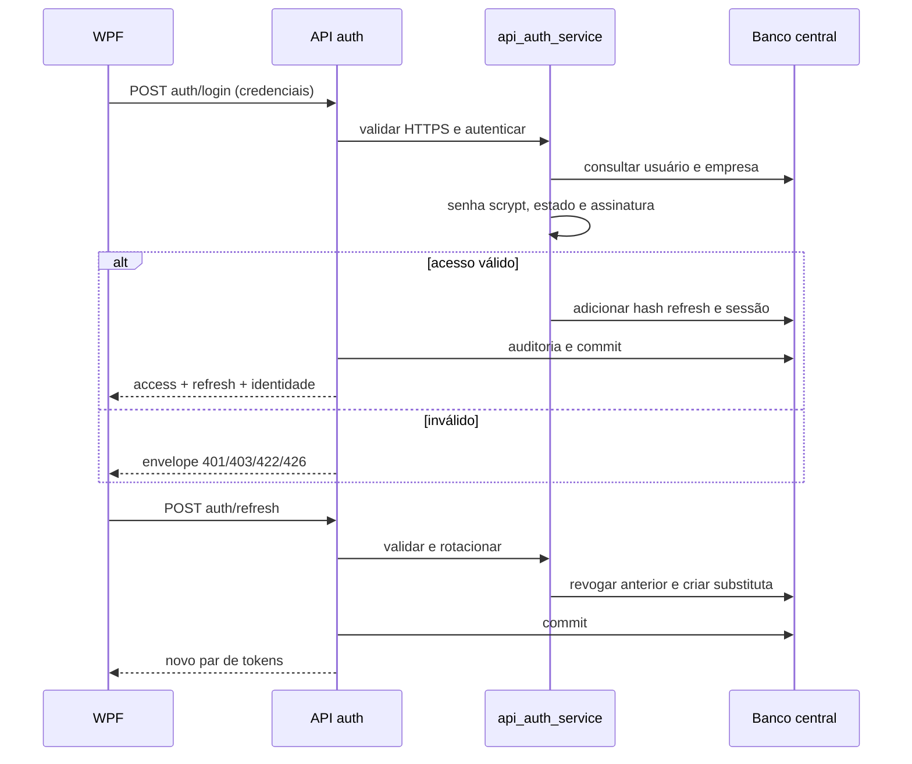

<a id="doc-docs-11-regras-negocio-fluxos-md--cadastro-de-produto-pela-api"></a>

##### Cadastro de produto pela API

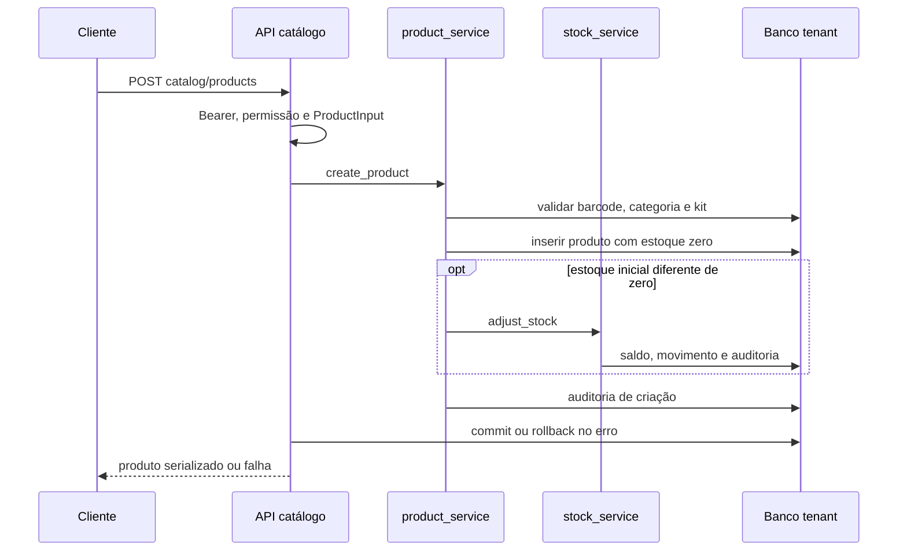

<a id="doc-docs-11-regras-negocio-fluxos-md--ajuste-manual-de-estoque"></a>

##### Ajuste manual de estoque

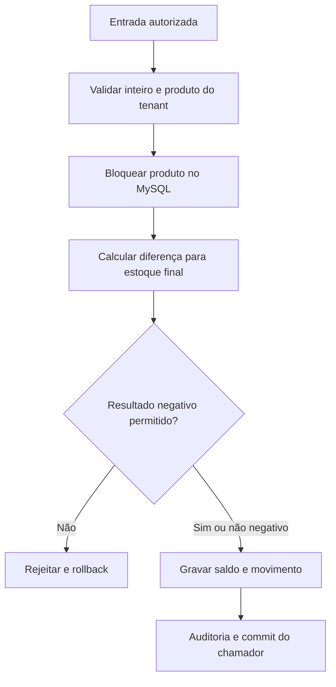

<a id="doc-docs-11-regras-negocio-fluxos-md--finalização-de-venda-e-pagamento-interno"></a>

##### Finalização de venda e pagamento interno

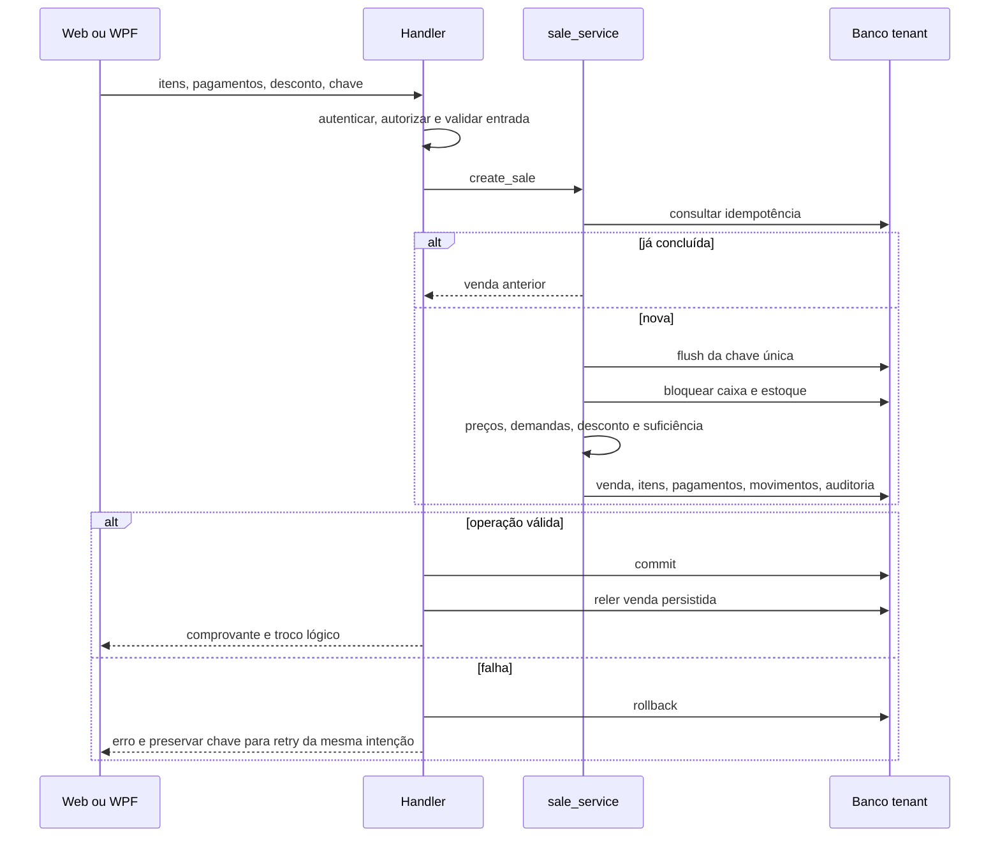

Não há participante adquirente/banco: `payments` registra recebimento declarado. Nenhuma mensagem do fluxo confirma liquidação Pix/cartão externa.

<a id="doc-docs-11-regras-negocio-fluxos-md--abertura-e-fechamento"></a>

##### Abertura e fechamento

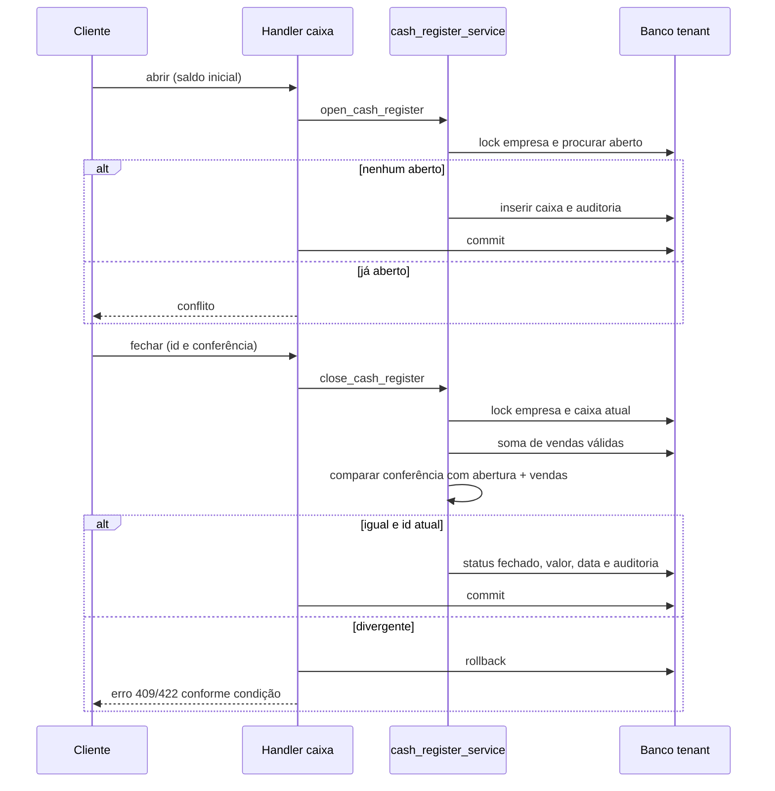

<a id="doc-docs-11-regras-negocio-fluxos-md--cancelamento"></a>

##### Cancelamento

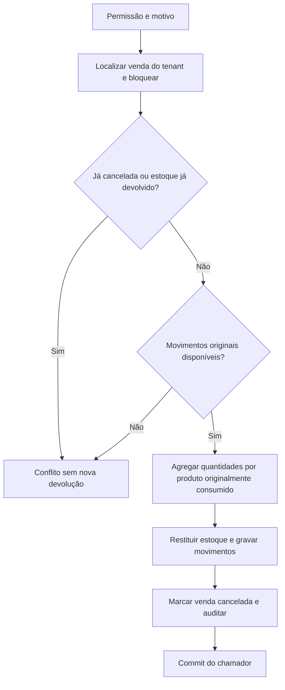

<a id="doc-docs-11-regras-negocio-fluxos-md--importação-histórica"></a>

##### Importação histórica

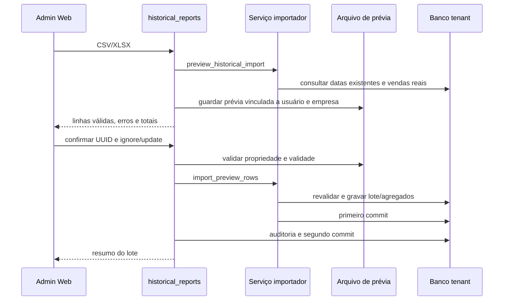

<a id="doc-docs-11-regras-negocio-fluxos-md--relatório"></a>

##### Relatório

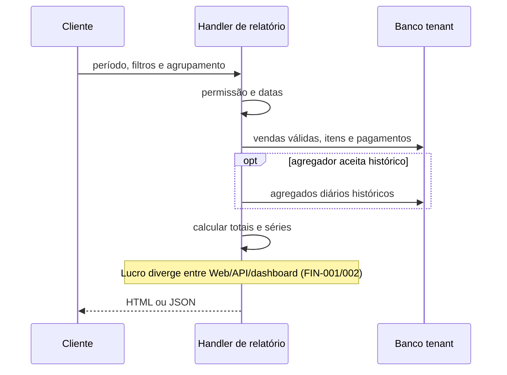

Fiado, quitação de conta a receber e processamento bancário: NÃO CONFIRMADOS; não foram desenhados. Pagar `Payable` é marcar despesa, sem ser quitação de cliente.

---

## Guias técnicos e operacionais

<a id="doc-readme-md"></a>

### SkyGest

Origem preservada: `README.md`. [Voltar ao sumário](#sumário).

<a id="doc-readme-md--skygest"></a>

#### SkyGest

> **Auditoria local de 14/10/2026:** consulte o [índice técnico e funcional](#doc-docs-14-auditoria-readme-md), com inventário completo de rotas/modelos, regras, achados financeiros e limitações de validação. O conteúdo anterior mantém seus marcos históricos; publicação em homologação não foi realizada nesta auditoria.

SkyGest é um SaaS de ponto de venda e gestão operacional para adegas e pequenos comércios. O repositório reúne backend Flask, interface Web, API REST, aplicativo Windows WPF, Painel Master e infraestrutura OCI para produção e homologação.

> A fonte técnica oficial é [DOCUMENTACAO_COMPLETA.md](#doc-documentacao-completa-md). Os documentos numerados em `docs/` aprofundam temas ou preservam marcos históricos.

<a id="doc-readme-md--estado-atual"></a>

##### Estado atual

- URL de produção configurada: [https://www.skygest.com.br](https://www.skygest.com.br)
- URL de homologação configurada: [https://hml.skygest.com.br](https://hml.skygest.com.br)
- App Windows: `0.9.18-preview`, .NET 8/WPF, online e sem banco local operacional
- Banco: MySQL central mais um banco físico por adega
- Painel Master: contexto administrativo central; não é adega e não possui banco tenant
- Planos comerciais: Basic, Pro e Ultimate; contratação temporariamente direcionada ao WhatsApp
- Cobertura reconferida: 291 testes backend aprovados localmente; 244 casos xUnit WPF enumeráveis no código (execução local indisponível por ausência do SDK .NET)

<a id="doc-readme-md--funcionalidades"></a>

##### Funcionalidades

- cadastro por usuário, e-mail e senha, confirmação de e-mail e recuperação de acesso;
- produtos, categorias, kits, código de barras, importação e exportação;
- estoque e histórico de movimentos;
- PDV com dinheiro, Pix, débito, crédito e pagamentos mistos;
- caixa, cancelamento auditado, contas a pagar e relatórios;
- dashboard responsivo com períodos, comparativos, gráficos e tooltips;
- equipe, permissões, configurações, notificações e auditoria;
- gestão SaaS de adegas, usuários, assinaturas e keys no Painel Master;
- API REST v1 e cliente Windows com access/refresh token protegido por DPAPI;
- migrations central/tenant, backup pré-deploy, Redis e health checks.

Não existem hoje módulos funcionais de clientes, fornecedores, emissão fiscal, cobrança automática ou integração com adquirentes. Os planos ainda não aplicam cotas técnicas por recurso.

<a id="doc-readme-md--arquitetura-resumida"></a>

##### Arquitetura resumida

```text
Web/Jinja ── cookie + CSRF ─┐
                            ├─ HTTPS ─ Flask/Gunicorn ─┬─ MySQL central
Windows WPF ─ Bearer/refresh┘                          ├─ MySQL por adega
                                                      ├─ Redis/rate limit
Painel Master ─ sessão Web ────────────────────────────└─ SMTP
```

O backend é a fonte de verdade para autenticação, autorização, cálculos, estoque, assinatura e isolamento de tenant. O App nunca acessa o MySQL diretamente.

<a id="doc-readme-md--estrutura"></a>

##### Estrutura

```text
app/                    Flask, Web, API, modelos e serviços
desktop_wpf/            solução .NET 8, WPF, xUnit e instalador
migrations/central/     schema central, head central_0010
migrations/tenant/      schema das adegas, head tenant_0011
scripts/                migrations, backup, deploy e OCI
deploy/                 Caddy e inicialização do MySQL
tests/                  contratos e integração do backend
docs/                   documentação temática e histórica
docker-compose.oci.yml  produção
docker-compose.hml.yml  homologação
```

<a id="doc-readme-md--desenvolvimento-local"></a>

##### Desenvolvimento local

Pré-requisitos: Python 3.13 e MySQL 8 compatível. Redis é necessário para reproduzir o modo de produção.

```bash
python3.13 -m venv .venv
source .venv/bin/activate
python -m pip install -r requirements.txt
cp .env.example .env
# configure somente valores locais e nunca versione segredos
python scripts/schema_migrate.py upgrade-all
python app.py
```

Por padrão, a aplicação local usa a porta configurada em `PORT`. Produção rejeita secrets/defaults inseguros e schemas fora do head esperado.

<a id="doc-readme-md--testes-backend"></a>

###### Testes backend

```bash
TESTING=1 MAIL_SUPPRESS_SEND=1 python -m unittest discover
```

<a id="doc-readme-md--app-windows"></a>

###### App Windows

Em Windows com SDK .NET 8:

```powershell
dotnet restore desktop_wpf/Girofy.Desktop.sln
dotnet test desktop_wpf/tests/Girofy.UnitTests/Girofy.UnitTests.csproj -c Release
dotnet run --project desktop_wpf/src/Girofy.Desktop/Girofy.Desktop.csproj
```

`appsettings.json` usa produção e `appsettings.Homologation.json` usa homologação, ambos com HTTPS obrigatório. O ambiente também pode ser selecionado por `SKYGEST_ENVIRONMENT`; sobrescritas `GIROFY_*` existem por compatibilidade interna.

<a id="doc-readme-md--produção-e-homologação"></a>

##### Produção e homologação

Os ambientes possuem bancos centrais, prefixos tenant, volumes, Redis, secrets, backups, projetos Compose e URLs independentes:

| Ambiente configurado | Branch | Workflow | Banco central padrão |
|---|---|---|---|
| Homologação | `develop` | `deploy-hml-oci.yml` | `skygest_hml_central` |
| Produção | `main` | `deploy-oci-self-hosted.yml` | `adega_central` |

O fluxo seguro é desenvolver → testar → publicar em `develop` → homologar → promover para `main`. Cada deploy executa testes, backup, migrations e health checks. Markdown isolado não dispara produção.

Runbooks:

- [Separação produção/homologação](#doc-docs-34-separacao-producao-homologacao-md)
- [Deploy dos ambientes](#doc-docs-deploy-ambientes-md)
- [Migrations central e tenant](#doc-docs-29-migracoes-versionadas-md)

<a id="doc-readme-md--segurança"></a>

##### Segurança

O código implementa scrypt, CSRF e verificação de origem, cookie seguro, CSP/headers, HTTPS no App, access token curto, refresh com hash/rotação/revogação, rate limit Redis, isolamento físico por tenant, idempotência de venda, auditoria mascarada e backup antes de migration.

Segredos reais, `.env`, dumps, tokens, chaves SSH/OCI, logs, builds e relatórios não devem ser versionados. Pendências e riscos atuais estão na seção de segurança e dívida técnica da documentação oficial.

<a id="doc-readme-md--documentação"></a>

##### Documentação

- [Documentação técnica completa](#doc-documentacao-completa-md)
- [Relatório da auditoria de 10/09/2026](#doc-docs-auditoria-documentacao-md)
- [Índice oficial](#doc-docs-00-index-md)
- [Matriz Web/App/Backend](#doc-docs-matrix-md)
- [Paridade funcional](#doc-docs-feature-parity-md)
- [Arquitetura](#doc-docs-03-arquitetura-md)
- [API](#doc-docs-09-api-md)
- [Segurança](#doc-docs-14-seguranca-md)
- [Testes](#doc-docs-15-testes-md)
- [Temas e acessibilidade](#doc-docs-shared-theming-md)

Em caso de divergência, prevalecem o código, as migrations versionadas e [DOCUMENTACAO_COMPLETA.md](#doc-documentacao-completa-md).

---

<a id="doc-desktop-wpf-readme-md"></a>

### SkyGest para Windows - WPF

Origem preservada: `desktop_wpf/README.md`. [Voltar ao sumário](#sumário).

<a id="doc-desktop-wpf-readme-md--skygest-para-windows---wpf"></a>

#### SkyGest para Windows - WPF

Esta pasta contém a aplicação Windows nativa experimental do SkyGest. Ela é independente da interface Flask/Jinja e não acessa o MySQL diretamente.

<a id="doc-desktop-wpf-readme-md--relação-com-a-versão-web"></a>

##### Relação com a versão web

A versão Windows é um cliente nativo conectado à API do SkyGest. Ela usa os mesmos usuários,
permissões, assinatura/key, bancos por adega e regras de negócio da versão web.

A comparação detalhada entre a versão web e a versão Windows está em:

```text
docs/24-estado-versoes-web-windows.md
```

Limites atuais desta frente:

- depende do servidor web/OCI disponível;
- não possui banco local e não acessa MySQL diretamente;
- ainda usa HTTP no ambiente atual, então exige `API_ALLOW_INSECURE_AUTH=1` apenas para teste controlado;
- ainda não possui assinatura digital reconhecida pela Microsoft;
- a atualização automática foi pausada/cancelada por decisão de produto;
- algumas configurações administrativas avançadas seguem sendo feitas pela versão web;
- antes da entrega comercial, precisa de validação manual em Windows 10/11 no fluxo real do cliente.

<a id="doc-desktop-wpf-readme-md--estado-atual"></a>

##### Estado atual

Décimo sétimo corte vertical implementado:

- solução C# em .NET 8 LTS;
- telas nativas em WPF;
- MVVM sem dependência de framework visual externo;
- injeção de dependência e `HttpClientFactory`;
- consulta real a `GET /api/v1/health`;
- login nativo por usuário ou e-mail em `POST /api/v1/auth/login`;
- ativação nativa de assinatura vencida por key em `POST /api/v1/subscription/activate`;
- renovação automática da sessão por refresh token rotativo;
- consulta da identidade autenticada e logout revogável;
- bloqueios de usuário e adega aplicados no servidor, com regularização de assinatura
  diretamente no cliente Windows quando uma key válida é informada;
- opção `Lembrar usuário`, sem armazenar a senha;
- sessão criptografada com DPAPI para o usuário atual do Windows;
- timeout e cancelamento;
- tela de disponibilidade do servidor;
- shell autenticado com navegação lateral nativa;
- dashboard nativo com caixa atual, vendas de hoje, ticket médio, lucro conforme
  permissão, formas de pagamento, estoque baixo e vendas recentes;
- carregamento agregado em `GET /api/v1/dashboard/summary`, sempre restrito à adega
  presente no token;
- ocultação de lucro, totais do caixa, formas de pagamento e contas a pagar quando o
  perfil não possui as permissões correspondentes;
- consulta paginada de produtos por nome ou código de barras;
- filtro por categoria e status, com ordenação por nome, preço ou estoque;
- consulta de categorias com quantidade de produtos;
- cadastro, edição e exclusão nativos de categorias para usuários com
  `can_manage_categories`;
- categorias integradas aos endpoints `POST`, `PUT` e `DELETE /api/v1/catalog/categories`;
- exclusão protegida contra categorias com produtos vinculados;
- tabelas WPF virtualizadas para reduzir consumo com catálogos grandes;
- custo e lucro omitidos pelo servidor quando o perfil não pode gerenciar produtos;
- cadastro e edição nativos de produtos para usuários com `can_manage_products`;
- formulário de produto com nome, código de barras, categoria, custo, venda, estoque,
  estoque mínimo e status;
- criação e edição integradas aos endpoints `POST /api/v1/catalog/products` e
  `PUT /api/v1/catalog/products/{id}`;
- ajustes de estoque feitos no servidor com trava, movimentação e auditoria;
- validação por adega para categoria, código de barras duplicado e permissões;
- tela nativa de Caixa com consulta do caixa atual e dos dez caixas fechados mais
  recentes;
- detalhe nativo de caixa selecionado em `GET /api/v1/cash-registers/{id}`, com linha
  do tempo cronológica das vendas, itens vendidos e pagamentos;
- abertura de caixa com valor inicial e proteção contra dois caixas simultâneos;
- fechamento com conferência exata do valor esperado, sem perder o valor digitado em
  caso de divergência;
- totais por forma de pagamento e valores do caixa exibidos apenas para usuários com
  permissão de relatórios;
- abertura e fechamento registrados na auditoria da adega;
- tela nativa de Vendas com busca por nome ou código de barras, resultados
  ranqueados e contêiner de altura dinâmica: acompanha os itens até 440 px e usa
  scroll apenas acima desse limite, sem comprimir as linhas nem manter área vazia;
- carrinho com múltiplos produtos em linhas compactas: nome priorizado com tooltip,
  unitário, controles de quantidade e total individual existente, sem scroll
  horizontal, além de desconto em reais e remoção de itens;
- pagamentos combinados em Dinheiro, Pix, Débito e Crédito, com preenchimento do valor
  restante, cálculo de falta e troco;
- registro transacional em `POST /api/v1/sales`, com caixa obrigatório, baixa de estoque,
  kits, taxas da maquininha, auditoria e isolamento pela adega do token;
- chave de idempotência preservada nas tentativas para impedir vendas duplicadas quando
  a conexão falha depois da gravação;
- pedido preservado no cliente quando o servidor rejeita ou não confirma a venda;
- comprovante nativo após a conclusão e início imediato de uma nova venda;
- tela nativa de Estoque com histórico paginado de movimentações;
- filtros de estoque por busca, categoria, tipo de movimentação e origem;
- resumo de entradas, saídas, total de movimentações e produtos movimentados;
- entrada manual de mercadoria integrada a `POST /api/v1/stock/entries`;
- ajuste manual de estoque integrado a `POST /api/v1/stock/adjustments`;
- histórico integrado a `GET /api/v1/stock/movements`, sempre limitado à adega do token;
- permissões `can_view_stock_movements` e `can_manage_stock` respeitadas no cliente e
  no servidor;
- tela nativa de Relatórios com período diário, semanal, mensal, anual e personalizado;
- alternância do gráfico entre faturamento e quantidade de vendas;
- cards de vendas, itens, subtotal, desconto, total final, lucro e ticket médio;
- totais por forma de pagamento e ranking dos dez produtos mais vendidos;
- relatório integrado a `GET /api/v1/reports/summary`, com agregação no backend e
  isolamento pela adega do token;
- relatório por produto integrado a `GET /api/v1/reports/products`;
- consulta paginada de performance por produto com quantidade vendida, faturamento,
  custo, lucro, ticket médio e estoque atual;
- filtros do relatório por produto por busca e ordenação por mais vendidos, maior
  faturamento, maior lucro, menor estoque ou produtos sem venda;
- acesso ao relatório bloqueado para perfis sem `can_view_reports`;
- tela nativa de Contas a pagar com resumo de abertas, vencidas, próximas e pagas;
- filtros por busca, status, categoria e período de vencimento;
- cadastro de contas com descrição, categoria, valor, vencimento e observações;
- marcação de conta como paga e reabertura de conta paga;
- integração com `GET /api/v1/payables`, `POST /api/v1/payables`,
  `POST /api/v1/payables/{id}/pay` e `POST /api/v1/payables/{id}/reopen`;
- acesso ao módulo de contas bloqueado para perfis sem `can_manage_payables`;
- tela nativa de Auditoria com consulta paginada de eventos críticos;
- filtros de auditoria por busca, usuário, ação, módulo, método e período;
- resumo de eventos, usuários envolvidos e ações diferentes;
- detalhes expansíveis com valores antes/depois, rota, método, request id e IP;
- integração com `GET /api/v1/audit/logs`, sempre restrita à adega presente no token;
- acesso à auditoria bloqueado para perfis sem `can_view_audit_logs`;
- tela nativa de Configurações com resumo da conta, adega, assinatura e regras da empresa;
- edição nativa de nome, sobrenome e telefone em `PUT /api/v1/settings/profile`;
- troca de senha nativa em `PUT /api/v1/settings/password`, com revogação das sessões do
  usuário e retorno automático para login;
- edição nativa das regras da adega em `PUT /api/v1/settings/company`, incluindo venda
  com estoque negativo e taxas de Pix, débito e crédito usadas no lucro;
- configuração nativa de frequência de backup em `PUT /api/v1/settings/backup`;
- geração de backup manual em `POST /api/v1/settings/backup/run`, reutilizando o mesmo
  motor de backup da versão web;
- exportação nativa em CSV para administradores em `GET /api/v1/settings/export/{tipo}`;
- tipos de exportação disponíveis no cliente Windows: produtos, vendas, caixas e contas a
  pagar;
- o arquivo exportado é salvo pelo usuário com a janela nativa do Windows, sem guardar dados
  sensíveis no cliente;
- importação nativa de produtos por CSV/XLSX em `POST /api/v1/settings/import/products`;
- a importação cria categorias quando necessário, cria ou atualiza produtos, ajusta estoque
  e registra auditoria sempre dentro da adega autenticada;
- gestão nativa de equipe para administradores, gerentes e usuários com permissão de
  configurações;
- busca de funcionários por nome, usuário ou CPF em `GET /api/v1/settings/team`;
- cadastro nativo de funcionário comum, gerente ou admin em `POST /api/v1/settings/team`;
- edição nativa de nome, sobrenome, CPF, e-mail, telefone, perfil e status em
  `PUT /api/v1/settings/team/{id}`;
- regras de equipe aplicadas no servidor: isolamento por adega, CPF único dentro da adega,
  username global único, perfis padronizados e proteção contra autodesativação;
- resumo e edição das taxas de Pix, débito e crédito e da regra de venda sem estoque;
- integração com `GET /api/v1/settings/account`, sempre restrita ao usuário autenticado e
  à adega presente no token;
- abertura opcional da versão web no navegador externo;
- logs locais no diretório legado `%LOCALAPPDATA%\Girofy\logs`, preservado para compatibilidade;
- catálogo carregado somente quando Produtos ou Categorias é aberto, evitando consultas
  e uso de memória desnecessários na inicialização;
- testes unitários de conexão, login, restauração de sessão, logout, dashboard, catálogo,
  caixa, vendas, estoque, relatórios, contas a pagar e exportação de configurações;
- workflow separado para build Windows self-contained.

O dashboard, o catálogo, a manutenção básica de produtos e categorias, o caixa, o registro
de vendas, o estoque operacional, os relatórios resumidos e por produto, contas a pagar,
auditoria, configurações pessoais, regras operacionais da adega, taxas de maquininha,
backup manual/frequência, importação de produtos, exportação CSV, gestão básica de equipe
e ativação por key já funcionam de forma nativa.
As demais configurações administrativas avançadas continuam disponíveis pela versão web
enquanto são migradas por etapas, sem remover nem substituir a versão web durante a
transição.

<a id="doc-desktop-wpf-readme-md--configuração"></a>

##### Configuração

O arquivo `src/Girofy.Desktop/appsettings.json` contém a URL padrão da API. Ela pode ser substituída no Windows sem recompilar:

```powershell
$env:GIROFY_API_BASE_URL = "https://seu-dominio"
$env:GIROFY_ALLOW_INSECURE_HTTP = "false"
```

O endereço OCI atual ainda usa HTTP e pode ser usado somente no health check. Login e
tokens são recusados pelo backend com HTTP `426` enquanto não houver HTTPS. Para um teste
temporário em rede controlada é possível definir `API_ALLOW_INSECURE_AUTH=1` no servidor,
mas isso transmite senha e token sem criptografia e não deve ser distribuído a clientes.

As informações locais ficam em:

```text
%LOCALAPPDATA%\Girofy\auth.dat          sessão criptografada com DPAPI
%LOCALAPPDATA%\Girofy\preferences.json somente usuário lembrado
%LOCALAPPDATA%\Girofy\logs              logs técnicos sem senha/token
```

<a id="doc-desktop-wpf-readme-md--desenvolvimento-no-windows"></a>

##### Desenvolvimento no Windows

Requisitos para desenvolvedores:

- Windows 10 ou 11;
- .NET 8 SDK;
- Visual Studio 2022 opcional.

Comandos:

```powershell
dotnet restore .\desktop_wpf\Girofy.Desktop.sln
dotnet test .\desktop_wpf\Girofy.Desktop.sln
dotnet run --project .\desktop_wpf\src\Girofy.Desktop\Girofy.Desktop.csproj
```

<a id="doc-desktop-wpf-readme-md--build-pelo-github"></a>

##### Build pelo GitHub

Execute manualmente:

```text
GitHub > Actions > Build Windows WPF preview > Run workflow
```

Na versão atual (`0.9.18-preview`), o workflow gera o artefato portátil `SkyGest-Windows-0.9.18`, o instalador `SkyGest-Installer-0.9.18` e um instalador separado de homologação. O cliente de teste não precisa instalar .NET, Python, MySQL ou ferramentas de desenvolvimento.

O Setup usa Inno Setup, instala por usuário em `%LocalAppData%\Programs\SkyGest`, cria atalho no Menu Iniciar, oferece atalho opcional na Área de Trabalho e registra o desinstalador no Windows. Consulte `docs/WINDOWS_INSTALLER.md` para build local, segurança, upgrade e homologação.

Esta prévia valida a base nativa, o ciclo completo de autenticação, o dashboard operacional,
a consulta e manutenção básica do catálogo, o fluxo de abertura/fechamento de caixa, o
registro completo de vendas, o estoque operacional, os relatórios resumidos e por produto,
contas a pagar, auditoria, configurações pessoais, backup, importação de produtos,
exportação CSV, gestão básica de equipe e ativação por key de assinatura. Ela ainda não substitui a versão web em produção porque as
configurações administrativas avançadas restantes, assinatura de código e validação manual
em Windows 10/11 ainda não atingiram o critério de liberação estável.

---

<a id="doc-docs-00-index-md"></a>

### Índice da documentação SkyGest

Origem preservada: `docs/00-INDEX.md`. [Voltar ao sumário](#sumário).

<a id="doc-docs-00-index-md--índice-da-documentação-skygest"></a>

#### Índice da documentação SkyGest

> **Revisão mais recente — 14/10/2026:** [auditoria técnica e funcional](#doc-docs-14-auditoria-readme-md), [catálogo de módulos](#doc-docs-07-modulos-readme-md), [dicionário de dados](#doc-docs-05-banco-de-dados-dicionario-dados-md), [catálogo HTTP](#doc-docs-06-api-readme-md) e [achados](#doc-docs-14-auditoria-riscos-md). Os marcos anteriores são preservados abaixo.

Este índice é o ponto inicial oficial. A documentação separa interface Web, aplicativo Windows e regras compartilhadas no servidor.

<a id="doc-docs-00-index-md--marco-atual"></a>

##### Marco atual

- [Documentação técnica completa e oficial](#doc-documentacao-completa-md) — revisão do código atual em 10/09/2026, commit `938e18ceedb6b6b49780a63027e82f6eaac97940`, com arquitetura, funcionalidades, API, banco, segurança, operação e dívida técnica.
- [Auditoria completa da documentação](#doc-docs-auditoria-documentacao-md) — método, inventário, classificação dos documentos, evidências, riscos e pendências da revisão atual.
- [Rebranding SkyGest](#doc-docs-33-rebranding-skygest-md) — nome oficial, novos assets e compatibilidade legada.
- [Documentação consolidada histórica](#doc-documentacao-documentacao-completa-txt) — marco anterior preservado; não é mais a fonte principal.
- [Estado completo em 17/08/2026](#doc-docs-31-estado-atual-17-08-2026-md) — marco histórico detalhado.
- [Marco de 13/08/2026](#doc-docs-30-versao-atual-13-08-2026-md) — histórico preservado.

<a id="doc-docs-00-index-md--visão-consolidada"></a>

##### Visão consolidada

- [Matriz resumida de plataformas](#doc-docs-matrix-md)
- [Paridade funcional detalhada](#doc-docs-feature-parity-md)
- [Fluxos de build e publicação](#doc-docs-workflows-md)
- [Instalador Windows — marco histórico 0.8.0](#doc-docs-windows-installer-md)
- [Estado Web e Windows](#doc-docs-24-estado-versoes-web-windows-md)
- [Arquitetura](#doc-docs-03-arquitetura-md)
- [Regras de negócio](#doc-docs-05-regras-negocio-md)
- [API](#doc-docs-09-api-md)
- [Permissões](#doc-docs-11-permissoes-md)
- [Testes](#doc-docs-15-testes-md)
- [Segurança](#doc-docs-14-seguranca-md)
- [Migrations central/tenant](#doc-docs-29-migracoes-versionadas-md)
- [Rate limit Redis](#doc-docs-28-rate-limit-redis-md)
- [Cancelamento de vendas](#doc-docs-27-cancelamento-estorno-vendas-md)
- [Notificações e e-mail](#doc-docs-25-notificacoes-web-windows-email-md)
- [Acessibilidade nativa Windows](#doc-docs-32-acessibilidade-windows-md)
- [Ambientes de produção e homologação](#doc-docs-34-separacao-producao-homologacao-md)
- [Runbook de deploy dos ambientes](#doc-docs-deploy-ambientes-md)
- [Auditoria financeira Float → Decimal/Numeric — gate 1.0](#doc-docs-35-auditoria-financeira-decimal-1-0-md)
- [Importação de relatórios históricos](#doc-docs-36-importacao-relatorios-historicos-md)

<a id="doc-docs-00-index-md--documentação-por-plataforma"></a>

##### Documentação por plataforma

- [Web](#doc-docs-web-readme-md): telas Flask/Jinja, sessão no navegador e painel master.
- [App Windows](#doc-docs-app-readme-md): cliente WPF, cache de sessão e consumo da API.
- [Compartilhado](#doc-docs-shared-readme-md): API, serviços transacionais, banco, tenant, auditoria e erros.
- [Temas claro e escuro](#doc-docs-shared-theming-md): tokens, persistência, toggle e validação Web/App.

Os documentos numerados continuam contendo manuais temáticos e marcos históricos. Em caso de conflito, prevalecem o código, as migrations, a documentação consolidada e o relatório de auditoria atual. Documentos explicitamente classificados como históricos no relatório não descrevem o estado corrente.

---

<a id="doc-docs-01-visao-geral-md"></a>

### 01 - Visão Geral

Origem preservada: `docs/01-visao-geral.md`. [Voltar ao sumário](#sumário).

<a id="doc-docs-01-visao-geral-md--01---visão-geral"></a>

#### 01 - Visão Geral

O banco central e cada banco de adega possuem revisão Alembic própria, conforme [29-migracoes-versionadas.md](#doc-docs-29-migracoes-versionadas-md).

<a id="doc-docs-01-visao-geral-md--propósito"></a>

##### Propósito

O SkyGest é um PDV multiempresa para adegas e pequenos comércios, disponibilizado em duas
interfaces claramente separadas:

- **WEB**: produto principal executado no navegador, com backend Flask, templates Jinja e
  operação centralizada no servidor.
- **APP WINDOWS**: cliente nativo WPF/.NET conectado à API da WEB, usando os mesmos usuários,
  permissões, regras e dados. O APP não acessa o MySQL diretamente e não funciona offline.

O detalhamento funcional e visual, sempre separado entre WEB e APP WINDOWS, está em
`docs/24-estado-versoes-web-windows.md`.

O sistema centraliza:

- Vendas com múltiplos produtos e múltiplas formas de pagamento.
- Abertura, acompanhamento e fechamento de caixa.
- Produtos, categorias, kits, estoque e estoque mínimo.
- Relatórios por período e gráfico de vendas.
- Contas a pagar com alertas de vencimento.
- Notificações operacionais no topo da interface.
- Interface SkyGest com tema claro/escuro, paleta não monocromática e status semânticos.
- Usuários, funcionários e permissões por perfil.
- Assinatura/key de ativação por adega.
- Movimentações de estoque rastreáveis.
- Auditoria de ações críticas.
- Banco de dados MySQL central e banco separado para cada adega.
- Painel master para gerenciar adegas, keys, logs e acesso administrativo.

<a id="doc-docs-01-visao-geral-md--público-alvo"></a>

##### Público-alvo

- Dono da adega.
- Administrador da adega.
- Gerente operacional.
- Funcionário de caixa.
- Master do sistema/SaaS.
- Suporte técnico e desenvolvimento.

<a id="doc-docs-01-visao-geral-md--situação-atual"></a>

##### Situação Atual

O projeto deixou de ser um PDV local simples em SQLite e passou a operar com MySQL multiadega:

- O banco central guarda empresas, usuários, assinaturas e keys.
- Cada adega tem um banco MySQL próprio para dados operacionais.
- O cadastro pode ser feito com key de ativação ou sem key, mas sem key o uso fica bloqueado.
- O master do sistema pode gerar keys, definir validade, ver logs e administrar adegas.

<a id="doc-docs-01-visao-geral-md--benefícios"></a>

##### Benefícios

- Separação real dos dados entre adegas.
- Fluxo de venda rápido com atalhos e autocomplete.
- Controle de permissões para funcionário, gerente e admin.
- Alertas de estoque baixo e contas a pagar.
- Relatórios e dashboard para acompanhamento diário.
- Backup por adega em arquivo SQL.
- Base pronta para evoluir para cobrança, suporte e operação SaaS.

<a id="doc-docs-01-visao-geral-md--status-do-produto"></a>

##### Status do Produto

| Área | Status | Observações |
|---|---|---|
| Login e sessão | Implementado | Flask-Login com usuário ativo/inativo e opção "Lembre de mim". |
| Cadastro de adega | Implementado | Cria empresa, usuário admin e banco da adega. |
| Assinatura/key | Implementado | Key pode ser gerada pelo master e bloqueia uso quando ausente/vencida. |
| Multiadega | Implementado | Banco central + banco MySQL separado por adega. |
| Painel master | Implementado | Gestão de adegas, logs, keys e acesso administrativo. |
| Produtos e categorias | Implementado | Filtros, edição expandida, kits, estoque mínimo e importação. |
| Vendas | Implementado | Produtos antes do pagamento, desconto, F2/F3, pagamentos mistos e troco. |
| Caixa | Implementado | Abertura obrigatória, fechamento validado e histórico. |
| Relatórios | Implementado | Diário, semanal, mensal, anual e período personalizado. |
| Dashboard | Implementado | Indicadores de venda, lucro, caixa, estoque e contas. |
| Contas a pagar | Implementado | Alertas 3 dias antes e no vencimento. |
| Notificações | Implementado | Estoque baixo, sem estoque e contas a pagar. |
| Backup | Implementado | Manual e automático por período. |
| Importação/exportação | Implementado | Importação de produtos por planilha e exportação CSV para admin. |
| Logs de erro | Implementado | Arquivo `logs/errors.log` e visualização no painel master. |
| Movimentação de estoque | Implementado | Histórico por produto, usuário, origem e saldo antes/depois. |
| Auditoria de ações | Implementado | Eventos críticos com valores sanitizados e consulta por adega/master. |
| Interface responsiva | Implementado | Paleta Girofy, filtros alinhados, menu lateral recolhível e ajustes para textos longos. |
| Deploy OCI | Implementado | Docker Compose em VM OCI Free Tier na porta pública alta `18080`. |
| Pipeline de deploy | Implementado | Workflow self-hosted recomendado para publicar sem depender do IP do desenvolvedor. |
| API para o APP Windows | Implementado | Rotas REST autenticadas atendem os módulos nativos; não deve ser confundida com API pública irrestrita. |
| APP Windows | Prévia funcional | Cliente WPF com login, dashboard, produtos, vendas, caixa, estoque, contas, relatórios, notificações, auditoria e configurações via API. |

<a id="doc-docs-01-visao-geral-md--pontos-fortes-atuais"></a>

##### Pontos Fortes Atuais

- A base multiadega já está desenhada para SaaS.
- As principais rotinas de uma adega estão cobertas.
- O controle de permissões já reduz risco operacional de funcionário comum.
- O dashboard dá uma visão rápida de vendas, lucro, caixa e alertas.
- A interface usa cores semânticas para diferenciar sucesso, aviso, erro e informação.
- A arquitetura ainda é simples o suficiente para manutenção rápida.

<a id="doc-docs-01-visao-geral-md--o-que-ainda-faz-falta"></a>

##### O Que Ainda Faz Falta

- Migrações versionadas com Alembic/Flask-Migrate.
- Monitoramento do Redis e dos eventos de rate limit em produção.
- Ampliar auditoria para cancelamento, estorno, sangria e aprovações futuras.
- Sangria e suprimento de caixa.
- Cadastro de fornecedores e compras.
- Regras comerciais reais para Basic/Pro.
- Domínio, HTTPS definitivo, backup externo e variáveis/segredos totalmente gerenciados fora do servidor.

---

<a id="doc-docs-02-requisitos-md"></a>

### 02 - Requisitos

Origem preservada: `docs/02-requisitos.md`. [Voltar ao sumário](#sumário).

<a id="doc-docs-02-requisitos-md--02---requisitos"></a>

#### 02 - Requisitos

<a id="doc-docs-02-requisitos-md--requisitos-funcionais"></a>

##### Requisitos Funcionais

| ID | Requisito | Status | Evidência |
|---|---|---|---|
| RF001 | Realizar login/logout | Implementado | `/login`, `/logout` em `app/routes/auth.py`. |
| RF002 | Cadastrar nova adega | Implementado | Aba Cadastrar em `app/templates/login.html`. |
| RF003 | Confirmar e-mail no cadastro | Implementado | `/verify-email` e `EmailVerificationCode`. |
| RF004 | Recuperar senha por e-mail | Implementado | `/forgot-password`, `/reset-password/<token>` e `PasswordResetToken`. |
| RF043 | Trocar e-mail com confirmação no e-mail antigo | Implementado | `EmailChangeRequest` e `/confirmar-troca-email/<token>`. |
| RF005 | Cadastrar com key de ativação | Implementado | `ActivationKey` e fluxo de cadastro. |
| RF006 | Cadastrar sem key e bloquear uso | Implementado | Opção "Não tenho key" e redirecionamento para `/assinatura`. |
| RF007 | Criar banco separado para adega | Implementado | `app/tenant.py`. |
| RF008 | Gerenciar adegas no painel master | Implementado | `/master/adegas`. |
| RF009 | Gerar key Basic/Pro | Implementado | Configurações > Gerar key. |
| RF010 | Ver e limpar logs no master | Implementado | `/master/adegas` e `/master/logs/limpar`. |
| RF011 | Editar dados do usuário | Implementado | Configurações > Usuário. |
| RF012 | Gerenciar funcionários | Implementado | Configurações > Equipe. |
| RF013 | Buscar funcionário por nome/login/CPF | Implementado | Template e JS de sugestões. |
| RF014 | Aplicar perfis funcionário/gerente/admin | Implementado | `apply_employee_permissions()`. |
| RF015 | Configurar taxas de Pix, débito e crédito | Implementado | Configurações > Financeiro. |
| RF016 | Alternar tema claro/escuro | Implementado | Configurações > Aparência. |
| RF017 | Listar, filtrar e ordenar produtos | Implementado | `/catalogo/produtos`, menu lateral de categorias e busca `Buscar produto`. |
| RF018 | Cadastrar, editar, inativar e excluir produto | Implementado | Rotas em `catalog.py`. |
| RF019 | Controlar estoque mínimo | Implementado | Campo `min_stock_quantity` e notificações. |
| RF020 | Configurar produto kit | Implementado | Campos `is_kit` e produto base. |
| RF021 | Importar produtos por CSV/XLSX | Implementado | Configurações > Importação. |
| RF022 | Baixar modelo de planilha | Implementado | `auth.import_template_download`. |
| RF023 | Cadastrar e editar categorias por adega | Implementado | `/catalogo/categorias`. |
| RF024 | Abrir caixa | Implementado | `/caixa/abrir`. |
| RF025 | Fechar caixa com validação exata | Implementado | `/caixa/fechar`. |
| RF026 | Ver detalhes de caixas anteriores | Implementado | `/caixa/<id>`. |
| RF027 | Bloquear venda sem caixa aberto | Implementado | `new_sale()`. |
| RF028 | Registrar venda com vários produtos | Implementado | `/vendas/nova`. |
| RF029 | Finalizar venda por clique e F2 | Implementado | Tela de venda e JS. |
| RF030 | Aplicar desconto com F3 | Implementado | `discount_amount`. |
| RF030A | Abrir nova venda com F3 no Dashboard, Vendas e Caixa | Implementado | Atalho global contextual. |
| RF031 | Aceitar dinheiro, Pix, débito e crédito | Implementado | Modelo `Payment`. |
| RF032 | Permitir múltiplas formas de pagamento | Implementado | Lista de pagamentos. |
| RF033 | Preservar pedido quando há erro | Implementado | Renderização mantém estado do formulário. |
| RF045 | Configurar venda com estoque negativo por adega | Implementado | Configurações > Operação e `allow_negative_stock`. |
| RF046 | Consultar caixas anteriores em linhas expansíveis | Implementado | `/caixa`, com vendas e pagamentos no detalhe. |
| RF053 | Separar caixa atual e caixas anteriores no Windows | Implementado | Navegação interna no módulo WPF, com seleção inicial do caixa atual e troca automática após fechamento. |
| RF054 | Carregar detalhe do caixa anterior sob demanda no Windows | Implementado | `GET /api/v1/cash-registers/{id}`, com totais, pagamentos e linha do tempo expansível. |
| RF055 | Expandir o detalhe de um produto ao clicar na grade do Windows | Implementado | `RowDetailsTemplate` reutiliza os dados paginados e preserva permissões financeiras. |
| RF047 | Mostrar apenas vendas do dia na listagem principal | Implementado | `/vendas` filtra por data atual no backend. |
| RF048 | Padronizar campos de busca como `Buscar X` | Implementado | Templates de vendas, produtos, categorias, equipe e painel master. |
| RF034 | Calcular lucro por produto/venda/caixa | Implementado | `profit_amount` e relatórios. |
| RF035 | Gerar relatórios por período | Implementado | `/relatorios`. |
| RF036 | Gerar gráfico de vendas | Implementado | `build_chart_buckets()`. |
| RF037 | Gerenciar contas a pagar | Implementado | `/contas-a-pagar`. |
| RF038 | Notificar vencimentos | Implementado | `inject_user()` em `app/__init__.py`. |
| RF044 | Enviar alertas críticos por e-mail | Implementado | Configurações > Alertas e `EmailAlertSetting`. |
| RF039 | Fazer backup manual/automático | Implementado | `app/backup.py`. |
| RF040 | Exportar dados em CSV | Implementado | `/exportacoes/<tipo>`. |
| RF049 | Registrar movimentações de estoque | Implementado | `StockMovement` e `app/services/stock_service.py`. |
| RF050 | Entrada e ajuste manual de estoque | Implementado | `/estoque/entrada` e `/estoque/ajuste`. |
| RF051 | Consultar histórico de estoque | Implementado | `/estoque/movimentacoes`. |
| RF052 | Auditar ações críticas | Implementado | `AuditLog` e `app/services/audit_service.py`. |
| RF041 | API pública JSON | Não implementado | Rotas atuais são HTML/formulário. |

<a id="doc-docs-02-requisitos-md--requisitos-não-funcionais"></a>

##### Requisitos Não Funcionais

| Área | Requisito | Status | Observações |
|---|---|---|---|
| Isolamento | Dados de cada adega separados | Implementado | Banco MySQL por adega. |
| Segurança | Senhas com hash | Implementado | Werkzeug `scrypt`. |
| Segurança | Bloqueio de tentativas de login | Implementado parcial | Limite simples em memória para ambiente local/controlado. |
| Segurança | Permissão no backend | Implementado | `permission_required`. |
| Segurança | Bloqueio por assinatura/key | Implementado | `company_requires_activation()`. |
| Segurança | CSRF | Implementado | Token por sessão para formulários e `fetch`; testes específicos com CSRF habilitado. |
| Disponibilidade | Execução local | Implementado | `python app.py` na porta 5003. |
| Backup | Dump por adega e cópia automática completa | Implementado | `app/backup.py` e serviço Docker `backup`. |
| Logs | Logs detalhados de erro | Implementado | `logs/errors.log`. |
| Auditoria | Trilha de ações críticas | Implementado | `audit_logs`, `/auditoria` e `/master/auditoria`. |
| Escalabilidade | Multiempresa | Implementado inicial | Banco por tenant, sem fila ou balanceamento. |
| Manutenibilidade | Organização modular | Implementado | Blueprints, modelos e serviços. |
| Testabilidade | Testes automatizados | Implementado | `unittest discover`. |

<a id="doc-docs-02-requisitos-md--premissas"></a>

##### Premissas

- MySQL instalado e rodando.
- Cada adega possui seu próprio banco operacional.
- Usuário master do sistema é separado do admin da adega.
- Planos Basic/Pro ainda são estéticos/comerciais, sem cobrança real integrada.
- A aplicação é server-side e usa sessões de navegador.

<a id="doc-docs-02-requisitos-md--fora-do-escopo-atual"></a>

##### Fora do Escopo Atual

- Emissão fiscal.
- TEF real.
- Cobrança online de assinatura.
- API pública.
- Auditoria de cancelamentos/estornos quando essas rotinas existirem.
- Controle avançado de compras/fornecedores.

---

<a id="doc-docs-03-arquitetura-md"></a>

### 03 - Arquitetura

Origem preservada: `docs/03-arquitetura.md`. [Voltar ao sumário](#sumário).

<a id="doc-docs-03-arquitetura-md--03---arquitetura"></a>

#### 03 - Arquitetura

> Atualizado em 17/08/2026. A arquitetura consolidada por plataforma está em [31-estado-atual-17-08-2026.md](#doc-docs-31-estado-atual-17-08-2026-md).

<a id="doc-docs-03-arquitetura-md--visão-arquitetural"></a>

##### Visão Arquitetural

O SkyGest usa uma arquitetura monolítica Web server-side:

- Flask recebe as requisições HTTP.
- Blueprints organizam as rotas por domínio.
- Templates Jinja2 renderizam HTML no servidor.
- JavaScript vanilla adiciona interações de venda, filtros, atalhos, tema e autocomplete.
- SQLAlchemy acessa MySQL.
- Flask-Login gerencia sessão autenticada.
- A camada `tenant.py` seleciona o banco operacional da adega atual.

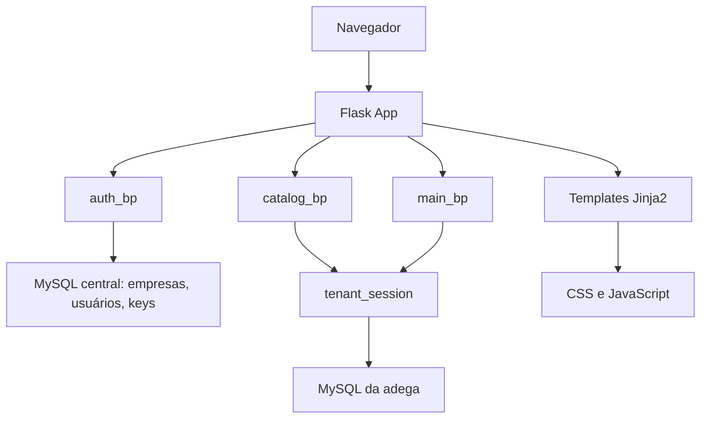

<a id="doc-docs-03-arquitetura-md--bancos"></a>

##### Bancos

O sistema trabalha com dois níveis de banco:

- Banco central: cadastro de empresas, usuários, assinatura, keys e dados administrativos.
- Banco por adega: produtos, categorias, vendas, caixa, pagamentos e contas a pagar.

Essa separação evita que uma adega enxergue ou conflite com dados de outra.

<a id="doc-docs-03-arquitetura-md--camadas"></a>

##### Camadas

<a id="doc-docs-03-arquitetura-md--frontend"></a>

###### Frontend

Arquivos principais:

- `app/templates/base.html`
- `app/templates/login.html`
- `app/templates/dashboard.html`
- `app/templates/catalog/`
- `app/templates/sales/`
- `app/templates/settings/index.html`
- `app/static/css/style.css`
- `app/static/js/main.js`

Responsabilidades:

- Layout responsivo com menu lateral recolhível.
- Tema claro/escuro.
- Paleta centralizada em tokens CSS com roxo Girofy, ciano de destaque e cores semânticas para status.
- Filtros críticos alinhados por grids responsivos em auditoria, estoque, vendas e produtos.
- Autocomplete de produtos, categorias e funcionários.
- Venda com produtos, desconto, pagamentos, falta e troco.
- Atalhos `F2` para finalização e `F3` para desconto.
- Abas de configurações, caixa, relatórios e painel master.

<a id="doc-docs-03-arquitetura-md--backend"></a>

###### Backend

Arquivos principais:

- `app/__init__.py`
- `app/routes/auth.py`
- `app/routes/catalog.py`
- `app/routes/main.py`
- `app/models/`
- `app/tenant.py`
- `app/permissions.py`
- `app/backup.py`
- `app/error_logging.py`

Responsabilidades:

- Criar aplicação e registrar blueprints.
- Criar banco central e bancos das adegas.
- Validar que banco central e tenants estão na revisão Alembic esperada.
- Autenticar usuários.
- Bloquear adegas sem assinatura/key ativa.
- Aplicar permissões por perfil.
- Executar regras de venda, estoque, caixa, relatórios e backup.

<a id="doc-docs-03-arquitetura-md--blueprints"></a>

##### Blueprints

| Blueprint | Arquivo | Responsabilidade |
|---|---|---|
| `auth_bp` | `app/routes/auth.py` | Login, cadastro, master, configurações, assinatura, keys, equipe, backup, importação/exportação visual. |
| `catalog_bp` | `app/routes/catalog.py` | Produtos, categorias, kits, estoque mínimo, importação de planilha. |
| `main_bp` | `app/routes/main.py` | Dashboard, vendas, caixa, relatórios, contas a pagar e exportação CSV. |

<a id="doc-docs-03-arquitetura-md--serviços-de-apoio"></a>

##### Serviços de Apoio

| Arquivo | Função |
|---|---|
| `app/tenant.py` | Cria/seleciona banco por adega, aplica migrations no provisionamento e abre sessões isoladas. |
| `app/services/migration_service.py` | Controla baseline, revisão atual, head e upgrade central/tenant. |
| `app/permissions.py` | Decorator `permission_required` e nomes de permissões. |
| `app/backup.py` | Gera dump SQL do banco da adega e controla frequência. |
| `app/error_logging.py` | Registra erros com contexto, request id e dados protegidos. |

<a id="doc-docs-03-arquitetura-md--decisões-arquiteturais"></a>

##### Decisões Arquiteturais

- Manter Flask monolítico para acelerar evolução do produto.
- Usar MySQL para permitir bancos separados por adega.
- Manter a API REST no mesmo backend Flask; ela atende o aplicativo Windows enquanto as telas Web são renderizadas no servidor.
- Usar permissões no backend, não apenas esconder botões no frontend.
- Gerar backups por adega, pois os dados operacionais ficam fora do banco central.

<a id="doc-docs-03-arquitetura-md--limitações-técnicas"></a>

##### Limitações Técnicas

- Produção exige migrations no head e não usa `create_all()` como fonte de verdade.
- O `create_all()` permanece apenas no modo isolado de testes.
- O servidor local só ativa debug quando `FLASK_DEBUG=1`; produção deve usar Gunicorn/Docker.
- Não há fila/background worker; backups automáticos rodam durante requisições autenticadas elegíveis.

---

<a id="doc-docs-04-modelagem-banco-md"></a>

### 04 - Modelagem do Banco

Origem preservada: `docs/04-modelagem-banco.md`. [Voltar ao sumário](#sumário).

<a id="doc-docs-04-modelagem-banco-md--04---modelagem-do-banco"></a>

#### 04 - Modelagem do Banco

> **Complemento atual:** o [dicionário completo](#doc-docs-05-banco-de-dados-dicionario-dados-md) cobre 24 tabelas/modelos e 286 colunas do código de 14/10/2026, incluindo tokens, notificações e importação histórica. Use-o com o [catálogo de migrations](#doc-docs-05-banco-de-dados-migrations-md); a descrição abaixo é anterior.

> O schema é versionado por duas árvores Alembic. Veja [29-migracoes-versionadas.md](#doc-docs-29-migracoes-versionadas-md). Git versiona código, Alembic versiona schema e backups protegem dados.

<a id="doc-docs-04-modelagem-banco-md--visão-geral"></a>

##### Visão Geral

O sistema usa MySQL em dois níveis:

- Banco central: empresas, usuários, keys e dados administrativos.
- Banco por adega: categorias, produtos, vendas, pagamentos, caixa e contas a pagar.

ORM:

- Flask-SQLAlchemy / SQLAlchemy.

Criação e compatibilidade:

- `db.create_all()` cria tabelas do banco central.
- `tenant.py` cria bancos/tabelas das adegas.
- Funções em `app/__init__.py` garantem colunas adicionadas durante a evolução do projeto.

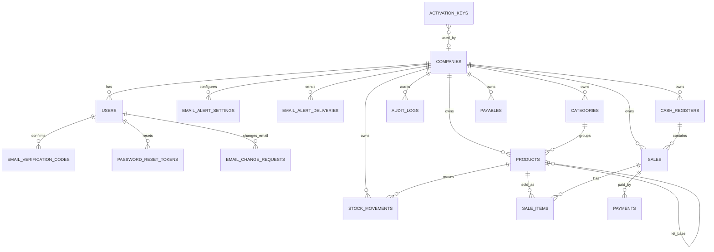

<a id="doc-docs-04-modelagem-banco-md--banco-central"></a>

##### Banco Central

<a id="doc-docs-04-modelagem-banco-md--companies"></a>

###### `companies`

Representa cada adega/empresa.

Campos principais:

- `id`
- `name`
- `database_path`
- `active`
- `allow_negative_stock`
- `subscription_plan`
- `billing_cycle`
- `subscription_started_at`
- `subscription_renews_at`
- `activation_key`
- `activation_key_updated_at`
- `pix_fee_enabled`, `debit_fee_enabled`, `credit_fee_enabled`
- `pix_fee_percent`, `debit_fee_percent`, `credit_fee_percent`
- `backup_frequency`
- `backup_last_at`
- `backup_last_path`
- `backup_last_status`
- `created_at`

`allow_negative_stock` define por adega se a venda pode baixar o saldo abaixo de zero. Quando desativado, o comportamento permanece bloqueante.

<a id="doc-docs-04-modelagem-banco-md--users"></a>

###### `users`

Representa usuários autenticáveis do sistema.

Campos principais:

- `id`
- `username`
- `first_name`
- `last_name`
- `cpf`
- `email`
- `email_verified`
- `email_verified_at`
- `phone`
- `password_hash`
- `role`
- `company_id`
- `is_active`
- `can_view_products`
- `can_manage_products`
- `can_manage_categories`
- `can_manage_sales`
- `can_cancel_sales`
- `can_manage_cash_register`
- `can_view_reports`
- `can_manage_payables`
- `can_manage_settings`
- `can_view_stock_movements`
- `can_manage_stock`
- `can_view_audit_logs`
- `created_at`

Perfis atuais:

- `master`
- `admin`
- `manager`
- `operator`

<a id="doc-docs-04-modelagem-banco-md--activation_keys"></a>

###### `activation_keys`

Representa keys geradas pelo master.

Campos principais:

- `id`
- `key`
- `plan`
- `renews_at`
- `active`
- `used_by_company_id`
- `used_at`
- `created_at`

<a id="doc-docs-04-modelagem-banco-md--email_verification_codes"></a>

###### `email_verification_codes`

Representa códigos temporários para confirmar e-mail no cadastro.

Campos principais:

- `id`
- `user_id`
- `code_hash`
- `expires_at`
- `used`
- `attempts`
- `created_at`

<a id="doc-docs-04-modelagem-banco-md--password_reset_tokens"></a>

###### `password_reset_tokens`

Representa tokens temporários para redefinição de senha.

Campos principais:

- `id`
- `user_id`
- `token_hash`
- `expires_at`
- `used`
- `created_at`

<a id="doc-docs-04-modelagem-banco-md--email_change_requests"></a>

###### `email_change_requests`

Representa solicitações temporárias para trocar e-mail confirmando pelo e-mail antigo.

Campos principais:

- `id`
- `user_id`
- `old_email`
- `new_email`
- `token_hash`
- `expires_at`
- `used`
- `created_at`
- `confirmed_at`

<a id="doc-docs-04-modelagem-banco-md--email_alert_settings"></a>

###### `email_alert_settings`

Representa a configuração de alertas críticos por e-mail por adega.

Campos principais:

- `id`
- `company_id`
- `alert_type`
- `enabled`
- `recipients`
- `created_at`
- `updated_at`

<a id="doc-docs-04-modelagem-banco-md--email_alert_deliveries"></a>

###### `email_alert_deliveries`

Representa alertas por e-mail já enviados, evitando repetição do mesmo alerta.

Campos principais:

- `id`
- `company_id`
- `alert_type`
- `alert_key`
- `recipients`
- `sent_at`

<a id="doc-docs-04-modelagem-banco-md--banco-da-adega"></a>

##### Banco da Adega

Cada adega possui as tabelas operacionais abaixo em seu próprio banco.

<a id="doc-docs-04-modelagem-banco-md--categories"></a>

###### `categories`

- `id`
- `name`
- `company_id`
- `created_at`

Regra: o nome é único dentro da adega, não globalmente entre todas as adegas.

<a id="doc-docs-04-modelagem-banco-md--products"></a>

###### `products`

- `id`
- `name`
- `barcode`
- `category_id`
- `company_id`
- `cost_price`
- `sale_price`
- `stock_quantity`
- `min_stock_quantity`
- `active`
- `is_kit`
- `kit_component_product_id`
- `kit_component_quantity`
- `created_at`

Regras:

- Código de barras não pode duplicar dentro da adega.
- Kit baixa estoque do produto base.
- Estoque mínimo gera notificação.

<a id="doc-docs-04-modelagem-banco-md--cash_registers"></a>

###### `cash_registers`

- `id`
- `opened_at`
- `closed_at`
- `opening_amount`
- `closing_amount`
- `status`
- `user_id`
- `company_id`

<a id="doc-docs-04-modelagem-banco-md--sales"></a>

###### `sales`

- `id`
- `created_at`
- `total_amount`
- `discount_amount`
- `final_amount`
- `payment_status`
- `status`: `completed` ou `cancelled`
- `cancelled_at`
- `cancelled_by_user_id`
- `cancellation_reason`
- `user_id`
- `company_id`
- `cash_register_id`

O cancelamento é lógico: a linha de `sales` e seus registros em `sale_items` e `payments`
permanecem armazenados. `cancelled_by_user_id` referencia o usuário que executou a operação.
Bases existentes recebem as colunas pelo mecanismo de compatibilidade atual, tanto no banco
central quanto nos bancos por tenant. Vendas legadas são normalizadas para `completed`.

<a id="doc-docs-04-modelagem-banco-md--sale_items"></a>

###### `sale_items`

- `id`
- `sale_id`
- `product_id`
- `quantity`
- `unit_price`
- `unit_cost_price`
- `total_price`
- `profit_amount`

<a id="doc-docs-04-modelagem-banco-md--payments"></a>

###### `payments`

- `id`
- `sale_id`
- `method`
- `amount`

Métodos:

- `money`
- `pix`
- `debit`
- `credit`

<a id="doc-docs-04-modelagem-banco-md--payables"></a>

###### `payables`

Valores monetários são armazenados em `NUMERIC(12,2)`, nunca em ponto flutuante.
A migration tenant `tenant_0004` converte registros legados, transforma `NULL` em
`0.00` e torna `amount`/`paid` obrigatórios sem apagar contas existentes.

- `id`
- `company_id`
- `description`
- `category`
- `amount` (`NUMERIC(12,2)`, não nulo)
- `due_date`
- `paid` (booleano, não nulo)
- `paid_at`
- `notes`
- `created_at`

<a id="doc-docs-04-modelagem-banco-md--stock_movements"></a>

###### `stock_movements`

Registra cada alteração no saldo de estoque. O saldo atual permanece em
`products.stock_quantity`, mas alterações feitas por cadastro, edição, importação,
venda, entrada ou ajuste geram uma linha nesta tabela.

Campos principais:

- `id`
- `company_id`
- `product_id`
- `user_id`
- `movement_type`
- `source_type`
- `source_id`
- `quantity`
- `previous_stock`
- `new_stock`
- `unit_cost`
- `total_cost`
- `reason`
- `notes`
- `created_at`

Tipos atuais:

- `entry`
- `sale`
- `adjustment_in`
- `adjustment_out`
- `return`
- `cancellation`
- `initial_stock`
- `import`

Origens atuais:

- `manual`
- `sale`
- `product_creation`
- `product_edit`
- `spreadsheet_import`
- `sale_cancellation`
- `system`

<a id="doc-docs-04-modelagem-banco-md--audit_logs"></a>

###### `audit_logs`

Registra ações críticas do sistema com contexto da requisição e valores sanitizados.

Campos principais:

- `id`
- `company_id`
- `user_id`
- `user_name`
- `user_role`
- `action`
- `entity_type`
- `entity_id`
- `description`
- `old_values`
- `new_values`
- `ip_address`
- `user_agent`
- `request_id`
- `route`
- `http_method`
- `created_at`

Valores sensíveis como senha, token, secret, API key e key de ativação são mascarados
antes de gravar.

<a id="doc-docs-04-modelagem-banco-md--tabelas-ainda-não-existentes"></a>

##### Tabelas Ainda Não Existentes

- `customers`: clientes.
- `suppliers`: fornecedores.
- `purchases`: compras/entrada de mercadoria.

<a id="doc-docs-04-modelagem-banco-md--observações-importantes"></a>

##### Observações Importantes

- `database_path` em `companies` guarda o nome do banco MySQL da adega.
- O campo `company_id` também existe em tabelas operacionais para reforçar vínculo lógico.
- A separação principal entre adegas é feita pelo banco selecionado em `tenant_session`.
- O projeto ainda não usa Alembic; mudanças de schema são aplicadas por compatibilidade no start da aplicação.

---

<a id="doc-docs-05-regras-negocio-md"></a>

### 05 - Regras de Negócio

Origem preservada: `docs/05-regras-negocio.md`. [Voltar ao sumário](#sumário).

<a id="doc-docs-05-regras-negocio-md--05---regras-de-negócio"></a>

#### 05 - Regras de Negócio

<a id="doc-docs-05-regras-negocio-md--autenticação-e-cadastro"></a>

##### Autenticação e Cadastro

- Usuário anônimo é redirecionado para login ao acessar rota protegida.
- Login aceita usuário ou e-mail e senha.
- Senhas são armazenadas e conferidas com hash Werkzeug.
- Usuário inativo não deve operar o sistema.
- Usuário `master` do sistema acessa o painel master.
- Cadastro solicita somente usuário, e-mail e senha, cria uma empresa/adega e o primeiro usuário como `admin`.
- A confirmação de e-mail e a ativação da assinatura ocorrem após o cadastro; cadastro não recebe key no formulário inicial.
- Cada nova adega deve ter seu banco MySQL operacional próprio.
- O usuário inicial global usa `MASTER_DEFAULT_USERNAME` e `MASTER_DEFAULT_PASSWORD`; em produção a senha padrão `master123` é recusada.

<a id="doc-docs-05-regras-negocio-md--assinatura-e-key"></a>

##### Assinatura e Key

- Key é gerada pelo master do sistema.
- Key pode ser avulsa ou vinculada a uma adega.
- Key possui plano e data de validade.
- Key usada fica vinculada à empresa.
- Adega sem key, vencida ou inativa é redirecionada para `/assinatura`.
- Planos Basic, Pro e Ultimate existem como estrutura comercial inicial, sem cobrança real integrada ou cotas técnicas por plano. Ultimate é o plano comercial mais completo.

<a id="doc-docs-05-regras-negocio-md--usuário-e-configurações"></a>

##### Usuário e Configurações

- Usuário pode editar nome, sobrenome, telefone, email e senha.
- Senha só pode ser alterada informando a senha atual.
- Funcionário comum não vê equipe, financeiro, plano, importação ou exportação.
- Admin da adega pode contratar e editar funcionários.
- CPF duplicado é bloqueado dentro da mesma adega.
- Pode existir mais de um admin por adega.

<a id="doc-docs-05-regras-negocio-md--produtos"></a>

##### Produtos

- Produto deve ter nome.
- Código de barras é opcional, mas não pode duplicar dentro da mesma adega.
- Preço de custo, preço de venda e estoque são normalizados para valores não negativos.
- Produto ativo aparece como vendável.
- Produto inativo não deve ser vendido.
- Produto possui estoque mínimo para alerta.
- Lucro unitário base é `sale_price - cost_price`.
- Taxas de Pix/débito/crédito podem reduzir o lucro final conforme configuração.
- Produto criado com estoque inicial maior que zero gera movimentação `initial_stock`.
- Edição de estoque em formulário ou linha rápida gera `adjustment_in` ou `adjustment_out`.
- Ajuste de estoque exige motivo.

<a id="doc-docs-05-regras-negocio-md--kits"></a>

##### Kits

- Produto kit é opcional.
- Kit deve informar produto base e quantidade consumida.
- Kit não pode usar a si mesmo como produto base.
- Estoque efetivo do kit é `estoque_produto_base // quantidade_por_kit`.
- Venda de kit baixa estoque do produto base.
- Kit sem configuração válida não pode ser vendido.

<a id="doc-docs-05-regras-negocio-md--categorias"></a>

##### Categorias

- Categoria deve ter nome.
- Nome da categoria é único dentro da adega atual.
- Adegas diferentes podem usar o mesmo nome de categoria.
- Categoria com produto vinculado não pode ser excluída.

<a id="doc-docs-05-regras-negocio-md--caixa"></a>

##### Caixa

- Só pode haver um caixa aberto por vez na adega.
- Venda só pode ser registrada com caixa aberto.
- Abertura registra valor inicial e usuário.
- Fechamento exige informar valor final.
- Valor esperado é `valor_inicial + total_vendido_no_caixa`.
- Se valor final for menor, o sistema informa quanto falta.
- Se valor final for maior, o sistema informa quanto excedeu.
- Fechamento só conclui quando o valor bate exatamente.
- Caixa atual exibe totais por forma de pagamento, total geral, quantidade de vendas e ticket médio para usuários autorizados a ver relatórios.
- A análise do caixa usa linha do tempo cronológica das vendas, com itens e pagamentos expansíveis.
- No Windows, caixa atual e caixas encerrados ocupam áreas internas separadas do mesmo módulo.
- O Windows abre no caixa atual e muda para caixas anteriores após um fechamento confirmado.
- O resumo histórico traz os dez caixas fechados mais recentes; o detalhe de vendas é carregado somente após a seleção de um caixa.
- Trocar de área não altera o caixa nem realiza nova consulta; apenas reorganiza o conteúdo já carregado.
- Valores financeiros de caixas atuais ou anteriores permanecem condicionados à permissão de relatórios.

<a id="doc-docs-05-regras-negocio-md--venda"></a>

##### Venda

- Venda exige pelo menos um produto válido.
- Quantidade deve ser maior que zero.
- Produto deve existir, estar ativo e pertencer à adega.
- Estoque pode ser bloqueante ou não conforme configuração da adega.
- Quando `allow_negative_stock` está ativo, a venda pode finalizar com estoque zerado/negativo e o sistema baixa normalmente para valor negativo.
- Kits continuam exigindo componente base válido e quantidade configurada.
- Pedido não deve ser resetado quando houver erro.
- Desconto em reais não pode ultrapassar o subtotal.
- Total final é `subtotal - desconto`.
- Pagamento total deve ser maior ou igual ao total final.
- Pagamento maior gera troco.
- Venda pode ter dinheiro, Pix, débito e crédito juntos.
- Itens gravam preço e custo do momento da venda.
- Venda finalizada baixa estoque por meio do serviço de estoque.
- Cada item da venda gera movimentação `sale`; kits movimentam o produto base.
- Venda, itens, pagamentos, estoque e movimentações são gravados na mesma transação.
- Se a baixa de qualquer item falhar, a venda inteira é revertida.
- A listagem principal em `/vendas` mostra o histórico do dia atual; relatórios continuam disponíveis para períodos maiores.
- Filtros de venda por vendedor, pagamento e status aparecem como listas visuais clicáveis.
- Atalho `F2` abre/conclui finalização.
- Em Dashboard, Vendas e Caixa, `F3` inicia uma nova venda quando o foco não está em um campo.
- Na tela de registrar venda, `F3` abre o desconto e não recarrega a página.
- Na tela pós-venda, `Enter`, `Espaço` e `F3` iniciam uma nova venda quando o foco não está em um campo.

<a id="doc-docs-05-regras-negocio-md--importação-e-exportação"></a>

##### Importação e Exportação

- Importação de produtos fica em Configurações > Importação.
- Apenas dono/admin autorizado da adega deve importar.
- Planilha aceita CSV/XLSX.
- Categoria é criada se não existir na adega.
- Produto existente é atualizado quando identificado pelo nome.
- Estoque importado gera movimentação `import` para produto novo ou ajuste do existente.
- Exportação fica em Configurações > Exportação.
- Apenas admin/master deve exportar dados.

<a id="doc-docs-05-regras-negocio-md--movimentação-de-estoque"></a>

##### Movimentação de Estoque

- `products.stock_quantity` é o saldo atual.
- `stock_movements` é o histórico rastreável.
- Nenhuma operação deve alterar saldo sem registrar movimentação.
- Entradas manuais usam `entry`.
- Ajustes positivos usam `adjustment_in`.
- Ajustes negativos usam `adjustment_out`.
- Cadastro inicial usa `initial_stock`.
- Importação usa `import`.
- Venda usa `sale`.
- Quantidade da movimentação é sempre positiva; o tipo define entrada ou saída.
- A tela `/estoque/movimentacoes` permite filtrar por produto, categoria, tipo, usuário e período.

<a id="doc-docs-05-regras-negocio-md--auditoria"></a>

##### Auditoria

- Ações críticas gravam registro em `audit_logs`.
- O registro inclui usuário, perfil, rota, método, IP, user-agent, request id, entidade e valores sanitizados.
- Campos sensíveis são mascarados antes de persistir.
- Auditoria operacional fica isolada por adega.
- O master do sistema acessa auditoria central em `/master/auditoria`.
- Eventos cobertos incluem login, logout, key, assinatura, produtos, categorias, importação, exportação, caixa, venda, contas a pagar e estoque.

<a id="doc-docs-05-regras-negocio-md--relatórios"></a>

##### Relatórios

- Diário usa a data atual por padrão.
- Semanal usa últimos 7 dias.
- Mensal usa últimos 30 dias.
- Anual usa últimos 365 dias.
- Personalizado usa datas escolhidas.
- Relatório calcula vendas, descontos, total, lucro, ticket médio, pagamentos e produtos mais vendidos.
- No período diário, vendas são agrupadas no banco em intervalos de uma hora, das 00h às 23h.
- O pico por quantidade e o pico por faturamento são calculados separadamente.
- Horas sem venda permanecem no gráfico com valor zero.
- Relatório por produto usa agregação no banco por itens vendidos no período.
- Relatório por produto mostra quantidade vendida, faturamento, custo total, lucro estimado, ticket médio e estoque atual.
- Relatório por produto pode ser filtrado por período, categoria e produto específico.
- Relatório por produto pode ordenar por mais vendidos, maior faturamento, maior lucro, menor estoque e produtos sem venda.
- Vendas com `status=cancelled` não entram em faturamento válido, lucro, ticket médio,
  pagamentos agregados, gráficos ou rankings de produto.

<a id="doc-docs-05-regras-negocio-md--cancelamento-de-venda"></a>

##### Cancelamento de venda

- A venda nunca é apagada; itens, pagamentos, valores e autoria original são preservados.
- Somente usuário com `can_cancel_sales` pode cancelar; administradores são autorizados pelo papel.
- O motivo é obrigatório e limitado a 500 caracteres.
- Status, metadados, devolução de estoque e auditoria pertencem à mesma transação.
- A devolução é o inverso das movimentações originais, inclusive para kits.
- Uma venda já cancelada não pode gerar uma segunda devolução.
- Caixa aberto desconsidera imediatamente a venda cancelada nos totais esperados.
- Caixa fechado preserva a conferência original e mostra um ajuste posterior separado.
- Pagamento histórico não significa estorno automático na adquirente, banco ou Pix.

<a id="doc-docs-05-regras-negocio-md--notificações"></a>

##### Notificações

- Produto sem estoque gera alerta.
- Produto com estoque igual ou abaixo do mínimo gera alerta.
- Conta vencida gera alerta.
- Conta vencendo hoje gera alerta.
- Conta vencendo em até 3 dias gera alerta.
- Notificações pertencem à adega atual.

<a id="doc-docs-05-regras-negocio-md--pendências-de-negócio"></a>

##### Pendências de Negócio

- Cancelamento parcial por item e integração de estorno com adquirentes.
- Sangria e reforço de caixa.
- Fornecedores e compras.
- Cobrança real de assinatura.

---

<a id="doc-docs-06-fluxo-sistema-md"></a>

### 06 - Fluxo do Sistema

Origem preservada: `docs/06-fluxo-sistema.md`. [Voltar ao sumário](#sumário).

<a id="doc-docs-06-fluxo-sistema-md--06---fluxo-do-sistema"></a>

#### 06 - Fluxo do Sistema

<a id="doc-docs-06-fluxo-sistema-md--fluxo-geral"></a>

##### Fluxo Geral

```mermaid
flowchart TD
    A["Acessar sistema"] --> B["Login ou cadastro"]
    B --> C{"Adega ativa com key?"}
    C -- "Não" --> D["Tela de assinatura"]
    C -- "Sim" --> E["Dashboard"]
    E --> F["Produtos e categorias"]
    E --> G["Caixa"]
    E --> H["Vendas"]
    E --> I["Relatórios"]
    E --> J["Configurações"]
    G --> K["Abrir caixa"]
    K --> L["Nova venda"]
    H --> L
    L --> M["Adicionar produtos"]
    M --> N["Concluir venda / F2"]
    N --> O["Informar pagamentos"]
    O --> P["Finalizar"]
    P --> Q["Baixar estoque"]
    Q --> T["Registrar movimentações e auditoria"]
    P --> R["Detalhe da venda"]
    R --> S["Nova venda por botão, Enter, Espaço ou F3"]
```

<a id="doc-docs-06-fluxo-sistema-md--fluxo-de-login"></a>

##### Fluxo de Login

```mermaid
flowchart TD
    A["GET /login"] --> B["Renderiza login.html"]
    B --> C["Usuário envia credenciais"]
    C --> D{"Usuário existe, ativo e senha confere?"}
    D -- "Não" --> E["Flash: usuário ou senha inválidos"]
    E --> B
    D -- "Sim" --> F{"É master do sistema?"}
    F -- "Sim" --> G["Redirect /master/adegas"]
    F -- "Não" --> H{"Adega exige ativação?"}
    H -- "Sim" --> I["Redirect /assinatura"]
    H -- "Não" --> J["Redirect /dashboard"]
```

<a id="doc-docs-06-fluxo-sistema-md--fluxo-de-cadastro"></a>

##### Fluxo de Cadastro

```mermaid
flowchart TD
    A["Aba Cadastrar"] --> B["Informa adega, usuário, senha e key opcional"]
    B --> C{"Dados básicos válidos?"}
    C -- "Não" --> X["Erro"]
    C -- "Sim" --> D{"Username único?"}
    D -- "Não" --> X
    D -- "Sim" --> E{"Key informada?"}
    E -- "Sim" --> F{"Key disponível?"}
    F -- "Não" --> X
    F -- "Sim" --> G["Aplica plano e validade"]
    E -- "Não" --> H["Cria sem plano ativo"]
    G --> I["Cria Company e User admin"]
    H --> I
    I --> J["Cria banco MySQL da adega"]
    J --> K["Envia código de verificação por e-mail"]
    K --> L["Usuário confirma código"]
    L --> M{"Adega ativa?"}
    M -- "Não" --> N["Redirect /assinatura"]
    M -- "Sim" --> O["Redirect /dashboard"]
```

<a id="doc-docs-06-fluxo-sistema-md--fluxo-de-caixa"></a>

##### Fluxo de Caixa

```mermaid
flowchart TD
    A["Tela Caixa"] --> B{"Existe caixa aberto?"}
    B -- "Não" --> C["Informar valor inicial"]
    C --> D["POST /caixa/abrir"]
    D --> E["Caixa aberto"]
    B -- "Sim" --> F["Exibe vendas, lucro e valor esperado"]
    F --> T["Resumo por forma de pagamento"]
    F --> U["Linha do tempo expansível"]
    F --> G["Informar valor final"]
    G --> H["POST /caixa/fechar"]
    H --> I{"Valor final == esperado?"}
    I -- "Menor" --> J["Mostra valor faltante"]
    I -- "Maior" --> K["Mostra valor excedido"]
    I -- "Sim" --> L["Fecha caixa"]
```

<a id="doc-docs-06-fluxo-sistema-md--fluxo-de-venda"></a>

##### Fluxo de Venda

```mermaid
flowchart TD
    A["Nova venda"] --> B{"Caixa aberto?"}
    B -- "Não" --> C["Redireciona para Caixa"]
    B -- "Sim" --> D["Adicionar produtos com autocomplete"]
    D --> E["Total aparece antes do pagamento"]
    E --> F["Concluir venda por botão ou F2"]
    F --> G["Informar formas de pagamento"]
    G --> H{"Itens válidos?"}
    H -- "Não" --> X["Erro e preserva pedido"]
    H -- "Sim" --> I{"Estoque insuficiente bloqueado pela adega?"}
    I -- "Sim" --> X
    I -- "Não" --> J{"Pago >= total final?"}
    J -- "Não" --> X
    J -- "Sim" --> K["Cria venda, itens e pagamentos"]
    K --> L["Baixa estoque via stock_service"]
    L --> P["Cria stock_movements"]
    P --> Q["Registra auditoria da venda"]
    Q --> M["Commit"]
    M --> N["Detalhe da venda"]
    N --> O["Nova venda por botão, Enter, Espaço ou F3"]
```

<a id="doc-docs-06-fluxo-sistema-md--fluxo-de-relatório-por-produto"></a>

##### Fluxo de Relatório por Produto

```mermaid
flowchart TD
    A["Relatórios"] --> B{"Visualização"}
    B -- "Resumo geral" --> C["Vendas, gráfico, pagamentos e produtos mais vendidos"]
    B -- "Por produto" --> D["Selecionar período, categoria, produto e ordenação"]
    D --> E["Consulta agregada por SaleItem no banco"]
    E --> F["Exibe quantidade, faturamento, custo, lucro, ticket médio e estoque"]
```

<a id="doc-docs-06-fluxo-sistema-md--fluxo-de-linha-do-tempo-do-caixa"></a>

##### Fluxo de Linha do Tempo do Caixa

```mermaid
flowchart TD
    A["Abre módulo Caixa no Windows"] --> B["Caixa atual selecionado"]
    B --> C["Usuário abre Caixas anteriores"]
    C --> D["Mostra resumo dos 10 caixas recentes"]
    D --> E["Usuário seleciona um caixa"]
    E --> F["GET /api/v1/cash-registers/{id}"]
    F --> G["Mostra resumo e pagamentos autorizados"]
    G --> H["Mostra linha cronológica resumida"]
    H --> I["Usuário expande uma venda"]
    I --> J["Exibe produtos, descontos e pagamentos"]
```

<a id="doc-docs-06-fluxo-sistema-md--fluxo-de-importação"></a>

##### Fluxo de Importação

```mermaid
flowchart TD
    A["Configurações > Importação"] --> B["Baixar planilha exemplo"]
    B --> C["Preencher categoria, produto, custo e venda"]
    C --> D["Enviar CSV/XLSX"]
    D --> E["Ler linhas"]
    E --> F["Criar categorias ausentes"]
    F --> G["Criar ou atualizar produtos"]
    G --> I["Registrar import/ajuste de estoque"]
    I --> H["Mostrar resumo"]
```

<a id="doc-docs-06-fluxo-sistema-md--fluxo-de-entradaajuste-de-estoque"></a>

##### Fluxo de Entrada/Ajuste de Estoque

```mermaid
flowchart TD
    A["Estoque"] --> B["Entrada ou ajuste"]
    B --> C["Seleciona produto, quantidade e motivo"]
    C --> D["stock_service valida saldo e configuração da adega"]
    D --> E["Atualiza products.stock_quantity"]
    E --> F["Cria stock_movements"]
    F --> G["Cria audit_logs"]
    G --> H["Commit"]
```

<a id="doc-docs-06-fluxo-sistema-md--fluxo-de-auditoria"></a>

##### Fluxo de Auditoria

```mermaid
flowchart TD
    A["Ação crítica"] --> B["audit_service sanitiza dados"]
    B --> C["Mascara senhas, tokens e keys"]
    C --> D["Grava usuário, rota, IP e request id"]
    D --> E["Exibe em /auditoria ou /master/auditoria"]
```

<a id="doc-docs-06-fluxo-sistema-md--fluxo-do-master"></a>

##### Fluxo do Master

```mermaid
flowchart TD
    A["Login master"] --> B["Painel master"]
    B --> C["Gerenciar adegas"]
    B --> D["Ver logs"]
    B --> E["Limpar logs"]
    B --> F["Acessar adega"]
    B --> G["Configurações > Gerar key"]
    G --> H["Escolher plano e validade"]
    H --> I["Gerar key avulsa ou vinculada"]
```

---

<a id="doc-docs-07-front-end-md"></a>

### 07 - Front-end WEB e APP WINDOWS

Origem preservada: `docs/07-front-end.md`. [Voltar ao sumário](#sumário).

<a id="doc-docs-07-front-end-md--07---front-end-web-e-app-windows"></a>

#### 07 - Front-end WEB e APP WINDOWS

<a id="doc-docs-07-front-end-md--visão-geral"></a>

##### Visão Geral

Este capítulo diferencia explicitamente as duas interfaces do SkyGest:

- **WEB**: renderizada por templates Jinja2 no servidor e enriquecida por CSS customizado e
  JavaScript vanilla. Todas as seções sem o sufixo `APP WINDOWS` abaixo descrevem a WEB.
- **APP WINDOWS**: interface WPF nativa. Suas regras visuais gerais e a comparação funcional
  completa estão em `docs/24-estado-versoes-web-windows.md`.

As duas interfaces usam os mesmos dados e regras do backend, mas não compartilham o mesmo código
visual. CSS/HTML altera somente a WEB; XAML e os temas WPF alteram somente o APP WINDOWS.

Arquivos principais:

- `app/templates/base.html`
- `app/templates/login.html`
- `app/templates/dashboard.html`
- `app/templates/catalog/*.html`
- `app/templates/sales/*.html`
- `app/templates/cash_register.html`
- `app/templates/reports/index.html`
- `app/templates/settings/index.html`
- `app/static/css/style.css`
- `app/static/js/main.js`

<a id="doc-docs-07-front-end-md--layout-base"></a>

##### Layout Base

Arquivo: `app/templates/base.html`.

Elementos:

- HTML em `pt-BR`.
- Bootstrap 5.3.3 via CDN.
- CSS local.
- Inicialização antecipada de tema antes do carregamento visual.
- Menu lateral para usuários autenticados.
- Topbar com alertas de estoque e nome do usuário.
- Menu do perfil com identificação do usuário, seleção de tema claro/escuro e saída da conta.
- Flash messages Bootstrap.
- Bloco ``.
- JavaScript Bootstrap via CDN.
- JavaScript local.

<a id="doc-docs-07-front-end-md--responsividade-da-versão-web"></a>

##### Responsividade da versão Web

A versão Web usa o mesmo HTML em celular, tablet e computador. Não existe uma
segunda interface móvel nem duplicação das regras de negócio.

Breakpoints centrais:

- até `480px`: celulares compactos, ações e indicadores em uma coluna;
- até `768px`: celulares grandes e tablets em modo retrato;
- até `900px`: navegação lateral off-canvas acionada pelo botão do topo;
- até `1024px`: grades e filtros reorganizados em duas colunas;
- acima de `1024px`: navegação lateral e densidade de desktop.

Comportamentos compartilhados:

- o menu móvel fecha ao tocar no fundo, escolher uma seção ou pressionar `Esc`;
- abertura do menu bloqueia a rolagem do conteúdo atrás dele;
- topo e espaçamentos consideram as safe areas do dispositivo;
- filtros passam de duas colunas para uma coluna em telas menores;
- tabelas largas permanecem dentro de uma região com rolagem horizontal
  controlada, acessível por teclado e identificada para leitores de tela;
- modais respeitam a altura dinâmica do viewport e mantêm o conteúdo rolável;
- imagens, gráficos, cards e formulários nunca ampliam a largura global da página;
- animações respeitam `prefers-reduced-motion`.

Matriz de verificação visual recomendada: `320x568`, `375x667`, `390x844`,
`430x932`, `768x1024`, `1024x768`, `1366x768` e `1920x1080`, nos temas claro
e escuro. As rotas de dashboard, produtos, categorias, vendas, PDV, caixa,
estoque, contas, relatórios, configurações e auditoria devem ser verificadas sem
rolagem horizontal global.

<a id="doc-docs-07-front-end-md--identidade-visual--web"></a>

##### Identidade Visual — WEB

Arquivo: `app/static/css/style.css`.

A interface usa tokens CSS em `:root` e `[data-theme='dark']` para manter a
identidade Girofy em tema claro e escuro.

Paleta atual:

- Roxo como cor principal da marca.
- Ciano como cor de destaque para ações, foco, sidebar e gradientes.
- Verde para sucesso, ativo, pago, aberto e picos positivos.
- Âmbar para avisos e pendências.
- Vermelho para erro, perigo, inativo, fechado e vencido.
- Azul para informação e estados neutros.

Componentes que herdam esses tokens:

- Botões principais.
- Sidebar e item ativo.
- Avatar/menu do usuário.
- Badges de status.
- Cards, tabelas, formulários e painéis.
- Gráfico de relatórios e destaque de pico.
- Alertas de assinatura e contas a pagar.

<a id="doc-docs-07-front-end-md--navegação"></a>

##### Navegação

Menu autenticado:

- Dashboard.
- Produtos.
- Categorias.
- Vendas.
- Caixa.
- Relatórios.
- Estoque.
- Auditoria.
- Configurações.
- Sair.

Estado ativo calculado por `request.endpoint`.

<a id="doc-docs-07-front-end-md--tela-de-login"></a>

##### Tela de Login

Arquivo: `app/templates/login.html`.

Objetivo:

- Permitir login.
- Permitir cadastro de usuário.

Componentes:

- Card central com wrapper responsivo próprio.
- Abas Bootstrap: Entrar e Cadastrar.
- Formulário de login.
- Checkbox "Lembre de mim" no login.
- Formulário de cadastro.

Validações visuais:

- Campos obrigatórios.
- Senha de cadastro com `minlength=6`.

Validações reais:

- No backend em `auth.login()`.

Comportamento:

- Quando "Lembre de mim" é marcado, o backend cria sessão persistente via Flask-Login.
- Quando não é marcado, a sessão segue o comportamento padrão do navegador.

<a id="doc-docs-07-front-end-md--dashboard"></a>

##### Dashboard

Arquivo: `app/templates/dashboard.html`.

Objetivo:

- Tela inicial pós-login.
- Exibir visão operacional do dia.
- Direcionar rapidamente para venda, produtos, caixa e relatórios.

Estado:

- Recebe `open_cash_register`.

Status:

- Implementado com resumo operacional, produtos de maior movimento, estoque baixo, contas a pagar e botão `Realizar Venda - F3`.

<a id="doc-docs-07-front-end-md--produtos"></a>

##### Produtos

Arquivos:

- `app/templates/catalog/products.html`.
- `app/templates/catalog/product_form.html`.

Funcionalidades:

- Busca por nome ou código de barras.
- Menu lateral de categorias: Todas + categorias da adega, com coluna própria e nomes longos limitados a duas linhas.
- Filtro por status.
- Filtros avançados por categoria, estoque e preço.
- Ordenação.
- Autocomplete de produtos e categorias.
- Barra principal de busca/filtros em linha única com rolagem horizontal controlada em telas estreitas.
- Placeholders de busca no padrão `Buscar X`, como `Buscar produto` e `Buscar categoria`.
- Lista em tabela com linha expansível.
- Edição rápida.
- Ativar/inativar.
- Excluir.
- Exibição de custo, venda, lucro e margem.
- Configuração de produto kit.
- Campo de motivo quando a alteração muda o saldo de estoque.

Comportamento visual:

- A coluna lateral de categorias usa largura responsiva entre `220px` e `300px`.
- Cada categoria usa grade interna com nome flexível e contador fixo à direita.
- Nomes longos quebram com limite de duas linhas para evitar corte horizontal.
- Em telas menores, o menu de categorias deixa de ser lateral e passa a ocupar a largura disponível.

Eventos JavaScript:

- Autocomplete por `data-catalog-autocomplete`.
- Filtro avançado por `data-advanced-filter-toggle`.
- Máscara de moeda por `data-currency-input`.
- Exibição de campos de kit por `data-kit-toggle`.

<a id="doc-docs-07-front-end-md--categorias"></a>

##### Categorias

Arquivo: `app/templates/catalog/categories.html`.

Funcionalidades:

- Criar categoria.
- Buscar categoria.
- Filtrar por uso: todas, com produtos, sem produtos.
- Ordenar por nome, quantidade de produtos ou criação.
- Editar em linha expansível.
- Excluir.

Regra visual:

- A tela permite acionar exclusão; o backend bloqueia se houver produto vinculado.

<a id="doc-docs-07-front-end-md--caixa"></a>

##### Caixa

Arquivo: `app/templates/cash_register.html`.

Funcionalidades:

- Aba "Caixa atual".
- Aba "Caixas anteriores".
- Abertura de caixa com valor inicial.
- Exibição de status, abertura, valor inicial, vendas registradas, total vendido, valor esperado e lucro.
- Caixa atual com total por forma de pagamento, total geral, quantidade de vendas e ticket médio.
- Linha do tempo expansível das vendas do caixa atual.
- Fechamento com valor final.
- Lista dos 10 últimos caixas fechados em linhas resumidas e expansíveis.
- Análise completa do caixa com linha do tempo cronológica de vendas.

Validação real:

- O backend exige valor final igual ao esperado.

<a id="doc-docs-07-front-end-md--produtos--app-windows"></a>

##### Produtos — APP WINDOWS

A grade nativa de Produtos mantém busca, categoria, filtros, ordenação e paginação no
servidor. Cada linha é clicável e usa `RowDetailsVisibilityMode="VisibleWhenSelected"`:
ao selecionar um produto, a própria linha se expande sem abrir outra página ou realizar
uma nova consulta.

O detalhe expandido apresenta nome, status, código de barras, categoria, tipo do produto,
situação do estoque, custo, venda, lucro unitário e estoque atual/mínimo. Código ausente
usa `Não informado`; categoria ausente usa `Sem categoria`; custo e lucro omitidos por
permissão usam `Não disponível`.

A expansão preserva a grade virtualizada e a paginação atual. Selecionar outro produto
fecha visualmente o detalhe anterior e abre o novo. O botão `Editar selecionado` continua
separado da consulta e só fica disponível para usuários autorizados a gerenciar produtos.

<a id="doc-docs-07-front-end-md--vendas"></a>

##### Vendas

Arquivos:

- `app/templates/sales/index.html`.
- `app/templates/sales/form.html`.
- `app/templates/sales/detail.html`.

Lista:

- Exibe número da venda, data, vendedor, total, formas de pagamento, status, caixa e ação de detalhe.
- Exibe por padrão apenas vendas do dia atual.
- Filtros por coluna no frontend sem recarregar a página.
- Campo de venda usa `Buscar venda`.
- Filtros de vendedor, pagamento e status usam listas visuais clicáveis com opção `Todos`.
- Filtro de total usa `Buscar valor` e ordenação maior/menor.

Formulário:

- Autocomplete de produto.
- Quantidade.
- Preço unitário somente leitura.
- Estoque somente leitura.
- Subtotal por linha.
- Adição e remoção de itens.
- Desconto em modal.
- Resumo da venda.
- Etapa de pagamentos.
- Valores de total, pago, falta e troco.

Atalhos:

- `F2`: abrir pagamento.
- `F3` em Dashboard, Vendas e Caixa: abrir a tela de registrar venda.
- `F3` dentro da venda: abrir desconto.
- Na tela pós-venda, `Enter`, `Espaço` e `F3` abrem uma nova venda.
- Atalhos globais não são disparados durante digitação em inputs, selects ou áreas editáveis.
- `Escape`: fechar modal de desconto.

Detalhe:

- Produtos vendidos.
- Subtotal, desconto, total, lucro, pago e troco.
- Pagamentos utilizados.

<a id="doc-docs-07-front-end-md--estoque"></a>

##### Estoque

Arquivos:

- `app/templates/stock/movements.html`.
- `app/templates/stock/form.html`.

Funcionalidades:

- Lista de movimentações com filtros por produto, categoria, tipo, usuário e período.
- Cards de resumo com entradas, saídas e produtos movimentados.
- Entrada manual de estoque.
- Ajuste manual por saldo final ou diferença.
- Prévia de saldo atual e saldo resultante no formulário.
- Linhas expansíveis para ver origem, motivo, observações e custo.

Comportamento visual:

- Filtros organizados em grade de quatro colunas no desktop.
- Datas e botões seguem a mesma altura dos demais campos.
- Botões `Filtrar` e `Limpar` ficam alinhados e não quebram texto.
- Em resoluções menores, a grade passa para duas colunas e depois uma coluna.

<a id="doc-docs-07-front-end-md--auditoria"></a>

##### Auditoria

Arquivos:

- `app/templates/audit/index.html`.
- `app/templates/audit/master.html`.
- `app/templates/audit/_table.html`.

Funcionalidades:

- Lista de eventos por data, ação, entidade, usuário e método.
- Busca por texto.
- Filtro por usuário, ação, entidade e período.
- Linhas expansíveis com valores antigos e novos.
- Versão operacional por adega e versão central para master.

Comportamento visual:

- Filtros usam grade alinhada em quatro colunas na auditoria da adega.
- A auditoria master usa grade de três colunas.
- Campos de data usam tamanho de fonte responsivo para evitar corte do calendário.
- Botões e selects respeitam largura máxima do card, evitando estouro lateral.

<a id="doc-docs-07-front-end-md--relatórios"></a>

##### Relatórios

Arquivo: `app/templates/reports/index.html`.

Funcionalidades:

- Alternância entre "Resumo geral" e "Por produto".
- Filtro por período.
- Datas inicial e final.
- Cards de resumo.
- Gráfico de barras em HTML/CSS.
- Alternância entre faturamento e quantidade no gráfico diário.
- Destaque visual e tooltip do horário de pico.
- Resumo do pico por quantidade e por faturamento.
- Tabela de vendas do período.
- Total por forma de pagamento.
- Produtos mais vendidos.
- Relatório por produto com categoria, quantidade vendida, faturamento, custo, lucro, ticket médio e estoque atual.
- Filtros por produto: data inicial, data final, categoria, produto e ordenação.

Períodos:

- Diário.
- Semanal.
- Mensal.
- Anual.
- Personalizado.

O gráfico diário usa 24 colunas responsivas e reduz apenas a quantidade de rótulos visíveis
em telas estreitas; todas as horas continuam acessíveis por foco ou ponteiro.

<a id="doc-docs-07-front-end-md--configurações"></a>

##### Configurações

Arquivo: `app/templates/settings/index.html`.

Abas:

- Usuário.
- Equipe.
- Financeiro.
- Backup.
- Importação.
- Suporte.
- Aparência.

Funcionalidades:

- Editar nome, sobrenome e telefone.
- Alterar email.
- Alterar senha.
- Exibir email mascarado.
- Buscar funcionário com placeholder `Buscar funcionário`.
- Contratar funcionário e ajustar perfil funcionário/gerente/admin.
- Configurar taxas de maquininha/Pix.
- Rodar backup manual e configurar frequência.
- Importar produtos por planilha e baixar modelo.
- Alternar tema light/dark.
- Ligar/desligar acessibilidade visual.
- Ajustar tamanho do texto, contraste e negrito global para leitura.

Observação:

- A acessibilidade visual fica concentrada nessa aba para evitar poluir o menu do perfil.
- O menu do perfil mantém apenas Aparência e Sair da conta.

<a id="doc-docs-07-front-end-md--responsividade"></a>

##### Responsividade

Implementada em `style.css` com breakpoints:

- 1280px.
- 1080px.
- 900px.

Comportamentos:

- Menu lateral vira navegação superior em telas menores.
- Grids passam para 1 ou 2 colunas.
- Tabelas mantêm rolagem horizontal.
- Barras críticas de filtros evitam quebra de texto com grids responsivos por card.
- Auditoria e estoque priorizam alinhamento em múltiplas linhas em vez de comprimir todos os controles em uma linha.
- Menu lateral de categorias de produtos evita corte de nomes longos com quebra controlada.
- Linha de venda se adapta para uma coluna.
- Linhas expansíveis usam o mesmo comportamento em produtos, caixas, estoque e auditoria.

<a id="doc-docs-07-front-end-md--integrações-externas"></a>

##### Integrações Externas

- Bootstrap CSS e JS via `https://cdn.jsdelivr.net`.

Risco:

- Sem internet, o Bootstrap via CDN pode não carregar. Para uso local offline, recomenda-se vendorizar os assets.

---

<a id="doc-docs-08-back-end-md"></a>

### 08 - Back-end

Origem preservada: `docs/08-back-end.md`. [Voltar ao sumário](#sumário).

<a id="doc-docs-08-back-end-md--08---back-end"></a>

#### 08 - Back-end

<a id="doc-docs-08-back-end-md--visão-geral"></a>

##### Visão Geral

O backend é uma aplicação Flask organizada por fábrica de aplicação, blueprints, modelos e serviços auxiliares.

Os instantes de vendas, caixa, auditoria, notificações e demais eventos são gravados em UTC.
`app/time_utils.py` converte esses instantes para o fuso informado pelo dispositivo ao exibir
horários ou calcular limites de dias em consultas e relatórios. O aplicativo Windows envia
`X-SkyGest-Timezone` com o identificador IANA; o navegador envia o mesmo identificador no
cookie `skygest_timezone`. Na ausência de um fuso válido, o servidor usa
`BUSINESS_TIMEZONE` ou `America/Sao_Paulo`.

```text
app/
├── __init__.py
├── backup.py
├── error_logging.py
├── extensions.py
├── permissions.py
├── services/
├── tenant.py
├── models/
├── routes/
├── static/
└── templates/
```

<a id="doc-docs-08-back-end-md--fábrica-da-aplicação"></a>

##### Fábrica da Aplicação

Arquivo:

- `app/__init__.py`

Responsabilidades:

- Criar instância Flask.
- Carregar `Config`.
- Inicializar `db` e `login_manager`.
- Criar banco central se necessário.
- Registrar blueprints.
- Criar tabelas centrais.
- Garantir colunas de compatibilidade.
- Criar usuário master do sistema.
- Aplicar bloqueio por assinatura/key.
- Injetar notificações no template base.
- Executar backup automático quando devido.
- Registrar handlers de erro.

<a id="doc-docs-08-back-end-md--blueprints"></a>

##### Blueprints

<a id="doc-docs-08-back-end-md--auth_bp"></a>

###### `auth_bp`

Arquivo:

- `app/routes/auth.py`

Cuida de:

- Login/logout/cadastro.
- Assinatura e ativação.
- Painel master.
- Logs do master.
- Configurações.
- Equipe.
- Geração de key.
- Backup.
- Download do modelo de importação.

<a id="doc-docs-08-back-end-md--catalog_bp"></a>

###### `catalog_bp`

Arquivo:

- `app/routes/catalog.py`

Cuida de:

- Produtos.
- Categorias.
- Kits.
- Estoque mínimo.
- Importação de planilha.
- Dispensa de notificação de estoque.

<a id="doc-docs-08-back-end-md--main_bp"></a>

###### `main_bp`

Arquivo:

- `app/routes/main.py`

Cuida de:

- Dashboard.
- Vendas.
- Caixa.
- Relatórios.
- Contas a pagar.
- Exportação CSV.
- Movimentações de estoque.
- Auditoria operacional e master.

<a id="doc-docs-08-back-end-md--serviços"></a>

##### Serviços

<a id="doc-docs-08-back-end-md--appservicesstock_servicepy"></a>

###### `app/services/stock_service.py`

Centraliza toda alteração de saldo de produto.

Funções principais:

- `register_stock_movement(...)`
- `increase_stock(...)`
- `decrease_stock(...)`
- `adjust_stock(...)`

Responsabilidades:

- validar quantidade;
- respeitar `Company.allow_negative_stock`;
- calcular saldo anterior e novo;
- atualizar `products.stock_quantity`;
- criar `stock_movements`;
- usar a mesma sessão/transação da operação chamadora.

Em MySQL, o produto é travado com `SELECT ... FOR UPDATE` quando aplicável para reduzir
risco de concorrência em baixa/ajuste de estoque.

<a id="doc-docs-08-back-end-md--appservicesaudit_servicepy"></a>

###### `app/services/audit_service.py`

Centraliza registros de auditoria.

Funções principais:

- `record_audit_event(...)`
- `changed_values(...)`
- `sanitize_payload(...)`

Responsabilidades:

- mascarar campos sensíveis;
- registrar usuário, IP, rota, método, user-agent e request id;
- gravar valores antigos e novos em JSON;
- funcionar dentro ou fora de uma requisição Flask.

<a id="doc-docs-08-back-end-md--tenant"></a>

##### Tenant

Arquivo:

- `app/tenant.py`

Responsabilidades:

- Definir nome do banco da adega.
- Criar banco MySQL da adega.
- Criar engine por tenant.
- Abrir sessão da adega atual.
- Sincronizar usuário/empresa no banco operacional.
- Apagar banco ao excluir adega, quando permitido.

<a id="doc-docs-08-back-end-md--permissões"></a>

##### Permissões

Arquivo:

- `app/permissions.py`

Uso:

```python
@permission_required('can_manage_sales')
```

O decorator bloqueia usuário sem permissão e redireciona para o dashboard com mensagem.

<a id="doc-docs-08-back-end-md--backup"></a>

##### Backup

Arquivo:

- `app/backup.py`

Funções principais:

- `backup_due(company)`
- `create_company_backup(company, reason='manual')`
- `build_database_dump(engine, database_name)`

O backup gera um arquivo `.sql` com estrutura e dados do banco da adega.

Em produção, `scripts/backup_mysql.sh` também gera uma cópia diária completa do MySQL por meio do serviço Docker `backup`, sem depender de requisições ao Flask.

<a id="doc-docs-08-back-end-md--estoque-na-venda"></a>

##### Estoque na venda

A empresa controla a regra por `Company.allow_negative_stock`:

- Desativado: a venda é recusada quando não há saldo suficiente.
- Ativado: a venda é concluída, o saldo pode ficar negativo e o sistema exibe aviso.

A tela de pagamento é um modal separado da composição dos itens. O backend continua responsável por validar pagamentos, gravar venda e itens, baixar estoque, criar `stock_movements`, registrar auditoria e vincular o caixa.

Se qualquer baixa falhar, a transação é revertida e não ficam venda, pagamentos ou movimentos parciais.

<a id="doc-docs-08-back-end-md--logs-de-erro"></a>

##### Logs de Erro

Arquivo:

- `app/error_logging.py`

Registra erro com:

- Usuário.
- Método.
- Endpoint.
- Caminho.
- Formulário mascarado.
- Tempo de requisição.
- Request id.

<a id="doc-docs-08-back-end-md--configuração"></a>

##### Configuração

Arquivo:

- `config.py`

Variáveis principais:

- `DATABASE_URL`
- `MYSQL_USER`
- `MYSQL_PASSWORD`
- `MYSQL_HOST`
- `MYSQL_PORT`
- `MYSQL_DATABASE`
- `MYSQL_TENANT_DATABASE_PREFIX`
- `MYSQL_TENANT_DATABASE_URL_TEMPLATE`
- `MYSQL_SERVER_DATABASE_URL`
- `SECRET_KEY`
- `PORT`

<a id="doc-docs-08-back-end-md--rotas-críticas"></a>

##### Rotas Críticas

| Rota | Função |
|---|---|
| `/login` | Login e cadastro. |
| `/assinatura` | Ativação por key. |
| `/master/adegas` | Gestão master. |
| `/configuracoes` | Usuário, equipe, financeiro, backup, importação, exportação e keys. |
| `/catalogo/produtos` | Produtos. |
| `/catalogo/categorias` | Categorias. |
| `/vendas/nova` | Registrar venda. |
| `/caixa` | Caixa atual e anteriores. |
| `/estoque/movimentacoes` | Histórico de estoque. |
| `/estoque/entrada` | Entrada manual de estoque. |
| `/estoque/ajuste` | Ajuste manual de estoque. |
| `/auditoria` | Auditoria da adega. |
| `/master/auditoria` | Auditoria central do master. |
| `/relatorios` | Relatórios. |
| `/contas-a-pagar` | Contas a pagar. |
| `/exportacoes/<tipo>` | Exportação CSV. |

<a id="doc-docs-08-back-end-md--padrões-de-implementação"></a>

##### Padrões de Implementação

- Rotas protegidas devem usar `@login_required`.
- Rotas sensíveis também devem usar `@permission_required`.
- Dados operacionais devem usar `tenant_session()`.
- Dados globais/master devem usar `db.session`.
- Após POST bem-sucedido, usar redirect.
- Mensagens para usuário devem usar `flash()`.
- Validações importantes devem ficar no backend.

---

<a id="doc-docs-09-api-md"></a>

### 09 - Rotas HTTP

Origem preservada: `docs/09-api.md`. [Voltar ao sumário](#sumário).

<a id="doc-docs-09-api-md--09---rotas-http"></a>

#### 09 - Rotas HTTP

> **Reconferência de 14/10/2026:** [inventário completo](#doc-docs-06-api-readme-md), [detalhes da API](#doc-docs-06-api-endpoints-md), [rotas Web](#doc-docs-06-api-rotas-web-md) e [contratos/limites](#doc-docs-06-api-contratos-md). Fórmulas de lucro têm divergências confirmadas: [FIN-001/002](#doc-docs-14-auditoria-riscos-md). Exemplos narrativos anteriores abaixo devem ser confrontados com os handlers atuais.

<a id="doc-docs-09-api-md--nota-importante"></a>

##### Nota Importante

O projeto ainda opera principalmente com rotas web HTML, renderização Jinja2 e submissão de formulários. A partir da preparação para o cliente desktop nativo, existe também uma fundação de API JSON versionada em `/api/v1`.

Esta documentação descreve os endpoints HTTP atuais. A API JSON usa sempre o envelope:

> Inventário reconferido em 10/09/2026 no commit
> `938e18ceedb6b6b49780a63027e82f6eaac97940`: 59 endpoints sob `/api/v1`.
> Os caminhos abaixo preservam os converters Flask exatamente como declarados no código.

<a id="doc-docs-09-api-md--inventário-canônico-da-api-v1"></a>

##### Inventário canônico da API v1

| Método e caminho | Autenticação/permissão | Finalidade e consumidor conhecido |
|---|---|---|
| `GET /api/v1/health` | pública | liveness; App e operação |
| `GET /api/v1/health/dependencies` | pública | banco/Redis; health check de deploy |
| `GET /api/v1/health/version` | pública | versão/ambiente sem segredos; operação |
| `POST /api/v1/auth/login` | pública, HTTPS, rate limit | login do App |
| `POST /api/v1/auth/registration-callback/exchange` | pública, PKCE, rate limit | handoff do cadastro Web para o App |
| `POST /api/v1/auth/password-recovery/request` | pública, HTTPS, rate limit | solicita link Web de recuperação pelo App |
| `POST /api/v1/subscription/activate` | pública com credenciais, HTTPS, rate limit | ativa key e autentica o App |
| `POST /api/v1/auth/refresh` | refresh token, HTTPS, rate limit | rotação da sessão do App |
| `POST /api/v1/auth/logout` | Bearer | revoga sessão do App |
| `GET /api/v1/auth/me` | Bearer | identidade, empresa e permissões |
| `GET /api/v1/settings/account` | Bearer | snapshot de conta/configurações |
| `PUT /api/v1/settings/company` | Bearer; admin/gerente conforme validação | estoque negativo e taxas |
| `PUT /api/v1/settings/profile` | Bearer | perfil do usuário atual |
| `PUT /api/v1/settings/password` | Bearer + senha atual | troca senha e revoga sessões |
| `PUT /api/v1/settings/backup` | Bearer; administração | periodicidade de backup |
| `POST /api/v1/settings/backup/run` | Bearer; administração; rate limit | backup manual |
| `GET /api/v1/settings/export/<export_type>` | Bearer; admin; rate limit | CSV de produtos/vendas/caixa/contas |
| `POST /api/v1/settings/import/products` | Bearer; admin; rate limit | importação CSV/XLSX de produtos |
| `GET /api/v1/settings/team` | Bearer; `can_manage_settings` | lista equipe |
| `POST /api/v1/settings/team` | Bearer; `can_manage_settings` | cria funcionário |
| `PUT /api/v1/settings/team/<int:user_id>` | Bearer; `can_manage_settings` | atualiza funcionário do tenant |
| `GET /api/v1/dashboard/summary` | Bearer | snapshot do dashboard, com redação por permissão |
| `GET /api/v1/reports/summary` | `can_view_reports` | resumo e gráfico por período |
| `GET /api/v1/reports/products` | `can_view_reports` | desempenho de produtos |
| `GET /api/v1/audit/logs` | `can_view_audit_logs` | auditoria paginada |
| `GET /api/v1/payables` | `can_manage_payables` | lista/filtros de contas |
| `GET /api/v1/payables/categories` | `can_manage_payables` | categorias conhecidas |
| `POST /api/v1/payables` | `can_manage_payables` | cria conta |
| `POST /api/v1/payables/<int:payable_id>/pay` | `can_manage_payables` | marca paga |
| `POST /api/v1/payables/<int:payable_id>/reopen` | `can_manage_payables` | reabre conta |
| `GET /api/v1/cash-registers/summary` | `can_manage_cash_register` | caixa atual e recentes |
| `GET /api/v1/cash-registers/<int:cash_register_id>` | `can_manage_cash_register` | detalhe e linha do tempo |
| `POST /api/v1/cash-registers/open` | `can_manage_cash_register` | abre único caixa da empresa |
| `POST /api/v1/cash-registers/close` | `can_manage_cash_register` | fecha com valor exato |
| `POST /api/v1/sales` | `can_manage_sales` | cria venda atômica/idempotente |
| `GET /api/v1/sales/<int:sale_id>` | `can_manage_sales` | recibo/detalhe |
| `POST /api/v1/sales/<int:sale_id>/cancel` | `can_cancel_sales` | cancelamento lógico |
| `GET /api/v1/sales/today` | `can_manage_sales` | vendas do dia, filtros/paginação |
| `GET /api/v1/catalog/categories` | `can_view_products` | categorias do tenant |
| `POST /api/v1/catalog/categories` | `can_manage_categories` | cria categoria |
| `PUT /api/v1/catalog/categories/<int:category_id>` | `can_manage_categories` | atualiza categoria |
| `DELETE /api/v1/catalog/categories/<int:category_id>` | `can_manage_categories` | exclui se não referenciada |
| `GET /api/v1/catalog/products` | `can_view_products` | produtos, filtros/paginação |
| `POST /api/v1/catalog/products` | `can_manage_products` | cria produto/kit e estoque inicial |
| `PUT /api/v1/catalog/products/<int:product_id>` | `can_manage_products` | atualiza produto/kit/estoque |
| `DELETE /api/v1/catalog/products/<int:product_id>` | `can_manage_products` | exclusão protegida |
| `GET /api/v1/stock/movements` | `can_view_stock_movements` | livro de estoque filtrado |
| `POST /api/v1/stock/entries` | `can_manage_stock` | entrada manual |
| `POST /api/v1/stock/adjustments` | `can_manage_stock` | ajuste positivo/negativo |
| `GET /api/v1/notifications/email-alert-settings` | Bearer; gestão validada na rota | regras de alerta por e-mail |
| `PUT /api/v1/notifications/email-alert-settings` | Bearer; gestão validada na rota | atualiza alertas/destinatários |
| `POST /api/v1/notifications/email-alert-settings/test` | Bearer; gestão validada na rota | envia teste SMTP |
| `GET /api/v1/notifications` | Bearer | lista notificações do tenant/usuário |
| `GET /api/v1/notifications/unread-count` | Bearer | contador não lido |
| `PUT /api/v1/notifications/<int:notification_id>/read` | Bearer; dono/tenant | marca como lida |
| `PUT /api/v1/notifications/read-all` | Bearer | marca todas como lidas |
| `PUT /api/v1/notifications/<int:notification_id>/dismiss` | Bearer; dono/tenant | dispensa notificação |
| `GET /api/v1/notifications/preferences` | Bearer | preferências de canais/severidade |
| `PUT /api/v1/notifications/preferences` | Bearer | atualiza preferências |

Os endpoints JSON são consumidos pelo App Windows, salvo os health checks também usados por
Docker/workflows. A Web opera sobretudo pelas rotas HTML documentadas adiante. Parâmetros,
payloads, respostas e erros por grupo permanecem nas seções detalhadas deste documento; em
caso de ambiguidade, os parsers e serializadores de `app/routes/api/v1.py` são autoritativos.

```json
{
  "success": true,
  "data": {},
  "message": null,
  "errors": []
}
```

Em falhas, `success` é `false`, `data` é `null` e `errors` contém `field`, `code` e `message`.
Todas as respostas da API recebem `Cache-Control: no-store`.

<a id="doc-docs-09-api-md--api-json-versionada"></a>

##### API JSON Versionada

<a id="doc-docs-09-api-md--get-apiv1health"></a>

###### `GET /api/v1/health`

Descrição: verifica se a API versionada está disponível.

Permissão: pública.

Resposta:

```json
{
  "success": true,
  "data": {
    "status": "ok",
    "service": "girofy",
    "api_version": "v1"
  },
  "message": null,
  "errors": []
}
```

Cabeçalhos:

- `Cache-Control: no-store`

Observação: o endpoint legado `GET /health` continua existindo para compatibilidade com deploy, health checks e clientes desktop já empacotados.

<a id="doc-docs-09-api-md--get-apiv1healthdependencies"></a>

###### `GET /api/v1/health/dependencies`

Descrição: informa, sem expor credenciais, a disponibilidade do banco e do Redis exigidos pelo ambiente. Retorna `503` quando uma dependência obrigatória não está saudável.

<a id="doc-docs-09-api-md--get-apiv1healthversion"></a>

###### `GET /api/v1/health/version`

Descrição: informa a versão/commit do artefato implantado a partir de `APP_VERSION`/`BUILD_SHA`. É usado para confirmar que HML ou PROD executam o commit esperado.

<a id="doc-docs-09-api-md--transporte-seguro"></a>

###### Transporte seguro

Os endpoints em `/api/v1/auth/*` exigem HTTPS. Em produção, `API_ALLOW_INSECURE_AUTH`
deve permanecer `0`. Quando o Flask estiver atrás de um proxy reverso HTTPS confiável,
configure `TRUST_PROXY_HEADERS=1` para aceitar `X-Forwarded-Proto: https`.

Os canais oficiais são `https://skygest.com.br` em produção e
`https://hml.skygest.com.br` em homologação. `API_ALLOW_INSECURE_AUTH=1` existe somente
para testes locais controlados e nunca deve ser habilitado em ambiente público.

<a id="doc-docs-09-api-md--autenticação-da-api"></a>

##### Autenticação da API

<a id="doc-docs-09-api-md--post-apiv1authlogin"></a>

###### `POST /api/v1/auth/login`

Descrição: autentica o aplicativo Windows e cria uma sessão revogável.

Permissão: pública, limitada por IP + identificador.

Payload:

```json
{
  "identifier": "operador-ou-email@example.com",
  "password": "SenhaForte123"
}
```

Sucesso: HTTP `200`, com access token de curta duração, refresh token rotativo,
identidade, empresa e permissões.

```json
{
  "success": true,
  "data": {
    "access_token": "token-assinado",
    "refresh_token": "grf1.sessao.segredo",
    "token_type": "Bearer",
    "expires_in": 900,
    "refresh_expires_at": "2026-08-14T12:00:00Z",
    "user": {
      "id": 10,
      "username": "operador",
      "full_name": "Operador Girofy",
      "role": "operator",
      "role_label": "Funcionário",
      "permissions": {}
    },
    "company": {
      "id": 4,
      "name": "Adega JF",
      "active": true,
      "subscription_valid": true
    }
  },
  "message": null,
  "errors": []
}
```

Validações aplicadas:

- senha verificada pelo hash existente do usuário;
- e-mail confirmado;
- usuário e empresa ativos;
- assinatura válida, exceto para o master do sistema;
- no máximo `API_LOGIN_ATTEMPT_LIMIT` falhas antes do bloqueio temporário;
- auditoria de login bem-sucedido e tentativa inválida.

Erros principais: `invalid_credentials`, `email_not_verified`, `user_inactive`,
`company_inactive`, `subscription_required`, `login_rate_limited` e `https_required`.

<a id="doc-docs-09-api-md--post-apiv1subscriptionactivate"></a>

###### `POST /api/v1/subscription/activate`

Descrição: ativa uma assinatura/key pelo cliente Windows quando o login normal retorna
`subscription_required`. Esse endpoint não libera acesso sem autenticação: ele exige o
mesmo usuário e senha do login e aplica a key somente na adega vinculada àquele usuário.

Permissão: pública, limitada por IP + identificador, com transporte seguro obrigatório.

Payload:

```json
{
  "identifier": "adegajf",
  "password": "SenhaForte123",
  "activation_key": "ABCD-1234-EFGH-5678"
}
```

Sucesso: HTTP `200`, com a mesma estrutura de sessão do login: access token, refresh
token rotativo, usuário, empresa, permissões e status atualizado da assinatura.

Validações aplicadas:

- usuário e senha precisam ser válidos;
- e-mail confirmado, usuário ativo e empresa ativa continuam obrigatórios;
- usuário master do sistema não ativa key de adega por esse endpoint;
- a key precisa existir, estar ativa, não usada e não expirada;
- a key é marcada como usada e vinculada à empresa do usuário;
- plano, início da assinatura, renovação, ciclo e key atual da adega são atualizados;
- a ativação gera auditoria `subscription_activated`.

Erros principais: `identifier_required`, `password_required`, `activation_key_required`,
`invalid_credentials`, `email_not_verified`, `user_inactive`, `company_inactive`,
`company_context_required`, `invalid_activation_key`, `login_rate_limited` e
`https_required`.

<a id="doc-docs-09-api-md--post-apiv1authrefresh"></a>

###### `POST /api/v1/auth/refresh`

Descrição: troca um refresh token válido por um novo par de tokens. O token anterior é
revogado no mesmo processo e não pode ser reutilizado.

Payload:

```json
{
  "refresh_token": "grf1.sessao.segredo"
}
```

Sucesso: HTTP `200`, com a mesma estrutura de `data` do login.

Erros principais: `invalid_refresh_token`, `credentials_changed`,
`subscription_required` e `https_required`.

<a id="doc-docs-09-api-md--get-apiv1authme"></a>

###### `GET /api/v1/auth/me`

Descrição: retorna a identidade, a empresa e as permissões atuais. O servidor revalida
status do usuário, empresa, assinatura e alteração de senha.

Permissão: Bearer access token.

Cabeçalho:

```text
Authorization: Bearer ACCESS_TOKEN
```

<a id="doc-docs-09-api-md--post-apiv1authlogout"></a>

###### `POST /api/v1/auth/logout`

Descrição: revoga a sessão correspondente ao access token.

Permissão: Bearer access token.

Resposta:

```json
{
  "success": true,
  "data": {
    "logged_out": true
  },
  "message": null,
  "errors": []
}
```

<a id="doc-docs-09-api-md--ciclo-de-vida-dos-tokens"></a>

###### Ciclo de vida dos tokens

- access token: assinado com `API_TOKEN_SECRET`, padrão de 15 minutos;
- refresh token: segredo aleatório, padrão de 30 dias;
- somente o hash do refresh token é salvo no MySQL;
- refresh tokens são rotacionados a cada renovação;
- logout, alteração de senha, inativação ou vencimento podem invalidar o acesso;
- o cliente WPF protege a sessão com DPAPI no perfil do usuário Windows;
- senhas nunca são persistidas pelo cliente.

<a id="doc-docs-09-api-md--dashboard-da-api"></a>

##### Dashboard da API

<a id="doc-docs-09-api-md--get-apiv1dashboardsummary"></a>

###### `GET /api/v1/dashboard/summary`

Descrição: retorna uma visão agregada da operação da adega autenticada. A empresa é
determinada exclusivamente pelo access token; parâmetros como `company_id` são ignorados.

Permissão: Bearer access token. Campos financeiros sensíveis respeitam
`can_view_reports`; contas a pagar respeitam `can_manage_payables`.

Conteúdo de `data`:

- data de referência;
- total e quantidade de vendas do dia;
- ticket médio e lucro, quando autorizados;
- status e identificação do caixa atual;
- totais por forma de pagamento, quando autorizados;
- cinco produtos mais vendidos;
- produtos abaixo do estoque mínimo;
- seis vendas recentes;
- contas vencidas ou com vencimento em até três dias, quando autorizadas.

As somas, agrupamentos e limites são calculados no backend para manter o cliente Windows
leve e evitar o envio de listas completas de vendas.

<a id="doc-docs-09-api-md--contas-a-pagar"></a>

##### Contas a pagar

- `GET /api/v1/payables`: lista por `q`, `category`, `status`, `start_date` e
  `end_date`; datas invertidas retornam HTTP 422.
- `GET /api/v1/payables/categories`: retorna separadamente as categorias válidas.
  Esse contrato mantém o formulário utilizável e permite retry isolado se o dado
  auxiliar falhar, sem derrubar lista e resumo.
- `POST /api/v1/payables`: cria no tenant do token. `description`, `amount` e
  `due_date` são obrigatórios. Dinheiro aceita número JSON ou texto pt-BR e é
  validado/quantizado sem `float`.
- `POST /api/v1/payables/<id>/pay`: marca como paga, registra `paid_at` UTC,
  auditoria e resolve notificações vencidas.
- `POST /api/v1/payables/<id>/reopen`: reabre, remove `paid_at`, audita e permite
  que alertas aplicáveis sejam materializados novamente.

`amount`, `open_amount`, `overdue_amount` e `due_soon_amount` são enviados como
strings decimais exatas com duas casas (exemplo: `"2480.35"`). `due_date` é uma
data civil ISO (`YYYY-MM-DD`), enquanto `created_at` e `paid_at` são instantes UTC
com sufixo `Z`. Todos os endpoints exigem `can_manage_payables` e ignoram qualquer
tentativa do cliente de escolher `company_id`.

O cliente pode enviar `X-SkyGest-Timezone` com um identificador IANA, por exemplo
`America/Sao_Paulo`. Esse fuso determina o dia local em filtros, relatórios e
exportações de data e hora. O aplicativo Windows envia o fuso do dispositivo.
Os timestamps JSON continuam em UTC com sufixo `Z` para que cada cliente os exiba
em seu próprio horário. Sem um fuso válido, vale o fuso padrão do servidor.

Datas civis impossíveis (por exemplo, `2025-02-29`) retornam HTTP 422 com código
`invalid_date` e campo `due_date`. Falhas inesperadas de listagem/cadastro são
registradas no log do servidor com `request_id` e retornam envelope JSON sanitizado;
HTML de erro ou stack trace não fazem parte do contrato da API.

<a id="doc-docs-09-api-md--relatórios-da-api"></a>

##### Relatórios da API

<a id="doc-docs-09-api-md--get-apiv1reportssummary"></a>

###### `GET /api/v1/reports/summary`

Descrição: retorna o resumo de relatórios da adega autenticada para o cliente Windows
nativo. A empresa é sempre definida pelo access token; o endpoint ignora qualquer tentativa
de trocar adega por parâmetro.

Permissão: Bearer access token com `can_view_reports`.

Parâmetros opcionais:

| Parâmetro | Valores | Função |
|---|---|---|
| `period` | `daily`, `weekly`, `monthly`, `annual`, `custom` | Define o intervalo principal. Padrão: `daily`. |
| `start_date` | `YYYY-MM-DD` | Data inicial usada quando `period=custom`. |
| `end_date` | `YYYY-MM-DD` | Data final usada quando `period=custom`. |
| `chart_metric` | `revenue`, `quantity` | Alterna o gráfico entre faturamento e quantidade. |

Conteúdo de `data`:

- período aplicado, rótulo, data inicial e data final;
- resumo com quantidade de vendas, itens vendidos, subtotal, desconto, total final, lucro e ticket médio;
- totais por forma de pagamento: Dinheiro, Pix, Débito e Crédito;
- ranking dos dez produtos mais vendidos no período;
- gráfico agregado por hora no diário, por dia em períodos semanais/mensais/customizados e por mês no anual;
- pico do gráfico atual, pico por quantidade e pico por faturamento.

Exemplo de resposta:

```json
{
  "success": true,
  "data": {
    "period": "daily",
    "period_label": "Diário",
    "start_date": "2026-07-17",
    "end_date": "2026-07-17",
    "chart_metric": "revenue",
    "summary": {
      "sales_count": 12,
      "items_count": 28,
      "subtotal": 1350.0,
      "discount": 50.0,
      "final": 1300.0,
      "profit": 420.0,
      "average_ticket": 108.33
    },
    "payment_totals": [
      {"method": "money", "label": "Dinheiro", "amount": 300.0},
      {"method": "pix", "label": "Pix", "amount": 500.0}
    ],
    "top_products": [],
    "chart": {
      "metric": "revenue",
      "metric_label": "Faturamento",
      "buckets": [],
      "peak": null,
      "peak_by_quantity": null,
      "peak_by_revenue": null
    }
  },
  "message": null,
  "errors": []
}
```

As agregações são calculadas no backend a partir de `sales`, `sale_items` e `payments`.
O cliente WPF apenas renderiza os cartões, ranking e gráfico, mantendo baixo consumo de
CPU e memória em computadores simples.

<a id="doc-docs-09-api-md--get-apiv1reportsproducts"></a>

###### `GET /api/v1/reports/products`

Descrição: retorna o relatório paginado de performance por produto da adega autenticada.
É o endpoint usado pelo cliente Windows nativo para mostrar produtos vendidos, produtos
sem venda e indicadores por item sem carregar todo o histórico no frontend.

Permissão: Bearer access token com `can_view_reports`.

Parâmetros opcionais:

| Parâmetro | Valores | Função |
|---|---|---|
| `period` | `daily`, `weekly`, `monthly`, `annual`, `custom` | Define o intervalo principal. Padrão: `daily`. |
| `start_date` | `YYYY-MM-DD` | Data inicial usada quando `period=custom`. |
| `end_date` | `YYYY-MM-DD` | Data final usada quando `period=custom`. |
| `q` | texto | Busca por produto, categoria ou código de barras. |
| `category_id` | inteiro | Limita o relatório a uma categoria da adega. |
| `product_id` | inteiro | Limita o relatório a um produto específico da adega. |
| `sort` | `quantity_desc`, `revenue_desc`, `profit_desc`, `stock_asc`, `no_sales` | Ordenação do resultado. |
| `page` | inteiro | Página solicitada. Padrão: `1`. |
| `per_page` | `1` a `100` | Tamanho da página. Padrão: `25`. |

Conteúdo de `data`:

- período aplicado, rótulo, data inicial e data final;
- filtros aplicados;
- resumo com quantidade de produtos, unidades vendidas, faturamento, custo, lucro e ticket médio;
- lista paginada com produto, categoria, quantidade vendida, faturamento, custo, lucro, ticket médio, estoque e status;
- metadados de paginação;
- opções de ordenação aceitas.

Exemplo de resposta:

```json
{
  "success": true,
  "data": {
    "period": "daily",
    "period_label": "Diário",
    "start_date": "2026-07-17",
    "end_date": "2026-07-17",
    "search": "",
    "category_id": 0,
    "product_id": 0,
    "summary": {
      "products": 8,
      "quantity": 32,
      "revenue": 1540.0,
      "cost": 900.0,
      "profit": 640.0,
      "average_ticket": 48.12
    },
    "items": [
      {
        "product_id": 10,
        "product_name": "Coca Cola 2L",
        "barcode": "7890000000000",
        "category_id": 3,
        "category_name": "Refrigerante",
        "quantity": 12,
        "revenue": 120.0,
        "cost": 72.0,
        "profit": 48.0,
        "average_ticket": 10.0,
        "stock": 90,
        "active": true
      }
    ],
    "pagination": {
      "page": 1,
      "per_page": 25,
      "total": 8,
      "pages": 1,
      "has_next": false,
      "has_prev": false
    },
    "sort": "quantity_desc",
    "sort_options": [
      {"value": "quantity_desc", "label": "Mais vendidos"}
    ]
  },
  "message": null,
  "errors": []
}
```

As agregações são feitas no backend a partir de `sale_items`, `sales`, `products` e
`categories`. A ordenação `no_sales` usa `LEFT JOIN` para incluir produtos ativos sem
venda no período, útil para identificar estoque parado.

<a id="doc-docs-09-api-md--caixa-da-api"></a>

##### Caixa da API

Os endpoints de caixa exigem Bearer access token, transporte seguro e a permissão
`can_manage_cash_register`. A adega é sempre obtida do token. Valores financeiros são
retornados somente quando o usuário também possui `can_view_reports`.

<a id="doc-docs-09-api-md--get-apiv1cash-registerssummary"></a>

###### `GET /api/v1/cash-registers/summary`

Descrição: retorna o caixa aberto da adega e os dez caixas fechados mais recentes.

Cada registro contém identificação, status, abertura, fechamento, responsável e
quantidade de vendas. Quando autorizado, também inclui valor inicial, valor final, total
vendido, valor esperado, diferença e totais de Dinheiro, Pix, Débito e Crédito.

<a id="doc-docs-09-api-md--get-apiv1cash-registers"></a>

###### `GET /api/v1/cash-registers/<cash_register_id>`

Descrição: retorna o detalhe de um caixa específico da adega autenticada.

A resposta inclui o mesmo registro financeiro do resumo, quando permitido, e uma linha
do tempo cronológica das vendas vinculadas ao caixa. Cada venda da linha do tempo traz
horário, vendedor, status, formas de pagamento, itens vendidos e pagamentos. Valores de
venda, itens e pagamentos são omitidos quando o usuário não possui `can_view_reports`.

Erros principais:

- `404 cash_register_not_found`: o caixa não existe ou pertence a outra adega;
- `403 permission_denied`: o usuário não possui permissão para caixa.

<a id="doc-docs-09-api-md--post-apiv1cash-registersopen"></a>

###### `POST /api/v1/cash-registers/open`

Descrição: abre um caixa para a adega autenticada.

Payload:

```json
{
  "opening_amount": "150,00"
}
```

Resposta: o mesmo snapshot de `summary`, com o novo caixa em `current_register` e HTTP
`201`. A abertura bloqueia a empresa durante a transação para impedir dois caixas
simultâneos e registra o evento na auditoria.

Erros principais:

- `422 invalid_money`: valor ausente, inválido ou fora do limite;
- `409 cash_register_already_open`: já existe um caixa aberto.

<a id="doc-docs-09-api-md--post-apiv1cash-registersclose"></a>

###### `POST /api/v1/cash-registers/close`

Descrição: fecha o caixa atual após conferir exatamente o valor inicial somado às vendas.

Payload:

```json
{
  "cash_register_id": 18,
  "closing_amount": "487,50"
}
```

O fechamento usa transação e bloqueio de linha. Se o caixa mudou desde a última consulta,
o cliente precisa atualizar o snapshot. Quando o valor não confere, o servidor não altera
o caixa e retorna HTTP `422`; usuários autorizados recebem o valor faltante ou excedente,
enquanto os demais recebem uma orientação sem revelar totais financeiros.

Erros principais:

- `422 invalid_integer`: identificador inválido;
- `422 invalid_money`: valor de fechamento inválido;
- `422 cash_register_amount_mismatch`: valor diferente do esperado;
- `409 cash_register_not_open`: não existe caixa aberto;
- `409 cash_register_changed`: o caixa aberto não corresponde ao identificador enviado.

<a id="doc-docs-09-api-md--vendas-da-api"></a>

##### Vendas da API

<a id="doc-docs-09-api-md--post-apiv1sales"></a>

###### `POST /api/v1/sales`

Descrição: registra uma venda completa para a adega autenticada. Exige Bearer access
token, transporte seguro e a permissão `can_manage_sales`. A empresa e o usuário são
obtidos exclusivamente do token; o cliente não informa `company_id`.

O cabeçalho `Idempotency-Key` é obrigatório e precisa conter de 8 a 128 caracteres
alfanuméricos seguros. A mesma chave pode ser reenviada depois de timeout ou queda de
conexão: o servidor retorna a venda já gravada sem baixar o estoque novamente.

Payload:

```json
{
  "idempotency_key": "windows-7ea3b491a6e04ab3b822b1f9d6813790",
  "discount_amount": "2,00",
  "items": [
    {"product_id": 15, "quantity": 2}
  ],
  "payments": [
    {"method": "money", "amount": "10,00"},
    {"method": "pix", "amount": "12,00"}
  ]
}
```

Formas aceitas: `money`, `pix`, `debit` e `credit`. O servidor agrega itens repetidos,
valida produtos ativos, caixa aberto, kits, estoque, desconto e pagamentos. Em uma única
transação ele cria venda, itens e pagamentos, baixa o estoque, calcula lucro/taxas, grava
auditoria e associa a chave de idempotência.

A resposta usa HTTP `201` na primeira gravação e HTTP `200` ao recuperar uma tentativa
já processada. O campo `already_processed` informa qual caso ocorreu. O comprovante em
`data` inclui venda, caixa, subtotal, desconto, total, pago, troco, itens, pagamentos e
eventuais avisos de estoque negativo permitido.

Erros principais:

- `409 cash_register_required`: não existe caixa aberto;
- `404 product_not_found`: produto não pertence à adega autenticada;
- `409 product_inactive`: produto inativo;
- `409 kit_not_configured`: kit sem componente válido;
- `409 insufficient_stock`: estoque negativo bloqueado pela configuração da adega;
- `422 discount_exceeds_subtotal`: desconto maior que o subtotal;
- `422 payment_insufficient`: pagamentos não completam o total;
- `409 sale_request_conflict`: outra tentativa com a mesma chave ainda está em processamento.

<a id="doc-docs-09-api-md--post-apiv1salescancel"></a>

###### `POST /api/v1/sales/<sale_id>/cancel`

Descrição: cancela logicamente uma venda, devolve exatamente o estoque originalmente baixado
e mantém itens e pagamentos para auditoria. Exige `can_cancel_sales`.

Payload: `{"reason": "Cliente desistiu antes de retirar."}`. O motivo é obrigatório e aceita
até 500 caracteres. O retorno contém a venda atualizada, os movimentos de devolução e o campo
`cash_register_was_closed`. Repetir a operação retorna `409 sale_already_cancelled` sem nova
devolução. A referência completa está em `docs/27-cancelamento-estorno-vendas.md`.

<a id="doc-docs-09-api-md--estoque-da-api"></a>

##### Estoque da API

Todos os endpoints de estoque exigem Bearer access token e transporte seguro. A empresa é
sempre determinada pelo token; o cliente Windows não envia `company_id` nem acessa o
MySQL diretamente.

<a id="doc-docs-09-api-md--get-apiv1stockmovements"></a>

###### `GET /api/v1/stock/movements`

Descrição: consulta paginada do histórico de movimentações de estoque da adega.

Permissão exigida: `can_view_stock_movements`.

Query params:

- `q`: busca opcional por produto, motivo ou observação;
- `category_id`: categoria da própria adega;
- `movement_type`: `all`, `entry`, `sale`, `adjustment_in`, `adjustment_out`,
  `initial_stock`, `import` ou `return`;
- `source_type`: `all`, `manual`, `sale`, `product_create`, `product_edit`, `import` ou
  `system`;
- `page`: página positiva, padrão `1`;
- `per_page`: itens por página, padrão `25` e máximo `100`.

Resposta em `data`:

```json
{
  "items": [
    {
      "id": 20,
      "created_at": "2026-07-17T12:00:00Z",
      "product": {
        "id": 15,
        "name": "Coca Cola 2L",
        "category": {"id": 7, "name": "Refrigerantes"}
      },
      "user": {"id": 10, "username": "operador"},
      "movement_type": "entry",
      "movement_type_label": "Entrada",
      "source_type": "manual",
      "source_type_label": "Manual",
      "quantity": 5,
      "previous_stock": 8,
      "new_stock": 13,
      "unit_cost": 7.5,
      "total_cost": 37.5,
      "reason": "Compra de fornecedor",
      "notes": ""
    }
  ],
  "pagination": {
    "page": 1,
    "per_page": 25,
    "total": 1,
    "total_pages": 1
  },
  "summary": {
    "entries_quantity": 5,
    "exits_quantity": 0,
    "movement_count": 1,
    "product_count": 1
  },
  "movement_types": [],
  "source_types": []
}
```

O resumo é calculado no servidor usando os mesmos filtros da consulta, evitando que o
cliente precise carregar todo o histórico.

<a id="doc-docs-09-api-md--post-apiv1stockentries"></a>

###### `POST /api/v1/stock/entries`

Descrição: registra entrada manual de mercadoria e aumenta o saldo do produto.

Permissão exigida: `can_manage_stock`.

Payload:

```json
{
  "product_id": 15,
  "quantity": 5,
  "unit_cost": "7,50",
  "reason": "Compra de fornecedor",
  "notes": "Nota 123",
  "update_cost": true
}
```

Regras:

- o produto precisa pertencer à adega autenticada;
- `quantity` precisa ser maior que zero;
- `unit_cost` pode atualizar o custo atual do produto quando `update_cost` for `true`;
- a movimentação é gravada com `movement_type=entry` e `source_type=manual`;
- a operação usa o `stock_service`, atualiza o saldo e registra auditoria.

Resposta em `data`: movimentação criada, no mesmo formato de `GET /api/v1/stock/movements`.

<a id="doc-docs-09-api-md--post-apiv1stockadjustments"></a>

###### `POST /api/v1/stock/adjustments`

Descrição: ajusta manualmente o estoque para um saldo final ou aplica uma diferença de
entrada/saída.

Permissão exigida: `can_manage_stock`.

Payload por saldo final:

```json
{
  "product_id": 15,
  "adjustment_mode": "target",
  "target_stock": 20,
  "reason": "Inventário",
  "notes": ""
}
```

Payload por diferença:

```json
{
  "product_id": 15,
  "adjustment_mode": "delta",
  "direction": "out",
  "quantity": 2,
  "reason": "Quebra",
  "notes": ""
}
```

Regras:

- `adjustment_mode` aceita `target` ou `delta`;
- em modo `delta`, `direction` aceita `in` ou `out`;
- ajuste para o mesmo saldo retorna `changed=false`;
- estoque negativo respeita `allow_negative_stock` da adega;
- a movimentação usa `adjustment_in` ou `adjustment_out`, com origem `manual`.

Resposta em `data`:

```json
{
  "changed": true,
  "movement": {}
}
```

Erros principais:

- `404 product_not_found`: produto não pertence à adega autenticada;
- `422 invalid_adjustment_mode`: modo inválido;
- `422 invalid_adjustment_direction`: direção inválida;
- `422 stock_movement_error`: regra de estoque rejeitou a operação.

<a id="doc-docs-09-api-md--catálogo-da-api"></a>

##### Catálogo da API

Todos os endpoints de catálogo exigem Bearer access token, transporte seguro e a
permissão `can_view_products`. A empresa é obtida exclusivamente da identidade do token;
parâmetros enviados pelo cliente não podem trocar a adega consultada.

<a id="doc-docs-09-api-md--get-apiv1catalogcategories"></a>

###### `GET /api/v1/catalog/categories`

Descrição: lista as categorias da adega em ordem alfabética com a quantidade de produtos.

Query params:

- `q`: busca opcional por nome, limitada a 120 caracteres.

Resposta em `data`:

```json
{
  "items": [
    {
      "id": 7,
      "name": "Refrigerantes",
      "product_count": 12
    }
  ],
  "total": 1
}
```

<a id="doc-docs-09-api-md--post-apiv1catalogcategories"></a>

###### `POST /api/v1/catalog/categories`

Descrição: cria uma categoria na adega do usuário autenticado.

Permissão exigida: `can_manage_categories`.

Corpo JSON:

```json
{
  "name": "Refrigerantes"
}
```

Regras:

- `name` é obrigatório;
- o nome não pode duplicar outra categoria da mesma adega;
- adegas diferentes podem usar o mesmo nome;
- a criação gera evento de auditoria `category_created`.

Resposta em `data`: objeto de categoria com `id`, `name` e `product_count`.

<a id="doc-docs-09-api-md--put-apiv1catalogcategories"></a>

###### `PUT /api/v1/catalog/categories/<category_id>`

Descrição: atualiza o nome de uma categoria da adega do usuário autenticado.

Permissão exigida: `can_manage_categories`.

Corpo JSON:

```json
{
  "name": "Cervejas"
}
```

Regras:

- a categoria precisa pertencer à adega do token;
- o nome não pode duplicar outra categoria da mesma adega;
- a edição gera evento de auditoria `category_updated` quando houver alteração.

Resposta em `data`: categoria atualizada com a contagem atual de produtos.

<a id="doc-docs-09-api-md--delete-apiv1catalogcategories"></a>

###### `DELETE /api/v1/catalog/categories/<category_id>`

Descrição: exclui uma categoria vazia da adega do usuário autenticado.

Permissão exigida: `can_manage_categories`.

Regras:

- a categoria precisa pertencer à adega do token;
- categorias com produtos vinculados retornam `409 category_has_products`;
- a exclusão gera evento de auditoria `category_deleted`.

Resposta em `data`:

```json
{
  "id": 7,
  "deleted": true
}
```

<a id="doc-docs-09-api-md--get-apiv1catalogproducts"></a>

###### `GET /api/v1/catalog/products`

Descrição: consulta paginada e somente leitura dos produtos da adega.

Query params:

- `q`: nome ou código de barras;
- `category_id`: categoria da própria adega;
- `active`: `all`, `active` ou `inactive`;
- `sort`: `name`, `name_desc`, `price`, `price_desc`, `stock` ou `stock_desc`;
- `page`: página positiva, padrão `1`;
- `per_page`: itens por página, padrão `30` e máximo `100`.

A resposta contém nome, código, categoria, preço de venda, estoque efetivo, estoque
mínimo, status e indicação de kit. Custo e lucro só são incluídos quando o usuário possui
`can_manage_products`.

```json
{
  "items": [
    {
      "id": 15,
      "name": "Coca Cola 2L",
      "barcode": "7890002",
      "category": {"id": 7, "name": "Refrigerantes"},
      "sale_price": 12.0,
      "stock_quantity": 8,
      "min_stock_quantity": 2,
      "active": true,
      "is_kit": false
    }
  ],
  "pagination": {
    "page": 1,
    "per_page": 30,
    "total": 1,
    "total_pages": 1
  }
}
```

<a id="doc-docs-09-api-md--post-apiv1catalogproducts"></a>

###### `POST /api/v1/catalog/products`

Descrição: cria um produto na adega do usuário autenticado.

Permissão exigida: `can_manage_products`.

Corpo JSON:

```json
{
  "name": "Coca Cola 2L",
  "barcode": "7890002",
  "category_id": 7,
  "cost_price": 7.5,
  "sale_price": 12.0,
  "stock_quantity": 8,
  "min_stock_quantity": 2,
  "active": true,
  "stock_reason": "Cadastro inicial"
}
```

Regras:

- `name` é obrigatório;
- `category_id`, quando informado, precisa pertencer à adega do token;
- `barcode` não pode duplicar outro produto da mesma adega;
- custo e venda não podem ser negativos;
- estoque mínimo não pode ser negativo;
- o estoque inicial é registrado como movimentação quando diferente de zero;
- a criação gera evento de auditoria `product_created`.

Resposta em `data`: objeto de produto no mesmo formato de `GET /api/v1/catalog/products`,
incluindo custo e lucro.

<a id="doc-docs-09-api-md--put-apiv1catalogproducts"></a>

###### `PUT /api/v1/catalog/products/<product_id>`

Descrição: atualiza um produto existente da adega do usuário autenticado.

Permissão exigida: `can_manage_products`.

Corpo JSON: mesmo formato de `POST /api/v1/catalog/products`.

Regras:

- o produto precisa pertencer à adega do token;
- `category_id`, quando informado, precisa pertencer à mesma adega;
- `barcode` não pode duplicar outro produto da mesma adega;
- alteração de estoque cria movimentação com origem `product_edit`;
- a edição gera evento de auditoria `product_updated`, com valores alterados.

Resposta em `data`: produto atualizado no mesmo formato de catálogo.

<a id="doc-docs-09-api-md--autenticação"></a>

##### Autenticação

<a id="doc-docs-09-api-md--get-login"></a>

###### `GET /login`

Descrição: exibe tela de login/cadastro.

Permissão: pública.

Resposta: HTML `login.html`.

<a id="doc-docs-09-api-md--post-login"></a>

###### `POST /login`

Descrição: autentica usuário ou cadastra usuário, dependendo de `form_type`.

Permissão: pública.

Payload login:

```json
{
  "form_type": "login",
  "username": "admin",
  "password": "SenhaForte123"
}
```

Payload cadastro:

```json
{
  "form_type": "register",
  "username": "operador",
  "email": "operador@example.com",
  "password": "SenhaForte123",
  "confirm_password": "SenhaForte123"
}
```

Sucesso: redirect para `/dashboard`.

Erros:

- Usuário/e-mail ou senha inválidos.
- Usuário obrigatório.
- Senha fora da política mínima.
- Confirmação divergente.
- Usuário duplicado.

<a id="doc-docs-09-api-md--post-logout"></a>

###### `POST /logout`

Descrição: encerra sessão.

Permissão: autenticado.

Sucesso: redirect para `/login`.

Observação: `GET /logout` não altera sessão e retorna método não permitido.

<a id="doc-docs-09-api-md--configurações"></a>

##### Configurações

<a id="doc-docs-09-api-md--get-apiv1settingsaccount"></a>

###### `GET /api/v1/settings/account`

Descrição: retorna os dados de perfil e permissões do usuário autenticado para o cliente Windows.

Permissão: autenticado via bearer token.

Resposta:

```json
{
  "data": {
    "user": {
      "id": 2,
      "username": "adegajf",
      "first_name": "Adega",
      "last_name": "JF",
      "email": "contato@example.com",
      "phone": "(11) 99999-0000",
      "role": "admin",
      "company_id": 4,
      "company_name": "Adega JF",
      "permissions": {
        "can_manage_sales": true,
        "can_manage_cash_register": true,
        "can_view_reports": true
      }
    }
  }
}
```

<a id="doc-docs-09-api-md--put-apiv1settingsprofile"></a>

###### `PUT /api/v1/settings/profile`

Descrição: atualiza nome, sobrenome e telefone do usuário autenticado.

Permissão: autenticado via bearer token.

Payload:

```json
{
  "first_name": "Rafael",
  "last_name": "Borges",
  "phone": "(11) 99999-0000"
}
```

Regras:

- nome e sobrenome são normalizados com espaços extras removidos;
- telefone é opcional;
- o retorno já devolve a identidade atualizada para o cliente atualizar a sessão local.

<a id="doc-docs-09-api-md--put-apiv1settingscompany"></a>

###### `PUT /api/v1/settings/company`

Descrição: atualiza regras operacionais da adega pelo cliente Windows.

Permissão: usuário `admin`, `manager`, `master` ou com permissão de gerenciar configurações.

Payload:

```json
{
  "allow_negative_stock": true,
  "pix_fee_enabled": true,
  "pix_fee_percent": "1,25",
  "debit_fee_enabled": true,
  "debit_fee_percent": "2.50",
  "credit_fee_enabled": false,
  "credit_fee_percent": "0"
}
```

Regras:

- a alteração é sempre aplicada na adega do token;
- `allow_negative_stock` controla se a venda pode baixar o estoque para negativo;
- os percentuais de Pix, débito e crédito aceitam vírgula ou ponto decimal;
- percentuais acima de `100` retornam `invalid_percent`;
- usuários sem permissão administrativa recebem `permission_denied`;
- a alteração gera auditoria `company_settings_updated`;
- o retorno devolve o mesmo snapshot de `/api/v1/settings/account`, já com as novas regras.

<a id="doc-docs-09-api-md--put-apiv1settingspassword"></a>

###### `PUT /api/v1/settings/password`

Descrição: altera a senha do usuário autenticado.

Permissão: autenticado via bearer token.

Payload:

```json
{
  "current_password": "SenhaAtual123",
  "new_password": "NovaSenha123",
  "confirm_password": "NovaSenha123"
}
```

Regras:

- senha atual precisa estar correta;
- nova senha precisa ter pelo menos 6 caracteres;
- confirmação precisa bater;
- depois da alteração, as sessões API antigas do usuário são revogadas.

<a id="doc-docs-09-api-md--put-apiv1settingsbackup"></a>

###### `PUT /api/v1/settings/backup`

Descrição: atualiza a frequência de backup da adega pelo cliente Windows.

Permissão: usuário `admin`, `manager`, `master` ou com permissão de gerenciar configurações.

Payload:

```json
{
  "backup_frequency": "weekly"
}
```

Valores aceitos:

- `manual`: somente manual;
- `daily`: diário;
- `weekly`: semanal;
- `monthly`: mensal.

Regras:

- a alteração é sempre aplicada na adega do token;
- frequências inválidas retornam `invalid_backup_frequency`;
- a alteração gera auditoria `backup_settings_updated`.

<a id="doc-docs-09-api-md--post-apiv1settingsbackuprun"></a>

###### `POST /api/v1/settings/backup/run`

Descrição: gera um backup manual da adega atual pelo cliente Windows.

Permissão: usuário `admin`, `manager`, `master` ou com permissão de gerenciar configurações.

Payload: objeto JSON vazio.

Sucesso:

```json
{
  "data": {
    "company_settings": {
      "backup_frequency": "weekly",
      "backup_last_status": "success"
    },
    "backup": {
      "file_name": "adega_4_20260719_120000_windows_manual.sql",
      "status": "success",
      "generated_at": "2026-07-19T12:00:00"
    }
  }
}
```

Regras:

- o backup usa o mesmo mecanismo da versão web;
- o arquivo é criado na pasta de backups configurada no servidor;
- a operação gera auditoria `backup_created`;
- falhas retornam `backup_failed` e são registradas nos logs do servidor.

<a id="doc-docs-09-api-md--get-apiv1settingsexport"></a>

###### `GET /api/v1/settings/export/<tipo>`

Descrição: exporta dados da adega atual em CSV para o cliente Windows nativo.

Permissão: usuário `admin` ou `master` da adega autenticada.

Tipos aceitos:

- `produtos`;
- `vendas`;
- `caixas`;
- `contas`.

Resposta: arquivo `text/csv; charset=utf-8`, com BOM UTF-8, separador `;` e cabeçalho
`Content-Disposition` sugerindo um nome como `girofy_produtos_20260719_120000.csv`.

Regras:

- a exportação é sempre feita dentro da adega do token;
- o cliente não envia `company_id` nem acessa banco diretamente;
- funcionários comuns e gerentes sem perfil administrativo recebem `permission_denied`;
- tipo inválido retorna `invalid_export_type`;
- a operação gera auditoria `data_exported`;
- a resposta recebe `Cache-Control: no-store`.

<a id="doc-docs-09-api-md--post-apiv1settingsimportproducts"></a>

###### `POST /api/v1/settings/import/products`

Descrição: importa produtos da adega atual a partir de uma planilha enviada pelo cliente
Windows nativo.

Permissão: usuário `admin`, `manager` ou `master` da adega autenticada.

Content-Type: `multipart/form-data`.

Campo aceito:

- `spreadsheet`: arquivo `.csv` ou `.xlsx`;
- `file`: alias aceito para compatibilidade.

Colunas reconhecidas:

- `produto`, `nome`, `nome_produto`, `product`, `name`;
- `categoria`, `category`;
- `codigo`, `código`, `codigo de barras`, `código de barras`, `barcode`;
- `valor de custo`, `custo`, `preço de custo`, `cost_price`, `cost`;
- `valor de venda`, `venda`, `preço de venda`, `sale_price`, `price`;
- `estoque atual`, `estoque_atual`, `estoque`, `stock_quantity`, `stock`;
- `estoque mínimo`, `estoque_minimo`, `min_stock_quantity`, `min_stock`.

Sucesso:

```json
{
  "data": {
    "created": 12,
    "updated": 3,
    "skipped": 1,
    "movements": 12,
    "total_rows": 16
  }
}
```

Regras:

- a importação é sempre feita dentro da adega do token;
- categorias inexistentes são criadas na própria adega;
- produto existente é localizado primeiro por código de barras e depois por nome;
- produto novo é criado ativo;
- linhas sem nome de produto são ignoradas;
- estoque inicial ou alterado gera movimentação de estoque;
- produtos criados/atualizados geram auditoria;
- funcionários comuns recebem `permission_denied`;
- arquivo ausente retorna `file_required`;
- extensão inválida retorna `invalid_import_file`;
- falha de leitura ou conteúdo inválido retorna `invalid_import_data`;
- falha inesperada retorna `import_failed` e é registrada nos logs do servidor.

<a id="doc-docs-09-api-md--get-apiv1settingsteam"></a>

###### `GET /api/v1/settings/team`

Descrição: lista funcionários da adega atual para a tela nativa de equipe.

Permissão: usuário `admin`, `manager`, `master` ou com permissão de gerenciar configurações.

Query params:

- `search`: busca opcional por usuário, nome, sobrenome, email ou CPF.

Resposta:

```json
{
  "data": {
    "employees": [
      {
        "id": 7,
        "username": "joao",
        "first_name": "João",
        "last_name": "Silva",
        "cpf": "12345678900",
        "email": "joao@example.com",
        "phone": "(11) 90000-0000",
        "role": "operator",
        "role_label": "Funcionário",
        "is_active": true,
        "is_current_user": false,
        "permissions": {
          "can_manage_sales": true,
          "can_manage_cash_register": true
        }
      }
    ],
    "roles": [
      {"value": "operator", "label": "Funcionário"},
      {"value": "manager", "label": "Gerente"},
      {"value": "admin", "label": "Admin"}
    ],
    "permissions": []
  }
}
```

<a id="doc-docs-09-api-md--post-apiv1settingsteam"></a>

###### `POST /api/v1/settings/team`

Descrição: cadastra um funcionário na adega atual.

Permissão: usuário `admin`, `manager`, `master` ou com permissão de gerenciar configurações.

Payload:

```json
{
  "username": "joao",
  "password": "Senha123",
  "first_name": "João",
  "last_name": "Silva",
  "cpf": "12345678900",
  "email": "joao@example.com",
  "phone": "(11) 90000-0000",
  "role": "operator",
  "is_active": true
}
```

Regras:

- usuário é obrigatório e precisa ser único no sistema;
- senha precisa ter pelo menos 6 caracteres;
- CPF, quando informado, precisa ser único dentro da mesma adega;
- email, quando informado, precisa ter formato válido;
- perfis aceitos: `operator`, `manager`, `admin`;
- permissões padrão são aplicadas automaticamente conforme o perfil;
- o usuário criado já fica com email marcado como verificado para uso interno da equipe.

<a id="doc-docs-09-api-md--put-apiv1settingsteam"></a>

###### `PUT /api/v1/settings/team/<user_id>`

Descrição: atualiza um funcionário da adega atual.

Permissão: usuário `admin`, `manager`, `master` ou com permissão de gerenciar configurações.

Payload:

```json
{
  "first_name": "João",
  "last_name": "Silva",
  "cpf": "12345678900",
  "email": "joao@example.com",
  "phone": "(11) 90000-0000",
  "role": "manager",
  "is_active": true
}
```

Regras:

- só atualiza usuários da adega atual;
- CPF continua único dentro da adega;
- o usuário autenticado não pode se inativar nem se rebaixar pela própria tela;
- alterar perfil reaplica as permissões padrão daquele perfil.

<a id="doc-docs-09-api-md--get-configuracoes"></a>

###### `GET /configuracoes`

Descrição: exibe tela de configurações.

Permissão: autenticado.

<a id="doc-docs-09-api-md--post-configuracoes"></a>

###### `POST /configuracoes`

Descrição: atualiza perfil, email ou senha.

Permissão: autenticado.

Payload perfil:

```json
{
  "form_type": "profile",
  "first_name": "Rafael",
  "last_name": "Borges",
  "phone": "(11) 99999-0000"
}
```

Payload email:

```json
{
  "form_type": "email",
  "email": "rafael@example.com"
}
```

Payload senha:

```json
{
  "form_type": "password",
  "current_password": "SenhaForte123",
  "new_password": "NovaSenhaForte123",
  "confirm_password": "NovaSenhaForte123"
}
```

<a id="doc-docs-09-api-md--produtos"></a>

##### Produtos

<a id="doc-docs-09-api-md--get-catalogoprodutos"></a>

###### `GET /catalogo/produtos`

Descrição: lista produtos.

Permissão: autenticado.

Query params:

- `q`: busca por nome ou código.
- `status`: `active`, `inactive`, `all`.
- `category_id`: ID da categoria.
- `stock`: `all`, `available`, `low`, `out`.
- `min_price`: preço mínimo.
- `max_price`: preço máximo.
- `sort`: `name_asc`, `name_desc`, `price_asc`, `price_desc`, `stock_asc`, `stock_desc`, `created_desc`.

Resposta: HTML `catalog/products.html`.

<a id="doc-docs-09-api-md--get-catalogoprodutosnovo"></a>

###### `GET /catalogo/produtos/novo`

Descrição: exibe formulário de novo produto.

Permissão: autenticado.

<a id="doc-docs-09-api-md--post-catalogoprodutosnovo"></a>

###### `POST /catalogo/produtos/novo`

Descrição: cria produto.

Permissão: autenticado.

Payload:

```json
{
  "name": "Vinho Tinto",
  "barcode": "789000000001",
  "category_id": "1",
  "cost_price": "25,50",
  "sale_price": "39,90",
  "stock_quantity": "12",
  "active": "on",
  "is_kit": "on",
  "kit_component_product_id": "2",
  "kit_component_quantity": "8",
  "stock_reason": "Estoque inicial"
}
```

Erros:

- Nome ausente.
- Código de barras duplicado.
- Kit sem produto base ou quantidade.
- Kit apontando para si mesmo.

<a id="doc-docs-09-api-md--get-catalogoprodutoseditar"></a>

###### `GET /catalogo/produtos/<product_id>/editar`

Descrição: exibe edição de produto.

Permissão: autenticado.

<a id="doc-docs-09-api-md--post-catalogoprodutoseditar"></a>

###### `POST /catalogo/produtos/<product_id>/editar`

Descrição: atualiza produto.

Permissão: autenticado.

Payload: mesmos campos de criação.

Observação: se `stock_quantity` mudar, o backend gera uma movimentação de estoque.

<a id="doc-docs-09-api-md--post-catalogoprodutosatualizar"></a>

###### `POST /catalogo/produtos/<product_id>/atualizar`

Descrição: edição rápida do produto pela listagem.

Permissão: autenticado.

<a id="doc-docs-09-api-md--post-catalogoprodutosalternar-status"></a>

###### `POST /catalogo/produtos/<product_id>/alternar-status`

Descrição: ativa ou inativa produto.

Permissão: autenticado.

<a id="doc-docs-09-api-md--post-catalogoprodutosexcluir"></a>

###### `POST /catalogo/produtos/<product_id>/excluir`

Descrição: exclui produto fisicamente.

Permissão: autenticado.

<a id="doc-docs-09-api-md--categorias"></a>

##### Categorias

<a id="doc-docs-09-api-md--get-catalogocategorias"></a>

###### `GET /catalogo/categorias`

Descrição: lista categorias.

Permissão: autenticado.

Query params:

- `q`: busca.
- `usage`: `all`, `with_products`, `empty`.
- `sort`: `name_asc`, `name_desc`, `products_desc`, `products_asc`, `created_desc`.

<a id="doc-docs-09-api-md--post-catalogocategorias"></a>

###### `POST /catalogo/categorias`

Descrição: cria categoria.

Permissão: autenticado.

Payload:

```json
{
  "name": "Bebidas"
}
```

Erros:

- Nome ausente.
- Nome duplicado.

<a id="doc-docs-09-api-md--post-catalogocategoriasatualizar"></a>

###### `POST /catalogo/categorias/<category_id>/atualizar`

Descrição: atualiza categoria.

Permissão: autenticado.

<a id="doc-docs-09-api-md--post-catalogocategoriasexcluir"></a>

###### `POST /catalogo/categorias/<category_id>/excluir`

Descrição: exclui categoria se não houver produtos vinculados.

Permissão: autenticado.

<a id="doc-docs-09-api-md--dashboard"></a>

##### Dashboard

<a id="doc-docs-09-api-md--get-"></a>

###### `GET /`

Descrição: redireciona/renderiza dashboard pela mesma função de `/dashboard`.

Permissão: autenticado.

<a id="doc-docs-09-api-md--get-dashboard"></a>

###### `GET /dashboard`

Descrição: tela inicial.

Permissão: autenticado.

<a id="doc-docs-09-api-md--vendas"></a>

##### Vendas

<a id="doc-docs-09-api-md--get-vendas"></a>

###### `GET /vendas`

Descrição: lista o histórico de vendas do dia atual da adega logada.

Permissão: autenticado.

<a id="doc-docs-09-api-md--get-vendasnova"></a>

###### `GET /vendas/nova`

Descrição: exibe formulário de venda se houver caixa aberto; caso contrário redireciona para caixa.

Permissão: autenticado.

<a id="doc-docs-09-api-md--post-vendasnova"></a>

###### `POST /vendas/nova`

Descrição: finaliza venda.

Permissão: autenticado.

Payload:

```json
{
  "product_id[]": ["1", "2"],
  "quantity[]": ["2", "3"],
  "discount_amount": "10,00",
  "payment_money": "50,00",
  "payment_pix": "54,00",
  "payment_debit": "",
  "payment_credit": ""
}
```

Erros:

- Caixa fechado.
- Nenhum produto válido.
- Produto inativo/inexistente.
- Kit sem configuração.
- Estoque insuficiente, somente quando a adega estiver configurada para bloquear venda sem saldo.
- Pagamento insuficiente.

Observação: cada item finalizado gera movimentação de estoque `sale` na mesma transação
da venda. Produto kit movimenta o componente base.

<a id="doc-docs-09-api-md--get-vendas-1"></a>

###### `GET /vendas/<sale_id>`

Descrição: detalhe da venda.

Permissão: autenticado.

<a id="doc-docs-09-api-md--estoque"></a>

##### Estoque

<a id="doc-docs-09-api-md--get-estoquemovimentacoes"></a>

###### `GET /estoque/movimentacoes`

Descrição: lista histórico de movimentações de estoque da adega atual.

Permissão: `can_view_stock_movements`.

Query params:

- `q`: busca por produto.
- `category_id`: categoria.
- `movement_type`: tipo técnico da movimentação.
- `user_id`: usuário responsável.
- `start_date`: data inicial.
- `end_date`: data final.
- `page`: página.

Resposta: HTML `stock/movements.html`.

<a id="doc-docs-09-api-md--get-estoqueentrada"></a>

###### `GET /estoque/entrada`

Descrição: exibe formulário de entrada manual.

Permissão: `can_manage_stock`.

<a id="doc-docs-09-api-md--post-estoqueentrada"></a>

###### `POST /estoque/entrada`

Descrição: registra entrada manual e cria `stock_movements`.

Permissão: `can_manage_stock`.

Payload:

```json
{
  "product_id": "1",
  "quantity": "12",
  "unit_cost": "8,50",
  "reason": "Compra de mercadoria",
  "notes": "Nota 123",
  "update_cost": "on"
}
```

<a id="doc-docs-09-api-md--get-estoqueajuste"></a>

###### `GET /estoque/ajuste`

Descrição: exibe formulário de ajuste.

Permissão: `can_manage_stock`.

<a id="doc-docs-09-api-md--post-estoqueajuste"></a>

###### `POST /estoque/ajuste`

Descrição: ajusta saldo por diferença ou saldo final e cria movimentação.

Permissão: `can_manage_stock`.

Payload por diferença:

```json
{
  "product_id": "1",
  "adjust_mode": "delta",
  "direction": "out",
  "quantity": "2",
  "reason": "Quebra"
}
```

Payload por saldo final:

```json
{
  "product_id": "1",
  "adjust_mode": "target",
  "new_stock": "20",
  "reason": "Inventário"
}
```

Erros:

- Produto inválido.
- Quantidade inválida.
- Motivo ausente.
- Saldo negativo quando a adega bloqueia estoque negativo.

<a id="doc-docs-09-api-md--auditoria"></a>

##### Auditoria

<a id="doc-docs-09-api-md--get-auditoria"></a>

###### `GET /auditoria`

Descrição: lista eventos de auditoria da adega atual.

Permissão: `can_view_audit_logs`.

Query params:

- `q`: busca textual.
- `user_id`: usuário.
- `action`: ação.
- `entity_type`: entidade.
- `method`: método HTTP.
- `start_date`: data inicial.
- `end_date`: data final.
- `page`: página.

Resposta: HTML `audit/index.html`.

<a id="doc-docs-09-api-md--get-masterauditoria"></a>

###### `GET /master/auditoria`

Descrição: lista auditoria central para o master do sistema.

Permissão: usuário `master`.

<a id="doc-docs-09-api-md--caixa"></a>

##### Caixa

<a id="doc-docs-09-api-md--get-caixa"></a>

###### `GET /caixa`

Descrição: exibe caixa atual e últimos caixas fechados.

Permissão: autenticado.

<a id="doc-docs-09-api-md--post-caixaabrir"></a>

###### `POST /caixa/abrir`

Descrição: abre caixa.

Permissão: autenticado.

Payload:

```json
{
  "opening_amount": "100,00"
}
```

Erro:

- Já existe caixa aberto.

<a id="doc-docs-09-api-md--post-caixafechar"></a>

###### `POST /caixa/fechar`

Descrição: fecha caixa.

Permissão: autenticado.

Payload:

```json
{
  "closing_amount": "150,00"
}
```

Erros:

- Não há caixa aberto.
- Valor menor que esperado.
- Valor maior que esperado.

<a id="doc-docs-09-api-md--relatórios"></a>

##### Relatórios

<a id="doc-docs-09-api-md--get-relatorios"></a>

###### `GET /relatorios`

Descrição: relatório de vendas por período.

Permissão: autenticado.

Query params:

- `period`: `daily`, `weekly`, `monthly`, `annual`, `custom`.
- `start_date`: `YYYY-MM-DD`.
- `end_date`: `YYYY-MM-DD`.

Resposta: HTML `reports/index.html`.
<a id="doc-docs-09-api-md--post-apiv1authpassword-recoveryrequest"></a>

###### `POST /api/v1/auth/password-recovery/request`

`POST /api/v1/auth/password-recovery/request` é público e recebe:

```json
{
  "identifier": "usuario-ou-email"
}
```

O campo é aparado somente nas extremidades e aceita usuário ou e-mail. Campo vazio
retorna `422`; uma solicitação válida retorna sempre a mesma confirmação técnica,
inclusive quando não existe conta elegível. A resposta nunca contém usuário, e-mail,
empresa, token ou URL de redefinição.

Quando existe uma conta ativa, com e-mail confirmado e utilizável, o backend reutiliza o
mesmo serviço do fluxo web, invalida solicitações anteriores, gera um token com expiração
de 30 minutos e envia o link web `/reset-password/<token>`. O aplicativo Windows não
recebe nem processa esse token.

---

<a id="doc-docs-10-autenticacao-md"></a>

### 10 - Autenticação

Origem preservada: `docs/10-autenticacao.md`. [Voltar ao sumário](#sumário).

<a id="doc-docs-10-autenticacao-md--10---autenticação"></a>

#### 10 - Autenticação

<a id="doc-docs-10-autenticacao-md--tecnologia"></a>

##### Tecnologia

A autenticação usa Flask-Login com sessão de navegador.

Arquivos principais:

- `app/extensions.py`
- `app/routes/auth.py`
- `app/models/user.py`
- `app/models/company.py`
- `app/models/activation_key.py`

<a id="doc-docs-10-autenticacao-md--login"></a>

##### Login

Rota:

- `GET/POST /login`

Fluxo:

1. Usuário informa login e senha.
2. Opcionalmente marca "Lembre de mim".
3. Sistema busca `User.username` ou e-mail.
4. Sistema valida `check_password()`.
5. Se o usuário estiver inativo, o acesso é bloqueado.
6. Se o e-mail ainda não foi confirmado, redireciona para `/verify-email`.
7. Se for `master`, redireciona para o painel master.
8. Se a adega exigir ativação, redireciona para `/assinatura`.
9. Caso contrário, entra no dashboard.

<a id="doc-docs-10-autenticacao-md--lembre-de-mim"></a>

###### Lembre de Mim

O formulário de login possui a opção:

```text
Lembre de mim
```

Quando marcada, a chamada `login_user(user, remember=True)` cria o cookie persistente
`remember_token` do Flask-Login. Isso permite que o usuário continue autenticado
mesmo após fechar e reabrir o navegador, enquanto o cookie continuar válido.

Quando a opção não é marcada, o login usa a sessão padrão do navegador.

<a id="doc-docs-10-autenticacao-md--cadastro-de-adega"></a>

##### Cadastro de Adega

O cadastro fica na própria tela `/login`.

Campos principais:

- Nome da adega.
- Usuário.
- E-mail.
- Senha e confirmação.
- Key de ativação.
- Opção "Não tenho key".

Comportamento:

- Cria `Company`.
- Cria primeiro usuário como `admin` com `email_verified = false`.
- Cria banco MySQL separado da adega.
- Se uma key válida for informada, aplica plano e validade.
- Gera código de 6 dígitos e envia por Gmail SMTP.
- Só libera login depois da confirmação do código em `/verify-email`.
- Se o usuário marcar "Não tenho key" ou deixar sem key, a conta é criada, mas fica bloqueada para uso operacional.

<a id="doc-docs-10-autenticacao-md--verificação-de-e-mail"></a>

##### Verificação de E-mail

Rotas:

- `GET/POST /verify-email`
- `POST /verify-email/resend`

Regras:

- Código numérico de 6 dígitos.
- Expiração em 15 minutos.
- Código anterior é invalidado ao reenviar.
- Reenvio limitado por tempo.
- Login é bloqueado enquanto `email_verified = false`.

<a id="doc-docs-10-autenticacao-md--recuperação-de-senha"></a>

##### Recuperação de Senha

Rotas:

- `GET/POST /forgot-password`
- `GET/POST /reset-password/<token>`

Regras:

- Token seguro gerado com `secrets.token_urlsafe()`.
- Expiração em 30 minutos.
- Tokens antigos do usuário são invalidados ao solicitar novo link.
- Token é marcado como usado depois da redefinição.

<a id="doc-docs-10-autenticacao-md--troca-de-e-mail"></a>

##### Troca de E-mail

Rota:

- `GET /confirmar-troca-email/<token>`

Regras:

- Se o usuário já possui e-mail confirmado, a troca envia um link para o e-mail antigo.
- O novo e-mail só é aplicado depois da confirmação pelo e-mail antigo.
- O token expira em 30 minutos.
- Se o usuário ainda não possui e-mail, o primeiro cadastro de e-mail é salvo diretamente.

<a id="doc-docs-10-autenticacao-md--key-de-ativação"></a>

##### Key de Ativação

Modelo:

- `ActivationKey`

Campos principais:

- `key`
- `plan`
- `renews_at`
- `active`
- `used_by_company_id`
- `used_at`

Regras:

- Key avulsa pode ser gerada pelo master.
- Key pode ser vinculada a uma adega no momento da geração.
- Key usada é marcada com empresa e data de uso.
- Key inválida ou vencida não libera uso.
- Adega sem key ativa pode visualizar a tela de ativação, mas não operar.

<a id="doc-docs-10-autenticacao-md--usuário-master-do-sistema"></a>

##### Usuário Master do Sistema

Na inicialização, o sistema garante um usuário global usando as variáveis:

```text
MASTER_DEFAULT_USERNAME
MASTER_DEFAULT_PASSWORD
```

Em desenvolvimento, o padrão local pode ser `master/master123` para facilitar testes. Em produção, a aplicação recusa iniciar com `MASTER_DEFAULT_PASSWORD=master123`. Esse usuário administra o SaaS inteiro e não deve ser confundido com o admin de uma adega.

<a id="doc-docs-10-autenticacao-md--admin-da-adega"></a>

##### Admin da Adega

Cada adega pode ter mais de um usuário `admin`.

O admin da adega:

- Gerencia produtos, categorias, vendas, caixa, relatórios e contas.
- Gerencia equipe.
- Acessa financeiro, importação, exportação e backup.
- Não acessa o painel master global, exceto se também for o usuário `master` do sistema.

<a id="doc-docs-10-autenticacao-md--hash-de-senha"></a>

##### Hash de Senha

Senhas são armazenadas com hash:

```python
generate_password_hash(password, method='scrypt')
```

Verificação:

```python
check_password_hash(self.password_hash, password)
```

<a id="doc-docs-10-autenticacao-md--sessão"></a>

##### Sessão

Flask-Login armazena o identificador do usuário na sessão assinada do Flask.

Configuração importante:

- `SECRET_KEY` deve ser forte em produção.
- A chave padrão existe apenas para desenvolvimento local.
- Sessão persistente depende do cookie `remember_token`, gerado somente quando "Lembre de mim" é marcado.
- Cookies usam `HttpOnly`, `SameSite=Lax` e `Secure` quando `APP_ENV=production`.

<a id="doc-docs-10-autenticacao-md--csrf"></a>

##### CSRF

Formulários e requisições JavaScript que usam `POST`, `PUT`, `PATCH` ou `DELETE` são protegidos por token CSRF de sessão.

O token é exposto no `base.html` e enviado automaticamente pelo JavaScript em:

- campo oculto `_csrf_token`;
- header `X-CSRFToken` para `fetch`.

<a id="doc-docs-10-autenticacao-md--bloqueios-de-segurança"></a>

##### Bloqueios de Segurança

O sistema bloqueia:

- Login de usuário inativo.
- Login após muitas tentativas inválidas em curto período.
- Login de usuário com e-mail ainda não confirmado.
- Uso de adega inativa.
- Operação de adega sem assinatura/key ativa.
- Acesso a rotas sem autenticação.
- Acesso a rotas protegidas sem permissão.
- POST sem token CSRF válido.

<a id="doc-docs-10-autenticacao-md--pendências"></a>

##### Pendências

- Rate limit persistente/distribuído ativo via Flask-Limiter e Redis em produção.
- Reautenticação para operações extremamente críticas.

---

<a id="doc-docs-11-permissoes-md"></a>

### 11 - Permissões

Origem preservada: `docs/11-permissoes.md`. [Voltar ao sumário](#sumário).

<a id="doc-docs-11-permissoes-md--11---permissões"></a>

#### 11 - Permissões

<a id="doc-docs-11-permissoes-md--visão-geral"></a>

##### Visão Geral

O sistema possui permissões por perfil e bloqueio no backend usando `permission_required`.

Arquivos principais:

- `app/models/user.py`
- `app/permissions.py`
- `app/routes/auth.py`
- `app/routes/catalog.py`
- `app/routes/main.py`
- `app/templates/settings/index.html`

<a id="doc-docs-11-permissoes-md--perfis"></a>

##### Perfis

| Perfil | Código | Uso |
|---|---|---|
| Master do sistema | `master` | Usuário global que gerencia todas as adegas, logs, keys e painel master. |
| Admin da adega | `admin` | Dono/master da adega. Pode executar todas as ações da adega. |
| Gerente | `manager` | Pode operar quase tudo, mas não deve acessar financeiro/plano sensível. |
| Funcionário | `operator` | Pode vender, abrir caixa e acessar configurações pessoais. |

Observação: o sistema agora permite mais de um `admin` por adega.

<a id="doc-docs-11-permissoes-md--permissões-técnicas"></a>

##### Permissões Técnicas

As permissões ficam no modelo `User`:

| Campo | Significado |
|---|---|
| `can_view_products` | Ver produtos. |
| `can_manage_products` | Criar, editar, importar e alterar produtos. |
| `can_manage_categories` | Criar, editar e excluir categorias. |
| `can_manage_sales` | Registrar e consultar vendas. |
| `can_cancel_sales` | Cancelar vendas, devolver estoque e registrar a justificativa auditável. |
| `can_manage_cash_register` | Abrir, fechar e consultar caixa. |
| `can_view_reports` | Acessar relatórios. |
| `can_manage_payables` | Gerenciar contas a pagar. |
| `can_manage_settings` | Acessar configurações permitidas ao perfil. |
| `can_view_stock_movements` | Consultar histórico de movimentações de estoque. |
| `can_manage_stock` | Registrar entrada e ajuste manual de estoque. |
| `can_view_audit_logs` | Consultar auditoria da adega. |

`master` e `admin` retornam verdadeiro para todas as permissões em `User.has_permission()`.

<a id="doc-docs-11-permissoes-md--matriz-de-acesso"></a>

##### Matriz de Acesso

| Área | Master sistema | Admin adega | Gerente | Funcionário |
|---|---:|---:|---:|---:|
| Painel master | Sim | Não | Não | Não |
| Gerar key | Sim | Não | Não | Não |
| Logs do sistema | Sim | Não | Não | Não |
| Dashboard | Sim | Sim | Sim | Sim |
| Produtos - ver | Sim | Sim | Sim | Sim |
| Produtos - alterar | Sim | Sim | Sim | Não |
| Categorias | Sim | Sim | Sim | Não |
| Venda | Sim | Sim | Sim | Sim |
| Caixa | Sim | Sim | Sim | Sim |
| Estoque - histórico | Sim | Sim | Sim | Não |
| Estoque - entrada/ajuste | Sim | Sim | Sim | Não |
| Relatórios | Sim | Sim | Sim | Não |
| Auditoria da adega | Sim | Sim | Sim | Não |
| Contas a pagar | Sim | Sim | Sim | Não |
| Configurações pessoais | Sim | Sim | Sim | Sim |
| Equipe | Sim | Sim | Não | Não |
| Financeiro/taxas | Sim | Sim | Não | Não |
| Importação | Sim | Sim | Não | Não |
| Exportação | Sim | Sim | Não | Não |
| Plano/assinatura | Sim | Sim | Não | Não |

<a id="doc-docs-11-permissoes-md--funcionário"></a>

##### Funcionário

O funcionário comum deve ter acesso limitado:

- Pode realizar venda.
- Pode abrir/operar caixa.
- Pode ver produtos quando necessário para venda.
- Pode alterar apenas configurações pessoais.
- Não pode editar produto, categoria ou preço.
- Não vê equipe, financeiro, plano, importação ou exportação.

<a id="doc-docs-11-permissoes-md--gerente"></a>

##### Gerente

O gerente é operacional:

- Pode vender, abrir caixa, ver relatórios e gerenciar catálogo.
- Pode consultar auditoria operacional e movimentar estoque, conforme permissões padrão.
- Não deve acessar financeiro sensível, plano/assinatura ou gestão avançada da equipe.

<a id="doc-docs-11-permissoes-md--admin-da-adega"></a>

##### Admin da Adega

O admin é o responsável pela adega:

- Pode contratar funcionários.
- Pode editar perfis e CPF.
- Pode ativar/inativar usuários.
- Pode importar/exportar dados.
- Pode configurar taxas de Pix, débito e crédito.
- Pode configurar backups.
- Pode consultar auditoria da adega.
- Pode registrar entrada e ajuste de estoque.

Proteções importantes:

- O admin não deve conseguir inativar a si mesmo como último acesso prático.
- CPF duplicado é bloqueado dentro da mesma adega.
- Username continua único no sistema.

<a id="doc-docs-11-permissoes-md--master-do-sistema"></a>

##### Master do Sistema

O master do sistema:

- Acessa `/master/adegas`.
- Pode entrar em qualquer adega para suporte.
- Gera keys avulsas ou vinculadas a uma adega.
- Vê e limpa logs de erro.
- Vê auditoria central em `/master/auditoria`.
- Pode editar/inativar/excluir adegas.

Esse usuário não representa o dono de uma adega específica.

---

<a id="doc-docs-12-deploy-md"></a>

### 12 - Deploy

Origem preservada: `docs/12-deploy.md`. [Voltar ao sumário](#sumário).

<a id="doc-docs-12-deploy-md--12---deploy"></a>

#### 12 - Deploy

> O fluxo atual possui ambientes independentes. Consulte [Ambientes](#doc-docs-34-separacao-producao-homologacao-md) e o [runbook operacional](#doc-docs-deploy-ambientes-md). As referências históricas abaixo à porta 18080 descrevem o acesso legado de produção, não a homologação.

<a id="doc-docs-12-deploy-md--deploy-com-migrations"></a>

##### Deploy com migrations

O deploy OCI executa `backup → migration central → migrations tenants → containers → health checks` e para na primeira falha. Procedimentos operacionais e restauração: [29-migracoes-versionadas.md](#doc-docs-29-migracoes-versionadas-md).

<a id="doc-docs-12-deploy-md--status-atual"></a>

##### Status Atual

O SkyGest já possui três formas principais de execução:

- local, para desenvolvimento e testes;
- desktop, para distribuição como app local;
- OCI Free Tier, para ambiente online usando Docker.

O ambiente OCI atual usa:

- VM `VM.Standard.E2.1.Micro`;
- Docker Compose;
- container da aplicação Flask;
- container MySQL;
- Caddy como proxy interno na porta pública alta `18080`;
- MySQL sem porta pública;
- SSH restrito ao IP administrativo;
- 80/443 fechadas até existir domínio/HTTPS.

<a id="doc-docs-12-deploy-md--execução-local"></a>

##### Execução Local

```bash
cd /Users/rafaelborges/pdv-adega-jf
source .venv/bin/activate
python app.py
```

Acesse:

```text
http://127.0.0.1:5003
```

Para trocar a porta:

```bash
PORT=5002 python app.py
```

O projeto carrega `.env` automaticamente ao iniciar. Variáveis exportadas no terminal também funcionam.

<a id="doc-docs-12-deploy-md--mysql-local"></a>

##### MySQL Local

O MySQL precisa estar instalado e rodando para execução local.

Banco central padrão:

```text
adega_central
```

Criar manualmente, se necessário:

```sql
CREATE DATABASE adega_central CHARACTER SET utf8mb4 COLLATE utf8mb4_unicode_ci;
```

Cada adega possui um banco operacional próprio, usando o prefixo configurado:

```text
adega_1_nome_da_adega
adega_2_outra_adega
```

<a id="doc-docs-12-deploy-md--variáveis-de-ambiente"></a>

##### Variáveis de Ambiente

Modelo em `.env.example`:

```env
SECRET_KEY=troque-esta-chave-em-producao
APP_ENV=production
FLASK_DEBUG=0
MASTER_DEFAULT_USERNAME=master
MASTER_DEFAULT_PASSWORD=troque-esta-senha
PASSWORD_MIN_LENGTH=8
PASSWORD_MAX_LENGTH=128
CSRF_ENABLED=1
SESSION_LIFETIME_HOURS=8
SESSION_COOKIE_SECURE=1
SESSION_COOKIE_SAMESITE=Lax
MYSQL_USER=root
MYSQL_PASSWORD=
MYSQL_HOST=127.0.0.1
MYSQL_PORT=3306
MYSQL_DATABASE=adega_central
MYSQL_TENANT_DATABASE_PREFIX=adega
MYSQL_TENANT_DATABASE_URL_TEMPLATE=
MYSQL_SERVER_DATABASE_URL=mysql+pymysql://root@127.0.0.1:3306/mysql?charset=utf8mb4
PUBLIC_BASE_URL=http://127.0.0.1:5003
PORT=5003
```

Em produção, a aplicação recusa iniciar com `SECRET_KEY` padrão ou `MASTER_DEFAULT_PASSWORD=master123`. Para detalhes de segurança e validações, consulte `docs/security-hardening.md`.

<a id="doc-docs-12-deploy-md--deploy-manual-na-oci"></a>

##### Deploy Manual na OCI

O deploy manual usa:

```text
scripts/deploy_oci_app.sh
```

Variáveis esperadas:

```env
OCI_DEPLOY_HOST=IP_PUBLICO_DA_VM
OCI_DEPLOY_USER=ubuntu
OCI_DEPLOY_PATH=/opt/girofy/app
OCI_DEPLOY_PORT=18080
```

Executar:

```bash
scripts/deploy_oci_app.sh
```

O script sincroniza o código, preserva o `.env` remoto, reconstrói os containers e valida `/login`.

Antes do deploy manual por SSH, a security list da OCI precisa liberar o IP público
atual do operador na porta 22. O script de rede usado para isso é:

```bash
scripts/oci/oci_harden_network.sh
```

Variável usada:

```env
OCI_ALLOWED_SSH_CIDR=SEU_IP_PUBLICO/32
```

Depois da publicação, valide:

```bash
curl -I http://IP_PUBLICO_DA_VM:18080/login
```

<a id="doc-docs-12-deploy-md--pipeline-github-actions-recomendada"></a>

##### Pipeline GitHub Actions Recomendada

Workflow:

```text
.github/workflows/deploy-oci-self-hosted.yml
```

Ele executa:

- testes automatizados;
- validação dos scripts de infraestrutura;
- deploy dentro da própria VM OCI usando self-hosted runner;
- rebuild dos containers;
- health check local em `/login`.

Esse fluxo não depende de SSH externo, IP público do desenvolvedor nem sessão OCI CLI. A instalação do runner é feita uma vez na VM com:

```text
scripts/oci/install_github_runner.sh
```

Variáveis opcionais no ambiente `production`:

```text
OCI_DEPLOY_PATH=/opt/girofy/app
OCI_DEPLOY_PORT=18080
```

Execução manual:

```text
GitHub > Actions > Deploy OCI Self Hosted > Run workflow
```

Execução automática:

- push para `main`;
- alterações somente em `docs/**` ou `*.md` não disparam deploy.

<a id="doc-docs-12-deploy-md--pipeline-ssh-de-emergência"></a>

##### Pipeline SSH De Emergência

Workflow:

```text
.github/workflows/deploy-oci.yml
```

Esse fluxo é manual e usa `scripts/deploy_oci_app.sh` com SSH/rsync. Ele permanece como fallback, mas depende de `OCI_SSH_PRIVATE_KEY` e regras de rede liberando SSH.

<a id="doc-docs-12-deploy-md--acesso-dos-clientes"></a>

##### Acesso dos Clientes

O canal oficial é a aplicação web hospedada na OCI:

```text
https://www.skygest.com.br
```

O computador do cliente precisa somente de um navegador e acesso à internet. MySQL,
Flask, arquivos `.env`, backups e segredos permanecem exclusivamente no servidor.

O projeto `desktop_wpf/` é o cliente nativo Windows 0.9.18-preview. Ele consome a API
HTTPS implantada, mas possui workflow de build/release próprio e não faz parte do
container Web.

<a id="doc-docs-12-deploy-md--checklist-de-produção"></a>

##### Checklist de Produção

Itens já aplicados no ambiente OCI atual:

- `DEBUG=False`;
- app e banco em Docker;
- MySQL sem exposição pública;
- SSH sem senha;
- SSH root desativado;
- SSH restrito ao IP administrativo;
- fail2ban para SSH;
- UFW ativo;
- porta pública alta `18080`;
- 80/443 fechadas enquanto não houver domínio.
- deploy manual validado via `scripts/deploy_oci_app.sh` com rebuild dos containers e health check em `/login`.

Itens ainda recomendados:

- domínio definitivo;
- HTTPS com Caddy;
- monitoramento do Redis usado pelo rate limit persistente;
- Alembic/Flask-Migrate;
- auditoria de ações de negócio;
- backup externo fora da VM;
- restauração guiada de backup;
- política real de cobrança Basic/Pro;
- HTTPS antes de expor autenticação por API para clientes nativos.

---

<a id="doc-docs-13-monitoramento-md"></a>

### 13 - Monitoramento

Origem preservada: `docs/13-monitoramento.md`. [Voltar ao sumário](#sumário).

<a id="doc-docs-13-monitoramento-md--13---monitoramento"></a>

#### 13 - Monitoramento

<a id="doc-docs-13-monitoramento-md--status-atual"></a>

##### Status Atual

O sistema possui monitoramento básico por logs de erro e alertas operacionais na interface.

Implementado:

- Logs detalhados de erro em `logs/errors.log`.
- Eventos externos, como rotas inexistentes anônimas, em `logs/security.log`.
- Visualização dos logs recentes no painel master.
- Botão para limpar logs no painel master.
- Auditoria de ações críticas em `audit_logs`.
- Consulta de auditoria operacional em `/auditoria`.
- Consulta de auditoria central em `/master/auditoria`.
- Notificações de estoque baixo, produto sem estoque e contas a pagar.
- Mensagens visuais com `flash`.

Ainda não implementado:

- Métricas externas.
- Monitoramento de disponibilidade.
- Alertas por WhatsApp.
- Dashboard técnico de performance.

<a id="doc-docs-13-monitoramento-md--logs-de-erro"></a>

##### Logs de Erro

Arquivo:

```text
logs/errors.log
```

O log registra:

- Código HTTP.
- Exceção.
- Rota/endpoint.
- Método.
- Caminho.
- Query string.
- Dados de formulário com campos sensíveis mascarados.
- Usuário autenticado.
- Duração da requisição.
- `X-Request-ID`.

Parâmetros sensíveis são mascarados antes da gravação e a URL bruta com query string
não é persistida. Exceções não tratadas são registradas uma única vez com traceback.

O master do sistema consegue ver os erros recentes em `/master/logs`. O botão
`Limpar logs` limpa `errors.log` e `security.log`.

<a id="doc-docs-13-monitoramento-md--auditoria-de-ações"></a>

##### Auditoria de Ações

A auditoria complementa os logs de erro. Ela registra eventos de negócio em banco de
dados, com usuário, perfil, rota, método, IP, request id, entidade afetada e valores
antigos/novos sanitizados.

Eventos cobertos:

- Login, logout e falha de login.
- Cadastro de empresa e usuário.
- Geração, uso e alteração de key/assinatura.
- Criação, edição, ativação/inativação e exclusão de produto.
- Criação, edição e exclusão de categoria.
- Importação e exportação de dados.
- Abertura e fechamento de caixa.
- Venda concluída.
- Contas a pagar criadas, pagas e reabertas.
- Entrada e ajuste de estoque.

<a id="doc-docs-13-monitoramento-md--alertas-operacionais"></a>

##### Alertas Operacionais

As notificações aparecem no topo da interface:

- Produto sem estoque.
- Produto com estoque igual ou abaixo do estoque mínimo.
- Conta vencida.
- Conta vencendo hoje.
- Conta vencendo em até 3 dias.

As notificações são filtradas pela adega atual.

<a id="doc-docs-13-monitoramento-md--alertas-por-e-mail"></a>

##### Alertas por E-mail

Além das notificações internas, a aba `Configurações > Alertas` permite ativar envio por e-mail e definir destinatários por tipo de alerta.

Tipos atuais:

- Produto esgotado.
- Estoque baixo.
- Conta vence hoje.
- Conta vencida.
- Assinatura perto do vencimento.

O sistema registra cada alerta enviado para evitar disparos repetidos enquanto a situação não mudar.

<a id="doc-docs-13-monitoramento-md--métricas-de-negócio-disponíveis"></a>

##### Métricas de Negócio Disponíveis

O próprio sistema já mostra:

- Total vendido no dia.
- Lucro do dia.
- Ticket médio.
- Status do caixa.
- Produtos com estoque baixo.
- Contas vencidas ou próximas.
- Produtos mais vendidos.
- Vendas por período em relatório e gráfico.

<a id="doc-docs-13-monitoramento-md--o-que-monitorar-em-produção"></a>

##### O Que Monitorar em Produção

Aplicação:

- Quantidade de erros 500.
- Tempo médio de resposta.
- Falhas de login.
- Tentativas de acesso sem permissão.

Banco:

- Tamanho do banco central.
- Tamanho dos bancos por adega.
- Tempo de consulta em relatórios.
- Falhas de conexão MySQL.

Negócio:

- Caixas abertos há muito tempo.
- Estoque crítico.
- Vendas canceladas ou bloqueadas.
- Contas vencidas.

Backup:

- Último backup com sucesso.
- Falhas de backup.
- Tamanho dos arquivos gerados.
- Teste periódico de restauração.

<a id="doc-docs-13-monitoramento-md--próximo-passo-recomendado"></a>

##### Próximo Passo Recomendado

Evoluir a auditoria para eventos ainda não existentes no produto, como cancelamento de
venda, estorno, sangria, suprimento de caixa e aprovações por senha.

---

<a id="doc-docs-14-seguranca-md"></a>

### 14 - Segurança

Origem preservada: `docs/14-seguranca.md`. [Voltar ao sumário](#sumário).

<a id="doc-docs-14-seguranca-md--14---segurança"></a>

#### 14 - Segurança

<a id="doc-docs-14-seguranca-md--status-atual"></a>

##### Status Atual

O projeto possui controles de autenticação, permissão, isolamento por adega, CSRF, headers de segurança, cookies por ambiente, logs mascarados, auditoria, rate limit distribuído e migrations versionadas. Os controles foram verificados estaticamente; a postura do host de produção não foi inspecionada nesta auditoria.

<a id="doc-docs-14-seguranca-md--implementado"></a>

##### Implementado

<a id="doc-docs-14-seguranca-md--hardening-versionado-para-o-servidor-oci"></a>

###### Hardening versionado para o servidor OCI

Os scripts e runbooks preveem as medidas abaixo, mas o estado efetivo da VM não foi consultado:

- SSH liberado apenas para o IP administrativo configurado;
- login SSH por senha desativado;
- login SSH do usuário `root` desativado;
- limite de tentativas SSH por conexão;
- fail2ban ativo para SSH;
- UFW e regras de rede restritivas;
- gateway HTTPS para os domínios de produção e homologação;
- MySQL sem porta pública;
- aplicação Flask acessível apenas pelo proxy Caddy dentro da rede Docker.

Os Compose publicam portas internas/loopback conforme o ambiente; acesso de usuário deve ocorrer exclusivamente pelos endpoints HTTPS configurados.

<a id="doc-docs-14-seguranca-md--hash-de-senha"></a>

###### Hash de Senha

Senhas são armazenadas com hash Werkzeug:

```python
generate_password_hash(password, method='scrypt')
```

<a id="doc-docs-14-seguranca-md--política-de-senha"></a>

###### Política de Senha

A validação fica centralizada em `app/security/passwords.py` e é reutilizada em:

- cadastro público;
- recuperação/redefinição de senha;
- alteração de senha nas configurações;
- contratação/criação de funcionário.

Regras atuais:

- mínimo de 8 caracteres;
- máximo configurável, padrão 128 caracteres;
- recusa senha vazia ou formada só por espaços;
- recusa senha igual ao usuário;
- recusa senha igual ao e-mail;
- recusa senhas comuns como `senha123`, `admin123`, `master123` e similares.

As variáveis relevantes são:

```env
PASSWORD_MIN_LENGTH=8
PASSWORD_MAX_LENGTH=128
```

<a id="doc-docs-14-seguranca-md--sessão-autenticada"></a>

###### Sessão Autenticada

Rotas principais usam `@login_required`.

<a id="doc-docs-14-seguranca-md--csrf"></a>

###### CSRF

O projeto possui proteção CSRF central em `app/security/csrf.py`.

Funcionamento:

- cada sessão recebe um token aleatório gerado com `secrets.token_urlsafe`;
- o token fica disponível no layout base por `<meta name="csrf-token">`;
- `app/static/js/main.js` injeta `_csrf_token` em formulários não-GET;
- requisições `fetch` com `POST`, `PUT`, `PATCH` ou `DELETE` recebem header `X-CSRFToken`;
- requisições sem token, com token inválido ou de outra sessão retornam HTTP 400;
- falha de CSRF é registrada sem stack trace para o usuário.

Configuração:

```env
CSRF_ENABLED=1
```

Em testes, `WTF_CSRF_ENABLED=False` pode ser usado para manter os testes de rotas focados. A suíte também possui testes específicos com CSRF habilitado.

Ações que alteram estado foram migradas para `POST`:

- `/logout`;
- `/master/adegas/<id>/acessar`;
- `/master/adegas/sair-acesso`;
- `/catalogo/produtos/<id>/notificacao-estoque`.

<a id="doc-docs-14-seguranca-md--permissões-por-perfil"></a>

###### Permissões por Perfil

Rotas sensíveis usam:

```python
@permission_required('can_manage_sales')
```

Os perfis atuais são:

- `master`
- `admin`
- `manager`
- `operator`

<a id="doc-docs-14-seguranca-md--isolamento-por-adega"></a>

###### Isolamento por Adega

Cada adega possui seu próprio banco MySQL operacional. Isso reduz risco de mistura de produtos, categorias, vendas e caixas entre empresas.

<a id="doc-docs-14-seguranca-md--bloqueio-por-assinaturakey"></a>

###### Bloqueio por Assinatura/Key

Adega sem key ativa, vencida ou inativa é redirecionada para a tela de assinatura.

<a id="doc-docs-14-seguranca-md--verificação-de-e-mail"></a>

###### Verificação de E-mail

Novos cadastros precisam confirmar o e-mail com código de 6 dígitos enviado por SMTP. O código expira, possui limite de tentativas e é invalidado ao reenviar.

<a id="doc-docs-14-seguranca-md--recuperação-de-senha"></a>

###### Recuperação de Senha

O usuário pode solicitar link temporário de redefinição. O token expira em 30 minutos, é armazenado com hash e é invalidado depois de usado.

<a id="doc-docs-14-seguranca-md--troca-de-e-mail"></a>

###### Troca de E-mail

Quando a conta já possui e-mail confirmado, a alteração exige confirmação pelo e-mail antigo. O link usa token temporário com hash e expira em 30 minutos.

<a id="doc-docs-14-seguranca-md--alertas-por-e-mail"></a>

###### Alertas por E-mail

Alertas críticos são configuráveis por adega e por destinatário. Cada envio fica registrado para reduzir repetição do mesmo alerta.

<a id="doc-docs-14-seguranca-md--logs-de-erro"></a>

###### Logs de Erro

Erros são registrados em `logs/errors.log` com dados sensíveis mascarados.

<a id="doc-docs-14-seguranca-md--auditoria-de-ações"></a>

###### Auditoria de Ações

Ações críticas são registradas em `audit_logs` com:

- usuário, perfil e empresa;
- rota, método HTTP, IP, user-agent e request id;
- entidade afetada;
- valores antigos e novos sanitizados;
- mascaramento de senhas, tokens, secrets, API keys e keys de ativação.

Admin/gerente autorizado acessa `/auditoria`; o master do sistema acessa
`/master/auditoria`.

<a id="doc-docs-14-seguranca-md--orm"></a>

###### ORM

SQLAlchemy reduz risco de SQL Injection nas consultas normais.

<a id="doc-docs-14-seguranca-md--escape-de-templates"></a>

###### Escape de Templates

Jinja2 escapa variáveis por padrão, reduzindo risco de XSS básico.

<a id="doc-docs-14-seguranca-md--cabeçalhos-http"></a>

###### Cabeçalhos HTTP

As respostas recebem headers centralizados na factory:

- `X-Content-Type-Options: nosniff`;
- `X-Frame-Options: DENY`;
- CSP com `frame-ancestors 'none'`;
- `Referrer-Policy`;
- `Permissions-Policy`;
- `Cross-Origin-Opener-Policy`;
- `Cross-Origin-Resource-Policy`;
- `Content-Security-Policy`.

A CSP atual permite recursos próprios e Bootstrap via `cdn.jsdelivr.net`, mantendo compatibilidade com scripts e estilos existentes. A próxima etapa recomendada é reduzir gradualmente `unsafe-inline`.

<a id="doc-docs-14-seguranca-md--cookies-e-ambiente"></a>

###### Cookies e Ambiente

Configurações principais:

```env
APP_ENV=production
FLASK_DEBUG=0
SESSION_LIFETIME_HOURS=8
SESSION_COOKIE_SECURE=1
SESSION_COOKIE_SAMESITE=Lax
```

Em produção, a aplicação recusa inicializar com `SECRET_KEY` padrão e com `MASTER_DEFAULT_PASSWORD=master123`.

<a id="doc-docs-14-seguranca-md--parcialmente-implementado"></a>

##### Parcialmente Implementado

<a id="doc-docs-14-seguranca-md--chave-secreta"></a>

###### Chave Secreta

`SECRET_KEY` pode vir do ambiente, mas existe padrão fraco para desenvolvimento:

```text
adega-jf-secret-key
```

Em produção, sempre definir uma chave longa e secreta.

<a id="doc-docs-14-seguranca-md--logs-e-auditoria"></a>

###### Logs e Auditoria

Logs de erro e auditoria de negócio existem. Em produção, ainda é recomendável enviar
esses dados para armazenamento externo e monitorado.

<a id="doc-docs-14-seguranca-md--backup"></a>

###### Backup

Backup por adega existe, mas produção deve enviar cópias para local externo.

<a id="doc-docs-14-seguranca-md--rate-limiting-de-login"></a>

###### Rate Limiting de Login

Login e demais endpoints sensíveis usam Flask-Limiter. Redis compartilha os contadores em produção; armazenamento em memória é permitido somente no desenvolvimento.

<a id="doc-docs-14-seguranca-md--recomendações-de-produção"></a>

##### Recomendações de Produção

- Definir `MASTER_DEFAULT_PASSWORD` forte antes da primeira inicialização.
- Definir `SECRET_KEY` forte.
- Rodar com `DEBUG=False`.
- Usar domínio com HTTPS.
- Criar usuário MySQL dedicado.
- Restringir painel master.
- Manter o rate limit persistente em Redis para login e demais endpoints sensíveis.
- Exigir confirmação digitada/reautenticação para excluir adega e operações destrutivas.
- Manter e testar as árvores Alembic independentes (`central_0010` e `tenant_0011`).
- Revisar upload/importação com limites de linhas e validação MIME mais forte.
- Revisar Docker para usuário não-root e imagem final mínima.
- Guardar backups fora do servidor.
- Ampliar auditoria para aprovações futuras, sangria, suprimento e estornos externos de pagamento.

O cancelamento de venda já é protegido por `can_cancel_sales`, filtro obrigatório por
`company_id`, transação com rollback, bloqueio de linha no MySQL e auditoria `sale_cancelled`.
Tentativas repetidas são recusadas antes de uma nova devolução de estoque.

<a id="doc-docs-14-seguranca-md--rate-limit-distribuído"></a>

##### Rate limit distribuído

O SkyGest centraliza o controle no Flask-Limiter e usa Redis em produção. Antes da autenticação,
a chave combina IP e identificador normalizado; depois dela, usa token ou empresa+usuário.
Bloqueios HTTP 429 e falhas do storage são registrados em `security.log`, sem senha, token,
cookie ou activation key. Consulte `docs/28-rate-limit-redis.md` para limites e operação.
- Monitorar erros 500 e tentativas negadas.
- Configurar certificados de assinatura para os instaladores desktop.

---

<a id="doc-docs-15-testes-md"></a>

### 15 - Testes

Origem preservada: `docs/15-testes.md`. [Voltar ao sumário](#sumário).

<a id="doc-docs-15-testes-md--15---testes"></a>

#### 15 - Testes

> **Execução desta sessão — 14/10/2026:** 292 testes Python passaram em ambiente isolado. Resultados e limitações estão em [verificações](#doc-docs-14-auditoria-verificacoes-md); números e resultados anteriores abaixo são históricos. WPF e homologação manual não foram executados nesta sessão.

<a id="doc-docs-15-testes-md--visão-geral"></a>

##### Visão Geral

Os testes automatizados ficam em:

```text
tests/test_routes.py
tests/test_migrations.py
```

Framework:

- `unittest`
- testes .NET no projeto `desktop_wpf/tests/Girofy.UnitTests`

A quantidade de testes cresce com o produto e não deve ser usada como critério isolado. O critério de aceite é `python -m unittest discover` concluir integralmente, incluindo testes funcionais/contratuais e as suítes dedicadas a migrations. O estado consolidado atual está em [31-estado-atual-17-08-2026.md](#doc-docs-31-estado-atual-17-08-2026-md).

Comando recomendado:

```bash
source .venv/bin/activate
python -m unittest discover
```

Ou diretamente:

```bash
.venv/bin/python -m unittest discover
```

<a id="doc-docs-15-testes-md--cobertura-atual"></a>

##### Cobertura Atual

Autenticação e assinatura:

- Login.
- Login com "Lembre de mim" e cookie persistente `remember_token`.
- Logout via `POST` e recusa de `GET /logout`.
- Cadastro.
- Verificação de e-mail.
- Troca de e-mail com confirmação no e-mail antigo.
- Recuperação e redefinição de senha.
- Usuário duplicado.
- Cadastro com e sem key.
- Bloqueio por assinatura/key.
- Ativação.
- Falha pública de login com mensagem genérica para reduzir enumeração.
- Política de senha recusando senhas comuns ou fracas em formulários públicos.

CSRF:

- `POST` sem token recusado com HTTP 400 quando CSRF está habilitado.
- `POST` com token válido da sessão aceito.
- Página de erro de CSRF amigável, sem stack trace ao usuário.

Multiadega:

- Isolamento de empresas.
- Produtos/categorias separados por adega.
- Rotas usando tenant atual.
- Painel master acessando adegas.

Permissões:

- Funcionário comum limitado.
- Gerente/admin com permissões diferentes.
- Rotas protegidas por `permission_required`.
- Abas sensíveis escondidas para funcionário.

Catálogo:

- Produtos.
- Categorias.
- Filtros.
- Menu lateral de categorias.
- Padronização visual de filtros e campos de busca.
- Edição expandida.
- Estoque mínimo.
- Kits.
- Importação.
- Detalhe expansível do produto selecionado no Windows.
- Formatação de código de barras, custo, venda, lucro e estoque atual/mínimo.
- Fallbacks seguros para categoria, código de barras e valores financeiros opcionais.

Vendas:

- Caixa obrigatório.
- Listagem principal limitada ao dia atual.
- Filtros por coluna, vendedor, pagamento, status, valor e busca de venda.
- Venda com múltiplos itens.
- Pagamento misto.
- Desconto.
- Troco.
- Erros sem resetar pedido.
- Baixa de estoque.
- Baixa de estoque por kit.
- Movimentação `initial_stock` no cadastro de produto.
- Entrada e ajuste manual via serviço de estoque.
- Bloqueio de ajuste negativo quando a adega não permite estoque negativo.
- Movimentações de venda e kit vinculadas à venda.
- Cancelamento lógico sem exclusão de venda, itens ou pagamentos.
- Motivo obrigatório e permissão `can_cancel_sales`.
- Devolução exata do estoque originalmente consumido por kits.
- Recusa de cancelamento duplicado sem nova movimentação.
- Auditoria `sale_cancelled` e movimento `cancellation`/`sale_cancellation`.
- Isolamento multitenant ao tentar cancelar venda de outra adega.
- Exclusão da venda cancelada do resumo financeiro da API.

Caixa:

- Abertura.
- Fechamento.
- Validação exata de valor.
- Detalhes de caixa anterior.
- Navegação interna entre caixa atual e caixas anteriores no Windows.
- Seleção automática de caixas anteriores após fechamento bem-sucedido.
- Detecção de lista histórica vazia ou preenchida.
- Carregamento sob demanda da linha do tempo do caixa selecionado.
- Expansão do detalhe dentro da própria linha selecionada no Windows.
- Descarte de respostas antigas quando a seleção muda durante o carregamento.
- Limpeza de snapshot, detalhe e navegação após troca de sessão.

Os testes unitários específicos do cliente Windows ficam em
`desktop_wpf/tests/Girofy.UnitTests/CashRegisterViewModelTests.cs`. O roteiro completo de
aceite manual do módulo está em `docs/25-caixas-windows.md`.

Estabilidade Windows:

- bloqueio de múltiplas instâncias do executável;
- prevenção de reentrância em comandos assíncronos;
- cancelamento de consultas substituídas por uma seleção mais recente;
- descarte de respostas fora de ordem;
- roteiro manual de cliques rápidos e uso prolongado em
  `docs/26-desempenho-estabilidade-windows.md`.

Relatórios:

- Períodos automáticos.
- Totais.
- Lucro.
- Produtos mais vendidos.
- Gráfico por período.
- Dia sem vendas e 24 horários vazios.
- Pico diário por quantidade e faturamento.
- Vendas simultâneas e alto volume concentrado na mesma hora.

Financeiro e operação:

- Contas a pagar.
- Notificações.
- Alertas por e-mail.
- Taxas de Pix/débito/crédito.
- Backup.
- Exportação CSV.

Logs:

- Separação entre erro e evento externo de segurança.
- `X-Request-ID` na resposta e no registro.
- Mascaramento de senha, token e API key.
- Exceção não tratada registrada uma única vez.
- Limpeza restrita ao master para os dois arquivos.
- Logs de erro.

Auditoria:

- Mascaramento de senha, token, secret e key.
- Registro de valores antigos e novos.
- Página de auditoria acessível por usuário autorizado.
- Rotas de estoque protegidas por permissão.

<a id="doc-docs-15-testes-md--última-validação-conhecida"></a>

##### Última Validação Conhecida

Validação backend feita em 10/09/2026 no commit `938e18ceedb6b6b49780a63027e82f6eaac97940`:

```text
Ran 291 tests
OK
```

O cliente WPF contém 162 `[Fact]`, 16 `[Theory]` e 82 `[InlineData]`, totalizando 244 casos estaticamente enumeráveis. O SDK .NET não estava disponível no host desta auditoria, portanto esses testes não foram executados localmente. Os workflows continuam configurados para executá-los em `windows-latest`.

Também foram validados:

- compilação de sintaxe dos principais arquivos Python;
- contrato agregado do dashboard nativo, incluindo isolamento por adega e ocultação por permissão;
- contratos de abertura, consulta e fechamento de caixa pela API, incluindo concorrência,
  conferência de valores, permissões e isolamento por adega;
- contrato de criação de venda pela API, incluindo atomicidade, idempotência, rollback,
  caixa obrigatório, permissão e baixa de estoque;
- contrato de relatório resumido pela API, incluindo isolamento por adega, formas de
  pagamento, ranking de produtos, gráfico agregado e permissão `can_view_reports`;
- contrato de exportação CSV pela API, incluindo permissão administrativa, tipo inválido,
  isolamento por adega e auditoria `data_exported`;
- sintaxe XML das telas WPF de dashboard, catálogo, caixa, vendas, estoque e relatórios;
- ViewModel nativa de caixa, incluindo abertura, fechamento, preservação do valor após
  erro e limpeza ao encerrar a sessão;
- ViewModel nativa de vendas, incluindo busca alfabética, carrinho, desconto, pagamentos,
  preservação do pedido e reutilização da chave de idempotência;
- sintaxe dos scripts OCI e deploy;
- workflow YAML de build desktop;
- workflow YAML de deploy OCI;
- deploy real na VM OCI via `scripts/deploy_oci_app.sh`;
- health check remoto em `/login`;
- validação de que o template publicado na VM não mostra mais acessibilidade no menu do perfil;
- containers Docker do app, MySQL e Caddy em execução;
- bloqueio das portas 80/443 no ambiente sem domínio;
- health checks e domínios HTTPS definidos nos workflows de HML e produção; a disponibilidade externa não foi testada nesta auditoria.
- redirecionamento de rotas protegidas para login quando não autenticado.

Comandos usados:

```bash
.venv/bin/python -m unittest discover
bash -n scripts/oci/load_oci_env.sh
bash -n scripts/oci/oci_check.sh
bash -n scripts/oci/oci_create_free_tier_vm.sh
bash -n scripts/oci/oci_harden_network.sh
bash -n scripts/deploy_oci_app.sh
```

Observação: o executável `pytest` não está instalado no ambiente local atual. A suíte oficial do projeto usa `unittest`.

<a id="doc-docs-15-testes-md--quando-adicionar-testes"></a>

##### Quando Adicionar Testes

Adicionar ou atualizar testes sempre que mexer em:

- Permissões.
- Cadastro/login/key.
- Isolamento por adega.
- Venda e estoque.
- Caixa.
- Importação/exportação.
- Backup.
- Rotas do painel master.

<a id="doc-docs-15-testes-md--testes-manuais-recomendados"></a>

##### Testes Manuais Recomendados

Após alterações grandes, validar manualmente:

1. Entrar como `master`.
2. Gerar uma key avulsa.
3. Cadastrar uma nova adega com essa key.
4. Cadastrar produto e categoria.
5. Abrir caixa.
6. Realizar venda com F2.
7. Fechar caixa com valor exato.
8. Exportar dados como admin.
9. Entrar como funcionário e conferir restrições.

---

<a id="doc-docs-16-manutencao-md"></a>

### 16 - Manutenção

Origem preservada: `docs/16-manutencao.md`. [Voltar ao sumário](#sumário).

<a id="doc-docs-16-manutencao-md--16---manutenção"></a>

#### 16 - Manutenção

<a id="doc-docs-16-manutencao-md--guia-para-novos-desenvolvedores"></a>

##### Guia para Novos Desenvolvedores

1. Leia `README.md`.
2. Leia `docs/01-visao-geral.md`.
3. Leia `docs/03-arquitetura.md`.
4. Leia `docs/04-modelagem-banco.md`.
5. Leia os modelos em `app/models/`.
6. Leia as rotas em `app/routes/`.
7. Execute os testes.
8. Faça uma venda manual em ambiente local.

<a id="doc-docs-16-manutencao-md--rodar-localmente"></a>

##### Rodar Localmente

```bash
cd /Users/rafaelborges/pdv-adega-jf
source .venv/bin/activate
python app.py
```

Acesse:

```text
http://127.0.0.1:5003
```

<a id="doc-docs-16-manutencao-md--criar-nova-funcionalidade"></a>

##### Criar Nova Funcionalidade

1. Definir regra de negócio.
2. Identificar domínio: `auth`, `catalog`, `main` ou novo módulo.
3. Verificar se a informação é central ou pertence à adega.
4. Criar/alterar modelo.
5. Ajustar criação/compatibilidade de colunas se necessário.
6. Criar rota.
7. Criar template.
8. Aplicar permissão no backend.
9. Adicionar teste.
10. Atualizar documentação.

<a id="doc-docs-16-manutencao-md--banco-central-ou-banco-da-adega"></a>

##### Banco Central ou Banco da Adega

Use banco central para:

- Empresas.
- Usuários.
- Keys.
- Assinatura.
- Dados do painel master.

Use banco da adega para:

- Produtos.
- Categorias.
- Vendas.
- Caixa.
- Pagamentos.
- Contas a pagar.

<a id="doc-docs-16-manutencao-md--criar-nova-rota"></a>

##### Criar Nova Rota

1. Usar `@login_required` quando não for pública.
2. Usar `@permission_required` se a ação for sensível.
3. Usar `tenant_session()` para dados operacionais da adega.
4. Validar entradas do formulário.
5. Usar `flash()` para mensagens.
6. Usar redirect após POST bem-sucedido.
7. Criar teste de acesso permitido e negado.

<a id="doc-docs-16-manutencao-md--criar-nova-tabela"></a>

##### Criar Nova Tabela

Estado atual:

- Criar model em `app/models/`.
- Exportar em `app/models/__init__.py`.
- Garantir criação no banco correto.
- Se for operacional, garantir criação em bancos de tenant.

Recomendação profissional:

- Adicionar Flask-Migrate/Alembic.
- Criar migração versionada.
- Testar upgrade e downgrade.

<a id="doc-docs-16-manutencao-md--backup"></a>

##### Backup

Existem duas camadas de backup:

1. Backup por adega, manual ou configurável em `Configurações > Backup`.
2. Backup completo automático do MySQL em produção, incluindo o banco central e todos os bancos das adegas.

Na OCI, os arquivos completos são gravados fora dos containers em:

```text
/opt/girofy/backups/
```

O serviço `backup` executa imediatamente ao iniciar e depois a cada 24 horas. Por padrão, mantém no máximo 30 arquivos e remove arquivos com mais de 30 dias. As opções ficam no `.env`:

```text
AUTO_BACKUP_ENABLED=1
AUTO_BACKUP_INTERVAL_SECONDS=86400
AUTO_BACKUP_RETENTION_DAYS=30
AUTO_BACKUP_RETENTION_COUNT=30
GIROFY_BACKUP_HOST_DIR=/opt/girofy/backups
GIROFY_BACKUP_UID=1001
GIROFY_BACKUP_GID=1001
```

Os valores UID/GID devem corresponder ao usuário proprietário da pasta de backup no servidor (`id -u` e `id -g`).

Para verificar a última execução:

```bash
docker compose -f docker-compose.oci.yml logs --tail=50 backup
cat /opt/girofy/backups/automatic_backup.status
```

Para executar uma cópia adicional imediatamente:

```bash
docker compose -f docker-compose.oci.yml run --rm -e AUTO_BACKUP_ONCE=1 backup
```

O backup por adega continua sendo salvo em:

```text
backups/
```

Pode ser:

- Manual.
- Diário.
- Semanal.
- Mensal.

Configuração:

- Configurações > Backup.

Recomendações:

- Copiar os arquivos para armazenamento externo.
- Testar restauração periodicamente.
- Não considerar backup válido até testar restauração.

<a id="doc-docs-16-manutencao-md--logs"></a>

##### Logs

Logs de erro ficam em:

```text
logs/errors.log
```

Eventos externos de segurança ficam em `logs/security.log`. Ambos usam rotação por
tamanho, persistem no volume `girofy_logs` em produção e são limpos pelo painel master.

O master do sistema também vê logs recentes no painel master e pode limpar o arquivo.

<a id="doc-docs-16-manutencao-md--corrigir-bug"></a>

##### Corrigir Bug

1. Reproduzir.
2. Criar ou ajustar teste.
3. Corrigir a menor área possível.
4. Rodar testes.
5. Validar manualmente se for fluxo visual.
6. Atualizar documentação se a regra mudou.

<a id="doc-docs-16-manutencao-md--antes-de-produção"></a>

##### Antes de Produção

- Manter `FLASK_DEBUG=0` em produção.
- Definir `SECRET_KEY` segura.
- Manter `CSRF_ENABLED=1`.
- Criar usuário MySQL dedicado.
- Configurar HTTPS.
- Configurar backup externo.
- Adicionar migrações versionadas.
- Ampliar auditoria para novas rotinas críticas conforme forem criadas.

---

<a id="doc-docs-18-casos-de-uso-md"></a>

### 18 - Casos de Uso

Origem preservada: `docs/18-casos-de-uso.md`. [Voltar ao sumário](#sumário).

<a id="doc-docs-18-casos-de-uso-md--18---casos-de-uso"></a>

#### 18 - Casos de Uso

<a id="doc-docs-18-casos-de-uso-md--uc001---realizar-login"></a>

##### UC001 - Realizar Login

Ator: usuário.

Objetivo: acessar o sistema.

Pré-condições:

- Usuário cadastrado.

Fluxo principal:

1. Usuário acessa `/login`.
2. Informa usuário e senha.
3. Sistema valida credenciais.
4. Sistema autentica sessão.
5. Sistema redireciona para dashboard.

Fluxo alternativo:

- Usuário já autenticado acessa `/login`; sistema redireciona para dashboard.

Exceções:

- Usuário ou senha inválidos.

Pós-condições:

- Usuário autenticado.

<a id="doc-docs-18-casos-de-uso-md--uc002---cadastrar-produto"></a>

##### UC002 - Cadastrar Produto

Ator: usuário autenticado.

Objetivo: adicionar produto ao catálogo.

Pré-condições:

- Usuário autenticado.

Fluxo principal:

1. Acessa Produtos.
2. Clica em Novo produto.
3. Informa nome, código, categoria, custo, venda, estoque e status.
4. Sistema valida nome e código único.
5. Sistema salva produto.
6. Sistema retorna para listagem.

Fluxo alternativo:

- Produto kit: usuário marca Kit, informa produto base e unidades descontadas.

Exceções:

- Nome ausente.
- Código duplicado.
- Kit sem base ou quantidade.

Pós-condições:

- Produto disponível no catálogo.

<a id="doc-docs-18-casos-de-uso-md--uc003---abrir-caixa"></a>

##### UC003 - Abrir Caixa

Ator: operador.

Objetivo: iniciar turno de vendas.

Pré-condições:

- Usuário autenticado.
- Não existir caixa aberto.

Fluxo principal:

1. Acessa Caixa.
2. Informa valor inicial.
3. Sistema cria caixa com status `open`.
4. Sistema libera venda.

Exceções:

- Já existe caixa aberto.

Pós-condições:

- Caixa aberto.

<a id="doc-docs-18-casos-de-uso-md--uc004---registrar-venda"></a>

##### UC004 - Registrar Venda

Ator: operador.

Objetivo: vender produtos e baixar estoque.

Pré-condições:

- Usuário autenticado.
- Caixa aberto.
- Produtos ativos cadastrados.
- Produtos com estoque suficiente ou adega configurada para permitir estoque negativo.

Fluxo principal:

1. Acessa Nova Venda.
2. Seleciona produtos.
3. Informa quantidades.
4. Aplica desconto opcional.
5. Informa uma ou mais formas de pagamento.
6. Sistema valida estoque conforme configuração da adega.
7. Sistema valida pagamento.
8. Sistema cria venda, itens e pagamentos.
9. Sistema baixa estoque.
10. Sistema exibe detalhe da venda.

Fluxo alternativo:

- Pagamento maior que total: sistema calcula troco.

Exceções:

- Sem caixa aberto.
- Sem produto válido.
- Estoque insuficiente, quando a adega estiver configurada para bloquear venda sem saldo.
- Pagamento insuficiente.
- Kit sem configuração.

Pós-condições:

- Venda registrada.
- Estoque atualizado.
- Caixa acumula total vendido.

<a id="doc-docs-18-casos-de-uso-md--uc005---fechar-caixa"></a>

##### UC005 - Fechar Caixa

Ator: operador.

Objetivo: encerrar caixa do turno.

Pré-condições:

- Caixa aberto.

Fluxo principal:

1. Acessa Caixa.
2. Confere valor esperado.
3. Informa valor final.
4. Sistema compara valor final com esperado.
5. Sistema fecha caixa.

Exceções:

- Valor final menor que esperado.
- Valor final maior que esperado.
- Não há caixa aberto.

Pós-condições:

- Caixa fechado.

<a id="doc-docs-18-casos-de-uso-md--uc005a---consultar-caixas-anteriores-no-windows"></a>

##### UC005A - Consultar caixas anteriores no Windows

Ator: operador com permissão de caixa.

Objetivo: consultar o resumo e as vendas de um caixa encerrado sem carregar antecipadamente
todo o detalhe histórico.

Pré-condições:

- Usuário autenticado.
- Permissão `can_manage_cash_register`.

Fluxo principal:

1. Acessa Caixa; o sistema inicia em `Caixa atual`.
2. Seleciona `Caixas anteriores`.
3. O sistema mostra os dez caixas encerrados mais recentes.
4. Seleciona uma linha da grade.
5. O sistema solicita o detalhe do caixa selecionado.
6. O sistema exibe o resumo, as formas de pagamento e a linha do tempo autorizada.
7. O usuário expande uma venda para consultar itens e pagamentos.

Fluxos alternativos:

- Sem caixas encerrados: o sistema mostra um estado vazio e oculta a grade.
- Caixa sem vendas: o sistema mantém o resumo e mostra o estado vazio da linha do tempo.
- Atualização solicitada: o sistema repete a consulta do caixa selecionado.
- Fechamento concluído: o sistema abre automaticamente `Caixas anteriores`.

Exceções:

- Sem permissão de caixa: o módulo permanece indisponível.
- Sem permissão de relatórios: valores financeiros são omitidos.
- Registro inexistente ou de outra adega: a API retorna erro seguro e nenhum detalhe é aplicado.
- Sessão alterada durante a consulta: a resposta antiga é descartada.

Pós-condições:

- Nenhum dado operacional é alterado pela consulta.
- O detalhe permanece visível até ser fechado, substituído ou invalidado por atualização/sessão.

<a id="doc-docs-18-casos-de-uso-md--uc006---consultar-relatório"></a>

##### UC006 - Consultar Relatório

Ator: gerente ou administrador futuro.

Objetivo: acompanhar vendas e lucro.

Pré-condições:

- Usuário autenticado.
- Vendas registradas.

Fluxo principal:

1. Acessa Relatórios.
2. Seleciona período.
3. Sistema busca vendas no intervalo.
4. Sistema calcula totais.
5. Sistema exibe gráfico, tabela, pagamentos e produtos.

Fluxo alternativo:

- Período personalizado com data final menor que inicial: sistema inverte datas.

Exceções:

- Nenhuma venda no período.

Pós-condições:

- Informações gerenciais exibidas.

<a id="doc-docs-18-casos-de-uso-md--uc007---alterar-senha"></a>

##### UC007 - Alterar Senha

Ator: usuário autenticado.

Objetivo: atualizar credencial.

Pré-condições:

- Usuário autenticado.

Fluxo principal:

1. Acessa Configurações.
2. Informa senha atual.
3. Informa nova senha e confirmação.
4. Sistema valida senha atual.
5. Sistema valida tamanho e confirmação.
6. Sistema grava novo hash.

Exceções:

- Senha atual incorreta.
- Nova senha curta.
- Confirmação divergente.

Pós-condições:

- Senha alterada.

---

<a id="doc-docs-19-diagrama-classe-md"></a>

### 19 - Diagrama de Classe

Origem preservada: `docs/19-diagrama-classe.md`. [Voltar ao sumário](#sumário).

<a id="doc-docs-19-diagrama-classe-md--19---diagrama-de-classe"></a>

#### 19 - Diagrama de Classe

<a id="doc-docs-19-diagrama-classe-md--diagrama-mermaid"></a>

##### Diagrama Mermaid

```mermaid
classDiagram
    class Company {
        +Integer id
        +String name
        +String database_path
        +Boolean active
        +String subscription_plan
        +String billing_cycle
        +Date subscription_started_at
        +Date subscription_renews_at
        +String activation_key
        +Boolean pix_fee_enabled
        +Boolean debit_fee_enabled
        +Boolean credit_fee_enabled
        +Numeric(8,4) pix_fee_percent
        +Numeric(8,4) debit_fee_percent
        +Numeric(8,4) credit_fee_percent
        +String backup_frequency
        +DateTime backup_last_at
        +String backup_last_path
        +String backup_last_status
        +subscription_expired
        +subscription_valid
    }

    class ActivationKey {
        +Integer id
        +String key
        +String plan
        +Date renews_at
        +Boolean active
        +Integer used_by_company_id
        +DateTime used_at
        +DateTime created_at
    }

    class User {
        +Integer id
        +String username
        +String first_name
        +String last_name
        +String cpf
        +String email
        +Boolean email_verified
        +DateTime email_verified_at
        +String phone
        +String password_hash
        +String role
        +Integer company_id
        +Boolean is_active
        +Boolean can_view_products
        +Boolean can_manage_products
        +Boolean can_manage_categories
        +Boolean can_manage_sales
        +Boolean can_manage_cash_register
        +Boolean can_view_reports
        +Boolean can_manage_payables
        +Boolean can_manage_settings
        +Boolean can_view_stock_movements
        +Boolean can_manage_stock
        +Boolean can_view_audit_logs
        +set_password(password)
        +check_password(password)
        +has_permission(permission)
        +role_label
    }

    class EmailVerificationCode {
        +Integer id
        +Integer user_id
        +String code_hash
        +DateTime expires_at
        +Boolean used
        +Integer attempts
        +DateTime created_at
    }

    class PasswordResetToken {
        +Integer id
        +Integer user_id
        +String token_hash
        +DateTime expires_at
        +Boolean used
        +DateTime created_at
    }

    class EmailChangeRequest {
        +Integer id
        +Integer user_id
        +String old_email
        +String new_email
        +String token_hash
        +DateTime expires_at
        +Boolean used
        +DateTime confirmed_at
    }

    class EmailAlertSetting {
        +Integer id
        +Integer company_id
        +String alert_type
        +Boolean enabled
        +Text recipients
        +recipient_list
    }

    class EmailAlertDelivery {
        +Integer id
        +Integer company_id
        +String alert_type
        +String alert_key
        +Text recipients
        +DateTime sent_at
    }

    class Category {
        +Integer id
        +String name
        +Integer company_id
        +DateTime created_at
    }

    class Product {
        +Integer id
        +String name
        +String barcode
        +Integer category_id
        +Integer company_id
        +Numeric(18,2) cost_price
        +Numeric(18,2) sale_price
        +Integer stock_quantity
        +Integer min_stock_quantity
        +Boolean active
        +Boolean is_kit
        +Integer kit_component_product_id
        +Integer kit_component_quantity
        +effective_stock_quantity
        +profit_amount
        +profit_margin_percent
    }

    class CashRegister {
        +Integer id
        +DateTime opened_at
        +DateTime closed_at
        +Numeric(18,2) opening_amount
        +Numeric(18,2) closing_amount
        +String status
        +Integer user_id
        +Integer company_id
    }

    class Sale {
        +Integer id
        +DateTime created_at
        +Numeric(18,2) total_amount
        +Numeric(18,2) discount_amount
        +Numeric(18,2) final_amount
        +String payment_status
        +Integer user_id
        +Integer company_id
        +Integer cash_register_id
    }

    class SaleItem {
        +Integer id
        +Integer sale_id
        +Integer product_id
        +Integer quantity
        +Numeric(18,2) unit_price
        +Numeric(18,2) unit_cost_price
        +Numeric(18,2) total_price
        +Numeric(18,2) profit_amount
    }

    class Payment {
        +Integer id
        +Integer sale_id
        +String method
        +Numeric(18,2) amount
    }

    class Payable {
        +Integer id
        +Integer company_id
        +String description
        +String category
        +Numeric(18,2) amount
        +Date due_date
        +Boolean paid
        +DateTime paid_at
        +String notes
    }

    class StockMovement {
        +Integer id
        +Integer company_id
        +Integer product_id
        +Integer user_id
        +String movement_type
        +String source_type
        +Integer source_id
        +Integer quantity
        +Integer previous_stock
        +Integer new_stock
        +Numeric(18,2) unit_cost
        +Numeric(18,2) total_cost
        +String reason
        +Text notes
        +DateTime created_at
    }

    class AuditLog {
        +Integer id
        +Integer company_id
        +Integer user_id
        +String user_name
        +String user_role
        +String action
        +String entity_type
        +Integer entity_id
        +Text description
        +Text old_values
        +Text new_values
        +String ip_address
        +String user_agent
        +String request_id
        +String route
        +String http_method
        +DateTime created_at
    }

    Company "1" --> "0..*" User : users
    Company "1" --> "0..*" ActivationKey : used_keys
    User "1" --> "0..*" EmailVerificationCode : verification_codes
    User "1" --> "0..*" PasswordResetToken : reset_tokens
    User "1" --> "0..*" EmailChangeRequest : email_changes
    Company "1" --> "0..*" EmailAlertSetting : email_alert_settings
    Company "1" --> "0..*" EmailAlertDelivery : email_alert_deliveries
    Company "1" --> "0..*" Category : tenant_data
    Company "1" --> "0..*" Product : tenant_data
    Company "1" --> "0..*" StockMovement : tenant_data
    Company "1" --> "0..*" AuditLog : audit
    Company "1" --> "0..*" CashRegister : tenant_data
    Company "1" --> "0..*" Sale : tenant_data
    Company "1" --> "0..*" Payable : tenant_data
    Category "1" --> "0..*" Product : products
    Product "1" --> "0..*" Product : kit_component
    Product "1" --> "0..*" StockMovement : movements
    User "1" --> "0..*" CashRegister : opens
    User "1" --> "0..*" Sale : creates
    User "1" --> "0..*" StockMovement : registers
    User "1" --> "0..*" AuditLog : performs
    CashRegister "1" --> "0..*" Sale : contains
    Sale "1" --> "1..*" SaleItem : items
    Sale "1" --> "1..*" Payment : payments
    Product "1" --> "0..*" SaleItem : sold
```

<a id="doc-docs-19-diagrama-classe-md--observações"></a>

##### Observações

- `Company` fica no banco central e representa uma adega.
- Os dados operacionais ficam no banco MySQL da adega selecionada.
- `ActivationKey` permite gerar keys avulsas ou vinculadas a uma empresa.
- `Product` possui relacionamento autorreferente para suportar kits.
- `Payable` alimenta alertas de contas vencidas e próximas do vencimento.
- Permissões são controladas no modelo `User` e aplicadas nas rotas.

---

<a id="doc-docs-20-diagrama-sequencia-md"></a>

### 20 - Diagramas de Sequência

Origem preservada: `docs/20-diagrama-sequencia.md`. [Voltar ao sumário](#sumário).

<a id="doc-docs-20-diagrama-sequencia-md--20---diagramas-de-sequência"></a>

#### 20 - Diagramas de Sequência

<a id="doc-docs-20-diagrama-sequencia-md--login"></a>

##### Login

```mermaid
sequenceDiagram
    participant U as Usuario
    participant B as Browser
    participant A as Auth Route
    participant C as MySQL Central
    U->>B: Envia usuario e senha
    B->>A: POST /login
    A->>C: Busca User por username
    C-->>A: User
    A->>A: check_password e is_active
    alt Master do sistema
        A-->>B: Redirect /master/adegas
    else Adega exige ativacao
        A-->>B: Redirect /assinatura
    else Login valido
        A->>A: login_user
        A-->>B: Redirect /dashboard
    end
```

<a id="doc-docs-20-diagrama-sequencia-md--cadastro-com-key"></a>

##### Cadastro com Key

```mermaid
sequenceDiagram
    participant U as Usuario
    participant B as Browser
    participant A as Auth Route
    participant C as MySQL Central
    participant T as Tenant Service
    participant D as MySQL da Adega
    U->>B: Preenche cadastro e key
    B->>A: POST /login form register
    A->>C: Valida ActivationKey disponivel
    A->>C: Cria Company e User admin
    A->>T: Cria database da adega
    T->>D: Cria tabelas operacionais
    A->>C: Marca key como usada
    A->>A: login_user
    A-->>B: Redirect /dashboard ou /assinatura
```

<a id="doc-docs-20-diagrama-sequencia-md--nova-venda"></a>

##### Nova Venda

```mermaid
sequenceDiagram
    participant U as Operador
    participant B as Browser
    participant R as Main Route
    participant S as Stock Service
    participant AU as Audit Service
    participant D as MySQL da Adega
    U->>B: Seleciona produtos
    B->>R: POST /vendas/nova
    R->>D: Busca caixa aberto
    R->>D: Busca produtos
    R->>R: Calcula itens, desconto e pagamentos
    alt Caixa fechado
        R-->>B: Redirect /caixa
    else Estoque insuficiente e bloqueio ativo
        R-->>B: Render formulario preservado
    else Pagamento insuficiente
        R-->>B: Render formulario preservado
    else Venda valida
        R->>D: Cria Sale, SaleItem e Payment
        R->>S: decrease_stock para cada item
        S->>D: Atualiza Product e cria StockMovement
        R->>AU: record_audit_event sale_completed
        AU->>D: Cria AuditLog
        R->>D: Commit
        R-->>B: Redirect detalhe da venda
    end
```

<a id="doc-docs-20-diagrama-sequencia-md--venda-de-kit"></a>

##### Venda de Kit

```mermaid
sequenceDiagram
    participant R as Main Route
    participant K as Produto Kit
    participant P as Produto Base
    participant S as Stock Service
    participant D as MySQL da Adega
    R->>K: Identifica produto base e quantidade
    K-->>R: Componente do kit
    R->>P: Calcula quantidade exigida
    R->>D: Confere estoque do produto base
    alt Sem estoque
        R-->>R: Bloqueia venda
    else Com estoque
        R->>S: decrease_stock no produto base
        S->>P: Atualiza saldo
        S->>D: Cria StockMovement sale
        R->>D: Commit venda
    end
```

<a id="doc-docs-20-diagrama-sequencia-md--entradaajuste-de-estoque"></a>

##### Entrada/Ajuste de Estoque

```mermaid
sequenceDiagram
    participant U as Usuario
    participant B as Browser
    participant R as Main Route
    participant S as Stock Service
    participant AU as Audit Service
    participant D as MySQL da Adega
    U->>B: Informa produto, quantidade e motivo
    B->>R: POST /estoque/entrada ou /estoque/ajuste
    R->>S: increase_stock ou adjust_stock
    S->>D: Atualiza Product e cria StockMovement
    S->>AU: record_audit_event
    AU->>D: Cria AuditLog
    R->>D: Commit
    R-->>B: Redirect /estoque/movimentacoes
```

<a id="doc-docs-20-diagrama-sequencia-md--fechamento-de-caixa"></a>

##### Fechamento de Caixa

```mermaid
sequenceDiagram
    participant U as Operador
    participant B as Browser
    participant R as Main Route
    participant D as MySQL da Adega
    U->>B: Informa valor final
    B->>R: POST /caixa/fechar
    R->>D: Busca caixa aberto e vendas
    R->>R: Calcula valor esperado
    alt Valor menor
        R-->>B: Mostra valor faltante
    else Valor maior
        R-->>B: Mostra valor excedido
    else Valor exato
        R->>D: Fecha caixa
        R->>D: Commit
        R-->>B: Redirect /caixa
    end
```

<a id="doc-docs-20-diagrama-sequencia-md--backup-manual"></a>

##### Backup Manual

```mermaid
sequenceDiagram
    participant A as Admin
    participant B as Browser
    participant R as Auth Route
    participant BK as Backup Service
    participant D as MySQL da Adega
    A->>B: Clica Fazer backup agora
    B->>R: POST /configuracoes
    R->>BK: create_company_backup
    BK->>D: Lê tabelas e registros
    BK->>BK: Gera arquivo SQL
    BK-->>R: Caminho do backup
    R-->>B: Mensagem de sucesso
```

---

<a id="doc-docs-21-glossario-md"></a>

### 21 - Glossário

Origem preservada: `docs/21-glossario.md`. [Voltar ao sumário](#sumário).

<a id="doc-docs-21-glossario-md--21---glossário"></a>

#### 21 - Glossário

<a id="doc-docs-21-glossario-md--girofy"></a>

##### Girofy

Nome do sistema e da operação representada pelo PDV.

<a id="doc-docs-21-glossario-md--pdv"></a>

##### PDV

Ponto de venda. No projeto, é o conjunto de telas e regras para registrar vendas, pagamentos e baixa de estoque.

<a id="doc-docs-21-glossario-md--caixa"></a>

##### Caixa

Controle financeiro de um turno. Possui valor inicial, vendas vinculadas, valor esperado e valor final.

<a id="doc-docs-21-glossario-md--caixa-aberto"></a>

##### Caixa Aberto

Caixa com `status='open'`. É obrigatório para registrar venda.

<a id="doc-docs-21-glossario-md--caixa-fechado"></a>

##### Caixa Fechado

Caixa com `status='closed'`, `closed_at` preenchido e `closing_amount` registrado.

<a id="doc-docs-21-glossario-md--valor-inicial"></a>

##### Valor Inicial

Dinheiro informado na abertura do caixa.

<a id="doc-docs-21-glossario-md--valor-esperado"></a>

##### Valor Esperado

Soma do valor inicial com o total vendido no caixa.

<a id="doc-docs-21-glossario-md--produto"></a>

##### Produto

Item cadastrado para venda ou controle de estoque.

<a id="doc-docs-21-glossario-md--produto-ativo"></a>

##### Produto Ativo

Produto disponível para venda e listagem padrão.

<a id="doc-docs-21-glossario-md--produto-inativo"></a>

##### Produto Inativo

Produto mantido no cadastro, mas indisponível para venda.

<a id="doc-docs-21-glossario-md--código-de-barras"></a>

##### Código de Barras

Campo único opcional usado para identificar produto.

<a id="doc-docs-21-glossario-md--categoria"></a>

##### Categoria

Agrupamento de produtos.

<a id="doc-docs-21-glossario-md--kit"></a>

##### Kit

Produto composto que baixa estoque de outro produto base. Exemplo: caixa com 8 unidades que desconta 8 unidades de um item unitário.

<a id="doc-docs-21-glossario-md--produto-base"></a>

##### Produto Base

Produto usado como origem de estoque para um kit.

<a id="doc-docs-21-glossario-md--estoque-efetivo"></a>

##### Estoque Efetivo

Quantidade vendável. Para produto normal, é o estoque físico. Para kit, é `estoque do produto base // quantidade por kit`.

<a id="doc-docs-21-glossario-md--venda"></a>

##### Venda

Registro de transação comercial, com itens, desconto, pagamentos e vínculo ao caixa.

<a id="doc-docs-21-glossario-md--item-de-venda"></a>

##### Item de Venda

Linha de produto dentro de uma venda, com quantidade, preço unitário, custo unitário, total e lucro.

<a id="doc-docs-21-glossario-md--pagamento"></a>

##### Pagamento

Valor pago em uma forma de pagamento.

<a id="doc-docs-21-glossario-md--formas-de-pagamento"></a>

##### Formas de Pagamento

Métodos atuais:

- Dinheiro.
- Pix.
- Débito.
- Crédito.

<a id="doc-docs-21-glossario-md--subtotal"></a>

##### Subtotal

Soma dos itens antes do desconto.

<a id="doc-docs-21-glossario-md--desconto"></a>

##### Desconto

Valor abatido do subtotal. Não pode superar o subtotal.

<a id="doc-docs-21-glossario-md--total-final"></a>

##### Total Final

Subtotal menos desconto.

<a id="doc-docs-21-glossario-md--troco"></a>

##### Troco

Valor pago acima do total final.

<a id="doc-docs-21-glossario-md--lucro"></a>

##### Lucro

No item: diferença entre preço de venda e custo, multiplicada pela quantidade.

Na venda: soma dos lucros dos itens menos desconto.

<a id="doc-docs-21-glossario-md--ticket-médio"></a>

##### Ticket Médio

Total vendido dividido pela quantidade de vendas no período.

<a id="doc-docs-21-glossario-md--flash-message"></a>

##### Flash Message

Mensagem temporária exibida ao usuário após ações ou validações.

<a id="doc-docs-21-glossario-md--blueprint"></a>

##### Blueprint

Mecanismo do Flask para organizar rotas por módulo.

<a id="doc-docs-21-glossario-md--template"></a>

##### Template

Arquivo Jinja2 usado para renderizar HTML.

<a id="doc-docs-21-glossario-md--orm"></a>

##### ORM

Mapeamento objeto-relacional. No projeto, SQLAlchemy/Flask-SQLAlchemy.

<a id="doc-docs-21-glossario-md--migração-manual"></a>

##### Migração Manual

Função que executa `ALTER TABLE` diretamente na inicialização para adicionar colunas ausentes. É uma solução provisória.

<a id="doc-docs-21-glossario-md--auditoria"></a>

##### Auditoria

Registro histórico de ações críticas. Não implementada atualmente.

<a id="doc-docs-21-glossario-md--csrf"></a>

##### CSRF

Ataque de falsificação de requisição. Proteção específica ainda não implementada.

---

<a id="doc-docs-22-oci-free-tier-md"></a>

### 22 - OCI Free Tier

Origem preservada: `docs/22-oci-free-tier.md`. [Voltar ao sumário](#sumário).

<a id="doc-docs-22-oci-free-tier-md--22---oci-free-tier"></a>

#### 22 - OCI Free Tier

As migrations rodam na rede Docker sem publicar MySQL. O runner gera backup antes do upgrade e a aplicação usa `SCHEMA_MANAGEMENT_MODE=verify`. Veja [29-migracoes-versionadas.md](#doc-docs-29-migracoes-versionadas-md).

<a id="doc-docs-22-oci-free-tier-md--objetivo"></a>

##### Objetivo

Preparar a hospedagem do Girofy na Oracle Cloud Infrastructure usando apenas recursos candidatos ao Always Free.

O desenho evita banco gerenciado e load balancer pago:

- 1 VM Compute Always Free;
- 50 GB de boot volume;
- VCN, subnet pública, internet gateway, route table e security list;
- Docker na VM;
- MySQL local em container;
- aplicação Flask em container;
- Caddy como proxy;
- porta pública alta `18080` enquanto não houver domínio/HTTPS.

<a id="doc-docs-22-oci-free-tier-md--status-do-ambiente-atual"></a>

##### Status do Ambiente Atual

O Compose inclui um Redis interno para rate limit distribuído. Ele não publica a porta 6379,
possui health check, limite de 96 MB, política `allkeys-lru` e persistência desativada. A aplicação
usa `redis://redis:6379/0` somente pela rede Docker e aguarda Redis e MySQL ficarem saudáveis.

Em 05/07/2026, a região disponível na conta não tinha capacidade para `VM.Standard.A1.Flex`. O ambiente foi criado com fallback para:

```text
VM.Standard.E2.1.Micro
```

Configuração aplicada:

- aplicação pública em `http://IP_PUBLICO:18080`;
- 80/443 fechadas;
- SSH liberado apenas para o IP administrativo;
- MySQL sem exposição pública;
- Docker Compose rodando `app`, `mysql` e `caddy`;
- UFW ativo;
- fail2ban ativo;
- login SSH por senha desativado;
- login SSH root desativado;
- swap configurado para aliviar a RAM pequena da E2 Micro.

Se no futuro houver capacidade A1 disponível, o mesmo desenho pode ser recriado com mais memória.

<a id="doc-docs-22-oci-free-tier-md--por-que-esse-desenho"></a>

##### Por Que Esse Desenho

Para reduzir risco de cobrança, o primeiro ambiente usa uma única VM pequena. O MySQL roda localmente na própria VM via Docker, sem HeatWave/MySQL gerenciado.

Quando o produto amadurecer, dá para separar banco, backup externo, monitoramento e alta disponibilidade. Para agora, a prioridade é gastar zero e validar o SaaS online.

<a id="doc-docs-22-oci-free-tier-md--arquivos-criados"></a>

##### Arquivos Criados

- `.env.oci.example`: modelo das credenciais OCI.
- `.venv-oci/`: ambiente local isolado onde a OCI CLI pode ser instalada.
- `scripts/oci/oci_session_login.sh`: cria login temporário por session token.
- `scripts/oci/oci_check.sh`: valida OCI CLI, chave e autenticação.
- `scripts/oci/oci_create_free_tier_vm.sh`: cria rede e VM por OCI CLI.
- `scripts/oci/cloud-init-girofy.yaml`: instala Docker e prepara `/opt/girofy`.
- `Dockerfile`: imagem da aplicação.
- `docker-compose.oci.yml`: aplicação, MySQL e Caddy.
- `deploy/Caddyfile`: proxy reverso.

<a id="doc-docs-22-oci-free-tier-md--variáveis-oci"></a>

##### Variáveis OCI

Preencha no `.env` ou copie `.env.oci.example` para `.env.oci`.

```env
OCI_AUTH_MODE=security_token
OCI_CLI_PROFILE=GIROFY
OCI_CONFIG_FILE=/Users/rafaelborges/.oci/config
OCI_SESSION_EXPIRATION_MINUTES=60
OCI_BIN=/Users/rafaelborges/pdv-adega-jf/.venv-oci/bin/oci
OCI_CLI_TENANCY=
OCI_CLI_USER=
OCI_CLI_FINGERPRINT=
OCI_CLI_KEY_FILE=/Users/rafaelborges/.oci/oci_api_key.pem
OCI_CLI_REGION=sa-saopaulo-1
OCI_COMPARTMENT_ID=
OCI_AVAILABILITY_DOMAIN=
OCI_SSH_PUBLIC_KEY_FILE=/Users/rafaelborges/.ssh/id_ed25519.pub
OCI_ALLOWED_SSH_CIDR=SEU_IP_PUBLICO/32
OCI_ALLOWED_HTTP_CIDR=0.0.0.0/0
OCI_SHAPE=VM.Standard.A1.Flex
OCI_OCPUS=1
OCI_MEMORY_GB=6
OCI_BOOT_VOLUME_GB=50
OCI_PUBLIC_HTTP_PORT=18080
GIROFY_SITE_ADDRESS=:18080
GIROFY_PUBLIC_HTTP_PORT=18080
```

Para a E2 Micro usada no fallback:

```env
OCI_SHAPE=VM.Standard.E2.1.Micro
OCI_OCPUS=1
OCI_MEMORY_GB=1
```

<a id="doc-docs-22-oci-free-tier-md--instalar-oci-cli-local"></a>

##### Instalar OCI CLI Local

A instalação recomendada para este projeto fica isolada em `.venv-oci/`, sem mexer no venv principal da aplicação:

```bash
rtk python3 -m venv .venv-oci
rtk .venv-oci/bin/python -m pip install --upgrade pip setuptools wheel
rtk .venv-oci/bin/python -m pip install oci-cli
rtk .venv-oci/bin/oci --version
```

<a id="doc-docs-22-oci-free-tier-md--login-com-session-token"></a>

##### Login Com Session Token

Para não depender de API key agora, use sessão temporária:

```bash
rtk scripts/oci/oci_session_login.sh
```

Esse comando abre o login da Oracle Cloud no navegador. Depois de concluir o login, ele salva o perfil local `GIROFY` em `~/.oci/config` e o token em `~/.oci/sessions`.

Com session token, estas variáveis ficam ativas:

```env
OCI_AUTH_MODE=security_token
OCI_CLI_PROFILE=GIROFY
OCI_CONFIG_FILE=/Users/rafaelborges/.oci/config
```

O token expira. Quando expirar, rode novamente:

```bash
rtk scripts/oci/oci_session_login.sh
```

<a id="doc-docs-22-oci-free-tier-md--onde-encontrar-cada-campo"></a>

##### Onde Encontrar Cada Campo

`OCI_AUTH_MODE`:
Use `security_token` para login temporário pelo navegador. Use `api_key` apenas quando quiser autenticação permanente por chave.

`OCI_CLI_PROFILE`:
Nome do perfil local salvo pela OCI CLI. O projeto usa `GIROFY`.

`OCI_CONFIG_FILE`:
Caminho do arquivo de configuração da OCI CLI. Para session token, normalmente é `~/.oci/config`.

`OCI_BIN`:
Caminho do executável local da OCI CLI. Neste projeto: `.venv-oci/bin/oci`.

`OCI_CLI_TENANCY`:
Tenancy OCID da sua conta OCI. Obrigatório no modo API key. No modo session token, não precisa para autenticar, mas ainda pode ser mantido como referência.

`OCI_CLI_USER`:
User OCID do usuário que terá a API key. Obrigatório apenas no modo API key.

`OCI_CLI_FINGERPRINT`:
Fingerprint da API key cadastrada no usuário. Obrigatório apenas no modo API key.

`OCI_CLI_KEY_FILE`:
Caminho local da private key correspondente à API key cadastrada na OCI. Obrigatório apenas no modo API key.

`OCI_CLI_REGION`:
Região da conta, por exemplo `sa-saopaulo-1`.

`OCI_COMPARTMENT_ID`:
OCID do compartment onde os recursos serão criados.

`OCI_AVAILABILITY_DOMAIN`:
Availability Domain da sua tenancy. Pode ser listado com:

```bash
rtk scripts/oci/oci_check.sh
rtk oci iam availability-domain list --compartment-id "$OCI_COMPARTMENT_ID"
```

`OCI_ALLOWED_SSH_CIDR`:
Seu IP público com `/32`. Evite deixar `0.0.0.0/0` para SSH.

<a id="doc-docs-22-oci-free-tier-md--validar-acesso"></a>

##### Validar Acesso

```bash
rtk scripts/oci/oci_session_login.sh
rtk scripts/oci/oci_check.sh
```

Se estiver tudo certo, o script mostra:

```text
Autenticação OCI OK.
```

<a id="doc-docs-22-oci-free-tier-md--criar-ambiente-free-tier"></a>

##### Criar Ambiente Free Tier

```bash
rtk scripts/oci/oci_create_free_tier_vm.sh
```

O script cria:

- VCN;
- internet gateway;
- route table;
- security list;
- subnet pública;
- VM;
- Docker via cloud-init.

No final ele mostra o IP público.

<a id="doc-docs-22-oci-free-tier-md--rede-segura-para-teste"></a>

##### Rede Segura Para Teste

Enquanto o Girofy estiver sem domínio público definitivo, use porta alta para o acesso público e mantenha apenas o SSH restrito ao seu IP:

```env
OCI_ALLOWED_SSH_CIDR=SEU_IP_PUBLICO/32
OCI_ALLOWED_HTTP_CIDR=0.0.0.0/0
OCI_PUBLIC_HTTP_PORT=18080
GIROFY_SITE_ADDRESS=:18080
GIROFY_PUBLIC_HTTP_PORT=18080
PUBLIC_BASE_URL=http://IP_PUBLICO:18080
```

Aplicar a Security List:

```bash
rtk scripts/oci/oci_harden_network.sh
```

Na VM, mantenha o UFW com SSH restrito e Girofy público na porta alta:

```bash
sudo ufw default deny incoming
sudo ufw default allow outgoing
sudo ufw allow from SEU_IP_PUBLICO to any port 22 proto tcp
sudo ufw allow proto tcp from 0.0.0.0/0 to any port 18080
sudo ufw --force enable
```

Também foi aplicado no servidor:

- login SSH por senha desativado;
- login SSH root desativado;
- máximo de 3 tentativas por conexão SSH;
- fail2ban ativo para SSH;
- MySQL sem porta pública exposta;
- app Flask exposto apenas internamente para o Caddy.

Se seu IP público mudar, atualize `OCI_ALLOWED_SSH_CIDR` e rode novamente `rtk scripts/oci/oci_harden_network.sh`. O acesso web continua público quando `OCI_ALLOWED_HTTP_CIDR=0.0.0.0/0`.

<a id="doc-docs-22-oci-free-tier-md--subir-o-girofy-na-vm"></a>

##### Subir o Girofy Na VM

Depois que a VM estiver criada:

```bash
ssh ubuntu@IP_PUBLICO
```

Envie o projeto para:

```text
/opt/girofy/app
```

Dentro da VM:

```bash
cd /opt/girofy/app
cp .env.example .env
```

Configure no `.env` da VM:

```env
APP_ENV=production
FLASK_DEBUG=0
SECRET_KEY=uma-chave-forte
MASTER_DEFAULT_PASSWORD=uma-senha-forte
MYSQL_ROOT_PASSWORD=uma-senha-root-forte
MYSQL_USER=girofy_app
MYSQL_PASSWORD=uma-senha-forte-do-app
MYSQL_HOST=mysql
MYSQL_PORT=3306
MYSQL_DATABASE=adega_central
MYSQL_TENANT_DATABASE_PREFIX=adega
PORT=5003
GIROFY_SITE_ADDRESS=:18080
GIROFY_PUBLIC_HTTP_PORT=18080
PUBLIC_BASE_URL=http://IP_PUBLICO:18080
```

Suba:

```bash
docker compose -f docker-compose.oci.yml up -d --build
```

<a id="doc-docs-22-oci-free-tier-md--domínio"></a>

##### Domínio

Sem domínio:

```env
GIROFY_SITE_ADDRESS=:18080
```

Com domínio apontado para o IP da VM:

```env
GIROFY_SITE_ADDRESS=girofy.seudominio.com.br
```

Nesse caso o Caddy tenta emitir HTTPS automaticamente.

<a id="doc-docs-22-oci-free-tier-md--deploy-por-pipeline"></a>

##### Deploy Por Pipeline

O deploy automatizado fica em:

```text
.github/workflows/deploy-oci.yml
```

Secrets necessários:

```text
OCI_DEPLOY_HOST
OCI_DEPLOY_USER
OCI_DEPLOY_PATH
OCI_SSH_PRIVATE_KEY
```

Variável recomendada:

```text
OCI_DEPLOY_PORT=18080
```

O workflow executa testes, envia o código para `/opt/girofy/app`, reconstrói os containers e valida `/login`.

Também é possível rodar o mesmo processo localmente:

```bash
OCI_DEPLOY_HOST=IP_PUBLICO OCI_DEPLOY_USER=ubuntu OCI_DEPLOY_PATH=/opt/girofy/app OCI_DEPLOY_PORT=18080 scripts/deploy_oci_app.sh
```

<a id="doc-docs-22-oci-free-tier-md--cuidados-para-não-sair-do-free-tier"></a>

##### Cuidados Para Não Sair Do Free Tier

- Não criar Load Balancer por enquanto.
- Não criar banco gerenciado por enquanto.
- Não aumentar `OCI_BOOT_VOLUME_GB` acima do planejado.
- Não criar múltiplas VMs sem conferir os limites Always Free atuais.
- Manter SSH restrito ao seu IP.
- Manter 80/443 fechadas no modo de teste sem domínio.
- Conferir no painel da OCI se todos os recursos aparecem como Always Free/candidatos ao Free Tier.

<a id="doc-docs-22-oci-free-tier-md--fontes-oficiais"></a>

##### Fontes Oficiais

- Oracle Free Tier: https://www.oracle.com/cloud/free/
- Always Free Resources: https://docs.oracle.com/iaas/Content/FreeTier/freetier_topic-Always_Free_Resources.htm
- OCI Free Tier: https://docs.oracle.com/iaas/Content/FreeTier/freetier.htm
- OCI CLI config: https://docs.oracle.com/iaas/Content/API/Concepts/sdkconfig.htm
- OCI CLI environment variables: https://docs.oracle.com/en-us/iaas/Content/API/SDKDocs/clienvironmentvariables.htm

---

<a id="doc-docs-23-pipeline-deploy-md"></a>

### 23 - Pipeline de Deploy

Origem preservada: `docs/23-pipeline-deploy.md`. [Voltar ao sumário](#sumário).

<a id="doc-docs-23-pipeline-deploy-md--23---pipeline-de-deploy"></a>

#### 23 - Pipeline de Deploy

> Produção continua neste workflow a partir de `main`. Homologação usa `deploy-hml-oci.yml` exclusivamente a partir de `develop`. Operação e promoção estão documentadas no [runbook de ambientes](#doc-docs-deploy-ambientes-md).

<a id="doc-docs-23-pipeline-deploy-md--objetivo"></a>

##### Objetivo

Automatizar o deploy do Girofy para a VM OCI sem enviar arquivos sensíveis do ambiente local.

Workflow recomendado:

```text
.github/workflows/deploy-oci-self-hosted.yml
```

Esse workflow roda o deploy dentro da própria VM OCI usando um GitHub Actions self-hosted runner. Assim o deploy não depende do IP público do desenvolvedor, não precisa abrir SSH para runners externos do GitHub e não exige sessão ativa da OCI CLI.

Workflow de emergência por SSH:

```text
.github/workflows/deploy-oci.yml
```

Script chamado pela pipeline recomendada:

```text
scripts/deploy_self_hosted_app.sh
```

Script chamado pela pipeline SSH de emergência:

```text
scripts/deploy_oci_app.sh
```

<a id="doc-docs-23-pipeline-deploy-md--quando-roda"></a>

##### Quando Roda

Manual:

```text
GitHub > Actions > Deploy OCI Self Hosted > Run workflow
```

Automático:

- push para a branch `main`;
- alterações apenas em `docs/**` ou `*.md` não disparam deploy.

<a id="doc-docs-23-pipeline-deploy-md--instalação-única-do-runner-na-vm"></a>

##### Instalação Única Do Runner Na VM

No GitHub, gere o token do runner em:

```text
Settings > Actions > Runners > New self-hosted runner > Linux
```

Na VM OCI, execute:

```bash
cd /opt/girofy/app
GITHUB_REPOSITORY_URL=https://github.com/SEU_USUARIO/SEU_REPOSITORIO \
GITHUB_RUNNER_TOKEN=TOKEN_GERADO_PELO_GITHUB \
scripts/oci/install_github_runner.sh
```

O runner é instalado como serviço em:

```text
/opt/actions-runner-girofy
```

Labels usadas pela pipeline:

```text
self-hosted
linux
girofy-oci
```

Depois disso, o deploy padrão não precisa mais de acesso SSH externo.

<a id="doc-docs-23-pipeline-deploy-md--secrets-necessários-para-o-fluxo-recomendado"></a>

##### Secrets Necessários Para O Fluxo Recomendado

Nenhum secret é necessário para o deploy self-hosted, porque ele roda dentro da VM e preserva o `.env` que já existe em `/opt/girofy/app/.env`.

Variáveis opcionais no ambiente `production`:

```text
OCI_DEPLOY_PATH=/opt/girofy/app
OCI_DEPLOY_PORT=18080
```

<a id="doc-docs-23-pipeline-deploy-md--secrets-necessários-para-fallback-ssh"></a>

##### Secrets Necessários Para Fallback SSH

No GitHub, configure em:

```text
Settings > Secrets and variables > Actions > Environment secrets > production
```

Secrets:

```text
OCI_DEPLOY_HOST=IP_PUBLICO_DA_VM
OCI_DEPLOY_USER=ubuntu
OCI_DEPLOY_PATH=/opt/girofy/app
OCI_SSH_PRIVATE_KEY=CHAVE_PRIVADA_SSH
```

Variável opcional:

```text
OCI_DEPLOY_PORT=18080
```

<a id="doc-docs-23-pipeline-deploy-md--o-que-a-pipeline-recomendada-faz"></a>

##### O Que A Pipeline Recomendada Faz

1. Baixa o código do repositório.
2. Instala Python 3.13.
3. Instala as dependências do `requirements.txt`.
4. Executa `python -m unittest discover`.
5. Valida a sintaxe dos scripts de deploy.
6. Executa o job `deploy` no runner self-hosted da VM OCI.
7. Sincroniza o projeto para `/opt/girofy/app`.
8. Rebuilda os containers Docker.
9. Remove imagens antigas sem uso.
10. Valida `/login` dentro da VM.

<a id="doc-docs-23-pipeline-deploy-md--arquivos-que-não-sobem"></a>

##### Arquivos Que Não Sobem

O script exclui:

- `.env`;
- `.env.*`;
- `.git`;
- `.venv`;
- `.venv-oci`;
- `logs`;
- `backups`;
- `reports`;
- `database`;
- `build`;
- `dist`;
- caches Python.

O `.env` real da VM deve permanecer em:

```text
/opt/girofy/app/.env
```

<a id="doc-docs-23-pipeline-deploy-md--teste-manual-do-deploy-recomendado"></a>

##### Teste Manual Do Deploy Recomendado

Na VM OCI:

```bash
cd /opt/girofy/app
scripts/deploy_self_hosted_app.sh
```

<a id="doc-docs-23-pipeline-deploy-md--teste-manual-do-deploy-ssh"></a>

##### Teste Manual Do Deploy SSH

Na máquina local:

```bash
OCI_DEPLOY_HOST=IP_PUBLICO_DA_VM OCI_DEPLOY_USER=ubuntu OCI_DEPLOY_PATH=/opt/girofy/app OCI_DEPLOY_PORT=18080 scripts/deploy_oci_app.sh
```

Se o SSH estiver restrito ao IP administrativo, atualize antes:

```bash
scripts/oci/oci_harden_network.sh
```

com:

```env
OCI_ALLOWED_SSH_CIDR=SEU_IP_PUBLICO/32
```

Se concluir corretamente, a saída termina com:

```text
Deploy OCI concluído em http://IP_PUBLICO_DA_VM:18080
```

<a id="doc-docs-23-pipeline-deploy-md--validação-depois-do-deploy"></a>

##### Validação Depois Do Deploy

Checar login:

```bash
curl -I http://IP_PUBLICO_DA_VM:18080/login
```

Checar containers:

```bash
ssh ubuntu@IP_PUBLICO_DA_VM
cd /opt/girofy/app
docker compose -f docker-compose.oci.yml ps
```

<a id="doc-docs-23-pipeline-deploy-md--cuidados"></a>

##### Cuidados

- Não coloque `.env` real no GitHub.
- Não coloque chave SSH diretamente no código.
- O runner self-hosted deve rodar com um usuário que consiga executar Docker.
- O `.env` real deve continuar apenas na VM.
- O health check espera o `/login` responder até 90 segundos após o rebuild.
- Se o token/session da OCI expirar, isso não afeta o deploy self-hosted; afeta apenas scripts que criam ou alteram recursos OCI.
- A pipeline SSH antiga continua disponível para emergência, mas depende de chave SSH e regras de rede.

---

<a id="doc-docs-24-estado-versoes-web-windows-md"></a>

### Estado das Versões Web e Windows

Origem preservada: `docs/24-estado-versoes-web-windows.md`. [Voltar ao sumário](#sumário).

<a id="doc-docs-24-estado-versoes-web-windows-md--estado-das-versões-web-e-windows"></a>

#### Estado das Versões Web e Windows

<a id="doc-docs-24-estado-versoes-web-windows-md--banco-e-migrations"></a>

##### Banco e migrations

- **Web/API:** proprietária do MySQL central, bancos tenants, Alembic, backups e deploy OCI.
- **Windows:** não executa migration nem acessa MySQL; esta mudança não exige novo artefato WPF.

Detalhes em [29-migracoes-versionadas.md](#doc-docs-29-migracoes-versionadas-md).

Atualizado em: 18/08/2026

> O snapshot oficial mais recente e detalhado está em [31-estado-atual-17-08-2026.md](#doc-docs-31-estado-atual-17-08-2026-md).

> Este documento permanece como manual funcional. O snapshot oficial para continuar o desenvolvimento é [31-estado-atual-17-08-2026.md](#doc-docs-31-estado-atual-17-08-2026-md).

<a id="doc-docs-24-estado-versoes-web-windows-md--objetivo"></a>

##### Objetivo

Este documento separa claramente o estado atual da versão web e da versão Windows nativa
do Girofy. A intenção é facilitar a análise do que já está pronto, do que está parcial e
do que ainda falta antes da entrega para o primeiro cliente.

<a id="doc-docs-24-estado-versoes-web-windows-md--índice"></a>

##### Índice

1. Resumo executivo e arquitetura de cada plataforma.
2. Funcionalidades prontas e pendências da WEB.
3. Funcionalidades prontas e pendências do APP WINDOWS.
4. Matriz de paridade e checklist de entrega.
5. Manual funcional separado por módulo.
6. Padrão visual e experiência de uso.
7. Permissões, desempenho e estabilidade.
8. Build, deploy, artifact e diagnóstico.
9. Limites entre plataformas e critérios de conclusão.

<a id="doc-docs-24-estado-versoes-web-windows-md--resumo-executivo"></a>

##### Resumo Executivo

| Frente | Estado | Observação |
|---|---|---|
| Web Flask/Jinja | Em uso controlado | Produção roda em `https://skygest.com.br`; homologação usa `https://hml.skygest.com.br`. |
| Windows nativo WPF | Prévia funcional | Usa a API da versão web, os mesmos usuários e os mesmos dados. Ainda precisa de validação manual forte no Windows. |
| Banco de dados | Centralizado no servidor | MySQL central + bancos por adega. O cliente Windows não instala nem acessa MySQL. |
| Deploy web | Automatizado | GitHub Actions self-hosted na OCI. |
| Build Windows | Automatizado | GitHub Actions gera artefato de prévia Windows WPF. |
| Atualizador automático | Pausado/cancelado | O ciclo atual foi cortado. A prioridade voltou para funcionalidades e estabilidade. |
| Instalador assinado | Pendente | Sem certificado Code Signing, Windows Smart App Control/SmartScreen pode bloquear o executável. |

<a id="doc-docs-24-estado-versoes-web-windows-md--versão-web"></a>

##### Versão Web

<a id="doc-docs-24-estado-versoes-web-windows-md--estado-atual"></a>

###### Estado Atual

A versão web é o produto mais completo do Girofy no momento. Ela roda no servidor OCI e
serve como fonte oficial de dados, autenticação, regras de negócio, permissões e
assinatura.

Acesso atual:

```text
https://skygest.com.br
```

<a id="doc-docs-24-estado-versoes-web-windows-md--arquitetura"></a>

###### Arquitetura

- Backend em Python + Flask.
- Frontend em Jinja, HTML, CSS e JavaScript vanilla.
- MySQL como banco principal.
- Banco central para empresas, usuários, assinatura e painel master.
- Banco separado por adega para dados operacionais.
- Docker Compose na OCI.
- Deploy por GitHub Actions self-hosted.
- Cliente Windows consome a API desta mesma aplicação.

<a id="doc-docs-24-estado-versoes-web-windows-md--funcionalidades-web-prontas"></a>

###### Funcionalidades Web Prontas

Autenticação e usuários:

- Login e logout.
- Cadastro de nova adega.
- Recuperação de senha por e-mail.
- Confirmação de e-mail.
- Lembre de mim na tela de login.
- Usuário master do sistema.
- Usuários por adega.
- Permissões por perfil: funcionário, gerente e admin.
- Bloqueio de usuários inativos.
- Bloqueio de adegas inativas.

Multiadega e painel master:

- Separação de dados por adega.
- Banco MySQL separado por adega.
- Painel master para listar, acessar, editar, inativar e excluir adegas.
- Logs visíveis no painel master.
- Limpeza de logs pelo painel.
- Acesso do master a qualquer adega.

Assinatura e ativação:

- Key de ativação por adega.
- Geração de key no painel master.
- Key com período definido.
- Planos Basic, Pro e Ultimate, com Ultimate apresentado como mais completo.
- Bloqueio de uso quando a assinatura/key vence.
- Cadastro sem key permitido, mas com operação bloqueada.

Produtos e categorias:

- Cadastro, listagem, edição, ativação, inativação e exclusão de produtos.
- Cadastro, listagem, edição e exclusão de categorias.
- Categoria única por adega, não global.
- Código de barras único por adega.
- Filtro lateral de categorias em produtos.
- Busca de produto por nome ou código.
- Sugestões/autocomplete na busca enquanto digita.
- Ordenação A-Z.
- Produto kit.
- Estoque mínimo.
- Lucro por produto.
- Importação de produtos por CSV/XLSX.
- Exportação CSV para administradores.

Vendas:

- Caixa obrigatório para vender.
- Quando o caixa está fechado, o sistema pergunta se o usuário deseja abrir.
- Nova venda com busca rápida de produto.
- Sugestões enquanto digita, ordenadas alfabeticamente.
- Seleção por mouse e teclado.
- Confirmação de quantidade com padrão 1.
- Venda com múltiplos itens.
- Venda sem estoque quando a configuração da adega permite.
- Estoque pode ficar negativo.
- Desconto em popup.
- F2 para finalizar pedido.
- F3 para nova venda nas telas principais e desconto dentro da venda.
- Múltiplas formas de pagamento.
- Autocomplete do valor faltante por forma de pagamento.
- Troco e valor faltante.
- Histórico de vendas do dia/caixa.
- Detalhe da venda com produtos, pagamentos e lucro.

Caixa:

- Aba Caixa abre no caixa atual por padrão.
- Abertura de caixa.
- Fechamento com validação exata.
- Campo de fechamento em formato monetário `0,00`, aceitando somente números.
- Valor digitado da direita para a esquerda, como nos demais campos monetários.
- Total vendido.
- Ticket médio.
- Lucro do caixa conforme permissão.
- Total por forma de pagamento.
- Linha do tempo de vendas.
- Caixas anteriores em lista resumida e expansível.

Estoque:

- Movimentações de estoque.
- Entrada manual.
- Ajuste manual.
- Registro de origem, usuário, saldo anterior e saldo posterior.
- Baixa automática por venda.
- Baixa de kit pelo produto base.
- Filtros por produto, categoria, tipo, usuário e período.

Relatórios:

- Relatório diário, semanal, mensal, anual e personalizado.
- Gráfico de vendas por período.
- Gráfico diário por horário.
- Horário de pico por quantidade.
- Horário de pico por faturamento.
- Pagamentos por forma.
- Produtos mais vendidos.
- Relatório por produto.
- Filtros por data, categoria, produto e ordenação.

Contas a pagar:

- Cadastro de contas.
- Filtro por abertas, pagas e todas.
- Marcar como paga.
- Reabrir conta.
- Alertas de vencimento.

Configurações:

- Perfil do usuário.
- Senha.
- E-mail.
- Equipe.
- Operação.
- Financeiro.
- Alertas.
- Backup.
- Importação.
- Exportação.
- Suporte.
- Acessibilidade.
- Aparência.

Acessibilidade e UX:

- Tema claro e escuro.
- Menu lateral colapsável.
- Controle de acessibilidade por interruptor.
- Tamanho de texto.
- Contraste de cor.
- Negrito opcional.
- Preferências salvas no navegador.
- Ajustes contínuos de proporção para evitar corte de texto.

Auditoria, logs e backup:

- Auditoria de ações críticas.
- Logs de erro detalhados.
- Mascaramento de dados sensíveis em logs.
- Limpeza automática de auditoria configurada para evitar crescimento excessivo.
- Backup manual.
- Backup por período.

<a id="doc-docs-24-estado-versoes-web-windows-md--pontos-web-ainda-pendentes-ou-parciais"></a>

###### Pontos Web Ainda Pendentes ou Parciais

- Domínio próprio e HTTPS definitivo.
- CSRF explícito em formulários HTML.
- Rate limit persistente/distribuído já está ativo com Redis na OCI.
- Migrações central e tenant já estão versionadas com Alembic/Flask-Migrate.
- Restauração guiada de backup pela interface.
- Cobrança real integrada aos planos Basic/Pro.
- Emissão de comprovante/impressão fiscal ou não fiscal.
- Cadastro de clientes.
- Cancelamento parcial por item e estorno automático junto a adquirentes ainda não estão disponíveis.
- Auditoria mais completa para todas as alterações críticas.
- Otimização específica da tabela "Vendas do período" em relatórios, sem alterar o restante da tela.

<a id="doc-docs-24-estado-versoes-web-windows-md--versão-windows-nativa"></a>

##### Versão Windows Nativa

<a id="doc-docs-24-estado-versoes-web-windows-md--estado-atual-1"></a>

###### Estado Atual

A versão Windows é um cliente nativo WPF em desenvolvimento. Ela não substitui a versão
web e não derruba a aplicação hospedada. O Windows usa a API da versão web e acessa os
mesmos usuários, adegas, permissões e dados.

<a id="doc-docs-24-estado-versoes-web-windows-md--cancelamento-de-vendas-no-windows"></a>

###### Cancelamento de vendas no Windows

- A venda é cancelada dentro do detalhe expansível do histórico.
- O botão aparece somente com `can_cancel_sales` e para venda ainda válida.
- Um modal nativo exige motivo antes da confirmação.
- O WPF chama exclusivamente `POST /api/v1/sales/{id}/cancel`.
- O backend devolve estoque, registra auditoria e determina o resultado financeiro.
- Após o sucesso, o aplicativo atualiza o detalhe e recarrega o histórico.
- Vendas canceladas continuam visíveis com status, motivo, responsável e data.
- Caixas fechados exibem ajuste posterior sem reescrever a conferência original.

<a id="doc-docs-24-estado-versoes-web-windows-md--cancelamento-de-vendas-na-web"></a>

###### Cancelamento de vendas na Web

- A ação fica no detalhe `/vendas/<id>` e usa formulário `POST` protegido por CSRF.
- A confirmação exige motivo e informa que o estoque será devolvido.
- A listagem mantém a venda e aplica o badge `CANCELADA`.
- Dashboard e relatórios ignoram a venda nos indicadores válidos.
- Itens e pagamentos originais permanecem disponíveis para auditoria.

<a id="doc-docs-24-estado-versoes-web-windows-md--arquitetura-1"></a>

###### Arquitetura

- C# + .NET 8.
- WPF.
- MVVM.
- Camadas separadas em `Application`, `Infrastructure`, `Desktop` e `UnitTests`.
- Comunicação via API REST do Flask.
- Tokens de sessão.
- Sessão local protegida por DPAPI.
- Logs locais em `%LOCALAPPDATA%\Girofy\logs`.
- Build `win-x64` autocontido via GitHub Actions.

<a id="doc-docs-24-estado-versoes-web-windows-md--funcionalidades-windows-prontas"></a>

###### Funcionalidades Windows Prontas

Base do aplicativo:

- Tela de login nativa.
- Lembrar usuário.
- Mostrar senha.
- Abertura da versão web pelo botão.
- Shell autenticado.
- Navbar lateral.
- Logout.
- Persistência segura de sessão com DPAPI.
- Logs locais.

Dashboard:

- Resumo operacional da adega.
- Indicadores principais.
- Dados respeitando permissões.

Produtos:

- Listagem de produtos.
- Busca e filtros.
- Cadastro de produto.
- Edição básica.
- Integração com categorias.
- Ajustes de UX em andamento para aproximar da versão web.

Categorias:

- Listagem.
- Cadastro.
- Edição.
- Exclusão quando permitido.

Vendas:

- Tela de vendas nativa.
- Nova venda em popup.
- Pesquisa de produto.
- Sugestões de produto.
- Navegação por teclado em evolução.
- Confirmação de quantidade.
- Carrinho de venda.
- Remoção de item.
- Desconto em popup.
- Pagamento em tela separada.
- Formas: dinheiro, Pix, débito e crédito.
- Autocomplete de valor faltante em pagamento.
- F2 para finalizar.
- F3 para nova venda/desconto conforme contexto.
- Enter e Espaço para iniciar nova venda depois de venda concluída.
- Esc para fechar a tela de nova venda.

Caixa:

- Consulta de caixa atual.
- Abertura de caixa.
- Fechamento de caixa.
- Resumo de vendas do caixa.
- Totais por forma de pagamento.

Estoque:

- Movimentações.
- Entrada manual.
- Ajuste manual.
- Histórico com filtros.

Relatórios:

- Resumo por período.
- Relatório por produto.
- Pagamentos.
- Produtos mais vendidos.

Contas a pagar:

- Listagem.
- Cadastro.
- Marcar como paga.
- Reabrir.

Auditoria:

- Listagem.
- Filtros.
- Detalhes expansíveis.

Configurações:

- Perfil.
- Senha.
- Regras operacionais.
- Taxas de pagamento.
- Backup.
- Importação.
- Exportação.
- Gestão básica de equipe.
- Ativação por key.

<a id="doc-docs-24-estado-versoes-web-windows-md--pontos-windows-ainda-pendentes-ou-parciais"></a>

###### Pontos Windows Ainda Pendentes ou Parciais

- Validação manual completa em Windows 10 e Windows 11.
- Assinatura digital do executável/instalador.
- Instalador oficial com experiência final para cliente.
- Definição do canal de distribuição.
- Autoatualizador pausado/cancelado no momento.
- HTTPS/domínio para remover exceções de HTTP.
- Finalizar paridade de UX com a versão web em produtos, configurações e vendas.
- Ajustar estados de seleção que ainda ficam brancos em algumas tabelas.
- Melhorar navegação por setas em sugestões de produto.
- Padronizar todos os campos monetários em formato `0,00`.
- Completar testes manuais de venda, caixa, estoque, relatórios e configurações.
- Medir desempenho em máquinas fracas do cliente.
- Reduzir peso visual e custo de renderização onde necessário.

<a id="doc-docs-24-estado-versoes-web-windows-md--matriz-de-paridade"></a>

##### Matriz de Paridade

| Módulo | Web | Windows | Falta para paridade inicial |
|---|---|---|---|
| Login | Pronto | Pronto | Assinatura digital do app para evitar bloqueio do Windows. |
| Usuários e permissões | Pronto | Parcial | Garantir que todas as telas Windows escondam ou bloqueiem ações conforme permissão. |
| Multiadega | Pronto | Pronto via API | Validar manualmente troca de usuário/adega no Windows. |
| Painel master | Pronto | Parcial/pendente | Windows ainda não deve ser prioridade para master completo. |
| Assinatura/key | Pronto | Parcial | Validar ativação e bloqueios em todos os fluxos nativos. |
| Produtos | Pronto | Pronto no recorte atual | Validar cadastro, expansão, filtros e permissões em Windows real. |
| Categorias | Pronto | Pronto no recorte atual | Validar bloqueio de exclusão e mensagens retornadas pela API. |
| Vendas | Pronto | Pronto no recorte atual | Continuar testes de estresse, teclado, máscaras e cliques repetidos. |
| Caixa | Pronto | Pronto no recorte atual | Validar abertura, fechamento, expansão e totais em cenário real. |
| Estoque | Pronto | Pronto no recorte atual | Validar histórico, entrada, ajuste e baixa por venda em massa. |
| Relatórios | Pronto | Pronto no recorte atual | Validar desempenho e consistência dos agregados com alto volume. |
| Contas a pagar | Pronto | Parcial | Validar cadastro, pagamento e reabertura em produção controlada. |
| Notificações e e-mail | Pronto | Pronto no recorte atual | APP consome notificações; envio de e-mail permanece no backend WEB. |
| Auditoria | Pronto | Pronto no recorte atual | Validar paginação e expansão com histórico extenso. |
| Configurações | Pronto | Pronto | UX nativa por abas alinhada à Web; ações condicionadas por permissão. |
| Backup | Pronto | Parcial | Windows chama API, mas restore guiado ainda falta. |
| Importação/exportação | Pronto | Parcial | Validar arquivos reais e erros de planilha no Windows. |
| Acessibilidade | Pronto | Pendente/parcial | Levar controles equivalentes para o app nativo se necessário. |
| Deploy web | Pronto | Não se aplica | Manter pipeline OCI estável. |
| Build Windows | Não se aplica | Pronto para prévia | Criar instalador assinado antes da entrega comercial. |
| Atualização automática | Não se aplica | Pausado | Retomar apenas após estabilizar funcionalidades. |

<a id="doc-docs-24-estado-versoes-web-windows-md--checklist-para-o-primeiro-cliente-windows"></a>

##### Checklist Para o Primeiro Cliente Windows

Antes de entregar para o primeiro cliente usando Windows nativo:

1. Confirmar que a versão web está funcionando como retaguarda e fonte de verdade.
2. Gerar novo artefato Windows pelo GitHub Actions.
3. Testar login com usuário real da adega do cliente.
4. Abrir caixa.
5. Cadastrar ou revisar produtos e categorias.
6. Realizar venda com um item.
7. Realizar venda com múltiplos itens.
8. Realizar venda com desconto.
9. Realizar venda com múltiplas formas de pagamento.
10. Conferir baixa de estoque.
11. Fechar caixa com valor correto.
12. Conferir relatório do dia.
13. Conferir histórico de vendas.
14. Conferir logs locais se houver erro.
15. Fazer backup antes e depois da operação inicial.

<a id="doc-docs-24-estado-versoes-web-windows-md--leitura-do-estado-atual"></a>

##### Leitura do Estado Atual

Para decisão prática:

- A versão web está mais pronta para operação.
- A versão Windows já tem base suficiente para testes manuais reais.
- O maior risco da versão Windows hoje não é regra de negócio, e sim distribuição,
  assinatura digital, acabamento de UX e validação manual em máquina do cliente.
- O atualizador automático foi pausado para evitar abrir outro ciclo de complexidade
  antes da versão inicial ficar estável.

---

<a id="doc-docs-24-estado-versoes-web-windows-md--como-ler-esta-documentação"></a>

##### Como Ler Esta Documentação

Este manual usa os seguintes nomes de forma rigorosa:

- **WEB**: interface aberta no navegador, renderizada pelo Flask com Jinja, HTML, CSS e
  JavaScript. É também onde o backend, a API e as regras oficiais são executados.
- **APP WINDOWS**: aplicativo nativo WPF, escrito em C#/.NET. Ele apresenta uma interface
  própria, mas consulta e altera dados por meio da API hospedada no servidor WEB.
- **COMPARTILHADO**: regra ou dado mantido no servidor e utilizado pelas duas interfaces.
- **NÃO SE APLICA**: recurso específico de uma plataforma, sem equivalente necessário na outra.

Uma função existir na WEB não significa automaticamente que sua tela exista no APP WINDOWS.
Da mesma forma, uma melhoria visual do APP não modifica os templates da WEB. Quando as duas
interfaces executam a mesma operação, a validação definitiva continua no backend.

<a id="doc-docs-24-estado-versoes-web-windows-md--visão-de-funcionamento-das-duas-plataformas"></a>

##### Visão de Funcionamento das Duas Plataformas

| Responsabilidade | WEB | APP WINDOWS |
|---|---|---|
| Interface | Navegador, templates Jinja e JavaScript | Executável WPF nativo |
| Regra de negócio | Executada no backend Flask | Solicita a operação à API; não replica a regra crítica |
| Dados | Lê e grava no MySQL do servidor | Não usa banco local; lê e grava pela API |
| Autenticação | Sessão Flask/cookie | Access token e refresh token |
| Sessão persistente | Cookie conforme opção de login | Refresh token protegido pelo DPAPI do Windows |
| Preferências visuais | `localStorage` do navegador | JSON em `%LOCALAPPDATA%\Girofy` |
| Logs da interface | Navegador e logs do servidor | Arquivos em `%LOCALAPPDATA%\Girofy\logs` |
| Atualização | Novo deploy passa a valer ao recarregar a página | Novo artifact precisa ser baixado e substituído manualmente |
| Fonte de verdade | Backend Flask + MySQL | Backend Flask + MySQL, acessados pela API |

<a id="doc-docs-24-estado-versoes-web-windows-md--manual-funcional-por-módulo"></a>

##### Manual Funcional por Módulo

<a id="doc-docs-24-estado-versoes-web-windows-md--1-autenticação-cadastro-e-recuperação-de-senha"></a>

###### 1. Autenticação, cadastro e recuperação de senha

<a id="doc-docs-24-estado-versoes-web-windows-md--web"></a>

###### WEB

- A tela pública possui as abas `Entrar` e `Cadastrar`.
- O login aceita usuário e senha, valida usuário ativo, adega ativa e estado da assinatura.
- `Lembre de mim` controla a persistência da sessão no navegador.
- O cadastro cria a adega, o primeiro administrador e o banco operacional da empresa.
- A key pode ser informada no cadastro. Cadastro sem key continua possível, mas a operação
  autenticada fica bloqueada até a ativação.
- A recuperação de senha recebe o e-mail, gera token temporário e envia o link de redefinição.
- Confirmação de e-mail e troca de e-mail usam códigos ou links enviados pelo backend.
- Tentativas inválidas de login são limitadas temporariamente.

<a id="doc-docs-24-estado-versoes-web-windows-md--app-windows"></a>

###### APP WINDOWS

- O login é uma tela WPF nativa e utiliza o mesmo usuário cadastrado na WEB.
- `Lembrar usuário` guarda somente a identificação necessária para facilitar o próximo acesso.
- `Mostrar senha` alterna a visualização sem mudar o valor digitado.
- O token renovável é armazenado de forma protegida com DPAPI; senha não é salva em texto puro.
- Quando a assinatura exige ativação, o formulário muda para o fluxo de key.
- `Criar conta` abre o cadastro público da WEB no navegador, evitando duplicar no APP um fluxo
  administrativo e de e-mail que já é oficial no servidor.
- `Esqueci minha senha` abre um popover nativo, solicita o envio pelo serviço WEB e informa o
  resultado sem revelar se determinado e-mail pertence a uma conta.
- Se a sessão expirar, o APP limpa o contexto autenticado e volta ao login.

<a id="doc-docs-24-estado-versoes-web-windows-md--2-dashboard"></a>

###### 2. Dashboard

<a id="doc-docs-24-estado-versoes-web-windows-md--web-1"></a>

###### WEB

- Mostra vendas, faturamento, lucro autorizado, situação do caixa, estoque baixo e contas.
- Oferece atalhos para venda, produtos, caixa e relatórios.
- O botão de venda também responde ao atalho global `F3` quando o foco não está em um campo.
- Os cards e avisos são calculados pelo backend para a adega autenticada.

<a id="doc-docs-24-estado-versoes-web-windows-md--app-windows-1"></a>

###### APP WINDOWS

- Consulta um snapshot resumido da mesma adega e respeita as permissões do usuário.
- Mostra cards operacionais, estados de carregamento, erro recuperável e botão de atualização.
- A navegação ocorre dentro do shell nativo; não abre uma nova página a cada módulo.
- A atualização é assíncrona para não bloquear a janela enquanto a API responde.

<a id="doc-docs-24-estado-versoes-web-windows-md--3-produtos-e-categorias"></a>

###### 3. Produtos e categorias

<a id="doc-docs-24-estado-versoes-web-windows-md--web-2"></a>

###### WEB

- Produtos podem ser buscados por nome ou código de barras, filtrados por categoria, status,
  estoque e preço, e ordenados conforme as opções da tela.
- O autocomplete sugere produtos e categorias enquanto o usuário digita.
- A linha do produto é clicável e expansível, mostrando informações financeiras e de estoque.
- O cadastro e a edição incluem nome, código, categoria, custo, preço, estoque, estoque mínimo,
  status e configuração de kit.
- Alterações que afetam saldo exigem motivo para formar um histórico auditável.
- Importação aceita CSV/XLSX; exportação CSV depende de permissão administrativa.
- Categorias são exclusivas da adega. A exclusão é bloqueada quando existem produtos associados.

<a id="doc-docs-24-estado-versoes-web-windows-md--app-windows-2"></a>

###### APP WINDOWS

- A aba `Produtos` possui busca, filtro de status, ordenação e paginação consultadas na API.
- Busca e filtros usam o componente escuro padronizado; o menu aberto mantém fundo escuro,
  texto claro e estados de foco/seleção visíveis.
- O produto é clicável. Selecionar uma linha expande os detalhes no próprio contexto da tabela;
  selecionar novamente ou outro item controla qual detalhe permanece aberto.
- O detalhe mostra status, código, categoria, tipo, estoque atual/mínimo, custo, preço e lucro,
  omitindo valores que a permissão não autoriza.
- Cadastro e edição são realizados em painel nativo e enviados à API.
- A aba `Categorias` permite listar, cadastrar, editar e excluir quando a regra permitir.
- As tabelas usam paginação e virtualização para evitar renderizar todos os itens de uma vez.

<a id="doc-docs-24-estado-versoes-web-windows-md--4-vendas"></a>

###### 4. Vendas

<a id="doc-docs-24-estado-versoes-web-windows-md--web-3"></a>

###### WEB

- Uma venda só pode ser concluída com caixa aberto.
- Produtos são pesquisados por nome/código, adicionados com quantidade e validados no servidor.
- O carrinho calcula subtotal, desconto, total, valor pago, valor restante e troco.
- Aceita dinheiro, Pix, débito e crédito, inclusive combinação de formas.
- `F2` avança para pagamento; `F3` abre desconto dentro da venda.
- A configuração da adega decide se estoque insuficiente bloqueia ou permite saldo negativo.
- Ao finalizar, são gravados venda, itens, pagamentos, baixa de estoque e vínculo com o caixa.
- O histórico lista as vendas e o detalhe apresenta itens, pagamentos, totais e lucro autorizado.

<a id="doc-docs-24-estado-versoes-web-windows-md--app-windows-3"></a>

###### APP WINDOWS

- A tela mantém histórico e criação de venda em experiência nativa.
- A pesquisa usa carregamento controlado, cancelamento de respostas antigas e limites de resultado
  para impedir travamento durante digitação rápida ou cliques repetidos.
- A nova venda abre em painel/modal, aceita carrinho, quantidade, remoção e desconto.
- O pagamento aceita dinheiro, Pix, débito e crédito e sugere o valor restante.
- `F2`, `F3`, `Enter`, `Espaço` e `Esc` são tratados conforme o contexto; atalhos não devem criar
  comandos duplicados quando o usuário clica repetidamente.
- Depois da confirmação, o APP atualiza o histórico usando os dados retornados pelo servidor.
- O detalhe da venda usa os dados oficiais da API; nenhuma baixa de estoque é calculada localmente.

<a id="doc-docs-24-estado-versoes-web-windows-md--5-caixa"></a>

###### 5. Caixa

<a id="doc-docs-24-estado-versoes-web-windows-md--web-4"></a>

###### WEB

- `Caixa atual` mostra abertura, saldo inicial, total vendido, saldo esperado, lucro autorizado,
  formas de pagamento e linha do tempo de vendas.
- Abertura cria um caixa para o usuário/adega quando não existe outro aberto.
- Fechamento exige o valor final e o backend valida a conferência.
- `Caixas anteriores` lista caixas fechados e expande o histórico completo escolhido.
- Cada venda da linha do tempo também pode ser expandida para mostrar itens e pagamentos.

<a id="doc-docs-24-estado-versoes-web-windows-md--app-windows-4"></a>

###### APP WINDOWS

- A navbar interna separa `Caixa atual` e `Caixas anteriores`.
- A tela atual organiza resumo, formas de pagamento e movimentações em cards do padrão Girofy.
- Caixas anteriores são carregados como lista resumida e virtualizada.
- Um clique carrega e expande o caixa. Um novo clique no mesmo caixa minimiza as informações.
- O detalhe contém quanto foi vendido, saldo inicial/final, totais por pagamento e linha do tempo.
- As vendas da linha do tempo são expansíveis.
- O detalhe é solicitado sob demanda: o APP não baixa antecipadamente todo o histórico.
- O scroll utiliza rolagem física/suave onde necessário e virtualização na listagem para reduzir
  input lag em máquinas mais fracas.

<a id="doc-docs-24-estado-versoes-web-windows-md--6-estoque"></a>

###### 6. Estoque

<a id="doc-docs-24-estado-versoes-web-windows-md--web-5"></a>

###### WEB

- Exibe histórico de movimentações com produto, tipo, quantidade, origem, usuário, saldo anterior,
  saldo posterior, motivo e data.
- Permite filtros por produto, categoria, tipo, origem, usuário e período.
- Entrada manual soma quantidade ao saldo e registra custo/motivo quando informado.
- Ajuste manual define ou corrige saldo e exige justificativa.
- Vendas geram baixa automática; kits baixam o produto base conforme a composição.

<a id="doc-docs-24-estado-versoes-web-windows-md--app-windows-5"></a>

###### APP WINDOWS

- A navbar interna separa `Movimentações` e `Entradas e ajustes`.
- A tela de movimentações possui busca, categoria, tipo, origem e ações de filtrar/limpar.
- Pesquisa e seletores seguem o mesmo tema escuro usado em Produtos.
- A tabela apresenta dados operacionais com virtualização e reaproveitamento de linhas.
- Entrada manual pesquisa o produto, define quantidade, custo, motivo e observação.
- Ajuste manual seleciona produto, modo de ajuste, quantidade/saldo desejado e motivo.
- Todos os comandos são enviados à API; após sucesso, o histórico é recarregado.

<a id="doc-docs-24-estado-versoes-web-windows-md--7-contas-a-pagar"></a>

###### 7. Contas a pagar

<a id="doc-docs-24-estado-versoes-web-windows-md--web-6"></a>

###### WEB

- Permite cadastrar descrição, valor e vencimento.
- Filtra contas abertas, pagas ou todas.
- Permite marcar como paga e reabrir, respeitando permissão.
- Contas próximas ou vencidas alimentam os alertas do sistema.

<a id="doc-docs-24-estado-versoes-web-windows-md--app-windows-6"></a>

###### APP WINDOWS

- Lista contas e seus estados em interface nativa.
- Permite cadastro, pagamento, reabertura, filtros e atualização.
- Mensagens de erro/sucesso permanecem na própria tela e não encerram o aplicativo.
- Datas, valores e transições continuam validados pelo backend.

<a id="doc-docs-24-estado-versoes-web-windows-md--8-relatórios"></a>

###### 8. Relatórios

<a id="doc-docs-24-estado-versoes-web-windows-md--web-7"></a>

###### WEB

- A navbar interna separa `Resumo geral` e `Por produto`.
- Períodos disponíveis: diário, semanal, mensal, anual e personalizado.
- O resumo mostra número de vendas, faturamento, lucro, ticket médio, itens e descontos.
- Mostra horário de pico, melhor hora por quantidade e por faturamento.
- O gráfico por horário alterna entre faturamento e quantidade.
- A parte inferior reúne vendas do período, formas de pagamento e produtos mais vendidos.
- O relatório por produto aceita busca, categoria/ordenação quando disponíveis e apresenta
  quantidade, receita, custo, lucro, ticket e estoque.

<a id="doc-docs-24-estado-versoes-web-windows-md--app-windows-7"></a>

###### APP WINDOWS

- A tela foi organizada nas abas nativas `Resumo geral` e `Por produto`, sem exibir os dois
  relatórios simultaneamente.
- O período, a métrica e as datas são enviados à API pelos filtros.
- Os cards mostram vendas, itens, faturamento, subtotal, lucro, descontos e ticket médio.
- O gráfico usa buckets retornados pelo servidor e destaca valor/quantidade conforme a métrica.
- Pagamentos e produtos mais vendidos são apresentados em cards laterais.
- O relatório por produto possui busca, ordenação, indicadores, tabela e paginação.
- A tabela é virtualizada para manter a janela responsiva.
- A estilização segue a WEB sem copiar literalmente o HTML: mesmas cores, hierarquia, estados e
  significado visual, usando componentes WPF nativos.

<a id="doc-docs-24-estado-versoes-web-windows-md--9-notificações-e-e-mail"></a>

###### 9. Notificações e e-mail

<a id="doc-docs-24-estado-versoes-web-windows-md--web-8"></a>

###### WEB

- O sino abre um popover pequeno ancorado ao topo, não uma página inteira.
- Alertas incluem estoque baixo, produto sem estoque, contas próximas do vencimento e vencidas.
- É possível filtrar, marcar uma como lida, dispensar e marcar todas como lidas.
- O contador mostra pendências não lidas e o estado crítico recebe destaque visual.
- E-mails operacionais são produzidos no servidor conforme preferências, destinatários e regras
  de deduplicação; o APP não envia SMTP diretamente.

<a id="doc-docs-24-estado-versoes-web-windows-md--app-windows-8"></a>

###### APP WINDOWS

- O sino abre um popover compacto inspirado na WEB.
- Um clique abre; outro clique no sino fecha. Não é necessário clicar e segurar.
- Clicar fora também pode encerrar o popover conforme o comportamento do shell.
- O painel apresenta contador, severidade, título, descrição, data e ações permitidas.
- Atualização, leitura e dispensa chamam a API de notificações.
- A consulta é protegida contra exceções não tratadas: falha de rede deve mostrar erro seguro,
  sem impedir a abertura do aplicativo.
- Notificações por e-mail são responsabilidade do backend WEB; o APP apenas altera preferências
  quando a tela oferece essa configuração.

<a id="doc-docs-24-estado-versoes-web-windows-md--10-auditoria"></a>

###### 10. Auditoria

<a id="doc-docs-24-estado-versoes-web-windows-md--web-9"></a>

###### WEB

- Registra ações críticas com usuário, módulo, entidade, descrição, data e valores sanitizados.
- A tela possui filtros, paginação e linhas expansíveis.
- O master pode consultar eventos globais conforme autorização.

<a id="doc-docs-24-estado-versoes-web-windows-md--app-windows-9"></a>

###### APP WINDOWS

- Consulta logs autorizados pela API.
- Possui busca, filtros, paginação, atualização e limpeza de filtros.
- Detalhes são expansíveis e valores sensíveis continuam mascarados pelo servidor.
- É uma consulta somente leitura; não altera o evento auditado.

<a id="doc-docs-24-estado-versoes-web-windows-md--11-configurações-equipe-e-operação"></a>

###### 11. Configurações, equipe e operação

<a id="doc-docs-24-estado-versoes-web-windows-md--web-10"></a>

###### WEB

- Reúne perfil, credenciais, equipe, permissões, operação, financeiro, alertas, aparência,
  acessibilidade, backup, importação, exportação e suporte.
- Administradores gerenciam usuários e permissões conforme o plano/regra vigente.
- Regras como permitir estoque negativo e taxas de pagamento afetam os cálculos do backend.
- Backup e exportação são gerados no servidor.

<a id="doc-docs-24-estado-versoes-web-windows-md--app-windows-10"></a>

###### APP WINDOWS

- Oferece telas nativas para perfil, senha, operação, taxas, alertas, backup, importação,
  exportação, equipe básica e ativação.
- A disponibilidade de cada ação é derivada das permissões retornadas na sessão.
- Seleção de arquivo usa o diálogo nativo do Windows.
- Download/exportação usa o seletor nativo para definir o destino.
- Configurações administrativas ainda não expostas no APP continuam disponíveis na WEB.

<a id="doc-docs-24-estado-versoes-web-windows-md--padrão-visual-e-experiência-de-uso"></a>

##### Padrão Visual e Experiência de Uso

<a id="doc-docs-24-estado-versoes-web-windows-md--estilo-da-web"></a>

###### Estilo da WEB

- Tokens CSS são definidos em `app/static/css/style.css` para tema claro e escuro.
- Roxo identifica marca, seleção e ações principais; ciano reforça foco e detalhes ativos.
- Verde representa sucesso; âmbar, atenção; vermelho, erro/perigo; azul, informação.
- Sidebar escura, item ativo com superfície destacada e borda/acento ciano.
- Cards usam superfície elevada, borda discreta, cantos arredondados e espaçamento consistente.
- Campos mantêm contraste entre fundo, borda, texto, placeholder, foco e estado desabilitado.
- Tabelas utilizam cabeçalho destacado, linhas legíveis, estados vazios e expansão contextual.
- Layout responde a telas menores reorganizando colunas, filtros e navegação.
- Acessibilidade permite escala de texto, contraste e negrito, persistidos no navegador.

<a id="doc-docs-24-estado-versoes-web-windows-md--estilo-do-app-windows"></a>

###### Estilo do APP WINDOWS

- Tokens WPF ficam em `desktop_wpf/src/Girofy.Desktop/Themes/Colors.xaml`.
- O APP utiliza fundo azul-marinho profundo, superfícies elevadas e a mesma semântica de roxo,
  ciano, verde, âmbar, vermelho e azul da WEB.
- `TextBox`, `PasswordBox` e `ComboBox` possuem templates nativos escuros. O dropdown não herda
  o fundo branco padrão do Windows.
- Estados de hover, foco, seleção, clique, carregamento e desabilitado precisam permanecer visíveis.
- Cards usam bordas discretas, cantos arredondados e hierarquia entre título, rótulo e valor.
- Navbars internas são usadas quando um módulo possui contextos diferentes, como Caixa, Estoque
  e Relatórios.
- Popovers, como Notificações, são compactos e ancorados à ação que os abriu.
- Tabelas extensas usam virtualização, paginação e carregamento sob demanda.
- A WEB é referência de linguagem visual; o APP preserva comportamentos nativos de teclado,
  foco, scroll e janela em vez de simular um navegador.

<a id="doc-docs-24-estado-versoes-web-windows-md--permissões-e-exposição-de-dados"></a>

##### Permissões e Exposição de Dados

<a id="doc-docs-24-estado-versoes-web-windows-md--web-11"></a>

###### WEB

- Rotas protegidas validam autenticação, adega e permissão no servidor.
- A interface pode ocultar botões, mas o bloqueio real acontece na rota/serviço.
- Lucro, custo, relatórios, caixa, auditoria, usuários e exportações podem exigir permissões próprias.

<a id="doc-docs-24-estado-versoes-web-windows-md--app-windows-11"></a>

###### APP WINDOWS

- O APP recebe as permissões da sessão e oculta/desabilita módulos e comandos incompatíveis.
- Toda requisição protegida envia o token; a API repete a validação no servidor.
- Ocultar um campo no XAML não é considerado controle de segurança isolado.
- Quando custo ou lucro não são autorizados, o APP mostra valor indisponível ou omite o bloco.

<a id="doc-docs-24-estado-versoes-web-windows-md--desempenho-e-estabilidade"></a>

##### Desempenho e Estabilidade

<a id="doc-docs-24-estado-versoes-web-windows-md--web-12"></a>

###### WEB

- Paginação e filtros reduzem o volume retornado nas listagens.
- Autocomplete limita sugestões e evita carregar o catálogo completo no DOM.
- Operações longas devem produzir feedback visual e mensagens seguras.
- Consultas agregadas de relatório precisam ser medidas à medida que o histórico cresce.

<a id="doc-docs-24-estado-versoes-web-windows-md--app-windows-12"></a>

###### APP WINDOWS

- Chamadas HTTP são assíncronas e não devem bloquear a thread de interface.
- Comandos assíncronos impedem execução duplicada enquanto uma operação está em andamento.
- Respostas antigas de pesquisas rápidas devem ser ignoradas/canceladas.
- DataGrid e listas extensas utilizam virtualização e modo de reciclagem.
- Detalhes de caixa e venda são carregados somente quando solicitados.
- Scroll não deve conter manipuladores pesados por evento nem controles aninhados ilimitados.
- Exceções globais são registradas localmente; erros recuperáveis devem ficar na tela.

<a id="doc-docs-24-estado-versoes-web-windows-md--build-deploy-e-artifact"></a>

##### Build, Deploy e Artifact

<a id="doc-docs-24-estado-versoes-web-windows-md--web-13"></a>

###### WEB

- Código principal é publicado pelo workflow de deploy OCI.
- O deploy usa Docker Compose e runner self-hosted conforme a configuração vigente.
- Alterações na WEB só chegam ao servidor depois do workflow de deploy correspondente.
- Banco, segredos e arquivos persistentes não devem ser empacotados como código-fonte.

<a id="doc-docs-24-estado-versoes-web-windows-md--app-windows-13"></a>

###### APP WINDOWS

- O workflow `Build Windows WPF preview` compila e publica `win-x64` autocontido.
- Pode ser iniciado por `pull_request`, por push elegível na `main` ou manualmente com
  `workflow_dispatch`.
- O resultado é enviado como artifact do GitHub Actions.
- Artifacts antigos consomem a cota da organização/repositório. Se a cota for atingida, é preciso
  excluir artifacts antigos e aguardar a atualização do uso, normalmente entre 6 e 12 horas.
- O aviso de `punycode`/Node emitido pelo `upload-artifact` é uma advertência da action e não é a
  causa de falha quando o erro informado é `Artifact storage quota has been hit`.
- O artifact atual é uma prévia portátil; assinatura digital e instalador comercial continuam
  pendentes.

<a id="doc-docs-24-estado-versoes-web-windows-md--diagnóstico-de-problemas"></a>

##### Diagnóstico de Problemas

<a id="doc-docs-24-estado-versoes-web-windows-md--web-14"></a>

###### WEB

1. Confirmar o endpoint `/health` e o estado dos containers.
2. Conferir logs da aplicação e do proxy/deploy.
3. Validar conexão com banco central e banco da adega.
4. Reproduzir com o mesmo usuário e permissões.
5. Preservar dados sensíveis ao copiar logs.

<a id="doc-docs-24-estado-versoes-web-windows-md--app-windows-14"></a>

###### APP WINDOWS

1. Confirmar que o servidor configurado responde.
2. Conferir `%LOCALAPPDATA%\Girofy\logs`.
3. Identificar timestamp, nível, exceção interna e operação HTTP anterior.
4. Validar se a falha ocorre antes do login, ao montar o shell ou ao abrir um módulo.
5. Em travamento visual, testar cliques rápidos, scroll, pesquisa e abertura repetida de detalhes.
6. Não apagar preferências/sessão antes de guardar uma cópia dos logs necessários ao diagnóstico.

<a id="doc-docs-24-estado-versoes-web-windows-md--funções-que-não-devem-ser-confundidas"></a>

##### Funções que Não Devem Ser Confundidas

| Função | WEB | APP WINDOWS |
|---|---|---|
| Hospedar API | Sim | Não |
| Acessar MySQL diretamente | Sim, pelo backend | Não |
| Enviar e-mail por SMTP | Sim, pelo backend | Não |
| Gerar artifact Windows | Não | Sim, pelo GitHub Actions |
| Atualizar automaticamente após deploy | Sim, ao recarregar | Não; requer novo binário |
| Painel master completo | Sim | Não é prioridade atual |
| Tema claro/escuro completo | Sim | Sim; preferência local e tokens dinâmicos |
| Trabalhar totalmente offline | Não | Não |
| Fonte oficial das regras | Backend WEB | Não; consome o backend |

<a id="doc-docs-24-estado-versoes-web-windows-md--critério-para-considerar-uma-função-concluída"></a>

##### Critério para Considerar uma Função Concluída

<a id="doc-docs-24-estado-versoes-web-windows-md--web-15"></a>

###### WEB

Uma função WEB está concluída quando a rota, validação, persistência, permissão, template,
mensagem de erro e teste aplicável funcionam no ambiente hospedado.

<a id="doc-docs-24-estado-versoes-web-windows-md--app-windows-15"></a>

###### APP WINDOWS

Uma função do APP está concluída quando a API necessária existe, a tela nativa cobre o fluxo,
permissões e erros são tratados, a interface permanece responsiva, o build Windows passa e o
fluxo é validado manualmente em Windows 10/11. Ter apenas o XAML ou apenas o endpoint não significa
que a função inteira esteja concluída.

---

<a id="doc-docs-25-caixas-windows-md"></a>

### 25 - Caixa atual e caixas anteriores no Windows

Origem preservada: `docs/25-caixas-windows.md`. [Voltar ao sumário](#sumário).

<a id="doc-docs-25-caixas-windows-md--25---caixa-atual-e-caixas-anteriores-no-windows"></a>

#### 25 - Caixa atual e caixas anteriores no Windows

<a id="doc-docs-25-caixas-windows-md--objetivo"></a>

##### Objetivo

Este documento descreve o módulo **Caixa** do cliente Girofy Windows (WPF), incluindo a
navegação interna, os estados da interface, a consulta de caixas encerrados, o detalhe
financeiro e a linha do tempo expansível de vendas.

O cliente Windows não possui banco local e não calcula o fechamento como fonte de verdade.
Todas as informações são obtidas da API autenticada do Girofy, que aplica isolamento por
adega, permissões e regras financeiras no servidor.

<a id="doc-docs-25-caixas-windows-md--experiência-de-uso"></a>

##### Experiência de uso

A tela possui uma navegação secundária no topo, composta por duas opções:

| Opção | Finalidade | Estado inicial |
|---|---|---|
| `Caixa atual` | Abrir, acompanhar e fechar o caixa em operação. | Selecionada ao entrar na tela ou trocar de sessão. |
| `Caixas anteriores` | Consultar os dez caixas fechados mais recentes e seus detalhes. | Selecionada automaticamente após um fechamento bem-sucedido. |

A opção ativa reutiliza o padrão visual global do Windows: superfície elevada, borda
semântica informativa, tipografia e botões definidos nos recursos compartilhados. A troca
de opção acontece no próprio `ViewModel`, sem nova navegação de página e sem nova consulta
à API.

Mensagens antigas de sucesso ou erro são limpas ao trocar de opção, evitando que um aviso
de uma operação anterior seja interpretado como pertencente ao conteúdo recém-aberto.

<a id="doc-docs-25-caixas-windows-md--caixa-atual"></a>

##### Caixa atual

Quando não existe caixa aberto, a tela apresenta o formulário de abertura com valor inicial.
Quando existe caixa aberto, apresenta seus dados operacionais, os indicadores financeiros
autorizados, o formulário de fechamento e o histórico expansível das vendas já realizadas.
O detalhe do caixa atual é consultado separadamente do detalhe de um caixa anterior, evitando
que a seleção no histórico substitua a linha do tempo do caixa em operação.

O fechamento exige o valor contado. O servidor valida esse valor contra:

```text
valor esperado = valor inicial + total vendido no caixa
```

Em caso de divergência, o caixa continua aberto e o valor digitado é preservado para
correção. Após o fechamento confirmado, o campo é limpo e a interface muda para
`Caixas anteriores`, onde o caixa recém-encerrado aparece na lista retornada pela API.

<a id="doc-docs-25-caixas-windows-md--caixas-anteriores"></a>

##### Caixas anteriores

A lista usa uma `DataGrid` somente leitura e apresenta:

- número do caixa;
- data e hora de abertura;
- data e hora de fechamento;
- responsável;
- quantidade de vendas;
- total vendido, quando permitido;
- status.

A grade habilita virtualização de linhas e reciclagem de elementos visuais para reduzir
alocação e renderização. Quando não há registros, a grade é ocultada e um estado vazio
explica que os caixas encerrados aparecerão naquele espaço.

O resumo inicial contém no máximo os dez caixas fechados mais recentes. Essa limitação é
do contrato atual da API; paginação, busca por período e filtros históricos ainda não fazem
parte deste fluxo.

<a id="doc-docs-25-caixas-windows-md--abertura-do-detalhe"></a>

##### Abertura do detalhe

Ao selecionar uma linha, o `SelectionChanged` fixa explicitamente o registro no
`CashRegisterViewModel`, solicita o detalhe e expande a própria linha por meio de
`RowDetailsVisibilityMode="VisibleWhenSelected"`. A lista resumida não transporta
antecipadamente todas as vendas, itens e pagamentos. Esse desenho mantém a entrada na tela
leve e transfere os dados detalhados somente quando necessários.

Durante a solicitação, a área expandida mostra `Carregando detalhes do caixa...`. O botão
`Atualizar detalhe` permite repetir a consulta do registro selecionado. Selecionar outra
linha recolhe visualmente o detalhe anterior e abre o novo, sem alterar dados no servidor.

Cada solicitação recebe uma versão interna. Se o usuário trocar rapidamente de linha, uma
resposta antiga é descartada e não pode substituir o detalhe do caixa atualmente
selecionado.

O painel apresenta os dados consolidados disponíveis, incluindo:

- abertura e fechamento;
- responsável e status;
- valor inicial e valor final;
- total vendido e valor esperado;
- diferença de fechamento;
- quantidade de vendas e ticket médio;
- totais por Dinheiro, Pix, Débito e Crédito.

Campos financeiros são exibidos somente quando a API informa
`can_view_financials = true`, derivado da permissão de relatórios do usuário.

<a id="doc-docs-25-caixas-windows-md--linha-do-tempo-de-vendas"></a>

##### Linha do tempo de vendas

O detalhe contém uma linha do tempo cronológica das vendas vinculadas ao caixa. Cada venda
é apresentada em um `Expander`: o cabeçalho mantém a leitura rápida e o conteúdo completo
só é renderizado visualmente quando o usuário expande a venda.

O cabeçalho identifica, conforme dados disponíveis:

- número e horário da venda;
- vendedor;
- status;
- total final;
- resumo das formas de pagamento.

Ao expandir, são apresentados os produtos vendidos, quantidades, valores, descontos e os
pagamentos associados. Se o caixa não possuir vendas, a tela apresenta um estado vazio
específico para a linha do tempo.

<a id="doc-docs-25-caixas-windows-md--saldo-antes-e-após-cada-venda"></a>

###### Saldo antes e após cada venda

Cada item da linha do tempo também informa o saldo acumulado imediatamente antes e depois
da venda. A regra base é:

```text
saldo antes da primeira venda = valor inicial do caixa
saldo após a venda = saldo antes + valor final da venda
saldo antes da próxima venda = saldo após a venda anterior
```

As vendas são ordenadas por data/hora e, em caso de empate, pelo identificador da venda.
O cálculo considera o total final da venda depois do desconto, seguindo a mesma definição
usada pelo saldo esperado do caixa. Nesta primeira versão, ele representa o saldo total
registrado no caixa, e não somente dinheiro físico por forma de pagamento.

Os campos enviados pela API são `balance_before_sale` e `balance_after_sale`. Ambos retornam
`null` quando o usuário não possui permissão financeira. O cálculo acontece no backend; o
cliente WPF apenas formata e apresenta os valores.

<a id="doc-docs-25-caixas-windows-md--contratos-da-api"></a>

##### Contratos da API

<a id="doc-docs-25-caixas-windows-md--resumo"></a>

###### Resumo

```http
GET /api/v1/cash-registers/summary
Authorization: Bearer <access_token>
```

Retorna `current_register`, `recent_registers` e permissões. É chamado ao inicializar ou
atualizar o módulo e após as operações de abertura e fechamento.

<a id="doc-docs-25-caixas-windows-md--detalhe-sob-demanda"></a>

###### Detalhe sob demanda

```http
GET /api/v1/cash-registers/{cash_register_id}
Authorization: Bearer <access_token>
```

Retorna o caixa solicitado e sua linha do tempo. O backend rejeita registros inexistentes
ou pertencentes a outra adega.

<a id="doc-docs-25-caixas-windows-md--operações"></a>

###### Operações

```http
POST /api/v1/cash-registers/open
POST /api/v1/cash-registers/close
```

O servidor serializa as operações, impede dois caixas abertos na mesma adega e valida o
fechamento de forma transacional. Consulte `docs/09-api.md` para payloads e erros.

<a id="doc-docs-25-caixas-windows-md--arquitetura-no-cliente"></a>

##### Arquitetura no cliente

| Responsabilidade | Arquivo |
|---|---|
| Estado, comandos, validações locais e chamadas assíncronas | `desktop_wpf/src/Girofy.Application/ViewModels/CashRegisterViewModel.cs` |
| Layout, estilos, bindings, estados vazios e expanders | `desktop_wpf/src/Girofy.Desktop/Views/CashRegisterView.xaml` |
| Seleção da grade e acionamento do detalhe | `desktop_wpf/src/Girofy.Desktop/Views/CashRegisterView.xaml.cs` |
| Contrato abstrato do cliente HTTP | `desktop_wpf/src/Girofy.Application/Abstractions/IGirofyApiClient.cs` |
| Implementação HTTP | `desktop_wpf/src/Girofy.Infrastructure/Api/GirofyApiClient.cs` |
| Testes do estado e dos comandos | `desktop_wpf/tests/Girofy.UnitTests/CashRegisterViewModelTests.cs` |

As propriedades `IsCurrentRegisterTabSelected` e `IsPreviousRegistersTabSelected` controlam
a visibilidade das duas áreas. `HasRecentRegisters` e `HasNoRecentRegisters` alternam entre
a grade e o estado vazio. `IsDetailLoading`, `HasDetail`, `HasTimeline` e `HasNoTimeline`
representam os estados do detalhe sem lógica de negócio no code-behind.

As respostas assíncronas só são aplicadas se o token da sessão ainda for o mesmo usado no
início da chamada. Uma troca ou encerramento de sessão limpa snapshot, seleção, detalhe,
campos, mensagens e restaura `Caixa atual` como opção ativa.

<a id="doc-docs-25-caixas-windows-md--permissões-e-segurança"></a>

##### Permissões e segurança

- `can_manage_cash_register` controla a disponibilidade do módulo e das operações.
- `can_view_reports` controla a exposição de valores financeiros no servidor.
- O identificador da adega nunca é aceito da interface; ele é obtido do token.
- O cliente não acessa MySQL diretamente.
- Erros inesperados são convertidos em mensagens seguras, sem detalhes internos.
- Uma sessão alterada durante uma resposta assíncrona impede a aplicação de dados antigos.

<a id="doc-docs-25-caixas-windows-md--estados-previstos"></a>

##### Estados previstos

| Estado | Resposta visual |
|---|---|
| Sem caixa aberto | Formulário para informar o valor inicial. |
| Caixa aberto | Resumo operacional, indicadores autorizados e fechamento. |
| Sem caixas anteriores | Card de estado vazio; grade oculta. |
| Com caixas anteriores | Grade resumida virtualizada. |
| Detalhe carregando | Aviso informativo de carregamento. |
| Caixa selecionado com vendas | Resumo financeiro e linha do tempo expansível. |
| Caixa selecionado sem vendas | Resumo do caixa e estado vazio da linha do tempo. |
| Erro de API ou rede | Mensagem segura; dados digitados são preservados quando aplicável. |
| Sessão encerrada ou trocada | Dados do módulo são limpos e a opção inicial é restaurada. |

<a id="doc-docs-25-caixas-windows-md--testes-automatizados"></a>

##### Testes automatizados

Os testes do `CashRegisterViewModel` cobrem:

- carga do caixa atual e preenchimento do valor esperado;
- conversão monetária no formato brasileiro;
- abertura bem-sucedida;
- preservação do caixa e do valor digitado quando o fechamento falha;
- limpeza do campo e seleção de `Caixas anteriores` após fechamento bem-sucedido;
- navegação entre as duas opções internas;
- detecção de lista de caixas anteriores com conteúdo;
- carregamento do detalhe e da linha do tempo do caixa selecionado;
- carregamento da linha do tempo do caixa atual sem substituir o detalhe histórico;
- saldo anterior e posterior em duas vendas cronológicas consecutivas;
- ocultação desses saldos quando o usuário não possui permissão financeira;
- limpeza dos dados após encerramento da sessão.

Comando de validação em ambiente com .NET SDK:

```bash
dotnet test desktop_wpf/tests/Girofy.UnitTests/Girofy.UnitTests.csproj
```

<a id="doc-docs-25-caixas-windows-md--critérios-de-aceite-manual"></a>

##### Critérios de aceite manual

1. Entrar em Caixa e confirmar que `Caixa atual` inicia selecionado.
2. Alternar entre as duas opções e confirmar que somente o conteúdo escolhido aparece.
3. Abrir um caixa, registrar vendas com formas de pagamento diferentes e fechá-lo.
4. Confirmar a troca automática para `Caixas anteriores` após o fechamento.
5. Selecionar o caixa encerrado e conferir totais, pagamentos e quantidade de vendas.
6. Expandir vendas da linha do tempo e conferir itens, pagamentos, saldo anterior e saldo posterior.
7. Confirmar que o saldo anterior da primeira venda é igual ao valor inicial do caixa.
8. Confirmar que o saldo anterior da segunda venda é igual ao saldo posterior da primeira.
9. Testar um caixa sem vendas e confirmar o estado vazio da linha do tempo.
10. Testar um usuário sem permissão financeira e confirmar que valores sensíveis não aparecem.
11. Trocar ou encerrar a sessão durante o uso e confirmar que nenhum dado da sessão anterior permanece.

<a id="doc-docs-25-caixas-windows-md--limitações-conhecidas"></a>

##### Limitações conhecidas

- o resumo histórico está limitado aos dez caixas encerrados mais recentes;
- não há paginação ou filtro por intervalo no contrato atual;
- sangria, suprimento, estorno e reabertura de caixa continuam fora do escopo;
- a compilação e os testes WPF exigem Windows ou ambiente com SDK .NET compatível;
- a publicação do ZIP depende da disponibilidade da cota de artefatos do GitHub Actions.

---

<a id="doc-docs-25-notificacoes-web-windows-email-md"></a>

### Notificações — Web, Windows e e-mail

Origem preservada: `docs/25-notificacoes-web-windows-email.md`. [Voltar ao sumário](#sumário).

<a id="doc-docs-25-notificacoes-web-windows-email-md--notificações--web-windows-e-e-mail"></a>

#### Notificações — Web, Windows e e-mail

<a id="doc-docs-25-notificacoes-web-windows-email-md--objetivo"></a>

##### Objetivo

O Girofy mantém uma fonte persistente de notificações por adega e entrega a mesma informação operacional no aplicativo Windows. Os alertas de e-mail já configurados na Web continuam sendo a fonte de preferências e destinatários, mas agora o SMTP é executado fora do tempo da requisição para não atrasar telas, vendas ou atualizações do caixa.

<a id="doc-docs-25-notificacoes-web-windows-email-md--regras-aproveitadas-da-versão-web"></a>

##### Regras aproveitadas da versão Web

| Evento | Categoria | Severidade no Windows | E-mail |
|---|---|---:|---:|
| Produto esgotado | Estoque | Crítica | Habilitado por padrão |
| Estoque igual ou abaixo do mínimo | Estoque | Atenção | Configurável |
| Conta vence em até três dias | Contas | Informação | Somente no aplicativo |
| Conta vence hoje | Contas | Atenção | Habilitado por padrão |
| Conta vencida | Contas | Crítica | Habilitado por padrão |
| Assinatura vence em até três dias | Assinatura | Atenção | Habilitado por padrão na Web |

Movimentações de estoque também geram alertas persistentes para estoque negativo e ajustes manuais grandes. Quando a condição deixa de existir, a notificação operacional é resolvida e deixa de aparecer na lista ativa.

<a id="doc-docs-25-notificacoes-web-windows-email-md--persistência-e-isolamento"></a>

##### Persistência e isolamento

As tabelas `notifications` e `notification_preferences` pertencem ao banco do tenant. Toda consulta exige `company_id` e limita notificações pessoais ao usuário autenticado; notificações sem `user_id` são visíveis para os usuários daquela adega. A restrição única `(company_id, deduplication_key)` impede repetição do mesmo evento.

Estados suportados:

- não lida ou lida, com data da leitura;
- dispensada, com data da ação;
- resolvida automaticamente quando a condição operacional termina;
- situação do envio de e-mail e metadados mínimos do evento.

<a id="doc-docs-25-notificacoes-web-windows-email-md--api-usada-pelo-windows"></a>

##### API usada pelo Windows

- `GET /api/v1/notifications`: lista paginada, total e contador de não lidas;
- `GET /api/v1/notifications/unread-count`: contador leve para o sino;
- `PUT /api/v1/notifications/{id}/read`: marca uma notificação como lida;
- `PUT /api/v1/notifications/read-all`: marca todas como lidas e grava auditoria;
- `PUT /api/v1/notifications/{id}/dismiss`: dispensa uma notificação;
- `GET|PUT /api/v1/notifications/preferences`: preferências pessoais da central;
- `GET|PUT /api/v1/notifications/email-alert-settings`: configuração em lote, por adega, dos cinco alertas por e-mail e seus destinatários.

Filtros disponíveis: categoria, severidade, estado de leitura, período, texto, página e tamanho da página. Antes da leitura, o backend materializa os alertas atuais de estoque e contas usando as mesmas regras da Web.

<a id="doc-docs-25-notificacoes-web-windows-email-md--experiência-no-windows"></a>

##### Experiência no Windows

O cabeçalho possui um sino com badge de não lidas. Ao clicar, ele abre um painel flutuante compacto sem trocar a tela atual. O painel apresenta a lista resumida, leitura individual, leitura de todas e dispensa, com rolagem interna quando necessário. O carregamento trata os estados de espera, vazio, erro e nova tentativa.

Após autenticação, o aplicativo atualiza a central e inicia polling a cada 60 segundos. O polling possui cancelamento por sessão: sair ou trocar de usuário interrompe a tarefa anterior, limpa os dados e evita requisições concorrentes antigas. As chamadas são assíncronas e não bloqueiam a interface.

<a id="doc-docs-25-notificacoes-web-windows-email-md--preferências-de-e-mail-no-windows"></a>

##### Preferências de e-mail no Windows

O App administra as mesmas regras disponíveis na Web em **Configurações > Alertas**. Cada evento aparece em um cartão independente, com chave de ativação, campo de e-mail, inclusão por `+` ou Enter e remoção por chip. O painel lateral explica o comportamento de estoque, contas, assinatura e deduplicação.

O `GET /email-alert-settings` devolve tipos suportados, habilitação, destinatários e metadados de apresentação. O `PUT` valida o lote inteiro antes de persistir, rejeita tipos desconhecidos e registra auditoria. Ambos exigem autenticação, `can_manage_settings` e usam a empresa resolvida pela sessão; o cliente não escolhe livremente um `company_id`.

O aplicativo nunca recebe senha SMTP e não envia e-mail diretamente. Sua responsabilidade termina na administração das preferências confirmadas pela API.

<a id="doc-docs-25-notificacoes-web-windows-email-md--entrega-por-e-mail"></a>

##### Entrega por e-mail

As opções existem em **Configurações > Alertas por e-mail** na Web e em **Configurações > Alertas** no Windows. Cada tipo possui habilitação e lista de destinatários. Se a lista estiver vazia, o alerta não é enviado.

O servidor aplica três proteções:

1. janela de verificação por empresa para evitar varreduras a cada renderização;
2. chave persistente em `email_alert_deliveries`, impedindo reenvio do mesmo evento;
3. executor de segundo plano com até dois workers, impedindo que latência ou falha SMTP bloqueie a resposta Web.

Falhas de autenticação e transporte SMTP são registradas no log sem interromper a operação principal. Em testes, a entrega permanece síncrona para tornar as asserções determinísticas.

<a id="doc-docs-25-notificacoes-web-windows-email-md--configuração-operacional"></a>

##### Configuração operacional

O ambiente precisa fornecer servidor SMTP, porta, usuário, senha, remetente e política TLS aceitos pelo provedor. Recomenda-se usar credencial exclusiva do aplicativo, limitar o remetente ao domínio autorizado e monitorar os logs de falha. Alterar destinatários exige a permissão de configurações.

<a id="doc-docs-25-notificacoes-web-windows-email-md--validação-e-evolução"></a>

##### Validação e evolução

Há cobertura automatizada para isolamento entre empresas, paginação/listagem, leitura, dispensa, deduplicação, preferências pessoais, contrato em lote de alertas por e-mail, permissão administrativa, validação de destinatários, materialização de alertas de estoque/contas e envio único por e-mail. A administração completa de preferências já está disponível no desktop; uma evolução futura possível é adicionar toast nativo do Windows.

---

<a id="doc-docs-26-desempenho-estabilidade-windows-md"></a>

### 26 - Desempenho e estabilidade do SkyGest Windows

Origem preservada: `docs/26-desempenho-estabilidade-windows.md`. [Voltar ao sumário](#sumário).

<a id="doc-docs-26-desempenho-estabilidade-windows-md--26---desempenho-e-estabilidade-do-skygest-windows"></a>

#### 26 - Desempenho e estabilidade do SkyGest Windows

<a id="doc-docs-26-desempenho-estabilidade-windows-md--objetivo"></a>

##### Objetivo

Este capítulo define a base de estabilidade que deve ser validada antes da continuidade
de novas funcionalidades no cliente Windows. O foco inicial é impedir travamentos causados
por abertura repetida do executável, cliques rápidos e operações assíncronas obsoletas.

<a id="doc-docs-26-desempenho-estabilidade-windows-md--instância-única"></a>

##### Instância única

O SkyGest Windows usa o mutex legado nomeado:

```text
Local\Girofy.Desktop.SingleInstance
```

A primeira execução adquire o mutex e inicializa host, serviços, HTTP e janela principal.
Execuções seguintes na mesma sessão do Windows são encerradas antes da construção do host.
Assim, clicar repetidamente no atalho ou executável não cria três processos concorrentes,
três conjuntos de serviços ou múltiplas cargas simultâneas da API.

O mutex é mantido durante toda a vida do processo e liberado no encerramento. Um mutex
abandonado por término inesperado é tratado como disponível na próxima inicialização.

<a id="doc-docs-26-desempenho-estabilidade-windows-md--proteção-contra-cliques-repetidos"></a>

##### Proteção contra cliques repetidos

Operações de escrita e atualização ligadas a `AsyncRelayCommand` não permitem reentrância:
enquanto uma execução está ativa, `CanExecute` retorna `false`. Isso protege abertura,
fechamento, salvamento, importação, filtros e demais ações assíncronas contra duplo envio.

Consultas em que uma nova seleção deve substituir a anterior seguem outra política:

1. incrementam a versão lógica da solicitação;
2. cancelam o `CancellationTokenSource` anterior;
3. iniciam a consulta da seleção mais recente;
4. aplicam a resposta apenas se versão, seleção e sessão ainda coincidirem;
5. descartam respostas atrasadas e erros pertencentes a consultas antigas.

Esse comportamento é aplicado ao detalhe de caixas anteriores. Ele evita acúmulo de
requisições e impede que um clique antigo sobrescreva a informação do último clique.

A navbar usa a mesma política de substituição. Embora cada destino possua seu próprio
comando, o `ConnectionViewModel` mantém um único cancelamento de navegação compartilhado.
Ao clicar rapidamente em Dashboard, Produtos e Caixa, por exemplo, os carregamentos dos
dois primeiros são cancelados e somente o último módulo permanece ativo.

<a id="doc-docs-26-desempenho-estabilidade-windows-md--responsividade-da-interface"></a>

##### Responsividade da interface

- Nenhuma chamada HTTP usa `.Wait()`, `.Result` ou bloqueio síncrono da thread visual.
- Grades de produtos e caixas usam virtualização e reciclagem de linhas.
- Detalhes pesados são carregados sob demanda.
- O estado de carregamento é separado do conteúdo concluído.
- Troca ou encerramento de sessão cancela operações vinculadas e limpa dados anteriores.
- O host possui limite de três segundos para encerramento, evitando espera indefinida.

<a id="doc-docs-26-desempenho-estabilidade-windows-md--cenários-de-validação-manual"></a>

##### Cenários de validação manual

<a id="doc-docs-26-desempenho-estabilidade-windows-md--inicialização-repetida"></a>

###### Inicialização repetida

1. Fechar todas as instâncias do Girofy.
2. Clicar três ou mais vezes rapidamente no atalho ou executável.
3. Confirmar no Gerenciador de Tarefas que existe somente um processo Girofy.
4. Confirmar que a janela permanece responsiva e permite login/navegação.

<a id="doc-docs-26-desempenho-estabilidade-windows-md--cliques-repetidos-em-ações"></a>

###### Cliques repetidos em ações

1. Clicar rapidamente três vezes em Atualizar nas telas principais.
2. Repetir em busca, paginação e botões de confirmação sem concluir operações destrutivas.
3. Confirmar que não existem chamadas duplicadas, mensagens sobrepostas ou congelamento.

<a id="doc-docs-26-desempenho-estabilidade-windows-md--troca-rápida-de-caixas"></a>

###### Troca rápida de caixas

1. Abrir `Caixa > Caixas anteriores`.
2. Selecionar três caixas diferentes em sequência rápida.
3. Confirmar que a interface mantém apenas o último detalhe selecionado.
4. Confirmar que a linha do tempo expande normalmente.
5. Repetir com conexão lenta e confirmar que respostas antigas não reaparecem.

<a id="doc-docs-26-desempenho-estabilidade-windows-md--uso-prolongado"></a>

###### Uso prolongado

1. Alternar entre Dashboard, Produtos, Caixa, Vendas, Estoque e Relatórios por 15 minutos.
2. Repetir filtros e atualizações.
3. Confirmar ausência de crescimento contínuo de processos, janelas ou tarefas pendentes.
4. Consultar o log local se houver falha inesperada.

<a id="doc-docs-26-desempenho-estabilidade-windows-md--testes-automatizados-relacionados"></a>

##### Testes automatizados relacionados

- comandos assíncronos recusam reentrância enquanto estão executando;
- última seleção de caixa vence quando respostas terminam fora de ordem;
- selecionar outro caixa cancela a consulta de detalhe anterior;
- navegar para outro módulo cancela o carregamento iniciado pela navegação anterior;
- troca de sessão limpa o estado do caixa;
- XAML e solução completa são compilados no GitHub Actions para Windows.

<a id="doc-docs-26-desempenho-estabilidade-windows-md--critério-para-retomar-funcionalidades"></a>

##### Critério para retomar funcionalidades

Novas funcionalidades devem ser retomadas somente depois que:

- o workflow Windows estiver integralmente verde;
- o artefato self-contained for gerado;
- o teste manual de múltiplas inicializações confirmar uma única instância;
- cliques rápidos nas áreas críticas não bloquearem a interface;
- detalhes de caixa preservarem sempre a última seleção.

<a id="doc-docs-26-desempenho-estabilidade-windows-md--observabilidade"></a>

##### Observabilidade

Falhas não tratadas da interface, processo ou tarefas são registradas no arquivo local do
Girofy. Ao relatar lentidão ou travamento, anexar o horário aproximado, a tela utilizada e
o log correspondente facilita distinguir falha de UI, rede ou backend.

---

<a id="doc-docs-27-cancelamento-estorno-vendas-md"></a>

### Cancelamento e estorno de vendas — Web, API e Windows

Origem preservada: `docs/27-cancelamento-estorno-vendas.md`. [Voltar ao sumário](#sumário).

<a id="doc-docs-27-cancelamento-estorno-vendas-md--cancelamento-e-estorno-de-vendas--web-api-e-windows"></a>

#### Cancelamento e estorno de vendas — Web, API e Windows

<a id="doc-docs-27-cancelamento-estorno-vendas-md--objetivo-e-terminologia"></a>

##### Objetivo e terminologia

O Girofy implementa **cancelamento lógico** de venda. A venda, seus itens e seus pagamentos
nunca são apagados. “Estorno”, neste documento, significa invalidar a venda para os totais
operacionais e devolver o estoque; não significa executar automaticamente uma devolução junto
à adquirente, banco ou Pix.

<a id="doc-docs-27-cancelamento-estorno-vendas-md--regra-central"></a>

##### Regra central

Uma venda concluída passa de `completed` para `cancelled` e recebe:

- data/hora (`cancelled_at`);
- usuário responsável (`cancelled_by_user_id`);
- motivo obrigatório de até 500 caracteres (`cancellation_reason`).

A operação é atômica: mudança de status, devolução de estoque e auditoria são confirmadas
juntas. Qualquer falha desfaz tudo. Uma segunda tentativa retorna conflito e não movimenta o
estoque novamente.

<a id="doc-docs-27-cancelamento-estorno-vendas-md--estoque-e-kits"></a>

##### Estoque e kits

A devolução usa as movimentações originais da venda (`source_type=sale`) como fonte da verdade.
Assim, um kit devolve exatamente o componente e a quantidade baixados no momento da venda,
mesmo que a composição do kit tenha sido alterada depois. A contrapartida usa:

- `movement_type=cancellation`;
- `source_type=sale_cancellation`;
- `source_id=<id da venda>`;
- estoque anterior e posterior, usuário, motivo e observação.

Vendas legadas sem movimentação original não são canceladas automaticamente: o sistema
interrompe a operação para não adivinhar uma recomposição e corromper o estoque.

<a id="doc-docs-27-cancelamento-estorno-vendas-md--financeiro-relatórios-e-caixa"></a>

##### Financeiro, relatórios e caixa

Pagamentos permanecem gravados para conciliação e auditoria. Vendas canceladas não entram em
dashboard, relatórios, rankings, lucro, ticket médio nem totais de caixa aberto.

Se o cancelamento ocorrer depois do fechamento, a conferência original do caixa fica imutável.
O sistema exibe separadamente a quantidade e o valor cancelados e o novo total válido. Isso
evita reescrever silenciosamente um fechamento que já foi contado e informado pelo operador.

<a id="doc-docs-27-cancelamento-estorno-vendas-md--permissão"></a>

##### Permissão

A permissão é `can_cancel_sales`. Administradores têm autorização pelo papel administrativo.
Gerentes recebem a permissão no padrão atual; operadores precisam recebê-la explicitamente em
Configurações. A autorização é validada no servidor — ocultar o botão na interface é apenas uma
proteção adicional de UX.

<a id="doc-docs-27-cancelamento-estorno-vendas-md--versão-web"></a>

##### Versão Web

1. Abra **Vendas** e selecione uma venda.
2. Clique em **Cancelar venda**.
3. Informe o motivo e confirme no modal.
4. A página recarrega com o selo **Cancelada**, autoria, data e motivo.

O formulário usa `POST`, proteção CSRF e a rota
`POST /vendas/<sale_id>/cancelar`. A listagem mantém a venda visível para consulta histórica.

<a id="doc-docs-27-cancelamento-estorno-vendas-md--api-v1"></a>

##### API v1

<a id="doc-docs-27-cancelamento-estorno-vendas-md--post-apiv1salescancel"></a>

###### `POST /api/v1/sales/<sale_id>/cancel`

Requer Bearer token e `can_cancel_sales`.

```json
{
  "reason": "Cliente desistiu antes de retirar."
}
```

A resposta inclui a venda com `status`, metadados do cancelamento, movimentos de devolução e
`cash_register_was_closed`. Erros relevantes: `permission_denied`,
`cancellation_reason_required`, `sale_not_found`, `sale_already_cancelled`,
`sale_stock_movements_missing` e `sale_cancellation_audit_failed`.

<a id="doc-docs-27-cancelamento-estorno-vendas-md--aplicativo-windows"></a>

##### Aplicativo Windows

Na aba **Vendas**, expanda uma linha e clique em **Cancelar venda**. Um modal nativo solicita o
motivo e mantém a interface responsiva durante a chamada assíncrona. Após sucesso, o histórico
é atualizado e a venda mostra o estado **CANCELADA**, com motivo, usuário e data. O botão não é
exibido sem permissão ou para uma venda já cancelada.

Na aba **Caixa**, a linha do tempo continua mostrando lançamentos cancelados para rastreabilidade.
Caixas fechados recebem o indicador de ajuste posterior sem alterar os números originais.

<a id="doc-docs-27-cancelamento-estorno-vendas-md--auditoria-e-segurança"></a>

##### Auditoria e segurança

O evento `sale_cancelled` registra empresa, usuário, venda, status anterior e novo, motivo,
caixa, movimentos de estoque, IP, user-agent, rota, método HTTP e request-id. A criação desse
registro é obrigatória: se ela falhar, toda a transação é revertida.

O carregamento da venda sempre filtra `company_id`; portanto, um usuário não consegue consultar
ou cancelar uma venda de outra empresa. Em MySQL, a venda é bloqueada durante a transação para
serializar tentativas concorrentes.

<a id="doc-docs-27-cancelamento-estorno-vendas-md--limites-atuais"></a>

##### Limites atuais

- Não há integração automática de estorno com adquirente, banco ou Pix.
- Não há cancelamento parcial por item; o cancelamento é da venda inteira.
- Venda legada sem trilha original de estoque exige correção administrativa antes do cancelamento.

<a id="doc-docs-27-cancelamento-estorno-vendas-md--cobertura-automatizada"></a>

##### Cobertura automatizada

Os testes de rota/API verificam cancelamento normal, recomposição exata de kit, preservação de
itens e pagamentos, movimento de cancelamento, auditoria única, recusa da segunda tentativa,
exclusão dos relatórios, autorização explícita e isolamento entre empresas. A suíte de regressão
existente continua cobrindo venda multiproduto, caixa, lucro, ticket médio, estoque, permissões,
API e multiadega; toda ela deve permanecer verde antes da publicação.

---

<a id="doc-docs-28-rate-limit-redis-md"></a>

### Rate limit persistente e distribuído

Origem preservada: `docs/28-rate-limit-redis.md`. [Voltar ao sumário](#sumário).

<a id="doc-docs-28-rate-limit-redis-md--rate-limit-persistente-e-distribuído"></a>

#### Rate limit persistente e distribuído

<a id="doc-docs-28-rate-limit-redis-md--visão-geral"></a>

##### Visão geral

O Girofy usa Flask-Limiter com Redis para compartilhar contadores entre processos e futuras
instâncias do backend. A Web e a API usam a mesma extensão, sem os antigos dicionários locais
de tentativas. O aplicativo Windows não implementa bloqueio próprio: ele recebe HTTP 429 da API.

```text
Web / Windows → Caddy → Flask-Limiter → Redis interno
```

<a id="doc-docs-28-rate-limit-redis-md--ambientes"></a>

##### Ambientes

- Produção: `RATELIMIT_STORAGE_URI` deve apontar para Redis. `memory://` e fallback silencioso
  são recusados durante a inicialização.
- Desenvolvimento: `memory://` é permitido e o limitador pode ser desativado.
- Testes gerais: o limitador fica desativado; testes dedicados usam storage isolado.

<a id="doc-docs-28-rate-limit-redis-md--limites-padrão"></a>

##### Limites padrão

| Escopo | Padrão | Chave |
|---|---:|---|
| Login Web/API | 5/min e 20/h | IP + hash do identificador normalizado |
| Recuperação de senha | 3/15 min | IP + hash do identificador |
| Reenvio de confirmação | 3/15 min | IP |
| Cadastro de adega | 3/h | IP |
| Ativação por key | 5/15 min | IP+identificador na API; empresa+usuário na Web |
| Refresh token | 120/h | IP + hash do refresh token |
| API geral | 600/min | hash do Bearer token; IP antes da autenticação |
| Importação | 5/h | empresa+usuário |
| Backup manual | 3/h | empresa+usuário |
| Exportação API | 20/h | empresa+usuário |
| Operações master protegidas | 30/h | empresa+usuário |

Todos os valores são configuráveis. Tokens, senhas, keys e cookies nunca entram nos logs;
valores usados em chaves são reduzidos a SHA-256 e não são expostos.

<a id="doc-docs-28-rate-limit-redis-md--respostas-e-falhas"></a>

##### Respostas e falhas

A Web retorna página amigável com HTTP 429. A API mantém o envelope JSON existente e usa
`rate_limit_exceeded`. Ambas retornam `Retry-After` e `Cache-Control: no-store`.

Quando o Redis fica indisponível, rotas protegidas falham fechadas com HTTP 503,
`Retry-After: 30` e, na API, `rate_limit_unavailable`. Não existe fallback silencioso em produção.

<a id="doc-docs-28-rate-limit-redis-md--proxy-e-ip-real"></a>

##### Proxy e IP real

`ProxyFix` só é ativado com `TRUST_PROXY_HEADERS=1` e confia na quantidade exata definida em
`TRUSTED_PROXY_COUNT`. No Compose oficial há um Caddy. A porta Flask fica em `127.0.0.1`,
impedindo acesso externo direto capaz de injetar `X-Forwarded-For`.

<a id="doc-docs-28-rate-limit-redis-md--redis-no-dockeroci"></a>

##### Redis no Docker/OCI

O Compose usa `redis:7.4.2-alpine`, sem porta publicada, persistência desativada, limite de 96 MB
e política `allkeys-lru`. O container é read-only, perde capacidades Linux e possui health check.

<a id="doc-docs-28-rate-limit-redis-md--health-check-e-logs"></a>

##### Health check e logs

- `/health` permanece mínimo para compatibilidade.
- `/health/dependencies` e `/api/v1/health/dependencies` informam apenas `database` e `redis`.
- Bloqueios e falhas do storage vão para `logs/security.log`, com contexto seguro e request-id.
- Esses eventos não vão para `audit_logs`, evitando amplificação durante ataques.

<a id="doc-docs-28-rate-limit-redis-md--testes"></a>

##### Testes

```bash
python -m unittest tests.test_routes
docker compose -f docker-compose.oci.yml config --quiet
```

A cobertura dedicada valida 429 Web/API, separação por IP, `Retry-After`, redaction do log,
ProxyFix confiável, Redis indisponível, health e desativação local. Na homologação distribuída,
duas réplicas Flask devem apontar para o mesmo Redis e consumir o mesmo contador.

---

<a id="doc-docs-29-migracoes-versionadas-md"></a>

### Migrações versionadas — banco central e tenants

Origem preservada: `docs/29-migracoes-versionadas.md`. [Voltar ao sumário](#sumário).

<a id="doc-docs-29-migracoes-versionadas-md--migrações-versionadas--banco-central-e-tenants"></a>

#### Migrações versionadas — banco central e tenants

<a id="doc-docs-29-migracoes-versionadas-md--objetivo-e-escopo"></a>

##### Objetivo e escopo

O SkyGest usa Alembic por meio do Flask-Migrate para controlar alterações de schema. Existem duas árvores independentes: `migrations/central` para o banco configurado em `DATABASE_URL` e `migrations/tenant` para cada banco indicado por `database_path`. Cada banco mantém sua própria tabela `alembic_version`; qualquer falha interrompe o deploy antes da troca do container da aplicação.

Apesar de hoje ambos receberem toda a metadata dos modelos, as árvores são separadas para permitir a divisão futura de responsabilidades sem reescrever o histórico.

<a id="doc-docs-29-migracoes-versionadas-md--baseline-e-adoção-sem-perda-de-dados"></a>

##### Baseline e adoção sem perda de dados

As revisões `central_0001` e `tenant_0001` representam o schema completo em 10/08/2026. Em banco vazio, o baseline cria as tabelas. Em banco legado sem `alembic_version`, o serviço valida tabelas essenciais, aplica `stamp` no baseline e executa a reconciliação `0002`.

A reconciliação adiciona condicionalmente colunas históricas e índices, normaliza status de vendas e confirmação de e-mail e nunca apaga registros. Downgrades destrutivos estão bloqueados.

<a id="doc-docs-29-migracoes-versionadas-md--execução-por-ambiente"></a>

##### Execução por ambiente

- testes: `test_create_all`, com SQLite isolado;
- desenvolvimento: `upgrade`, permitindo atualizar o banco local;
- produção: `verify`; o processo web apenas confirma que central e tenant estão no head e falha cedo se estiverem atrasados;
- `off`: reservado a ferramentas sem acesso ao schema.

Não há mais `create_all`, `ALTER TABLE` ou criação de índices no startup/requisição de produção. A sincronização de empresa/usuário para o tenant executa somente DML.

<a id="doc-docs-29-migracoes-versionadas-md--comandos-operacionais"></a>

##### Comandos operacionais

```bash
python scripts/schema_migrate.py central-current
python scripts/schema_migrate.py central-upgrade
python scripts/schema_migrate.py tenants-status
python scripts/schema_migrate.py tenants-upgrade
python scripts/schema_migrate.py upgrade-all
```

`upgrade-all` migra o central, lê as empresas e migra cada tenant sequencialmente. Para na primeira falha. `--continue-on-error` é somente para diagnóstico e não é usado no deploy.

<a id="doc-docs-29-migracoes-versionadas-md--deploy-oci-e-rollback"></a>

##### Deploy OCI e rollback

O workflow é serializado por `girofy-oci-deploy`. A publicação compila imagens, inicia MySQL/Redis, gera um `mysqldump --all-databases` obrigatório, executa `upgrade-all`, atualiza os serviços somente após sucesso e valida login e endpoints de dependências.

Se backup ou migration falhar, `set -e` encerra a publicação e a aplicação anterior continua ativa. Rollback de schema exige parar escritas, restaurar o dump pré-deploy e republicar a versão anterior; o Alembic não executa downgrade destrutivo automático.

<a id="doc-docs-29-migracoes-versionadas-md--separação-web-e-windows"></a>

##### Separação Web e Windows

<a id="doc-docs-29-migracoes-versionadas-md--webbackend"></a>

###### Web/backend

O backend é proprietário dos schemas, migrations, backups, validações e revisões executadas na OCI.

<a id="doc-docs-29-migracoes-versionadas-md--aplicativo-windows"></a>

###### Aplicativo Windows

O SkyGest Windows não executa Alembic nem acessa MySQL diretamente. Ele continua consumindo a API; esta infraestrutura não alterou contratos. Mudanças futuras de resposta da API exigirão compatibilidade do cliente em tarefa própria.

<a id="doc-docs-29-migracoes-versionadas-md--diagnóstico-e-segurança"></a>

##### Diagnóstico e segurança

- `sem revisão`: banco vazio ou legado ainda não adotado;
- `pendente`: revisão atual diferente do head;
- `inválido`: tabela ou coluna esperada ausente;
- dois heads: histórico divergente, bloqueado até existir merge revision;
- tenant com falha: o deploy para e não substitui a aplicação.

Os logs registram tipo, nome lógico do banco, revisão anterior, head, duração e erro, sem URL ou credenciais.

---

<a id="doc-docs-32-acessibilidade-windows-md"></a>

### Acessibilidade nativa no SkyGest Windows

Origem preservada: `docs/32-acessibilidade-windows.md`. [Voltar ao sumário](#sumário).

<a id="doc-docs-32-acessibilidade-windows-md--acessibilidade-nativa-no-skygest-windows"></a>

#### Acessibilidade nativa no SkyGest Windows

Atualizado em 20/08/2026. Este documento descreve apenas o cliente WPF. A Web
mantém sua própria implementação visual; nenhuma preferência desta tela altera
regras financeiras, permissões, estoque ou dados do tenant no backend.

<a id="doc-docs-32-acessibilidade-windows-md--funcionalidades-disponíveis"></a>

##### Funcionalidades disponíveis

Em `Configurações > Acessibilidade`, o usuário pode selecionar:

- texto padrão (100%), médio (110%), grande (120%) ou muito grande (130%);
- texto reforçado, preservando a hierarquia entre corpo, label e título;
- contraste padrão, alto ou muito alto;
- redução de animações e transições decorativas;
- restauração de todos os valores padrão.

O cartão de pré-visualização demonstra texto, preço, borda e botão antes da
gravação. A prévia altera somente recursos visuais da sessão atual. `Salvar`
persiste a configuração; `Restaurar padrões` redefine e persiste os padrões.

<a id="doc-docs-32-acessibilidade-windows-md--arquitetura"></a>

##### Arquitetura

`IAccessibilityService` define inicialização, prévia, salvamento e restauração.
`AccessibilityService`, na camada Application, normaliza os valores, preserva as
outras preferências do usuário e publica o evento `Changed`.

`WindowsAccessibilityResourceAdapter`, na camada Desktop, observa acessibilidade
e tema. Ele reaplica a paleta Light/Dark e sobrepõe tipografia, peso, bordas,
contraste e duração de animação por recursos WPF dinâmicos. ViewModels e dados da
API não são recarregados quando a aparência muda.

Os tamanhos fixos principais foram migrados para tokens semânticos, de
`FontSizeTiny` até `FontSizeHero`. Pesos usam tokens de corpo, label e destaque.
Essa abordagem evita multiplicar estilos por tela e permite que Dashboard,
Produtos, Categorias, Vendas, Caixa, Estoque, Contas, Relatórios, Auditoria e
Configurações recebam a mesma escala.

<a id="doc-docs-32-acessibilidade-windows-md--persistência-e-segurança"></a>

##### Persistência e segurança

As escolhas ficam no JSON local de preferências, junto do tema e do nome de
usuário lembrado. Elas não são credenciais e, por isso, não usam DPAPI. Tokens de
autenticação continuam armazenados separadamente e protegidos pelo Windows.

Operações de login e troca de tema preservam o bloco de acessibilidade ao atualizar
o arquivo. Valores desconhecidos ou fora do contrato são normalizados, evitando
que uma preferência corrompida impeça a abertura do aplicativo.

<a id="doc-docs-32-acessibilidade-windows-md--movimento-tema-e-sistema-operacional"></a>

##### Movimento, tema e sistema operacional

Alto contraste é composto sobre o tema claro ou escuro, sem criar uma terceira
árvore independente de telas. Se o usuário não definiu preferência explícita de
movimento, o App respeita `SystemParameters.ClientAreaAnimation` do Windows. Com
redução ativada, as durações decorativas passam a zero sem remover foco, estado de
carregamento ou feedback funcional.

<a id="doc-docs-32-acessibilidade-windows-md--teclado-e-automação"></a>

##### Teclado e automação

Inputs, seletores, caixas de marcação e botões permanecem navegáveis por teclado e
com foco visível. Ações críticas de venda, quantidade, remoção/finalização de item
e abertura/fechamento de caixa possuem nomes de automação compreensíveis para
tecnologias assistivas. Mensagens importantes são textuais e não dependem apenas
de cor.

<a id="doc-docs-32-acessibilidade-windows-md--testes-e-publicação"></a>

##### Testes e publicação

Os testes unitários verificam valores padrão, salvamento e recarga, preservação de
outras preferências, prévia sem persistência, restauração e normalização de entrada
inválida. O workflow Windows #157 concluiu build estrito, testes, publish e geração
do instalador para o commit `375593e`.

Ainda é necessária homologação manual em Windows real para a matriz completa de
DPI, leitor de tela, teclado, Light/Dark, contraste e redução de movimento. Essa
homologação não altera o estado funcional da implementação, mas é requisito de
qualidade para uma distribuição comercial.

---

<a id="doc-docs-33-rebranding-skygest-md"></a>

### 33 - Rebranding SkyGest

Origem preservada: `docs/33-rebranding-skygest.md`. [Voltar ao sumário](#sumário).

<a id="doc-docs-33-rebranding-skygest-md--33---rebranding-skygest"></a>

#### 33 - Rebranding SkyGest

<a id="doc-docs-33-rebranding-skygest-md--nome-oficial"></a>

##### Nome oficial

O nome oficial atual do produto é **SkyGest**. **Girofy** foi o nome utilizado
anteriormente.

O rebranding altera interfaces, mensagens públicas, e-mails, metadados, ícones,
atalhos e instalador. Regras de negócio, contratos da API e estrutura de dados
não foram alterados.

<a id="doc-docs-33-rebranding-skygest-md--assets-oficiais"></a>

##### Assets oficiais

- `app/static/brand/skygest-logo-horizontal.png`: assinatura horizontal para login;
- `app/static/brand/skygest-symbol-circle.png`: símbolo compacto para navegação;
- `app/static/brand/skygest-app-icon.png`: ícone quadrado oficial;
- `app/static/brand/favicon.ico` e `skygest-icon-*.png`: favicon, Apple Touch e PWA;
- `desktop_wpf/src/Girofy.Desktop/Resources/SkyGest.ico`: ícone multirresolução do Windows.

<a id="doc-docs-33-rebranding-skygest-md--compatibilidade-legada"></a>

##### Compatibilidade legada

Os identificadores abaixo continuam usando o nome anterior propositalmente:

- namespaces, nomes de projetos e caminhos-fonte `Girofy.*`;
- `%LOCALAPPDATA%\Girofy`, entropia DPAPI e nomes de mutex/pipe;
- esquema de callback `girofy://` e seu registro no Windows;
- chaves `girofy-*` no `localStorage`;
- salts de autenticação, prefixos de rate limit e nomes de serviço da API;
- variáveis `GIROFY_*`, recursos OCI e diretórios `/opt/girofy`;
- endereços de e-mail e infraestrutura existentes.

Esses nomes não são exibidos como marca ao usuário. Mantê-los evita invalidar
sessões, tokens, preferências, dados locais, callbacks, automações e produção.

<a id="doc-docs-33-rebranding-skygest-md--empacotamento-windows"></a>

##### Empacotamento Windows

O executável passa a se chamar `SkyGest.exe`, e o instalador segue o padrão
`SkyGest-Setup-[VERSAO].exe`. O `AppId` do instalador permanece o mesmo para que
uma instalação anterior seja reconhecida como atualização. O diretório legado
de dados não é removido durante instalação ou desinstalação.

---

<a id="doc-docs-34-separacao-producao-homologacao-md"></a>

### 34 - Ambientes de produção e homologação

Origem preservada: `docs/34-separacao-producao-homologacao.md`. [Voltar ao sumário](#sumário).

<a id="doc-docs-34-separacao-producao-homologacao-md--34---ambientes-de-produção-e-homologação"></a>

#### 34 - Ambientes de produção e homologação

<a id="doc-docs-34-separacao-producao-homologacao-md--objetivo-e-fluxo"></a>

##### Objetivo e fluxo

O SkyGest mantém dois ambientes independentes:

```text
branch de trabalho -> develop -> HOMOLOGAÇÃO -> teste manual -> autorização explícita -> main -> PRODUÇÃO -> nova versão
```

Não existe promoção automática de HML para PROD. O merge em `main` não deve ser tratado como aprovação implícita: a autorização explícita do responsável precisa ser concedida depois do teste manual em homologação.

<a id="doc-docs-34-separacao-producao-homologacao-md--política-obrigatória-de-promoção"></a>

##### Política obrigatória de promoção

1. Toda alteração é implantada primeiro em homologação pela branch `develop`.
2. A alteração implantada é testada manualmente em `https://hml.skygest.com.br`.
3. O resultado do teste é apresentado ao responsável e a promoção aguarda autorização explícita.
4. Somente após a autorização, a mesma alteração validada é promovida para `main` e implantada em produção.
5. Depois da promoção para produção, é gerada a nova versão correspondente.

Testes automatizados, commit, push, abertura de PR ou o pedido original de implementação não substituem a autorização explícita para produção. Sem autorização, o trabalho termina em homologação e a produção permanece intocada.

| Ambiente | URL | Branch | Diretório OCI | Compose project |
|---|---|---|---|---|
| Produção | `https://skygest.com.br` | `main` | `/opt/girofy/app` | `app` (legado preservado) |
| Homologação | `https://hml.skygest.com.br` | `develop` | `/opt/girofy/hml` | `skygest-hml` |

<a id="doc-docs-34-separacao-producao-homologacao-md--arquitetura-real-da-oci"></a>

##### Arquitetura real da OCI

A VM `girofy-app-01` possui 1 GiB de RAM e usa Nginx no host como gateway público em 80/443. Produção é encaminhada diretamente para o App em `127.0.0.1:5003`. O Caddy legado da stack PROD continua disponível na porta 18080 e não foi recriado.

Homologação usa uma stack própria com limites conservadores de memória:

```text
Internet
  -> Nginx compartilhado (host, seleção por hostname)
     -> skygest.com.br -> App PROD 127.0.0.1:5003
     -> hml.skygest.com.br -> Caddy HML 127.0.0.1:18081
        -> App HML -> MySQL HML + Redis HML
```

O gateway Nginx é compartilhado somente na borda. Dados, segredos, containers, rede, volumes, backups e logs não são compartilhados.

<a id="doc-docs-34-separacao-producao-homologacao-md--isolamento-hml"></a>

##### Isolamento HML

- MySQL: container e volume `skygest_hml_mysql_data` exclusivos.
- Banco central: `skygest_hml_central`.
- Prefixo tenant: `skygest_hml_tenant`.
- Redis: container exclusivo, 32 MB, sem persistência e sem porta publicada.
- Network: `skygest_hml_internal`.
- Logs/reports: volumes `skygest_hml_logs` e `skygest_hml_reports`.
- Backups: bind mount `/opt/girofy/hml/backups`, retenção padrão de 14 dias/arquivos.
- `.env`: `/opt/girofy/hml/.env.hml`, modo 600, nunca versionado.
- E-mail: `MAIL_SUPPRESS_SEND=1`.
- Contratação/WhatsApp: `SUBSCRIPTION_COMMERCIAL_ENABLED=0`.
- Caddy HML: publicado somente em `127.0.0.1:18081`.
- MySQL, Redis e Gunicorn HML não possuem publicação de portas no host.
- O Painel Master é apenas o contexto administrativo do SaaS no banco central: não recebe `database_path`, não entra na lista de tenants e não possui schema próprio em nenhum ambiente.

<a id="doc-docs-34-separacao-producao-homologacao-md--segurança-production-like"></a>

##### Segurança production-like

`APP_ENV=homologation` aplica as mesmas proteções obrigatórias de produção: debug desligado, cookies Secure, schema em `verify`, Redis obrigatório, fallback em memória recusado, HTTPS obrigatório para autenticação da API, CSRF e headers de segurança preservados.

Antes de migrations, `scripts/validate_environment_isolation.py` recusa domínio, banco, Redis, backup path ou segredos cruzados. `scripts/deploy_hml.sh` gera backup HML integral e aborta na primeira falha.

Após o backup validado, `scripts/cleanup_system_tenant.py` remove de forma idempotente apenas o schema legado cujo nome corresponde exatamente ao ID e ao nome do contexto `is_system`. A operação é recusada se o banco estiver compartilhado, tiver nome inesperado ou contiver referência de uma adega real.

<a id="doc-docs-34-separacao-producao-homologacao-md--cicd"></a>

##### CI/CD

- `.github/workflows/deploy-hml-oci.yml`: push em `develop` ou execução manual; testes, migrations, Compose, guardrails, deploy HML, HTTPS e health checks.
- `.github/workflows/deploy-oci-self-hosted.yml`: push em `main` ou execução manual; produção apenas.
- Ambos usam o mesmo concurrency group para impedir builds simultâneos na VM de 1 GiB.
- GitHub Environments: `homologation` e `production`.

<a id="doc-docs-34-separacao-producao-homologacao-md--windows"></a>

##### Windows

O build normal usa `https://skygest.com.br` e recusa HTTP inseguro. Para homologação, iniciar com `SKYGEST_ENVIRONMENT=Homologation`; o arquivo `appsettings.Homologation.json` aponta para `https://hml.skygest.com.br`, também sem HTTP inseguro.

Os instaladores comerciais nunca devem definir `SKYGEST_ENVIRONMENT=Homologation`.

<a id="doc-docs-34-separacao-producao-homologacao-md--operação"></a>

##### Operação

O runbook completo, rollback e comandos sem segredos estão em [DEPLOY_AMBIENTES.md](#doc-docs-deploy-ambientes-md).

---

<a id="doc-docs-35-auditoria-financeira-decimal-1-0-md"></a>

### Auditoria financeira Float → Decimal/Numeric — gate 1.0

Origem preservada: `docs/35-auditoria-financeira-decimal-1.0.md`. [Voltar ao sumário](#sumário).

<a id="doc-docs-35-auditoria-financeira-decimal-1-0-md--auditoria-financeira-float--decimalnumeric--gate-10"></a>

#### Auditoria financeira Float → Decimal/Numeric — gate 1.0

Data da revisão: 30/08/2026.

<a id="doc-docs-35-auditoria-financeira-decimal-1-0-md--resultado-executivo"></a>

##### Resultado executivo

O código financeiro autoritativo do backend foi migrado para `Decimal`, os campos
persistidos passaram para `NUMERIC`, as taxas preservam quatro casas e a API v1
serializa números decimais sem convertê-los para `float`. As migrations
`central_0009` e `tenant_0009` normalizam dados legados com `ROUND_HALF_UP`,
preservam valores altos e bloqueiam downgrade destrutivo.

O código está aprovado nos testes backend e compila integralmente em Release no
.NET 8. A promoção da versão 1.0 ainda depende de dois gates que não puderam ser
executados neste host macOS: testes WPF no runtime Windows e ensaio da migration em
uma cópia MySQL recente de homologação com backup/restauração verificados.

<a id="doc-docs-35-auditoria-financeira-decimal-1-0-md--auditoria"></a>

##### Auditoria

<a id="doc-docs-35-auditoria-financeira-decimal-1-0-md--ocorrências-problemáticas-corrigidas"></a>

###### Ocorrências problemáticas corrigidas

- models SQLAlchemy: preços, caixa, venda, itens, pagamentos e taxas persistidos
  como `Float`;
- services: retornos financeiros convertidos para `float` e agregações/coalesces
  sem tipo decimal explícito;
- rotas Web/API: parsing, importação, relatórios, dashboard e caixa com conversões
  monetárias para `float` ou zeros binários;
- API v1: serialização padrão que não preservava `Decimal` como número JSON;
- compatibilidade de schema em `app/__init__.py`: DDL de contingência ainda criava
  colunas financeiras `FLOAT`;
- App WPF: dinheiro já usava `decimal`; a taxa configurável, porém, era reduzida a
  duas casas antes de ser enviada à API.

<a id="doc-docs-35-auditoria-financeira-decimal-1-0-md--ocorrências-mantidas"></a>

###### Ocorrências mantidas

- percentuais visuais e razões de gráfico no backend são convertidos para `float`
  apenas depois de a agregação monetária terminar em `Decimal`;
- `retry_after`, durações e tempos de execução continuam com ponto flutuante por
  não serem valores financeiros;
- `double` no WPF permanece somente para dimensões, scroll e geometria de gráficos;
- migrations históricas continuam declarando `Float` porque representam o schema
  legado que precisa ser reproduzido antes da migration corretiva.

Quantidades de estoque e itens permanecem inteiras. Elas não foram confundidas com
valores monetários.

<a id="doc-docs-35-auditoria-financeira-decimal-1-0-md--política-financeira-adotada"></a>

##### Política financeira adotada

- dinheiro em Python: `Decimal`, quantizado em `0.01`;
- taxas: `Decimal`, quantizado em `0.0001`;
- arredondamento: `ROUND_HALF_UP` (`10.125 → 10.13`);
- conversão de legado: sempre por representação textual (`Decimal(str(valor))`),
  nunca `Decimal(float)`;
- dinheiro persistido: `NUMERIC(18,2)`. A capacidade maior que a sugestão
  `NUMERIC(12,2)` é intencional, pois há suporte e evidência de imports legados
  acima de R$ 9.999.999.999,99;
- taxas persistidas: `NUMERIC(8,4)`;
- frontend Web: cálculos locais continuam apenas como prévia. Produto, quantidade,
  preço, desconto, pagamentos, taxas, lucro, troco e estoque são recalculados ou
  validados no backend pelo mesmo `sale_service` usado pela API/App.

<a id="doc-docs-35-auditoria-financeira-decimal-1-0-md--banco"></a>

##### Banco

As duas árvores recebem a mesma alteração porque o schema operacional pode existir
no central legado e em cada banco físico tenant.

| Campo | Tipo anterior | Tipo novo | Migration |
|---|---|---|---|
| `companies.pix_fee_percent` | `FLOAT` | `NUMERIC(8,4)` | `central_0009` / `tenant_0009` |
| `companies.debit_fee_percent` | `FLOAT` | `NUMERIC(8,4)` | `central_0009` / `tenant_0009` |
| `companies.credit_fee_percent` | `FLOAT` | `NUMERIC(8,4)` | `central_0009` / `tenant_0009` |
| `products.cost_price` | `FLOAT` | `NUMERIC(18,2)` | `central_0009` / `tenant_0009` |
| `products.sale_price` | `FLOAT` | `NUMERIC(18,2)` | `central_0009` / `tenant_0009` |
| `cash_registers.opening_amount` | `FLOAT` | `NUMERIC(18,2)` | `central_0009` / `tenant_0009` |
| `cash_registers.closing_amount` | `FLOAT` | `NUMERIC(18,2)` | `central_0009` / `tenant_0009` |
| `sales.total_amount` | `FLOAT` | `NUMERIC(18,2)` | `central_0009` / `tenant_0009` |
| `sales.discount_amount` | `FLOAT` | `NUMERIC(18,2)` | `central_0009` / `tenant_0009` |
| `sales.final_amount` | `FLOAT` | `NUMERIC(18,2)` | `central_0009` / `tenant_0009` |
| `sale_items.unit_price` | `FLOAT` | `NUMERIC(18,2)` | `central_0009` / `tenant_0009` |
| `sale_items.unit_cost_price` | `FLOAT` | `NUMERIC(18,2)` | `central_0009` / `tenant_0009` |
| `sale_items.total_price` | `FLOAT` | `NUMERIC(18,2)` | `central_0009` / `tenant_0009` |
| `sale_items.profit_amount` | `FLOAT` | `NUMERIC(18,2)` | `central_0009` / `tenant_0009` |
| `payments.amount` | `FLOAT` | `NUMERIC(18,2)` | `central_0009` / `tenant_0009` |
| `payables.amount` | `NUMERIC(12,2)` | `NUMERIC(18,2)` | `central_0009` / `tenant_0009` |
| `stock_movements.unit_cost` | `NUMERIC(12,2)` | `NUMERIC(18,2)` | `central_0009` / `tenant_0009` |
| `stock_movements.total_cost` | `NUMERIC(12,2)` | `NUMERIC(18,2)` | `central_0009` / `tenant_0009` |

Durante o upgrade, `NULL` financeiro vira zero e cada valor existente é quantizado
explicitamente. Exemplos cobertos: `19.899999999 → 19.90`, `10.125 → 10.13`,
`0.105 → 0.11` e `2.34567% → 2.3457%`. O downgrade para `FLOAT` lança erro porque
seria destrutivo.

<a id="doc-docs-35-auditoria-financeira-decimal-1-0-md--alterações-de-aplicação"></a>

##### Alterações de aplicação

- helper central em `app/money.py`: conversão, quantização monetária/percentual,
  validação, formato brasileiro e serialização;
- models de empresa, produto, caixa, venda, item, pagamento, conta e movimento;
- services de venda, caixa, estoque, produto e dashboard;
- rotas Web de catálogo, vendas, caixa, relatórios, importação/exportação e taxas;
- API v1 com JSON decimal numérico via `simplejson(use_decimal=True)`;
- WPF preservando `decimal` e quatro casas nas taxas;
- documentação e heads Alembic atualizados para `central_0009`/`tenant_0009`.

<a id="doc-docs-35-auditoria-financeira-decimal-1-0-md--compatibilidade"></a>

##### Compatibilidade

- **Dados existentes:** preservados e normalizados por política explícita; valores
  históricos altos cabem em `NUMERIC(18,2)`.
- **API `/api/v1`:** campos que já eram números continuam números JSON, sem virar
  strings e sem passar por `float`; DTOs WPF usam `decimal`.
- **Web:** aceita vírgula/ponto, mantém prévias no navegador e persiste somente o
  recálculo autoritativo do servidor.
- **App:** nenhum valor financeiro usa `double`/`float`; a solução compila em
  Release com .NET 8.
- **Tenants:** migration testada nas árvores central e tenant, inclusive tenant
  novo, existente, múltiplos tenants, idempotência e propagação de falha.
- **Relatórios/dashboard:** somas, lucro, faturamento, ticket e pagamentos usam
  `Decimal`; somente coordenadas/percentuais de apresentação viram `float`.

<a id="doc-docs-35-auditoria-financeira-decimal-1-0-md--testes-executados"></a>

##### Testes executados

- `python -m unittest discover`: **257 testes, OK**;
- testes novos: artefatos `0.1 + 0.2`, `0.01 × 100`, `ROUND_HALF_UP`, separadores
  CSV, taxa com quatro casas, venda de centavos, desconto/troco, JSON decimal e
  migration com dados legados/valor alto nos schemas central e tenant;
- `dotnet build desktop_wpf/Girofy.Desktop.sln -c Release`: **OK**;
- `dotnet test ... -c Release`: build dos projetos e testes **OK**, execução
  interrompida porque macOS não fornece `Microsoft.WindowsDesktop.App`;
- validação Docker Compose HML: não executada porque Docker não está disponível no
  host atual.

<a id="doc-docs-35-auditoria-financeira-decimal-1-0-md--riscos-e-gates-restantes"></a>

##### Riscos e gates restantes

1. Executar `dotnet test` em runner Windows e exigir resultado verde.
2. Criar backup de uma cópia recente de produção em HML, medir o tempo/lock da
   normalização linha a linha, executar `upgrade-all` e conferir amostras/relatórios.
3. Testar restauração desse backup antes da promoção.
4. Executar health checks Web/API e smoke tests de venda, caixa e relatórios em HML.
5. Somente depois promover para produção; não realizar ajuste manual em dado real.

<a id="doc-docs-35-auditoria-financeira-decimal-1-0-md--status-10"></a>

##### Status 1.0

**NÃO APROVADO PARA 1.0**

O código backend passou integralmente e o App compila, mas a política de release
exige os testes WPF no Windows e o ensaio MySQL/HML com backup/restauração. A
aprovação deve ser alterada para **APROVADO PARA 1.0** apenas após esses dois gates
produzirem evidência verde.

---

<a id="doc-docs-36-importacao-relatorios-historicos-md"></a>

### Importação de relatórios históricos

Origem preservada: `docs/36-importacao-relatorios-historicos.md`. [Voltar ao sumário](#sumário).

<a id="doc-docs-36-importacao-relatorios-historicos-md--importação-de-relatórios-históricos"></a>

#### Importação de relatórios históricos

<a id="doc-docs-36-importacao-relatorios-historicos-md--escopo"></a>

##### Escopo

A funcionalidade importa resumos diários de vendas vindos de outro sistema. Os registros ficam em `historical_daily_reports` e nunca criam vendas, itens, pagamentos, movimentações de estoque, comissões, contas a receber ou lançamentos de caixa.

A interface fica em **Configurações > Importação > Relatórios históricos** para administradores autorizados. O teste `test_production_environment_exposes_feature_to_authorized_user` e `_ensure_available()` confirmam que o recurso também está habilitado em produção no código atual; não há flag de ambiente que o oculte.

<a id="doc-docs-36-importacao-relatorios-historicos-md--contrato-do-arquivo"></a>

##### Contrato do arquivo

O modelo oficial é `app/static/files/modelo_importacao_relatorios_skygest.xlsx`. A aba obrigatória é `Importacao_Relatorios`, com os cabeçalhos abaixo na ordem exata:

```text
data, quantidade_vendas, faturamento, lucro_bruto, ticket_medio, origem
```

São aceitos XLSX sem macros e CSV UTF-8. A importação aceita datas Excel, `AAAA-MM-DD` e `DD/MM/AAAA`, além de valores monetários numéricos ou no padrão brasileiro. Fórmulas e conteúdo executável são recusados. O limite global de upload é 8 MiB e o limite específico é 10.000 linhas não vazias.

<a id="doc-docs-36-importacao-relatorios-historicos-md--fluxo-e-endpoints-web"></a>

##### Fluxo e endpoints Web

- `GET /relatorios/importacao/`: upload, histórico dos últimos 50 lotes e resultado.
- `GET /relatorios/importacao/modelo`: download byte a byte do modelo oficial.
- `POST /relatorios/importacao/previsualizar`: valida o arquivo e cria uma prévia temporária, sem gravar dados históricos.
- `POST /relatorios/importacao/confirmar`: revalida conflitos e grava o lote em uma transação.
- `GET /relatorios/importacao/erros/<token>.csv`: relatório por linha, campo, valor e motivo.

A prévia temporária é vinculada ao `company_id` e ao `user_id`, expira em uma hora e é removida após a confirmação. A confirmação possui chave idempotente única por empresa para impedir duplicação por clique duplo ou repetição da requisição.

<a id="doc-docs-36-importacao-relatorios-historicos-md--banco-de-dados"></a>

##### Banco de dados

As migrations `central_0010` e `tenant_0010` criam:

- `historical_report_import_batches`: arquivo, hash SHA-256, usuário, período, estratégia, contadores, status e chave idempotente;
- `historical_daily_reports`: empresa, data, quantidade, faturamento `NUMERIC(18,2)`, lucro opcional, ticket calculado, origem, lote, usuário e timestamps.

Há unicidade por `company_id` e `report_date`. O backend sempre obtém a empresa da sessão autenticada.

<a id="doc-docs-36-importacao-relatorios-historicos-md--cálculos-dos-relatórios"></a>

##### Cálculos dos relatórios

Nas consultas de dashboard e relatório geral, o SkyGest soma vendas reais e resumos históricos por período. O ticket médio é sempre `SUM(faturamento) / SUM(quantidade_vendas)`. Gráficos diários e mensais somam as duas fontes por data, sem criar linhas de venda fictícias.

Pagamentos, produtos, categorias, vendas recentes, caixa e estoque continuam usando apenas vendas reais. Se qualquer resumo do período não tiver lucro bruto, o lucro consolidado aparece como indisponível, evitando apresentar um valor parcial como completo.

<a id="doc-docs-36-importacao-relatorios-historicos-md--validação-manual-em-homologação"></a>

##### Validação manual em homologação

1. Entrar como administrador e abrir **Configurações > Importação**.
2. Baixar o modelo e conferir as duas abas e os seis cabeçalhos.
3. Preencher datas sem vendas reais, enviar e conferir a prévia, totais, avisos e ticket calculado.
4. Confirmar com **Ignorar registros existentes** e conferir o lote no histórico.
5. Reenviar uma data alterada com **Atualizar registros existentes**.
6. Abrir Dashboard e Relatórios nos períodos diário, mensal e anual e conferir os totais.
7. Tentar uma data que já possua venda SkyGest e confirmar que a linha é bloqueada.
8. Conferir que estoque, caixa, pagamentos e listagem de vendas não mudaram.

Produção e geração de versão permanecem bloqueadas até autorização explícita após este teste manual.

---

<a id="doc-docs-37-correcao-lentidao-windows-md"></a>

### Correção de lentidão no aplicativo Windows — 12/10/2026

Origem preservada: `docs/37-correcao-lentidao-windows.md`. [Voltar ao sumário](#sumário).

<a id="doc-docs-37-correcao-lentidao-windows-md--correção-de-lentidão-no-aplicativo-windows--12102026"></a>

#### Correção de lentidão no aplicativo Windows — 12/10/2026

<a id="doc-docs-37-correcao-lentidao-windows-md--diagnóstico-confirmado-no-código-e-em-reprodução-local"></a>

##### Diagnóstico confirmado no código e em reprodução local

O Windows consulta notificações ao entrar e a cada 60 segundos. A sincronização
operacional executava uma consulta por produto para resolver alertas antigos, mais
uma consulta de deduplicação por alerta ativo. Isso acrescentava trabalho ao banco
mesmo quando nada havia mudado. Kits também podiam carregar seus componentes
individualmente.

Na busca do PDV, Enter não cancelava a busca agendada pela digitação. Além disso,
a conclusão ou falha de uma busca antiga podia limpar resultados e o indicador de
carregamento de uma busca mais recente.

<a id="doc-docs-37-correcao-lentidao-windows-md--correções"></a>

##### Correções

- Carregar notificações operacionais em lote, restritas à adega, e resolver alertas
  em memória. O snapshot dura somente a sincronização atual; não há cache de estoque
  entre requisições. Carregar componentes de kits junto com os produtos.
- Cancelar a busca agendada ao pressionar Enter. Usar uma versão por busca para
  descartar respostas e erros antigos, inclusive quando o transporte não respeita
  o cancelamento. Apenas a busca atual encerra seu indicador de carregamento.

<a id="doc-docs-37-correcao-lentidao-windows-md--evidência-de-desempenho"></a>

##### Evidência de desempenho

Reprodução SQLite local com 1.000 produtos, 500 alertas ativos, segunda consulta
sem alteração de estoque:

| Medida | Antes | Depois |
|---|---:|---:|
| Comandos SQL por sincronização | 1.503 | 4 |
| Tempo observado | 146 ms | 7 ms |

Os tempos são uma amostra local, não um SLA ou medição de produção. O teste fixa
um orçamento de consultas e verifica os alertas preservados. Outro teste cobre
estoque de kits, resolução/reativação, estado de leitura, vencimento de contas e
isolamento entre adegas. Os testes Windows cobrem Enter sem requisição duplicada
e respostas/erros fora de ordem.

<a id="doc-docs-37-correcao-lentidao-windows-md--validação-manual-necessária-em-homologação"></a>

##### Validação manual necessária em homologação

1. Usar o instalador **Homologação** do artefato do PR, conectado ao backend HML.
2. Entrar com o usuário de teste e abrir Vendas.
3. Digitar parte do nome, pressionar Enter imediatamente e selecionar o produto.
4. Trocar rapidamente o texto, inclusive apagando e repetindo o mesmo termo;
   verificar que os resultados finais correspondem ao texto atual.
5. Selecionar código de barras e quantidade; conferir que a seleção permanece.
6. Manter o aplicativo aberto por mais de um minuto e repetir buscas durante a
   atualização de notificações. Conferir Produtos, Estoque e abertura de editores.
7. Conferir alertas de estoque e contas, marcar um alerta como lido e atualizar.

A execução visual Windows exige um computador Windows. Testes automatizados e
health checks não substituem essa homologação. A promoção para main e a geração
de nova versão dependem de autorização explícita após a validação manual.

---

<a id="doc-docs-37-revisao-seguranca-2026-09-10-md"></a>

### Revisão de segurança — 2026-09-10

Origem preservada: `docs/37-revisao-seguranca-2026-09-10.md`. [Voltar ao sumário](#sumário).

<a id="doc-docs-37-revisao-seguranca-2026-09-10-md--revisão-de-segurança--2026-09-10"></a>

#### Revisão de segurança — 2026-09-10

Escopo: aplicação Flask/Jinja, API v1, autenticação, autorização, isolamento tenant,
imports, configuração, Docker, proxy, migrations e testes. A revisão foi executada
somente sobre desenvolvimento/homologação; produção não foi alterada.

<a id="doc-docs-37-revisao-seguranca-2026-09-10-md--já-implementado-e-seguro"></a>

##### Já implementado e seguro

- senhas armazenadas com `scrypt`, política de tamanho e bloqueio de senhas comuns;
- login e recuperação sem enumeração de contas, inclusive com hash fictício no login da API;
- cookies `Secure`, `HttpOnly`, `SameSite=Lax` em ambientes protegidos e sessão de oito horas;
- CSRF global em POST/PUT/PATCH/DELETE da Web; API usa Bearer em vez de cookie;
- rate limiting distribuído por Redis, falhando fechado em ambiente protegido;
- access token curto, refresh token opaco com hash, rotação, expiração e revogação;
- decorators de autenticação/permissão no backend e escopo tenant centralizado;
- consultas ORM parametrizadas e identificadores SQL dinâmicos limitados a valores internos validados;
- escaping padrão Jinja; usos de `innerHTML` encontrados apenas limpam nós ou renderizam constantes locais;
- allowlists explícitas de campos de entrada na API, sem mass assignment de modelos;
- rejeição de operações cross-origin e ausência de CORS permissivo;
- erros públicos genéricos com request ID e logs técnicos protegidos;
- `.env` ignorado, exemplos sem credenciais reais e validação de secrets em ambientes protegidos;
- banco e Redis sem portas públicas nos Compose; redes e volumes separados entre HML e PROD;
- health checks públicos com resposta mínima;
- backups pré-deploy e agendados, com retenção configurável;
- imports com extensão permitida, limite global de 8 MiB e validação de schema/tipos;
- nenhuma vulnerabilidade conhecida encontrada por `pip-audit` nas dependências declaradas.

<a id="doc-docs-37-revisao-seguranca-2026-09-10-md--implementado-mas-melhorado-nesta-revisão"></a>

##### Implementado, mas melhorado nesta revisão

<a id="doc-docs-37-revisao-seguranca-2026-09-10-md--alto--estado-anônimo-preservado-após-autenticação"></a>

###### ALTO — estado anônimo preservado após autenticação

- Arquivo: `app/routes/auth.py`
- Risco: dados controlados antes do login permaneciam na sessão autenticada. Apesar de a
  sessão Flask ser assinada e não possuir ID servidor fixável, renovar o estado reduz o
  impacto de session fixation e de dados anônimos residuais.
- Correção: limpeza da sessão antes de `login_user`, renovação de permanência e preservação
  apenas do callback desktop estritamente necessário.

<a id="doc-docs-37-revisao-seguranca-2026-09-10-md--médio--política-de-framing-permissiva"></a>

###### MÉDIO — política de framing permissiva

- Arquivo: `app/__init__.py`
- Risco: `SAMEORIGIN` e `frame-ancestors 'self'` permitiam enquadramento por páginas da
  mesma origem, desnecessário para o produto.
- Correção: `X-Frame-Options: DENY` e `frame-ancestors 'none'`.

<a id="doc-docs-37-revisao-seguranca-2026-09-10-md--médio--hsts-abrangia-subdomínios-sem-garantia-operacional"></a>

###### MÉDIO — HSTS abrangia subdomínios sem garantia operacional

- Arquivo: `app/__init__.py`
- Risco: `includeSubDomains` poderia indisponibilizar um subdomínio futuro ainda sem HTTPS.
- Correção: HSTS de um ano apenas para o host atual, sem `includeSubDomains` e sem preload.

<a id="doc-docs-37-revisao-seguranca-2026-09-10-md--médio--importação-de-produtos-sem-limite-próprio-de-linhasdescompressão"></a>

###### MÉDIO — importação de produtos sem limite próprio de linhas/descompressão

- Arquivo: `app/routes/catalog.py`
- Risco: CSVs com muitas linhas ou XLSX altamente comprimidos poderiam elevar consumo de
  memória/CPU mesmo respeitando o limite do corpo HTTP.
- Correção: máximo de 10.000 linhas, 64 colunas e 32 MiB descompactados para XLSX.

<a id="doc-docs-37-revisao-seguranca-2026-09-10-md--alto--https-da-api-perdido-entre-os-proxies-de-homologação"></a>

###### ALTO — HTTPS da API perdido entre os proxies de homologação

- Arquivo: `deploy/nginx/skygest-hml.conf`
- Risco: o TLS termina no gateway Caddy, mas o Nginx substituía
  `X-Forwarded-Proto` pelo protocolo do salto interno (`http`). As rotas de autenticação da
  API recusavam chamadas HTTPS externas com `426 Upgrade Required`.
- Correção: o Nginx de HML sobrescreve um marcador privado com o protocolo validado; a
  aplicação só o aceita quando a confiança em proxies está explicitamente habilitada.
  O deploy também passou a exigir `401` (e recusar `426`) em uma rota autenticada sem token.

<a id="doc-docs-37-revisao-seguranca-2026-09-10-md--não-implementado--pendências"></a>

##### Não implementado / pendências

- **ALTO — usuário administrativo de schema:** `MYSQL_SERVER_DATABASE_URL` ainda usa root
  para criar bancos tenant dinamicamente. Criar na infraestrutura uma conta separada apenas
  com `CREATE/DROP` sobre o prefixo tenant e retirar root da aplicação exige rotação de
  credenciais e teste de provisionamento/restauração.
- **MÉDIO — usuário do container:** a imagem não declara `USER`; executar Gunicorn como
  usuário não-root requer validar permissões dos volumes de logs, backups e previews.
- **MÉDIO — CSP inline:** a CSP ainda permite `unsafe-inline` para scripts/estilos por
  compatibilidade com templates existentes. A remoção deve ser incremental com nonces/hashes
  e observação prévia em report-only.
- **MÉDIO — restore drill:** existem backups e retenção, mas a proteção só fica completa com
  restauração periódica documentada em ambiente isolado.
- **BAIXO — TLS externo:** versões/ciphers e ocultação de versão dependem do gateway HTTPS
  da OCI; devem ser confirmados no servidor, não inferidos apenas do Caddy interno.

<a id="doc-docs-37-revisao-seguranca-2026-09-10-md--vulnerabilidades-potenciais-revisadas-sem-achado-explorável"></a>

##### Vulnerabilidades potenciais revisadas sem achado explorável

- IDOR/BOLA em produtos, categorias, vendas, pagamentos, caixa, estoque, contas, usuários,
  notificações, relatórios e auditoria: recursos individuais usam sessão tenant e filtros de
  `company_id`; testes cross-tenant cobrem múltiplos módulos.
- SQL injection: SQL textual usa bind parameters; nomes de bancos/tabelas vêm de allowlists
  ou validadores de identificador.
- XSS: saída de usuário permanece sob autoescape; não foi encontrada renderização de HTML
  fornecido por usuários.
- mass assignment/company spoofing: payloads são lidos campo a campo e o tenant vem do
  usuário autenticado.
- CORS: não há reflexão nem wildcard; requisições mutáveis com `Origin` divergente recebem 403.

<a id="doc-docs-37-revisao-seguranca-2026-09-10-md--critérios-verificados"></a>

##### Critérios verificados

- [x] password hashing seguro
- [x] sessões seguras
- [x] cookies Secure/HttpOnly/SameSite
- [x] proteção CSRF
- [x] rate limiting
- [x] proteção contra enumeração de usuários
- [x] autorização backend
- [x] isolamento multiempresa
- [x] IDOR/BOLA
- [x] SQL Injection
- [x] XSS
- [x] mass assignment
- [x] CORS
- [x] security headers e CSP
- [x] tratamento seguro de erros
- [x] secrets
- [x] logs/auditoria
- [x] upload/importação
- [x] dependências
- [x] banco, Docker e reverse proxy (com pendências acima)
- [x] separação HML/PROD
- [x] testes automatizados de segurança

---

<a id="doc-docs-cadastro-app-callback-md"></a>

### Retorno ao GiroFy App após cadastro

Origem preservada: `docs/CADASTRO_APP_CALLBACK.md`. [Voltar ao sumário](#sumário).

<a id="doc-docs-cadastro-app-callback-md--retorno-ao-girofy-app-após-cadastro"></a>

#### Retorno ao GiroFy App após cadastro

O cadastro Web continua em `/login?auth_tab=register` e, após a confirmação do e-mail, mantém o redirecionamento Web existente.

No Windows, o botão **Cadastrar** cria localmente um `state` e um `code_verifier`, guarda-os com DPAPI e abre a mesma página com `source=desktop`, `state` e `code_challenge`. O backend conserva esses dados na sessão do navegador durante o cadastro e a confirmação do e-mail.

Após a confirmação, o backend cria um código aleatório de uso único, válido por cinco minutos, e apresenta a página “Conta criada com sucesso”, que tenta abrir:

`girofy://auth/callback?code=<codigo>&state=<state>`

O instalador registra o protocolo `girofy` no perfil do usuário. O App valida protocolo, rota e `state`, recupera o verificador protegido por DPAPI e chama `POST /api/v1/auth/registration-callback/exchange`. O backend valida o desafio PKCE, expiração e uso único. Em sucesso, devolve somente o e-mail/usuário para preencher a tela de login. A senha nunca transita por URL e o usuário ainda precisa digitá-la; isso preserva a verificação de assinatura já existente.

Se o App já estiver aberto, a segunda ativação encaminha o callback para a instância existente por named pipe restrito ao usuário atual. Se não estiver instalado ou não abrir, a página mantém os botões **Abrir GiroFy App** e **Continuar pela Web**.

<a id="doc-docs-cadastro-app-callback-md--produção-e-desenvolvimento"></a>

##### Produção e desenvolvimento

- Aplicar a migration central `central_0004` antes de publicar o backend.
- Servir autenticação e troca de código por HTTPS; HTTP só é aceito nas configurações explícitas de desenvolvimento/teste já existentes.
- Gerar o instalador novamente para registrar o protocolo customizado.
- Códigos são armazenados apenas como SHA-256, expiram em cinco minutos e não podem ser reutilizados.

<a id="doc-docs-cadastro-app-callback-md--arquivos-principais"></a>

##### Arquivos principais

- `app/services/app_registration_service.py`: emissão e troca segura.
- `app/models/app_registration_code.py`: persistência do código temporário.
- `app/templates/app_registration_complete.html`: retorno automático e fallback.
- `desktop_wpf/src/Girofy.Application/ViewModels/LoginViewModel.cs`: PKCE, validação e preenchimento do login.
- `desktop_wpf/src/Girofy.Desktop/App.xaml.cs`: ativação do protocolo e instância já aberta.
- `desktop_wpf/installer/GiroFy.iss`: registro de `girofy://`.

---

<a id="doc-docs-deploy-ambientes-md"></a>

### Runbook - Deploy dos ambientes SkyGest

Origem preservada: `docs/DEPLOY_AMBIENTES.md`. [Voltar ao sumário](#sumário).

<a id="doc-docs-deploy-ambientes-md--runbook---deploy-dos-ambientes-skygest"></a>

#### Runbook - Deploy dos ambientes SkyGest

<a id="doc-docs-deploy-ambientes-md--identificação-rápida"></a>

##### Identificação rápida

| Item | Produção | Homologação |
|---|---|---|
| URL | `https://skygest.com.br` | `https://hml.skygest.com.br` |
| Branch | `main` | `develop` |
| Diretório | `/opt/girofy/app` | `/opt/girofy/hml` |
| Compose | `docker-compose.oci.yml` | `docker-compose.hml.yml` |
| Project | `app` (nome legado) | `skygest-hml` |
| Porta proxy local | App `127.0.0.1:5003` / Caddy `18080` | Caddy `127.0.0.1:18081` |
| Backups | `/opt/girofy/backups` | `/opt/girofy/hml/backups` |

<a id="doc-docs-deploy-ambientes-md--variáveis-e-segredos"></a>

##### Variáveis e segredos

Produção preserva `/opt/girofy/app/.env`. HML preserva `/opt/girofy/hml/.env.hml`. Ambos devem ter modo 600. Nunca copiar um para o outro e nunca usar `docker compose config` em logs públicos, pois a saída resolvida pode conter credenciais.

No primeiro deploy HML, o GitHub Environment `homologation` precisa do secret `HML_MASTER_DEFAULT_PASSWORD`. Os demais segredos HML são gerados na própria VM e não aparecem no log.

<a id="doc-docs-deploy-ambientes-md--containers"></a>

##### Containers

Produção:

```bash
cd /opt/girofy/app
docker compose -f docker-compose.oci.yml ps
```

Homologação:

```bash
cd /opt/girofy/hml
docker compose --env-file .env.hml -p skygest-hml -f docker-compose.hml.yml ps
```

<a id="doc-docs-deploy-ambientes-md--logs"></a>

##### Logs

```bash
# PROD
cd /opt/girofy/app
docker compose -f docker-compose.oci.yml logs --tail=200 app mysql redis caddy

# HML
cd /opt/girofy/hml
docker compose --env-file .env.hml -p skygest-hml -f docker-compose.hml.yml logs --tail=200 app mysql redis caddy
```

<a id="doc-docs-deploy-ambientes-md--restart-isolado"></a>

##### Restart isolado

```bash
# PROD
cd /opt/girofy/app
docker compose -f docker-compose.oci.yml restart app

# HML
cd /opt/girofy/hml
docker compose --env-file .env.hml -p skygest-hml -f docker-compose.hml.yml restart app
```

<a id="doc-docs-deploy-ambientes-md--health-checks"></a>

##### Health checks

```bash
curl -fsS https://skygest.com.br/health
curl -fsS https://skygest.com.br/health/dependencies
curl -fsS https://skygest.com.br/api/v1/health/dependencies
curl -fsS https://skygest.com.br/health/version

curl -fsS https://hml.skygest.com.br/health
curl -fsS https://hml.skygest.com.br/health/dependencies
curl -fsS https://hml.skygest.com.br/api/v1/health/dependencies
curl -fsS https://hml.skygest.com.br/health/version
```

<a id="doc-docs-deploy-ambientes-md--mysql-e-redis"></a>

##### MySQL e Redis

```bash
# PROD
cd /opt/girofy/app
docker compose -f docker-compose.oci.yml exec mysql mysqladmin ping -h 127.0.0.1 -uroot -p
docker compose -f docker-compose.oci.yml exec redis redis-cli ping

# HML
cd /opt/girofy/hml
docker compose --env-file .env.hml -p skygest-hml -f docker-compose.hml.yml exec mysql mysqladmin ping -h 127.0.0.1 -uroot -p
docker compose --env-file .env.hml -p skygest-hml -f docker-compose.hml.yml exec redis redis-cli ping
```

O prompt de senha evita registrar credenciais no histórico do shell.

<a id="doc-docs-deploy-ambientes-md--backup-manual"></a>

##### Backup manual

```bash
# PROD
cd /opt/girofy/app
docker compose -f docker-compose.oci.yml run --rm -e AUTO_BACKUP_ONCE=1 backup

# HML
cd /opt/girofy/hml
docker compose --env-file .env.hml -p skygest-hml -f docker-compose.hml.yml run --rm -e AUTO_BACKUP_ONCE=1 backup
```

Confirme que o arquivo novo existe e possui tamanho maior que zero no diretório correto.

<a id="doc-docs-deploy-ambientes-md--deploy-e-promoção"></a>

##### Deploy e promoção

HML automático: push/merge para `develop`. PROD automático: push/merge para `main`. Para execução manual, use GitHub Actions e selecione o workflow correspondente. Não execute o workflow de produção para testar HML.

1. Merge da branch de trabalho em `develop`.
2. Aguardar deploy HML e todos os health checks.
3. Homologar em `https://hml.skygest.com.br`.
4. Abrir merge de `develop` para `main`.
5. Aprovar conscientemente a produção.
6. Revalidar login, dependências e versão PROD.

<a id="doc-docs-deploy-ambientes-md--dns-e-https-hml"></a>

##### DNS e HTTPS HML

```text
Tipo: A
Nome: hml
Destino: 168.75.101.126
TTL: padrão do provedor
```

Valide com `dig +short A hml.skygest.com.br`. Somente quando o DNS retornar `168.75.101.126`, `scripts/configure_hml_gateway.sh` instala o virtual host, emite certificado Let's Encrypt e valida HML e PROD. Antes, o script gera backup integral do MySQL PROD e backup de Nginx/Let's Encrypt.

Nenhuma porta nova precisa ser aberta na OCI ou no UFW: HML reutiliza 80/443 por hostname e 18081 fica em loopback.

<a id="doc-docs-deploy-ambientes-md--identificar-commit-implantado"></a>

##### Identificar commit implantado

```bash
curl -fsS https://skygest.com.br/health/version
curl -fsS https://hml.skygest.com.br/health/version
cat /opt/girofy/app/DEPLOYED_COMMIT
cat /opt/girofy/hml/DEPLOYED_COMMIT
```

<a id="doc-docs-deploy-ambientes-md--rollback-hml"></a>

##### Rollback HML

Crie um commit de reversão em `develop` ou publique uma branch baseada no commit anterior. Nunca reescreva histórico. Se houver incompatibilidade de schema, pare escritas e restaure somente um dump de `/opt/girofy/hml/backups`; não execute downgrade automático.

<a id="doc-docs-deploy-ambientes-md--rollback-prod"></a>

##### Rollback PROD

Bloqueie novas escritas se necessário, preserve o backup pré-deploy, reverta o commit em `main` sem force push e restaure apenas o dump PROD correto sob procedimento controlado. Depois valide login, banco, Redis e versão.

Nunca usar `docker compose down -v`, `docker volume prune`, `DROP DATABASE` ou downgrade Alembic destrutivo.

<a id="doc-docs-deploy-ambientes-md--auditoria-somente-leitura"></a>

##### Auditoria somente leitura

No workflow `Deploy OCI Self Hosted`, escolha a operação `audit`. Ela mostra recursos, portas, firewall, containers, mounts, redes, volumes, backups e proxy sem imprimir `.env` ou executar deploy.

---

<a id="doc-docs-desktop-architecture-md"></a>

### Arquitetura do SkyGest para Windows

Origem preservada: `docs/DESKTOP_ARCHITECTURE.md`. [Voltar ao sumário](#sumário).

<a id="doc-docs-desktop-architecture-md--arquitetura-do-skygest-para-windows"></a>

#### Arquitetura do SkyGest para Windows

<a id="doc-docs-desktop-architecture-md--coexistência"></a>

##### Coexistência

Durante a migração existem dois canais independentes:

```text
Navegador --------> Flask/Jinja -----------+--> Services --> MySQL atual
WPF nativo -------> API Flask /api/v1 -----+
```

Nenhum cliente desktop possui credenciais do MySQL. O tenant é sempre determinado no servidor a partir da identidade autenticada.

<a id="doc-docs-desktop-architecture-md--estrutura-do-wpf"></a>

##### Estrutura do WPF

- `Girofy.Application`: contratos da aplicação, modelos da API, MVVM e ViewModels sem acesso a infraestrutura.
- `Girofy.Infrastructure`: cliente HTTP, configuração, abertura segura do navegador e logs locais.
- `Girofy.Desktop`: composição WPF, recursos visuais e janelas.
- `Girofy.UnitTests`: testes de comportamento que não dependem da interface gráfica.

A camada `Domain` ainda não foi criada porque não existe lógica de domínio nativa no cliente. Regras críticas continuam no Flask e serão representadas no desktop apenas quando houver necessidade real.

<a id="doc-docs-desktop-architecture-md--segurança-da-conexão"></a>

##### Segurança da conexão

O health check pode operar por HTTP durante a transição, mas os endpoints de autenticação
exigem HTTPS. O backend retorna HTTP `426` antes de ler credenciais quando a conexão não
é segura. Atrás de proxy reverso confiável, `TRUST_PROXY_HEADERS=1` permite reconhecer
`X-Forwarded-Proto: https`.

Fluxo de autenticação nativo:

```text
Login WPF -> POST /api/v1/auth/login -> access token + refresh token
   |                                           |
   |                                           +-> hash no MySQL central
   +-> DPAPI CurrentUser em %LOCALAPPDATA%\Girofy\auth.dat

Assinatura vencida -> POST /api/v1/subscription/activate -> key aplicada à adega
                 +-> nova sessão emitida somente após senha + key válidas

Inicialização -> refresh rotativo -> sessão anterior revogada -> novo par protegido
Logout -> revogação no servidor + remoção local obrigatória
```

Fluxos públicos no login:

- `Criar uma conta` monta `/login?auth_tab=register` a partir da mesma URL base
  configurada para o servidor e abre o cadastro web no navegador padrão.
- `Esqueci minha senha` abre um diálogo WPF que envia somente usuário ou e-mail para
  `POST /api/v1/auth/password-recovery/request`.
- o servidor devolve a mesma confirmação pública independentemente de a conta existir;
  quando aplicável, reutiliza o serviço de recuperação web e envia o link por e-mail.
- o token e a definição da nova senha permanecem exclusivamente em
  `/reset-password/<token>` no navegador. O cliente Windows não recebe nem processa o
  token.

O cliente não salva senha. A opção “Lembrar usuário” persiste apenas o identificador em
JSON. Alteração de senha, usuário/empresa inativos ou assinatura vencida são revalidados
no servidor e bloqueiam a sessão. Quando a assinatura estiver vencida, o login normal
retorna `subscription_required` e o WPF mostra a tela de ativação. A ativação usa usuário,
senha e key; o servidor aplica a key apenas na própria adega do usuário autenticado e já
retorna um novo par de tokens.

Configurações reconhecidas:

- `GIROFY_API_BASE_URL`
- `GIROFY_ALLOW_INSECURE_HTTP`
- `GIROFY_API_TIMEOUT_SECONDS`

A URL web desses fluxos usa a própria `Api.BaseUrl`/`GIROFY_API_BASE_URL`, pois API e
site são publicados no mesmo servidor. Não há domínio ou rota codificados nos ViewModels.

Para validar localmente, execute os testes Python de rotas, `dotnet test` na solução e
abra o login no Windows. Confirme o cadastro no navegador, o diálogo de recuperação, o
estado de envio e a mensagem genérica. O recebimento real exige SMTP configurado.

Configurações do servidor:

- `API_TOKEN_SECRET`
- `API_ACCESS_TOKEN_MINUTES`
- `API_REFRESH_TOKEN_DAYS`
- `API_LOGIN_ATTEMPT_LIMIT`
- `API_LOGIN_BLOCK_SECONDS`
- `API_ALLOW_INSECURE_AUTH`
- `TRUST_PROXY_HEADERS`

<a id="doc-docs-desktop-architecture-md--próximas-etapas"></a>

##### Próximas etapas

1. Publicar o backend atrás de domínio e HTTPS.
2. Ampliar detalhes e manutenção avançada de catálogo conforme as permissões.
3. Aprofundar relatórios com detalhamento por produto, caixa e comparativos avançados.
4. Migrar fluxos administrativos avançados restantes, como ajustes de plano.

<a id="doc-docs-desktop-architecture-md--dashboard-nativo"></a>

##### Dashboard nativo

O cliente consulta `GET /api/v1/dashboard/summary` após autenticação. O endpoint agrega os
dados no servidor e devolve apenas a adega vinculada ao token. Nenhum `company_id` enviado
na query altera o tenant.

O contrato inclui vendas de hoje, caixa atual, formas de pagamento, produtos mais vendidos,
estoque baixo, vendas recentes e contas críticas. Lucro, ticket médio, totais do caixa,
pagamentos e contas são omitidos quando as permissões do usuário não autorizam a leitura.
Produtos e categorias são carregados somente ao abrir o respectivo módulo.

<a id="doc-docs-desktop-architecture-md--instância-única-e-reentrância"></a>

##### Instância única e reentrância

O processo WPF adquire `Local\Girofy.Desktop.SingleInstance` antes de construir o host.
Uma segunda inicialização na mesma sessão encerra imediatamente, evitando múltiplos hosts,
clientes HTTP e janelas quando o usuário clica repetidamente no executável.

Comandos assíncronos bloqueiam reentrância para operações comuns. Consultas substituíveis,
como o detalhe de caixas anteriores, cancelam a chamada anterior e aplicam somente a versão
mais recente compatível com seleção e sessão. O roteiro de estresse e os critérios para
retomar funcionalidades estão em `docs/26-desempenho-estabilidade-windows.md`.

A navegação principal possui um `CancellationTokenSource` compartilhado no
`ConnectionViewModel`. Trocar de módulo cancela a inicialização anterior, impedindo que
cliques rápidos disparem cargas simultâneas de Dashboard, Catálogo, Caixa e outros módulos.

<a id="doc-docs-desktop-architecture-md--caixa-nativo"></a>

##### Caixa nativo

O módulo Caixa consome `GET /api/v1/cash-registers/summary` somente quando o usuário abre
a tela. Abertura e fechamento usam endpoints transacionais próprios; o servidor serializa
as operações no escopo da empresa, confere o valor esperado e registra auditoria. O cliente
preserva o valor digitado quando a conferência falha e nunca acessa o MySQL diretamente.

Usuários com `can_manage_cash_register` podem operar o módulo. Valores iniciais, totais,
diferenças e formas de pagamento só são enviados quando a identidade também possui
`can_view_reports`.

A interface separa o fluxo em uma navegação secundária entre `Caixa atual` e
`Caixas anteriores`. O resumo dos dez caixas encerrados é carregado com o snapshot, mas
vendas, itens e pagamentos são obtidos apenas ao selecionar um registro. A grade utiliza
virtualização e reciclagem de linhas; cada venda do detalhe usa um `Expander`, reduzindo o
custo visual do histórico. Depois de um fechamento bem-sucedido, a interface seleciona
automaticamente `Caixas anteriores`.

O estado das opções fica no `CashRegisterViewModel`; o code-behind apenas encaminha a
seleção da grade ao comando assíncrono. Estados vazio, carregando, com detalhe e sem vendas
são controlados por bindings. Consulte `docs/25-caixas-windows.md` para o contrato completo
de UX, segurança, testes e critérios de aceite.

<a id="doc-docs-desktop-architecture-md--catálogo-de-produtos-expansível"></a>

##### Catálogo de produtos expansível

A listagem de Produtos reutiliza o objeto `CatalogProduct` recebido na consulta paginada.
Selecionar uma linha abre um `RowDetailsTemplate` com os dados completos já disponíveis,
sem endpoint adicional e sem duplicar estado no `CatalogViewModel`. A grade mantém
virtualização de linhas e colunas com reciclagem de contêineres.

Propriedades de apresentação no modelo formatam moeda em `pt-BR`, estoque, tipo, situação
e valores opcionais. Custo e lucro permanecem nulos quando o backend os omite por falta de
permissão e são exibidos como `Não disponível`. A expansão é somente leitura; edição
continua sendo uma ação explícita e protegida por `can_manage_products`.

<a id="doc-docs-desktop-architecture-md--venda-nativa"></a>

##### Venda nativa

O módulo Vendas pesquisa o catálogo existente, mantém o pedido em memória no WPF e envia
somente a confirmação final para `POST /api/v1/sales`. O endpoint exige caixa aberto e
executa venda, itens, pagamentos, estoque e auditoria na mesma transação do banco da adega.

Cada rascunho recebe uma chave de idempotência. Se houver timeout depois de o servidor
confirmar a transação, o cliente reutiliza a mesma chave e recupera o comprovante, sem
duplicar venda ou movimentação de estoque. Um erro validável preserva produtos, desconto
e pagamentos para correção e nova tentativa.

As regras de produto ativo, kit, estoque negativo, desconto, taxas de Pix/débito/crédito,
pagamento mínimo e permissão continuam centralizadas no Flask. O WPF calcula uma prévia
para agilizar a operação, mas a resposta do servidor é sempre a fonte de verdade.

O módulo também consulta `GET /api/v1/sales/today` para o histórico disponível e
`GET /api/v1/sales/{id}` para detalhes. A interface permite atualização manual, expande
itens e pagamentos e reutiliza o mesmo comprovante nativo da venda recém-concluída, sem
registrar ou alterar dados. Não existe infraestrutura de impressão no cliente atual.

O contrato de listagem existente é limitado ao dia atual ou ao caixa aberto e não oferece
parâmetros de filtro, paginação nem total de registros. Por isso o Windows não simula
filtros ou páginas sobre uma lista baixada integralmente. Período, número, operador, forma
de pagamento e paginação permanecem indisponíveis até que o backend forneça um contrato
de consulta apropriado. O cancelamento completo já é suportado por
`POST /api/v1/sales/{id}/cancel`; edição e cancelamento parcial continuam fora do escopo.

O modal de cancelamento é nativo WPF e apenas coleta o motivo. O cliente não altera estoque
nem banco localmente: após confirmação, consome a API, substitui o detalhe pelo retorno do
servidor e atualiza o histórico. A permissão `can_cancel_sales` controla a visibilidade da ação.

<a id="doc-docs-desktop-architecture-md--estoque-nativo"></a>

##### Estoque nativo

O módulo Estoque consome `GET /api/v1/stock/movements`, `POST /api/v1/stock/entries` e
`POST /api/v1/stock/adjustments`. O cliente exibe histórico paginado, filtros, resumo de
entradas/saídas e formulários de entrada e ajuste manual, mas a alteração real do saldo é
sempre executada no backend.

O Flask usa o `stock_service` para aplicar bloqueios por empresa/produto, validar estoque
negativo conforme a configuração da adega, gravar `stock_movements` e registrar auditoria.
Usuários sem `can_view_stock_movements` não acessam o histórico; usuários sem
`can_manage_stock` visualizam o histórico autorizado, mas não conseguem enviar entrada ou
ajuste.

<a id="doc-docs-desktop-architecture-md--relatórios-nativos"></a>

##### Relatórios nativos

O módulo Relatórios consome `GET /api/v1/reports/summary` e
`GET /api/v1/reports/products`. A consulta aceita períodos diário, semanal, mensal, anual
e personalizado, além da alternância do gráfico entre faturamento e quantidade de vendas.

O backend calcula os cartões principais, totais por forma de pagamento, ranking de
produtos, buckets do gráfico e performance paginada por produto dentro do banco da adega
autenticada. O WPF não recebe listas completas de vendas para recalcular localmente, o que
mantém a tela mais leve em máquinas simples e reduz tráfego.

O relatório por produto traz quantidade vendida, faturamento, custo, lucro, ticket médio e
estoque atual, com busca e ordenação feitas por endpoint para evitar processamento pesado
no cliente Windows.

O acesso depende de `can_view_reports`. Usuários sem essa permissão continuam autenticados,
mas a navegação de relatórios fica indisponível no cliente e o servidor retorna
`permission_denied` se o endpoint for chamado diretamente.

<a id="doc-docs-desktop-architecture-md--configurações-e-importação"></a>

##### Configurações e importação

O módulo Configurações consome endpoints versionados para perfil, senha, backup,
exportação, importação e gestão básica de equipe. A importação de produtos usa
`POST /api/v1/settings/import/products` com `multipart/form-data` e arquivo `.csv` ou
`.xlsx` escolhido pela janela nativa do Windows.

O backend interpreta os cabeçalhos conhecidos, cria categorias ausentes dentro da própria
adega, cria ou atualiza produtos por código de barras ou nome, ajusta o estoque quando a
planilha informa quantidade e registra movimentação e auditoria. O cliente Windows não
processa regra de negócio nem acessa o MySQL: ele apenas seleciona o arquivo, envia os
bytes para a API e mostra o resumo de criados, atualizados, ignorados e movimentações.

Usuários `admin`, `manager` e `master` podem importar. Funcionários comuns recebem
`permission_denied`, mesmo que tentem chamar o endpoint diretamente.

---

<a id="doc-docs-feature-parity-md"></a>

### Paridade funcional Web, Windows e Backend

Origem preservada: `docs/FEATURE_PARITY.md`. [Voltar ao sumário](#sumário).

<a id="doc-docs-feature-parity-md--paridade-funcional-web-windows-e-backend"></a>

#### Paridade funcional Web, Windows e Backend

Esta matriz é um marco histórico atualizado em 22/08/2026. A fonte canônica atual, incluindo a matriz revisada de Web/App/Master, está em [`DOCUMENTACAO_COMPLETA.md`](#doc-documentacao-completa-md). Em caso de divergência, use o documento canônico e o código atual.

<a id="doc-docs-feature-parity-md--legenda"></a>

##### Legenda

- `[WEB_ONLY]`: deliberadamente disponível apenas no navegador.
- `[APP_ONLY]`: comportamento local do cliente Windows.
- `[WEB_APP]`: experiência presente nas duas interfaces.
- `[BACKEND]`: infraestrutura ou endpoint sem tela própria.
- `[SHARED]`: regra central obrigatoriamente reutilizada pelas interfaces.
- `[MASTER_ONLY]`: operação do administrador global SaaS.

<a id="doc-docs-feature-parity-md--arquitetura-e-fonte-da-verdade"></a>

##### Arquitetura e fonte da verdade

O Flask/API é a fonte de verdade. Dados globais de empresas, usuários e assinatura ficam no banco central; dados operacionais ficam no banco do tenant. O App WPF não acessa MySQL e não executa migrations: chama `/api/v1`, mantém apenas tokens/preferências locais e exige conexão. A Web usa as mesmas sessões tenant e, para operações críticas, os mesmos serviços do endpoint.

<a id="doc-docs-feature-parity-md--matriz-detalhada"></a>

##### Matriz detalhada

| Recurso | Classificação | Web | Windows | Contrato/regra central | Estado |
|---|---|---|---|---|---|
| Login e logout | `[WEB_APP]` | Cookie Flask-Login | access/refresh token | auth + permissões + assinatura | Paridade funcional |
| Recuperação de senha | `[WEB_APP]` | link/token | solicitação no App | serviço de e-mail/API | Paridade de resultado |
| Cadastro/verificação de adega | `[WEB_ONLY]` | fluxo completo | redirecionamento/ausente | modelos centrais | Diferença intencional |
| Painel master, adegas, keys e logs | `[MASTER_ONLY]` | completo | não exposto | banco central | Diferença intencional |
| Dashboard | `[WEB_APP]` | cards Web | DashboardViewModel | `/dashboard/summary` | Paridade |
| Produtos | `[WEB_APP]` | CRUD amplo | CatalogViewModel | product_service/API | Paridade parcial |
| Kits | `[WEB_APP]` | cria/edita componente | editor nativo de base e consumo | API valida tenant, atividade, quantidade e autorreferência | Paridade funcional |
| Categorias | `[WEB_APP]` | CRUD | CatalogViewModel | category_service/API | Paridade |
| Venda | `[SHARED]` | formulário PDV | SalesViewModel | `sale_service.create_sale` | Corrigido |
| Idempotência de venda | `[SHARED]` | chave oculta por pedido | chave por requisição | `ApiSaleRequest`, única por empresa | Corrigido |
| Concorrência de venda/estoque | `[SHARED]` | serviço comum | serviço comum | locks no caixa/produtos, transação atômica | Corrigido |
| Cancelamento de venda | `[SHARED]` | detalhe da venda | SalesViewModel | `cancel_sale`, estoque e auditoria | Paridade |
| Caixa | `[SHARED]` | atual/anteriores | CashRegisterViewModel | `cash_register_service` | Corrigido |
| Estoque | `[WEB_APP]` | entrada/ajuste/histórico | StockViewModel | stock_service + movimentos | Paridade |
| Contas a pagar | `[WEB_APP]` | tela e filtros | PayablesViewModel | endpoints payables | Paridade |
| Relatórios | `[WEB_APP]` | gráficos/tabelas | ReportsViewModel | endpoints summary/products | Paridade de dados |
| Auditoria | `[WEB_APP]` | tenant e master | AuditViewModel | audit_service | Paridade no tenant |
| Notificações e e-mail | `[WEB_APP]` | menu compacto e preferências por evento | popover e Configurações > Alertas | alert/notification services + contrato batch | Paridade |
| Configurações/equipe | `[WEB_APP]` | configurações | SettingsViewModel | settings/team API | Paridade principal, com exceções abaixo |
| Tema claro/escuro | `[WEB_APP]` | localStorage/CSS | preferência local WPF | não altera regra de negócio | Paridade visual |
| DPAPI para tokens | `[APP_ONLY]` | N/A | armazenamento protegido | Windows Credential/Data Protection | Implementado |
| Health/dependencies | `[BACKEND]` | rota operacional | usado para diagnóstico | banco + Redis | Implementado |
| Rate limit distribuído | `[BACKEND]` | transparente | transparente | Redis com fallback controlado | Implementado |
| Migrations Alembic | `[BACKEND]` | deploy aplica | App não aplica | trilhas central/tenant | Implementado |

<a id="doc-docs-feature-parity-md--auditoria-detalhada-por-ação--19082026"></a>

##### Auditoria detalhada por ação — 19/08/2026

Legenda de situação: `OK`, `DIVERGÊNCIA VISUAL`, `DIVERGÊNCIA FUNCIONAL`, `REGRA DIFERENTE`, `PERMISSÃO DIFERENTE`, `CONTRATO API AUSENTE`, `CAMPO AUSENTE`, `VALIDAÇÃO AUSENTE`, `ERRO DE UX`, `BUG`, `EXCLUSIVO WEB POR DECISÃO`, `EXCLUSIVO APP POR DECISÃO` e `NÃO APLICÁVEL`.

<a id="doc-docs-feature-parity-md--dashboard-autenticação-e-sessão"></a>

###### Dashboard, autenticação e sessão

| Módulo | Ação/recurso | Web | App | Backend/API | Situação | Ação |
|---|---|---|---|---|---|---|
| Dashboard | resumo diário | Cards | Cards nativos | `/dashboard/summary` | OK | Nenhuma |
| Dashboard | venda rápida | Link/ação | Botão e F3 | caixa é revalidado | OK | Nenhuma |
| Dashboard | estoque baixo e recentes | Exibe | Exibe | snapshot único | OK | Nenhuma |
| Autenticação | login | Cookie | access/refresh | `/auth/login` | OK | Nenhuma |
| Autenticação | lembrar usuário | Sessão/cookie | preferência local | regras distintas por plataforma | OK | Documentar diferença |
| Autenticação | cadastro e confirmação | Completo | abre fluxo Web | backend central | EXCLUSIVO WEB POR DECISÃO | Manter onboarding Web |
| Autenticação | recuperação | Formulário e reset | solicita e-mail | `/auth/password-recovery/request` | OK | Reset continua no link Web |
| Sessão | renovação | sessão Flask | refresh rotacionado | `/auth/refresh` | OK | Nenhuma |
| Sessão | logout/revogação | POST | comando assíncrono | `/auth/logout` | OK | Nenhuma |
| Assinatura | ativação | Completa | ativação disponível | `/subscription/activate` | OK | Gestão comercial permanece Web |
| Master SaaS | empresas, keys e suporte | Completo | Não exposto | rotas centrais | EXCLUSIVO WEB POR DECISÃO | Manter fora do App operacional |

<a id="doc-docs-feature-parity-md--produtos-e-categorias"></a>

###### Produtos e categorias

| Módulo | Ação/recurso | Web | App | Backend/API | Situação | Ação |
|---|---|---|---|---|---|---|
| Produtos | listar e paginar | 20/página | 50/página | paginação configurável | OK | Diferença de UX intencional |
| Produtos | nome/código | Pesquisa única | Pesquisa única; Enter executa o mesmo comando do botão | `q` cobre ambos | OK | UX de teclado homologável |
| Produtos | código de barras | Manual | Manual ou scanner HID; Enter não salva formulário | `barcode` exato, tenant e unicidade `(company_id, barcode)` | OK | Entregue em 20/08/2026 |
| Produtos | categoria/status | Filtros | Filtros | suportados | OK | Nenhuma |
| Produtos | estoque/preço | Filtros por disponibilidade, estoque baixo, sem estoque e faixa de preço | Mesmos filtros, máscara monetária pt-BR da direita para a esquerda, Enter e limpeza sem aplicar zero implícito | `stock`, `min_price` e `max_price` validados e isolados por empresa | OK | UX nativa consolidada em 22/08/2026 |
| Produtos | ordenação | nome/preço/estoque/criação | nome/preço/estoque/mais recentes/mais antigos | `created_desc` e `created_asc` com desempate por ID | OK | Entregue em 20/08/2026 |
| Produtos | detalhes | Expansível | Expansível, com status e ação contextual Editar | payload de catálogo | OK | Editor existente reutilizado e protegido por permissão |
| Produtos | criar/editar campos básicos | Completo | Modal nativo | POST/PUT products | OK | Nenhuma |
| Produtos | ativar/inativar | Ação dedicada | campo Ativo no editor | PUT products | OK | UX diferente, regra equivalente |
| Produtos | excluir | Confirma e protege histórico | Confirma e chama API | DELETE com permissão, tenant e conflitos | OK | Corrigido nesta auditoria |
| Produtos | margem | Exibe | Exibe quando autorizado | payload traz lucro/margem | OK | Campo e formatação corrigidos nesta auditoria |
| Produtos | kits | Cria/edita base e consumo | Cria/edita base e consumo | POST/PUT validam tenant, atividade, quantidade e autorreferência | OK | Contrato e editor corrigidos nesta auditoria |
| Produtos | estoque manual | Edição gera movimento | Edição gera movimento | stock_service | OK | Nenhuma |
| Categorias | listar/criar/editar/excluir | Completo | Completo em popup | CRUD completo | OK | Nenhuma |
| Categorias | pesquisa | Parâmetro disponível | Campo nativo com Pesquisar, Enter e Limpar | API tenant aceita `q` | OK | Entregue no App em 20/08/2026 |
| Categorias | exclusão com produtos | Rejeita/valida | mostra erro API | category_service | OK | Nenhuma |

<a id="doc-docs-feature-parity-md--vendas-e-caixa"></a>

###### Vendas e caixa

| Módulo | Ação/recurso | Web | App | Backend/API | Situação | Ação |
|---|---|---|---|---|---|---|
| Vendas | exigir caixa aberto | Sim | Sim | sale_service | OK | Nenhuma |
| Vendas | pesquisa/autocomplete | Sim | Até 20 sugestões ranqueadas, densas, virtualizadas, com debounce/cancelamento | catálogo tenant retorna até 30 | OK | Modal responsivo e teclado aprimorados em 19/08/2026 |
| Vendas | scan de código de barras | Busca pelo código | Autofocus, captura HID segura, match exato e quantidade | `barcode` exato; venda segue `sale_service` | OK | Entregue em 20/08/2026 |
| Vendas | fechar pedido não finalizado | Estado transitório | X/Esc compartilham confirmação e descarte integral | nenhuma venda/API é criada antes de Finalizar | OK | Sem rascunho nesta versão |
| Vendas | seleção de quantidade | Modal Web | Modal WPF equivalente | valida novamente | OK | Entregue em `0d14e87` |
| Vendas | múltiplos itens/alteração/remoção | Sim | Sim | itens revalidados | OK | Nenhuma |
| Vendas | desconto | Sim | Popup | servidor limita | OK | Nenhuma |
| Vendas | dinheiro/Pix/débito/crédito/misto | Sim | Sim | pagamentos validados | OK | Nenhuma |
| Vendas | falta/troco/taxas/lucro | Exibe | Exibe | servidor recalcula | OK | Nenhuma |
| Vendas | estoque negativo e kit | Sim | payload comum | sale_service | OK | Cadastro de kit também disponível no App |
| Vendas | idempotência/duplo clique | Chave por pedido | chave por pedido/comando ocupado | ApiSaleRequest | OK | Nenhuma |
| Vendas | histórico/detalhe | Sim | Sim, expansível | `/sales/today` e `/<id>` | OK | Nenhuma |
| Vendas | cancelamento/motivo/permissão | Sim | Sim | `/cancel`, rollback de estoque e auditoria | OK | Nenhuma |
| Caixa | abrir/fechar/único aberto | Sim | Sim | cash_register_service | OK | Nenhuma |
| Caixa | atual/resumo/pagamentos | Sim | Sim | snapshot comum | OK | Nenhuma |
| Caixa | anteriores/detalhe/timeline | Sim | Sim, expansível com o mesmo template do caixa atual | summary/detail + `/sales/<id>` sob demanda | OK | Detalhe completo entregue em 19/08/2026 |
| Caixa | detalhe auditável da venda | Sim | itens históricos, unitário, quantidade, subtotal, desconto, total, pagamentos, troco, operador, status e cancelamento | `/sales/<id>` revalida sessão e tenant | OK | Cache por ID e erro/retry local no App |
| Caixa | saldo antes/depois da venda | Sim | Sim, separado do resumo da venda | detail calcula sequência | OK | Nenhuma |
| Caixa | conferência e diferença | Sim | Sim | servidor calcula | OK | Nenhuma |

<a id="doc-docs-feature-parity-md--estoque-contas-e-relatórios"></a>

###### Estoque, contas e relatórios

| Módulo | Ação/recurso | Web | App | Backend/API | Situação | Ação |
|---|---|---|---|---|---|---|
| Estoque | movimentos/filtros/paginação | Sim | Sim | `/stock/movements`: texto, categoria, tipo, origem, responsável, período, página | OK | Homologar visualmente em 1366×768 |
| Estoque | entrada e ajuste | Sim | Sim | stock_service transacional | OK | Nenhuma |
| Estoque | tipo/origem/quantidade/saldos | Sim | Sim | códigos estáveis + labels e fallback legado | OK | Nenhuma |
| Estoque | detalhe histórico/custos | Sim | Sim | snapshot persistido; custo condicionado a `can_view_reports` | OK | Nenhuma |
| Estoque | baixa/devolução/kit | Sim | Reflete com origem distinta | sale_service | OK | Homologar cenário completo no App |
| Contas | listar/criar/pagar/reabrir | Sim | Sim | endpoints payables, Decimal(12,2), tenant do token e auditoria | OK | Homologar migration tenant_0004 na OCI |
| Contas | valores pt-BR e precisão | Sim | Máscara de centavos da direita para a esquerda, com colagem e exclusão normalizadas | aceita `65,99`, `2.480,35`, `19` e `19,90`; responde strings decimais de duas casas | OK | Homologar entrada na VM |
| Contas | datas e horários | Data de vencimento local | Entrada `dd/MM/aaaa`, DateOnly no vencimento e horário convertido para o fuso do dispositivo | datas ISO `YYYY-MM-DD`; timestamps UTC `Z` | OK | Validar no Windows em homologação |
| Contas | busca, categoria, status e período | Sim | Sim | filtros sempre escopados por company_id | OK | Nenhuma |
| Contas | editar conta existente | Não | Não | endpoint ausente | NÃO APLICÁVEL | Definir como feature futura se necessário |
| Contas | status e alertas | Sim | Sim | backend/notificações; pagar resolve e reabrir rematerializa o alerta | OK | Nenhuma |
| Relatórios | período e indicadores | Sim | Sim | `/reports/summary` | OK | Nenhuma |
| Relatórios | pagamentos/produtos/horários | Sim | Sim | mesma agregação | OK | Nenhuma |
| Relatórios | representação gráfica | HTML/CSS | WPF nativo | mesmos números | DIVERGÊNCIA VISUAL | Intencional, validar visualmente |

<a id="doc-docs-feature-parity-md--administração-alertas-e-ux-local"></a>

###### Administração, alertas e UX local

| Módulo | Ação/recurso | Web | App | Backend/API | Situação | Ação |
|---|---|---|---|---|---|---|
| Auditoria | filtros/paginação/detalhe | Sim | Sim | `/audit/logs` | OK | Nenhuma |
| Auditoria | escopo master | Sim | Não | rotas master | EXCLUSIVO WEB POR DECISÃO | Manter |
| Notificações | listar/contagem/ler/ler todas/dispensar | Sim | Popover subordinado à janela principal; fecha ao perder foco, minimizar ou navegar | endpoints dedicados | OK | Revalidar na VM ao alternar para aplicativos externos |
| Notificações | preferências internas | Sim | Editor completo no painel Alertas | GET/PUT preferences | OK | Entregue em 20/08/2026 |
| Alertas por e-mail | tipos, ativação e destinatários individuais | Cartões por tipo | Cartões nativos equivalentes, com chips de e-mail | GET/PUT em lote, `EmailAlertSetting` e delivery sem repetição | OK | Protegido por `can_manage_settings` |
| Perfil | nome/sobrenome/telefone | Sim | Sim | `/settings/profile` | OK | Nenhuma |
| Perfil | troca de e-mail confirmada | Sim | abre Web | token/serviço Web | EXCLUSIVO WEB POR DECISÃO | Manter por segurança |
| Senha | atual/nova/confirmação | Sim | Sim | `/settings/password` | OK | Nenhuma |
| Equipe | listar/criar/editar/ativar | Sim | Painel gerencial com indicadores, pesquisa, lista, cadastro e editor selecionado | settings/team | OK | Homologar perfis e resoluções |
| Equipe | papéis e flags de permissão | Sim | Sim | servidor revalida | OK | Auditar cada botão continuamente |
| Operação | estoque negativo | Sim | Sim | company settings | OK | Nenhuma |
| Financeiro | taxas Pix/débito/crédito | Sim | Sim | company settings | OK | Nenhuma |
| Backup | status/frequência/manual | Sim | Sim | backup endpoints | OK | Restauração continua pendente |
| Importação | CSV/XLSX e erros | Sim | Seletor nativo | API import | OK | Nenhuma |
| Exportação | tipos/permissão/download | Sim | Salva arquivo | API export | OK | Nenhuma |
| Suporte | informações completas | Sim | atalhos/abre Web | sem regra crítica | DIVERGÊNCIA VISUAL | Intencional |
| Acessibilidade | fonte, peso, contraste, movimento e restauração | Sim | Editor nativo com aplicação imediata e persistência local | serviço local + tokens WPF; sem regra de negócio | OK | Entregue em 20/08/2026 |
| Tema | claro/escuro persistente | Sim | Sim, animado | local por cliente | OK | Nenhuma |
| Rede | timeout/indisponível/cancelamento | navegador | mensagens e async | códigos estruturados | OK | Ampliar testes de integração |
| Rede | 401/refresh | sessão Web | renovação automática | auth service | OK | Nenhuma |
| Rede | 403/404/409/422/429/500 | feedback Web | GirofyApiException/mensagem segura | envelope de erro | OK | Manter testes de contrato |

<a id="doc-docs-feature-parity-md--resultado-quantitativo-desta-auditoria"></a>

##### Resultado quantitativo desta auditoria

- módulos/áreas principais auditados: 30;
- ações/recursos explicitamente classificados nesta matriz: 73;
- totalmente equivalentes ou equivalentes por comportamento: 60;
- diferenças intencionais/exclusivas ou não aplicáveis: 6;
- divergências funcionais de acessibilidade pendentes: 0;
- os contratos de filtros avançados de produto, ordenação por criação, pesquisa de categorias e preferências de notificações nativas foram concluídos em 20/08/2026;
- pendência restante da Etapa 2: homologação visual dos gráficos WPF e painéis de suporte;
- status: `PARIDADE WEB × APP × BACKEND: EM EVOLUÇÃO`.

As contagens agrupam linhas relacionadas e devem ser atualizadas quando uma ação mudar de classificação. Não transformar este número em percentual de marketing.

<a id="doc-docs-feature-parity-md--correções-críticas-desta-revisão"></a>

##### Correções críticas desta revisão

Antes desta revisão, `/vendas/nova` calculava e gravava a venda diretamente com `float`, enquanto o Windows usava `sale_service`. Isso permitia diferenças em arredondamento, idempotência, locks e tratamento de concorrência. A Web agora monta `SaleLineInput`/`SalePaymentInput` e chama o mesmo serviço do App. Cada formulário recebe uma chave idempotente; reenvios não criam outra venda nem baixam estoque novamente.

Abertura e fechamento Web também passaram para `cash_register_service`, que serializa o escopo da empresa, bloqueia o caixa em alteração, calcula o valor esperado no servidor e registra auditoria. O serviço aceita a origem (`web` ou `windows_native`) sem duplicar regras.

O isolamento multi-tenant permanece obrigatório em consultas, chave idempotente e locks. Um usuário master operando dentro de uma adega não é gravado como usuário daquela empresa.

Produtos agora possuem o mesmo contrato de exclusão segura na Web e no App: o serviço central bloqueia exclusão quando há venda registrada ou quando o produto é base de kit, preserva histórico, valida tenant/permissão e audita a operação. O contrato `DELETE /api/v1/catalog/products/<id>` foi criado para o Windows. A mutação de kits em `POST/PUT /api/v1/catalog/products` passou a aceitar produto-base e quantidade consumida; o servidor rejeita componente de outro tenant, inativo, ausente ou autorreferente. O editor WPF envia esses campos e exibe composição e margem no detalhe expansível.

<a id="doc-docs-feature-parity-md--contratos-críticos"></a>

##### Contratos críticos

<a id="doc-docs-feature-parity-md--venda"></a>

###### Venda

Entrada: empresa autenticada, ator, itens (`product_id`, quantidade inteira positiva), pagamentos (`method`, valor monetário), desconto e chave idempotente. O servidor valida tenant, status do produto, kit, estoque, caixa aberto, desconto e pagamento. Valores monetários usam `Decimal` com duas casas. A transação grava pedido idempotente, venda, itens, pagamentos, movimentos e auditoria; qualquer falha causa rollback.

<a id="doc-docs-feature-parity-md--caixa"></a>

###### Caixa

Somente um caixa pode estar aberto por empresa. A abertura bloqueia o escopo da empresa. O fechamento bloqueia e relê o caixa, rejeita ID desatualizado e exige `saldo inicial + vendas válidas`. Cancelamentos preservam o histórico de caixa fechado e ficam auditáveis.

<a id="doc-docs-feature-parity-md--erros"></a>

###### Erros

A API retorna erro estruturado com mensagem, código, status HTTP e campo quando aplicável. A Web traduz o mesmo `OperationError` para mensagem visível e rollback. Códigos são estáveis; texto pode ser aprimorado sem quebrar o App.

<a id="doc-docs-feature-parity-md--testes-de-paridade-e-risco"></a>

##### Testes de paridade e risco

- venda API atômica e idempotente;
- reenvio da mesma venda Web cria uma venda, um pedido idempotente e uma baixa;
- venda de kit baixa exatamente o produto-base;
- estoque insuficiente respeita a configuração da empresa;
- caixa exige valor exato e usa o mesmo serviço na Web/API;
- cancelamento restaura estoque uma vez;
- permissões e dados são testados por tenant;
- App possui testes unitários de ViewModels, serviços HTTP, tema e sessão.

<a id="doc-docs-feature-parity-md--pendências-priorizadas"></a>

##### Pendências priorizadas

| Prioridade | Item | Motivo/critério de conclusão |
|---|---|---|
| Alta | Teste concorrente em MySQL real | SQLite não reproduz integralmente `FOR UPDATE`; executar duas vendas simultâneas no pipeline de integração. |
| Alta | HTTPS e assinatura do executável | Proteção de credenciais e confiança do Windows para produção pública. |
| Média | Versionar formalmente `/api/v1` | Definir janela de compatibilidade e processo de descontinuação antes de criar v2. |
| Média | Restauração guiada de backup | Validar, simular, restaurar e auditar pela interface. |
| Média | Testes visuais automatizados | Detectar divergências de tema/layout sem misturar regra de negócio. |
| Baixa | Cadastro completo no App | Implementar somente se houver necessidade comercial; hoje a Web é o canal de onboarding. |
| Fora do escopo atual | Offline/sincronização | Exigiria fila, conflitos e armazenamento local; não deve ser improvisado. |

<a id="doc-docs-feature-parity-md--regra-para-novas-funcionalidades"></a>

##### Regra para novas funcionalidades

Toda regra que altera venda, caixa, estoque, permissão ou tenant deve nascer em `app/services` e ser exposta pela API. Web e Windows podem ter UX diferente, mas não podem recalcular a regra separadamente. A entrega deve incluir teste de serviço/rota, teste de isolamento e atualização desta matriz.

---

<a id="doc-docs-matrix-md"></a>

### Matriz resumida Web, App e Backend

Origem preservada: `docs/MATRIX.md`. [Voltar ao sumário](#sumário).

<a id="doc-docs-matrix-md--matriz-resumida-web-app-e-backend"></a>

#### Matriz resumida Web, App e Backend

Legenda: `Completo`, `Parcial`, `N/A` (não pertence à plataforma) e `Pendente`.

| Domínio | Web | Windows | Backend/API | Observação |
|---|---|---|---|---|
| Login, logout e sessão | Completo | Completo | Completo | Web usa cookie; App usa access/refresh token protegido por DPAPI. |
| Cadastro de adega e verificação de e-mail | Completo | Parcial | Completo | Cadastro permanece orientado pela Web; App possui recuperação de senha. |
| Dashboard | Completo | Completo | Completo | Mesma fonte de dados por tenant. |
| Produtos e categorias | Completo | Completo | Completo | CRUD, filtros, kits, status e estoque mínimo. |
| Venda e pagamentos | Completo | Completo | Completo | Ambos usam `sale_service.create_sale`, Decimal, locks e idempotência. |
| Cancelamento/estorno interno | Completo | Completo | Completo | Estoque é devolvido de forma auditável; não há estorno em adquirente. |
| Caixa atual e anteriores | Completo | Completo | Completo | Abertura/fechamento usam o mesmo serviço transacional. |
| Estoque e movimentações | Completo | Completo | Completo | Baixa de venda, entrada, ajuste, filtros e auditoria. |
| Contas a pagar | Completo | Completo | Completo | Criar, pagar, reabrir e filtrar. |
| Relatórios | Completo | Completo | Completo | Resumo e produto; representação visual difere por plataforma. |
| Auditoria | Completo | Completo | Completo | Painel master possui escopo adicional. |
| Notificações | Completo | Completo | Completo | Web e App exibem alertas; backend também entrega e-mail configurável. |
| Equipe e configurações | Completo | Completo | Completo | Respeita permissões e tenant. |
| Importação/exportação/backup | Completo | Completo | Completo | Restauração guiada continua pendente. |
| Assinatura e ativação | Completo | Parcial | Completo | App ativa assinatura; administração comercial fica na Web. |
| Painel SaaS master | Completo | N/A | Completo | Função deliberadamente exclusiva da Web. |
| Tema claro/escuro | Completo | Completo | N/A | Toggle sol/lua animado, tokens centralizados e persistência local sem flash. |
| Operação offline/sincronização | N/A | Pendente | N/A | Não faz parte da arquitetura atual; o App é online. |

Detalhes, contratos, evidências e pendências: [FEATURE_PARITY.md](#doc-docs-feature-parity-md).

---

<a id="doc-docs-workflows-md"></a>

### Workflows, deploy e artefatos

Origem preservada: `docs/WORKFLOWS.md`. [Voltar ao sumário](#sumário).

<a id="doc-docs-workflows-md--workflows-deploy-e-artefatos"></a>

#### Workflows, deploy e artefatos

<a id="doc-docs-workflows-md--componentes-independentes"></a>

##### Componentes independentes

| Workflow | Arquivo | Efeito |
|---|---|---|
| Windows WPF | `.github/workflows/build-windows-wpf.yml` | Testa/publica o cliente, gera o instalador Inno Setup e atualiza a release de prévia. |
| OCI self-hosted | `.github/workflows/deploy-oci-self-hosted.yml` | Testa migrations/backend e implanta Web/API no runner da OCI. |
| OCI remoto | `.github/workflows/deploy-oci.yml` | Alternativa de deploy remoto conforme secrets configurados. |

Uma alteração somente visual do WPF não exige migration nem deploy Web. Uma alteração em API/serviço exige deploy Web/API e depois validação do App compatível. Mudanças de schema devem passar pelas trilhas Alembic central e tenant antes da aplicação iniciar.

<a id="doc-docs-workflows-md--artefatos-windows"></a>

##### Artefatos Windows

O build 0.8.0 gera o executável self-contained `Girofy.exe` e o instalador de desenvolvimento `GiroFy-Setup-0.8.0.exe`. Os artifacts temporários têm retenção de sete dias; a release pre-release `windows-preview` mantém os dois arquivos atuais. Falha `Artifact storage quota has been hit` é cota da conta, não falha de compilação. Após excluir artifacts antigos, o GitHub pode levar 6–12 horas para recalcular o uso.

O instalador usa Inno Setup, instala por usuário em `%LocalAppData%\Programs\GiroFy`, cria atalho no Menu Iniciar e preserva `%LocalAppData%\Girofy` na desinstalação. Consulte [WINDOWS_INSTALLER.md](#doc-docs-windows-installer-md).

<a id="doc-docs-workflows-md--ordem-segura-de-publicação"></a>

##### Ordem segura de publicação

1. Executar testes Python e WPF.
2. Aplicar migrations compatíveis com a versão anterior.
3. Publicar Web/API e validar `/health` e `/health/dependencies`.
4. Publicar o Windows e validar login, venda idempotente, caixa e estoque.
5. Observar logs e manter rollback do componente afetado.

Nunca incorporar credenciais, banco ou segredos no executável. O App deve continuar consumindo a API versionada.

---

<a id="doc-docs-app-readme-md"></a>

### SkyGest App Windows

Origem preservada: `docs/app/README.md`. [Voltar ao sumário](#sumário).

<a id="doc-docs-app-readme-md--skygest-app-windows"></a>

#### SkyGest App Windows

O App é um cliente WPF online. Sua estrutura fica em `desktop_wpf`: Presentation/Desktop, Application/ViewModels e Infrastructure/serviços HTTP.

Estado detalhado e critérios de continuidade: [31-estado-atual-17-08-2026.md](#doc-docs-31-estado-atual-17-08-2026-md).

<a id="doc-docs-app-readme-md--funções"></a>

##### Funções

- login, refresh/logout e recuperação de senha;
- dashboard, catálogo, vendas, cancelamento, caixa atual/anteriores;
- estoque, contas, relatórios, auditoria e notificações;
- equipe, perfil, senha, empresa, importação/exportação e backup;
- tema claro/escuro e preferências locais.

<a id="doc-docs-app-readme-md--interface-atual"></a>

##### Interface atual

- o Dashboard possui a ação primária `Realizar venda — F3`; no Dashboard, F3
  navega para Vendas e inicia o editor, preservando a exigência de caixa aberto;
- Produtos e Categorias usam editores em popup com overlay e cartão central;
- a navbar usa ícones Fluent em molduras arredondadas e nomes equivalentes à Web;
- o cabeçalho exibe somente logo e nome Girofy;
- o interruptor de tema desliza entre sol e lua, inverte os destaques conforme o
  tema e persiste a escolha localmente;
- os componentes usam recursos dinâmicos para funcionar em Light e Dark Mode.

Tokens são protegidos localmente; dados de negócio não são persistidos como banco paralelo. Sem rede, a operação informa indisponibilidade: não existe sincronização offline. ViewModels devem cancelar/reutilizar carregamentos e nunca implementar cálculos financeiros autoritativos.

O App consome `/api/v1`; uma mudança incompatível exige nova versão de API, não alteração silenciosa. Consulte [paridade](#doc-docs-feature-parity-md).

<a id="doc-docs-app-readme-md--build-e-distribuição"></a>

##### Build e distribuição

- solução: `desktop_wpf/Girofy.Desktop.sln`;
- runtime: .NET 8, Windows x64;
- testes: `desktop_wpf/tests/Girofy.UnitTests`;
- build: self-contained, single-file e comprimido;
- release: `windows-preview`;
- executável: `https://github.com/RafaelBG7/pdv2026/releases/download/windows-preview/Girofy.exe`.
- instalador preview 0.8.0: `GiroFy-Setup-0.8.0.exe`, gerado com Inno Setup;
- instalação por usuário: `%LocalAppData%\Programs\GiroFy`;
- documentação: [WINDOWS_INSTALLER.md](#doc-docs-windows-installer-md).

O App não executa migrations nem inclui MySQL/Python. O Setup 0.8.0 é de desenvolvimento; Code Signing, auto-update e instalador comercial ainda são pendências.

<a id="doc-docs-app-readme-md--tema-claro-e-escuro"></a>

##### Tema claro e escuro

O toggle animado sol/lua é um `ToggleButton` ligado a `IsDarkMode` e reutilizado no login, topbar e configurações. `Colors.xaml` centraliza os recursos Light/Dark; `WindowsThemeService` aplica e persiste a paleta antes da janela aparecer. Detalhes em [THEMING.md](#doc-docs-shared-theming-md).

---

<a id="doc-docs-security-hardening-md"></a>

### Security Hardening - Girofy

Origem preservada: `docs/security-hardening.md`. [Voltar ao sumário](#sumário).

<a id="doc-docs-security-hardening-md--security-hardening---girofy"></a>

#### Security Hardening - Girofy

Data da etapa: 13/07/2026

> Documento histórico da etapa de hardening. Estados e contagens abaixo descrevem aquele marco; para a avaliação de segurança vigente em 30/08/2026, use `DOCUMENTACAO_COMPLETA.md`. Migrations Alembic central/tenant e rate limit Redis já estão implementados no código atual.

<a id="doc-docs-security-hardening-md--escopo-desta-etapa"></a>

##### Escopo desta etapa

Esta etapa aplicou um hardening incremental, sem reescrever a arquitetura e sem remover funcionalidades existentes. O foco foi reduzir riscos imediatos em formulários, sessões, senhas, headers e endpoints que alteravam estado via `GET`.

<a id="doc-docs-security-hardening-md--riscos-encontrados"></a>

##### Riscos encontrados

| Severidade | Risco | Status nesta etapa |
|---|---|---|
| Crítico | Formulários e ações sensíveis sem CSRF | Mitigado com token por sessão e validação global de métodos inseguros. |
| Alto | Ações de alteração usando `GET` | Mitigado para logout, acesso master a adega, saída do acesso master e dispensa de notificação. |
| Alto | Senha mínima antiga muito fraca | Mitigado com política central de senha. |
| Alto | Enumeração de usuário por mensagem de login | Mitigado com resposta pública genérica. |
| Alto | `SECRET_KEY` e senha master padrão em produção | Mitigado com bloqueio de inicialização em `APP_ENV=production`. |
| Médio | Cookies sem política explícita por ambiente | Mitigado com `HttpOnly`, `SameSite`, `Secure` em produção e tempo de sessão configurável. |
| Médio | Ausência de CSP e headers complementares | Mitigado com headers centralizados compatíveis com o frontend atual. |
| Resolvido | Rate limit distribuído | Flask-Limiter usa Redis compartilhado entre workers e instâncias. |
| Médio | Operações destrutivas sem reautenticação | Risco residual. |
| Médio | Migrações não versionadas | Risco residual. |
| Médio | Upload/importação precisa de validação mais profunda | Risco residual. |

<a id="doc-docs-security-hardening-md--arquivos-criados"></a>

##### Arquivos criados

- `app/security/__init__.py`
- `app/security/csrf.py`
- `app/security/passwords.py`
- `app/templates/errors/400.html`
- `docs/security-hardening.md`

<a id="doc-docs-security-hardening-md--arquivos-modificados"></a>

##### Arquivos modificados

- `.env.example`
- `README.md`
- `app/__init__.py`
- `app/routes/auth.py`
- `app/routes/catalog.py`
- `app/static/css/style.css`
- `app/static/js/main.js`
- `app/templates/base.html`
- `app/templates/master/companies.html`
- `config.py`
- `docs/02-requisitos.md`
- `docs/09-api.md`
- `docs/14-seguranca.md`
- `docs/15-testes.md`
- `tests/test_routes.py`

<a id="doc-docs-security-hardening-md--melhorias-implementadas"></a>

##### Melhorias implementadas

<a id="doc-docs-security-hardening-md--csrf"></a>

###### CSRF

Foi adicionada proteção CSRF global em `app/security/csrf.py`.

Características:

- token criptograficamente seguro por sessão;
- validação para `POST`, `PUT`, `PATCH` e `DELETE`;
- token exposto no `base.html` via meta tag;
- JavaScript adiciona `_csrf_token` em formulários e `X-CSRFToken` em `fetch`;
- falha retorna HTTP 400 com página amigável;
- falha é registrada no log sem stack trace para o usuário.

Configuração:

```env
CSRF_ENABLED=1
```

Testes:

```bash
rtk .venv/bin/python -m unittest tests.test_routes
```

Validações cobertas:

- requisição sem token é recusada;
- requisição com token válido funciona;
- página de erro não exibe traceback.

<a id="doc-docs-security-hardening-md--endpoints-críticos-migrados-para-post"></a>

###### Endpoints críticos migrados para POST

Foram migrados:

- `POST /logout`;
- `POST /master/adegas/<company_id>/acessar`;
- `POST /master/adegas/sair-acesso`;
- `POST /catalogo/produtos/<product_id>/notificacao-estoque`.

Os templates foram atualizados para usar formulários e botões, preservando a experiência visual.

<a id="doc-docs-security-hardening-md--política-de-senha"></a>

###### Política de senha

A validação central fica em `app/security/passwords.py`.

Regras:

- mínimo de 8 caracteres;
- máximo de 128 caracteres por padrão;
- não aceitar somente espaços;
- não aceitar senha igual ao usuário;
- não aceitar senha igual ao e-mail;
- bloquear senhas comuns.

Variáveis:

```env
PASSWORD_MIN_LENGTH=8
PASSWORD_MAX_LENGTH=128
```

Locais integrados:

- cadastro inicial;
- redefinição de senha;
- alteração de senha;
- criação/contratação de funcionário.

<a id="doc-docs-security-hardening-md--anti-enumeração-no-login"></a>

###### Anti-enumeração no login

Falhas públicas de login agora usam mensagem genérica:

```text
Usuário/e-mail ou senha inválidos.
```

Internamente, a auditoria continua registrando o evento sem expor senha ou token.

<a id="doc-docs-security-hardening-md--configuração-segura-por-ambiente"></a>

###### Configuração segura por ambiente

O `app.py` não usa mais `debug=True` fixo. O debug depende de:

```env
FLASK_DEBUG=1
```

Em produção:

```env
APP_ENV=production
FLASK_DEBUG=0
SECRET_KEY=uma-chave-forte
MASTER_DEFAULT_PASSWORD=uma-senha-forte
```

A aplicação recusa iniciar em produção com `SECRET_KEY` padrão ou `MASTER_DEFAULT_PASSWORD=master123`.

<a id="doc-docs-security-hardening-md--sessões-e-cookies"></a>

###### Sessões e cookies

Configurações adicionadas ou revisadas:

- `PERMANENT_SESSION_LIFETIME`;
- `SESSION_COOKIE_HTTPONLY=True`;
- `SESSION_COOKIE_SAMESITE=Lax`;
- `SESSION_COOKIE_SECURE=True` em produção;
- `REMEMBER_COOKIE_HTTPONLY=True`;
- `REMEMBER_COOKIE_SAMESITE=Lax`;
- `REMEMBER_COOKIE_SECURE=True` em produção.

<a id="doc-docs-security-hardening-md--headers-http"></a>

###### Headers HTTP

Headers enviados pela factory:

- `X-Content-Type-Options`;
- `X-Frame-Options`;
- `Referrer-Policy`;
- `Permissions-Policy`;
- `Cross-Origin-Opener-Policy`;
- `Cross-Origin-Resource-Policy`;
- `Content-Security-Policy`.

A CSP atual é compatível com os recursos existentes e ainda permite `unsafe-inline` por causa dos templates atuais. Próxima etapa: reduzir scripts/estilos inline e usar nonce ou hashes.

<a id="doc-docs-security-hardening-md--novas-dependências"></a>

##### Novas dependências

Nenhuma dependência nova foi adicionada nesta etapa. A proteção CSRF foi implementada com biblioteca padrão Python e integração Flask própria para evitar bloquear o ambiente local com download de pacote.

<a id="doc-docs-security-hardening-md--novas-variáveis-de-ambiente"></a>

##### Novas variáveis de ambiente

```env
PASSWORD_MAX_LENGTH=128
CSRF_ENABLED=1
```

Variáveis já existentes e reforçadas na documentação:

```env
APP_ENV=production
FLASK_DEBUG=0
SECRET_KEY=...
MASTER_DEFAULT_PASSWORD=...
SESSION_COOKIE_SECURE=1
SESSION_COOKIE_SAMESITE=Lax
SESSION_LIFETIME_HOURS=8
```

<a id="doc-docs-security-hardening-md--como-validar-manualmente"></a>

##### Como validar manualmente

<a id="doc-docs-security-hardening-md--csrf-1"></a>

###### CSRF

1. Abra `/login` e veja a meta tag:

```html
<meta name="csrf-token" content="...">
```

2. Faça um `POST` sem `_csrf_token` ou `X-CSRFToken`.
3. O retorno esperado é HTTP 400.

<a id="doc-docs-security-hardening-md--cookies-e-headers"></a>

###### Cookies e headers

Use:

```bash
curl -I http://127.0.0.1:5003/login
```

Verifique headers como:

- `X-Content-Type-Options`;
- `X-Frame-Options`;
- `Content-Security-Policy`;
- `Referrer-Policy`;
- `Permissions-Policy`.

Em produção HTTPS, verifique também se cookies saem com `Secure`.

<a id="doc-docs-security-hardening-md--rotas-post"></a>

###### Rotas POST

`GET /logout` deve retornar método não permitido. O logout real deve ser feito por `POST`.

<a id="doc-docs-security-hardening-md--comandos-de-teste"></a>

##### Comandos de teste

```bash
rtk .venv/bin/python -m unittest tests.test_routes
```

Resultado histórico desta etapa:

```text
Ran 138 tests in 18.385s
OK
```

> Este número é um marco histórico. A revisão atual de 30/08/2026 executa 251 testes backend; consulte `DOCUMENTACAO_COMPLETA.md`.

<a id="doc-docs-security-hardening-md--itens-não-concluídos-nesta-etapa"></a>

##### Itens não concluídos nesta etapa

- Monitorar disponibilidade, memória e política de eviction do Redis de rate limit.
- Reautenticação obrigatória para excluir adega, alterar key e restaurar backup.
- Expandir a cobertura de migrations Alembic/Flask-Migrate já implementadas.
- Revisão completa de upload/importação com limite de linhas, MIME e CSV Injection.
- Revisão Docker para usuário não-root e filesystem mais restrito.
- Auditoria extra para tentativas de IDOR e escalada de privilégio.
- CSP estrita sem `unsafe-inline`.
- Dependência de auditoria como `pip-audit` na pipeline.

<a id="doc-docs-security-hardening-md--próxima-etapa-recomendada"></a>

##### Próxima etapa recomendada

1. Validar periodicamente o rate limit Redis com múltiplas réplicas em homologação.
2. Criar confirmação/reautenticação para operações destrutivas.
3. Adicionar testes IDOR específicos por recurso e por tenant.
4. Fortalecer importação/exportação contra arquivos malformados e CSV Injection.
5. Iniciar Alembic/Flask-Migrate para central e tenants.
6. Revisar Docker/OCI para execução não-root e healthchecks mais rígidos.

---

<a id="doc-docs-seguranca-entrega-hml-md"></a>

### Segurança: entrega em homologação

Origem preservada: `docs/seguranca-entrega-hml.md`. [Voltar ao sumário](#sumário).

<a id="doc-docs-seguranca-entrega-hml-md--segurança-entrega-em-homologação"></a>

#### Segurança: entrega em homologação

Este lote remove bancos e dumps do índice Git, impede seu retorno pela CI,
revoga sessões web/remember após troca de senha e exige cookies Secure em ambientes protegidos.
Sessões antigas sem vínculo com a credencial serão encerradas no primeiro acesso após deploy.

Os workflows de produção preparados neste lote deixam de publicar automaticamente por push,
restringem deploy a main e conferem que a árvore é idêntica ao SHA com deploy HML aprovado na CI.
Essa verificação automatizada NÃO comprova teste manual nem autorização do usuário.

<a id="doc-docs-seguranca-entrega-hml-md--pendências-antes-de-considerar-a-contenção-concluída"></a>

##### Pendências antes de considerar a contenção concluída

- O usuário pediu para manter o repositório público em 13/10/2026.
- A remoção no novo commit não remove arquivos de main, histórico, forks e clones.
- A limpeza de histórico exige operação coordenada, inventário das referências e autorização específica.
- Identificar titulares/origem dos registros expostos e rotacionar credenciais afetadas;
  não reaproveitar senhas publicadas nem registrar hashes/senhas em evidências.
- Após teste manual HML e autorização explícita, aplicar proteção de main e do ambiente production,
  restringir deployments a main e exigir aprovação do proprietário sem bypass administrativo.
- Promover somente o conteúdo validado e gerar a versão após autorização.

<a id="doc-docs-seguranca-entrega-hml-md--teste-manual-hml"></a>

##### Teste manual HML

Conferir login HTTPS, cookies Secure/HttpOnly/SameSite e HSTS.
Com conta descartável, abrir duas sessões, habilitando lembrar em uma delas;
alterar a senha e verificar que ambas deixam de acessar conteúdo protegido,
inclusive após remover o cookie de sessão mantendo apenas o remember.
Validar novo login e logout. Não usar contas nem alterar credenciais de produção.

---

<a id="doc-docs-shared-readme-md"></a>

### Backend e regras compartilhadas

Origem preservada: `docs/shared/README.md`. [Voltar ao sumário](#sumário).

<a id="doc-docs-shared-readme-md--backend-e-regras-compartilhadas"></a>

#### Backend e regras compartilhadas

Estado detalhado e critérios de continuidade: [31-estado-atual-17-08-2026.md](#doc-docs-31-estado-atual-17-08-2026-md).

O backend Flask/MySQL é a fonte de verdade para Web e Windows. `app/services` concentra regras de venda, caixa, estoque, catálogo, dashboard, autenticação, auditoria, alertas e notificações. `app/routes/api/v1.py` expõe contratos ao WPF; as rotas HTML chamam os mesmos serviços nas operações críticas.

<a id="doc-docs-shared-readme-md--garantias"></a>

##### Garantias

- transações e rollback atômico;
- dinheiro com `Decimal` nas decisões críticas;
- idempotência de vendas por empresa;
- locks para estoque/caixa em banco compatível;
- filtro e sessão por tenant;
- permissão verificada no servidor;
- auditoria com origem Web/Windows;
- erros API com código, mensagem, status e campo;
- rate limit Redis e health checks;
- migrations Alembic separadas para central e tenants.

O cliente nunca deve acessar MySQL diretamente. Novas regras compartilhadas precisam de testes de sucesso, erro, repetição, concorrência aplicável e isolamento entre empresas.

<a id="doc-docs-shared-readme-md--serviços-que-devem-permanecer-centralizados"></a>

##### Serviços que devem permanecer centralizados

- venda, pagamentos, desconto, lucro e idempotência;
- caixa, saldo esperado, abertura e fechamento;
- estoque, kits, baixa, ajuste e estorno;
- autenticação, tokens e recuperação de senha;
- permissões e seleção de tenant;
- auditoria, notificações e e-mail;
- catálogo, dashboard, relatórios e contas;
- migrations, health checks e rate limit.

---

<a id="doc-docs-shared-theming-md"></a>

### Sistema de temas do SkyGest

Origem preservada: `docs/shared/THEMING.md`. [Voltar ao sumário](#sumário).

<a id="doc-docs-shared-theming-md--sistema-de-temas-do-skygest"></a>

#### Sistema de temas do SkyGest

Web e App oferecem temas claro e escuro com a mesma identidade visual, mas usam mecanismos nativos de cada plataforma. A preferência é local e não altera banco, tenant ou regra de negócio.

<a id="doc-docs-shared-theming-md--web"></a>

##### Web

- Tokens ficam em `app/static/css/style.css`, em `:root` e `[data-theme='dark']`.
- Um script pequeno no `<head>` de `base.html` consulta `girofy-theme` antes da pintura, evitando flash branco.
- Sem preferência salva, `prefers-color-scheme` escolhe o estado inicial.
- O toggle sol/lua fica na topbar e também aparece no login; troca o tema sem reload e persiste em `localStorage`.
- Movimento do indicador, rotação/fade dos ícones e cores usam transições de 180–240 ms. `prefers-reduced-motion` reduz o efeito por acessibilidade.
- O tema é controlado pelo toggle global; não existe mais um bloco textual Claro/Escuro no menu do usuário.

<a id="doc-docs-shared-theming-md--app-windows"></a>

##### App Windows

- `Themes/Colors.xaml` é o `ResourceDictionary` único de tokens e estilos compartilhados.
- `WindowsThemeService` aplica as paletas Light/Dark nos mesmos brushes e salva a escolha no `JsonUserPreferencesStore`.
- A inicialização carrega a preferência antes de abrir a janela principal; falhas usam o tema escuro padrão sem impedir a abertura.
- `ThemeToggleButtonStyle` é um `ToggleButton` ligado diretamente a `IsDarkMode` e reutilizado no login, topbar autenticada e configurações.
- A transição dura 200 ms: no Light Mode, o indicador fica sobre o sol, o sol tem opacidade total e a lua fica quase apagada; no Dark Mode, o indicador desliza para a lua, a lua ganha opacidade total e o sol fica quase apagado.
- DataGrid, cabeçalho, linhas alternadas, seleção, overlays, estados semânticos, inputs, ComboBox, DatePicker, botões e scrollbars usam recursos de tema.

<a id="doc-docs-shared-theming-md--tokens-principais"></a>

##### Tokens principais

As plataformas mantêm equivalentes para fundo principal/secundário, superfície, superfície elevada, hover, bordas, texto primário/secundário, marca, destaque, sucesso, aviso, erro, cabeçalho de tabela, linha alternada, seleção e overlay.

Ao criar uma tela, use os tokens existentes. Uma cor literal só é aceitável para imagem de marca ou sombra neutra que funcione nos dois temas. Novos tokens devem ser adicionados às duas paletas e documentados aqui.

<a id="doc-docs-shared-theming-md--validação"></a>

##### Validação

Verifique login, dashboard, venda, produtos/categorias, estoque, caixa, contas, relatórios, auditoria, notificações e configurações em Light e Dark. Confirme persistência após refresh/reabertura, foco por teclado, hover, pressed, disabled, contraste e ausência de superfícies fixas incompatíveis.

---

<a id="doc-docs-web-readme-md"></a>

### SkyGest Web

Origem preservada: `docs/web/README.md`. [Voltar ao sumário](#sumário).

<a id="doc-docs-web-readme-md--skygest-web"></a>

#### SkyGest Web

A Web é a interface administrativa e operacional mais ampla. Usa Flask-Login, templates Jinja, CSS/JavaScript e o banco tenant selecionado pelo backend.

Estado detalhado e critérios de continuidade: [31-estado-atual-17-08-2026.md](#doc-docs-31-estado-atual-17-08-2026-md).

<a id="doc-docs-web-readme-md--funções"></a>

##### Funções

- onboarding, confirmação de e-mail, login e recuperação de senha;
- dashboard, produtos, categorias, vendas, caixa, estoque, contas e relatórios;
- auditoria, equipe, permissões, importação, exportação e backup;
- configurações operacionais, financeiras, alertas, acessibilidade e tema;
- painel master SaaS, empresas, ativações, assinaturas e logs.

As telas podem validar formato para resposta rápida, mas venda, caixa e estoque são confirmados exclusivamente pelos serviços do servidor. A sessão e a empresa ativa nunca substituem o filtro `company_id`/sessão tenant.

Arquivos principais: `app/routes`, `app/templates` e `app/static`. Consulte [paridade](#doc-docs-feature-parity-md) para saber o que também existe no Windows.

<a id="doc-docs-web-readme-md--execução-e-publicação"></a>

##### Execução e publicação

- backend: Flask/SQLAlchemy;
- interface: Jinja, CSS variables, JavaScript e Bootstrap;
- dados: MySQL central + banco por tenant;
- rate limit: Redis;
- migrations: Alembic central/tenant;
- produção: containers na OCI;
- workflow: `Deploy OCI Self Hosted`;
- health: `/health`, `/health/dependencies` e equivalentes `/api/v1`.

<a id="doc-docs-web-readme-md--tema-claro-e-escuro"></a>

##### Tema claro e escuro

O toggle animado sol/lua fica no login e na topbar. A preferência usa `localStorage`, é aplicada no `<head>` antes da renderização e, na primeira visita, respeita `prefers-color-scheme`. Todas as superfícies usam variáveis CSS; detalhes em [THEMING.md](#doc-docs-shared-theming-md).

---

## Histórico e planejamento

<a id="doc-docs-17-roadmap-md"></a>

### 17 - Roadmap

Origem preservada: `docs/17-roadmap.md`. [Voltar ao sumário](#sumário).

<a id="doc-docs-17-roadmap-md--17---roadmap"></a>

#### 17 - Roadmap

<a id="doc-docs-17-roadmap-md--versão-atual"></a>

##### Versão Atual

Implementado:

- Flask monolítico com templates Jinja2.
- MySQL central e bancos separados por adega.
- Login, logout, cadastro e sessão.
- Verificação de e-mail por código.
- Recuperação de senha por link temporário.
- Cadastro com key ou opção "Não tenho key".
- Bloqueio por assinatura/key vencida ou ausente.
- Painel master para adegas, logs e keys.
- Geração de key Basic/Pro com presets e data customizada.
- Dashboard com venda, lucro, caixa, estoque e contas.
- Produtos, categorias, filtros, kits e estoque mínimo.
- Importação de produtos por planilha em Configurações.
- Exportação CSV para admin.
- Abertura e fechamento de caixa.
- Detalhe de caixas anteriores.
- Registro de venda com autocomplete, desconto, F2/F3 e múltiplos pagamentos.
- Relatórios e gráfico por período.
- Contas a pagar e notificações.
- Equipe com CPF, busca e perfis.
- Taxas de Pix, débito e crédito para cálculo de lucro.
- Backup manual e automático.
- Logs de erro visíveis para o master.
- Movimentação de estoque com histórico rastreável.
- Auditoria de ações críticas.
- Testes automatizados de rotas e regras principais.

<a id="doc-docs-17-roadmap-md--prioridade-alta"></a>

##### Prioridade Alta

- Monitorar e testar o Redis de rate limit sob múltiplas réplicas.
- Adicionar migrações versionadas com Alembic/Flask-Migrate.
- Criar fluxo de restauração de backup.
- Manter `FLASK_DEBUG=0` em ambiente de produção.
- Forçar `SECRET_KEY` segura fora do desenvolvimento.

<a id="doc-docs-17-roadmap-md--operação-do-pdv"></a>

##### Operação do PDV

Melhorias recomendadas:

- Cancelamento de venda.
- Estorno.
- Sangria e suprimento de caixa.
- Cadastro de fornecedores.
- Registro de compras.
- Impressão de comprovante.
- Leitor de código de barras.

<a id="doc-docs-17-roadmap-md--gestão"></a>

##### Gestão

Melhorias recomendadas:

- Curva ABC de produtos.
- Margem por categoria.
- Relatório de divergência de caixa.
- Relatório de estoque mínimo.
- Ranking de funcionários por venda.
- Controle de metas.
- Comparativo entre períodos.

<a id="doc-docs-17-roadmap-md--saas-e-assinatura"></a>

##### SaaS e Assinatura

Melhorias recomendadas:

- Regras reais por plano Basic/Pro.
- Tela de contratação/pagamento real.
- Emissão de cobrança mensal/anual.
- Avisos de vencimento de assinatura.
- Bloqueio progressivo antes do vencimento.
- Histórico de keys e renovações.
- Painel de suporte por adega.

<a id="doc-docs-17-roadmap-md--segurança-e-produção"></a>

##### Segurança e Produção

Melhorias recomendadas:

- Separar produção e homologação conforme o [plano de infraestrutura aprovado](#doc-docs-34-separacao-producao-homologacao-md).
- HTTPS.
- Rate limit persistente/distribuído concluído no login e demais rotas sensíveis.
- Política de senha mais forte.
- Proteção do painel master por IP ou segundo fator.
- Logs externos.
- Backups externos.
- Teste de restauração.
- Monitoramento de disponibilidade.

<a id="doc-docs-17-roadmap-md--integrações-futuras"></a>

##### Integrações Futuras

- Impressoras térmicas.
- TEF.
- Emissão fiscal, se aplicável.
- Integrações externas para relatórios e alertas.
- ERP/contabilidade.
- API pública versionada.

<a id="doc-docs-17-roadmap-md--mobiledesktop"></a>

##### Mobile/Desktop

Possibilidades:

- PWA para operação em tablet.
- Layout dedicado para celular.
- Scanner por câmera.
- Cliente Windows realmente nativo em WPF, integrado pela API versionada.

---

<a id="doc-docs-30-versao-atual-13-08-2026-md"></a>

### Versão atual — 13/08/2026

Origem preservada: `docs/30-versao-atual-13-08-2026.md`. [Voltar ao sumário](#sumário).

<a id="doc-docs-30-versao-atual-13-08-2026-md--versão-atual--13082026"></a>

#### Versão atual — 13/08/2026

> Documento histórico. O estado oficial mais recente está em [31-estado-atual-17-08-2026.md](#doc-docs-31-estado-atual-17-08-2026-md).

Este é o documento oficial de continuidade do Girofy a partir do commit de marco de 13/08/2026. Ele separa o que pertence ao produto Web/API do que pertence ao aplicativo Windows e registra infraestrutura, segurança, banco, testes, deploy e pendências conhecidas.

<a id="doc-docs-30-versao-atual-13-08-2026-md--1-regra-de-separação-entre-plataformas"></a>

##### 1. Regra de separação entre plataformas

| Componente | Web/API | Aplicativo Windows |
|---|---|---|
| Interface | Flask/Jinja, HTML, CSS e JavaScript | WPF nativo em .NET 8/XAML |
| Regras de negócio | Fonte oficial no backend Flask | ViewModels apresentam dados e chamam a API |
| Autenticação | Sessão web e tokens REST | Access/refresh token pela API |
| Dados | MySQL central + banco por tenant | Não possui banco local e não acessa MySQL |
| Deploy | Docker Compose na OCI | ZIP self-contained win-x64 no GitHub Actions |
| Schema | Alembic central e tenant | Não executa migrations |
| Atualização | Workflow Deploy OCI Self Hosted | Workflow Build Windows WPF preview |

Uma funcionalidade só é considerada disponível no Windows quando existe endpoint compatível, implementação no cliente e validação do build. A existência na Web não significa automaticamente paridade no aplicativo.

<a id="doc-docs-30-versao-atual-13-08-2026-md--2-webapi--estado-atual"></a>

##### 2. Web/API — estado atual

<a id="doc-docs-30-versao-atual-13-08-2026-md--base-funcional"></a>

###### Base funcional

- cadastro de adega, confirmação de e-mail, login, logout e recuperação de senha;
- painel master, empresas, usuários, perfis e permissões;
- assinatura por key, planos apresentados e bloqueio por expiração;
- produtos, categorias, kits, estoque mínimo, busca, filtros, importação e exportação;
- estoque com entrada, ajuste, baixa por venda, estorno e histórico antes/depois;
- vendas com múltiplos itens, desconto, pagamentos mistos, troco e lucro;
- cancelamento/estorno lógico de venda, motivo, autorização, auditoria e devolução de estoque;
- caixa atual, abertura, fechamento, formas de pagamento, saldo antes das vendas e histórico de caixas;
- relatórios gerais e por produto, horários, pagamentos e produtos mais vendidos;
- contas a pagar, notificações no painel e alertas por e-mail;
- configurações operacionais, financeiras, aparência, acessibilidade e backup;
- auditoria e logs com `request_id` e mascaramento de segredos.

<a id="doc-docs-30-versao-atual-13-08-2026-md--backend-e-api"></a>

###### Backend e API

- API REST v1 consumida pelo WPF;
- tokens de acesso e renovação com revogação/rotação;
- respostas e permissões alinhadas ao tenant autenticado;
- serviços compartilhados para vendas, caixa, estoque, dashboard e catálogo;
- health checks Web e API verificam MySQL e Redis;
- erros 429 e indisponibilidade do rate limiter possuem resposta controlada.

<a id="doc-docs-30-versao-atual-13-08-2026-md--banco-e-multi-tenant"></a>

###### Banco e multi-tenant

- banco central para empresas, usuários, autenticação e administração;
- banco operacional separado para cada adega;
- árvores `migrations/central` e `migrations/tenant` independentes;
- revisions atuais `central_0002` e `tenant_0002`;
- bancos existentes adotados por baseline validado, sem recriar dados;
- novas adegas recebem database, migrations completas e sincronização inicial;
- produção usa `SCHEMA_MANAGEMENT_MODE=verify` e falha se o schema estiver atrasado;
- deploy gera backup completo antes de executar migrations.

<a id="doc-docs-30-versao-atual-13-08-2026-md--segurança-e-infraestrutura"></a>

###### Segurança e infraestrutura

- CSRF em operações Web mutáveis;
- política de senha e confirmação de e-mail;
- rate limit distribuído por Redis em login, cadastro, recuperação, API e ações sensíveis;
- proxy confiável configurado para Caddy;
- MySQL e Redis não são publicados diretamente na internet;
- Docker Compose executa app, MySQL, Redis, backup e Caddy;
- GitHub Actions serializa deploys para impedir migrations concorrentes.

<a id="doc-docs-30-versao-atual-13-08-2026-md--publicação-web"></a>

###### Publicação Web

- ambiente atual: OCI em `http://168.75.101.126:18080`;
- pipeline: testes → build → backup → migrations central/tenants → containers → health checks;
- falha em backup, migration, Redis ou health check interrompe o deploy;
- domínio próprio e HTTPS definitivo continuam pendentes.

<a id="doc-docs-30-versao-atual-13-08-2026-md--3-aplicativo-windows-wpf--estado-atual"></a>

##### 3. Aplicativo Windows WPF — estado atual

<a id="doc-docs-30-versao-atual-13-08-2026-md--arquitetura"></a>

###### Arquitetura

- solução em `desktop_wpf/Girofy.Desktop.sln`;
- projetos Desktop, Application, Infrastructure e testes unitários;
- cliente HTTP centralizado em `GirofyApiClient`;
- armazenamento protegido da sessão/tokens no Windows;
- executável self-contained `win-x64`, sem Python ou MySQL local.

<a id="doc-docs-30-versao-atual-13-08-2026-md--funcionalidades-disponíveis"></a>

###### Funcionalidades disponíveis

- login, criação de conta, confirmação e recuperação de senha via API;
- dashboard e notificações em popover compacto por clique;
- produtos pesquisáveis e detalhe expansível;
- categorias e estoque com filtros e padrão visual do sistema;
- vendas, detalhe expansível e cancelamento autorizado;
- caixa atual e caixas anteriores em navegação própria;
- detalhe expansível de caixas, formas de pagamento e linha do tempo;
- clique repetido minimiza o caixa já expandido;
- saldo existente antes de cada venda no histórico do caixa;
- relatórios com identidade visual alinhada à versão Web;
- permissões refletidas na interface e confirmadas pelo servidor.

<a id="doc-docs-30-versao-atual-13-08-2026-md--estabilidade-e-desempenho"></a>

###### Estabilidade e desempenho

- trava de instância única;
- comandos assíncronos protegidos contra reentrada;
- cancelamento de pesquisas e carregamentos substituídos;
- descarte de respostas antigas/fora de ordem;
- carregamento sob demanda de detalhes e linhas do tempo;
- melhorias de scroll e redução de trabalho desnecessário na UI;
- erros globais registrados sem encerrar silenciosamente o aplicativo.

<a id="doc-docs-30-versao-atual-13-08-2026-md--distribuição"></a>

###### Distribuição

- workflow `Build Windows WPF preview` executa contratos Python, restore, testes .NET e publish;
- artifact ZIP contém a aplicação self-contained;
- retenção padrão reduzida para 7 dias para controlar a cota do GitHub;
- somente o artifact mais recente deve ser mantido durante desenvolvimento;
- instalador assinado e atualizador automático continuam fora do marco atual.

<a id="doc-docs-30-versao-atual-13-08-2026-md--4-padrão-visual-compartilhado"></a>

##### 4. Padrão visual compartilhado

As duas interfaces usam fundo escuro, superfícies em azul-noturno, bordas discretas, roxo como ação principal, ciano como destaque e cores semânticas para sucesso, alerta e erro. Cards, filtros, tabs, campos, estados vazios e detalhes expansíveis devem seguir a mesma hierarquia, mas respeitando os componentes nativos de cada plataforma.

- **Web:** tokens e componentes em `app/static/css/style.css`, templates Jinja e interações em `app/static/js/main.js`.
- **Windows:** resources/dicionários XAML, controles WPF e ViewModels; não copiar HTML/CSS para o app.

<a id="doc-docs-30-versao-atual-13-08-2026-md--5-testes-e-critério-de-continuidade"></a>

##### 5. Testes e critério de continuidade

Antes de cada entrega:

```bash
.venv/bin/python -m unittest discover
dotnet test desktop_wpf/Girofy.Desktop.sln --configuration Release
```

CI também valida carregamento das duas árvores Alembic, sintaxe dos scripts de deploy e bindings WPF. Testes manuais no Windows continuam obrigatórios para scroll, múltiplos cliques, expansão de linhas e janelas em diferentes resoluções.

<a id="doc-docs-30-versao-atual-13-08-2026-md--6-workflows-e-artifacts"></a>

##### 6. Workflows e artifacts

- `Deploy OCI Self Hosted`: publica somente Web/API/infraestrutura;
- `Build Windows WPF preview`: gera somente o aplicativo Windows;
- alterações apenas em documentação não precisam publicar a OCI;
- alterações de contrato da API podem disparar os dois pipelines;
- artifacts antigos devem ser excluídos regularmente; em 13/08/2026 a limpeza deixou apenas o ZIP Windows mais recente e seis execuções recentes bem-sucedidas;
- a cota do GitHub pode levar de 6 a 12 horas para refletir exclusões.

<a id="doc-docs-30-versao-atual-13-08-2026-md--7-pendências-priorizadas"></a>

##### 7. Pendências priorizadas

<a id="doc-docs-30-versao-atual-13-08-2026-md--webapi"></a>

###### Web/API

1. domínio e HTTPS definitivo;
2. restauração guiada de backup;
3. cobrança real e regras comerciais dos planos;
4. impressão/comprovante;
5. cadastro de clientes;
6. cancelamento parcial por item e integração com adquirentes;
7. ampliar observabilidade e auditoria de operações críticas.

<a id="doc-docs-30-versao-atual-13-08-2026-md--windows"></a>

###### Windows

1. ciclo completo de homologação manual em Windows real;
2. instalador e assinatura Code Signing;
3. atualização automática quando a estratégia for retomada;
4. validação de impressão e periféricos quando implementados no backend;
5. continuar paridade módulo a módulo sem duplicar regras de negócio.

<a id="doc-docs-30-versao-atual-13-08-2026-md--8-documentos-de-referência"></a>

##### 8. Documentos de referência

- arquitetura geral: [03-arquitetura.md](#doc-docs-03-arquitetura-md);
- banco: [04-modelagem-banco.md](#doc-docs-04-modelagem-banco-md);
- API: [09-api.md](#doc-docs-09-api-md);
- deploy: [12-deploy.md](#doc-docs-12-deploy-md);
- segurança: [14-seguranca.md](#doc-docs-14-seguranca-md);
- testes: [15-testes.md](#doc-docs-15-testes-md);
- Web versus Windows: [24-estado-versoes-web-windows.md](#doc-docs-24-estado-versoes-web-windows-md);
- caixa Windows: [25-caixas-windows.md](#doc-docs-25-caixas-windows-md);
- notificações: [25-notificacoes-web-windows-email.md](#doc-docs-25-notificacoes-web-windows-email-md);
- estabilidade Windows: [26-desempenho-estabilidade-windows.md](#doc-docs-26-desempenho-estabilidade-windows-md);
- cancelamento: [27-cancelamento-estorno-vendas.md](#doc-docs-27-cancelamento-estorno-vendas-md);
- rate limit: [28-rate-limit-redis.md](#doc-docs-28-rate-limit-redis-md);
- migrations: [29-migracoes-versionadas.md](#doc-docs-29-migracoes-versionadas-md).

<a id="doc-docs-30-versao-atual-13-08-2026-md--9-ponto-oficial-de-retomada"></a>

##### 9. Ponto oficial de retomada

O desenvolvimento posterior deve partir do commit marcado como **`docs: registra versão atual 13/08/2026`** na branch `main`. Mudanças futuras devem indicar explicitamente se afetam Web/API, Windows ou ambos e executar apenas os pipelines correspondentes.

---

<a id="doc-docs-31-estado-atual-17-08-2026-md"></a>

### Estado atual completo — 17/08/2026

Origem preservada: `docs/31-estado-atual-17-08-2026.md`. [Voltar ao sumário](#sumário).

<a id="doc-docs-31-estado-atual-17-08-2026-md--estado-atual-completo--17082026"></a>

#### Estado atual completo — 17/08/2026

Este é o documento oficial de continuidade do Girofy a partir do commit mais recente da `main` em 17/08/2026. Ele descreve separadamente Web, App Windows, Backend/API, banco e infraestrutura, além das regras compartilhadas, segurança, testes, publicação e pendências.

<a id="doc-docs-31-estado-atual-17-08-2026-md--1-resumo-executivo"></a>

##### 1. Resumo executivo

O Girofy é um PDV SaaS multiadega com duas interfaces sobre a mesma fonte de verdade:

- **Web:** Flask/Jinja, HTML, CSS e JavaScript, usada para operação, administração da adega e painel master do SaaS.
- **App Windows:** cliente WPF/.NET 8 online, distribuído como executável self-contained e consumidor da API REST v1.
- **Backend/API:** Flask, SQLAlchemy, serviços transacionais, autenticação, permissões, auditoria, alertas e integração com MySQL/Redis.
- **Banco:** banco central para identidade/empresas e banco operacional separado por tenant.

O App não contém banco paralelo, não acessa MySQL diretamente e não executa migrations. Web e Windows podem ter UX nativa diferente, mas regras críticas devem permanecer no backend.

<a id="doc-docs-31-estado-atual-17-08-2026-md--2-limites-de-responsabilidade"></a>

##### 2. Limites de responsabilidade

| Camada | Responsabilidade | Não deve fazer |
|---|---|---|
| Web | Renderizar telas, coletar dados, apresentar erros e chamar serviços do servidor | Duplicar cálculo autoritativo de venda, caixa ou estoque |
| App Windows | Apresentar ViewModels, consumir `/api/v1`, proteger sessão e preferências locais | Conectar ao MySQL, aplicar migration ou decidir regra financeira |
| API | Autenticar, autorizar, validar contratos e serializar respostas | Confiar em permissão ou total calculado pelo cliente |
| Serviços | Transações, locks, idempotência, dinheiro, tenant, auditoria e domínio | Conhecer detalhes visuais de Web/WPF |
| Banco | Persistência central e por tenant, constraints e histórico | Ser manipulado diretamente pelo cliente Windows |

<a id="doc-docs-31-estado-atual-17-08-2026-md--3-estrutura-do-repositório"></a>

##### 3. Estrutura do repositório

```text
app/                  Backend Flask, rotas, modelos, serviços, templates e assets Web
desktop_wpf/          Solução .NET 8: Desktop, Application, Infrastructure e testes
docs/                 Documentação técnica, funcional e operacional
migrations/central/   Migrações do banco central
migrations/tenant/    Migrações aplicadas aos bancos das adegas
scripts/              Deploy, migrations, manutenção e infraestrutura OCI
deploy/               Configuração de containers e publicação
tests/                 Testes de integração/contrato Flask
.github/workflows/     Build Windows e deploy OCI
```

<a id="doc-docs-31-estado-atual-17-08-2026-md--4-web--funções-e-comportamento"></a>

##### 4. WEB — funções e comportamento

<a id="doc-docs-31-estado-atual-17-08-2026-md--autenticação-e-onboarding"></a>

###### Autenticação e onboarding

- login por usuário ou e-mail, logout e opção “Lembre de mim”;
- cadastro de adega e primeiro administrador;
- política mínima de senha;
- confirmação de e-mail por código;
- recuperação e redefinição de senha por e-mail;
- solicitação e confirmação de troca de e-mail;
- bloqueio de usuário/empresa inativa ou assinatura expirada;
- autorização elevada por credencial para ações protegidas.

<a id="doc-docs-31-estado-atual-17-08-2026-md--administração-saas-master_only"></a>

###### Administração SaaS `[MASTER_ONLY]`

- dashboard master;
- listagem, edição, acesso assistido, ativação/inativação e exclusão de adegas;
- usuários e assinaturas globais;
- geração, renovação e cancelamento de keys;
- logs e auditoria master;
- acesso temporário a um tenant sem gravar o master como funcionário da adega.

<a id="doc-docs-31-estado-atual-17-08-2026-md--catálogo"></a>

###### Catálogo

- cadastro, edição, atualização rápida, ativação/inativação e exclusão de produtos;
- categorias isoladas por adega;
- código de barras único no tenant;
- custo, preço, margem, estoque atual e mínimo;
- produtos kit com baixa no produto-base;
- busca por nome/código, filtro por categoria/status e ordenação;
- detalhes expansíveis do produto;
- importação CSV/XLSX e exportação autorizada.

<a id="doc-docs-31-estado-atual-17-08-2026-md--vendas"></a>

###### Vendas

- caixa aberto obrigatório;
- múltiplos itens e quantidades inteiras;
- busca/autocomplete de produtos;
- desconto monetário validado no servidor;
- dinheiro, Pix, débito e crédito, inclusive pagamentos mistos;
- taxas configuráveis e lucro líquido por item;
- troco e pagamento insuficiente;
- estoque normal, kit e estoque negativo configurável;
- idempotência por empresa e pedido;
- histórico, detalhes, itens, pagamentos e lucro;
- cancelamento com motivo, permissão, devolução exata de estoque e auditoria.

Desde o marco atual, Web e App usam `sale_service.create_sale`: dinheiro é tratado com `Decimal`, caixa/produtos são bloqueados, e reenvio não duplica venda nem baixa de estoque.

<a id="doc-docs-31-estado-atual-17-08-2026-md--caixa"></a>

###### Caixa

- abertura com saldo inicial;
- apenas um caixa aberto por empresa;
- caixa atual e caixas anteriores;
- resumo, saldo esperado/final, total vendido, lucro e diferença;
- formas de pagamento;
- linha do tempo expansível de vendas;
- saldo existente antes de cada venda;
- cancelamentos destacados sem apagar o histórico original;
- fechamento com conferência exata e proteção por permissão.

Abertura e fechamento Web/API usam `cash_register_service`, com lock no escopo da empresa, releitura transacional e auditoria de origem.

<a id="doc-docs-31-estado-atual-17-08-2026-md--estoque"></a>

###### Estoque

- entrada e ajuste manual;
- baixa automática por venda e devolução por cancelamento;
- origem, tipo, motivo, observação, usuário e saldo antes/depois;
- filtros por produto, categoria, tipo, responsável e período;
- estoque mínimo, esgotado e negativo;
- notificações configuráveis por produto.

<a id="doc-docs-31-estado-atual-17-08-2026-md--contas-relatórios-e-auditoria"></a>

###### Contas, relatórios e auditoria

- contas a pagar: criar, listar, filtrar, pagar e reabrir;
- relatórios por período e produto;
- faturamento, lucro, desconto, ticket médio e itens vendidos;
- pagamentos, produtos mais vendidos e vendas por horário;
- auditoria tenant com ação, entidade, ator, IP, rota, request ID e diffs;
- exportações administrativas e backups manuais/agendados.

<a id="doc-docs-31-estado-atual-17-08-2026-md--notificações-e-e-mail"></a>

###### Notificações e e-mail

- alertas de estoque baixo/esgotado e contas próximas/vencidas;
- popover compacto aberto/fechado por clique;
- contador e navegação para a ação necessária;
- preferências por usuário/empresa;
- entregas de e-mail registradas e protegidas contra repetição indevida.

<a id="doc-docs-31-estado-atual-17-08-2026-md--tema-e-acessibilidade"></a>

###### Tema e acessibilidade

- temas Light/Dark por variáveis CSS;
- toggle sol/lua no login e topbar;
- animação curta, suporte a `prefers-reduced-motion` e sem reload;
- persistência em `localStorage` e aplicação antecipada no `<head>`;
- preferência inicial do sistema por `prefers-color-scheme`;
- tamanho de texto, contraste e negrito opcionais;
- menu lateral colapsável e responsividade.

O seletor textual duplicado foi removido do menu do usuário; o toggle sol/lua é o controle principal.

<a id="doc-docs-31-estado-atual-17-08-2026-md--5-app-windows--funções-e-arquitetura"></a>

##### 5. APP WINDOWS — funções e arquitetura

<a id="doc-docs-31-estado-atual-17-08-2026-md--solução"></a>

###### Solução

- `Girofy.Desktop`: WPF, XAML, janela, views, recursos e integração Windows;
- `Girofy.Application`: modelos, abstrações, comandos e ViewModels;
- `Girofy.Infrastructure`: cliente HTTP, sessão, preferências e armazenamento;
- `Girofy.UnitTests`: testes de comandos, ViewModels, contratos e serviços.

<a id="doc-docs-31-estado-atual-17-08-2026-md--sessão-e-conexão"></a>

###### Sessão e conexão

- login e recuperação de senha;
- access token e refresh token rotacionável;
- logout e revogação;
- sessão protegida por mecanismos do Windows;
- endereço do servidor configurável;
- diagnóstico de conexão e mensagens controladas;
- nenhuma credencial ou segredo embutido no executável.

<a id="doc-docs-31-estado-atual-17-08-2026-md--módulos-disponíveis"></a>

###### Módulos disponíveis

- Dashboard;
- Produtos e Categorias;
- Vendas e cancelamento;
- Caixa atual e Caixas anteriores;
- Estoque;
- Contas a pagar;
- Relatórios;
- Auditoria;
- Notificações;
- Configurações, perfil, senha, empresa e equipe;
- importação, exportação e backup via API.

<a id="doc-docs-31-estado-atual-17-08-2026-md--ux-e-desempenho"></a>

###### UX e desempenho

- navegação lateral nativa;
- produtos, vendas e caixas com detalhes expansíveis;
- clique repetido minimiza o item aberto;
- carregamento sob demanda de detalhes;
- virtualização/recycling em tabelas extensas;
- debounce/cancelamento de pesquisa;
- descarte de respostas antigas;
- comandos assíncronos protegidos contra reentrada;
- scroll otimizado e instância única do aplicativo;
- logs locais em `%LocalAppData%/Girofy/logs`;
- handler global que informa erro sem falhar silenciosamente.

<a id="doc-docs-31-estado-atual-17-08-2026-md--tema-lightdark"></a>

###### Tema Light/Dark

- `Themes/Colors.xaml` centraliza brushes, gradientes e estilos;
- `WindowsThemeService` aplica a paleta e persiste em preferências JSON;
- preferência carregada antes da janela para evitar flash;
- toggle sol/lua reutilizado no login, topbar e configurações;
- animação do indicador/ícone em 240 ms;
- inputs, ComboBox, DatePicker, DataGrid, cabeçalhos, linhas alternadas, seleção, overlays, modais, alertas, botões, tooltips e scrollbars usam tokens;
- cores principais da marca permanecem coerentes com a Web.

<a id="doc-docs-31-estado-atual-17-08-2026-md--distribuição"></a>

###### Distribuição

- target .NET 8, `win-x64`, self-contained;
- publish single-file comprimido;
- testes e compilação executados em `windows-latest`;
- executável atual publicado na release `windows-preview`;
- download permanente: `https://github.com/RafaelBG7/pdv2026/releases/download/windows-preview/Girofy.exe`;
- versão de desenvolvimento definida como `0.8.0` em `Directory.Build.props`;
- instalador preview Inno Setup preparado como `GiroFy-Setup-0.8.0.exe`;
- instalação por usuário em `%LocalAppData%\Programs\GiroFy`, com Menu Iniciar, atalho opcional e desinstalador;
- artifacts do executável e instalador integrados ao workflow/release `windows-preview`;
- assinatura Code Signing, auto-update e instalador comercial continuam pendentes.

<a id="doc-docs-31-estado-atual-17-08-2026-md--6-backendapi--contratos"></a>

##### 6. BACKEND/API — contratos

<a id="doc-docs-31-estado-atual-17-08-2026-md--api-v1"></a>

###### API v1

Prefixo: `/api/v1`. Áreas principais:

- health/dependencies;
- login, refresh, logout, recuperação e usuário atual;
- ativação de assinatura;
- dashboard;
- catálogo/categorias;
- vendas e cancelamento;
- caixa/snapshots/detalhes;
- estoque;
- contas a pagar;
- relatórios;
- auditoria;
- notificações;
- configurações, equipe, importação, exportação e backup.

Respostas de sucesso usam envelope `data`. Erros trazem mensagem, código estável, status HTTP e campo quando aplicável. O cliente não deve depender apenas do texto da mensagem.

<a id="doc-docs-31-estado-atual-17-08-2026-md--serviços-críticos"></a>

###### Serviços críticos

- `sale_service`: venda, Decimal, pagamentos, fees, locks, idempotência, estoque e auditoria;
- `cash_register_service`: abertura/fechamento, saldo esperado, locks e snapshots;
- `stock_service`: movimentos e concorrência;
- `product_service`/`category_service`: catálogo por tenant;
- `api_auth_service`: tokens e revogação;
- `audit_service`: eventos e mascaramento;
- `alert_service`/`notification_service`: alertas internos/e-mail;
- `migration_service`: verificação e aplicação das trilhas Alembic.

<a id="doc-docs-31-estado-atual-17-08-2026-md--multi-tenant"></a>

###### Multi-tenant

- toda operação resolve a empresa autenticada;
- consultas incluem `company_id` ou usam a sessão do banco tenant;
- IDs recebidos do cliente são revalidados no tenant;
- chave idempotente é única dentro da empresa;
- permissões são avaliadas no servidor;
- App e Web nunca podem selecionar livremente outro banco.

<a id="doc-docs-31-estado-atual-17-08-2026-md--7-banco-e-migrations"></a>

##### 7. BANCO E MIGRATIONS

- **Central:** empresas, usuários, ativação, autenticação e administração SaaS.
- **Tenant:** catálogo, estoque, vendas, pagamentos, caixas, contas, auditoria, notificações e configurações operacionais.
- Flask-Migrate/Alembic possui árvores independentes `central` e `tenant`.
- Revisões head atuais: `central_0002` e `tenant_0002`.
- Produção usa verificação de revisão e falha se o schema estiver atrasado.
- Deploy faz backup antes de migration.
- App Windows não recebe string de conexão e não altera schema.

<a id="doc-docs-31-estado-atual-17-08-2026-md--8-segurança"></a>

##### 8. SEGURANÇA

- senha com hash e política mínima;
- confirmação de e-mail e tokens expiráveis;
- cookies de sessão e CSRF na Web;
- bearer access/refresh na API;
- rotação e revogação de refresh tokens;
- rate limit persistente/distribuído com Redis;
- fallback e health de dependências observáveis;
- autorização por permissão e elevação controlada;
- isolamento por tenant;
- logs com request ID e campos sensíveis mascarados;
- MySQL/Redis sem exposição pública direta;
- segredos fornecidos por ambiente/GitHub, não pelo repositório.

Antes de produção pública ainda são necessários domínio HTTPS definitivo e assinatura do executável.

<a id="doc-docs-31-estado-atual-17-08-2026-md--9-testes-e-qualidade"></a>

##### 9. TESTES E QUALIDADE

<a id="doc-docs-31-estado-atual-17-08-2026-md--backendweb"></a>

###### Backend/Web

```bash
.venv/bin/python -m unittest tests.test_routes
```

A suíte cobre rotas, autenticação, API, permissões, tenants, vendas, idempotência, caixa, estoque, cancelamento, relatórios, notificações, rate limit, CSRF, migrations e logs.

<a id="doc-docs-31-estado-atual-17-08-2026-md--windows"></a>

###### Windows

```bash
dotnet restore desktop_wpf/Girofy.Desktop.sln
dotnet test desktop_wpf/tests/Girofy.UnitTests/Girofy.UnitTests.csproj --configuration Release
```

O runner também valida bindings XAML e produz o aplicativo self-contained. Homologação manual em Windows real continua necessária para contraste, resoluções, scroll, teclado, múltiplos cliques, impressão futura e integração com o sistema operacional.

<a id="doc-docs-31-estado-atual-17-08-2026-md--critério-mínimo-de-entrega"></a>

###### Critério mínimo de entrega

1. testes Python aprovados;
2. migrations carregam e heads são conhecidos;
3. testes .NET aprovados quando App/contrato é afetado;
4. build Windows aprovado quando App é afetado;
5. health checks aprovados após deploy Web;
6. documentação e matriz atualizadas;
7. nenhum segredo ou artefato binário versionado indevidamente.

<a id="doc-docs-31-estado-atual-17-08-2026-md--10-workflows-e-deploy"></a>

##### 10. WORKFLOWS E DEPLOY

<a id="doc-docs-31-estado-atual-17-08-2026-md--webapi"></a>

###### Web/API

Workflow: `Deploy OCI Self Hosted`.

```text
checkout → Python/dependências → testes → validação das migrations/scripts
→ runner OCI → backup/migrations/containers → health checks
```

Ambiente atual: `http://168.75.101.126:18080`.

<a id="doc-docs-31-estado-atual-17-08-2026-md--windows-1"></a>

###### Windows

Workflow: `Build Windows WPF preview`.

```text
bindings → .NET/Python → contratos backend → restore → testes .NET
→ publish win-x64 self-contained → upload da release Girofy.exe
```

Web e App são publicados separadamente. Uma mudança de contrato compartilhado deve validar ambos. Mudança apenas documental não dispara deploy automaticamente; use `workflow_dispatch` quando uma nova publicação for solicitada.

O aviso de depreciação de Node 20 emitido pelas actions não é uma falha do Girofy: os runners atuais forçam Node 24 e os jobs continuam válidos.

<a id="doc-docs-31-estado-atual-17-08-2026-md--11-observabilidade-e-operação"></a>

##### 11. OBSERVABILIDADE E OPERAÇÃO

- `/health`, `/health/dependencies` e equivalentes da API;
- logs estruturados com request ID;
- logs locais do App;
- auditoria tenant/master;
- status de Redis e banco nos health checks;
- workflows e logs de deploy no GitHub Actions;
- rollback deve respeitar compatibilidade de schema e backup.

<a id="doc-docs-31-estado-atual-17-08-2026-md--12-pendências-priorizadas"></a>

##### 12. PENDÊNCIAS PRIORIZADAS

<a id="doc-docs-31-estado-atual-17-08-2026-md--alta-prioridade"></a>

###### Alta prioridade

1. domínio definitivo e HTTPS;
2. assinatura Code Signing e instalador confiável;
3. homologação funcional/visual completa em Windows real;
4. teste de concorrência contra MySQL real para `FOR UPDATE`;
5. restauração guiada e auditável de backup.

<a id="doc-docs-31-estado-atual-17-08-2026-md--média-prioridade"></a>

###### Média prioridade

1. cobrança real e regras comerciais dos planos;
2. impressão/comprovante e periféricos;
3. cadastro de clientes;
4. cancelamento parcial por item;
5. estorno integrado a adquirentes;
6. política formal de compatibilidade e descontinuação da API v1;
7. testes visuais automatizados Light/Dark.

<a id="doc-docs-31-estado-atual-17-08-2026-md--fora-da-arquitetura-atual"></a>

###### Fora da arquitetura atual

Operação offline/sincronização não está implementada. Adicioná-la exigiria banco local, fila, resolução de conflitos, criptografia e estratégia explícita; não deve ser criada como cache improvisado.

<a id="doc-docs-31-estado-atual-17-08-2026-md--13-documentos-canônicos"></a>

##### 13. DOCUMENTOS CANÔNICOS

- [Índice](#doc-docs-00-index-md)
- [Matriz de plataformas](#doc-docs-matrix-md)
- [Paridade funcional](#doc-docs-feature-parity-md)
- [Web](#doc-docs-web-readme-md)
- [App Windows](#doc-docs-app-readme-md)
- [Backend compartilhado](#doc-docs-shared-readme-md)
- [Temas](#doc-docs-shared-theming-md)
- [Workflows](#doc-docs-workflows-md)
- [Migrations](#doc-docs-29-migracoes-versionadas-md)
- [Segurança](#doc-docs-14-seguranca-md)
- [Testes](#doc-docs-15-testes-md)

<a id="doc-docs-31-estado-atual-17-08-2026-md--14-ponto-oficial-de-retomada"></a>

##### 14. PONTO OFICIAL DE RETOMADA

O desenvolvimento deve partir do commit desta atualização na branch `main`. Toda nova entrega deve declarar explicitamente `[WEB]`, `[APP]`, `[BACKEND]` e `[DATABASE]`, atualizar a matriz quando houver mudança funcional e executar somente os pipelines necessários — ou ambos quando contrato compartilhado for afetado.

---

<a id="doc-docs-auditoria-documentacao-md"></a>

### Auditoria técnica e documental — 10/09/2026

Origem preservada: `docs/AUDITORIA_DOCUMENTACAO.md`. [Voltar ao sumário](#sumário).

<a id="doc-docs-auditoria-documentacao-md--auditoria-técnica-e-documental--10092026"></a>

#### Auditoria técnica e documental — 10/09/2026

> **Registro anterior preservado:** a auditoria desta sessão, datada de 14/10/2026, está em [14-auditoria](#doc-docs-14-auditoria-readme-md). As afirmações de execução, hash e disponibilidade neste documento pertencem à revisão anterior e não são revalidação da infraestrutura atual.

<a id="doc-docs-auditoria-documentacao-md--1-identificação-e-limites"></a>

##### 1. Identificação e limites

| Item | Valor |
|---|---|
| Produto | SkyGest |
| Data | 10/09/2026 |
| Branch local | `mdcodex/style-stock-view` |
| Commit | `938e18ceedb6b6b49780a63027e82f6eaac97940` |
| Referência remota coincidente | `origin/develop` |
| Produção | `origin/main` estava em outro commit (`57b9089`); não foi inspecionada nem alterada |
| Natureza | análise estática, execução de testes locais e atualização exclusiva de documentação |

Não houve conexão com banco real, migration fora dos bancos temporários de teste, deploy,
commit, push, merge ou alteração de aplicação/infraestrutura. Arquivos já modificados ou não
rastreados do usuário foram preservados.

<a id="doc-docs-auditoria-documentacao-md--2-metodologia-e-fonte-da-verdade"></a>

##### 2. Metodologia e fonte da verdade

A revisão seguiu esta ordem: código executável; models e migrations; testes; rotas e
serviços; Docker, scripts e workflows; documentação corrente; marcos históricos. Foram
inventariados 426 arquivos versionados, incluindo:

- `app/`: factory Flask, Web/Jinja, API v1, segurança, models e serviços;
- `migrations/central` e `migrations/tenant`: duas árvores Alembic independentes;
- `desktop_wpf`: solução .NET 8/WPF, cliente HTTP, armazenamento DPAPI, testes e instalador;
- `tests`: 291 testes Python descobertos;
- `Dockerfile`, dois Compose, proxy, scripts OCI/backup e cinco workflows;
- `README.md`, `DOCUMENTACAO_COMPLETA.md`, 52 Markdown sob `docs/`, dois TXT históricos e o README WPF.

As quantidades são fotografia deste commit, não métricas contratuais. A API possui 59
funções de endpoint no blueprint `/api/v1`. O ORM expõe 22 tabelas/modelos funcionais.

<a id="doc-docs-auditoria-documentacao-md--3-resultado-executivo"></a>

##### 3. Resultado executivo

A documentação tinha boa cobertura temática, mas misturava três estados: documentação
corrente, marcos históricos e afirmações operacionais de auditorias anteriores. Os principais
erros eram o commit-base antigo, versão Windows `0.9.13-preview`, heads Alembic
`central_0009`/`tenant_0009`, contagens antigas de testes, headers de framing já alterados e
a alegação de que a importação histórica retornava 404 em produção. Esses pontos foram
reconciliados com o código.

A fonte corrente passa a ser, nesta ordem:

1. código e migrations do commit identificado;
2. [documentação técnica completa](#doc-documentacao-completa-md);
3. este relatório;
4. manuais temáticos ativos ligados pelo [índice](#doc-docs-00-index-md);
5. documentos explicitamente históricos, apenas para contexto.

<a id="doc-docs-auditoria-documentacao-md--4-arquitetura-comprovada"></a>

##### 4. Arquitetura comprovada

```mermaid
flowchart LR
    WEB[Web Flask/Jinja] -->|cookie, CSRF, HTTPS| GW[Gateway/proxy do ambiente]
    APP[SkyGest Windows 0.9.18-preview] -->|Bearer + refresh, HTTPS| GW
    MASTER[Painel Master Web] -->|sessão Web| GW
    GW --> API[Flask + Gunicorn]
    API --> CENTRAL[(MySQL central)]
    API --> TENANT[(MySQL físico por empresa)]
    API --> REDIS[(Redis: rate limit)]
    API --> SMTP[SMTP]
```

- A Web e o Painel Master são interfaces server-side do mesmo monólito Flask.
- O App Windows é online, usa somente `/api/v1` e não acessa MySQL.
- O banco central mantém identidade, empresas, licenciamento e dados administrativos.
- Cada empresa operacional possui banco próprio, resolvido por `tenant_session()`; referências
  de empresa/usuário são sincronizadas para permitir FKs e consultas no tenant.
- A empresa de sistema do Master tem `is_system=true`, `database_path=''` e não recebe tenant.
- Redis não é fila; é o armazenamento distribuído do Flask-Limiter. Alertas assíncronos usam
  execução no processo, não Celery/RabbitMQ/Kafka.

<a id="doc-docs-auditoria-documentacao-md--fluxo-de-autenticação"></a>

###### Fluxo de autenticação

```mermaid
sequenceDiagram
    participant C as Web ou App
    participant F as Flask
    participant B as Banco central
    participant T as Banco tenant
    C->>F: credenciais via HTTPS
    F->>B: usuário + hash scrypt + estado da empresa/assinatura
    alt Web
        F-->>C: sessão/cookie Secure + CSRF
    else App
        F->>B: grava hash do refresh e session_id
        F-->>C: access token curto + refresh opaco
        C->>C: protege sessão com DPAPI CurrentUser
    end
    F->>T: resolve tenant da empresa autenticada
```

<a id="doc-docs-auditoria-documentacao-md--isolamento-e-fluxo-de-venda"></a>

###### Isolamento e fluxo de venda

```mermaid
sequenceDiagram
    participant UI as Web/App
    participant S as sale_service
    participant DB as Banco tenant
    UI->>S: itens, pagamentos, desconto e idempotência
    S->>DB: lock do caixa aberto e dos produtos
    S->>S: valida empresa, itens, estoque e pagamento
    S->>DB: venda + itens + pagamentos + movimentos + auditoria
    S->>DB: commit único
    S-->>UI: recibo e troco calculados no servidor
```

<a id="doc-docs-auditoria-documentacao-md--topologia-versionada-dos-ambientes"></a>

###### Topologia versionada dos ambientes

```mermaid
flowchart TB
    DEV[Branch develop] --> HWF[deploy-hml-oci.yml]
    HWF --> HML[Compose HML: MySQL/Redis/App/Backup/Caddy isolados]
    MAIN[Branch main] --> PWF[deploy-oci-self-hosted.yml]
    PWF --> PROD[Compose PROD: MySQL/Redis/App/Backup/Caddy]
    HML -. mesma VM possível; projetos, volumes, rede, portas e segredos distintos .- PROD
```

O diagrama descreve configuração versionada, não comprova o estado externo atual.

<a id="doc-docs-auditoria-documentacao-md--5-estado-funcional"></a>

##### 5. Estado funcional

| Módulo | Estado | Evidência principal | Limitação relevante |
|---|---|---|---|
| Autenticação Web e recuperação | Implementado | `app/routes/auth.py`, models de verificação/reset, testes de rotas | depende de SMTP para entrega real |
| Cadastro de empresa | Implementado | `register`, `tenant_engine`, migrations | cadastro público cria admin; operação real depende de infraestrutura MySQL |
| Multi-tenant | Implementado | `app/tenant.py`, filtros `company_id`, testes de isolamento | metadata ampla é replicada; rota nova mal implementada pode romper disciplina de isolamento |
| Usuários/equipe/permissões | Implementado | `User`, `app/permissions.py`, configurações Web/API | `can_view_finance` e `can_export_data` são derivados do papel, não colunas |
| Categorias e produtos | Implementado | `catalog.py`, serviços de catálogo, API | exclusão física é bloqueada quando há referências |
| Kits | Implementado | autorrelação de `Product`, `sale_service.stock_source_for_product` | um kit possui um produto-base e multiplicador, não composição N:N |
| Estoque/movimentos | Implementado | `stock_service.py`, `StockMovement`, rotas Web/API | sem módulo de compras/fornecedores |
| Vendas/itens/desconto/pagamentos | Implementado | `sale_service.py`, `Sale`, `SaleItem`, `Payment` | sem adquirente, fiscal ou estorno externo |
| Caixa | Implementado | `cash_register_service.py`, testes Web/API | sem sangria/suprimento; saldo é abertura + vendas válidas |
| Contas a pagar | Implementado | `Payable`, rotas Web/API | não é contas a receber nem conciliação bancária |
| Dashboard/relatórios | Implementado | `dashboard_service.py`, Web/API/WPF | métricas históricas agregadas não criam documentos operacionais |
| Importação histórica | Implementado | `historical_report_import_service.py`, rotas e testes | disponível inclusive em produção no código; exige autorização administrativa |
| Auditoria | Implementado | `AuditLog`, `audit_service.py` | retenção externa/imutável não comprovada |
| Notificações in-app/e-mail | Implementado | models, `notification_service.py`, `alert_service.py` | digest possui campos, mas scheduler completo não foi localizado |
| Assinaturas/keys | Implementado | `ActivationKey`, guardas em `auth.py` e API | cobrança automática e cotas por plano não existem |
| Painel Master | Implementado | rotas `/master/*`, templates e testes | interface Web; não há App Master separado |
| Importação/exportação de produtos/dados | Implementado | `catalog.py`, `main.py`, API settings | formatos/tipos são allowlists específicas |
| App Windows | Parcial | solução WPF e consumidor de todos os grupos principais da API | preview, sem assinatura de código/auto-update e sem validação local nesta auditoria |
| Homepage pública | Implementado | `home`, `home.html`, assets e `home.js` | conteúdo comercial não prova disponibilidade externa |
| Clientes | Não localizado | ausência de model, migration, rota e serviço | marcador visual não constitui módulo |
| Fornecedores/compras | Não localizado | ausência de model, migration, rota e serviço | — |
| Emissão fiscal | Não localizado | ausência de integração/schema | — |
| Integração com adquirentes | Não localizado | pagamentos são registros internos | cancelamento não estorna transação externa |
| Cobrança automática/webhooks | Planejado | apenas rótulos/keys/WhatsApp no código | não apresentar como implementado |
| Sangria e suprimento | Não localizado | `CashRegister` não possui movimentos de caixa | — |
| Nomes/protocolo `Girofy` | Legado | namespaces, caminhos locais, `girofy://` | preservados por compatibilidade |
| Planos Essencial/Profissional/Premium | Descontinuado | migrations os convertem para Basic/Ultimate | não são oferta corrente |

<a id="doc-docs-auditoria-documentacao-md--6-regras-críticas-confirmadas"></a>

##### 6. Regras críticas confirmadas

- Há no máximo um caixa aberto por empresa. O serviço bloqueia a linha da empresa e procura
  o caixa aberto com `FOR UPDATE` no MySQL.
- Não há fechamento automático na virada do dia; o caixa permanece aberto até ação explícita.
- Fechamento exige valor exato igual a `opening_amount + SUM(sales.final_amount)` das vendas
  não canceladas. Sangria e suprimento não existem no modelo atual.
- Venda exige caixa aberto, ao menos um item, produto ativo da empresa, quantidade positiva,
  pagamento suficiente e estoque suficiente, salvo quando estoque negativo é permitido.
- Preços, subtotal, desconto, total, taxas, lucro e troco são recalculados no backend com
  `Decimal`/`Numeric`; desconto não pode superar subtotal.
- Dinheiro, Pix, débito e crédito são aceitos e podem ser combinados. Valores pagos acima do
  total geram troco lógico; não há integração financeira externa.
- Venda API usa chave idempotente por empresa e grava pedido/venda na mesma transação.
- Cancelamento é lógico, exige `can_cancel_sales` e motivo, devolve o estoque uma única vez e
  preserva venda, itens e pagamentos para auditoria.
- Valores monetários usam `Numeric(18,2)`; percentuais de taxa usam `Numeric(8,4)`. Datas civis
  usam `Date`; timestamps são tratados como UTC no banco/contrato e convertidos pelo fuso de
  negócio, padrão `America/Sao_Paulo`.

<a id="doc-docs-auditoria-documentacao-md--7-banco-e-migrations"></a>

##### 7. Banco e migrations

| Árvore | Head | Papel |
|---|---|---|
| `migrations/central` | `central_0010` | schema central/model-compatible e relatórios históricos |
| `migrations/tenant` | `tenant_0011` | schema por empresa; `0011` repara tabelas de notificações ausentes em legados |

Ambas as baselines criam metadata ampla. Isso significa que “banco central” e “banco tenant”
não são schemas mínimos distintos; a separação efetiva é dada pelo caminho usado por cada
fluxo. Em produção/homologação, `SCHEMA_MANAGEMENT_MODE=verify`: o processo Web não deve
alterar schema. `scripts/schema_migrate.py upgrade-all` é o proprietário da atualização.

O processo documentado de criação de tenant é: validar empresa → gerar identificador com
prefixo/id/slug → criar banco por uma conexão administrativa → aplicar a árvore tenant →
sincronizar empresa/usuários de referência → operar por `tenant_session()`.

Não foram localizadas exclusões lógicas genéricas. Produtos usam `active`; vendas usam status
e cancelamento lógico; outras exclusões podem ser físicas e devem respeitar FKs/regras da rota.

<a id="doc-docs-auditoria-documentacao-md--8-api"></a>

##### 8. API

O inventário completo de método, caminho, autenticação, permissão, entrada, saída e erros está
em [09-api.md](#doc-docs-09-api-md). A reconferência encontrou 59 endpoints em `app/routes/api/v1.py`.
Todos usam prefixo `/api/v1`; health/login/refresh/callback/recuperação/ativação são públicos
conforme o fluxo, e os demais usam Bearer ou permissão específica.

Contrato comum de sucesso: `success=true`, `data`, `message=null`, `errors=[]`. Falhas usam
`success=false`, `data=null`, mensagem e código de erro. Há paginação/filtros nos recursos de
lista onde implementados. O consumidor conhecido é o App WPF por `GirofyApiClient`; a Web usa
principalmente rotas HTML e serviços compartilhados.

<a id="doc-docs-auditoria-documentacao-md--9-segurança--achados-abertos"></a>

##### 9. Segurança — achados abertos

Nenhuma correção de código foi feita nesta auditoria.

| Severidade | Achado, evidência e impacto | Recomendação |
|---|---|---|
| Alto | `docker-compose*.yml` fornece `MYSQL_SERVER_DATABASE_URL` com usuário root à aplicação para criação/exclusão dinâmica de tenants. Comprometimento do processo amplia o alcance sobre todos os bancos. | Conta administrativa dedicada, privilégios limitados ao prefixo tenant, segredo separado e rotação ensaiada em HML. |
| Médio | `Dockerfile` não declara `USER`; Gunicorn executa como root no container. Uma exploração teria privilégios elevados dentro do namespace e sobre volumes montados. | Criar usuário não-root e validar permissões de logs, backups e relatórios em HML. |
| Médio | CSP em `app/__init__.py` mantém `unsafe-inline`; a mitigação de XSS fica enfraquecida. | Migrar scripts/estilos inline para nonces/hashes, primeiro em report-only. |
| Médio | Bootstrap é carregado de CDN e não há garantia documental de SRI/autohospedagem. Indisponibilidade/comprometimento do terceiro afeta a Web. | Servir assets versionados localmente ou aplicar SRI e política de atualização. |
| Médio | Backups existem, porém restore periódico, cópia off-site, criptografia própria, RPO e RTO não estão comprovados no repositório. | Executar drill em ambiente isolado, registrar evidência e formalizar RPO/RTO/off-site. |
| Médio | Isolamento depende de `tenant_session()` + `company_id`, enquanto as duas árvores carregam metadata ampla. Uma rota nova usando `db.session` incorretamente pode vazar dados. | Gate de revisão e teste cross-tenant obrigatório por endpoint novo. |
| Médio | Instalador Windows não possui assinatura de código nem atualização automática autenticada. | Adotar certificado, timestamp e canal de atualização assinado antes de release estável. |
| Baixo | Namespaces, protocolo e diretórios locais ainda usam `Girofy`. | Migrar apenas com plano de compatibilidade de upgrade, DPAPI e callback. |
| Baixo | Não há E2E completo de browser, snapshot visual, carga/soak ou teste MySQL distribuído. | Adicionar por risco e medir cobertura/latência. |
| Informativo | A varredura textual não encontrou valor real óbvio de segredo nos arquivos versionados; valores de teste e defaults de desenvolvimento existem. | Manter secret scanning e nunca versionar `.env`, dumps, tokens ou logs. |

Controles confirmados: scrypt; política de senha; resposta anti-enumeração; limpeza de sessão no
login; cookies Secure/HttpOnly/SameSite nos ambientes protegidos; CSRF e bloqueio de origem;
Bearer sem CORS permissivo; refresh com hash/rotação/revogação; rate limit Redis que falha
fechado; ORM/binds; validação de identificadores SQL dinâmicos; autoescape; framing `DENY`;
HSTS sem `includeSubDomains`; limites de upload/linhas/descompressão; mascaramento de logs e
auditoria; isolamento de rede/volumes no Compose HML.

<a id="doc-docs-auditoria-documentacao-md--10-operação-backup-e-recuperação"></a>

##### 10. Operação, backup e recuperação

O início local, Docker, migrations, deploy, health checks e logs estão consolidados em
[DOCUMENTACAO_COMPLETA.md](#doc-documentacao-completa-md), [DEPLOY_AMBIENTES.md](#doc-docs-deploy-ambientes-md)
e [29-migracoes-versionadas.md](#doc-docs-29-migracoes-versionadas-md). Comandos documentados foram
conferidos contra os scripts atuais.

Backups automáticos e pré-deploy usam `mysqldump --all-databases`, arquivo temporário,
validação, rename atômico, modo 600 e retenção configurável. Não existe restauração automática.
Um restore deve ser feito apenas em ambiente isolado: interromper escritas, selecionar dump,
restaurar com cliente MySQL, conferir `alembic_version` de central/tenants, executar health
checks e testes funcionais, e só então decidir recuperação. Nunca ensaiar em produção.

<a id="doc-docs-auditoria-documentacao-md--11-inventário-e-classificação-documental"></a>

##### 11. Inventário e classificação documental

<a id="doc-docs-auditoria-documentacao-md--fontes-correntes-atualizadas-nesta-auditoria"></a>

###### Fontes correntes atualizadas nesta auditoria

| Documento | Situação após revisão |
|---|---|
| `README.md` | porta de entrada atualizada: versão, testes e link da auditoria |
| `DOCUMENTACAO_COMPLETA.md` | referência consolidada atualizada para commit, versão, migrations, segurança, testes e importação histórica |
| `docs/00-INDEX.md` | base atual e precedência documental corrigidas |
| `docs/14-seguranca.md` | framing, migrations e limites de afirmações sobre a VM corrigidos |
| `docs/15-testes.md` | 291 backend e 244 casos WPF enumeráveis; limitação local registrada |
| `docs/36-importacao-relatorios-historicos.md` | disponibilidade em produção corrigida conforme código/teste |
| `desktop_wpf/README.md` | artefatos/versão `0.9.18-preview` e pendências de release corrigidos |
| `docs/AUDITORIA_DOCUMENTACAO.md` | criado como relatório reproduzível desta auditoria |

<a id="doc-docs-auditoria-documentacao-md--manuais-ativos-válidos-com-a-precedência-acima"></a>

###### Manuais ativos, válidos com a precedência acima

`docs/01-visao-geral.md` a `docs/21-glossario.md`, `docs/23-pipeline-deploy.md`,
`docs/25-caixas-windows.md`, `docs/25-notificacoes-web-windows-email.md`,
`docs/26-desempenho-estabilidade-windows.md`, `docs/27-cancelamento-estorno-vendas.md`,
`docs/28-rate-limit-redis.md`, `docs/29-migracoes-versionadas.md`,
`docs/32-acessibilidade-windows.md`, `docs/33-rebranding-skygest.md`,
`docs/34-separacao-producao-homologacao.md`, `docs/35-auditoria-financeira-decimal-1.0.md`,
`docs/CADASTRO_APP_CALLBACK.md`, `docs/DEPLOY_AMBIENTES.md`,
`docs/DESKTOP_ARCHITECTURE.md`, `docs/FEATURE_PARITY.md`, `docs/MATRIX.md`,
`docs/shared/*` e `docs/web/README.md` contêm detalhes úteis. Menções a “Girofy” são corretas
somente quando designam identificadores internos legados; quando usadas como nome do produto,
devem ser lidas como nomenclatura anterior e serão consolidadas gradualmente.

<a id="doc-docs-auditoria-documentacao-md--históricoslegados--preservados-não-normativos"></a>

###### Históricos/legados — preservados, não normativos

| Documento/grupo | Classificação e substituto atual |
|---|---|
| `docs/22-oci-free-tier.md` | histórico de bootstrap sem domínio; substituído operacionalmente por `DEPLOY_AMBIENTES.md` e docs 34/37 |
| `docs/24-estado-versoes-web-windows.md` | fotografia histórica extensa; usar `FEATURE_PARITY.md` e documentação consolidada |
| `docs/30-versao-atual-13-08-2026.md` | marco histórico pela própria data |
| `docs/31-estado-atual-17-08-2026.md` | marco histórico pela própria data |
| `docs/WINDOWS_INSTALLER.md` | contém marco 0.8.x e caminhos legados; comandos estruturais ainda úteis, mas a versão vem de `Directory.Build.props` e do README WPF |
| `docs/WORKFLOWS.md` | resumo histórico 0.8.0; os YAML e `DOCUMENTACAO_COMPLETA.md` prevalecem |
| `docs/DESKTOP_MIGRATION_ANALYSIS.md` | análise de decisão anterior; arquitetura corrente está em `DESKTOP_ARCHITECTURE.md` |
| `docs/app/README.md` | visão antiga e curta; substituído por `desktop_wpf/README.md` |
| `docs/security-hardening.md` | plano/checklist histórico; usar docs 14, 37 e este relatório |
| `documentacao/DOCUMENTACAO_COMPLETA.txt` | consolidação anterior; substituída por `DOCUMENTACAO_COMPLETA.md` |
| `documentacao/ROADMAP_CONTINUIDADE.txt` | backlog histórico; não comprova funcionalidade |

Nenhum histórico foi excluído. A dívida documental restante é reduzir duplicação e adicionar
um aviso explícito no topo de cada histórico; isso deve ser feito em mudança dedicada para não
apagar contexto nem confundir referências de versões antigas.

<a id="doc-docs-auditoria-documentacao-md--12-validações-executadas"></a>

##### 12. Validações executadas

| Validação | Resultado |
|---|---|
| `TESTING=1 MAIL_SUPPRESS_SEND=1 python3 -m unittest discover -v` | OK — 291 testes em 38,906 s |
| Migrations nos testes | OK — bancos temporários chegaram a `central_0010` e `tenant_0011` |
| Inventário WPF estático | 162 Facts + 82 InlineData em 16 Theories = 244 casos enumeráveis |
| `dotnet test ...` | não executado — `dotnet` ausente no host |
| Varredura textual de segredos | nenhum segredo real óbvio encontrado; apenas variáveis, código e credenciais de teste |
| Deploy/banco real | não executado por restrição explícita |

As validações finais de links, Markdown, Mermaid, `git diff --check` e escopo do diff são
registradas na entrega após a última revisão dos arquivos.

<a id="doc-docs-auditoria-documentacao-md--13-pendências-e-próximos-passos"></a>

##### 13. Pendências e próximos passos

<a id="doc-docs-auditoria-documentacao-md--alta-prioridade"></a>

###### Alta prioridade

1. Criar usuário MySQL administrativo de privilégio mínimo e validar criação/remoção de tenant em HML.
2. Executar restore drill completo em ambiente isolado e definir RPO/RTO e cópia off-site.
3. Validar manualmente a documentação e o App `0.9.18-preview` em HML/Windows antes de qualquer promoção.

<a id="doc-docs-auditoria-documentacao-md--média-prioridade"></a>

###### Média prioridade

1. Executar os 244 casos WPF e build/instaladores em runner Windows.
2. Rodar teste de dependências atualizado (`pip-audit`/equivalente) em ambiente controlado.
3. Migrar container para usuário não-root e endurecer CSP/CDN.
4. Assinar o instalador e definir atualização autenticada.
5. Tornar teste cross-tenant obrigatório para endpoint novo e adicionar cenários MySQL reais.

<a id="doc-docs-auditoria-documentacao-md--decisões-humanas"></a>

###### Decisões humanas

- RPO/RTO e destino off-site dos backups;
- manutenção ou desativação da importação histórica em produção;
- estratégia e janela para remover nomes internos `Girofy` sem quebrar upgrades;
- fornecedor/certificado de assinatura do Windows;
- quando consolidar ou arquivar fisicamente os documentos históricos duplicados.

A promoção para produção e a geração de nova versão permanecem pendentes de teste manual em
homologação e autorização explícita posterior. Esta auditoria não publicou mudanças em HML,
conforme a restrição específica do pedido.

---

<a id="doc-docs-desktop-migration-analysis-md"></a>

### Análise da Migração Windows Nativa

Origem preservada: `docs/DESKTOP_MIGRATION_ANALYSIS.md`. [Voltar ao sumário](#sumário).

<a id="doc-docs-desktop-migration-analysis-md--análise-da-migração-windows-nativa"></a>

#### Análise da Migração Windows Nativa

<a id="doc-docs-desktop-migration-analysis-md--objetivo"></a>

##### Objetivo

O Girofy web continua sendo o produto estável e permanece publicado na OCI em:

```text
http://168.75.101.126:18080
```

A eventual versão Windows é desenvolvida separadamente em `desktop_wpf/`. Ela usa
C#, .NET 8, WPF e MVVM, com telas realmente nativas e integração exclusivamente pela
API REST do Flask. Nenhuma etapa dessa migração substitui ou interrompe a versão web.

Para a separação atual entre versão web e Windows, veja também:

```text
docs/24-estado-versoes-web-windows.md
```

<a id="doc-docs-desktop-migration-analysis-md--estado-atual"></a>

##### Estado Atual

Já existem no cliente WPF:

- solução separada em camadas Application, Infrastructure, Desktop e UnitTests;
- configuração segura do endereço da API;
- verificação de conectividade em `GET /api/v1/health`;
- login por usuário ou e-mail;
- ativação de assinatura vencida por key diretamente no cliente Windows;
- access token curto e refresh token rotativo;
- sessão local protegida pelo DPAPI do Windows;
- restauração de sessão, logout e revogação de token;
- opção de lembrar apenas o identificador do usuário;
- shell autenticado com navegação entre Dashboard, Produtos, Categorias, Caixa, Vendas,
  Estoque, Relatórios, Contas a pagar, Auditoria e Configurações;
- dashboard operacional agregado e isolado por adega;
- caixa atual, vendas do dia, ticket, lucro conforme permissão, pagamentos, estoque baixo,
  produtos mais vendidos e vendas recentes;
- API de catálogo paginada, filtrada pela empresa do token;
- busca, filtros, ordenação e tabelas WPF virtualizadas;
- carregamento do catálogo sob demanda, sem consulta automática após o login;
- cadastro e edição básica de produtos no cliente nativo;
- cadastro, edição e exclusão de categorias no cliente nativo;
- endpoints versionados para criar e atualizar produtos, com validação de permissão,
  duplicidade, categoria da adega, ajuste de estoque e auditoria;
- endpoints versionados para criar, atualizar e excluir categorias, com validação por
  adega, bloqueio de exclusão com produtos vinculados e auditoria;
- consulta sob demanda do caixa atual e dos dez caixas fechados mais recentes;
- abertura e fechamento transacionais de caixa com conferência exata, proteção de
  permissão, auditoria e valores financeiros redigidos quando necessário;
- venda nativa com pesquisa, carrinho, quantidades, desconto, pagamentos combinados,
  troco e comprovante;
- criação transacional da venda no banco da adega, com baixa de estoque, suporte a kits,
  taxas da maquininha, auditoria e caixa obrigatório;
- idempotência para recuperação segura após falhas de conexão, sem venda duplicada;
- preservação do pedido após erros de validação ou comunicação;
- estoque operacional nativo com histórico paginado, filtros, resumo de entradas/saídas e
  produtos movimentados;
- entrada manual e ajuste manual de estoque pelo cliente WPF, sempre executados pelos
  endpoints versionados e pelo `stock_service` do servidor;
- API de estoque protegida por `can_view_stock_movements` e `can_manage_stock`, com
  auditoria e isolamento por adega;
- relatórios nativos com períodos diário, semanal, mensal, anual e personalizado;
- resumo de vendas, itens, subtotal, desconto, total final, lucro, ticket médio, formas de
  pagamento, gráfico agregado e produtos mais vendidos;
- API de relatórios em `GET /api/v1/reports/summary`, protegida por `can_view_reports` e
  agregada no backend para manter o cliente leve;
- relatório nativo por produto em `GET /api/v1/reports/products`, com paginação,
  busca, ordenação, quantidade vendida, faturamento, custo, lucro, ticket médio e estoque;
- contas a pagar nativas com listagem, filtros, cadastro, pagamento e reabertura;
- auditoria nativa com filtros, paginação e detalhes expansíveis;
- configurações nativas para perfil, senha, regras operacionais da adega, taxas de
  Pix/débito/crédito, backup, importação de produtos, exportação e gestão básica de
  equipe;
- frequência de backup e geração manual integradas aos endpoints versionados, sempre
  usando a adega presente no token;
- endpoint versionado para ativar assinatura em `POST /api/v1/subscription/activate`,
  validando usuário, senha e key antes de emitir a sessão;
- logs locais rotativos sem senha ou token completo;
- workflow Windows para testes e build de prévia.

O backend mantém autenticação, tenant, assinatura, permissões e regras de negócio como
fonte de verdade. O cliente nunca acessa o MySQL diretamente.

<a id="doc-docs-desktop-migration-analysis-md--princípios-da-migração"></a>

##### Princípios da Migração

1. Preservar integralmente o Flask/Jinja e o deploy OCI.
2. Criar endpoints versionados em `/api/v1` sem duplicar regras de negócio.
3. Exigir HTTPS para credenciais e tokens fora de desenvolvimento controlado.
4. Migrar um módulo de cada vez, começando por consultas somente leitura.
5. Aplicar paginação, cancelamento e virtualização para manter baixo consumo.
6. Tratar vendas e caixa com idempotência e validação transacional no servidor.
7. Manter testes de contrato entre API e cliente nativo.

<a id="doc-docs-desktop-migration-analysis-md--ordem-recomendada"></a>

##### Ordem Recomendada

1. Publicar a OCI atrás de domínio e HTTPS.
2. Ampliar detalhes de produtos e finalizar manutenção avançada de catálogo.
3. Aprofundar relatórios de caixa e comparativos.
4. Migrar importação e permissões administrativas avançadas restantes.
5. Preparar assinatura digital e instalador quando o cliente nativo alcançar paridade
   suficiente com o fluxo web. A atualização automática está pausada/cancelada por decisão
   de produto.

<a id="doc-docs-desktop-migration-analysis-md--progresso-funcional"></a>

##### Progresso Funcional

Estimativa atual: **91% da migração Windows planejada**.

- concluído: fundação nativa, conexão, autenticação/sessão, shell, dashboard, consulta de
  produtos/categorias, cadastro e edição básica de produtos, manutenção de categorias,
  abertura/fechamento de caixa, registro de vendas, estoque operacional e resumo de
  relatórios, relatório por produto, contas a pagar, auditoria, configurações pessoais,
  regras operacionais da adega, taxas de Pix/débito/crédito, backup, importação de
  produtos, exportação CSV, gestão básica de equipe e ativação por key;
- parcial: histórico detalhado de caixa/vendas, manutenção avançada de catálogo e
  algumas configurações financeiras avançadas ainda dependem da versão web;
- pendente: instalador assinado e HTTPS público;
- pausado por decisão de produto: atualização automática do cliente Windows.

O percentual mede módulos funcionais necessários para paridade operacional e pode mudar
quando o escopo de produção for refinado. A versão web permanece integralmente disponível.

<a id="doc-docs-desktop-migration-analysis-md--critério-de-liberação"></a>

##### Critério de Liberação

O WPF só deve ser distribuído para clientes quando os módulos necessários estiverem
completos, os endpoints estiverem protegidos por HTTPS, os testes Windows passarem e a
versão web continuar disponível como contingência.

---

<a id="doc-docs-windows-installer-md"></a>

### Instalador do GiroFy Windows 0.8.0

Origem preservada: `docs/WINDOWS_INSTALLER.md`. [Voltar ao sumário](#sumário).

<a id="doc-docs-windows-installer-md--instalador-do-girofy-windows-080"></a>

#### Instalador do GiroFy Windows 0.8.0

<a id="doc-docs-windows-installer-md--visão-geral"></a>

##### Visão geral

O GiroFy Windows 0.8.0 é a primeira entrega com instalador reproduzível. Trata-se de uma versão de desenvolvimento/preview, não da distribuição comercial 1.0.0.

O asset da release `windows-preview` é substituído a cada publicação aprovada na
`main`. Portanto, o nome permanece `GiroFy-Setup-0.8.0.exe`, mas o conteúdo sempre
corresponde ao commit mais recente que concluiu integralmente o workflow Windows.

O fluxo preserva o publish existente:

```text
dotnet publish self-contained/single-file
    → Girofy.exe e arquivos de configuração
    → Inno Setup
    → GiroFy-Setup-0.8.0.exe
```

O instalador não altera a arquitetura do produto: o App continua sendo WPF/.NET 8, usa `/api/v1`, não acessa MySQL, não executa migrations e não possui banco operacional local.

<a id="doc-docs-windows-installer-md--auditoria-do-projeto"></a>

##### Auditoria do projeto

| Item | Estado confirmado no código |
|---|---|
| Solução | `desktop_wpf/Girofy.Desktop.sln` |
| Executável | `desktop_wpf/src/Girofy.Desktop/Girofy.Desktop.csproj` |
| Application | `desktop_wpf/src/Girofy.Application` |
| Infrastructure | `desktop_wpf/src/Girofy.Infrastructure` |
| Testes | `desktop_wpf/tests/Girofy.UnitTests` |
| Framework | `net8.0-windows` |
| Runtime | `win-x64` |
| Assembly | `Girofy`, produzindo `Girofy.exe` |
| Publish | self-contained, single-file, nativas incluídas e compressão habilitada |
| Trimming | não habilitado |
| Configuração API | `appsettings.json`, variáveis `GIROFY_*` e defaults do App |
| Sessão | `%LocalAppData%\Girofy\auth.dat`, protegida por DPAPI/CurrentUser |
| Preferências | `%LocalAppData%\Girofy\preferences.json` |
| Logs | `%LocalAppData%\Girofy\logs` com rotação local |
| Instância única | mutex `Local\Girofy.Desktop.SingleInstance` |
| Workflow | `.github/workflows/build-windows-wpf.yml` em `windows-latest` |

O publish inclui `Girofy.exe` e `appsettings.json`. Recursos XAML e imagens configuradas como `Resource` são incorporados ao assembly. Nenhum runtime externo, Python ou banco acompanha o instalador.

<a id="doc-docs-windows-installer-md--tecnologia-escolhida"></a>

##### Tecnologia escolhida

Foi escolhido o **Inno Setup 6**.

<a id="doc-docs-windows-installer-md--motivos"></a>

###### Motivos

- produz o `.exe` solicitado;
- é maduro e simples para um aplicativo WPF unpackaged;
- suporta instalação por usuário sem elevação;
- cria atalhos e entrada de desinstalação do Windows;
- permite upgrade por `AppId` persistente;
- integra-se ao GitHub Actions com `ISCC.exe`;
- aceita Code Signing em uma evolução futura;
- mantém o publish self-contained/single-file atual intacto.

<a id="doc-docs-windows-installer-md--alternativas-consideradas"></a>

###### Alternativas consideradas

**WiX Toolset:** oferece MSI, patches e Burn, além de integração robusta com MSBuild. Para a preview atual, exigiria mais XML, conceitos de componentes/upgrade e manutenção do que o necessário. Continua viável caso surjam requisitos corporativos de MSI.

**MSIX:** fornece identidade, atualização e desinstalação controladas, porém pacotes distribuídos fora da Store precisam de uma cadeia de confiança de assinatura. Também impõe outro modelo de empacotamento e virtualização. Isso conflita com a meta atual de validar rapidamente um Setup `.exe` sem Code Signing comercial.

<a id="doc-docs-windows-installer-md--trade-offs-e-limitações"></a>

###### Trade-offs e limitações

- o instalador preview não é assinado e pode acionar SmartScreen;
- Inno Setup não fornece sozinho o protocolo de auto-update do App;
- o canal comercial futuro precisa assinar primeiro o executável e depois o Setup;
- o teste funcional de instalação exige Windows real/VM.

Referências oficiais consideradas: [Inno Setup](https://jrsoftware.org/isinfo.php), [WiX Toolset](https://docs.firegiant.com/wix/) e [empacotamento MSIX](https://learn.microsoft.com/windows/msix/desktop/desktop-to-uwp-packaging-dot-net).

<a id="doc-docs-windows-installer-md--versionamento-e-metadados"></a>

##### Versionamento e metadados

A fonte de verdade é `desktop_wpf/Directory.Build.props`, que define `Version` como `0.8.0`, além de `AssemblyVersion`, `FileVersion` e `InformationalVersion`. O workflow lê essa versão, o script confere a versão publicada no `Girofy.exe` e o Inno Setup usa o mesmo valor no produto e no nome do arquivo.

Metadados visíveis:

- produto e título: `GiroFy`;
- descrição: `Sistema de gestão e ponto de venda GiroFy`;
- executável: `Girofy.exe` para preservar compatibilidade;
- instalador: `GiroFy-Setup-0.8.0.exe`;
- ícone multirresolução: `desktop_wpf/src/Girofy.Desktop/Resources/SkyGest.ico`.

Não foi definido Publisher, CNPJ ou empresa inexistente.

<a id="doc-docs-windows-installer-md--build"></a>

##### Build

Executar em Windows com .NET 8 SDK:

```powershell
dotnet restore .\desktop_wpf\Girofy.Desktop.sln

dotnet test .\desktop_wpf\tests\Girofy.UnitTests\Girofy.UnitTests.csproj `
  --configuration Release --no-restore

dotnet publish .\desktop_wpf\src\Girofy.Desktop\Girofy.Desktop.csproj `
  --configuration Release --runtime win-x64 --self-contained true `
  -p:PublishSingleFile=true `
  -p:IncludeNativeLibrariesForSelfExtract=true `
  -p:EnableCompressionInSingleFile=true `
  -p:DebugType=None `
  --output .\desktop_wpf\artifacts\Girofy-Windows-WPF
```

<a id="doc-docs-windows-installer-md--empacotamento"></a>

##### Empacotamento

Entrada: `desktop_wpf/artifacts/Girofy-Windows-WPF/*`.

Definição: `desktop_wpf/installer/GiroFy.iss`.

Comando:

```powershell
.\desktop_wpf\installer\build-installer.ps1
```

O script lê a versão, encontra o publish, bloqueia arquivos indevidos, compara a versão do executável, encontra `ISCC.exe`, compila o Setup e valida nome/tamanho.

O script `desktop_wpf/installer/test-installer.ps1` executa no runner Windows um ciclo automatizado de instalação silenciosa, conferência do diretório/atalho/registro, abertura do App, instância única, desinstalação, preservação dos dados locais e reinstalação.

Saída:

```text
desktop_wpf/artifacts/installer/GiroFy-Setup-0.8.0.exe
```

<a id="doc-docs-windows-installer-md--instalação"></a>

##### Instalação

Escopo: por usuário e sem UAC.

Diretório:

```text
%LocalAppData%\Programs\GiroFy
```

A escolha evita privilégio administrativo e mantém arquivos do programa separados dos dados mutáveis. O Setup cria atalho obrigatório no Menu Iniciar, oferece atalho opcional na Área de Trabalho e registra `GiroFy` versão `0.8.0` em Aplicativos instalados. Ao final da instalação interativa, o usuário pode abrir o App.

<a id="doc-docs-windows-installer-md--dados-locais"></a>

##### Dados locais

O instalador não muda nem incorpora:

```text
%LocalAppData%\Girofy\auth.dat
%LocalAppData%\Girofy\preferences.json
%LocalAppData%\Girofy\logs\desktop.log
```

`auth.dat` continua protegido por DPAPI `CurrentUser`. Tema, usuário lembrado e preferências permanecem fora do diretório do programa.

<a id="doc-docs-windows-installer-md--desinstalação-e-reinstalação"></a>

##### Desinstalação e reinstalação

A desinstalação remove os arquivos do programa, atalhos e registro do instalador. Ela preserva intencionalmente `%LocalAppData%\Girofy`, incluindo sessão protegida, preferências e logs. Logout deve ser usado quando for necessário revogar e apagar a sessão antes de desinstalar.

Ao reinstalar 0.8.0, o mesmo `AppId` e diretório são reutilizados. O Setup atualiza os binários sem depender da pasta de build original.

<a id="doc-docs-windows-installer-md--upgrade-futuro"></a>

##### Upgrade futuro

O `AppId` persistente abaixo identifica a linha do produto e não deve ser alterado arbitrariamente:

```text
4A79774E-9F9D-4CB5-84A6-69BF567BE89B
```

Versões 0.8.1, 0.9.0 e 1.0.0 devem manter esse `AppId`. Testes específicos de upgrade continuam obrigatórios.

<a id="doc-docs-windows-installer-md--github-actions"></a>

##### GitHub Actions

Workflow: `.github/workflows/build-windows-wpf.yml`.

Triggers: `workflow_dispatch`, push em `main` e pull request nos caminhos do App/contratos.

Fluxo:

```text
checkout → versão → bindings XAML → .NET/Python → contratos backend
→ restore → testes .NET → publish → Inno Setup → validações
→ artifacts → release preview
```

Artifacts temporários, com retenção de sete dias:

- `GiroFy-Windows-0.8.0` contendo `Girofy.exe`;
- `GiroFy-Installer-0.8.0` contendo `GiroFy-Setup-0.8.0.exe`.

Fora de pull requests, os dois arquivos também são enviados para a release pre-release `windows-preview`, que não é uma versão estável.

Download direto do instalador mais recente:

```text
https://github.com/RafaelBG7/pdv2026/releases/download/windows-preview/GiroFy-Setup-0.8.0.exe
```

<a id="doc-docs-windows-installer-md--segurança-do-pacote"></a>

##### Segurança do pacote

O script rejeita `.env`, metadados `.git`, certificados/chaves, SQLite, dumps SQL, backups, logs e nomes indicativos de credenciais/segredos. O pacote não deve conter senha, token de desenvolvimento, credencial OCI, GitHub Secret, certificado privado ou conexão MySQL.

`appsettings.json` contém somente configuração pública do cliente. O endereço atual usa HTTP de preview e não é adequado para lançamento comercial.

<a id="doc-docs-windows-installer-md--code-signing-futuro"></a>

##### Code Signing futuro

Ordem prevista:

```text
publish → assinar Girofy.exe → gerar Setup → assinar Setup → release
```

Certificado, senha e configuração de timestamp deverão vir de GitHub Secrets, cofre ou HSM. Nenhum certificado privado entra no Git.

<a id="doc-docs-windows-installer-md--auto-update-futuro"></a>

##### Auto-update futuro

Não implementado em 0.8.0. O `AppId` estável permite que uma evolução baixe um Setup assinado, valide versão/assinatura/hash, feche o App, execute upgrade e reinicie. A política de rollback ainda precisa ser definida.

<a id="doc-docs-windows-installer-md--matriz-de-homologação"></a>

##### Matriz de homologação

<a id="doc-docs-windows-installer-md--automatizada-no-workflow"></a>

###### Automatizada no workflow

- [x] bindings XAML válidos;
- [x] contratos backend aprovados (196 testes);
- [x] restore .NET aprovado;
- [x] testes .NET aprovados (65 testes);
- [x] publish win-x64 self-contained/single-file aprovado;
- [x] versão do executável corresponde a 0.8.0;
- [x] publish sem arquivos proibidos;
- [x] instalador gerado com nome correto e tamanho válido;
- [x] instalação, abertura e instância única aprovadas no runner;
- [x] desinstalação, preservação de dados e reinstalação aprovadas no runner;
- [x] artifacts enviados;
- [x] release preview atualizada.

Evidência: workflow `Build Windows WPF` nº `32086276016`, concluído com sucesso em
18/08/2026, no commit `957192179b45d4a955a38579a438f0bc9e500b96`:
https://github.com/RafaelBG7/pdv2026/actions/runs/32086276016

O smoke test foi executado em runner Windows hospedado pelo GitHub. Ele comprova o
ciclo técnico automatizado, mas não substitui a homologação interativa em uma VM
Windows limpa representativa do computador do cliente.

<a id="doc-docs-windows-installer-md--manual-em-vm-windows-limpa"></a>

###### Manual em VM Windows limpa

- [ ] Setup abre e instala sem SDK/runtime;
- [ ] arquivos são instalados no diretório esperado;
- [ ] Menu Iniciar, ícone e atalho opcional funcionam;
- [ ] Aplicativos instalados exibe nome/versão/desinstalação;
- [ ] App abre, faz health check, login, refresh e logout;
- [ ] sessão DPAPI persiste para o mesmo usuário;
- [ ] tema, preferências e logs persistem;
- [ ] segunda abertura não cria outra instância;
- [ ] API indisponível e URL inválida não causam crash não tratado;
- [ ] App aberto durante desinstalação é tratado previsivelmente;
- [ ] desinstalação remove programa/atalhos e preserva dados locais;
- [ ] reinstalação funciona;
- [ ] upgrade para versão posterior funciona.

<a id="doc-docs-windows-installer-md--instalação-silenciosa-para-teste"></a>

##### Instalação silenciosa para teste

```powershell
.\GiroFy-Setup-0.8.0.exe /VERYSILENT /NORESTART /SUPPRESSMSGBOXES
& "$env:LOCALAPPDATA\Programs\GiroFy\unins000.exe" /VERYSILENT /NORESTART
```

<a id="doc-docs-windows-installer-md--limitações-conhecidas"></a>

##### Limitações conhecidas

- sem Code Signing e reputação SmartScreen;
- sem auto-update;
- sem HTTPS/domínio comercial;
- instalação e UX ainda precisam de homologação em Windows limpo;
- publicação somente x64;
- dados locais preservados na desinstalação;
- release permanece pre-release.

<a id="doc-docs-windows-installer-md--artefatos-validados-em-18082026"></a>

##### Artefatos validados em 18/08/2026

- Setup persistente da pre-release:
  `https://github.com/RafaelBG7/pdv2026/releases/download/windows-preview/GiroFy-Setup-0.8.0.exe`;
- SHA-256 do Setup publicado na release:
  `22aba860eedc34204d36d6bd1ffb2a4f77abd02c6e308c01dca2e2123f52215b`;
- tamanho do Setup publicado: `68.844.303` bytes;
- executável portátil:
  `https://github.com/RafaelBG7/pdv2026/releases/download/windows-preview/Girofy.exe`;
- SHA-256 do executável portátil:
  `11d098301de14d85eca259aa9a642f9bf004ebf761a4da5a4a40be56c371db92`;
- artifacts do workflow expiram em 25/08/2026; a pre-release é o canal persistente.

<a id="doc-docs-windows-installer-md--troubleshooting"></a>

##### Troubleshooting

- `ISCC.exe não encontrado`: instalar Inno Setup 6 ou informar `-IsccPath`.
- versão divergente: publicar novamente após atualizar `Directory.Build.props`.
- arquivo proibido: remover do publish, sem contornar a validação.
- cota de artifact: remover artifacts antigos e aguardar o recálculo; a release preview é o canal persistente.
- App não autentica: verificar URL, API e restrição de HTTP inseguro; nunca incorporar credenciais no Setup.

---

<a id="doc-documentacao-documentacao-completa-txt"></a>

### DOCUMENTACAO_COMPLETA

Origem preservada: `documentacao/DOCUMENTACAO_COMPLETA.txt`. [Voltar ao sumário](#sumário).

```text
GIROFY — DOCUMENTAÇÃO COMPLETA DO PROJETO
=========================================

Marco de referência: 25/08/2026
Repositório: https://github.com/RafaelBG7/pdv2026
Produto: PDV SaaS Web/API com aplicativo nativo para Windows
Versão do App documentada: 0.8.9-preview
Commit-base deste marco funcional: a4ef333
Canal de distribuição Windows: windows-preview
Último deploy OCI validado: GitHub Actions run 32894419386
Classificação: documento técnico, funcional, operacional e de segurança


1. FINALIDADE DESTE DOCUMENTO
-----------------------------

Este arquivo concentra, em um único lugar, a documentação funcional, técnica e
operacional do Girofy. A descrição separa claramente:

- WEB: interface executada no navegador com Flask, Jinja, HTML, CSS e JavaScript;
- APP: aplicativo nativo Windows construído com WPF e .NET 8;
- BACKEND/API: regras de negócio, autenticação, permissões e contratos REST;
- BANCO: persistência central e bancos separados por adega;
- INFRAESTRUTURA: testes, build, GitHub Actions, Docker e publicação na OCI.

Em caso de divergência entre uma tela e uma regra de negócio, o backend é a fonte
de verdade. O aplicativo Windows não acessa o MySQL diretamente e não mantém um
banco operacional paralelo.

Este é o documento canônico do projeto. Ele reúne também estado de distribuição,
pendências e roteiro de evolução, para que a continuidade não dependa de arquivos
separados. “Implementado” significa que há código correspondente no repositório;
“validado” significa que o comportamento passou por teste automatizado ou
verificação expressamente indicada; “pendente” não deve ser interpretado como
autorização para implementação automática.


2. RESUMO DO SISTEMA
--------------------

O Girofy é um sistema de ponto de venda para adegas, pequenos mercados e comércios
locais. O produto organiza vendas, produtos, categorias, estoque, caixa, contas a
pagar, relatórios, usuários, permissões, auditoria e notificações.

O projeto foi estruturado como SaaS multiadega. Existe uma camada central para
empresas, usuários, assinatura e administração global, enquanto cada adega possui
seu próprio banco operacional. A Web e o App Windows utilizam os mesmos dados e as
mesmas regras do backend.

Situação atual das plataformas:

- Web: produto principal e interface administrativa completa;
- API v1: contrato versionado consumido pelo App Windows;
- Windows: cliente online em estágio avançado, distribuído como Girofy.exe;
- Backend: Flask com serviços transacionais e isolamento por tenant;
- Produção: containers publicados em uma VM OCI por GitHub Actions.

Endereço atual do ambiente Web:
http://168.75.101.126:18080

Executável Windows:
https://github.com/RafaelBG7/pdv2026/releases/download/windows-preview/Girofy.exe

Instalador Windows:
https://github.com/RafaelBG7/pdv2026/releases/download/windows-preview/GiroFy-Setup-0.8.9.exe


3. ARQUITETURA GERAL
--------------------

3.1 Web

A Web renderiza templates Jinja no servidor. O navegador recebe HTML, CSS e
JavaScript, mantém a sessão Web e envia formulários ou chamadas assíncronas. Ela é
responsável por apresentação e interação, mas não deve decidir sozinha cálculos
financeiros, permissões, saldo de caixa ou baixa de estoque.

3.2 Aplicativo Windows

O App é construído com WPF/.NET 8 e segue separação em camadas:

- Girofy.Desktop: XAML, janela principal, views, recursos e integração Windows;
- Girofy.Application: modelos, contratos, comandos e ViewModels;
- Girofy.Infrastructure: HTTP, autenticação, sessão e preferências locais;
- Girofy.UnitTests: testes de comandos, ViewModels, serviços e contratos.

O App se autentica na API, recebe tokens, consulta e altera dados por HTTPS/HTTP e
armazena somente sessão e preferências necessárias. Não recebe string de conexão
do banco e não executa migrations.

3.3 Backend e API

O backend Flask autentica o usuário, resolve a empresa, verifica assinatura e
permissões, valida os dados, executa serviços de domínio e persiste as mudanças.
A API é versionada sob o prefixo /api/v1.

3.4 Serviços de domínio

Os principais serviços centralizam regras que precisam funcionar da mesma forma
na Web e no Windows:

- sale_service: criação e cancelamento de vendas, pagamentos, taxas, lucro,
  idempotência, estoque e auditoria;
- cash_register_service: abertura, fechamento, saldo esperado e snapshots;
- stock_service: entradas, ajustes, baixas e devoluções;
- product_service e category_service: catálogo isolado por tenant;
- api_auth_service: access token, refresh token, rotação e revogação;
- audit_service: trilha de auditoria e proteção de campos sensíveis;
- alert_service e notification_service: alertas internos e e-mail;
- migration_service: conferência e aplicação das revisões Alembic.

3.5 Banco de dados

O desenho multi-tenant possui:

- banco central: empresas, usuários, ativação, autenticação e administração SaaS;
- banco tenant: produtos, categorias, vendas, pagamentos, caixas, estoque, contas,
  auditoria, notificações e configurações da adega.

Toda entidade recebida do cliente é revalidada dentro da empresa autenticada.
Permissões são sempre avaliadas no servidor.


4. ESTRUTURA PRINCIPAL DO REPOSITÓRIO
-------------------------------------

app/                  Backend Flask, Web, rotas, serviços, modelos e arquivos estáticos
desktop_wpf/          Solução e projetos do aplicativo Windows
docs/                 Documentos técnicos e históricos separados por assunto
documentacao/         Documento consolidado solicitado pelo proprietário
migrations/central/   Migrações Alembic do banco central
migrations/tenant/    Migrações Alembic dos bancos das adegas
scripts/              Deploy, manutenção, migrations e utilitários
deploy/               Arquivos auxiliares da infraestrutura publicada
tests/                 Testes de integração e contrato do backend
.github/workflows/     Workflows de deploy Web e build Windows
Dockerfile             Imagem da aplicação Web/backend
docker-compose.oci.yml Composição dos serviços no ambiente OCI
app.py                 Ponto de entrada local da aplicação Flask
config.py              Configurações carregadas por variáveis de ambiente
requirements.txt       Dependências Python

4.1 Tecnologias e versões

Backend, Web e persistência:

- Python e Flask >= 3.0 e < 4.0;
- Flask-Login >= 0.6 e < 0.7 para sessão Web;
- Flask-SQLAlchemy >= 3.1 e SQLAlchemy >= 2.0 para ORM e transações;
- Flask-Migrate >= 4.1 e Alembic para migrations versionadas;
- Flask-Limiter >= 4.1 com backend Redis para limites distribuídos;
- Jinja2 >= 3.1 para templates server-side;
- Werkzeug >= 3.0, incluindo hash scrypt de senha;
- PyMySQL >= 1.1 como driver MySQL;
- Gunicorn >= 22 e < 24 no serviço Web em produção;
- MySQL para o banco central e para os bancos operacionais por tenant;
- Redis para rate limit persistente, coordenação e prevenção de abuso;
- HTML5, CSS e JavaScript sem transformar a Web em fonte das regras críticas;
- tzdata >= 2025.2 e BUSINESS_TIMEZONE=America/Sao_Paulo para a data comercial.

Aplicativo Windows:

- C# com linguagem configurada como latest;
- .NET 8;
- WPF nativo em net8.0-windows;
- MVVM com ObservableObject, RelayCommand e AsyncRelayCommand do próprio projeto;
- Microsoft.Extensions.Hosting 8.0.1 para composição e ciclo de vida;
- Microsoft.Extensions.Http 8.0.1 para clientes HTTP;
- Microsoft.Extensions.Logging.Abstractions 8.0.2;
- ProtectedData 8.0.0/DPAPI para proteção de credenciais locais;
- xUnit 2.9.2 e Microsoft.NET.Test.Sdk 17.11.1 nos testes;
- Inno Setup 6 para o instalador;
- publicação win-x64, self-contained e single-file.

Infraestrutura e entrega:

- Git e GitHub como controle de versão e hospedagem;
- GitHub Actions para testes, build, artefatos e release;
- Docker e Docker Compose no ambiente OCI;
- VM Oracle Cloud Infrastructure para a publicação atual;
- scripts de health check, backup e migration usados pelo deploy.

4.2 Princípios arquiteturais obrigatórios

- BACKEND = fonte de verdade para autorização, dinheiro, estoque e tenant;
- Web e App são clientes diferentes do mesmo domínio;
- o App é WPF real: não usa Electron, Tauri, WebView ou HTML incorporado;
- o App não recebe credenciais MySQL e não executa SQL operacional;
- toda alteração de schema deve ser versionada na árvore Alembic adequada;
- toda operação crítica deve ser atômica, auditável e vinculada ao tenant;
- cliente não deve confiar em IDs, preços, permissões ou totais enviados por ele
  próprio sem revalidação no servidor;
- mudanças visuais do App devem funcionar nos temas claro e escuro.


5. FUNCIONALIDADES DA VERSÃO WEB
--------------------------------

5.1 Login, cadastro e recuperação

A Web oferece:

- login por usuário ou e-mail;
- opção Lembre de mim;
- logout por operação POST protegida;
- cadastro de uma nova adega e do primeiro administrador;
- política de senha;
- confirmação de e-mail por código;
- recuperação e redefinição de senha por link temporário;
- troca de e-mail com confirmação;
- bloqueio de usuário inativo;
- bloqueio de empresa inativa ou assinatura vencida;
- autorização elevada para ações que exigem credencial superior.

Senhas são armazenadas com hash. Tokens possuem validade e os textos públicos de
erro evitam revelar indevidamente se um usuário existe.

5.2 Painel master do SaaS

O usuário master do sistema pode:

- visualizar indicadores gerais;
- listar e editar adegas;
- ativar ou inativar empresas;
- acessar temporariamente uma adega para suporte;
- sair do acesso assistido;
- gerenciar usuários e assinaturas globais;
- gerar, renovar e cancelar keys;
- consultar logs e auditoria master;
- excluir uma adega dentro das proteções previstas.

Essas funções são exclusivas do papel master e não devem aparecer para operadores
comuns.

5.3 Produtos e categorias

O catálogo oferece:

- cadastro, edição e atualização rápida de produtos;
- ativação, inativação e exclusão;
- categorias isoladas por adega;
- código de barras único dentro do tenant;
- entrada manual ou por leitor USB/HID no mesmo campo `barcode`;
- busca exata autenticada por `GET /api/v1/catalog/products?barcode=...`;
- custo, preço de venda, margem, estoque e estoque mínimo;
- busca por nome ou código;
- filtros por categoria e status;
- ordenação dos resultados;
- detalhes expansíveis;
- produtos kit com consumo de um produto-base;
- importação de CSV/XLSX;
- exportação autorizada.

Toda mudança manual de saldo deve gerar movimentação de estoque. Produtos de outra
adega não podem ser consultados ou utilizados.

O código de barras não é limitado a EAN-13: o contrato aceita EAN-8, EAN-13, UPC
e códigos internos alfanuméricos de até 80 caracteres. A normalização remove
somente espaços e quebras de linha acidentais nas extremidades, sem modificar o
conteúdo significativo. O backend revalida o valor, filtra por `company_id` e a
constraint `uq_products_company_barcode` garante unicidade por tenant. A migration
`tenant_0003` verifica duplicidades legadas antes de criar a constraint; se houver
conflito, interrompe com diagnóstico em vez de apagar ou escolher dados.

5.4 Vendas

O fluxo de venda possui:

- exigência de caixa aberto;
- múltiplos produtos e quantidades;
- busca e autocomplete;
- seleção rápida por leitor de código de barras USB/HID;
- desconto monetário validado no servidor;
- dinheiro, Pix, débito e crédito;
- pagamentos mistos;
- cálculo de valor faltante e troco;
- taxas configuráveis por forma de pagamento;
- custo e lucro líquido por item;
- baixa de produto normal ou produto-base de kit;
- estoque negativo conforme configuração da empresa;
- histórico e detalhe completo;
- idempotência para impedir venda duplicada em reenvios;
- cancelamento lógico com motivo, permissão, devolução exata do estoque e auditoria.

Valores monetários críticos são processados com Decimal no servidor. A venda e a
baixa de estoque fazem parte de uma operação transacional.

Uma venda não finalizada existe somente na memória da interface. Fechar Realizar
Venda por X/botão Fechar ou por Esc descarta o estado temporário depois de pedir
confirmação quando houver itens. Ao abrir novamente, o pedido começa vazio, sem
produto, quantidade, desconto, pagamento ou chave idempotente anterior. Pedidos
suspensos, rascunhos, comandas e pré-vendas não fazem parte desta versão.

5.5 Caixa

O módulo de caixa contém duas áreas principais: Caixa Atual e Caixas Anteriores.

Funções disponíveis:

- abertura com saldo inicial;
- apenas um caixa aberto por empresa;
- resumo de total vendido, lucro e saldo esperado;
- separação por formas de pagamento;
- linha do tempo das vendas;
- detalhe expansível e auditável de cada venda, tanto no caixa atual quanto nos
  caixas anteriores;
- carregamento sob demanda do recibo completo pelo endpoint GET /api/v1/sales/{id},
  sem buscar dezenas de vendas ao abrir a tela;
- cache em memória por ID durante a sessão da tela, evitando repetir a chamada ao
  recolher e expandir novamente a mesma venda;
- cabeçalho do detalhe com número real, data, hora, operador e situação;
- itens históricos com nome completo/tooltip, valor unitário, quantidade e
  subtotal persistidos no momento da venda, sem consultar o preço atual do produto;
- resumo separado com subtotal, desconto e total final;
- pagamentos individuais, inclusive pagamento misto, valor recebido e troco;
- lucro total somente quando a permissão financeira do snapshot autoriza e a API
  fornece os valores dos itens;
- saldo existente antes de cada venda;
- saldo posterior à venda em uma seção própria de movimentação do caixa;
- destaque de cancelamentos sem apagar o histórico;
- consulta detalhada de caixas fechados;
- fechamento com conferência do valor final;
- proteção de abertura e fechamento por permissão.

Clicar novamente em um item expandido deve recolher os detalhes.

No App Windows, a expansão é assíncrona e não bloqueia a janela. Enquanto o recibo
é consultado, o card exibe estado de carregamento. Falhas HTTP, timeout ou API
indisponível permanecem isoladas naquela venda e apresentam a ação "Tentar
novamente"; a aba Caixa e as demais vendas continuam utilizáveis. Vendas com muitos
itens usam uma lista interna com altura máxima e scroll, preservando o acesso ao
resumo, pagamentos e saldos. O template usa exclusivamente os brushes dinâmicos do
design system, portanto funciona nos temas claro e escuro.

O detalhe não recalcula preço, desconto, pagamento, troco, lucro ou saldo. A fonte
da verdade continua sendo o recibo persistido pelo backend. A API revalida sessão,
tenant e permissões ao consultar o ID; o App nunca acessa banco de dados diretamente.

5.6 Estoque

O backend é a fonte de verdade do estoque. Web e App não recalculam nem mantêm
estoques paralelos: entrada, ajuste, criação/edição de produto, importação, venda e
cancelamento passam pelo stock_service, que altera Product.stock_quantity e grava
StockMovement na mesma transação.

Cada StockMovement preserva tenant, produto, usuário responsável, código de tipo,
código de origem, referência da operação, quantidade absoluta, saldo anterior,
saldo posterior, snapshot do custo unitário, custo total, motivo, observação e data.
O snapshot impede que uma alteração futura no custo do produto reescreva o valor
histórico. O contrato também fornece a quantidade com sinal e confirma a identidade
"saldo anterior + quantidade assinada = saldo posterior".

Tipo descreve o que aconteceu com o saldo: entry e initial_stock/import são
Entrada; sale é Saída; adjustment_in é Ajuste +; adjustment_out é Ajuste -; return
e cancellation são Devolução. Origem descreve o causador: manual vira Entrada
manual para entry e Ajuste manual nos ajustes; sale é Venda; kit_sale é Venda de
kit; sale_cancellation é Cancelamento de venda; product_creation é Cadastro de
produto; product_edit é Edição de produto; spreadsheet_import é Importação de
planilha; system é Sistema.

Código desconhecido ou registro legado sem informação recebe "Não informado".
Nenhum backfill inferencial foi aplicado: o sistema não inventa tipo ou origem para
o passado.

No App Windows, a tabela compacta mostra Produto, Tipo, Origem, quantidade assinada,
Antes, Depois, Usuário e Data. Um clique abre o detalhe com categoria, referência,
motivo, observação, validação do saldo e custos; clicar novamente recolhe. A grade
usa virtualização e paginação real. O horário ISO é convertido para o fuso de
negócio America/Sao_Paulo, mesmo quando o computador está em outro fuso.

Os filtros reais são pesquisa textual, categoria, tipo, origem, responsável, data
inicial e final. O período rejeita faixa invertida. A ordenação padrão é created_at
DESC e id DESC. "Limpar e atualizar" restaura os filtros e "Atualizar" refaz a
consulta. Após entrada ou ajuste confirmado, produtos e movimentos são recarregados
sem reiniciar o App. Loading, dados, vazio, vazio filtrado e erro são estados
distintos; o erro oferece "Tentar novamente".

GET /api/v1/stock/movements é autenticado, isolado pelo company_id da sessão e exige
can_view_stock_movements (ou gestão de estoque). Aceita q, category_id,
movement_type, source_type, user_id, start_date, end_date, page e per_page. Retorna
items, summary, pagination, movement_types, source_types, responsible_users e
costs_visible. Custos só são enviados quando o servidor confirma can_view_reports.
POST /stock/entries e POST /stock/adjustments exigem can_manage_stock.

Fluxos: entrada manual gera Entrada/Entrada manual; ajustes geram Ajuste + ou Ajuste
-/Ajuste manual; venda simples gera Saída/Venda; venda de kit gera Saída/Venda de
kit e baixa multiplicada no produto-base; cancelamento gera
Devolução/Cancelamento de venda uma única vez. Estoque baixo, zerado ou negativo
aciona notificações sem modificar o histórico.

5.7 Contas a pagar

O sistema permite criar, listar, pesquisar, filtrar, marcar como paga e reabrir
contas. Datas de vencimento alimentam alertas internos e, conforme configuração,
notificações por e-mail.

5.8 Relatórios

Os relatórios incluem:

- seleção de período;
- visão geral e por produto;
- quantidade de vendas;
- faturamento;
- lucro;
- descontos;
- ticket médio;
- itens vendidos;
- pagamentos por forma;
- produtos mais vendidos;
- vendas e faturamento por horário;
- listagem das vendas pertencentes ao período.

5.9 Auditoria

A auditoria registra ações críticas com usuário, empresa, ação, entidade, data,
endereço IP, rota, request ID e diferenças relevantes. Senhas, tokens, secrets e
keys são mascarados antes da gravação.

5.10 Notificações e e-mail

As notificações incluem estoque baixo/esgotado e contas próximas ou vencidas. Na
Web, elas aparecem em um popover compacto: um clique abre e outro clique fecha. O
contador informa pendências e os itens podem direcionar o usuário para a ação.

Preferências de alerta são configuráveis por adega e por tipo de evento. O painel
Web de Alertas permite ativar ou desativar cada regra e manter uma lista própria de
destinatários para:

- produto esgotado;
- estoque baixo, quando a quantidade fica igual ou abaixo do mínimo;
- conta a pagar com vencimento no dia;
- conta a pagar vencida;
- assinatura próxima do vencimento.

Cada endereço é normalizado e validado antes de ser persistido. A configuração
SMTP pertence ao ambiente do backend; senhas e credenciais de envio não são
expostas na interface nem devolvidas pela API. O registro EmailAlertDelivery
controla a deduplicação: o mesmo alerta não é reenviado continuamente enquanto a
situação que o originou permanecer igual. Quando a condição é resolvida e ocorre
novamente, uma nova entrega pode ser produzida conforme a regra do serviço.

5.11 Configurações

Na Web, as configurações são organizadas em uma navegação horizontal por áreas. A
tela centraliza preferências pessoais e administrativas sem misturar as
responsabilidades do painel master. As áreas atuais são:

- Usuário;
- Gerar key, quando autorizado;
- Equipe;
- Operação;
- Financeiro;
- Alertas;
- Backup;
- Importação;
- Exportação;
- Suporte;
- Acessibilidade.

A área Usuário permite consultar e editar o perfil e trocar a senha. Equipe
administra funcionários, papéis, permissões e situação de acesso, respeitando as
permissões do usuário conectado. Operação controla a venda com estoque
insuficiente. Financeiro mantém as taxas de Pix, débito e crédito usadas no cálculo
de lucro. Alertas direciona as preferências operacionais e de e-mail. Backup,
Importação e Exportação concentram as ferramentas autorizadas de manutenção de
dados. Suporte oferece os caminhos de atualização e atendimento. Acessibilidade
mantém preferências visuais adicionais da versão Web.

Não existe mais uma aba textual chamada Aparência. Também não existe o bloco
Claro/Escuro dentro do menu do usuário. O tema é alterado pelo botão global com
ícones de sol/lua presente nas áreas apropriadas da interface.

5.12 Tema e acessibilidade

A Web possui Light Mode e Dark Mode baseados em variáveis CSS. A preferência é
persistida no localStorage e aplicada no início do carregamento para evitar flash
de tema incorreto. Sem preferência salva, o navegador respeita
prefers-color-scheme.

Acessibilidade permite ativar recursos, aumentar o texto, usar negrito e escolher
níveis de contraste. Animações respeitam prefers-reduced-motion.


6. FUNCIONALIDADES DO APLICATIVO WINDOWS
----------------------------------------

6.1 Autenticação e sessão

O App oferece login, recuperação de senha, renovação de sessão e logout. Utiliza
access token e refresh token rotacionável. A sessão é protegida por mecanismos do
Windows e o endereço do servidor pode ser configurado.

6.1.1 Renovação automática da sessão do operador

O access token possui duração curta e sua expiração normal não encerra a sessão do
operador. O refresh token possui duração maior, é rotacionável, pode ser revogado e
continua protegido em repouso pelo DpapiSessionStore com DPAPI CurrentUser. Access
token, refresh token e cabeçalho Authorization nunca são escritos em logs.

O AutomaticSessionRefreshHandler centraliza o comportamento de todas as chamadas
autenticadas. Antes de uma operação, ele substitui qualquer token capturado por um
ViewModel pelo token mais recente do IAppSessionContext. Quando a validade conhecida
está a menos de 60 segundos do fim, solicita renovação sob demanda, sem timer ou
keep-alive. Se a API ainda responder 401, tenta renovar reativamente. Login, refresh,
logout e recuperação de senha não entram nesse mecanismo, evitando recursão.

SessionRefreshCoordinator é singleton e utiliza SemaphoreSlim. Se Dashboard,
notificações, caixa e produtos receberem 401 simultaneamente, somente a primeira
requisição usa o refresh token. As demais aguardam, detectam que o access token já
foi substituído e reutilizam a sessão nova. Isso é obrigatório porque o backend
revoga o refresh token anterior durante a rotação.

Após POST /api/v1/auth/refresh retornar sucesso, AccessToken, RefreshToken,
ExpiresIn, AccessExpiresAtUtc, identidade e empresa são substituídos como uma única
sessão. O arquivo DPAPI é atualizado por escrita temporária e substituição atômica;
somente depois o contexto global publica a nova sessão. O refresh token antigo não
volta a ser utilizado.

A requisição original é clonada antes do primeiro envio. Método, URI, versão,
headers, opções, corpo e headers do corpo são preservados, portanto uma repetição
mantém também a Idempotency-Key e o idempotency_key persistido de vendas. O retry
ocorre no máximo uma vez. A API autentica antes de executar rotas protegidas, e as
operações financeiras continuam dependentes das garantias de idempotência do
backend; o cliente não cria uma chave nova durante a renovação.

Um refresh rejeitado com 401 ou 403 limpa o arquivo protegido e o estado global,
direcionando uma única vez para o login com a mensagem “Sua sessão terminou. Entre
novamente para continuar.” Falhas transitórias de rede ou servidor não revogam
localmente uma sessão que o backend não rejeitou. Um segundo 401 após retry encerra
a sessão e nunca inicia outro ciclo de refresh.

Na inicialização, LoginViewModel continua carregando a sessão DPAPI e chama o mesmo
contrato de refresh antes de decidir pelo login. Assim, um access token persistido
expirado com refresh válido restaura a aplicação autenticada. Durante uso normal,
o refresh não recria ViewModels nem navega: carrinho, desconto, pagamentos, filtros,
expansões e tela atual permanecem intactos.

6.2 Módulos

O aplicativo contém interfaces para:

- Dashboard;
- Produtos;
- Categorias;
- Vendas e cancelamento;
- Caixa Atual e Caixas Anteriores;
- Estoque;
- Contas a pagar;
- Relatórios;
- Auditoria;
- Notificações;
- Configurações, perfil, senha, empresa e equipe;
- importação, exportação e backup por meio da API.

6.2.0 Notificações e preferências de alertas

O sino do cabeçalho abre um painel compacto de notificações. O contador representa
somente itens não lidos. Marcar uma notificação como lida ou marcar todas como
lidas atualiza a coleção e o contador local imediatamente após a confirmação da
API; itens dispensados deixam de aparecer na caixa de entrada aplicável.

Em Configurações > Alertas, o App Windows oferece a mesma administração funcional
da versão Web para alertas por e-mail. A tela é composta por cartões independentes,
um para cada tipo de alerta, e um painel lateral explicando quando cada evento é
enviado. Em cada cartão, um usuário autorizado pode:

- ativar ou desativar o envio daquele tipo;
- adicionar um destinatário pelo botão “+” ou pela tecla Enter;
- visualizar destinatários como chips;
- remover um destinatário pelo “x” do chip;
- salvar todas as preferências em uma única operação consistente.

Os cinco tipos disponíveis são produto esgotado, estoque baixo, conta vencendo
hoje, conta vencida e assinatura próxima do vencimento. O App não envia e-mail
diretamente e não armazena credenciais SMTP: ele apenas lê e altera preferências
por meio da API autenticada. A entrega, deduplicação e auditoria permanecem sob
responsabilidade do backend.

Para evitar perda acidental de configuração, o ViewModel mantém uma cópia editável
dos dados carregados, valida endereços e impede salvamento concorrente enquanto a
requisição está em andamento. Erros de autorização, validação, rede ou servidor
são apresentados sem substituir silenciosamente o estado confirmado anteriormente.

6.2.1 Dashboard e início rápido de venda

O Dashboard apresenta o resumo operacional do dia, incluindo vendas, caixa,
ticket médio, estoque baixo, formas de pagamento, vendas recentes e produtos mais
vendidos. A ação primária “Realizar venda — F3” abre o módulo Vendas e inicia o
fluxo de uma nova venda. O atalho F3 executa essa ação quando o Dashboard está
ativo. Dentro do módulo Vendas, o mesmo atalho mantém as funções contextuais já
existentes, como abrir uma venda ou acessar desconto na etapa de pagamento.

Antes de abrir o editor, o App atualiza o módulo e verifica o caixa pela API. Se
não houver caixa aberto, o fluxo existente solicita a abertura com saldo inicial;
o App não ignora essa regra para acelerar a navegação.

6.2.2 Produtos e categorias

Produtos possuem pesquisa, filtros, ordenação, paginação, seleção, detalhes
expansíveis e editor modal para criação ou alteração. O formulário contém nome,
código de barras, categoria, situação, custo, venda, estoque, estoque mínimo e motivo da
movimentação quando necessário.

O campo “Código de barras” aceita digitação e leitores USB comuns em modo HID ou
keyboard wedge. O leitor escreve no mesmo TextBox e normalmente encerra com Enter.
Esse Enter apenas normaliza o texto e move o foco; ele nunca salva sozinho um
produto incompleto. A orientação “Digite o código ou escaneie com o leitor” fica
junto ao campo. Duplicidade é apresentada com a mensagem devolvida pela API e não
é decidida apenas pelo cliente.

A exclusão de Produto no APP usa confirmação visual interna do Girofy, e não uma
janela nativa do Windows. Ao selecionar “Excluir produto”, o ViewModel apenas abre
um overlay modal sobre o editor, mantendo a entidade selecionada e sem enviar a
requisição. O cartão apresenta o nome exato do produto, alerta que itens com
histórico de vendas ou usados como base de kit devem ser inativados e oferece as
ações “Cancelar” e “Excluir produto”. O fundo é bloqueado enquanto a confirmação
está aberta. O foco inicial fica em Cancelar; Tab percorre primeiro Cancelar e
depois Excluir; Enter não confirma implicitamente; Esc e o botão X cancelam apenas
a confirmação e preservam o editor do produto.

Durante a confirmação, a exclusão continua usando o DeleteProductCommand e o
contrato DELETE /api/v1/catalog/products/<id>. O comando impede execução paralela,
desabilita as ações e exibe “Excluindo...” até a resposta. As regras críticas não
foram duplicadas no cliente: permissão can_manage_products, isolamento por tenant,
bloqueio por histórico de vendas, bloqueio quando o produto é base de kit e
auditoria permanecem no backend/product_service. Em sucesso, confirmação e editor
são fechados, a grade é recarregada pela API e o APP mostra retorno interno de
sucesso. Em falha, o produto permanece selecionado e o modal continua aberto.

Tratamento interno da exclusão no APP:
- HTTP 409: informa que há histórico de vendas ou uso como base de kit e orienta
  a inativação;
- HTTP 403: informa ausência de permissão;
- HTTP 404: orienta atualizar a lista porque o produto não foi encontrado;
- timeout: informa demora do servidor;
- falha de rede: orienta verificar a conexão;
- demais respostas da API: usa a mensagem segura do contrato, sem expor stack
  trace ou detalhes técnicos.

O modal usa exclusivamente DynamicResource para superfície, textos, bordas,
overlay, erro e estados de interação, acompanhando tema claro/escuro, contraste e
espessura de borda configurados no APP. O ícone de lixeira é vetorial em XAML e
não depende de emoji, arquivo externo ou fonte específica.

Categorias são listadas separadamente e podem ser criadas, editadas ou excluídas
conforme permissão. O cadastro e a edição usam popup modal no mesmo padrão de
Produtos: overlay que bloqueia interação acidental com o conteúdo ao fundo,
cartão central em gradiente, título contextual, campo de nome, orientação e ações
Fechar, Cancelar e Salvar categoria. Ao salvar, a categoria passa a ficar
disponível no cadastro de produtos após a confirmação da API.

A aba Categorias possui pesquisa nativa por nome. O operador pode digitar o termo
e acionar Pesquisar ou Enter; Limpar restaura a listagem completa. O App envia o
termo pelo contrato GET /api/v1/catalog/categories?q=..., que limita o tamanho da
consulta, exige can_view_products e aplica o tenant autenticado. A pesquisa altera
somente a grade visível e o contador de resultados: as listas completas usadas no
filtro e no editor de Produtos permanecem disponíveis.

6.2.3 Vendas, quantidade e pagamento

O editor de venda do App reproduz o fluxo operacional da Web sem incorporar a
página Web. O modal principal ocupa a área útil disponível com margem externa de
24 px, limites de 720 x 540 até 1600 x 920 e alinhamento Stretch; assim ele cresce
em Full HD sem ficar colado às bordas e continua acessível em notebooks. A etapa
de produtos é dividida em pesquisa/resultados à esquerda e carrinho à direita,
com rodapés financeiros fixos e scroll independente nas listas.

A pesquisa usa debounce, cancelamento e descarte de respostas antigas. A API já
retorna até 30 candidatos por consulta operacional e o App mantém os 20 resultados
mais relevantes, em vez do limite anterior de 12. A lista usa linhas compactas de
aproximadamente 44 px, virtualização e recycling. Cada linha prioriza nome,
categoria, estoque, preço e código de barras.

Ao abrir Realizar Venda por F3, o foco retorna automaticamente à pesquisa. Um
scanner HID pode operar sem clique. Um código completo tem prioridade: o App
consulta o parâmetro exato `barcode`; quando encontra um produto ativo, abre
diretamente o popup de quantidade, sem exibir a lista de autocomplete. Um produto
inexistente gera mensagem compacta com o código; um produto inativo é rejeitado
explicitamente. Em ambos os casos, a venda permanece aberta para nova leitura.

Existe também captura encapsulada para o caso de o foco ter saído da pesquisa.
`BarcodeScannerInputService` acumula caracteres rápidos, encerra no Enter, limita
o buffer e o limpa após timeout ou conclusão. A captura global só funciona na
etapa de produtos e é desativada quando quantidade, desconto, pagamento, outro
campo textual ou confirmação de descarte está ativo. Não há driver proprietário
nem acesso USB direto.

O contêiner visual das sugestões tem altura dinâmica. Com poucos resultados, o
fundo elevado e sua borda terminam logo depois do último produto, preservando o
padding do contêiner, os 3 px de margem entre linhas e o padding interno de cada
item. Portanto, a “sombra” não ocupa mais toda a altura disponível nem cria uma
grande região vazia. Conforme novos resultados aparecem, o contêiner cresce junto
com a lista até o limite de 440 px. A partir desse limite, a altura permanece
estável e somente a lista recebe scroll vertical. Esse comportamento evita tanto
itens comprimidos quanto expansão excessiva do modal.

O painel esquerdo “Adicionar produto” também se alinha ao topo e mede sua altura
pelo título, campo de busca e resultados efetivamente visíveis. O painel direito
“Itens do pedido” continua usando toda a área operacional disponível, pois o
carrinho precisa comportar linhas, cabeçalho e scroll de forma independente. A
mudança é exclusivamente de layout no APP; não altera resultados retornados pela
API, ranking, preço, estoque, permissões nem regras de venda.

Setas para cima/baixo percorrem os resultados, Home/End acessam os extremos,
Enter confirma e Esc limpa/fecha as sugestões. O primeiro resultado é selecionado
automaticamente. Hover, foco e seleção possuem estados distintos baseados em
recursos dinâmicos compatíveis com Light/Dark. Ao confirmar um produto, o campo de
quantidade não permanece solto no formulário: o App abre um popup modal central
com overlay, mantendo o restante da venda visível, porém bloqueado contra cliques
acidentais.

O popup de quantidade exibe:

- título “Quantidade”;
- nome do produto selecionado;
- preço unitário formatado em reais;
- saldo de estoque em unidades;
- campo “Quantidade do produto”, iniciado em 1 e focado automaticamente;
- botão “Adicionar produto” com o gradiente primário do design system;
- botão “Fechar”.

Somente inteiros entre 1 e 100.000 são aceitos. Enter normaliza e adiciona o item;
Esc ou Fechar cancela o popup sem alterar o carrinho e devolve o foco à pesquisa.
Erros mantêm o modal aberto para correção. Após sucesso, pesquisa, seleção e
quantidade são reiniciadas e o foco volta para o próximo produto. A API ainda
revalida produto, preço, disponibilidade e política de estoque; a validação visual
do App não substitui a validação no servidor.

Scans consecutivos repetem esse ciclo. Se o produto já estiver no carrinho, a
quantidade confirmada é somada à linha existente, seguindo a mesma regra da busca
manual. A pesquisa por nome ou código parcial mantém autocomplete, setas, Home,
End e Enter. O scan altera somente a identificação do produto; venda, preço,
caixa, estoque, kits, permissões e pagamentos continuam no fluxo central.

O carrinho permite múltiplos itens, alteração de quantidade e remoção. Cada item é
apresentado em duas linhas compactas, com aproximadamente 72 px de altura. A
primeira linha reserva todo o espaço flexível ao nome do produto e mantém apenas a
ação Remover à direita. Nomes que realmente excedam essa largura usam reticências,
mas o texto completo permanece disponível em tooltip.

A segunda linha reutiliza os dados já calculados pelo SaleCartItemViewModel e
organiza “R$ 0,00 un.” à esquerda, controles compactos de quantidade no centro e
“Total R$ 0,00” à direita. O total individual é o binding LineTotalText já
existente; ele não duplica nem recalcula o subtotal. Valores e quantidades ficam
associados visualmente ao produto, enquanto o TOTAL DO PEDIDO permanece destacado
no rodapé fixo e representa a soma geral da venda. A antiga coluna separada de
estoque foi removida do carrinho para devolver largura ao nome; o estoque continua
visível na pesquisa e no popup de quantidade, onde é operacionalmente relevante.

O carrinho ocupa a largura adicional do modal, desabilita scroll horizontal, usa
scroll vertical e virtualização para listas extensas e preserva o total geral fora
da área rolável. Hover, seleção, linhas alternadas, textos e bordas continuam usando
os recursos dinâmicos do design system em Light/Dark. Nome, unitário, quantidade e
total possuem nomes de automação para tecnologias assistivas. Em uma área útil de
aproximadamente 360 a 500 px de altura, o operador visualiza em torno de cinco a
sete itens antes do scroll, variando conforme escala e resolução.

A etapa de pagamento oferece dinheiro, Pix, débito e crédito, inclusive composição
de mais de um meio, valor faltante, troco, desconto e finalização. F2 e F3 mantêm
ações contextuais, e comandos assíncronos evitam reenvio enquanto uma operação está
em andamento. No Dashboard, F3 é capturado no PreviewKeyDown da janela autenticada
antes que o controle focado consuma a tecla; ele só executa com Dashboard ativo,
permissão de vendas e comando disponível. A chave idempotente impede que uma
tentativa repetida gere duas vendas.

O botão Fechar e o Esc sem popup secundário chamam o mesmo comando. Esc com
quantidade ou desconto aberto fecha somente o popup superior. Com carrinho vazio,
o editor fecha e limpa imediatamente. Com itens, “Descartar venda?” oferece
“Continuar venda” e “Descartar”. Continuar preserva tudo; descartar cancela buscas
pendentes e limpa carrinho, seleção, resultados, busca, quantidade, desconto,
pagamentos, troco visual, mensagens, captura de barcode e idempotência. Nenhum
endpoint de criação de venda é chamado pelo descarte.

6.2.4 Navegação e identidade visual

A barra lateral usa ícones lineares Fluent dentro de molduras arredondadas para
Dashboard, Produtos, Categorias, Vendas, Caixa, Estoque, Contas a pagar,
Relatórios, Auditoria e Configurações. O item ativo mantém realce de fundo e borda
de destaque, e o estado hover também evidencia a moldura do ícone. Os nomes da
navegação seguem a terminologia da Web.

O cabeçalho de marca exibe somente o logotipo e o nome Girofy. Os antigos textos
“Aplicativo Windows” e “Aplicativo Windows nativo” foram removidos para reduzir
ruído visual.

6.2.5 Configurações no App Windows

A tela nativa de Configurações mantém as mesmas áreas conceituais da Web em abas:
Usuário, Equipe, Operação, Financeiro, Alertas, Backup, Importação, Exportação,
Suporte e Acessibilidade. Abas administrativas respeitam a visibilidade calculada
a partir das permissões devolvidas pela API.

O cabeçalho usa o cartão em gradiente do design system, com título, descrição,
alternância global de tema e atualização dos dados. As abas usam fundo, borda e
estado selecionado derivados dos tokens de tema, sem cores fixas que prejudiquem o
modo claro. Os formulários são agrupados em cards e reutilizam os estilos globais
de TextBox, PasswordBox, ComboBox, CheckBox e botões.

Funções disponíveis no App:

- editar nome, sobrenome e telefone do usuário conectado;
- alterar a senha mediante senha atual e confirmação;
- consultar, criar e editar funcionários conforme autorização;
- selecionar papel, permissões e estado ativo do funcionário;
- permitir ou impedir vendas que resultem em estoque negativo;
- configurar taxas de Pix, débito e crédito;
- consultar a situação e a frequência de backup;
- salvar a frequência e solicitar backup manual;
- importar produtos por planilha CSV/XLSX;
- exportar dados autorizados em CSV;
- configurar acessibilidade visual diretamente no App;
- abrir na Web somente configurações que ainda dependem da interface Web;
- atualizar o snapshot de configurações sem reiniciar o aplicativo.

Na aba Operação, “Permitir estoque negativo” determina se uma venda pode ser
concluída quando a quantidade disponível for insuficiente. Quando habilitada, a
venda é registrada, o saldo pode ficar negativo e o alerta de estoque insuficiente
continua ativo. O botão “Salvar regra” persiste a decisão pela API; apenas marcar a
chave sem salvar não conclui a alteração no servidor.

Mensagens de sucesso e falha são exibidas no próprio conteúdo. Operações de rede
usam comandos assíncronos e não devem bloquear a janela. A interface Web continua
sendo a referência visual, mas o App usa componentes WPF nativos e não incorpora a
página Web.

6.2.6 Acessibilidade nativa no App Windows

A aba Configurações > Acessibilidade é nativa e não redireciona mais o usuário
para ajustar as preferências visuais principais na Web. Ela oferece:

- tamanho de texto em quatro escalas controladas: padrão (100%), médio (110%),
  grande (120%) e muito grande (130%);
- reforço seletivo do peso tipográfico, preservando a diferença entre corpo,
  labels, textos fortes e títulos;
- contraste padrão, alto e muito alto;
- redução de animações decorativas;
- pré-visualização imediata com texto, preço, borda e botão reais do design system;
- salvamento local e restauração completa dos padrões.

AccessibilityService, na camada Application, normaliza os valores aceitos,
mantém o estado atual, persiste por IUserPreferencesStore e publica o evento
Changed. WindowsAccessibilityResourceAdapter, na camada Desktop, transforma esse
estado em recursos WPF dinâmicos de tipografia, pesos, bordas, cores e duração de
animações. Essa divisão mantém a regra testável sem acoplar o ViewModel a
System.Windows e evita lógica dispersa em code-behind.

As preferências ficam no mesmo arquivo JSON local usado pelo tema e pelo usuário
lembrado. Não são segredos e não usam DPAPI; tokens de sessão continuam protegidos
separadamente. Login e alternância de tema preservam o bloco de acessibilidade ao
reescrever o arquivo, impedindo perda de configuração entre sessões.

As alterações são aplicadas em tempo real por DynamicResource, sem recarregar
ViewModels, sessão ou dados da API. Fontes fixas das telas principais foram
substituídas por tokens semânticos, de FontSizeTiny a FontSizeHero. Alto contraste
é composto sobre Light/Dark, portanto não cria temas paralelos. Quando não existe
uma escolha local explícita para movimento, o adaptador respeita
SystemParameters.ClientAreaAnimation do Windows; ao ativar redução, as durações
decorativas passam a zero, mantendo estados funcionais e foco.

Controles críticos de venda, quantidade, remoção de item, finalização e abertura
ou fechamento de caixa possuem nomes de automação compreensíveis. TextBox,
ComboBox, CheckBox, botões e navegação mantêm foco visível pelos estilos globais.
Mensagens de sucesso ou falha continuam textuais e não dependem apenas de cor.

6.3 Experiência e desempenho

O cliente utiliza navegação lateral nativa, comandos assíncronos e carregamento sob
demanda. Listas extensas devem usar virtualização e recycling. Pesquisas usam
debounce, cancelamento e descarte de respostas antigas. Comandos são protegidos
contra execução repetida para evitar travamentos por múltiplos cliques.

Produtos, vendas e caixas possuem detalhes expansíveis. Clicar novamente recolhe o
item. O aplicativo possui controle de instância única e tratamento global de erro.

Logs locais ficam em:
%LocalAppData%\Girofy\logs

6.4 Tema Windows

As cores e estilos são centralizados em Themes/Colors.xaml. O
WindowsThemeService alterna Light/Dark e persiste a preferência em arquivo local.
A escolha é aplicada antes da janela principal para reduzir flash visual.

Inputs, ComboBox, DatePicker, DataGrid, linhas alternadas, seleção, overlays,
modais, alertas, botões, tooltips e scrollbars usam tokens de tema. O interruptor
sol/lua é reutilizado no login, no cabeçalho global e em Configurações. Ele usa o
estado real IsDarkMode: no tema claro, o círculo fica do lado do sol, o sol aparece
com destaque e a lua quase apagada; no tema escuro, o círculo desliza para o lado
da lua, a lua ganha destaque e o sol reduz a opacidade. A transição é animada e a
ação continua persistindo a preferência local.

6.5 Distribuição

O alvo é .NET 8, Windows x64, self-contained e single-file comprimido. Portanto, a
máquina cliente não precisa instalar previamente o runtime .NET correspondente.

O GiroFy Windows está versionado como 0.8.0 e possui instalador de desenvolvimento
Inno Setup chamado GiroFy-Setup-0.8.0.exe. Ele instala por usuário em
%LocalAppData%\Programs\GiroFy, cria atalho no Menu Iniciar, oferece atalho opcional
na Área de Trabalho e registra o desinstalador em Aplicativos instalados.

O pipeline preserva Girofy.exe e produz também o Setup. O aplicativo ainda não
possui Code Signing nem auto-update e o instalador não é a distribuição comercial.
O Windows pode exibir aviso de segurança por se tratar de executável não assinado.

Em 20/08/2026, o pipeline Windows validava testes de contrato do backend,
testes .NET, publish self-contained/single-file, geração do Setup e smoke test
automatizado do ciclo instalar, abrir, impedir segunda instância, desinstalar
preservando dados locais e reinstalar. A execução mais recente fica disponível no
histórico do workflow:
https://github.com/RafaelBG7/pdv2026/actions/workflows/build-windows-wpf.yml

Download persistente do instalador validado:
https://github.com/RafaelBG7/pdv2026/releases/download/windows-preview/GiroFy-Setup-0.8.0.exe

Publicação correspondente ao estado funcional deste documento:

- commit funcional de acessibilidade: b24fb4663ed6652058000bf94b41757319f48fa6;
- correção estrita do build e commit publicado na main:
  375593ec2150bddedc0b56f9e80785e2a85451de;
- workflow Windows aprovado (#157):
  https://github.com/RafaelBG7/pdv2026/actions/runs/32423695447;
- SHA-256 do instalador dessa publicação:
  828565cfdb24e8f486584be3df2eb12669167196c68a39060838f7ed57aa2ab4;
- SHA-256 do executável portátil dessa publicação:
  5a90510bb7afe8d6cff0cd5a417db9d9e075725433cf94bdc8de36f632d95cf6.

O hash SHA-256 muda a cada publicação e deve ser consultado ou calculado sobre o
arquivo efetivamente baixado. A validação automatizada ocorre em runner Windows do
GitHub. A homologação manual em uma
VM Windows limpa continua pendente e deve verificar a interface do Setup,
SmartScreen, login/refresh/logout reais, persistência DPAPI, tema/preferências,
falhas de rede/API e desinstalação com o aplicativo aberto.

6.6 Entregas incorporadas até o marco de 20/08/2026

Este marco documenta em conjunto:

- estilização de Contas a pagar alinhada à versão Web;
- barra lateral do App com ícones Fluent e nomenclatura padronizada;
- interruptor Light/Dark compacto, animado e ligado diretamente a IsDarkMode;
- remoção dos subtítulos redundantes da marca no cabeçalho;
- botão “Realizar venda — F3” no Dashboard, com navegação e abertura do editor;
- cadastro e edição de Categorias em popup no padrão visual de Produtos;
- seleção de quantidade da venda em popup modal com produto, preço, estoque,
  validação, Enter para adicionar e Esc para cancelar;
- ampliação responsiva do modal de venda, layout resultados x carrinho, até 20
  sugestões ranqueadas, lista compacta virtualizada e navegação integral por
  teclado;
- altura dinâmica do painel e do contêiner de resultados da venda: crescimento
  proporcional aos itens, espaçamento preservado, limite de 440 px e scroll
  somente quando o conteúdo ultrapassa esse limite;
- carrinho de venda em duas linhas compactas por item, priorizando nome completo,
  unitário, quantidade e total individual sem scroll horizontal ou novo cálculo;
- correção do F3 global no Dashboard por captura antecipada da tecla, preservando
  o comportamento contextual do F3 dentro da tela de Vendas;
- manutenção de contraste, recursos dinâmicos e compatibilidade Light/Dark;
- correção do teste de Dashboard para usar a data comercial de São Paulo durante
  a virada do dia em runners UTC;
- geração do executável portátil e do instalador pela release windows-preview;
- preferências completas de alertas por e-mail no App Windows, com cartões por
  evento, chaves de ativação, destinatários editáveis e painel explicativo;
- contrato batch GET/PUT de preferências de alertas por e-mail, compartilhando as
  regras já utilizadas pela versão Web;
- validação, auditoria, autorização e isolamento por adega no gerenciamento das
  preferências de alerta.


7. API REST V1
--------------

Prefixo principal: /api/v1

Áreas expostas ao App:

- health e dependências;
- login, refresh, logout e recuperação;
- usuário autenticado;
- ativação de assinatura;
- dashboard;
- produtos e categorias;
- vendas e cancelamento;
- caixa, snapshots e detalhes;
- estoque;
- contas a pagar;
- relatórios;
- auditoria;
- notificações;
- configurações e equipe;
- importação, exportação e backup.

7.1 Contratos disponíveis por grupo

Saúde e autenticação:

- GET /health e GET /health/dependencies;
- POST /auth/login, /auth/refresh e /auth/logout;
- GET /auth/me;
- POST /auth/password-recovery/request;
- POST /subscription/activate.

Configurações:

- GET /settings/account;
- PUT /settings/company, /settings/profile, /settings/password e
  /settings/backup;
- POST /settings/backup/run e /settings/import/products;
- GET /settings/export/<tipo>;
- GET/POST /settings/team e PUT /settings/team/<id>.

Operação:

- GET /dashboard/summary;
- GET /reports/summary e /reports/products;
- GET /audit/logs;
- GET/POST /payables, POST /payables/<id>/pay e /reopen;
- GET /cash-registers/summary e /cash-registers/<id>;
- POST /cash-registers/open e /cash-registers/close;
- POST /sales, GET /sales/<id>, GET /sales/today e
  POST /sales/<id>/cancel;
- GET/POST /catalog/categories, PUT/DELETE /catalog/categories/<id>;
- GET/POST /catalog/products e PUT /catalog/products/<id>. POST e PUT aceitam
  is_kit, kit_component_product_id e kit_component_quantity; o backend valida
  tenant, produto-base ativo, quantidade positiva e impede autorreferência;
- DELETE /catalog/products/<id>, com bloqueio quando vendas ou kits exigem a
  preservação do registro;
- GET /stock/movements, paginado e filtrável por texto, categoria, tipo, origem,
  responsável e período; POST /stock/entries e /stock/adjustments. O histórico
  inclui códigos e labels, quantidade assinada, saldos, referência, consistência
  matemática e custos somente quando autorizados.

Notificações:

- GET /notifications e /notifications/unread-count;
- PUT /notifications/<id>/read, /notifications/read-all e
  /notifications/<id>/dismiss;
- GET/PUT /notifications/preferences;
- GET/PUT /notifications/email-alert-settings.

O endpoint /notifications/email-alert-settings usa um contrato em lote. GET
retorna os tipos suportados, estado de ativação, destinatários e metadados de
apresentação necessários ao App. PUT recebe o conjunto editado, valida todos os
itens antes da persistência e registra a alteração na auditoria. A empresa é
obtida da identidade autenticada; não é aceito company_id livre fornecido pelo
cliente. Leitura e alteração exigem a permissão administrativa correspondente
(can_manage_settings), e IDs ou chaves não reconhecidas são rejeitados sem revelar
configurações de outra adega.

Método, autenticação, permissão, tenant, paginação, limites e payload continuam
definidos pelo código da API; esta lista serve como mapa funcional, não como
substituto para validação de contrato.

7.2 Formato e comportamento

Sucessos utilizam envelope data. Erros retornam status HTTP, mensagem, código
estável e, quando aplicável, o campo inválido. O cliente não deve implementar
lógica dependendo somente do texto humano da mensagem.

A API deve devolver 401 para autenticação ausente/inválida, 403 para falta de
permissão, 404 para recurso inexistente no tenant, 409 para conflito de estado, 422
para validação e 429 quando o rate limit for excedido.


8. REGRAS DE NEGÓCIO ESSENCIAIS
-------------------------------

- usuário precisa estar autenticado para áreas internas;
- assinatura e status da empresa são verificados pelo backend;
- cada operação pertence à empresa autenticada;
- nenhuma consulta pode vazar dados entre tenants;
- venda exige caixa aberto;
- somente um caixa pode ficar aberto por empresa;
- venda exige ao menos um item válido e ativo;
- desconto não pode superar o total;
- pagamentos não podem ficar abaixo do total final;
- pagamento excedente gera troco;
- venda reduz estoque na mesma transação;
- kit reduz o estoque do produto-base na proporção configurada;
- toda alteração de saldo gera uma movimentação;
- falha na baixa de estoque cancela a venda inteira;
- reenvio com a mesma chave idempotente não duplica venda;
- cancelamento é lógico, exige permissão e motivo;
- cancelamento devolve o estoque conforme a movimentação original;
- dados da venda cancelada permanecem disponíveis para auditoria;
- caixa fechado preserva a conferência original;
- permissões são verificadas no servidor, nunca apenas pela interface;
- valores monetários críticos utilizam Decimal;
- ações críticas geram auditoria com dados sensíveis protegidos.


9. BANCO E MIGRAÇÕES
--------------------

9.1 Entidades centrais e operacionais

Entidades de identidade/SaaS:

- Company: empresa/adega, situação, assinatura e preferências operacionais;
- User: identidade, hash de senha, papel, permissões e vínculo com a empresa;
- ActivationKey: chave, plano, ciclo, situação e aplicação na assinatura;
- EmailVerificationCode: confirmação temporária do e-mail;
- PasswordResetToken: redefinição temporária de senha;
- EmailChangeRequest: troca confirmada de endereço;
- ApiRefreshToken: sessão renovável, hash, validade, rotação e revogação.

Entidades operacionais do tenant:

- Category: agrupamento lógico do catálogo;
- Product: catálogo, código de barras, preço, custo, estoque, mínimo e kit;
- StockMovement: razão de cada entrada, saída, ajuste, venda ou devolução;
- Sale: cabeçalho financeiro, desconto, total, lucro, usuário, caixa e estado;
- SaleItem: snapshot de produto, quantidade, preço, custo e resultado por item;
- Payment: meio de pagamento e valor associado à venda;
- ApiSaleRequest: chave idempotente e resultado de criação pela API;
- CashRegister: abertura, fechamento, saldos, responsável e conferência;
- Payable: despesa, categoria, vencimento, pagamento, observação e situação;
- AuditLog: trilha de ação crítica;
- Notification e NotificationPreference: caixa de entrada e preferências;
- EmailAlertSetting e EmailAlertDelivery: regra, deduplicação e entrega de alerta.

Relações financeiras são preservadas como histórico. Excluir/inativar um item de
catálogo não deve reescrever vendas passadas. Movimentações de estoque explicam o
saldo e suportam a devolução exata de cancelamentos.

9.2 Migrações

O projeto já utiliza Flask-Migrate/Alembic. Migrações não são uma funcionalidade
pendente.

Existem duas árvores independentes:

- migrations/central: schema do banco central;
- migrations/tenant: schema operacional das adegas.

Heads documentados no marco atual:

- central_0002;
- tenant_0002.

O ambiente de produção verifica a revisão. O deploy realiza backup antes da etapa
de migration. Um schema atrasado deve interromper a inicialização ou a publicação
de forma controlada, em vez de continuar silenciosamente.


10. SEGURANÇA
-------------

10.1 Identidade, senha e recuperação

- senhas nunca são persistidas em texto aberto; User.set_password usa o gerador
  scrypt do Werkzeug e check_password compara o hash;
- comprimento mínimo e máximo são configuráveis por PASSWORD_MIN_LENGTH e
  PASSWORD_MAX_LENGTH;
- cadastro pode exigir confirmação do endereço de e-mail por código temporário;
- recuperação de senha e troca de e-mail usam registros temporários, expiração e
  consumo controlado;
- mensagens públicas devem evitar enumeração de contas;
- usuário inativo, empresa inativa e assinatura sem validade são recusados pelo
  backend, mesmo que o cliente ainda possua dados locais;
- alteração de senha invalida a credencial anterior e integra a impressão digital
  da credencial à validação dos tokens de API.

10.2 Sessão Web

- Flask-Login controla a identidade da sessão Web;
- operações mutáveis usam CSRF quando CSRF_ENABLED está ativo;
- logout é uma operação POST;
- SESSION_LIFETIME_HOURS define a expiração operacional;
- SESSION_COOKIE_SECURE deve ser 1 em HTTPS;
- SESSION_COOKIE_SAMESITE usa Lax por padrão e reduz envio cross-site;
- a aplicação não deve aceitar redirect externo arbitrário após autenticação;
- ações master e administrativas continuam sujeitas à autorização no servidor.

10.3 Sessão da API e App Windows

- login da API emite access token curto e refresh token longo;
- API_ACCESS_TOKEN_MINUTES tem exemplo de 15 minutos e
  API_REFRESH_TOKEN_DAYS de 30 dias;
- o refresh token é aleatório, armazenado no servidor por hash, associado a uma
  sessão e rotacionado a cada renovação;
- reutilização de token revogado/expirado é rejeitada;
- logout revoga a sessão de refresh correspondente;
- access tokens são enviados no cabeçalho Authorization: Bearer;
- em produção, autenticação insegura deve permanecer bloqueada por
  API_ALLOW_INSECURE_AUTH=0; HTTPS é requisito antes da distribuição pública;
- no Windows, sessão persistida é protegida pela DPAPI e vinculada ao contexto do
  usuário do Windows; senha digitada não deve ser salva em configuração aberta;
- instalar o App em outro computador não autentica automaticamente na conta
  AdegaJF: somente dados locais de sessão válidos naquela instalação/usuário podem
  restaurar uma sessão;
- “Lembrar usuário” pode preencher o identificador, mas não deve equivaler a
  armazenar a senha em texto legível.

10.4 Autorização e papéis

Papéis conhecidos: master, admin, manager e operator. Master e admin possuem
autorização ampla conforme o modelo atual; demais papéis dependem das flags:

- can_view_products;
- can_manage_products;
- can_manage_categories;
- can_manage_sales;
- can_cancel_sales;
- can_manage_cash_register;
- can_view_reports;
- can_manage_payables;
- can_manage_settings;
- can_view_stock_movements;
- can_manage_stock;
- can_view_audit_logs.

Ocultar um botão não concede segurança. Cada rota e serviço deve aplicar a
permissão correspondente novamente. Respostas usam 401 para ausência ou falha de
autenticação e 403 para identidade válida sem autorização.

10.5 Isolamento multi-tenant

- a empresa é resolvida a partir do usuário autenticado, não de um company_id
  livremente confiado ao cliente;
- consultas operacionais são limitadas ao banco e ao company_id do tenant;
- IDs de produto, categoria, caixa, venda, conta e usuário são reconsultados no
  escopo autenticado;
- o banco central mantém identidades e empresas, enquanto dados operacionais ficam
  nos bancos tenants;
- tentativa de acessar um recurso fora do tenant deve resultar em 404/403 sem
  revelar dados da outra empresa;
- suporte master assistido deve ficar explícito, limitado e auditado.

10.6 Proteção financeira e consistência

- dinheiro usa Decimal no backend, evitando float binário em cálculos críticos;
- preço, custo, desconto, taxas, total e formas de pagamento são revalidados;
- venda, itens, pagamentos e baixa de estoque compartilham uma transação;
- falha parcial causa rollback;
- abertura/fechamento de caixa usa bloqueio de escopo para impedir dois caixas
  concorrentes;
- idempotência associa requisições de venda repetidas ao resultado original;
- cancelamento é lógico: preserva a venda, exige motivo/permissão, devolve o
  estoque da movimentação original e registra auditoria;
- migrations e backup anterior ao upgrade protegem evolução do schema.

No fluxo de busca do APP, altura, sombra, seleção e scroll são exclusivamente
recursos de apresentação. A quantidade mostrada na tela, a seleção automática ou
o redimensionamento do contêiner não autorizam nem confirmam uma venda. Ao incluir
e finalizar um item, o backend volta a resolver o produto dentro da adega
autenticada e revalida existência, status, preço, estoque, política de estoque
negativo, caixa, permissão e valores. Isso impede que estado visual desatualizado,
manipulação do cliente ou resposta antiga de pesquisa substitua a regra segura do
servidor. Debounce e cancelamento melhoram desempenho, enquanto o descarte de
respostas antigas reduz o risco operacional de selecionar dados de uma consulta
anterior; nenhum desses mecanismos substitui autenticação ou autorização.

10.7 Rate limit e proteção contra abuso

- Flask-Limiter aplica limites a rotas sensíveis;
- Redis é o armazenamento distribuído esperado em produção, mantendo contadores
  consistentes entre processos/containers;
- API_LOGIN_ATTEMPT_LIMIT e API_LOGIN_BLOCK_SECONDS adicionam bloqueio específico
  a tentativas de login;
- respostas 429 incluem Retry-After quando aplicável;
- fallback em memória existe para desenvolvimento/contingência, mas não substitui
  Redis em produção com múltiplos processos;
- tamanho máximo de upload é controlado por MAX_CONTENT_LENGTH, com exemplo de
  8 MiB no .env.example.

10.8 Entrada, saída e transporte

- SQLAlchemy/ORM e parâmetros evitam interpolação direta de SQL;
- JSON, datas, inteiros, quantidades e valores monetários possuem parsers com
  limites explícitos;
- importação aceita apenas formatos previstos e normaliza cabeçalhos/colunas;
- templates Jinja escapam conteúdo por padrão; qualquer uso de conteúdo seguro
  deve ser deliberado;
- headers HTTP de segurança são configurados pelo backend;
- TRUST_PROXY_HEADERS só deve ser habilitado atrás de proxy conhecido e com
  TRUSTED_PROXY_COUNT correto;
- MySQL e Redis não devem ter portas publicamente expostas;
- domínio definitivo, certificado TLS e redirecionamento HTTPS são pendências
  críticas antes da abertura comercial.

10.9 Auditoria, logs e privacidade

- eventos críticos registram usuário, ação, módulo/entidade, data, IP, request ID
  e descrição disponível;
- audit_service higieniza payloads e mascara password, token, secret e key;
- logs estruturados permitem correlacionar uma chamada sem registrar credenciais;
- App grava diagnóstico em %LocalAppData%\Girofy\logs;
- logs não substituem auditoria de negócio e não devem conter senha, token bruto,
  CPF completo desnecessário ou conteúdo secreto;
- retenção, acesso e descarte de logs/backups devem seguir política operacional e
  requisitos aplicáveis de privacidade/LGPD.

10.10 Segredos e cadeia de entrega

- SECRET_KEY, API_TOKEN_SECRET, senhas MySQL/Redis/SMTP e chaves OCI pertencem ao
  ambiente ou aos GitHub Secrets, nunca ao código-fonte;
- .env.example contém somente exemplos e nomes de variáveis;
- workflow executa testes antes de publicar;
- release Windows é gerada por runner Windows, passa por smoke test de instalação
  e publica hashes SHA-256 fornecidos pelo GitHub;
- executável e instalador ainda não têm Code Signing; por isso autenticidade deve
  ser conferida pela release oficial e pelo hash, e o SmartScreen pode alertar.

Pendências de segurança operacional:

- domínio definitivo com HTTPS;
- assinatura digital do executável;
- testes de concorrência adicionais em MySQL real;
- revisão periódica de segredos, backups e permissões.


11. VARIÁVEIS DE AMBIENTE
-------------------------

As configurações devem partir do arquivo .env.example. Segredos reais não devem
ser commitados.

Grupos principais:

- APP_ENV, FLASK_DEBUG e SECRET_KEY;
- MYSQL_HOST, MYSQL_PORT, MYSQL_USER, MYSQL_PASSWORD e MYSQL_DATABASE;
- DATABASE_URL, quando usada como URL completa;
- configurações do banco central e do template de bancos tenants;
- REDIS_URL e configuração de rate limit;
- MAIL_SMTP_SERVER, MAIL_SMTP_PORT, MAIL_SMTP_LOGIN e MAIL_SMTP_PASSWORD;
- MAIL_FROM_EMAIL, MAIL_FROM_NAME e MAIL_SUPPRESS_SEND;
- PUBLIC_BASE_URL;
- MASTER_DEFAULT_USERNAME e MASTER_DEFAULT_PASSWORD;
- configurações de cookies e duração de sessão;
- PORT.

Em produção, não podem ser usados SECRET_KEY padrão nem senha master de exemplo.


12. EXECUÇÃO LOCAL DA WEB
-------------------------

Pré-requisitos:

- Python compatível com requirements.txt;
- MySQL configurado para o modo completo;
- Redis quando for testar rate limit distribuído;
- variáveis de ambiente preenchidas.

Fluxo básico:

1. Criar ambiente virtual:
   python3 -m venv .venv

2. Ativar no macOS/Linux:
   source .venv/bin/activate

3. Instalar dependências:
   python -m pip install -r requirements.txt

4. Copiar e configurar .env.example como .env.

5. Aplicar/verificar migrations conforme os scripts do repositório.

6. Iniciar:
   python app.py

Por padrão histórico, o desenvolvimento usa a porta configurada em PORT, com
5003 como fallback. Como o servidor escuta em 0.0.0.0, outra máquina na mesma rede
pode acessar http://IP_DO_SERVIDOR:PORT, desde que firewall e rede permitam.


13. EXECUÇÃO E TESTES DO WINDOWS
--------------------------------

Pré-requisitos de desenvolvimento:

- Windows;
- SDK .NET 8;
- acesso ao backend configurado.

Comandos principais:

dotnet restore desktop_wpf/Girofy.Desktop.sln
dotnet test desktop_wpf/tests/Girofy.UnitTests/Girofy.UnitTests.csproj --configuration Release

O build oficial é executado em runner windows-latest e produz a versão win-x64
self-contained.


14. TESTES E CRITÉRIO DE QUALIDADE
----------------------------------

Backend/Web:

.venv/bin/python -m unittest tests.test_routes

Última validação local confirmada neste marco:

- 199 testes executados;
- resultado OK.

A suíte cobre autenticação, rotas Web, API, permissões, tenants, vendas,
idempotência, caixa, estoque, cancelamento, relatórios, notificações, rate limit,
CSRF, migrations e logs.

Critério mínimo antes de uma entrega:

1. testes Python aprovados;
2. árvores de migrations válidas e heads conhecidos;
3. testes .NET aprovados quando App ou contrato forem alterados;
4. build Windows aprovado quando o App for afetado;
5. health check aprovado após deploy Web;
6. documentação atualizada quando o comportamento mudar;
7. ausência de segredos e binários indevidos no commit.


15. DEPLOY WEB/API
------------------

O deploy não é apenas futuro: ele já está automatizado.

Workflow principal:
Deploy OCI Self Hosted

Fluxo resumido:

checkout
-> configuração Python e dependências
-> testes automatizados
-> validação de migrations e scripts
-> execução no runner da OCI
-> backup
-> migrations
-> atualização dos containers
-> health check

Infraestrutura existente:

- Dockerfile;
- docker-compose.oci.yml;
- scripts de deploy e manutenção;
- workflows em .github/workflows;
- VM OCI executando os containers.

Health esperado:
{"service":"girofy","status":"ok"}


16. BUILD E PUBLICAÇÃO DO WINDOWS
---------------------------------

Workflow:
Build Windows WPF preview

Fluxo resumido:

validação de bindings XAML
-> setup .NET e Python
-> testes de contrato do backend
-> restore da solução
-> testes .NET
-> publish win-x64 self-contained
-> publicação de Girofy.exe na release windows-preview

Web e Windows são publicados separadamente. Alteração em contrato compartilhado
deve validar as duas plataformas.

O aviso das actions sobre depreciação do Node 20 não representa, sozinho, falha do
Girofy. Os runners atuais executam essas actions com Node 24. O resultado final do
job é o indicador autoritativo.


17. BACKUPS, LOGS E OBSERVABILIDADE
-----------------------------------

O sistema possui:

- backup manual e configuração de periodicidade;
- backup pré-migration no fluxo de produção;
- health checks da aplicação e dependências;
- logs estruturados com request ID;
- logs de segurança;
- auditoria tenant e master;
- logs locais do App Windows;
- histórico de workflows no GitHub Actions.

Backups devem ser armazenados fora da única máquina de produção. Uma restauração
deve respeitar a versão do schema e ser registrada. A restauração guiada pela
interface ainda é uma melhoria pendente.


18. FUNCIONALIDADES IMPLEMENTADAS — CHECKLIST
----------------------------------------------

[OK] Login, logout e lembrar sessão
[OK] Cadastro de adega e administrador
[OK] Confirmação de e-mail
[OK] Recuperação de senha
[OK] Painel master
[OK] Multiadega com banco central e tenants
[OK] Assinatura e keys de ativação
[OK] Produtos, categorias e kits
[OK] Importação CSV/XLSX
[OK] Exportações administrativas
[OK] Estoque e movimentações
[OK] Abertura e fechamento de caixa
[OK] Caixa atual e caixas anteriores
[OK] Linha do tempo com detalhe completo sob demanda, cache e saldo antes/depois
[OK] Vendas e pagamentos mistos
[OK] Popup de quantidade no App alinhado visualmente à Web
[OK] Desconto, troco, taxas e lucro
[OK] Cancelamento lógico com devolução de estoque
[OK] Contas a pagar
[OK] Relatórios
[OK] Funcionários e permissões
[OK] Notificações internas e alertas por e-mail
[OK] Auditoria
[OK] Tema claro e escuro na Web e Windows
[OK] Acessibilidade visual na Web e nativa no Windows
[OK] API REST v1
[OK] Rate limit Redis
[OK] Migrações Alembic central e tenant
[OK] Docker e deploy automatizado
[OK] Build e publicação do Girofy.exe e GiroFy-Setup-0.8.0.exe


18.1 AUDITORIA DE PARIDADE WEB x APP x BACKEND — 20/08/2026
----------------------------------------------------------------

A auditoria comparou 30 módulos/áreas e 73 ações individualizadas. A matriz
técnica completa está em docs/FEATURE_PARITY.md. O resultado atual é:

- 60 ações equivalentes por regra ou comportamento;
- 6 diferenças deliberadas, exclusivas ou não aplicáveis;
- acessibilidade avançada nativa concluída no Windows;
- homologação visual de gráficos WPF e painéis de suporte ainda pendente;
- PARIDADE WEB x APP x BACKEND: EM EVOLUÇÃO.

Correções entregues nesta revisão:

1. Exclusão segura de produtos
   - Web e App usam product_service como regra central;
   - DELETE /api/v1/catalog/products/<id> exige can_manage_products;
   - o tenant é validado no servidor;
   - produto vendido não pode ser removido: deve ser inativado;
   - produto usado como base de kit não pode ser removido;
   - exclusão bem-sucedida gera auditoria;
   - o App confirma a ação destrutiva antes da chamada em modal Girofy interno;
   - Cancelar, X e Esc fecham somente a confirmação e não chamam a API;
   - confirmação repetida é bloqueada enquanto a requisição está em andamento;
   - sucesso fecha editor/modal, atualiza a grade e mostra feedback interno;
   - conflito 409, permissão, item inexistente, timeout e rede possuem mensagens
     seguras dentro do próprio modal.

2. Cadastro e edição de kits
   - POST/PUT de produto aceitam identificação de kit, produto-base e consumo;
   - componente de outro tenant, inativo ou inexistente é rejeitado;
   - produto não pode apontar para si mesmo como componente;
   - quantidade consumida precisa ser inteira e maior que zero;
   - o editor WPF apresenta os controles correspondentes;
   - os detalhes expansíveis exibem composição, custo, lucro e margem.

3. Cobertura
   - foram adicionados testes de rota para exclusão, conflito com kit, tenant e
     criação válida de kit;
   - foram adicionados testes do CatalogViewModel para abertura/cancelamento da
     confirmação, exclusão única, fechamento após sucesso, conflito 409, falha de
     rede, preservação do produto em erro, serialização de kit, margem e
     apresentação da composição;
   - alterações de estoque continuam obrigatoriamente passando por
     stock_service e gerando movimento.

Recursos de catálogo concluídos em 20/08/2026:

- filtros de Produtos por estoque e preço possuem contrato autenticado na API:
  `stock=all|available|low|out`, `min_price` e `max_price`. A API valida valores
  monetários, rejeita faixa invertida, aplica as mesmas regras da Web e mantém o
  isolamento pela empresa do usuário autenticado. O App apresenta "Todos",
  "Com estoque", "Estoque baixo" e "Sem estoque", campos de preço mínimo e
  máximo e a ação para limpar todos os filtros;
- a ordenação de Produtos por criação está disponível na API e no App pelas
  opções `created_desc` (mais recentes) e `created_asc` (mais antigos), com ID
  como desempate para paginação determinística;
- a lista de Categorias do App possui pesquisa por nome via contrato da API,
  contador de resultados e ação de limpeza sem reduzir as opções usadas nos
  formulários e no filtro de Produtos.

Entregas de paridade concluídas neste marco:

- o painel Alertas do App Windows carrega e salva as preferências autenticadas de
  notificações: canal interno, canal Windows, envio por e-mail, severidade mínima,
  destinatários autorizados, período de silêncio e resumo diário. Destinatários
  somente ficam editáveis para usuários com `can_manage_settings`; horários são
  validados em `HH:mm` tanto no App quanto na API, e toda alteração gera auditoria;
- o mesmo painel também reproduz a gestão de alertas por e-mail da Web com cartões
  separados para produto esgotado, estoque baixo, conta vencendo hoje, conta
  vencida e assinatura próxima do vencimento. Cada cartão possui ativação e lista
  própria de destinatários, com inclusão por Enter ou botão `+`, remoção em chips
  e persistência tenant-aware nos registros `EmailAlertSetting`. O endpoint em
  lote exige `can_manage_settings`, valida todos os e-mails, rejeita tipos ausentes,
  desconhecidos ou duplicados e registra a alteração na auditoria;
- a aba Acessibilidade do App passou a ser integralmente nativa, com quatro escalas
  tipográficas, reforço de peso, três níveis de contraste, redução de movimento,
  pré-visualização, persistência local, restauração e composição Light/Dark;
- os testes unitários cobrem valores padrão, persistência sem perda das demais
  preferências, pré-visualização sem gravação, restauração e normalização de valores
  inválidos. O build estrito, os testes e o empacotamento passaram no workflow #157.

Pendências exatas que impedem marcar a Etapa 2 como concluída:

- gráficos WPF e alguns painéis de suporte possuem divergência visual intencional
  e precisam de homologação visual, sem alterar seus dados/regras.

Diferenças deliberadas:

- onboarding completo, confirmação/troca de e-mail e administração master ficam
  na Web por segurança e por serem fluxos administrativos;
- o App permanece WPF nativo e conectado, sem MySQL, SQLite operacional ou modo
  offline;
- paginação e composição visual podem diferir, desde que os dados e decisões do
  backend sejam os mesmos.


19. PENDÊNCIAS PRIORIZADAS
--------------------------

Alta prioridade:

1. domínio definitivo e HTTPS;
2. Code Signing e instalador confiável para Windows;
3. homologação visual e funcional completa em Windows real;
4. testes de concorrência com MySQL real;
5. restauração guiada e auditável de backup.

Média prioridade:

1. cobrança real e regras comerciais dos planos;
2. impressão de comprovante e integração com periféricos;
3. cadastro de clientes;
4. cancelamento parcial por item;
5. estorno integrado a adquirentes;
6. política formal de evolução da API;
7. testes visuais automatizados para Light/Dark.

Não implementado na arquitetura atual:

- modo offline com sincronização;
- banco operacional local no App;
- pagamento real com adquirente;
- assinatura digital do executável.

19.1 Roadmap consolidado até a versão 1.0.0

Este roteiro substitui a necessidade de consultar um segundo documento para
entender a ordem planejada. Ele registra intenção, não autorização automática.

Etapa 1 — Instalador básico 0.8.0: IMPLEMENTADA NO PIPELINE.
O Setup instala por usuário, cria atalhos, registra desinstalação, preserva dados
locais e passou pelo smoke test automatizado. Permanece pendente homologação
interativa completa em uma VM Windows limpa.

Etapa 2 — Paridade Web x App x Backend: EM EVOLUÇÃO.
Revisar módulo por módulo, garantindo as mesmas regras e aproximando o design do
App ao da Web sem duplicar decisões críticas. Cada diferença deve ser classificada
como visual, contrato ausente, permissão, regra ou funcionalidade deliberadamente
exclusiva de uma plataforma.

Etapa 3 — Homologação Windows: PENDENTE.
Testar instalação, SmartScreen, resolução/escala, Light/Dark, teclado, múltiplos
cliques, scroll, rede lenta/offline, expiração de token, sessão DPAPI, logs,
desinstalação e reinstalação em Windows limpo.

Critérios específicos pendentes para homologação manual do ciclo de sessão:

[ ] Deixar a sessão tempo suficiente ou simular expiração do access token.
[ ] Confirmar refresh automático sem reiniciar o Girofy e sem perder a tela atual.
[ ] Confirmar que refresh inválido retorna ao login sem loop ou travamento.
[ ] Repetir a expiração com uma venda aberta e confirmar preservação do carrinho.
[ ] Minimizar/bloquear o Windows, restaurar e confirmar renovação sob demanda.

Cobertura automatizada deste ciclo valida access válido sem refresh, 401 seguido de
refresh e retry, rejeição definitiva, ausência de loop, single-flight concorrente,
rotação e persistência do novo refresh, refresh preventivo, exclusão da própria rota
de refresh e preservação de corpo/headers/idempotência. Esses testes automatizados
não substituem os itens manuais acima, que permanecem desmarcados até execução na VM.

Etapa 4 — Concorrência e consistência: PENDENTE.
Executar cenários simultâneos em MySQL real para venda, estoque, caixa,
idempotência, cancelamento e refresh token.

Etapa 5 — Backup e restauração: PARCIAL.
Backup e configuração existem; falta fluxo guiado, validação do arquivo,
restauração segura, compatibilidade de schema e auditoria ponta a ponta.

Etapa 6 — Feature Freeze 0.9.0: PENDENTE.
Suspender novas funções, corrigir defeitos, fechar contratos, revisar textos,
acessibilidade, telemetria permitida e documentação.

Etapa 7 — Domínio e HTTPS: PENDENTE E CRÍTICA.
Configurar DNS, certificado TLS, proxy reverso, cookies Secure, URL pública,
redirecionamentos e desabilitar autenticação HTTP insegura.

Etapa 8 — Atualização automática: PENDENTE.
Definir canal, manifesto assinado, download, verificação de integridade, aplicação
segura, rollback e comportamento quando o App estiver aberto.

Etapa 9 — Code Signing: PENDENTE.
Adquirir certificado, proteger a chave, assinar executável e instalador, adicionar
timestamp e validar reputação/SmartScreen.

Etapa 10 — Instalador comercial: PENDENTE.
Consolidar identidade, licença, atalhos, upgrade, reparo, desinstalação e suporte.

Etapa 11 — Release Candidate: PENDENTE.
Publicar versão imutável, executar regressão completa, piloto controlado e corrigir
somente bloqueadores.

Etapa 12 — Girofy 1.0.0: PENDENTE.
Publicar Web/API e Windows com HTTPS, assinatura, documentação, suporte, backup e
critérios de rollback aprovados.


20. ORIENTAÇÃO PARA CONTINUIDADE
--------------------------------

Toda mudança deve indicar as camadas afetadas:

[WEB] interface do navegador
[APP] aplicativo Windows
[BACKEND] API ou regras compartilhadas
[DATABASE] modelos ou migrations

Ao alterar uma regra compartilhada, Web e App devem continuar recebendo a mesma
decisão do backend. Mudanças de banco devem ter migration nas árvores corretas.
Mudanças visuais devem funcionar em Light/Dark e não remover acessibilidade.

Antes de concluir uma tarefa:

- conferir git diff;
- preservar mudanças não relacionadas do proprietário;
- executar os testes proporcionais ao risco;
- atualizar este documento quando houver mudança funcional relevante;
- fazer commit claro;
- publicar apenas os workflows necessários;
- confirmar health check ou release gerada.


21. LINKS ÚTEIS
---------------

Repositório:
https://github.com/RafaelBG7/pdv2026

Aplicação Web atual:
http://168.75.101.126:18080

Release Windows:
https://github.com/RafaelBG7/pdv2026/releases/tag/windows-preview

Download direto do executável:
https://github.com/RafaelBG7/pdv2026/releases/download/windows-preview/Girofy.exe


22. CONCLUSÃO
-------------

O Girofy já possui uma base funcional ampla nas versões Web e Windows. O backend
centraliza as regras críticas, a API conecta o cliente nativo à mesma fonte de
verdade, os dados são isolados por adega e o deploy é automatizado. As próximas
entregas devem priorizar segurança pública, distribuição confiável do executável,
homologação em Windows real, restauração de backup e recursos comerciais.

Este arquivo deve ser mantido como a documentação única e consolidada do projeto.
Os documentos em docs/ e o arquivo histórico ROADMAP_CONTINUIDADE.txt podem servir
como registro de decisões anteriores, mas não são necessários para compreender o
estado atual: funcionalidades, arquitetura, segurança, tecnologias, operação,
distribuição, pendências e roadmap até a versão 1.0.0 estão reunidos aqui.


23. CONTAS A PAGAR — CONTRATO CONSOLIDADO (22/08/2026)
-------------------------------------------------------

[DATABASE]
A tabela payables pertence ao banco do tenant e contém id, company_id, description,
category, amount, due_date, paid, paid_at, notes e created_at. A migration versionada
tenant_0004 substitui FLOAT por NUMERIC(12,2), converte valores nulos legados para
0.00, torna amount e paid obrigatórios e preserva todos os registros. O deploy deve
executar schema_migrate antes de liberar tráfego. Rollback converte novamente para
FLOAT apenas em emergência, podendo perder precisão e, por isso, não é a estratégia
normal de recuperação.

[BACKEND E WEB]
O parser monetário compartilhado usa Decimal, arredondamento ROUND_HALF_UP e limite
compatível com NUMERIC(12,2). São aceitos 65,99; 2.480,35; 19; 19,90 e números JSON
canônicos. Texto inválido, zero, negativo, NaN, infinito e estouro são rejeitados.
A Web exige descrição, valor positivo e vencimento ISO válido. Criação, pagamento e
reabertura são transacionais, auditados e sempre recebem company_id da sessão. Uma
conta paga recebe paid_at em UTC; reabrir limpa paid_at. Pagar conta já paga ou
reabrir conta já aberta não duplica auditoria nem altera o estado.

[API]
GET /api/v1/payables lista com busca, categoria, status e período.
POST /api/v1/payables cria a conta.
POST /api/v1/payables/<id>/pay registra pagamento.
POST /api/v1/payables/<id>/reopen reabre a conta.
Todos exigem Bearer válido e can_manage_payables. O tenant vem exclusivamente do
token. Valores são retornados como strings decimais exatas com duas casas. due_date
é data civil YYYY-MM-DD; created_at e paid_at são timestamps UTC com Z. Erros de
validação retornam 422; ausência retorna 404; conflito de integridade retorna 409
sem expor SQL, stack trace, credenciais ou estrutura interna.

[APP WINDOWS]
PayablesViewModel carrega resumo, categorias, status e contas; pesquisa e filtra por
texto, categoria e datas; cria; paga; reabre; atualiza imediatamente após mutações;
exibe sucesso e erro seguro; oferece retry, limpar filtros, loading e estados vazios
distintos. Amount é decimal no DTO e aceita string decimal da API por compatibilidade.
O vencimento é tratado com DateOnly, sem conversão de fuso. created_at e paid_at são
convertidos de UTC para America/Sao_Paulo antes da exibição. O formulário usa pt-BR,
envia data canônica e bloqueia nova execução enquanto uma operação está em andamento.

[ALERTAS]
Contas vencidas, vencendo hoje ou em até três dias geram notificações conforme as
preferências. O cálculo usa a data comercial America/Sao_Paulo. Ao pagar, alertas da
conta são resolvidos na mesma transação. Ao reabrir, a sincronização pode recriá-los
se o vencimento continuar dentro da janela. A chave de deduplicação impede repetição
do mesmo alerta ativo.

[SEGURANÇA]
O cliente não controla company_id. Permissão é validada no servidor. Consultas por ID
incluem tenant, evitando IDOR. SQLAlchemy usa parâmetros, CSRF protege a Web e tokens
protegem a API. Logs técnicos ficam no servidor; respostas ao usuário são sanitizadas.

[TESTES E ENTREGA]
Os testes cobrem parsing monetário, valores exatos, rejeições, criação Web, contrato
API, listagem, pagamento, reabertura, datas invertidas, loading, empty state e filtros.
O workflow Windows executa unittest discover, dotnet test, publish self-contained,
smoke test do executável e do instalador. O workflow OCI valida tenant_0004 antes do
deploy e executa health checks do site e das dependências.


24. ATUALIZAÇÕES DE HOMOLOGAÇÃO WINDOWS — 22/08/2026
-----------------------------------------------------

24.1 Escopo e versão distribuída

Este marco consolida as correções encontradas durante a homologação manual do App
Windows e a melhoria do painel de equipe. A versão distribuída continua sendo
0.8.0-preview; o canal `windows-preview` contém o instalador gerado a partir do
commit 87f5dca. O workflow #172 terminou com sucesso em 6m18s, produziu o instalador
e o executável portável e publicou ambos na release.

Instalador homologável:
https://github.com/RafaelBG7/pdv2026/releases/download/windows-preview/GiroFy-Setup-0.8.0.exe

24.2 Notificações — ciclo de vida da janela

[APP]
O painel compacto de notificações abre e fecha por clique no sino e é subordinado
ao ciclo de vida da janela principal. Ele deve fechar ao perder foco, desativar,
minimizar ou ocultar a janela, trocar de tela e encerrar a sessão. Isso impede que o
Popup WPF, implementado pelo Windows como superfície nativa separada, permaneça
sobre Chrome, área de trabalho ou outros aplicativos. O painel não é uma notificação
global do Windows e não pode continuar visível fora do Girofy.

[SEGURANÇA E PRIVACIDADE]
O fechamento automático reduz exposição acidental de informações da adega em outros
aplicativos ou durante compartilhamento de tela. Fechar o painel não marca alertas
como lidos; contagem, leitura e remoção continuam persistidas pela API.

24.3 Contas a pagar — entrada monetária e data brasileira

[APP]
Os campos monetários de criação e filtros usam máscara de centavos da direita para
a esquerda. O estado inicial é `0,00`: digitar 1 produz `0,01`, digitar 2 produz
`0,12` e digitar 3 produz `1,23`. Backspace/Delete removem o último dígito lógico,
a colagem conserva apenas dígitos e a perda de foco normaliza duas casas e os
separadores pt-BR. A quantidade de dígitos é limitada antes da conversão para evitar
estouro e valores incompatíveis com NUMERIC(12,2).

O vencimento e os filtros de período são apresentados como `dd/MM/aaaa`. A digitação
insere barras progressivamente, aceita oito dígitos e normaliza datas coladas em
formato brasileiro ou ISO. O ViewModel converte o vencimento para `yyyy-MM-dd`
somente no payload da API. Vencimento é data civil, usa DateOnly e não sofre
conversão de fuso horário.

[BACKEND/API]
O servidor permanece como validador definitivo de valor positivo, limite monetário,
data válida, tenant e permissão. As máscaras do App melhoram a UX, mas não substituem
validações e não permitem ao cliente escolher company_id.

24.3.1 Correção de homologação — carregamento parcial e contrato de categorias

[CAUSA RAIZ]
Lista, resumo, opções de status e categorias eram obtidos por uma única chamada. Uma
falha inesperada ao compor qualquer parte fazia a API responder com a página HTML de
erro 500; o cliente não conseguia desserializar o envelope e exibia a mensagem genérica.
Além disso, o ViewModel só preenchia categorias/status depois do sucesso integral,
deixando os combos vazios e os cartões com valores padrão que pareciam dados reais.

[BACKEND/API]
GET /api/v1/payables/categories passou a oferecer o contrato estável e independente
das categorias permitidas. GET /api/v1/payables continua trazendo `categories` por
compatibilidade, mas usa a lista canônica e não executa uma consulta auxiliar capaz de
invalidar o snapshot. Falhas inesperadas de listagem e criação agora são registradas
com request_id e respondem em JSON sanitizado com `payables_load_failed` ou
`payable_create_failed`; nenhuma página HTML, SQL ou stack trace é entregue ao App.

POST /api/v1/payables recebe `due_date` exclusivamente como data civil ISO
`yyyy-MM-dd`. `date.fromisoformat` valida o calendário gregoriano real, incluindo anos
bissextos: 29/02 só é aceito em ano válido; 31/02, mês 13 e texto retornam HTTP 422,
`invalid_date`, campo `due_date`. Como o tipo é Date/DateOnly, não existe conversão UTC
nem deslocamento de dia por timezone.

[APP WINDOWS]
Status e categorias padrão são materializados antes do primeiro acesso à rede. A tela
carrega snapshot principal e categorias em operações isoladas. Se somente categorias
falharem, lista, resumo e formulário continuam disponíveis, aparece um aviso específico
e o botão Tentar novamente repete apenas a chamada de categorias. Se o snapshot falhar,
o formulário digitado e qualquer dado previamente válido são preservados; os cartões de
resumo ficam ocultos para não apresentar R$ 0,00 falso. O retry principal mantém busca,
filtros e todos os campos da nova conta.

O campo Vencimento aceita apenas dígitos, insere `/` automaticamente, limita a oito
dígitos e apresenta `dd/MM/aaaa`. Colagem ISO ou brasileira é normalizada. O ViewModel
usa DateOnly.TryParseExact para rejeitar letras e datas impossíveis antes do POST e só
então gera `yyyy-MM-dd`. A mesma regra vale para datas inicial/final dos filtros.

[TESTES]
O contrato Python cobre criação/listagem, endpoint independente de categorias e rejeição
422 de data impossível. Os testes .NET cobrem conversão pt-BR para ISO, valores
monetários, datas inválidas e falha parcial de categorias sem perda de resumo/itens. O
workflow Windows executa todos os testes, valida XAML, publica self-contained, faz smoke
test do executável/instalador e atualiza a release `windows-preview`.

24.4 Configurações > Equipe — painel de gerenciamento

[APP]
O painel nativo de equipe foi reorganizado para administração diária e contém:

- indicadores de total de integrantes, ativos e inativos;
- formulário de novo funcionário com usuário, senha, nome, sobrenome, CPF, e-mail,
  telefone e perfil;
- ações distintas para limpar, cadastrar e atualizar a lista;
- pesquisa de funcionário, tabela de resultados e estado vazio explícito;
- identificação, usuário, perfil e status de cada integrante;
- editor do selecionado com dados pessoais, perfil, telefone, e-mail e estado Ativo;
- botão Salvar habilitado apenas com integrante selecionado e operação permitida.

Os indicadores são derivados da coleção carregada e notificados após recarregar a
equipe ou limpar a sessão. O layout utiliza cards, bordas, tipografia, estados e
cores do design system do App e respeita os temas claro e escuro.

[WEB]
A Web continua oferecendo a administração de equipe em Configurações. A organização
visual pode variar; papéis, ativação, isolamento, validações e permissões permanecem
equivalentes porque pertencem ao backend/API.

[BACKEND/API E SEGURANÇA]
Listar, cadastrar ou alterar equipe exige sessão válida e permissão administrativa.
O servidor restringe a operação à empresa autenticada, valida perfil e campos
permitidos e não devolve senha ou hash. A senha do cadastro é enviada apenas na
requisição autenticada, processada no backend e não é gravada como preferência local.
Desativar preserva vendas, operações e auditoria do integrante.

24.5 Horário comercial e testes determinísticos

[APP/BACKEND]
Datas e horários operacionais são exibidos em America/Sao_Paulo. Timestamps da API
continuam canônicos em UTC com offset/Z; somente a apresentação converte para o fuso
comercial. Datas civis, como vencimento, nunca passam por essa conversão.

[TESTES]
O teste de auditoria foi alinhado para comparar explicitamente 15:30 UTC com 12:30
em São Paulo, em vez de usar o fuso local da máquina do GitHub Actions. Runners
Windows usam UTC e não representam o fuso do negócio. A asserção agora é
determinística em desenvolvimento, integração contínua e produção.

24.6 Build, instalador e publicação

O workflow `Build Windows WPF preview` executa: validações XAML; contratos backend;
restore .NET; testes unitários; publish win-x64 self-contained/single-file; smoke
test de inicialização; construção Inno Setup; teste de instalação/desinstalação;
upload de artefatos; e atualização da release `windows-preview` com `--clobber`.

Resultado deste marco:

- entrega funcional e visual: commit 1a51515;
- correções de validação do pipeline: commits 6c1b1cd e 87f5dca;
- workflow aprovado: #172;
- instalador: GiroFy-Installer-0.8.0, 65,2 MB;
- digest SHA-256 do pacote de artefato no GitHub Actions:
  5b12dd5bd5a54f05125556526fba18771100070f10a85a827aa83f0e56598c7e;
- executável portável também produzido no mesmo workflow.

O aviso de actions baseadas em Node.js 20 não impediu o build: o runner as executou
com Node.js 24. Atualizar as versões dessas actions permanece manutenção recomendada,
mas não representa defeito funcional do Girofy.

24.7 Checklist de homologação manual

[ ] Digitar, apagar e colar valores monetários no formulário de contas.
[ ] Confirmar `dd/MM/aaaa` na tela e `yyyy-MM-dd` enviado corretamente à API.
[ ] Criar, pesquisar, selecionar, editar, desativar e reativar funcionário.
[ ] Repetir a equipe com operador, gerente e administrador.
[ ] Abrir Alertas, alternar para Chrome e confirmar fechamento imediato.
[ ] Repetir o fechamento ao minimizar, bloquear/restaurar e navegar no Girofy.
[ ] Validar equipe e contas em 1366x768, 1920x1080 e escalas 100%, 125% e 150%.
[ ] Instalar sobre uma 0.8.0 anterior e confirmar preservação de dados locais.
[ ] Desinstalar e reinstalar em VM limpa, validando atalhos e inicialização.

Os itens manuais permanecem desmarcados até confirmação expressa da homologação. O
workflow comprova build, testes e ciclo automatizado do instalador, mas não substitui
inspeção visual e uso real nas resoluções suportadas.


25. PRODUTOS — TECLADO, VALORES E EDIÇÃO CONTEXTUAL — 22/08/2026
----------------------------------------------------------------

25.1 Escopo

Esta atualização trata exclusivamente de quatro bloqueadores de UX do catálogo no
App Windows: pesquisa por Enter, entrada monetária de custo/venda, faixa de preço e
acesso à edição no detalhe expandido. Não altera o contrato REST, o banco de dados,
o fluxo de venda nem o tratamento do leitor de código de barras.

25.2 Pesquisa e filtros por teclado

[APP]
Nos campos de pesquisa principal, preço mínimo e preço máximo, pressionar Enter
executa exatamente `Catalog.SearchCommand`, o mesmo ICommand usado pelo botão
Pesquisar. Não há lógica duplicada e o estado de carregamento, validações, página 1,
mensagens e parâmetros enviados à API permanecem idênticos.

O atalho está declarado localmente em cada TextBox do catálogo. Ele não é um atalho
global da janela e, portanto, não intercepta o Enter usado pelo scanner HID na tela
de Vendas. A pesquisa de categorias mantém seu próprio comando local.

25.3 Máscara monetária reutilizável

[APP]
`BrazilianMoneyFormatter` centraliza normalização e parsing de dinheiro. O
`MoneyInputBehavior` conecta essa regra aos TextBox WPF sem replicar eventos em cada
tela. A mesma implementação atende:

- custo no cadastro/edição de produto;
- preço de venda no cadastro/edição de produto;
- preço mínimo do filtro;
- preço máximo do filtro.

A digitação trabalha da direita para a esquerda: `1` vira `0,01`, depois `2` vira
`0,12`, depois `3` vira `1,23`. Backspace/Delete remove o último dígito monetário.
Colagens como `12,50`, `12.50`, `R$ 12,50`, `1.234,56` e `1234.56` são normalizadas
para duas casas no padrão pt-BR. O ViewModel converte o valor para Decimal antes do
payload; a API continua recebendo número, nunca texto formatado.

25.4 Semântica dos filtros opcionais

[APP/API]
Preço mínimo e máximo exibem `0,00` ao abrir e após Limpar filtros. Esse zero é apenas
estado visual enquanto o usuário não interagir com o campo: o ViewModel mantém flags
de ativação separadas e envia `null` para `min_price`/`max_price`. Ao digitar, apagar
ou colar, o filtro passa a estar ativo e o Decimal correspondente é enviado.

Antes da consulta, o App rejeita valores inválidos e a combinação em que mínimo é
maior que máximo, exibindo mensagem segura e sem chamar a API. A API continua sendo
a autoridade final para limites, tenant, permissão e formato dos parâmetros.

25.5 Edição pelo produto expandido

[APP]
O cabeçalho do detalhe expandido mostra o status Ativo/Inativo e, ao lado, um botão
Editar com ícone vetorial de lápis, tooltip e nome de automação. O botão reutiliza
`OpenEditProductCommand`; por isso abre o mesmo editor existente, pré-preenche os
mesmos dados e herda validações, salvamento e exclusão já implementados.

O CanExecute do comando exige `can_manage_products`, produto selecionado e ausência
de operação ocupada. Sem permissão, a ação fica desabilitada e nenhuma regra é
confiada apenas à interface; a API revalida autorização e isolamento por empresa.
As cores vêm de recursos dinâmicos, preservando tema claro, tema escuro, contraste e
configurações de acessibilidade.

25.6 Testes e regressão

[AUTOMATIZADO]
Foram acrescentados testes unitários para progressão monetária da direita para a
esquerda, normalização de colagem, filtros `0,00` intocados enviados como null,
limpeza do estado visual/semântico, faixa válida e rejeição de mínimo maior que
máximo. Os testes existentes de criação e edição continuam verificando Decimals
exatos no contrato da API.

[REGRESSÃO]
O XAML foi validado estruturalmente e o diff não possui erros de whitespace. O Mac
de desenvolvimento não dispõe do SDK .NET; por isso compilação WPF, suíte completa,
publish win-x64, smoke test e instalador devem ser comprovados pelo runner Windows do
workflow antes de marcar esta entrega como publicada.

25.7 Checklist de homologação

[ ] Enter na busca principal executa uma única consulta.
[ ] Enter em preço mínimo e máximo aplica os mesmos filtros do botão.
[ ] Scanner de Vendas continua adicionando/buscando código sem interferência.
[ ] Digitar 1, 2, 3 e apagar confirma 0,01; 0,12; 1,23; 0,12.
[ ] Colar cada formato suportado confirma normalização pt-BR.
[ ] Limpar filtros mostra 0,00 e envia ambos os preços como null.
[ ] Mínimo maior que máximo não chama a API e mostra a validação.
[ ] Botão Editar abre o produto correto para usuário autorizado.
[ ] Usuário sem can_manage_products não consegue executar a edição.
[ ] Repetir em tema claro/escuro e nas resoluções de homologação.

25.8 Enter padronizado em pesquisa e filtros

[APP WINDOWS]
As áreas de consulta agora usam `EnterCommandBehavior`, um comportamento anexado
reutilizável que recebe exatamente o mesmo `ICommand` do botão visual de pesquisar,
filtrar ou aplicar. A implementação foi aplicada somente ao contêiner de filtros de
Produtos, Categorias, Estoque, Contas a pagar, resumo e produtos de Relatórios,
Auditoria e pesquisa da Equipe. Assim, qualquer campo simples dentro desse bloco
dispara uma única execução equivalente ao clique, inclusive ComboBox fechado.

O comportamento consulta `CanExecute` antes de executar. Logo, comandos bloqueados
por carregamento, permissão ou estado inválido não são forçados. Enter já tratado,
combinações com modificadores, botões, TextBox multilinha e ComboBox com dropdown
aberto mantêm o comportamento nativo. O recurso não foi instalado globalmente na
janela e não alcança login, leitor de código, autocomplete, quantidade, pagamento,
desconto, cadastro, edição, modal ou caixa. Vendas, Caixa e Notificações não possuem
um bloco de filtros equivalente no estado atual e permanecem sem captura adicional.

Nos filtros com datas digitáveis, Contas a pagar, Relatórios e Auditoria validam
DD/MM/AAAA. Uma data preenchida e inválida mostra erro local e não inicia chamada
HTTP. Validações monetárias e de faixa de Produtos continuam no comando já usado
pelo botão, mantendo a API como autoridade final.

[TESTES]
`EnterCommandBehaviorTests` cobre execução única com o parâmetro original, respeito
a `CanExecute=false`, preservação de campo multilinha e prioridade do ComboBox aberto.
O XAML das telas alteradas deve ser validado no pipeline Windows junto da compilação
e da suíte .NET, pois o ambiente macOS de desenvolvimento não possui o SDK WPF.

25.9 Padronização global de datas e horários do App Windows

[APP WINDOWS — APRESENTAÇÃO]
Toda data civil exibida no aplicativo segue DD/MM/AAAA. Instantes operacionais
seguem DD/MM/AAAA HH:mm. A cultura padrão das threads do processo é definida
explicitamente como pt-BR no início do aplicativo, evitando que uma máquina em
en-US ou outra localidade altere textos, calendário ou ordem de dia e mês.

`BrazilianDateFormatting` é a fronteira central de datas da camada Application. Ela
concentra parsing, máscara, apresentação, conversão de data civil para o contrato da
API, relógio comercial e conversão de timestamp. `DashboardFormatting` delega a
essa implementação; com isso Dashboard, Vendas, Caixa atual e anteriores, Estoque,
Contas a pagar, Relatórios, Auditoria, Notificações, Configurações/backup e estados
de conexão usam a mesma regra. Produtos e Categorias não apresentam atualmente
campos de data; quando passarem a apresentá-los, devem consumir a mesma fronteira.

[APP WINDOWS — ENTRADA]
`BrazilianDateInputBehavior` fornece a máscara reutilizável para TextBox. A digitação
de 23082026 evolui para 23/08/2026, aceita colagem segura, bloqueia letras e limita a
oito dígitos. A validação usa o calendário real do .NET: datas impossíveis, mês 13,
dia zero e 29/02 em ano não bissexto são rejeitados. O comportamento foi aplicado ao
vencimento e aos filtros de Contas a pagar, aos períodos de Relatórios e aos filtros
da Auditoria. Os DatePicker de Estoque declaram idioma pt-BR.

Pressionar Enter em filtro inválido exibe a mensagem local e não chama a API. Quando
as duas extremidades estão preenchidas, a data inicial deve ser menor ou igual à
final. Em uma faixa válida, Enter e botão visual continuam executando exatamente o
mesmo ICommand e o mesmo caminho de consulta.

[API E PERSISTÊNCIA]
Data civil não recebe conversão de fuso: o App apresenta DD/MM/AAAA e envia
YYYY-MM-DD, preservando o dia escolhido. Instantes permanecem no contrato ISO 8601.
Ao exibi-los, o App interpreta o offset recebido e converte uma única vez para
America/Sao_Paulo (ou o identificador equivalente do Windows). Não são usados
`AddHours`, sufixos artificiais nem correção duplicada. Viradas de dia, mês, ano e
ano bissexto são consequência da conversão oficial de fuso, não de regra manual.

[SEGURANÇA E CONFIABILIDADE]
Entradas inválidas são interrompidas antes da rede, reduzindo requisições ambíguas.
A API continua validando parâmetros, autorização e isolamento por empresa; formato
visual nunca substitui validação de servidor. Valores inesperados recebidos da API
não são reinterpretados silenciosamente como outra data: a interface apresenta um
fallback seguro. Logs técnicos podem manter ISO 8601 porque não são campos de UI.

[TESTES]
`BrazilianDateFormattingTests` cobre DD/MM/AAAA, oito dígitos, ISO do contrato,
cultura en-US, colagem/máscara, datas impossíveis, ano bissexto e conversões UTC que
atravessam dia e ano em São Paulo. `PayablesViewModelTests` cobre bloqueio de data
inválida e de período invertido sem chamada à API, além do payload YYYY-MM-DD.

[HOMOLOGAÇÃO PENDENTE NO WINDOWS]
[ ] Digitar e colar datas nas telas listadas, inclusive usando Windows em en-US.
[ ] Confirmar Enter e clique com data inválida e período invertido.
[ ] Confirmar abertura/fechamento de caixa, venda, cancelamento, auditoria e alertas
    próximos à meia-noite com o mesmo horário de São Paulo exibido na Web.
[ ] Executar build, testes .NET, publish win-x64 e smoke test do instalador no runner.
```

<a id="doc-documentacao-roadmap-continuidade-txt"></a>

### ROADMAP_CONTINUIDADE

Origem preservada: `documentacao/ROADMAP_CONTINUIDADE.txt`. [Voltar ao sumário](#sumário).

```text
GIROFY — MEMÓRIA DE CONTINUIDADE E ROADMAP ATÉ A VERSÃO 1.0.0
================================================================

Registrado em: 17/08/2026
Natureza: contexto de planejamento; não autoriza implementação automática


1. OBJETIVO DESTE ARQUIVO
-------------------------

Este arquivo preserva o plano de continuidade do GiroFy. Ele deve ser consultado
antes de futuras tarefas para compreender:

- o estado atual do produto;
- a etapa em andamento;
- a ordem planejada das próximas etapas;
- as dependências entre etapas;
- o conteúdo esperado para a primeira versão oficial;
- o que deve permanecer para depois da versão 1.0.0.

Este roadmap é orientação e pode receber pequenos ajustes quando existir uma
dependência técnica real. Ele não autoriza implementar qualquer etapa sem uma
solicitação futura explícita.


2. ARQUITETURA QUE DEVE SER PRESERVADA
--------------------------------------

Web:

Flask + Jinja + HTML/CSS/JavaScript
                |
                v
Backend / API REST v1 em Flask
                |
                v
MySQL — banco central e bancos separados por empresa

Windows:

C# + .NET 8 + WPF + MVVM
                |
                v
API REST /api/v1
                |
                v
Backend Flask
                |
                v
MySQL

O aplicativo Windows:

- é nativo;
- não usa Tauri, Electron ou WebView;
- não é um wrapper da Web;
- não acessa o MySQL diretamente;
- não possui banco operacional local;
- não executa migrations;
- usa access token e refresh token;
- possui armazenamento protegido de sessão;
- usa %LocalAppData%\Girofy\ para dados locais apropriados;
- possui Light Mode e Dark Mode;
- comunica-se exclusivamente pela API.

Princípio permanente:

BACKEND = FONTE DE VERDADE

Web e App compartilham dados, autenticação, permissões, regras financeiras,
estoque, caixa, vendas, assinatura e isolamento multi-tenant. Regras críticas não
devem ser duplicadas desnecessariamente no cliente Windows.


3. ESTADO FUNCIONAL ATUAL
-------------------------

Já existem no projeto:

- login, logout, confirmação de e-mail e recuperação de senha;
- painel master, multiadega, assinatura e keys;
- produtos, categorias, kits e importação CSV/XLSX;
- exportação, estoque e movimentações;
- caixa, vendas, pagamentos mistos, desconto e troco;
- taxas, lucro e cancelamento lógico;
- contas a pagar e relatórios;
- funcionários e permissões;
- notificações e alertas por e-mail;
- auditoria;
- Light/Dark e acessibilidade na Web;
- API REST v1;
- rate limit Redis;
- migrations Alembic;
- Docker e deploy OCI automatizado;
- build automatizado do App Windows.

O aplicativo Windows está em estágio avançado, mas sua distribuição ainda é
PREVIEW / DESENVOLVIMENTO, e não uma versão comercial oficial.


4. DISTRIBUIÇÃO WINDOWS ATUAL
-----------------------------

O pipeline atual gera Girofy.exe com:

- .NET 8;
- win-x64;
- self-contained;
- single-file;
- compressão habilitada.

O cliente não deve precisar instalar .NET Runtime, .NET SDK, Visual Studio,
Python, MySQL ou Git. O GitHub Actions já executa build e publicação.


5. ORDEM OFICIAL DAS PRÓXIMAS ETAPAS
------------------------------------

1. Instalador básico 0.8.0
2. Finalização e revisão Web x App x Backend
3. Homologação completa em Windows
4. Concorrência e consistência
5. Backup e restauração
6. Feature Freeze 0.9.0
7. Domínio e HTTPS
8. Atualização automática
9. Code Signing
10. Instalador comercial
11. Release Candidate
12. GiroFy 1.0.0

Uma etapa deve avançar para a próxima somente quando seus objetivos forem
concluídos e os problemas relevantes forem corrigidos.


6. ETAPA 1 — INSTALADOR BÁSICO WINDOWS
--------------------------------------

Versão planejada: GiroFy 0.8.0
Artefato planejado: GiroFy-Setup-0.8.0.exe
Status da implementação: CONCLUÍDA em 18/08/2026.
Status da homologação manual: PENDENTE EM VM WINDOWS LIMPA.

Objetivos:

- instalar o aplicativo;
- criar atalhos;
- aparecer na lista de aplicativos instalados;
- iniciar corretamente;
- preservar sessão, preferências e logs;
- desinstalar;
- reinstalar;
- gerar o instalador pelo GitHub Actions;
- validar em Windows sem ambiente de desenvolvimento.

Este é um instalador de desenvolvimento. Nesta etapa ainda não são obrigatórios
Code Signing comercial, atualização automática completa, domínio, HTTPS ou
lançamento 1.0.0.

Condição de saída: instalação, execução, desinstalação, reinstalação e geração no
pipeline funcionando em uma máquina Windows limpa.

Resultado atual:

- implementação, build, instalação silenciosa, abertura, instância única,
  desinstalação, preservação de dados e reinstalação foram aprovados no runner
  Windows do GitHub Actions;
- workflow aprovado: https://github.com/RafaelBG7/pdv2026/actions/runs/32086276016;
- Setup publicado: https://github.com/RafaelBG7/pdv2026/releases/download/windows-preview/GiroFy-Setup-0.8.0.exe;
- a condição formal de saída ainda depende de homologação interativa em VM limpa,
  incluindo SmartScreen, atalhos, login real, sessão DPAPI, tema, falhas da API e
  comportamento com o aplicativo aberto durante a desinstalação;
- a Etapa 2 não foi iniciada por este trabalho.


7. ETAPA 2 — FINALIZAÇÃO WEB X APP
----------------------------------

Após validar o instalador básico, revisar Web, App Windows e Backend/API.

Prioridades:

- paridade de dados;
- paridade de regras;
- paridade das funções essenciais da primeira versão.

As interfaces não precisam ser idênticas. O App pode ter UX própria de desktop e
a Web pode continuar mais forte em administração. O que não pode divergir são as
regras e os dados autoritativos.


8. ETAPA 3 — HOMOLOGAÇÃO COMPLETA WINDOWS
-----------------------------------------

Executar testes em Windows real, incluindo:

- instalação limpa e reinstalação/atualização manual;
- login, logout, recuperação e sessão;
- permissões;
- produtos, categorias e kits;
- estoque;
- venda, pagamento misto, desconto e troco;
- cancelamento;
- caixa;
- contas a pagar;
- relatórios e auditoria;
- notificações;
- importação, exportação e backup;
- temas claro e escuro;
- preferências e logs;
- API indisponível, timeout e erros;
- usuário sem permissão;
- assinatura vencida.

Problemas encontrados devem ser corrigidos antes de avançar.


9. ETAPA 4 — CONCORRÊNCIA E CONSISTÊNCIA
----------------------------------------

Testar operadores simultâneos, especialmente:

- duas vendas ao mesmo tempo;
- alterações simultâneas de estoque;
- abertura concorrente de caixa;
- fechamento concorrente;
- cancelamento concorrente;
- idempotência;
- atualização simultânea de produto;
- sessões de usuários diferentes;
- isolamento entre empresas.

As proteções devem permanecer no backend e no MySQL.


10. ETAPA 5 — BACKUP E RESTAURAÇÃO
----------------------------------

Implementar e homologar restauração guiada, segura, validada, auditável e
compatível com schema/migrations.

Fluxo desejado:

Selecionar backup
-> validar arquivo
-> validar empresa
-> validar schema
-> criar proteção/backup do estado atual
-> restaurar
-> auditar
-> validar funcionamento


11. ETAPA 6 — FEATURE FREEZE
----------------------------

Versão planejada: GiroFy 0.9.0
Significado: FEATURE COMPLETE

Depois desse marco, não adicionar funcionalidades grandes antes da 1.0.0, salvo
algo indispensável. O foco deve passar para bugs, estabilidade, segurança,
desempenho, UX, distribuição e homologação.


12. ETAPA 7 — DOMÍNIO E HTTPS
-----------------------------

Antes da distribuição comercial:

- configurar domínio oficial;
- habilitar HTTPS e certificado TLS;
- usar a API por HTTPS;
- definir a URL oficial de produção;
- remover exceções HTTP temporárias;
- revisar cookies, tokens e configurações de produção.

O gasto com domínio pode ocorrer próximo da primeira venda. Não antecipar custos
sem necessidade operacional.


13. ETAPA 8 — ATUALIZAÇÃO AUTOMÁTICA
------------------------------------

Implementar somente depois que o instalador básico estiver estável.

Fluxo esperado:

App consulta versão
-> detecta versão nova
-> baixa atualização
-> valida arquivo
-> atualiza
-> reinicia
-> confirma nova versão

O mecanismo deve possuir versionamento, validação, segurança e tratamento de
falha ou rollback quando aplicável.


14. ETAPA 9 — CODE SIGNING
--------------------------

Antes da distribuição comercial, assinar Girofy.exe e GiroFy-Setup.exe.

Pipeline futuro:

Build
-> Tests
-> Publish
-> Sign Girofy.exe
-> Generate Installer
-> Sign Installer
-> Release

Certificado privado e senha nunca devem ser armazenados diretamente no
repositório. Usar GitHub Secrets ou mecanismo seguro equivalente.


15. ETAPA 10 — INSTALADOR COMERCIAL
-----------------------------------

Evoluir o instalador básico para uma distribuição profissional com:

- identidade GiroFy;
- nome, versão, ícone e informações corretas;
- atalhos adequados;
- desinstalador;
- upgrade entre versões;
- Code Signing;
- integração com atualização automática;
- pipeline automatizado;
- experiência profissional.


16. ETAPA 11 — RELEASE CANDIDATE
--------------------------------

Após o Feature Complete 0.9.0, versões 0.9.1, 0.9.2, 0.9.3 e seguintes podem ser
usadas para correções. Quando estiver estável, publicar 1.0.0-rc.1 ou estratégia
equivalente.

O Release Candidate deve ser testado como a versão de um cliente real. O ambiente
de desenvolvimento não pode ser a única homologação.


17. ETAPA 12 — GIROFY 1.0.0
---------------------------

Somente declarar 1.0.0 quando houver:

- Web funcional;
- App Windows funcional;
- API estável;
- MySQL multi-tenant e isolamento por empresa;
- autenticação e permissões;
- vendas, caixa, estoque e relatórios;
- auditoria;
- backup e restauração confiáveis;
- testes;
- deploy OCI;
- domínio e HTTPS;
- instalador;
- Code Signing;
- atualização automática;
- documentação atualizada.

A versão 1.0.0 precisa estar realmente pronta para instalação e uso por cliente.


18. FUNCIONALIDADES PÓS-1.0
---------------------------

Não atrasar a 1.0.0 tentando implementar tudo. Podem ficar para depois:

- cadastro e histórico de clientes;
- impressão térmica e comprovantes;
- leitor de código de barras, gaveta, balança e outros periféricos;
- cobrança automática dos planos GiroFy;
- cancelamento parcial de itens;
- pagamentos e estornos integrados com adquirentes.


19. OFFLINE — SOMENTE DEPOIS
----------------------------

O GiroFy atual é online:

App -> API -> Backend -> MySQL

Não criar banco operacional local antes da 1.0.0 sem decisão futura explícita. O
modo offline exige um projeto próprio para resolver IDs, conflitos de estoque,
vendas simultâneas, sincronização, reconciliação, cancelamentos, múltiplos
terminais e timestamps.


20. PRINCÍPIO PARA TODA NOVA FUNCIONALIDADE
-------------------------------------------

1. identificar em qual camada a regra deve ficar;
2. evitar duplicação;
3. manter isolamento multi-tenant;
4. validar permissões no servidor;
5. atualizar a API quando necessário;
6. atualizar a Web quando necessário;
7. atualizar o App quando necessário;
8. criar migration quando houver mudança de schema;
9. executar testes;
10. atualizar documentação.


21. REGRAS DE DEPLOY
--------------------

Mudança apenas no instalador ou App:

- executar build Windows;
- não executar deploy OCI sem necessidade.

Mudança de API/backend:

- executar testes backend;
- executar testes de contrato do App;
- publicar na OCI;
- confirmar health check.

Web/API e Windows possuem pipelines separados.


22. MANUTENÇÃO DA DOCUMENTAÇÃO
------------------------------

Após mudanças importantes, atualizar a documentação separando claramente:

- Web;
- App;
- Backend/API;
- Database;
- Infraestrutura.

Registrar versão, funcionalidades, pendências e decisões arquiteturais. Não deixar
a documentação afirmar que uma função continua pendente depois de implementada.


23. RESTRIÇÕES E DECISÕES PRESERVADAS
-------------------------------------

- não introduzir grandes mudanças arquiteturais sem necessidade;
- não substituir tecnologias estáveis apenas por preferência;
- não reintroduzir Tauri;
- não abandonar WPF sem motivo técnico forte;
- não criar banco local antecipadamente;
- não transformar o App em wrapper da Web;
- não colocar credenciais do banco no cliente;
- não declarar 1.0.0 antes da prontidão comercial real.


24. COMO USAR ESTA MEMÓRIA
--------------------------

Ao receber uma tarefa futura do GiroFy, consultar este arquivo para responder:

1. onde o projeto está;
2. qual é o objetivo da etapa atual;
3. quais dependências precisam estar prontas;
4. o que vem depois;
5. o que ainda não deve ser implementado.

No momento deste registro, nenhuma das etapas deste roadmap deve ser iniciada
automaticamente. A próxima implementação depende de solicitação explícita do
proprietário do projeto.
```

## Evidências estruturadas preservadas

Dados da auditoria original, não resultados de uma nova execução.

<a id="evidencia-inventario"></a>

### inventario.json

Origem: `docs/06-api/inventario.json`.

```json
[
  {
    "methods": [
      "GET"
    ],
    "path": "/api/v1/health",
    "handler": "health_check",
    "source": "app/routes/api/v1.py",
    "line": 1412,
    "decorators": []
  },
  {
    "methods": [
      "GET"
    ],
    "path": "/api/v1/health/dependencies",
    "handler": "api_dependency_health_check",
    "source": "app/routes/api/v1.py",
    "line": 1421,
    "decorators": []
  },
  {
    "methods": [
      "GET"
    ],
    "path": "/api/v1/health/version",
    "handler": "api_version_health_check",
    "source": "app/routes/api/v1.py",
    "line": 1437,
    "decorators": []
  },
  {
    "methods": [
      "POST"
    ],
    "path": "/api/v1/auth/login",
    "handler": "api_login",
    "source": "app/routes/api/v1.py",
    "line": 1453,
    "decorators": [
      "limiter.limit(configured_limit('RATELIMIT_LOGIN', '10 per 5 minutes'), key_func=login_identity_key, override_defaults=False)"
    ]
  },
  {
    "methods": [
      "POST"
    ],
    "path": "/api/v1/auth/registration-callback/exchange",
    "handler": "api_exchange_registration_callback",
    "source": "app/routes/api/v1.py",
    "line": 1519,
    "decorators": [
      "limiter.limit(configured_limit('RATELIMIT_REGISTRATION_CALLBACK', '10 per minute'), key_func=login_identity_key, override_defaults=False)"
    ]
  },
  {
    "methods": [
      "POST"
    ],
    "path": "/api/v1/auth/password-recovery/request",
    "handler": "api_request_password_recovery",
    "source": "app/routes/api/v1.py",
    "line": 1543,
    "decorators": [
      "limiter.limit(configured_limit('RATELIMIT_PASSWORD_RESET', '3 per 15 minutes'), key_func=login_identity_key, override_defaults=False)"
    ]
  },
  {
    "methods": [
      "POST"
    ],
    "path": "/api/v1/subscription/activate",
    "handler": "api_activate_subscription",
    "source": "app/routes/api/v1.py",
    "line": 1587,
    "decorators": [
      "limiter.limit(configured_limit('RATELIMIT_ACTIVATION', '5 per 15 minutes'), key_func=login_identity_key, override_defaults=False)"
    ]
  },
  {
    "methods": [
      "POST"
    ],
    "path": "/api/v1/auth/refresh",
    "handler": "api_refresh",
    "source": "app/routes/api/v1.py",
    "line": 1684,
    "decorators": [
      "limiter.limit(configured_limit('RATELIMIT_REFRESH', '120 per hour'), key_func=token_identity_key, override_defaults=False)"
    ]
  },
  {
    "methods": [
      "POST"
    ],
    "path": "/api/v1/auth/logout",
    "handler": "api_logout",
    "source": "app/routes/api/v1.py",
    "line": 1709,
    "decorators": [
      "api_auth_required"
    ]
  },
  {
    "methods": [
      "GET"
    ],
    "path": "/api/v1/auth/me",
    "handler": "api_me",
    "source": "app/routes/api/v1.py",
    "line": 1727,
    "decorators": [
      "api_auth_required"
    ]
  },
  {
    "methods": [
      "GET"
    ],
    "path": "/api/v1/settings/account",
    "handler": "api_settings_account",
    "source": "app/routes/api/v1.py",
    "line": 2431,
    "decorators": [
      "api_auth_required"
    ]
  },
  {
    "methods": [
      "PUT"
    ],
    "path": "/api/v1/settings/company",
    "handler": "api_update_company_settings",
    "source": "app/routes/api/v1.py",
    "line": 2459,
    "decorators": [
      "api_auth_required"
    ]
  },
  {
    "methods": [
      "PUT"
    ],
    "path": "/api/v1/settings/profile",
    "handler": "api_update_profile",
    "source": "app/routes/api/v1.py",
    "line": 2518,
    "decorators": [
      "api_auth_required"
    ]
  },
  {
    "methods": [
      "PUT"
    ],
    "path": "/api/v1/settings/password",
    "handler": "api_update_password",
    "source": "app/routes/api/v1.py",
    "line": 2565,
    "decorators": [
      "api_auth_required"
    ]
  },
  {
    "methods": [
      "PUT"
    ],
    "path": "/api/v1/settings/backup",
    "handler": "api_update_backup_settings",
    "source": "app/routes/api/v1.py",
    "line": 2607,
    "decorators": [
      "api_auth_required"
    ]
  },
  {
    "methods": [
      "POST"
    ],
    "path": "/api/v1/settings/backup/run",
    "handler": "api_run_manual_backup",
    "source": "app/routes/api/v1.py",
    "line": 2650,
    "decorators": [
      "api_auth_required",
      "limiter.limit(configured_limit('RATELIMIT_BACKUP', '3 per hour'), key_func=authenticated_identity_key, override_defaults=False)"
    ]
  },
  {
    "methods": [
      "GET"
    ],
    "path": "/api/v1/settings/export/<export_type>",
    "handler": "api_export_settings_data",
    "source": "app/routes/api/v1.py",
    "line": 2696,
    "decorators": [
      "api_auth_required",
      "limiter.limit(configured_limit('RATELIMIT_EXPORT', '20 per hour'), key_func=authenticated_identity_key, override_defaults=False)"
    ]
  },
  {
    "methods": [
      "POST"
    ],
    "path": "/api/v1/settings/import/products",
    "handler": "api_import_settings_products",
    "source": "app/routes/api/v1.py",
    "line": 2740,
    "decorators": [
      "api_auth_required",
      "limiter.limit(configured_limit('RATELIMIT_IMPORT', '5 per hour'), key_func=authenticated_identity_key, override_defaults=False)"
    ]
  },
  {
    "methods": [
      "GET"
    ],
    "path": "/api/v1/settings/team",
    "handler": "api_settings_team",
    "source": "app/routes/api/v1.py",
    "line": 2809,
    "decorators": [
      "api_auth_required"
    ]
  },
  {
    "methods": [
      "POST"
    ],
    "path": "/api/v1/settings/team",
    "handler": "api_create_employee",
    "source": "app/routes/api/v1.py",
    "line": 2835,
    "decorators": [
      "api_auth_required"
    ]
  },
  {
    "methods": [
      "PUT"
    ],
    "path": "/api/v1/settings/team/<int:user_id>",
    "handler": "api_update_employee",
    "source": "app/routes/api/v1.py",
    "line": 2907,
    "decorators": [
      "api_auth_required"
    ]
  },
  {
    "methods": [
      "GET"
    ],
    "path": "/api/v1/dashboard/summary",
    "handler": "api_dashboard_summary",
    "source": "app/routes/api/v1.py",
    "line": 2968,
    "decorators": [
      "api_auth_required"
    ]
  },
  {
    "methods": [
      "GET"
    ],
    "path": "/api/v1/reports/summary",
    "handler": "api_reports_summary",
    "source": "app/routes/api/v1.py",
    "line": 2992,
    "decorators": [
      "api_permission_required('can_view_reports')"
    ]
  },
  {
    "methods": [
      "GET"
    ],
    "path": "/api/v1/reports/products",
    "handler": "api_reports_products",
    "source": "app/routes/api/v1.py",
    "line": 3046,
    "decorators": [
      "api_permission_required('can_view_reports')"
    ]
  },
  {
    "methods": [
      "GET"
    ],
    "path": "/api/v1/audit/logs",
    "handler": "api_audit_logs",
    "source": "app/routes/api/v1.py",
    "line": 3143,
    "decorators": [
      "api_permission_required('can_view_audit_logs')"
    ]
  },
  {
    "methods": [
      "GET"
    ],
    "path": "/api/v1/payables",
    "handler": "api_payables",
    "source": "app/routes/api/v1.py",
    "line": 3286,
    "decorators": [
      "api_permission_required('can_manage_payables')"
    ]
  },
  {
    "methods": [
      "GET"
    ],
    "path": "/api/v1/payables/categories",
    "handler": "api_payable_categories",
    "source": "app/routes/api/v1.py",
    "line": 3335,
    "decorators": [
      "api_permission_required('can_manage_payables')"
    ]
  },
  {
    "methods": [
      "POST"
    ],
    "path": "/api/v1/payables",
    "handler": "api_create_payable",
    "source": "app/routes/api/v1.py",
    "line": 3342,
    "decorators": [
      "api_permission_required('can_manage_payables')"
    ]
  },
  {
    "methods": [
      "POST"
    ],
    "path": "/api/v1/payables/<int:payable_id>/pay",
    "handler": "api_pay_payable",
    "source": "app/routes/api/v1.py",
    "line": 3417,
    "decorators": [
      "api_permission_required('can_manage_payables')"
    ]
  },
  {
    "methods": [
      "POST"
    ],
    "path": "/api/v1/payables/<int:payable_id>/reopen",
    "handler": "api_reopen_payable",
    "source": "app/routes/api/v1.py",
    "line": 3451,
    "decorators": [
      "api_permission_required('can_manage_payables')"
    ]
  },
  {
    "methods": [
      "GET"
    ],
    "path": "/api/v1/cash-registers/summary",
    "handler": "api_cash_register_summary",
    "source": "app/routes/api/v1.py",
    "line": 3484,
    "decorators": [
      "api_permission_required('can_manage_cash_register')"
    ]
  },
  {
    "methods": [
      "GET"
    ],
    "path": "/api/v1/cash-registers/<int:cash_register_id>",
    "handler": "api_cash_register_detail",
    "source": "app/routes/api/v1.py",
    "line": 3634,
    "decorators": [
      "api_permission_required('can_manage_cash_register')"
    ]
  },
  {
    "methods": [
      "POST"
    ],
    "path": "/api/v1/cash-registers/open",
    "handler": "api_open_cash_register",
    "source": "app/routes/api/v1.py",
    "line": 3669,
    "decorators": [
      "api_permission_required('can_manage_cash_register')"
    ]
  },
  {
    "methods": [
      "POST"
    ],
    "path": "/api/v1/cash-registers/close",
    "handler": "api_close_cash_register",
    "source": "app/routes/api/v1.py",
    "line": 3704,
    "decorators": [
      "api_permission_required('can_manage_cash_register')"
    ]
  },
  {
    "methods": [
      "POST"
    ],
    "path": "/api/v1/sales",
    "handler": "api_create_sale",
    "source": "app/routes/api/v1.py",
    "line": 3744,
    "decorators": [
      "api_permission_required('can_manage_sales')"
    ]
  },
  {
    "methods": [
      "GET"
    ],
    "path": "/api/v1/sales/<int:sale_id>",
    "handler": "api_sale_detail",
    "source": "app/routes/api/v1.py",
    "line": 3814,
    "decorators": [
      "api_permission_required('can_manage_sales')"
    ]
  },
  {
    "methods": [
      "POST"
    ],
    "path": "/api/v1/sales/<int:sale_id>/cancel",
    "handler": "api_cancel_sale",
    "source": "app/routes/api/v1.py",
    "line": 3845,
    "decorators": [
      "api_permission_required('can_cancel_sales')"
    ]
  },
  {
    "methods": [
      "GET"
    ],
    "path": "/api/v1/sales/today",
    "handler": "api_today_sales",
    "source": "app/routes/api/v1.py",
    "line": 3883,
    "decorators": [
      "api_permission_required('can_manage_sales')"
    ]
  },
  {
    "methods": [
      "GET"
    ],
    "path": "/api/v1/catalog/categories",
    "handler": "api_catalog_categories",
    "source": "app/routes/api/v1.py",
    "line": 3970,
    "decorators": [
      "api_permission_required('can_view_products')"
    ]
  },
  {
    "methods": [
      "POST"
    ],
    "path": "/api/v1/catalog/categories",
    "handler": "api_create_catalog_category",
    "source": "app/routes/api/v1.py",
    "line": 4016,
    "decorators": [
      "api_permission_required('can_manage_categories')"
    ]
  },
  {
    "methods": [
      "PUT"
    ],
    "path": "/api/v1/catalog/categories/<int:category_id>",
    "handler": "api_update_catalog_category",
    "source": "app/routes/api/v1.py",
    "line": 4055,
    "decorators": [
      "api_permission_required('can_manage_categories')"
    ]
  },
  {
    "methods": [
      "DELETE"
    ],
    "path": "/api/v1/catalog/categories/<int:category_id>",
    "handler": "api_delete_catalog_category",
    "source": "app/routes/api/v1.py",
    "line": 4100,
    "decorators": [
      "api_permission_required('can_manage_categories')"
    ]
  },
  {
    "methods": [
      "GET"
    ],
    "path": "/api/v1/catalog/products",
    "handler": "api_catalog_products",
    "source": "app/routes/api/v1.py",
    "line": 4132,
    "decorators": [
      "api_permission_required('can_view_products')"
    ]
  },
  {
    "methods": [
      "POST"
    ],
    "path": "/api/v1/catalog/products",
    "handler": "api_create_catalog_product",
    "source": "app/routes/api/v1.py",
    "line": 4276,
    "decorators": [
      "api_permission_required('can_manage_products')"
    ]
  },
  {
    "methods": [
      "PUT"
    ],
    "path": "/api/v1/catalog/products/<int:product_id>",
    "handler": "api_update_catalog_product",
    "source": "app/routes/api/v1.py",
    "line": 4314,
    "decorators": [
      "api_permission_required('can_manage_products')"
    ]
  },
  {
    "methods": [
      "DELETE"
    ],
    "path": "/api/v1/catalog/products/<int:product_id>",
    "handler": "api_delete_catalog_product",
    "source": "app/routes/api/v1.py",
    "line": 4353,
    "decorators": [
      "api_permission_required('can_manage_products')"
    ]
  },
  {
    "methods": [
      "GET"
    ],
    "path": "/api/v1/stock/movements",
    "handler": "api_stock_movements",
    "source": "app/routes/api/v1.py",
    "line": 4385,
    "decorators": [
      "api_permission_required('can_view_stock_movements')"
    ]
  },
  {
    "methods": [
      "POST"
    ],
    "path": "/api/v1/stock/entries",
    "handler": "api_create_stock_entry",
    "source": "app/routes/api/v1.py",
    "line": 4557,
    "decorators": [
      "api_permission_required('can_manage_stock')"
    ]
  },
  {
    "methods": [
      "POST"
    ],
    "path": "/api/v1/stock/adjustments",
    "handler": "api_create_stock_adjustment",
    "source": "app/routes/api/v1.py",
    "line": 4613,
    "decorators": [
      "api_permission_required('can_manage_stock')"
    ]
  },
  {
    "methods": [
      "GET"
    ],
    "path": "/api/v1/notifications/email-alert-settings",
    "handler": "api_email_alert_settings",
    "source": "app/routes/api/v1.py",
    "line": 4721,
    "decorators": [
      "api_auth_required"
    ]
  },
  {
    "methods": [
      "PUT"
    ],
    "path": "/api/v1/notifications/email-alert-settings",
    "handler": "api_update_email_alert_settings",
    "source": "app/routes/api/v1.py",
    "line": 4754,
    "decorators": [
      "api_auth_required"
    ]
  },
  {
    "methods": [
      "POST"
    ],
    "path": "/api/v1/notifications/email-alert-settings/test",
    "handler": "api_test_email_alert_settings",
    "source": "app/routes/api/v1.py",
    "line": 4813,
    "decorators": [
      "api_auth_required"
    ]
  },
  {
    "methods": [
      "GET"
    ],
    "path": "/api/v1/notifications",
    "handler": "api_notifications",
    "source": "app/routes/api/v1.py",
    "line": 4859,
    "decorators": [
      "api_auth_required"
    ]
  },
  {
    "methods": [
      "GET"
    ],
    "path": "/api/v1/notifications/unread-count",
    "handler": "api_notifications_unread_count",
    "source": "app/routes/api/v1.py",
    "line": 4901,
    "decorators": [
      "api_auth_required"
    ]
  },
  {
    "methods": [
      "PUT"
    ],
    "path": "/api/v1/notifications/<int:notification_id>/read",
    "handler": "api_notification_read",
    "source": "app/routes/api/v1.py",
    "line": 4911,
    "decorators": [
      "api_auth_required"
    ]
  },
  {
    "methods": [
      "PUT"
    ],
    "path": "/api/v1/notifications/read-all",
    "handler": "api_notifications_read_all",
    "source": "app/routes/api/v1.py",
    "line": 4927,
    "decorators": [
      "api_auth_required"
    ]
  },
  {
    "methods": [
      "PUT"
    ],
    "path": "/api/v1/notifications/<int:notification_id>/dismiss",
    "handler": "api_notification_dismiss",
    "source": "app/routes/api/v1.py",
    "line": 4941,
    "decorators": [
      "api_auth_required"
    ]
  },
  {
    "methods": [
      "GET"
    ],
    "path": "/api/v1/notifications/preferences",
    "handler": "api_notification_preferences",
    "source": "app/routes/api/v1.py",
    "line": 4955,
    "decorators": [
      "api_auth_required"
    ]
  },
  {
    "methods": [
      "PUT"
    ],
    "path": "/api/v1/notifications/preferences",
    "handler": "api_update_notification_preferences",
    "source": "app/routes/api/v1.py",
    "line": 4968,
    "decorators": [
      "api_auth_required"
    ]
  },
  {
    "methods": [
      "GET"
    ],
    "path": "/register",
    "handler": "register",
    "source": "app/routes/auth.py",
    "line": 690,
    "decorators": []
  },
  {
    "methods": [
      "GET",
      "POST"
    ],
    "path": "/login",
    "handler": "login",
    "source": "app/routes/auth.py",
    "line": 709,
    "decorators": [
      "limiter.limit(configured_limit('RATELIMIT_LOGIN', '10 per 5 minutes'), key_func=login_identity_key, methods=['POST'], exempt_when=lambda: request.form.get('form_type', 'login') == 'register')",
      "limiter.limit(configured_limit('RATELIMIT_REGISTRATION', '3 per hour'), key_func=anonymous_identity_key, methods=['POST'], exempt_when=lambda: request.form.get('form_type', 'login') != 'register')"
    ]
  },
  {
    "methods": [
      "GET",
      "POST"
    ],
    "path": "/verify-email",
    "handler": "verify_email",
    "source": "app/routes/auth.py",
    "line": 881,
    "decorators": []
  },
  {
    "methods": [
      "POST"
    ],
    "path": "/verify-email/resend",
    "handler": "resend_verification_code",
    "source": "app/routes/auth.py",
    "line": 971,
    "decorators": [
      "limiter.limit(configured_limit('RATELIMIT_EMAIL_RESEND', '3 per 15 minutes'), key_func=anonymous_identity_key)"
    ]
  },
  {
    "methods": [
      "GET",
      "POST"
    ],
    "path": "/forgot-password",
    "handler": "forgot_password",
    "source": "app/routes/auth.py",
    "line": 992,
    "decorators": [
      "limiter.limit(configured_limit('RATELIMIT_PASSWORD_RESET', '3 per 15 minutes'), key_func=login_identity_key, methods=['POST'])"
    ]
  },
  {
    "methods": [
      "GET",
      "POST"
    ],
    "path": "/reset-password/<token>",
    "handler": "reset_password",
    "source": "app/routes/auth.py",
    "line": 1018,
    "decorators": []
  },
  {
    "methods": [
      "GET"
    ],
    "path": "/confirmar-troca-email/<token>",
    "handler": "confirm_email_change",
    "source": "app/routes/auth.py",
    "line": 1057,
    "decorators": []
  },
  {
    "methods": [
      "POST"
    ],
    "path": "/logout",
    "handler": "logout",
    "source": "app/routes/auth.py",
    "line": 1090,
    "decorators": [
      "login_required"
    ]
  },
  {
    "methods": [
      "GET",
      "POST"
    ],
    "path": "/autorizar-acesso",
    "handler": "permission_unlock",
    "source": "app/routes/auth.py",
    "line": 1108,
    "decorators": [
      "login_required"
    ]
  },
  {
    "methods": [
      "GET",
      "POST"
    ],
    "path": "/assinatura",
    "handler": "subscription_activation",
    "source": "app/routes/auth.py",
    "line": 1148,
    "decorators": [
      "login_required",
      "limiter.limit(configured_limit('RATELIMIT_ACTIVATION', '5 per 15 minutes'), key_func=authenticated_identity_key, methods=['POST'])"
    ]
  },
  {
    "methods": [
      "GET"
    ],
    "path": "/assinaturas",
    "handler": "subscriptions",
    "source": "app/routes/auth.py",
    "line": 1207,
    "decorators": [
      "login_required"
    ]
  },
  {
    "methods": [
      "GET"
    ],
    "path": "/master/adegas",
    "handler": "master_companies",
    "source": "app/routes/auth.py",
    "line": 1266,
    "decorators": [
      "login_required"
    ]
  },
  {
    "methods": [
      "GET"
    ],
    "path": "/master",
    "handler": "master_dashboard",
    "source": "app/routes/auth.py",
    "line": 1325,
    "decorators": [
      "login_required"
    ]
  },
  {
    "methods": [
      "GET"
    ],
    "path": "/master/usuarios",
    "handler": "master_users",
    "source": "app/routes/auth.py",
    "line": 1354,
    "decorators": [
      "login_required"
    ]
  },
  {
    "methods": [
      "POST"
    ],
    "path": "/master/usuarios/<int:user_id>/excluir",
    "handler": "delete_master_user",
    "source": "app/routes/auth.py",
    "line": 1384,
    "decorators": [
      "login_required"
    ]
  },
  {
    "methods": [
      "GET"
    ],
    "path": "/master/assinaturas",
    "handler": "master_subscriptions",
    "source": "app/routes/auth.py",
    "line": 1449,
    "decorators": [
      "login_required"
    ]
  },
  {
    "methods": [
      "GET"
    ],
    "path": "/master/logs",
    "handler": "master_logs",
    "source": "app/routes/auth.py",
    "line": 1564,
    "decorators": [
      "login_required"
    ]
  },
  {
    "methods": [
      "POST"
    ],
    "path": "/master/logs/limpar",
    "handler": "clear_master_logs",
    "source": "app/routes/auth.py",
    "line": 1579,
    "decorators": [
      "login_required"
    ]
  },
  {
    "methods": [
      "POST"
    ],
    "path": "/master/assinaturas/keys/gerar",
    "handler": "generate_master_activation_key",
    "source": "app/routes/auth.py",
    "line": 1603,
    "decorators": [
      "login_required",
      "limiter.limit(configured_limit('RATELIMIT_ADMIN', '30 per hour'), key_func=authenticated_identity_key)"
    ]
  },
  {
    "methods": [
      "POST"
    ],
    "path": "/master/assinaturas/renovar",
    "handler": "renew_master_subscription",
    "source": "app/routes/auth.py",
    "line": 1667,
    "decorators": [
      "login_required"
    ]
  },
  {
    "methods": [
      "POST"
    ],
    "path": "/master/assinaturas/keys/<int:key_id>/cancelar",
    "handler": "cancel_master_activation_key",
    "source": "app/routes/auth.py",
    "line": 1718,
    "decorators": [
      "login_required"
    ]
  },
  {
    "methods": [
      "POST"
    ],
    "path": "/master/assinaturas/keys/historico/limpar",
    "handler": "clear_master_activation_key_history",
    "source": "app/routes/auth.py",
    "line": 1743,
    "decorators": [
      "login_required"
    ]
  },
  {
    "methods": [
      "POST"
    ],
    "path": "/master/assinaturas/keys/<int:key_id>/renovar",
    "handler": "renew_master_activation_key",
    "source": "app/routes/auth.py",
    "line": 1776,
    "decorators": [
      "login_required"
    ]
  },
  {
    "methods": [
      "POST"
    ],
    "path": "/master/assinaturas/keys/<int:key_id>/editar",
    "handler": "edit_master_activation_key",
    "source": "app/routes/auth.py",
    "line": 1813,
    "decorators": [
      "login_required"
    ]
  },
  {
    "methods": [
      "POST"
    ],
    "path": "/master/adegas/<int:company_id>/editar",
    "handler": "edit_company",
    "source": "app/routes/auth.py",
    "line": 1845,
    "decorators": [
      "login_required"
    ]
  },
  {
    "methods": [
      "POST"
    ],
    "path": "/master/adegas/<int:company_id>/acessar",
    "handler": "access_company",
    "source": "app/routes/auth.py",
    "line": 1951,
    "decorators": [
      "login_required"
    ]
  },
  {
    "methods": [
      "POST"
    ],
    "path": "/master/adegas/sair-acesso",
    "handler": "leave_company_access",
    "source": "app/routes/auth.py",
    "line": 1976,
    "decorators": [
      "login_required"
    ]
  },
  {
    "methods": [
      "POST"
    ],
    "path": "/master/adegas/<int:company_id>/alternar-status",
    "handler": "toggle_company_status",
    "source": "app/routes/auth.py",
    "line": 1996,
    "decorators": [
      "login_required"
    ]
  },
  {
    "methods": [
      "POST"
    ],
    "path": "/master/adegas/<int:company_id>/excluir",
    "handler": "delete_company",
    "source": "app/routes/auth.py",
    "line": 2027,
    "decorators": [
      "login_required"
    ]
  },
  {
    "methods": [
      "GET",
      "POST"
    ],
    "path": "/configuracoes",
    "handler": "settings",
    "source": "app/routes/auth.py",
    "line": 2138,
    "decorators": [
      "login_required",
      "limiter.limit(configured_limit('RATELIMIT_BACKUP', '3 per hour'), key_func=authenticated_identity_key, methods=['POST'], exempt_when=lambda: request.form.get('form_type') != 'manual_backup')"
    ]
  },
  {
    "methods": [
      "GET"
    ],
    "path": "/configuracoes/importacao/modelo",
    "handler": "import_template_download",
    "source": "app/routes/auth.py",
    "line": 2477,
    "decorators": [
      "login_required"
    ]
  },
  {
    "methods": [
      "GET"
    ],
    "path": "/catalogo/produtos",
    "handler": "products",
    "source": "app/routes/catalog.py",
    "line": 388,
    "decorators": [
      "login_required",
      "permission_required('can_view_products')"
    ]
  },
  {
    "methods": [
      "POST"
    ],
    "path": "/catalogo/produtos/importar",
    "handler": "import_products",
    "source": "app/routes/catalog.py",
    "line": 486,
    "decorators": [
      "login_required",
      "permission_required('can_manage_products')",
      "limiter.limit(configured_limit('RATELIMIT_IMPORT', '5 per hour'), key_func=authenticated_identity_key)"
    ]
  },
  {
    "methods": [
      "GET"
    ],
    "path": "/catalogo/produtos/sugestoes-kit",
    "handler": "kit_product_suggestions",
    "source": "app/routes/catalog.py",
    "line": 517,
    "decorators": [
      "login_required",
      "permission_required('can_manage_products')"
    ]
  },
  {
    "methods": [
      "GET",
      "POST"
    ],
    "path": "/catalogo/produtos/novo",
    "handler": "new_product",
    "source": "app/routes/catalog.py",
    "line": 555,
    "decorators": [
      "login_required",
      "permission_required('can_manage_products')"
    ]
  },
  {
    "methods": [
      "GET",
      "POST"
    ],
    "path": "/catalogo/produtos/<int:product_id>/editar",
    "handler": "edit_product",
    "source": "app/routes/catalog.py",
    "line": 624,
    "decorators": [
      "login_required",
      "permission_required('can_manage_products')"
    ]
  },
  {
    "methods": [
      "POST"
    ],
    "path": "/catalogo/produtos/<int:product_id>/atualizar",
    "handler": "quick_update_product",
    "source": "app/routes/catalog.py",
    "line": 696,
    "decorators": [
      "login_required",
      "permission_required('can_manage_products')"
    ]
  },
  {
    "methods": [
      "POST"
    ],
    "path": "/catalogo/produtos/<int:product_id>/notificacao-estoque",
    "handler": "dismiss_low_stock_notification",
    "source": "app/routes/catalog.py",
    "line": 775,
    "decorators": [
      "login_required",
      "permission_required('can_view_products')"
    ]
  },
  {
    "methods": [
      "POST"
    ],
    "path": "/catalogo/produtos/<int:product_id>/alternar-status",
    "handler": "toggle_product",
    "source": "app/routes/catalog.py",
    "line": 792,
    "decorators": [
      "login_required",
      "permission_required('can_manage_products')"
    ]
  },
  {
    "methods": [
      "POST"
    ],
    "path": "/catalogo/produtos/<int:product_id>/excluir",
    "handler": "delete_product",
    "source": "app/routes/catalog.py",
    "line": 816,
    "decorators": [
      "login_required",
      "permission_required('can_manage_products')"
    ]
  },
  {
    "methods": [
      "GET",
      "POST"
    ],
    "path": "/catalogo/categorias",
    "handler": "categories",
    "source": "app/routes/catalog.py",
    "line": 838,
    "decorators": [
      "login_required",
      "permission_required('can_manage_categories')"
    ]
  },
  {
    "methods": [
      "POST"
    ],
    "path": "/catalogo/categorias/<int:category_id>/atualizar",
    "handler": "update_category",
    "source": "app/routes/catalog.py",
    "line": 920,
    "decorators": [
      "login_required",
      "permission_required('can_manage_categories')"
    ]
  },
  {
    "methods": [
      "POST"
    ],
    "path": "/catalogo/categorias/<int:category_id>/excluir",
    "handler": "delete_category",
    "source": "app/routes/catalog.py",
    "line": 960,
    "decorators": [
      "login_required",
      "permission_required('can_manage_categories')"
    ]
  },
  {
    "methods": [
      "GET"
    ],
    "path": "/relatorios/importacao/",
    "handler": "index",
    "source": "app/routes/historical_reports.py",
    "line": 49,
    "decorators": [
      "login_required"
    ]
  },
  {
    "methods": [
      "GET"
    ],
    "path": "/relatorios/importacao/modelo",
    "handler": "download_template",
    "source": "app/routes/historical_reports.py",
    "line": 62,
    "decorators": [
      "login_required"
    ]
  },
  {
    "methods": [
      "POST"
    ],
    "path": "/relatorios/importacao/previsualizar",
    "handler": "preview",
    "source": "app/routes/historical_reports.py",
    "line": 78,
    "decorators": [
      "login_required",
      "limiter.limit(configured_limit('RATELIMIT_IMPORT', '5 per hour'), key_func=authenticated_identity_key)"
    ]
  },
  {
    "methods": [
      "POST"
    ],
    "path": "/relatorios/importacao/confirmar",
    "handler": "confirm",
    "source": "app/routes/historical_reports.py",
    "line": 108,
    "decorators": [
      "login_required",
      "limiter.limit(configured_limit('RATELIMIT_IMPORT', '5 per hour'), key_func=authenticated_identity_key)"
    ]
  },
  {
    "methods": [
      "GET"
    ],
    "path": "/relatorios/importacao/erros/<token>.csv",
    "handler": "error_report",
    "source": "app/routes/historical_reports.py",
    "line": 157,
    "decorators": [
      "login_required"
    ]
  },
  {
    "methods": [
      "GET"
    ],
    "path": "/health",
    "handler": "health_check",
    "source": "app/routes/main.py",
    "line": 98,
    "decorators": []
  },
  {
    "methods": [
      "GET"
    ],
    "path": "/health/dependencies",
    "handler": "dependency_health_check",
    "source": "app/routes/main.py",
    "line": 105,
    "decorators": []
  },
  {
    "methods": [
      "GET"
    ],
    "path": "/health/version",
    "handler": "version_health_check",
    "source": "app/routes/main.py",
    "line": 124,
    "decorators": []
  },
  {
    "methods": [
      "GET"
    ],
    "path": "/",
    "handler": "home",
    "source": "app/routes/main.py",
    "line": 1037,
    "decorators": []
  },
  {
    "methods": [
      "GET"
    ],
    "path": "/dashboard",
    "handler": "dashboard",
    "source": "app/routes/main.py",
    "line": 1052,
    "decorators": [
      "login_required"
    ]
  },
  {
    "methods": [
      "GET"
    ],
    "path": "/vendas",
    "handler": "sales",
    "source": "app/routes/main.py",
    "line": 1087,
    "decorators": [
      "login_required",
      "permission_required('can_manage_sales')"
    ]
  },
  {
    "methods": [
      "GET"
    ],
    "path": "/estoque/movimentacoes",
    "handler": "stock_movements",
    "source": "app/routes/main.py",
    "line": 1132,
    "decorators": [
      "login_required",
      "permission_required('can_view_stock_movements')"
    ]
  },
  {
    "methods": [
      "GET",
      "POST"
    ],
    "path": "/estoque/entrada",
    "handler": "stock_entry",
    "source": "app/routes/main.py",
    "line": 1210,
    "decorators": [
      "login_required",
      "permission_required('can_manage_stock')"
    ]
  },
  {
    "methods": [
      "GET",
      "POST"
    ],
    "path": "/estoque/ajuste",
    "handler": "stock_adjustment",
    "source": "app/routes/main.py",
    "line": 1265,
    "decorators": [
      "login_required",
      "permission_required('can_manage_stock')"
    ]
  },
  {
    "methods": [
      "GET"
    ],
    "path": "/auditoria",
    "handler": "audit_logs",
    "source": "app/routes/main.py",
    "line": 1317,
    "decorators": [
      "login_required",
      "permission_required('can_view_audit_logs')"
    ]
  },
  {
    "methods": [
      "GET"
    ],
    "path": "/master/auditoria",
    "handler": "master_audit_logs",
    "source": "app/routes/main.py",
    "line": 1387,
    "decorators": [
      "login_required"
    ]
  },
  {
    "methods": [
      "GET",
      "POST"
    ],
    "path": "/exportacoes/<export_type>",
    "handler": "export_data",
    "source": "app/routes/main.py",
    "line": 1435,
    "decorators": [
      "login_required"
    ]
  },
  {
    "methods": [
      "GET",
      "POST"
    ],
    "path": "/contas-a-pagar",
    "handler": "payables",
    "source": "app/routes/main.py",
    "line": 1481,
    "decorators": [
      "login_required",
      "permission_required('can_manage_payables')"
    ]
  },
  {
    "methods": [
      "POST"
    ],
    "path": "/contas-a-pagar/<int:payable_id>/pagar",
    "handler": "pay_payable",
    "source": "app/routes/main.py",
    "line": 1599,
    "decorators": [
      "login_required",
      "permission_required('can_manage_payables')"
    ]
  },
  {
    "methods": [
      "POST"
    ],
    "path": "/contas-a-pagar/<int:payable_id>/reabrir",
    "handler": "reopen_payable",
    "source": "app/routes/main.py",
    "line": 1626,
    "decorators": [
      "login_required",
      "permission_required('can_manage_payables')"
    ]
  },
  {
    "methods": [
      "GET"
    ],
    "path": "/relatorios",
    "handler": "reports",
    "source": "app/routes/main.py",
    "line": 1653,
    "decorators": [
      "login_required",
      "permission_required('can_view_reports')"
    ]
  },
  {
    "methods": [
      "GET"
    ],
    "path": "/api/produtos/busca",
    "handler": "product_search_api",
    "source": "app/routes/main.py",
    "line": 1787,
    "decorators": [
      "login_required",
      "permission_required('can_manage_sales')"
    ]
  },
  {
    "methods": [
      "GET",
      "POST"
    ],
    "path": "/vendas/nova",
    "handler": "new_sale",
    "source": "app/routes/main.py",
    "line": 1826,
    "decorators": [
      "login_required",
      "permission_required('can_manage_sales')"
    ]
  },
  {
    "methods": [
      "GET"
    ],
    "path": "/vendas/<int:sale_id>",
    "handler": "sale_detail",
    "source": "app/routes/main.py",
    "line": 1909,
    "decorators": [
      "login_required",
      "permission_required('can_manage_sales')"
    ]
  },
  {
    "methods": [
      "POST"
    ],
    "path": "/vendas/<int:sale_id>/cancelar",
    "handler": "cancel_sale_route",
    "source": "app/routes/main.py",
    "line": 1928,
    "decorators": [
      "login_required",
      "permission_required('can_cancel_sales')"
    ]
  },
  {
    "methods": [
      "GET"
    ],
    "path": "/caixa",
    "handler": "cash_register",
    "source": "app/routes/main.py",
    "line": 1960,
    "decorators": [
      "login_required",
      "permission_required('can_manage_cash_register')"
    ]
  },
  {
    "methods": [
      "GET"
    ],
    "path": "/caixa/<int:cash_register_id>",
    "handler": "cash_register_detail",
    "source": "app/routes/main.py",
    "line": 2018,
    "decorators": [
      "login_required",
      "permission_required('can_manage_cash_register')"
    ]
  },
  {
    "methods": [
      "POST"
    ],
    "path": "/caixa/abrir",
    "handler": "open_cash_register_route",
    "source": "app/routes/main.py",
    "line": 2061,
    "decorators": [
      "login_required",
      "permission_required('can_manage_cash_register')"
    ]
  },
  {
    "methods": [
      "POST"
    ],
    "path": "/caixa/fechar",
    "handler": "close_cash_register_route",
    "source": "app/routes/main.py",
    "line": 2080,
    "decorators": [
      "login_required",
      "permission_required('can_manage_cash_register')"
    ]
  },
  {
    "methods": [
      "GET"
    ],
    "path": "/favicon.ico",
    "handler": "favicon",
    "source": "app/__init__.py",
    "line": 481,
    "decorators": []
  }
]
```

<a id="evidencia-openapi"></a>

### openapi.json

Origem: `docs/06-api/openapi.json`.

```json
{
  "openapi": "3.0.3",
  "info": {
    "title": "SkyGest — contrato confirmado de health",
    "version": "audit-2026-10-14",
    "description": "Escopo parcial: apenas health. Demais endpoints estão no catálogo Markdown; esta não é uma especificação completa da API."
  },
  "paths": {
    "/api/v1/health": {
      "get": {
        "operationId": "health_check",
        "summary": "Liveness da API, sem verificação de dependências",
        "responses": {
          "200": {
            "description": "Processo responde",
            "headers": {
              "Cache-Control": {
                "schema": {
                  "type": "string",
                  "enum": [
                    "no-store"
                  ]
                }
              }
            },
            "content": {
              "application/json": {
                "schema": {
                  "type": "object",
                  "required": [
                    "success",
                    "data",
                    "message",
                    "errors"
                  ],
                  "properties": {
                    "success": {
                      "type": "boolean",
                      "enum": [
                        true
                      ]
                    },
                    "data": {
                      "type": "object",
                      "required": [
                        "status",
                        "service",
                        "api_version"
                      ],
                      "properties": {
                        "status": {
                          "type": "string",
                          "enum": [
                            "ok"
                          ]
                        },
                        "service": {
                          "type": "string",
                          "enum": [
                            "girofy"
                          ]
                        },
                        "api_version": {
                          "type": "string",
                          "enum": [
                            "v1"
                          ]
                        }
                      }
                    },
                    "message": {
                      "type": "string",
                      "nullable": true
                    },
                    "errors": {
                      "type": "array",
                      "maxItems": 0,
                      "items": {
                        "type": "object"
                      }
                    }
                  }
                },
                "example": {
                  "success": true,
                  "data": {
                    "status": "ok",
                    "service": "girofy",
                    "api_version": "v1"
                  },
                  "message": null,
                  "errors": []
                }
              }
            }
          }
        }
      }
    }
  }
}
```

<a id="evidencia-arquivos-da-sessao"></a>

### arquivos-da-sessao.json

Origem: `docs/14-auditoria/arquivos-da-sessao.json`.

```json
{
  "baseline_commit": "d645260eb92832a504134697f2975ddc32acc489",
  "date": "2026-10-14",
  "created": [
    "CHANGELOG.md",
    "docs/05-banco-de-dados/diagrama-er.md",
    "docs/05-banco-de-dados/dicionario-dados.md",
    "docs/05-banco-de-dados/indices.md",
    "docs/05-banco-de-dados/migrations.md",
    "docs/05-banco-de-dados/persistencia.md",
    "docs/06-api/README.md",
    "docs/06-api/contratos.md",
    "docs/06-api/endpoints.md",
    "docs/06-api/inventario.json",
    "docs/06-api/openapi.json",
    "docs/06-api/rotas-web.md",
    "docs/07-modulos/README.md",
    "docs/07-modulos/caixa.md",
    "docs/07-modulos/configuracoes.md",
    "docs/07-modulos/contas-a-pagar.md",
    "docs/07-modulos/estoque.md",
    "docs/07-modulos/importacoes.md",
    "docs/07-modulos/notificacoes.md",
    "docs/07-modulos/pagamentos.md",
    "docs/07-modulos/pdv.md",
    "docs/07-modulos/produtos.md",
    "docs/07-modulos/relatorios.md",
    "docs/07-modulos/usuarios.md",
    "docs/11-regras-negocio/catalogo.md",
    "docs/11-regras-negocio/fluxos.md",
    "docs/14-auditoria/README.md",
    "docs/14-auditoria/arquitetura.md",
    "docs/14-auditoria/arquivos-da-sessao.json",
    "docs/14-auditoria/checklist.md",
    "docs/14-auditoria/guia-manutencao.md",
    "docs/14-auditoria/inventario-arquivos.md",
    "docs/14-auditoria/operacao.md",
    "docs/14-auditoria/relatorio-final.md",
    "docs/14-auditoria/reproducao-financeira.json",
    "docs/14-auditoria/riscos.md",
    "docs/14-auditoria/validacao-estatica.json",
    "docs/14-auditoria/validacao-final.json",
    "docs/14-auditoria/validacao-mermaid.json",
    "docs/14-auditoria/variaveis.md",
    "docs/14-auditoria/verificacoes.md"
  ],
  "modified_from_initial_workspace": [
    "AGENTS.md",
    "DOCUMENTACAO_COMPLETA.md",
    "README.md",
    "docs/00-INDEX.md",
    "docs/04-modelagem-banco.md",
    "docs/09-api.md",
    "docs/15-testes.md",
    "docs/AUDITORIA_DOCUMENTACAO.md"
  ],
  "removed": []
}
```

<a id="evidencia-reproducao-financeira"></a>

### reproducao-financeira.json

Origem: `docs/14-auditoria/reproducao-financeira.json`.

```json
[
  {
    "caso": "desconto de 10, margem do item de 40",
    "web": "30.00",
    "api": "40.00"
  },
  {
    "caso": "lucro armazenado zero",
    "web": "40.00",
    "api": "0.00"
  }
]
```

<a id="evidencia-validacao-estatica"></a>

### validacao-estatica.json

Origem: `docs/14-auditoria/validacao-estatica.json`.

```json
{
  "bash_scripts_checked": 13,
  "bash_syntax_failures": [],
  "mermaid_blocks_valid": 12,
  "python_tests": 292,
  "python_result": "OK",
  "python_seconds": 81.551,
  "wpf_facts": 165,
  "wpf_theories": 16,
  "wpf_inline_data": 82,
  "wpf_executed": false,
  "deploy_executed": false
}
```

<a id="evidencia-validacao-final"></a>

### validacao-final.json

Origem: `docs/14-auditoria/validacao-final.json`.

```json
{
  "new_markdown_files_checked": 33,
  "created_files": 41,
  "modified_preexisting_docs": 8,
  "missing_relative_links": [],
  "unknown_test_references": [],
  "non_documentation_changes_since_snapshot": [],
  "removed_preexisting_files": [],
  "route_operations_actual": 147,
  "route_operations_documented": 147,
  "missing_route_operations": [],
  "extra_route_operations": [],
  "health_example_matches_runtime": true,
  "git_diff_check_exit_code": 0,
  "git_diff_check_output": "",
  "all_new_json_parse": true
}
```

<a id="evidencia-validacao-mermaid"></a>

### validacao-mermaid.json

Origem: `docs/14-auditoria/validacao-mermaid.json`.

```json
[
  {
    "file": "docs/14-auditoria/arquitetura.md",
    "index": 1,
    "ok": true
  },
  {
    "file": "docs/14-auditoria/arquitetura.md",
    "index": 2,
    "ok": true
  },
  {
    "file": "docs/14-auditoria/operacao.md",
    "index": 1,
    "ok": true
  },
  {
    "file": "docs/05-banco-de-dados/diagrama-er.md",
    "index": 1,
    "ok": true
  },
  {
    "file": "docs/11-regras-negocio/fluxos.md",
    "index": 1,
    "ok": true
  },
  {
    "file": "docs/11-regras-negocio/fluxos.md",
    "index": 2,
    "ok": true
  },
  {
    "file": "docs/11-regras-negocio/fluxos.md",
    "index": 3,
    "ok": true
  },
  {
    "file": "docs/11-regras-negocio/fluxos.md",
    "index": 4,
    "ok": true
  },
  {
    "file": "docs/11-regras-negocio/fluxos.md",
    "index": 5,
    "ok": true
  },
  {
    "file": "docs/11-regras-negocio/fluxos.md",
    "index": 6,
    "ok": true
  },
  {
    "file": "docs/11-regras-negocio/fluxos.md",
    "index": 7,
    "ok": true
  },
  {
    "file": "docs/11-regras-negocio/fluxos.md",
    "index": 8,
    "ok": true
  }
]
```


## Evolução mobile — fase 1 (21/10/2026)

A primeira fase adapta o site Flask/Jinja existente para uso online em celulares Android e iPhone. A segunda fase promove a mesma alteração validada em homologação para produção, somente com autorização explícita posterior ao teste manual. A terceira fase será o desenvolvimento e distribuição dos aplicativos Android e iOS; não está incluída nesta entrega.

A interface carrega `app/static/css/mobile.css` após o estilo principal. Até 900 px, os controles têm alvo de toque mínimo de 44 px, campos usam fonte mínima de 16 px, o menu lateral tem botão de fechamento e isolamento de foco, e cada item da venda agrupa nome, preço, estoque, quantidade e subtotal em cartão compacto. As janelas de pagamento, quantidade e desconto respeitam a altura dinâmica do navegador e as áreas seguras. Quantidades solicitam teclado numérico. Tabelas continuam com rolagem horizontal quando necessário; o cadastro, as permissões, os valores monetários, a API e o cliente Windows mantêm seus contratos.

Validação local: 311 testes Python passaram em base temporária SQLite, com envio de e-mail suprimido. Verificação visual e funcional em navegador com larguras de celular e desktop; a emulação não substitui teste físico de Safari/iPhone, Chrome/Android ou do teclado virtual. Publicação e teste manual HML serão registrados após conclusão. Produção, nova versão e aplicativos permanecem pendentes.
